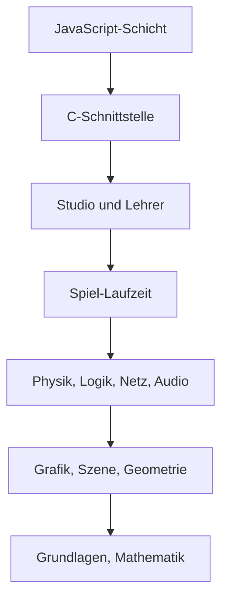

# 1 Willkommen in der Werkstatt

> **Dein Level:** Du betrittst Kern, eine echte 3D-Engine im Browser. Du erfährst, was darin
> steckt, nach welchen Regeln sie gebaut ist und wie du dieses Buch spielst.

Hallo und willkommen! Unter jedem Spiel steckt eine **Engine**, der Motor unter der Haube. Das
Spiel sagt nur: „Hier steht ein Auto, bei W fährt es.“ Zeichnen, Physik und Ton erledigt die Engine.

In diesem Buch nimmst du die Engine **Kern** auseinander. Auf
https://kernengine.de/ warten **Kern Studio**, ein Editor, in dem du Welten baust und
sofort spielst; die **Micro Duck**, ein zweibeiniger Roboter von Pollen Robotics, der in Kern mit
seinen echten, trainierten Netzen läuft; der **Lehrer**, der neue Netze für diesen Roboter
trainiert; dazu spielbare Levels wie **Orb Run** und **Physics Lab** und die C++-Beispiele `hello`
und `orbrun`.


> **Mission:** Öffne Kern Studio. Beim allerersten Start ist **Orb Run** geladen (sonst
> **File → Example Levels → Orb Run**). Drück **Play** (Alt+P), fahr mit dem Hovercar los und
> sammle Orbs. **Esc** beendet das Spiel.

## 1.1 Was Kern ist

Kern ist in **C++20** geschrieben. Browser verstehen kein C++, deshalb übersetzt der Werkzeugkasten
**wasi-sdk** Kern nach **WebAssembly**, einer Maschinensprache für Browser. Gezeichnet wird mit
**WebGL2**. Entstanden ist Kern aus dem Spiel **SpawnCity**, aber die Engine kennt SpawnCity nicht:
Spiele sprechen mit der Engine, nie umgekehrt.

| Teil | Was er macht |
|---|---|
| Grundlagen, Mathematik | Typen, Fehler, JSON, Vektoren |
| Renderer, Szene, Geometrie | zeichnen, Häuser, Straßen, Gelände |
| Physik (Box3D) | Stöße, Gelenke, Schwerkraft |
| Audio | Mixer, 3D-Klang, Stimme der Ente |
| Spiel-Laufzeit | Levels, Spieler, Regeln |
| Logik, Netzwerk | Bausteine, Mehrspieler |
| Studio, Lehrer | Editor und Trainer |
| JavaScript-Schicht | Brücke zum Browser |

## 1.2 Kerns Regeln

**Alles selbst gemacht.** Kern nutzt weder die Grafik-Engine three.js noch den Übersetzer
Emscripten. Der Renderer ruft WebGL2 direkt auf. Das Modul ist ein **Reactor**: kein Hauptprogramm,
sondern der Browser ruft einmal eine Startfunktion und danach, was er braucht. Weil Kern nur die
ältesten WebAssembly-Fähigkeiten nutzt, läuft es auf jedem WebGL2-Browser, sogar Safari ab 15.

**JavaScript ist nur der Kellner.** Grafikkarte, Tasten, Töne und Dateien erreicht
im Browser nur JavaScript. Genau das – und nur das – erledigt die JavaScript-Schicht. Selbst die Studio-Fenster
zeichnet sie nur nach Angaben des C++-Editors.

> **So kannst du es dir vorstellen:** Der Kellner bringt die Bestellung in die Küche und das Essen
> an den Tisch. Kochen tut er nicht. JavaScript ist der Kellner, C++ die Küche.

Alles, was ein Spiel tut, steht in C++ und lässt sich ohne Browser testen.

**Überall exakt gleich.** Eine Simulation oder ein Training kommt auf einem PC mit x86-Chip, einem
Mac mit ARM-Chip und im Browser **Bit für Bit** gleich heraus. Das heißt **Determinismus**. Dafür
zieht Kern `a*b+c` nie zu einem Rechenschritt zusammen, lässt Box3D ohne Spezialbefehle laufen,
bringt `sin`, `cos` und Co. selbst mit und rechnet beim Lernen unabhängig davon, wie viele Helfer
mitarbeiten ([Kapitel 3](03-grundlagen.md)). Ein **Fingerabdruck** prüft das auf drei Plattformen
([Kapitel 2](02-bauen-und-testen.md)).

> **Krass, aber wahr:** Weil Kern so exakt rechnet, ist ein Unterschied zwischen echtem Roboter und
> Simulation ein echter Modellfehler und kein Zufallsrauschen ([Kapitel 16](16-kalibrierung.md)).

**Noch mehr Regeln:**

- Keine Ausnahmen: Bei Fehlern gibt es `false` und eine Meldung.
- Kaputte Eingaben ändern nichts Bestehendes.
- JavaScript legt beim Zeichnen keinen neuen Speicher an.
- Keine Schummelei: Die Micro Duck steht nur durch Servos und Bodenkontakt.
- Editor, Spiel und Lehrer teilen Spielwelt, Servos und Physik.
- Verliert der Browser die Grafikkarte, baut Kern alles neu auf.

## 1.3 Der Bauplan: Stockwerke

Kern ist wie ein Hochhaus: Jedes Stockwerk benutzt nur die darunter.



Manche Stockwerke kommen nur per Schalter dazu: `--app` (Spiele ganz in C++), `--physics` (Box3D),
`--game` (bringt die Physik mit), `--studio` und `--lehrer` (bringen Spiel-Laufzeit und Physik mit).

Zwischen C++ und JavaScript gibt es nur eine Tür: den Speicher des Moduls. Der Browser legt dort
Zahlen ab und gibt der Engine die Adresse; Texte gehen als „Adresse plus Länge“. Umgekehrt ruft die
Engine Funktionen des Browsers auf, etwa zum Zeichnen oder für die Uhrzeit
([Kapitel 17](17-referenz.md)).

> **Vorsicht, Falle:** Wo welche Zahl liegt, ist auf beiden Seiten fest vereinbart. Ändert man es
> nur in C++, reden beide aneinander vorbei.

## 1.4 Vier Formen, ein Code

**Ein Spiel ganz in C++.** So stellt das kleinste Beispiel `hello` seinen Renderer ein:

```cpp
RendererOptions configure() override {
  RendererOptions o;
  o.shadows = true;
  o.shadow.resolution = 1024;
  o.shadow.extent = 40;
  return o;
}
```

Ein leerer Einstellungszettel `o`, Schatten an, Schattenkarte mit Auflösung 1024, die
40 Meter in jede Richtung abdeckt, Zettel abgeben. Danach ruft der Browser in jedem Bild `update()` auf
([Kapitel 12](12-eigene-spiele.md)). Das größere `orbrun` hat Stadt, Verkehr und Tag und Nacht.

**Nur der Renderer.** So nutzt SpawnCity Kern: JavaScript lädt das Modul und lässt es zeichnen
([Kapitel 4](04-grafik.md)).

**Studio und exportierte Spiele.** Das ganze Studio ist **eine** HTML-Datei, die offline per
Doppelklick läuft. **File → Package Game** macht aus deinem Level ebenfalls eine einzige HTML-Datei,
die mit denselben C++-Klassen spielt ([Kapitel 11](11-studio.md)).

**Der Lehrer.** Er trainiert Netze für die Micro Duck: als Programm auf allen Prozessorkernen oder
im Browser auf `/lehrer/`. Gleicher Startwert, gleich viele Enten – überall dasselbe Netz. Das
Studio lädt es wie Pollens Netze ([Kapitel 14](14-lehrer.md)).

In der Micro Duck greift alles ineinander: Modell von Pollen, Glieder aus Box3D-Körpern, Servos mit
Gerätemodell, Netze, die Kern selbst rechnet, Stimme aus dem Mixer, Logik-Bausteine der Kategorie
*Robots* – und im Studio ein Actor wie jeder andere.

> **Mission:** Lade **File → Example Levels → Micro Duck** und drück **Play**. Erst schaust du zu,
> wie die Ente allein herumläuft. **F8** übernimmt sie: **W** läuft, **A**/**D** drehen, die
> **Leertaste** quakt.

> **Mission:** Öffne von der Startseite aus den **Lehrer** und schau dich um.

## 1.5 Wo alles liegt

Der Quellcode ist offen: https://github.com/ChristianHohlfeld/kernengine.de (Apache License 2.0).

```
tools/        Studio bauen, Relay, Import
site/         Startseite
generated/    fertig gebaute Dateien
kern/         die Engine
  include/    Header      src/   Code
  web/        JavaScript  tests/ Tests
  examples/   hello, orbrun
  policies/   Kerns eigene Netze
  third_party/  Box3D, musl, Micro Duck
  docs/       Dokumente und Bücher
```

Für Physik und Micro Duck sind `kern/docs/physics.md` und `walker.md` verbindlich.

> **Vorsicht, Falle:** Die SpawnCity-Dateien aus `kern/README.md` liegen im SpawnCity-Repository.

## 1.6 So spielst du dieses Buch

**Jedes Kapitel ist ein Level.** Oben steht **Dein Level**. Es geht von unten nach oben: Bauen und
Grundlagen, Grafik bis Netzwerk, Studio und eigene Spiele, Micro Duck bis Kalibrierung, zum
Schluss die [Referenz](17-referenz.md). Drei Bonuslevel erklären neuronale Netze
([A](A-grundlagen-neuronale-netze.md)), Echtzeit-Grafik ([B](B-grundlagen-rendering.md)) und
Physik ([C](C-grundlagen-physik.md)).

| Kasten | Was drinsteht |
|---|---|
| **Mission** | Aufgabe im echten Studio |
| **So kannst du es dir vorstellen** | Vergleich aus dem Alltag |
| **Krass, aber wahr** | verblüffende Tatsache |
| **Vorsicht, Falle** | typischer Fehler |
| **Für Profis** | Ausblick für Neugierige |

Am Ende: **Level geschafft!** und die **Rätsel-Ecke**.

Abkürzungen: Kern ändern – 2 und 3 (vor Physik oder Roboter auch 6 und 13). Spiele bauen – 11
oder 12, dazu 8 und 9. Ente – 13, 14, 16. Kern in eine Webseite einbauen – 4 und 17.

**Drei Bücher, ein Inhalt.** Du liest das **gelbe Buch**. Das **grüne** erklärt alles einfach für
Erwachsene ohne Vorwissen, das **blaue** geht technisch bis ins letzte Detail und ist die Quelle für
alle drei. Packt dich ein Thema, schlag im blauen Buch nach!

> **Für Profis:** Der Code im Buch stammt aus dem echten Quelltext. Pfade gelten ab `kern/`, außer
> bei `tools/`, `site/` und `generated/`.

## Level geschafft!

- Du weißt, was eine Engine ist und was in Kern steckt.
- Du kennst C++20, WebAssembly und WebGL2 als Zutaten.
- Du weißt, warum JavaScript nur der Kellner ist.
- Du kennst Kerns Stockwerke und die vier Formen aus einem Code.
- Du hast Orb Run gespielt und die Micro Duck gesteuert.

## Rätsel-Ecke

1. Warum läuft Kern nicht direkt als C++ im Browser?
2. Du baust mit `--studio`. Was kommt automatisch mit?
3. **Boss-Rätsel:** Warum läuft ein im Lehrer trainiertes Netz im Studio genauso?

### Lösungen

1. Browser verstehen kein C++; wasi-sdk übersetzt es nach WebAssembly.
2. Spiel-Laufzeit (`--game`) und Physik (`--physics`).
3. Lehrer und Studio teilen Spielwelt, Servos und Physik, und Kern rechnet überall Bit für Bit
   gleich. Das Netz trifft auf genau dieselbe Welt.

---

© 2026 Christian Heinrich Hohlfeld · Alle Rechte vorbehalten · [Impressum und Rechte](00-impressum.md)
