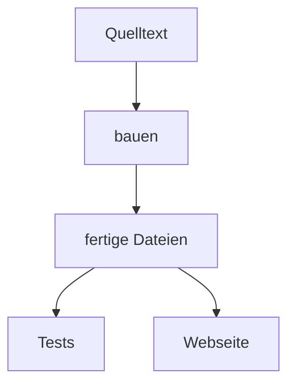

# 2 Bauen, prüfen, beweisen

> **Dein Level:** Hier wird aus Quelltext eine laufende Engine – und du siehst, wie Kern sich selbst
> überwacht: mit Tausenden Prüfungen, einem Roboter, der das Studio durchklickt, und einem
> Fingerabdruck, der jedes falsche Bit verrät.

> **Wörter, die du brauchst:**
> - **Quelltext** – der Text eines Programms, so wie Menschen ihn schreiben.
> - **Compiler** – ein Übersetzer-Programm: Es macht aus Quelltext Befehle, die ein Computer ausführen
>   kann.
> - **Modul** – die fertig übersetzte Datei von Kern, die der Browser lädt.
> - **Prozessor** – das Rechenwerk im Computer. Moderne Prozessoren haben mehrere **Kerne**, die
>   gleichzeitig rechnen können. Nicht verwechseln: Diese Prozessorkerne haben mit der Engine Kern
>   nichts zu tun, sie heißen nur zufällig fast gleich.
> - **Speicher** – der Arbeitsplatz des Computers, auf dem ein Programm seine Zahlen ablegt.
> - **Actor** – ein Ding in einem Level von Studio, etwa ein Würfel, eine Lampe oder die Ente.
> - **GitHub** – eine Webseite, auf der der Quelltext von Kern liegt und von der aus Änderungen
>   geprüft und veröffentlicht werden.

Stell dir vor, du änderst eine Zeile in der Physik. Stolpert die Micro Duck jetzt nach drei
Sekunden? Läuft das Studio noch auf dem Handy? Rechnet der Mac noch wie der PC? Von Hand kann das
niemand nach jeder Änderung prüfen. Deshalb schreiben Profis **Tests**: Programme, die das jedes
Mal automatisch in Minuten erledigen.

## 2.1 Der Überblick

Zwischen dem Quelltext und der Engine in deinem Browser liegen zwei Arbeitsgänge: **bauen** und
**prüfen**. Bauen heißt, den Quelltext in fertige Dateien zu übersetzen. Prüfen heißt, mit Tests
nachzuweisen, dass diese Dateien auch richtig arbeiten.

> **So kannst du es dir vorstellen:** eine Bäckerei. Das Rezept ist der Quelltext. Der Ofen macht
> daraus einen Kuchen – das ist das Bauen. Bevor der Kuchen in den Laden kommt, probiert ein
> Vorkoster jedes Stück – das sind die Tests.

Kern baut drei Dinge: das Modul für den Browser, das ganze Studio als eine einzige Datei und den
Lehrer als eigenes Programm. Geprüft wird auf drei Arten: mit vielen kleinen Tests, mit einem
Roboter, der das Studio im Browser bedient, und mit dem Fingerabdruck der Ente.

Die genauen Befehle, Pfade und Einstellungen stehen im blauen Buch, Kapitel 2.

## 2.2 Der Werkzeugkasten

Ein **Compiler** ist ein Übersetzer: Er liest C++ und schreibt Maschinensprache. Für den Browser
braucht Kern einen besonderen Compiler, der WebAssembly schreibt. Für die Tests und den Lehrer, die
direkt auf deinem Computer laufen, reicht ein gewöhnlicher Compiler, wie ihn jeder Programmierer
hat. Kern benutzt dafür nur einfache, frei verfügbare Werkzeuge und keinen großen Fremdbaukasten.

> **Für Profis:** Der Werkzeugkasten heißt wasi-sdk (Version 25). Welche Programme und Versionen
> außerdem nötig sind, steht im blauen Buch, Kapitel 2.

## 2.3 Das Modul bauen

**Bauen nach Bedarf.** Beim Übersetzen sagt man, welche Stockwerke aus
[Kapitel 1](01-einfuehrung.md) ins Modul sollen: nur Grafik, dazu Physik, dazu Spielregeln, Studio
oder Lehrer. Ein Spiel kann seinen eigenen Quelltext gleich mit übersetzen lassen.

**Strenge Regeln beim Übersetzen.** Ein Compiler darf normalerweise ein bisschen tricksen, um
schneller zu werden, zum Beispiel zwei Rechenschritte zu einem zusammenziehen. Kern verbietet ihm
das. Dadurch rechnet jeder Rechner exakt gleich. Warum zwei Schritte statt einem einen Unterschied
machen, rechnest du in [Kapitel 3](03-grundlagen.md) selbst nach.

Aus demselben Grund verzichtet die Physik auf ihren Turbo-Weg. Sie hätte einen eigenen Rechenweg,
der mit Spezialbefehlen mancher Prozessoren mehrere Zahlen auf einmal rechnet. Im Browser gibt es
diesen Weg nicht. Darum schaltet Kern ihn überall ab, und die Physik rechnet auf jedem Rechner auf
demselben einfachen Weg.

**Der Zwischenspeicher.** Kern besteht aus vielen Dutzend Quelltext-Dateien. Alle zu übersetzen
dauert eine ganze Weile. Darum übersetzt Kern jede Datei einzeln, viele gleichzeitig auf allen
Prozessorkernen, und legt das Ergebnis in einem **Zwischenspeicher** ab. Beim nächsten Bauen
schaut Kern nach: Hat sich diese Datei geändert? Wenn nein, nimmt es das fertige Teil aus dem
Zwischenspeicher. Nur Geändertes wird neu übersetzt. Studio und die Beispielspiele teilen sich dabei
die fertigen Teile der Engine.

> **So kannst du es dir vorstellen:** dein Hausaufgabenordner. Ändert sich eine Aufgabe, schreibst
> du nur diese Seite neu ab, nicht den ganzen Ordner. Ändert sich aber die Vorlage, nach der alle
> Seiten gemacht sind, schreibst du sicherheitshalber alles neu.

Woran erkennt Kern „geändert“? Aus dem Inhalt einer Datei entsteht eine Kennzahl, ein **Hash**
(mehr dazu in 2.9). Ändert sich auch nur ein Zeichen, ändert sich die Kennzahl.

> **Vorsicht, Falle:** Manche Dateien benutzen fast alle anderen, wie die Vorlage. Ändert man so
> eine gemeinsame Datei, baut Kern alles neu. Das ist Absicht: lieber eine Minute länger warten als
> mit einem veralteten Teil weiterarbeiten.

## 2.4 Studio in einer Datei

Eine Webseite besteht normalerweise aus vielen Dateien: Text, Aussehen, Programme, Bilder. Für Studio
werden alle diese Teile, samt dem übersetzten Modul, in **eine einzige** Datei gepackt. Das Modul wird
dafür in gewöhnliche Buchstaben umgeschrieben, denn es besteht aus rohen Zahlen, und eine Webseite
darf nur Text enthalten. Darum läuft Studio auch ohne Internet per Doppelklick. Studio legt sich
außerdem die Bauteile für fertige Spiele gleich mit in die Datei, damit es daraus dein exportiertes
Spiel packen kann.

> **So kannst du es dir vorstellen:** ein Umschlag, in dem Brief, Fotos und Bastelanleitung stecken.
> Wer den Umschlag hat, hat alles und muss nichts nachbestellen.

> **Für Profis:** Webseiten markieren Programmteile mit `` am Ende,
> wie Klammern. Steht diese Endmarke zufällig mitten im eingepackten Programm, hielte der Browser es
> dort für beendet. Deshalb bricht das Bauen in diesem Fall mit einer Meldung ab.

## 2.5 Der Lehrer als Programm

Das Training der Ente dauert lange. Deshalb gibt es den Lehrer nicht nur im Browser, sondern auch als
eigenes Programm für Rechner mit Linux (einem Betriebssystem wie Windows) und für Macs. Als Programm
nutzt er alle Kerne des Prozessors und malt kein einziges Bild – das spart viel Zeit. So kann er
sogar auf einem Server, einem Computer im Rechenzentrum ohne Bildschirm, trainieren.

Der Compiler darf dabei die schnellsten Befehle des jeweiligen Prozessors benutzen. Ist das nicht
Tricksen, das in 2.3 verboten wurde? Nein. Verboten ist, die **Rechenschritte** zu ändern, also etwa
zwei zu einem zusammenzuziehen. Erlaubt ist, dieselben Schritte mit schnelleren Befehlen
auszuführen. Darum bleibt das Ergebnis Bit für Bit gleich.

> **So kannst du es dir vorstellen:** eine Matheaufgabe. Du darfst mit einem schnelleren Stift
> schreiben. Aber du musst dieselben Rechenschritte in derselben Reihenfolge machen und an denselben
> Stellen runden. Dann steht unten dasselbe Ergebnis wie bei deinem Banknachbarn.

## 2.6 Unit-Tests: Tausende kleine Fragen

Ein **Unit-Test** ist eine Frage an ein kleines Stück Kern, auf die es genau eine richtige Antwort
gibt. „Was ergibt 2 + 3?“ – „5.“ Stimmt die Antwort, ist der Test bestanden. Kern hat Tausende solcher
Prüfungen, von der Mathe bis zum Studio. Ein paar Fragen, die Kern sich wirklich stellt:

- Steht die Micro Duck, läuft sie und dreht sie sich mit ihrem Netz?
- Lernt der Lehrer eine einfache Aufgabe?
- Kommt eine Nachricht im Mehrspieler-Modus an, auch wenn das Netzwerk schlecht ist?

Bei Kommazahlen fragt ein Test manchmal „ungefähr gleich?“, weil Computer runden (siehe
[Kapitel 3](03-grundlagen.md)). Das widerspricht dem „Bit für Bit gleich“ aus Kapitel 1 nicht:
Hier wird mit dem mathematisch **richtigen** Ergebnis verglichen, nicht mit einem anderen Rechner.
Ein Beispiel: Der Test fragt „Ist 1 : 3 ungefähr 0,333?“ Ob der Computer genau 0,3333333 oder
0,3333334 herausbekommt, ist ihm egal. Dass jeder Rechner **dieselbe** dieser beiden Zahlen bekommt,
prüft dagegen der Fingerabdruck in 2.9. Am Ende meldet der Test, wie viele Prüfungen es gab und wie viele
gescheitert sind, mit der genauen Stelle im Quelltext. Das kleine Testgerüst hat Kern selbst
geschrieben.

**Extra-Prüfer.** Während der Tests laufen zwei Aufpasser mit, die man **Sanitizer** nennt:

- Der erste merkt, wenn ein Programm über den Rand seines Speicherbereichs greift. Das ist, als
  würdest du in einer Tabelle mit 10 Zeilen die Zeile 11 lesen: Dort steht irgendetwas, nur nicht
  das, was du suchst.
- Der zweite fängt verbotene Rechnungen, zum Beispiel einen **Zahlenüberlauf**. Das ist wie ein
  Kilometerzähler mit fünf Stellen, der nach 99 999 plötzlich wieder 00 000 zeigt.

Findet einer der beiden etwas, bricht der Test sofort ab. Außerdem gilt beim Testen: Jede
**Warnung** des Compilers zählt als Fehler. Eine Warnung ist ein Hinweis des Übersetzers: „Das sieht
verdächtig aus.“

> **So kannst du es dir vorstellen:** ein Schiedsrichter mit Videobeweis. Im Spiel übersieht man
> ein kleines Foul vielleicht. Der Videobeweis sieht jedes.

**Die Grafik-Attrappe.** Die Tests laufen ohne Browser, also auch ohne Grafikkarte. Eine
**Attrappe** spielt deshalb die Grafikkarte: Sie zeichnet nichts, schreibt aber genau mit, was die
Engine von ihr verlangt. So prüft man, ob die Engine die richtigen Befehle gibt. Die Attrappe kann
sogar so tun, als hätte der Browser die Grafikkarte kurz weggenommen, damit man testet, ob Kern
danach alles wieder aufbaut. Auch der Lehrer benutzt sie, denn er zeichnet ja nichts.

> **So kannst du es dir vorstellen:** ein Crash-Test-Dummy. Er fährt nicht selbst Auto, aber die
> Sensoren in ihm verraten genau, was bei einem Unfall passieren würde.

## 2.7 Logik: drei Wege, ein Ergebnis

In Studio kannst du Spielabläufe aus Bausteinen zusammenstecken, zum Beispiel „Wenn der Spieler die
Tür berührt, geht sie auf“. So ein Ablauf heißt **Logik** ([Kapitel 9](09-logik.md)). Kern kann ihn
auf drei Wegen ausführen:

1. Schritt für Schritt vorlesen und ausführen (der langsamste Weg),
2. beim Spielen blitzschnell in Maschinensprache übersetzen und dann ausführen,
3. als C++-Quelltext ausgeben, der fest in ein Spiel eingebaut wird.

> **So kannst du es dir vorstellen:** ein Rezept. Du kannst es beim Kochen vorlesen, es dir vorher
> einprägen oder es gedruckt einem Freund mitgeben. Der Kuchen muss jedes Mal gleich schmecken.

Genau das prüfen die Logik-Tests: Dieselben kleinen Abläufe laufen auf allen drei Wegen, und alle
müssen Bit für Bit dasselbe Ergebnis liefern.

## 2.8 Der Roboter, der das Studio bedient

Ein Testprogramm steuert einen echten Browser und klickt sich wie ein Mensch durch alles Wichtige im
Studio, auch im Handy-Format.

Der Testcomputer hat keine Grafikkarte. Also muss der Prozessor mühsam selbst zeichnen und schafft
nur etwa **ein Bild pro Sekunde**. Darum
wartet jede Prüfung auf ihre **Wirkung** statt auf eine feste Zeit: „Warte, bis das Menü offen ist“
statt „Warte zwei Sekunden“. Und um zu prüfen, ob wirklich etwas gezeichnet wurde, zählt der Test,
wie viele verschiedene Farben im Bild sind. Ein leeres Fenster hätte fast nur eine.

> **So kannst du es dir vorstellen:** Du wartest auf den Bus, bis er da ist, nicht genau fünf
> Minuten. Kommt er früher, steigst du früher ein. Kommt er später, stehst du nicht umsonst an
> einer leeren Straße.

Auf Wunsch macht der Test Bildschirmfotos. Einige davon siehst du in diesem Buch.

> **Mission:** Sei selbst der Test-Roboter! Halte im Studio die rechte Maustaste und drück **W**
> zum Fliegen. Klick einen Actor an und drück **F**, das heißt **Auswahl fokussieren** (Focus
> Selection): Die Kamera fliegt zu ihm. Drück dann **Spielen** (Play) (Alt+P): Du spielst selbst mit.
> **Esc** stoppt. Drück **Simulieren** (Simulate) (Alt+S): Jetzt läuft nur die Physik, und du schaust
> mit freier Kamera zu. **Esc**. Alles geklappt? Test bestanden.

> **Mission:** Öffne die **Inhaltsablage** (Content Drawer) mit dem Knopf ganz links in der
> Statusleiste (unter Windows und Linux geht auch Strg+Leertaste; auf dem Mac nimm lieber den Knopf,
> weil der Mac diese Tasten oft selbst benutzt). Klick **Würfel** (Cube) an. Drück jetzt **W**,
> diesmal ohne rechte Maustaste: Dann heißt W nicht „fliegen“, sondern Werkzeug **Verschieben (W)**
> (Move (W)). Am Würfel erscheinen farbige Pfeile. Zieh dreimal mit der linken Maustaste an einem
> Pfeil, um ihn zu verschieben. Öffne **Bearbeiten › Verlauf...** (Edit › History...) und klick auf
> einen früheren Schritt.
> Das Studio springt exakt dorthin. Auch das prüfen Kerns Tests: Rückgängig muss jedes Mal genau
> denselben Zustand zurückbringen.

## 2.9 Der Fingerabdruck

Jetzt das Herzstück: Wie beweist man, dass Mac, PC und Browser die Micro Duck **genau** gleich
simulieren?

Kern lässt die Ente mit einem Laufnetz von Pollen erst geradeaus gehen und sich dann auf der Stelle
drehen. Nach jedem **Regeltakt** (so heißt jeder Moment, in dem das Netz neu entscheidet; das passiert
50-mal pro Sekunde in der Zeit der echten Ente) nimmt Kern alle Zahlen, die die Ente beschreiben: Position,
Drehung, Geschwindigkeiten, alle Gelenkwinkel. Daraus macht es eine kurze Kennung aus Buchstaben und
Ziffern, einen **Hash**. Ändert sich ein einziges Bit irgendwo in diesen Zahlen, kommt eine völlig
andere Kennung heraus.

> **So kannst du es dir vorstellen:** Ein Fingerabdruck verrät einen Menschen, ohne ihn ganz zu
> beschreiben. Hier verrät eine Zeile Buchstabensalat den kompletten Zustand der Ente.

> **Für Profis:** Kern rechnet die Ente vierfach vergrößert und dafür doppelt so langsam
> ([Kapitel 6](06-physik.md), Abschnitt 6.2). In der Simulationszeit sind es deshalb 25 Regeltakte
> pro Sekunde, für die echte Ente 50.

Warum genügt nicht etwas Einfaches wie die Quersumme? Probier es aus: 1234 hat die Quersumme
1 + 2 + 3 + 4 = 10. Die Zahl 1243 hat aber auch die Quersumme 10. Die Quersumme bemerkt also nicht,
dass zwei Ziffern vertauscht wurden. Ein guter Hash mischt die Zahlen so gründlich, dass schon die
kleinste Änderung oder Vertauschung eine ganz andere Kennung ergibt.

Für 400 Regeltakte, also 8 Sekunden im Leben der echten Ente (400 : 50 = 8), ist die richtige Kennung jedes Takts
als **Referenz** gespeichert. Verglichen wird auf drei Arten: auf einem PC, im Browser und auf einem
Mac, dessen Rechenwerk ganz anders gebaut ist als das im PC. Stimmen alle 400 Kennungen überein,
rechnen alle exakt gleich.

Weicht etwas ab, gibt es zwei Möglichkeiten:

- Jemand hat die Simulation **absichtlich** geändert. Dann bekommt sie eine neue Referenz, mit
  Begründung.
- Irgendwo rechnet ein Stück Code **nicht überall gleich**. Zum Beispiel benutzt es eine
  Rechenfunktion des Computers, die an der letzten Stelle anders rundet, oder es zieht zwei
  Rechenschritte zusammen. Oder es zählt Zahlen in einer Reihenfolge zusammen, die davon abhängt,
  wie viele Helfer gerade gleichzeitig rechnen (etwa auf mehreren Prozessorkernen aus dem
  Wörterkasten). Warum die Reihenfolge zählt, zeigt
  [Kapitel 3](03-grundlagen.md).

Darum gibt es noch einen zweiten Test: Der Lehrer lernt dieselbe Aufgabe mehrmals, jedes Mal mit
unterschiedlich vielen Helfern, die gleichzeitig rechnen. Am Ende müssen alle Netze bis aufs letzte
Bit gleich sein.

> **Krass, aber wahr:** Geprüft wird jeder einzelne der 400 Takte. Weicht einer ab, nennt der Test
> den ersten abweichenden Takt. So findet man die Stelle, an der die Rechnung zum ersten Mal
> auseinanderläuft.

Den Befehl, mit dem man den Fingerabdruck selbst vergleicht, findest du im blauen Buch, Kapitel 2.

## 2.10 Die CI: der unermüdliche Prüfer

**CI** steht für *Continuous Integration*, auf Deutsch etwa „ständiges Zusammenführen“. Jedes Mal,
wenn jemand eine Änderung an Kern auf GitHub hochlädt, startet ein Computer im Internet automatisch
alle Arbeitsgänge: bauen, testen, veröffentlichen. Niemand muss daran denken.

> **So kannst du es dir vorstellen:** ein Fließband mit Qualitätskontrolle. Jedes neue Teil läuft
> durch dieselben Stationen. Ist ein Teil fertig gebaut, kommt es schon in den Laden, während die
> Kontrolle es noch prüft. Findet sie etwas, sieht man das sofort und bessert nach.

- **Tests mit Prüfern:** alle Unit-Tests mit den Sanitizern.
- **Fingerabdruck auf dem Mac:** Den Fingerabdruck rechnet der Lehrer aus. Darum wird der Lehrer auf
  einem Mac gebaut und muss die Ente genauso bewegen wie PC und Browser.
- **Bauen:** Studio, Beispiele und Lehrer werden gebaut (mit dem Zwischenspeicher aus 2.3). Lehrer
  und Logik werden dabei auch in ihrer Browser-Form getestet, und die Webseite wird zusammengestellt.
- **Veröffentlichen:** Die fertige Seite erscheint auf https://kernengine.de/.
- **Roboter im Browser:** der Test aus 2.8, und zwar mit genau den Dateien, die veröffentlicht werden.

Die Seite geht online, sobald das Bauen fertig ist. Die Tests laufen gleichzeitig weiter und halten
das nicht auf. Das ist ein bewusster Kompromiss: Ein ganzer Durchlauf dauert gut eine Viertelstunde,
und so ist eine Änderung schneller bei dir. Meldet ein Test danach einen Fehler, sieht man es sofort
und bessert nach.

Veröffentlicht wird aber nur, was schon im **Hauptstand** von Kern angekommen ist. Schlägt jemand
eine Änderung erst vor (das heißt auf GitHub **Pull Request**), baut und prüft die CI sie genauso,
veröffentlicht sie aber nicht. So kommt ein Vorschlag nie ungeprüft auf die Webseite.

> **Mission:** Öffne das veröffentlichte Studio und schau unten rechts in die Statusleiste. Dort
> steht „v“ und sieben Zeichen: der Anfang der **Build-Kennung**, die die CI beim Veröffentlichen
> in die Seite geschrieben hat. Damit weißt du immer, welche Version du gerade benutzt. Meldest du
> einen Fehler, kann man mit dieser Kennung genau die Änderung finden, aus der deine Version stammt.

## 2.11 Selbst bauen

Alles, was die CI tut, kann man auch zu Hause auf dem eigenen Computer tun, in derselben Reihenfolge:
erst die Tests, dann den Fingerabdruck, dann bauen und zum Schluss der Roboter im Browser. Und wenn
etwas klemmt, sagt dir die Meldung meistens schon, wo: welcher Test, welche Zeile, welcher Takt.

Die genauen Befehle, Pfade und eine Tabelle mit typischen Fehlern und ihrer Abhilfe stehen im blauen
Buch, Kapitel 2.

## Level geschafft!

- Du weißt, warum Profis jede Änderung automatisch testen.
- Du weißt, was „übersetzen“ heißt und wie der Zwischenspeicher Zeit spart.
- Du weißt, dass ein Test eine Frage mit fester Antwort ist.
- Du weißt, was Sanitizer und die Grafik-Attrappe tun.
- Du weißt, warum der Test-Roboter auf Wirkungen wartet statt auf Zeit.
- Du verstehst den Fingerabdruck und warum ein Bit zählt.
- Du weißt, wie die CI als Fließband jede Änderung prüft und veröffentlicht.

## Rätsel-Ecke

1. Du änderst eine einzige Datei, die sonst niemand benutzt. Warum geht das nächste Bauen viel
   schneller als das erste?
2. Warum wartet der Browser-Test auf Wirkungen statt auf feste Zeiten?
3. **Boss-Rätsel:** Der Fingerabdruck weicht auf dem Mac ab Takt 212 ab, obwohl niemand die
   Simulation absichtlich geändert hat. Nenne zwei mögliche Gründe, warum ein Computer anders rechnen
   könnte.

### Lösungen

1. Der Zwischenspeicher hat alle anderen Dateien schon fertig übersetzt. Kern übersetzt nur die eine
   geänderte Datei neu.
2. Ohne Grafikkarte zeichnet der Testcomputer etwa ein Bild pro Sekunde. Eine feste Zeit wäre mal zu kurz,
   mal Verschwendung.
3. Zum Beispiel: Eine Rechenfunktion des Computers rundet an der letzten Stelle anders. Oder zwei
   Rechenschritte wurden zu einem zusammengezogen. Oder Zahlen werden in einer Reihenfolge
   zusammengezählt, die davon abhängt, wie viele Helfer mitrechnen.

---

© 2026 Christian Heinrich Hohlfeld · Alle Rechte vorbehalten · [Impressum und Rechte](00-impressum.md)
