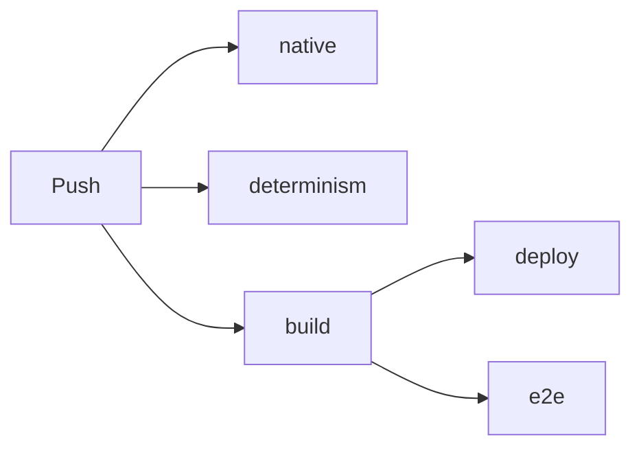

# 2 Bauen, prüfen, beweisen

> **Dein Level:** Hier wird aus Quelltext eine laufende Engine – und du siehst, wie Kern sich selbst
> überwacht: mit Tausenden Prüfungen, einem Roboter, der das Studio durchklickt, und einem
> Fingerabdruck, der jedes falsche Bit verrät.

Stell dir vor, du änderst eine Zeile in der Physik. Stolpert die Micro Duck jetzt nach drei
Sekunden? Läuft das Studio noch auf dem Handy? Rechnet der Mac noch wie der PC? Von Hand kann das
niemand nach jeder Änderung prüfen. Deshalb schreiben Profis **Tests**: Programme, die das jedes
Mal in Minuten erledigen.

## 2.1 Der Überblick

Zum **Bauen** gibt es drei Skripte: `kern/build.sh` (ein WebAssembly-Modul),
`tools/build_studio.sh` (das Studio als eine Datei) und `kern/tools/lehrer.sh` (der Lehrer als
Programm). Zum **Prüfen** gibt es die Unit-Tests `kern/tests/run.sh`, zwei Tests unter Node (Logik
und Lehrer im Modul) und den Browser-Test. Der kürzeste Weg:

```sh
export WASI_SDK=/opt/wasi-sdk-25.0-x86_64-linux
tools/build_studio.sh
CXX=g++ CC=gcc kern/tests/run.sh
```

Zeile 1 sagt, wo der Werkzeugkasten liegt, Zeile 2 baut `generated/studio.html`, das danach offline
per Doppelklick läuft, Zeile 3 startet alle Unit-Tests. Zum Entwickeln liefert man den
Repository-Ordner mit einem kleinen Webserver aus und öffnet `kern/web/studio/index.html`.
`play.html?level=orbRun` spielt ein Level ohne Editor (auch `physicsLab`, `shootingRange`,
`microDuck`, `basic`).

## 2.2 Der Werkzeugkasten

Kern braucht **wasi-sdk 25**: Compiler clang, Linker wasm-ld und Bibliotheken für WebAssembly,
kein Emscripten. `WASI_SDK` zeigt auf den Ordner (sonst `/opt/wasi-sdk`). Für Tests und Lehrer
reicht ein normaler Compiler (GCC, Clang, Apple clang). Dazu `python3` fürs Studio, Node (die CI
nimmt Node 22) und Playwright mit Chromium für den Browser-Test.

## 2.3 Das Modul bauen

Ohne Schalter baut `kern/build.sh` den Grundstock; `--app`, `--physics`, `--game`, `--studio` und
`--lehrer` fügen Stockwerke hinzu ([Kapitel 1](01-einfuehrung.md)). Argumente auf `.cpp` oder `.cc`
werden als Spielquellen mitübersetzt, andere gehen als Optionen an den Compiler. Variablen:
`KERN_BUILD=debug` optimiert weniger (Debug-Infos wirft der Linker trotzdem immer heraus),
`KERN_JOBS` regelt die Parallelität, `KERN_OBJ_CACHE` den Zwischenspeicher.

Die Optionen sind streng: `-ffp-contract=off` überall ([Kapitel 3](03-grundlagen.md)), Box3D im
einfachen Skalar-Pfad, musl genauso streng, C++ ohne Ausnahmen und RTTI, nach außen sichtbar nur, was markiert
ist, Ungenutztes fliegt raus. Das Modul wird ein Reactor mit 1 MiB Stack, 32 MiB Startspeicher
(höchstens 2 GiB) und einer wachsbaren Funktionstabelle, in die der Logik-JIT seine Graphen legt
([Kapitel 9](09-logik.md)). Zum Schluss: `built <out> (<n> bytes)`.

Jede Quelle wird parallel übersetzt und gespeichert; Studio und Beispiele teilen sich die Objekte.
Der Schlüssel eines Objekts enthält Quellpfad, Quellinhalt und den Inhalt **aller** Header.

> **Vorsicht, Falle:** Ein geänderter Header baut alles neu. Das ist Absicht: einfach und sicher.

## 2.4 Studio in einer Datei

`tools/build_studio.sh` baut erst `generated/kern_studio.wasm` (mit `--skip-wasm` nimmt es ein
vorhandenes). Dann klebt ein Python-Teil alles in eine Seite: Stylesheet, das Modul als base64-Text
und die vier JavaScript-Dateien als **ein** eingebettetes Skript. Darum läuft sie auch unter
strengen Sicherheitsregeln. `kern.mjs` und `game.mjs` liegen zusätzlich als Text darin – daraus
schreibt das Studio exportierte Spiele.

> **Krass, aber wahr:** Enthält eine Quelle die Zeichen `</script`, bricht der Build ab. Der Browser
> würde dort das eingebettete Skript für beendet halten.

## 2.5 Der Lehrer als Programm

`kern/tools/lehrer.sh` baut `kern_lehrer` für Linux und macOS, x86 und ARM, voll optimiert, aus
allen Quellen außer Studio und App plus der WebGL-Attrappe (der Lehrer zeichnet nichts). Mit
`KERN_NATIVE=1` nutzt der Compiler die besten Befehle des Prozessors – das Ergebnis bleibt gleich,
weil `-ffp-contract=off` gilt ([Kapitel 14](14-lehrer.md), [Kapitel 17](17-referenz.md)).

## 2.6 Unit-Tests: Tausende kleine Fragen

`kern/tests/run.sh` startet alle Tests, `kern/tests/run.sh micro_duck` nur die, deren Name
`micro_duck` enthält. Ein Test ist eine Frage mit fester Antwort. `CHECK(...)` prüft sie,
`CHECK_NEAR(a, b, eps)` prüft „ungefähr gleich“. Am Ende steht `<n> checks, <m> failures`, bei
Fehlern mit Datei und Zeile. Das kleine Testgerüst hat Kern selbst geschrieben. Ein paar echte
Namen: `micro_duck_stands_walks_and_turns_on_its_policy`, `lehrer_ppo_learns_to_reach`,
`net_reliable_channel_under_bad_network`. Getestet wird alles von Mathe bis Studio.

**Sanitizer.** Kerns Code wird für die Tests mit **AddressSanitizer** übersetzt, der merkt, wenn
Code über den Rand eines Speicherbereichs greift, und mit **UndefinedBehaviorSanitizer**, der
„undefiniertes Verhalten“ wie einen Zahlenüberlauf erwischt und sofort abbricht. Box3D und musl
laufen ohne. Dazu gilt `-Werror`: Jede Warnung stoppt den Testbuild.

> **So kannst du es dir vorstellen:** Ein Schiedsrichter mit Videobeweis. Im Spiel übersieht man
> ein kleines Foul vielleicht. Der Videobeweis sieht jedes.

**Die GL-Attrappe.** Ohne Browser kein WebGL. `gl_stub.cpp` spielt die Grafikkarte und schreibt mit,
was der Renderer verlangt. So lässt sich der Renderer sogar beim Grafikabsturz testen.

## 2.7 Logik: drei Wege, ein Ergebnis

Ein Logik-Graph läuft im **Interpreter**, als **JIT** oder als **exportiertes C++**
([Kapitel 9](09-logik.md)). Alle drei müssen Bit für Bit dasselbe liefern. `run.sh` prüft den
Interpreter und (nur ohne Filter) das exportierte C++; den JIT testet die CI unter Node, genau wie
im Browser, und misst nebenbei eine Million Schleifendurchläufe in beiden Stufen.

## 2.8 Der Roboter, der das Studio bedient

`kern/tests/e2e/studio_e2e.mjs` steuert einen echten Chromium-Browser und klickt sich durch das
Studio: Menüs, Fliegen, Auswählen, Play, Simulate, Undo, vier Viewports, Logik-Editor, Micro Duck
mit Kopfkamera, Mehrspieler über zwei Tabs, Spiel packen und spielen, alles auch im
Telefon-Format.

Die Grafik rechnet er ohne Grafikkarte, mit etwa **einem Bild pro Sekunde**. Darum wartet jede
Prüfung auf ihre Wirkung statt auf eine feste Zeit, und `ink()` zählt die Farben im Bild, um zu
sehen, ob wirklich gezeichnet wurde. Screenshots entstehen nur, wenn `KERN_E2E_SHOTS` einen Ordner
nennt. Einige davon siehst du in diesem Buch.

> **Mission:** Sei selbst der Test-Roboter! Halte im Studio die rechte Maustaste und drück **W**
> zum Fliegen. Klick einen Actor an, drück **F**, dann **Play** (Alt+P), **Esc**, **Simulate**
> (Alt+S), **Esc**. Alles geklappt? Check bestanden.

> **Mission:** Öffne den Content Drawer (Ctrl+Space), klick **Cube** an und verschieb ihn mit dem
> Move-Werkzeug (**W**) dreimal. Öffne **Edit → History...** und klick auf einen früheren Schritt.
> Das Studio springt exakt dorthin.

## 2.9 Der Fingerabdruck

Jetzt das Herzstück: Wie beweist man, dass Mac, PC und Browser die Micro Duck **genau** gleich
simulieren?

Kern lässt die Ente mit Pollens Laufnetz `velstand` laufen: 150 Takte geradeaus, dann dreht sie
sich auf der Stelle. Nach jedem Regeltakt wirft Kern Position, Drehung, Geschwindigkeiten und alle
Gelenkwinkel in einen **Hash** (FNV-1a). Der macht aus vielen Zahlen eine kurze Kennung. Ändert sich
ein einziges Bit, kommt eine völlig andere heraus.

> **So kannst du es dir vorstellen:** Ein Fingerabdruck verrät einen Menschen, ohne ihn ganz zu
> beschreiben. Hier verrät eine Zeile Buchstabensalat den kompletten Zustand der Ente.

Die Referenz für 400 Takte steht in `kern/tests/determinism_fingerprint.txt` und beginnt so:

```
0 7588b1a57dfadf95
1 46e1d239a7ed5cfe
```

Verglichen wird dreimal: mit GCC auf x86 samt Sanitizern, im WebAssembly-Modul unter Node und mit
Apple clang auf ARM. Von Hand:

```sh
kern/build/kern_lehrer --fingerprint 400 \
  | diff - kern/tests/determinism_fingerprint.txt
```

Der Lehrer gibt 400 Fingerabdrücke aus, `diff` vergleicht sie. Keine Ausgabe heißt: alles gleich.

Weicht etwas ab, wurde entweder die Simulation absichtlich geändert (dann neue Referenz, mit
Begründung) oder Code rechnet plattformabhängig: `std::sin` statt `kern::dm::sin`, eine fehlende
`-ffp-contract=off`-Option, eine Summe, deren Reihenfolge von der Thread-Zahl abhängt. Ein zweiter
Test lernt mit 1, 2 und 4 Workern (zusammen 8 Enten) und vergleicht die Netze Byte für Byte.

> **Krass, aber wahr:** In einer Robotersimulation wird aus einem falschen Bit binnen Sekunden ein
> anderer Gang. Ohne Fingerabdruck würde das niemand merken.

## 2.10 Die CI: der unermüdliche Prüfer

Die **CI** (`.github/workflows/ci.yml`) läuft bei jedem Push auf `main`, bei Pull Requests und auf
Knopfdruck:



- **native:** alle Unit-Tests mit Sanitizern.
- **determinism:** Lehrer mit Apple clang auf ARM bauen, Fingerabdruck vergleichen.
- **build:** Studio, Beispiele und Lehrer bauen (mit Cache), JavaScript-Syntax prüfen, Lehrer im
  Modul testen (zwei Enten sammeln, ein Lerner, ein PPO-Schritt, ONNX-Export, Fingerabdruck),
  Logik-JIT testen, Webseite samt Build-Kennung und Netzen zusammenstellen.
- **deploy:** nur auf `main`; schiebt die Seite in den Branch `gh-pages`, und sie erscheint auf
  https://kernengine.de/.
- **e2e:** der Browser-Test mit Playwright 1.56.0 auf den veröffentlichten Dateien.

Auf `main` läuft jeder Push zu Ende, damit jeder grüne Stand online geht; ein Lauf dauert etwa
17 Minuten.

> **Mission:** Öffne das veröffentlichte Studio und schau unten rechts in die Statusleiste. Dort
> steht „v“ und sieben Zeichen: der Anfang der Build-Kennung, die die CI beim Veröffentlichen in
> die Seite geschrieben hat.

> **Für Profis:** Die `README.md` nennt noch eine `pages.yml`. Die gibt es nicht; das erledigt der
> Job `deploy`.

## 2.11 Zu Hause wie die CI

Dieselbe Reihenfolge klappt lokal: Unit-Tests, Fingerabdruck, Module, Node-Tests, Webserver auf
Port 8771, Browser-Test. Die Entwicklungsseiten laden ihre Dateien relativ; nur die Lehrer-Seite
erwartet die Ordner der veröffentlichten Seite.

## 2.12 Wenn es klemmt

| Meldung | Ursache | Abhilfe |
|---|---|---|
| `clang++ not found` | `WASI_SDK` falsch | Variable setzen |
| `missing …kern_studio.wasm` | `--skip-wasm` | ohne bauen |
| `runtime error` | Sanitizer-Fund | Test einzeln |
| `first differing tick` | Rechnung abhängig | siehe 2.9 |
| `runs in "interpreter"` | JIT gescheitert | Konsole lesen |
| Test hängt am Start | Server/Modul fehlt | beides starten |
| Playwright fehlt | nicht installiert | `npm install` |

## Level geschafft!

- Du weißt, warum Profis jede Änderung automatisch testen.
- Du kennst die Bau-Skripte und den Zwischenspeicher.
- Du weißt, was Sanitizer und die GL-Attrappe tun.
- Du kennst den Roboter, der das Studio durchklickt.
- Du verstehst den Fingerabdruck und warum ein Bit zählt.
- Du kennst die fünf Jobs der CI.

## Rätsel-Ecke

1. Was macht `kern/tests/run.sh micro_duck`?
2. Warum wartet der Browser-Test auf Wirkungen statt auf feste Zeiten?
3. **Boss-Rätsel:** Der Fingerabdruck weicht auf dem Mac ab Takt 212 ab. Nenne zwei mögliche
   Ursachen.

### Lösungen

1. Es führt nur die Tests aus, deren Name `micro_duck` enthält.
2. Ohne Grafikkarte zeichnet der Browser etwa ein Bild pro Sekunde; eine feste Zeit wäre mal zu
   kurz, mal Verschwendung.
3. Etwa `std::sin` statt `kern::dm::sin`, eine fehlende `-ffp-contract=off`-Option oder eine Summe,
   deren Reihenfolge von der Thread-Zahl abhängt.

---

© 2026 Christian Heinrich Hohlfeld · Alle Rechte vorbehalten · [Impressum und Rechte](00-impressum.md)
