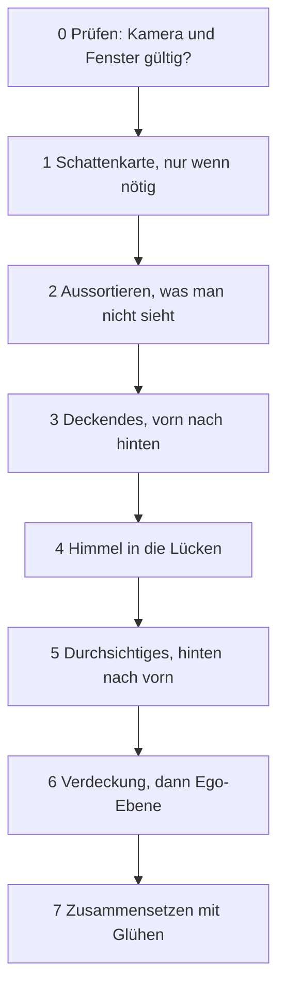

# 4 Grafik – wie Kern 60 Bilder pro Sekunde malt

> **Dein Level:** Jetzt schaust du der Engine beim Malen zu. Du erfährst, wie C++-Code im Browser
> die Grafikkarte erreicht, wie aus Dreiecken, Licht und Schatten ein Bild wird und mit welchen
> Tricks Kern so wenig Arbeit wie möglich macht. Am Ende leuchten die Fenster einer ganzen Stadt –
> ohne dass jemand ein einziges Fenster gebaut hat.

> **Wörter, die du brauchst:**
>
> - **Mesh** – das Drahtgitter aus Dreiecken, aus dem ein 3D-Ding besteht.
> - **Instanz** – eine Kopie desselben Meshes an einer anderen Stelle, etwa der 50. Baum einer Allee.
> - **Shader** – ein kleines Malprogramm, das die Grafikkarte für jede Ecke und jedes Pixel
>   gleichzeitig ausführt, wie tausend Schüler, die dieselbe Aufgabe mit anderen Zahlen rechnen.
> - **Normale** – ein Pfeil, der senkrecht aus einer Fläche herausschaut und sagt, wohin sie zeigt.
> - **Textur** – ein Bild, das auf eine Form geklebt wird wie ein Aufkleber. Ihre Pixel heißen
>   **Texel**.
> - **Tiefenpuffer** – ein unsichtbares Bild, in dem die Grafikkarte für jedes Pixel notiert, wie
>   weit das bisher vorderste Ding weg ist. Nur was näher ist, darf drübermalen.
> - **Direktes und indirektes Licht** – direkt: Ein Sonnenstrahl oder eine Lampe trifft die Fläche.
>   Indirekt: Licht, das vorher am Himmel oder an Wänden abgeprallt ist. Darum ist es im Schatten
>   nicht stockdunkel.
> - **sRGB** – die Art, wie Bildschirme Farben speichern: Dunkle Töne bekommen mehr Stufen, weil
>   das Auge dort feiner sieht. Zum Rechnen macht Kern die Farben erst **linear** (doppelt so viel
>   Licht = doppelt so große Zahl) und am Ende wieder sRGB.

Dieses Kapitel zeigt, **was Kern macht**. Warum Licht, Schatten und Perspektive so funktionieren,
erklärt [Anhang B](B-grundlagen-rendering.md) mit Bildern und Rechenbeispielen. Wenn du tiefer
einsteigen willst, lies dort vorher B.2, B.3 und B.5.

## 4.1 Überblick

Der **Renderer** ist der Teil von Kern, der die Bilder malt. Drei Grundregeln halten ihn zusammen:

1. **Ein Programm für alles.** Jedes Objekt wird mit demselben Shader gemalt. Spiele ändern das
   Aussehen über kleine Erweiterungen, die in dieses eine Programm eingesetzt werden (4.6).
2. **Einmal hochladen, danach nur Bewegung.** Die Form geht einmal zur Grafikkarte, danach nur noch,
   *wo* etwas steht. Die Arbeit pro Bild hängt davon ab, was sich bewegt – nicht von der Größe der Welt.
3. **Die eigene Kopie ist die Wahrheit.** Kern behält Ecken, Farben und Positionen jedes Objekts
   selbst. Daraus berechnet es, was sichtbar ist und was man anklicken kann – und baut alles neu auf,
   wenn der Browser die Grafikkarte wegnimmt (4.11).

> **So kannst du es dir vorstellen:** Theater. Die Kulissen werden einmal aufgebaut, während der
> Vorstellung laufen nur die Schauspieler herum. Und der Regisseur hat den Plan der Bühne im Kopf –
> brennt sie ab, baut er sie genauso wieder auf.

## 4.2 Die Brücke zur Grafikkarte

Kern ist C++, die Grafik im Browser (sie heißt **WebGL2**) gibt es aber nur für JavaScript. Also
braucht Kern eine Brücke. Das Prinzip: **Über die Brücke gehen nur Zahlen.**

> **So kannst du es dir vorstellen:** Garderobe im Theater. Du gibst deinen Mantel ab und bekommst
> eine Marke mit der Nummer 7. Später sagst du nur „Nummer 7“ und bekommst ihn zurück. Du musst den
> Mantel nicht die ganze Zeit mit dir herumtragen.

Genau so arbeitet Kern:

- **Grafikobjekte sind Nummern.** Die echten Dinge auf der Grafikkarte (Puffer, Texturen,
  Programme) liegen bei JavaScript in einer Liste. Kern bekommt nur die Platznummer. 0 heißt
  „nichts“.
- **Daten sind „ab hier, so viel“.** Will Kern zum Beispiel 1000 Ecken hochladen, sagt es nur:
  „Ab Speicherstelle 5000, so viele Bytes“. JavaScript liest direkt in Kerns Speicher nach, ohne
  etwas abzuschreiben. Wie eine Seitenangabe im Buch statt einer Abschrift.

Welche Grafikbefehle Kern benutzen darf, steht in **einer** kurzen Liste. Beim Start sagt Kern
„ich brauche diese Befehle“, und JavaScript reicht sie herein (man nennt das **Importe**). Für Tests
ohne Browser gibt es eine Attrappe, die die Befehle nur mitschreibt.

Die JavaScript-Seite ist absichtlich dünn: Kern laden, Nummernlisten verwalten, einen bequemen
Zugang anbieten. **Spiel-Logik steckt dort keine, und die Engine fasst keine Dateien an.** Warum?
Was in JavaScript stünde, müsste man doppelt pflegen und könnte es nicht wie den C++-Kern testen.

Benutzt wird der Renderer auf drei Wegen: **C++-Spiele** machen in jedem Bild erst ihre Spiellogik,
dann malt der Renderer ([Kapitel 12](12-eigene-spiele.md)). **JavaScript-Programme** wie SpawnCity
nehmen nur den Renderer. **Kern Studio** hat einen eigenen Zugang zum selben Renderer
([Kapitel 11](11-studio.md)).

> **Für Profis:** Die Zeichenfläche legt die Webseite an, nicht die Engine. Kerns eigene Seite
> schaltet die Kantenglättung dabei ab, weil Kern ohnehin in eigene Bildpuffer malt (4.7), wo sie
> nichts bewirken würde; Studio und exportierte Spiele schalten sie ein. Die genauen Namen und Werte
> stehen im blauen Buch, Kapitel 4.

## 4.3 Programme und der Merkzettel

Ein **Programm** ist ein fertiger Shader aus zwei Teilen: dem **Vertex-Shader**, der für jede Ecke
ausrechnet, wo sie auf dem Bildschirm landet, und dem **Fragment-Shader**, der für jedes Pixel die
Farbe ausrechnet ([Anhang B.3](B-grundlagen-rendering.md)). Klappt das Übersetzen nicht, schreibt
Kern die Fehlermeldung mit einem Namensschild ins Log, damit man sieht, welcher Shader schuld ist.
Fragt Kern nach einer Einstellung, die der Shader gar nicht benutzt, ist das kein Fehler – sie wird
einfach still übergangen.

**Uniforms** sind Einstellungen, die für einen ganzen Malbefehl gelten, etwa „Rauheit = 0,5“ oder
„die Sonne kommt von links“. Einmal gesetzt, bleiben sie stehen, bis man sie ändert. Das nutzt Kern
mit einem **Merkzettel**: Er notiert jeden zuletzt geschickten Wert. Bevor Kern einen Wert schickt,
schaut es nach. Steht dort schon dieselbe Zahl, schickt es nichts.

> **So kannst du es dir vorstellen:** Eine Lehrerin schreibt nicht jede Stunde die ganze Tafel neu.
> Sie wischt nur weg und schreibt hin, was sich geändert hat.

Warum der Aufwand? Jeder Befehl nimmt den weiten Weg von C++ über JavaScript zum Browser, der ihn
erst prüft. Bei hunderten Objekten mit gleichem Material spart der Merkzettel die meisten Wege. Bei
langen Zahlenlisten notiert er nur einen Fingerabdruck (**Hash**, siehe
[Kapitel 2](02-bauen-und-testen.md)). Knochen bewegter Figuren gehen ohne Merkzettel raus – sie
ändern sich ohnehin jedes Bild.

## 4.4 Mesh, Material und Instanzen

Ein **Mesh** ist eine Form aus Dreiecken, das **Material** sagt, wie sie aussieht: Farbe, Glanz,
Leuchten.

### Was jede Ecke und jede Kopie mitbringt

Jede **Ecke** bringt mit: wo sie ist, wohin ihre Fläche zeigt (die Normale), welche Farbe sie hat und
welche Stelle der Textur auf ihr liegt. Bei Figuren kommt dazu, an welchen Knochen sie hängt. Jede
**Instanz** bringt mit: wo sie steht (als Matrix), wie sie getönt ist und wie ihre Normalen gedreht
werden. Das hat feste Plätze, die der Shader kennt – wie Fächer in einem Setzkasten.

Kern malt **jedes** Mesh als Instanzen, auch wenn es nur einmal vorkommt. So gibt es nur einen
einzigen Weg zu malen, und der ist für 1 Baum genauso schnell gebaut wie für 1000. Wie man die
Normalen richtig mitdreht, rechnet Kern selbst aus ([Anhang B.1](B-grundlagen-rendering.md)); eine
Matrix, die ein Objekt zu einer flachen Scheibe zusammendrückt, lehnt es ab.

> **Für Profis:** Der Shader hat 16 feste Plätze für Eckdaten. Zwei davon sind für Erweiterungen
> frei (4.6). Eine Figur darf höchstens 32 Knochen haben, eine Szene höchstens 6 Lampen gleichzeitig.
> Die genaue Belegung steht im blauen Buch, Kapitel 4.

### Das Material

Ein Material hat diese Eigenschaften:

| Eigenschaft | Was sie tut |
|---|---|
| Farbe | die Grundfarbe |
| Deckkraft | deckend, ausgestanzt oder durchsichtig |
| Rauheit, Metall | matt oder glänzend, Kunststoff oder Metall |
| Eigenleuchten | leuchtet selbst, wird zum Glühen |
| ohne Licht | zeigt die Farbe pur, ohne Schatten |
| beidseitig | auch die Rückseite wird gemalt |
| wirft Schatten | an oder aus |
| Ego-Ebene | wird zuletzt gemalt |
| Linien | Striche statt Dreiecke |

**Ausgestanzt** heißt: Ein Pixel ist entweder ganz da oder ganz weg – wie bei einem Blatt oder einem
Maschendrahtzaun, die als Bild auf einem Viereck kleben. **Durchsichtig** ist Glas oder Rauch.

Farben sind sRGB; fürs Licht macht Kern sie erst linear. Nur **deckende** Materialien werfen
Schatten. Die **Ego-Ebene** ist für die Waffe in der Hand bei einem Ego-Shooter und für Studios
Gizmos: Kern löscht vorher den Tiefenpuffer und malt sie ganz zuletzt. So kann keine Wand, vor der du
stehst, deine Hand abschneiden. **Linien** haben weder Licht noch Schatten und sind nicht anklickbar.
Normalerweise lässt Kern die Rückseiten der Dreiecke weg ([Anhang B.2](B-grundlagen-rendering.md));
bei gespiegelten Objekten dreht es diese Regel passend um.

### Anlegen: alles oder nichts

Ein neues Mesh muss nur die Positionen der Ecken mitbringen; was fehlt, ergänzt Kern (weiß, eine
Instanz am Nullpunkt, passende Normalen). Dann gilt: **alles oder nichts.** Erst prüft Kern alles:
Sind alle Zahlen echte Zahlen? Zeigt jede Dreiecksecke auf eine vorhandene Ecke? Passen die Längen
der Listen? Ergeben die Knochen-Anteile jeder Ecke zusammen 100 %? Nur wenn alles stimmt, baut Kern
das neue Mesh und tauscht es gegen das alte.

> **So kannst du es dir vorstellen:** Erst checkst du, ob alle Zutaten da sind, dann kochst du. Fehlt
> das Mehl, fängst du gar nicht an – und der alte Kuchen steht noch auf dem Tisch.

> **Krass, aber wahr:** Deshalb kann ein Editor beim Tippen nichts kaputtmachen. Ein ungültiger
> Zwischenstand löscht kein Objekt – Kern zeigt einfach weiter den letzten guten.

Die Nummern der Meshes vergibt nur der Renderer selbst; zwei Programmteile können sich so nie
denselben Platz teilen.

Beim Hochladen spart Kern Platz: Jedes Dreieck wird als drei **Eckennummern** gespeichert. Hat ein
Mesh höchstens 65 536 Ecken, nimmt Kern für jede Nummer nur 16 Bit (16 Ja-Nein-Stellen) statt 32,
denn mit 16 Bit kann man 2¹⁶ = 65 536 verschiedene Nummern schreiben. Das halbiert die
Dreiecksliste. Große, ruhige Objekte bekommen außerdem einen Suchbaum, damit ein Mausklick sie
schnell findet ([Kapitel 5](05-szene-und-geometrie.md), Bild dazu in
[Anhang B.10](B-grundlagen-rendering.md)).

### Bewegen: nur was sich ändert

Für alles, was sich bewegt, gibt es einen eigenen Weg, der nur die Instanzen neu schickt:

- Nur die Tönung ist neu? Dann geht nur sie raus, und die Schatten bleiben gültig.
- Alles ist genau gleich wie vorher? Dann passiert gar nichts.
- Mehr Instanzen als Platz? Dann wird der Platz **mindestens verdoppelt**.

> **So kannst du es dir vorstellen:** Deine Sammlung wächst. Kaufst du jedes Mal ein Regal mit nur
> einem Fach mehr, schleppst du ständig Regale. Kaufst du gleich ein doppelt so großes, hast du lange
> Ruhe.

Andere Befehle ändern Knochen, Sichtbarkeit oder Material. Ändert sich etwas an einem Ding, das
Schatten wirft, zählt Kern einen **Schattenzähler** hoch – dann weiß es, dass die Schattenkarte neu
muss (4.8.1).

**Ebenen** sind Schalter in einer einzigen Zahl. Jede Stelle der Zahl in Ja-Nein-Schreibweise ist
ein Schalter: 5 = 4 + 1 heißt „Schalter 1 und Schalter 3 an“. Beim Malen, bei Schatten und beim
Anklicken fragt Kern: Ist die Ebene dieses Objekts eingeschaltet? Kern Studio trennt so Raster,
Symbole, Gizmos, Kollisionsformen und die Welten mehrerer Netzwerk-Spieler.

**Texturen** legt Kern entweder selbst an und behält eine Kopie der Pixel (für 4.11), oder ein
JavaScript-Programm meldet ein eigenes Bild an und hinterlegt ein Rezept, wie man es neu füllt. Ein
Mesh hat höchstens **eine** Textur.

## 4.5 Der Standard-Shader

Der Standard-Shader ist **ein** Malprogramm für alles. Kern setzt es beim Start aus festen
Bausteinen zusammen; an markierten Stellen kommen die Stückchen der Erweiterungen hinein (4.6).

Der **Vertex-Shader** schiebt jede Ecke an ihre Stelle: Er holt die Matrix der Instanz, rechnet bei
Figuren die Knochen ein und bringt die Ecke auf den Bildschirm. Knochen funktionieren so: Eine Ecke
am Ellbogen hängt zu 70 % am Oberarm und zu 30 % am Unterarm. Hebt sich der Unterarm um 10 cm, wandert
die Ecke 0,3 · 10 = 3 cm mit. So knickt die Haut weich statt eckig.

Der **Fragment-Shader** rechnet für jedes Pixel: Farbe aus Textur und Material holen, ausgestanzte
Pixel wegwerfen, Licht ausrechnen, alles auf Bildschirm-Helligkeit bringen, Nebel drüber. Dabei
schreibt er **drei Ergebnisse auf einmal**: das fertige Bild, das helle Rohlicht für das Glühen
(4.8.3) und einen Zettel für die Verdeckung (4.8.4). So muss Kern die Szene nicht dreimal malen.

### Licht und Material

Kern orientiert sich am Standardmaterial der bekannten Web-Engine three.js. Die Ideen dahinter
erklärt [Anhang B.4](B-grundlagen-rendering.md). Kern mischt sieben Zutaten:

| Zutat | Art | Woher |
|---|---|---|
| Sonne | direkt | mal Schatten |
| Halbkugel-Licht | indirekt | Himmel von oben, Boden von unten |
| Himmelsverlauf | indirekt | Farben von Zenit, Horizont, Boden |
| bis zu 6 Lampen | direkt | Punktlichter |
| Glanz | beides | Spiegelung von Sonne und Himmel |
| Glas | – | von Erweiterungen gesetzt |
| Leuchten | – | Eigenleuchten |

Beim **Himmelsverlauf** zählt, wohin die Fläche zeigt: Ein Dach schaut zum Himmel und bekommt
Himmelsfarbe, eine senkrechte Wand schaut halb zum Himmel, halb zum Boden und bekommt eine Mischung
aus beiden. **Zenit** heißt: genau über dir.

Das indirekte Licht führt Kern **getrennt** mit. Warum? Später soll die Verdeckung in Ecken (4.8.4)
nur dieses Licht abdunkeln – die Sonne hat ja schon ihren eigenen Schatten.

Metall hat keinen matten Anteil, es spiegelt nur. „Ohne Licht“ zeigt die Grundfarbe pur. Den
Glanzpunkt der Sonne begrenzt Kern nach oben, damit sehr glatte Flächen keine einzelnen superhellen
Pixel bekommen, die im Glühen flackern würden. **Glas** spiegelt den Himmel, je flacher du
draufschaust, desto mehr. **Leuchten** hat keine Obergrenze; was heller als 1 ist, glüht später.

> **Mission:** Öffne Kern Studio über https://kernengine.de/, wähle **File › New Level...** ›
> **Basic** und klick in der Werkzeugleiste auf **+ Add** › **Shapes** › **Sphere** (dasselbe findest
> du auch im Content Drawer, Ctrl+Space). Stell in **Details** unter *Material* **Roughness** auf 1
> und **Metallic** auf 0: Die Kugel ist matt wie Gummi. Dann Roughness 0,1 und Metallic 1: Sie
> spiegelt den Himmel wie eine Christbaumkugel. Zum Schluss dreh **Emissive color** auf eine Farbe
> und **Emissive strength** hoch – sie glüht und strahlt über ihren Rand hinaus.

### Vom Rohlicht zum Pixel

Das ausgerechnete Licht kann viel heller als 1 sein, der Bildschirm zeigt aber nur 0 bis 1. Darum
kommt am Ende eine Kette:

1. **Rohlicht sichern** – für das Glühen (4.8.3).
2. **Zusammendrücken** mit einer Filmkurve: in der Mitte fast unverändert, das sehr Helle sanft
   gestaucht (das heißt **Tonemapping**, Bild in [Anhang B.6](B-grundlagen-rendering.md)). Davor
   wirkt die **Belichtung** wie bei einer Kamera.
3. **Farbstimmung** – etwas kräftigere Farben, wärmere Lichter, kühlere Schatten. Abschaltbar.
4. **Nach sRGB** – fertig für den Bildschirm.
5. **Nebel** drüber.

Beim Nebel hat Kern drei Extras: **Höhennebel** – der Dunst liegt am Boden wie Milch unten im Glas,
über den Dächern ist es klar. **Sonnenstreuung** – schaust du Richtung Sonne, leuchtet der Nebel in
ihrer Farbe. **Horizontnebel** – der Himmel verschwimmt am Horizont in der Nebelfarbe (4.8.2). Sind
alle drei aus, sieht der Nebel aus wie in three.js.

Auf den Zettel für die Verdeckung schreibt der Shader, **welcher Anteil des Lichts indirekt ist**.
Kommen von 1,0 Licht 0,3 vom Himmel, steht dort 0,3. Durchsichtiges und die Ego-Ebene schreiben 0 –
sie werden nie abgedunkelt.

## 4.6 Shader-Erweiterungen

Eine **Shader-Erweiterung** ist ein Stückchen Malprogramm, das ein Spiel in Kerns Shader einsetzt,
ohne Kern selbst zu ändern. Das Spiel gibt seine Erweiterungen beim Start ab.

> **So kannst du es dir vorstellen:** Ein Lückentext. Kern schreibt den Text, das Spiel füllt nur die
> Lücken. Der Rest bleibt, wie er ist – und funktioniert weiter.

Es gibt sechs Lücken: zwei im Vertex-Shader (dort darf man Farbe, Deckkraft und Texturstelle
ändern) und vier im Fragment-Shader (eigene Rechnungen, Pixel wegwerfen, „diese Farbe ist schon
linear“, und kurz vor dem Licht Farbe, Glas und Leuchten ändern). Eine Erweiterung darf auch eigene
Daten pro Ecke mitbringen (dafür sind die zwei freien Plätze aus 4.4), eigene Zahlen im Material und
eigene Uniforms – am besten über den Merkzettel aus 4.3.

Vor jedes eingesetzte Stückchen schreibt Kern eine Zeile mit dem Namen der Erweiterung. Geht etwas
schief, steht in der Fehlermeldung, wessen Stückchen es war. Ein Beispiel folgt in 4.13. Die genauen
Namen der Lücken stehen im blauen Buch, Kapitel 4.

## 4.7 Der Ablauf eines Bildes

Ein Bild entsteht in festen Schritten, jedes Mal 60-mal pro Sekunde:



Die wichtigsten Gründe:

- **Erst prüfen.** Ist die Kamera kaputt, bricht Kern ab, bevor es irgendetwas verstellt hat.
- **Aussortieren.** Unsichtbares, ausgeschaltete Ebenen und alles außerhalb des Blickfelds fallen
  weg. Nur Figuren mit Knochen nicht: Ihr Arm kann aus der gespeicherten Hülle herausragen.
- **Deckendes von vorn nach hinten.** Dann steht im Tiefenpuffer schon das Nahe, und alles
  Verdeckte fällt beim Tiefentest durch, bevor der teure Fragment-Shader rechnet.
- **Durchsichtiges von hinten nach vorn.** Wie Buntglasscheiben, die du übereinanderlegst: Die
  hintere muss zuerst liegen, sonst stimmen die Mischfarben nicht.
- **Himmel nach dem Deckenden** – er füllt nur noch die Lücken (4.8.2).
- **Verdeckung vor der Ego-Ebene**, denn für die Ego-Ebene wird der Tiefenpuffer gelöscht, und die
  Verdeckung braucht die Tiefe der Welt.

Für Glühen und Verdeckung braucht Kern eigene **Bildpuffer** – unsichtbare Bilder, in die es malt,
bevor das Ergebnis auf den Bildschirm kommt. Darin liegen das fertige Bild, das Rohlicht, der Zettel
mit dem indirekten Anteil und die Tiefe. Wird das Fenster aber in mehrere Teilfenster aufgeteilt,
malt Kern jedes Teilfenster direkt auf den Bildschirm, ohne diese Puffer – und dann gibt es weder
Glühen noch Verdeckung. Nebenbei misst Kern noch, wie lange die Grafikkarte gebraucht hat, und
zählt am Ende Malbefehle, Dreiecke und Instanzen.

> **Für Profis:** Fertiges Bild, Rohlicht und Verdeckungs-Zettel brauchen zusammen genau 16 Byte pro
> Pixel. So viel passt bei Handy-Grafikchips, die das Bild in kleinen Kacheln malen, in den schnellen
> Kachelspeicher. Darum ist der Zettel absichtlich grob gespeichert. Die genauen Formate stehen im
> blauen Buch, Kapitel 4.


Kern Studio malt jeden Viewport einzeln. Ein einzelner großer Viewport ist kein Teilfenster und
bekommt Glühen und Verdeckung; in der Vier-Ansicht fehlt beides.

> **Mission:** Lade **File › Example Levels ▸ Orb Run** und zieh in **World Settings** die **Time of
> day** auf 0,9 – jetzt ist Nacht, und viele Fenster leuchten. Flieg so nah an ein paar Häuser, dass
> die Fenster gut zu sehen sind. Schalte im Viewport-Menü **≡** unter **Layout** auf
> **4 viewports**. Nur einer der vier zeigt die Welt mit Perspektive und Licht (die anderen zeigen
> Drahtgitter von oben, vorn und der Seite); darin suchst du dir dieselben Fenster. Dann
> machst du ihn mit dem Knopf ganz rechts in seiner Leiste (**Maximise**) wieder einzeln und groß.
> **Was du siehst:** Groß hat jedes leuchtende Fenster einen weichen Lichtschein, der über seinen
> Rand hinaus auf die Wand strahlt. In der Vier-Ansicht sind die Fenster nur scharfe, helle Rechtecke
> ohne Schein. **Was du lernst:** Das Glühen entsteht erst in Kerns eigenen Bildpuffern – im
> Teilfenster fehlt es. Dasselbe gilt für die Verdeckung, die du in 4.8.4 bei Tag ausprobierst.
> (Ist dein Gerät sehr langsam, hat Kern das Glühen vielleicht schon ganz abgeschaltet, siehe 4.8.3.)

## 4.8 Die Zusatz-Durchgänge im Detail

Neben dem eigentlichen Malen macht Kern vier Extra-Durchgänge: Sonnenschatten, Himmel, Glühen und
Verdeckung.

### 4.8.1 Sonnenschatten

Für die Schatten der Sonne macht Kern ein „Foto“ aus Sicht der Sonne, in dem nur steht, wie weit weg
das Nächste ist – die **Schattenkarte** ([Anhang B.5](B-grundlagen-rendering.md)). Die Sonne ist so
weit weg, dass ihre Strahlen parallel sind. Wie gut die Schatten aussehen, hängt an einer einzigen
Frage: **Wie groß ist ein Kästchen (Texel) der Karte in Metern?** Kleine Kästchen geben scharfe
Schatten, große Kästchen Schatten wie aus Minecraft-Blöcken.

Einstellbar sind Kästchenzahl, abgedeckte Fläche, Sicherheitsabstand und Kantenweichheit; Studio
nimmt auf Handys einen schnelleren, auf Computern einen feineren Kantenfilter.

**Schattendistanz.** In World Settings legt **Shadow distance** fest, wie weit die Schatten in deine
Sicht reichen (im Micro-Duck-Level nur 10 m, für sehr scharfe Schatten). Kern deckt dann genau den
Teil deines Blickfelds bis zu dieser Entfernung mit der Karte ab – und zwar mit einer **Kugel**.

Stell dir dein Blickfeld als liegende, eckige Eistüte vor: Die Spitze ist dein Auge, die Öffnung
ist ein Rechteck in der Schattendistanz – so groß wie das Bild, das du in dieser Entfernung siehst.
Kern legt eine Kugel um die ganze Tüte. Bei Studios Kamera liegt der Mittelpunkt der Kugel genau in
der Mitte dieses Rechtecks, und die Kugel reicht bis zu seinen Ecken. Das Rechteck von vorn:

```
 +---------------------------+ <- Ecke
 |                       . / |
 |              Radius . /   |
 |                   . /     |  halbe Höhe
 |              ●------------|
 |            Mitte  halbe   |
 |                   Breite  |
 +---------------------------+
```

Dein Auge liegt näher an der Mitte als die Ecken, also steckt die ganze Tüte in der Kugel.

**Durchgerechnet** mit Studios Kamera (70° Öffnung, Bild 16 : 9) und 80 m Schattendistanz: Bei 70°
ist das Bild in jeder Entfernung etwa 1,4-mal so hoch, wie es weit weg ist. In 80 m ist das Rechteck
also 1,4 · 80 = 112 m hoch und 112 · 16 ÷ 9 ≈ 199 m breit. Von der Mitte zur Ecke sind es 56 m hoch
und 99,6 m quer. Pythagoras:

> Radius = √(56² + 99,6²) = √(3136 + 9920) ≈ **114 m**

Die Karte ist so breit wie die Kugel, also 2 · 114 = 228 m. Studio gibt ihr 2048 Kästchen: 228 ÷
2048 ≈ **11 cm** pro Kästchen. Bei 10 m Schattendistanz ist das Rechteck nur 14 m hoch und knapp
25 m breit, der Radius gut 14 m, ein Kästchen ≈ **1,4 cm**. Kleinere Distanz heißt also schärfere
Schatten, die weniger weit reichen.

Und warum eine Kugel? **Dreh dich auf der Stelle.** Die Eistüte schwenkt herum, ihr Rechteck kippt
in alle möglichen Lagen – aber eine Kugel sieht von jeder Seite gleich aus. Ihre Größe bleibt, also
auch die Größe der Kästchen. Eine Kiste müsste beim Drehen mal größer, mal kleiner werden, und die
Schatten würden dabei pumpen.

**Einrasten.** Rutscht die Karte mit der Kamera um Bruchteile eines Kästchens mit, fallen
Schattenkanten in jedem Bild etwas anders aufs Raster – sie „schwimmen“ und flimmern. Kern
verschiebt die Karte deshalb nur um **ganze Kästchen**.

> **So kannst du es dir vorstellen:** Karopapier, auf dem du dein Bild nur um ganze Kästchen
> verschieben darfst. Jede Linie liegt dann immer auf denselben Kästchen.

**Wiederverwenden.** Aus Lage, Sonnenrichtung und Größe der Karte bildet Kern einen Fingerabdruck,
dazu kommen der Schattenzähler aus 4.4 und die eingeschalteten Ebenen. Bleibt alles gleich, wird die
Karte nicht neu gemalt.

> **Krass, aber wahr:** Steht die Kamera still über einer ruhigen Stadt, kostet der Schatten danach
> **keinen einzigen** Malbefehl.

**Malen und Abfragen.** Die Sonne „fotografiert“ nur deckende Dinge, die Schatten werfen. Gegen
Streifen und Treppenkanten nutzt Kern die Gegenmittel aus [Anhang B.5](B-grundlagen-rendering.md):
etwas Abstand und das Mitteln mehrerer Nachbarkästchen. Außerhalb der Karte gilt alles als
beleuchtet. Mit Schattendistanz blendet der Schatten auf dem letzten Zehntel weich aus, statt an
der Kante abzureißen.

> **Mission:** Lade Orb Run und flieg nah an ein Haus heran, bis der Boden weniger als 10 m vor dir
> liegt. Stell in **World Settings** die **Shadow distance (smaller: sharper)** auf 10, dann 80, dann
> 500. Bei 10 sind die Schatten direkt vor dir am schärfsten, alles weiter als 10 m hat keinen. Bei 500
> reichen sie weit, aber ihre Kanten werden gröber – dieselben Kästchen müssen eine viel größere
> Kugel abdecken.

### 4.8.2 Himmel

Der Himmel wird **nach** allem Deckenden gemalt, als ein riesiges Dreieck ganz hinten, das über
den ganzen Bildschirm hinausragt und ihn so ganz bedeckt. Der Tiefentest lässt ihn nur dort durch,
wo noch nichts gemalt ist. So rechnet das teure Himmels-Malprogramm nur da, wo man wirklich Himmel
sieht.

Er mischt: einen **Verlauf** vom Horizont zum Zenit, die **goldene Stunde** (tiefe Sonne: Horizont
orange, Zenit violett), die **Sonne** mit Lichthof und Scheibe, nachts **Mond und Sterne**, und
**Wolken** aus Rauschen, die mit dem Wind ziehen – eine Explosion drückt sie sogar weg. Auf Wunsch
verschwimmt der Horizont im **Horizontnebel**. Die Physik dahinter steht in
[Anhang B.9](B-grundlagen-rendering.md). Ansichten ohne Perspektive (etwa von oben) haben keinen
Himmel.

Im Spiel rechnet die Laufzeit das ganze Licht aus der **Tageszeit** aus: Sonnenstand, Himmel,
Nebel, Nacht ([Kapitel 8](08-spiel-laufzeit.md)). Dabei ist die Sonne etwa fünfmal so stark wie das
Himmelslicht. Alle Startwerte für Licht, Kamera und Schatten stehen im blauen Buch, Kapitel 4.

### 4.8.3 Glühen und Zusammensetzen

**Glühen** (*Bloom*) ist der Lichtschein um sehr helle Dinge, wie bei einer Straßenlaterne im
Dunkeln ([Anhang B.7](B-grundlagen-rendering.md)). Kern macht es so: Helles aus dem Rohlicht
ausschneiden, auf einem verkleinerten Bild weichzeichnen, noch einmal kleiner und noch weicher, und
dann zurückmischen. Kann das Gerät nicht in Kommazahl-Bildpuffer malen, meldet Kern „nicht
unterstützt“ und malt ohne Glühen direkt.

Beim **Zusammensetzen** steckt ein Kniff. Das fertige Bild enthält schon den Nebel, das Rohlicht
nicht. Würde Kern das Rohlicht samt Glühen einfach neu durch die Filmkurve schicken, wäre der Nebel
weg. Also rechnet Kern zweimal durch dieselbe Kurve und addiert nur den **Unterschied**:

| Rechnung | Ergebnis |
|---|---|
| Rohlicht ohne Glühen, durch die Kurve | 0,60 |
| Rohlicht mit Glühen, durch die Kurve | 0,70 |
| Unterschied | 0,10 |
| fertiges Pixel mit Nebel: 0,50 + 0,10 | 0,60 |

(Die Zahlen sind ausgedacht, damit man das Prinzip sieht.) Der Nebel bleibt, das Glühen kommt dazu.
Genauso kommt die Verdeckung aus 4.8.4 hinein. Pixel ohne Glühen und ohne Verdeckung werden bloß
kopiert – das spart Zeit.

**Bildzeit-Wächter.** Kern schaut ständig auf den Durchschnitt, wie lange ein Bild dauert.
Einzelne Ausreißer, etwa ein kurzes Hängen, zählen nicht. Braucht ein Bild 3,5 Sekunden lang im
Schnitt mehr als 27 Millisekunden – das sind weniger als 1000 ÷ 27 ≈ 37 Bilder pro Sekunde –,
schaltet sich das Glühen ab. Das Zusammensetzen läuft für die Verdeckung weiter. Ist die Seite
verborgen, fängt der Wächter von vorn an, denn der Browser bremst Seiten im Hintergrund absichtlich.

> **So kannst du es dir vorstellen:** Fährst du mit dem Fahrrad bergauf und wirst zu langsam,
> schaltest du einen Gang runter. Du verzichtest auf etwas Tempo, kommst aber flüssig weiter.

### 4.8.4 Umgebungsverdeckung (GTAO)

In Ecken, Fugen und unter Dingen kommt weniger Himmelslicht an, weil ein Teil des Himmels verdeckt
ist. Das heißt **Umgebungsverdeckung** (englisch *Ambient Occlusion*, kurz AO). Kern nutzt dafür ein
Verfahren namens **GTAO**, dessen Idee [Anhang B.8](B-grundlagen-rendering.md) mit Bildern erklärt.
Das Besondere in Kern ist der Einbau: **Es muss nichts ein zweites Mal gemalt werden.**

1. Beim normalen Malen notiert der Shader auf seinem Zettel, welcher Anteil jedes Pixels
   indirektes Licht ist (4.5).
2. GTAO schaut nur in den fertigen Tiefenpuffer und rechnet aus, wie versteckt jeder Punkt ist.
3. Das Zusammensetzen dunkelt **nur** den indirekten Anteil ab. Sonne und Lampen bleiben, wie sie
   sind – sie haben ihre eigenen Schatten.

Die Normale, also wohin eine Fläche zeigt, **errät Kern aus der Tiefe**: Liegen die Nachbarpixel
ungefähr gleich weit weg, gehört der Punkt zur selben Fläche wie sie, und daraus ergibt sich ihre
Richtung. Der **Radius** sagt in Metern, wie weit Kern um einen Punkt nach Verdeckern sucht. Damit
das schnell geht, sucht Kern pro Pixel nur in wenigen Richtungen und dreht diese Richtungen von Pixel
zu Pixel nach einem festen Muster weiter. Ein Filter mittelt das Muster danach glatt, ohne über
Kanten zu verschmieren.

**Mehrfach-Abprall:** Helle Flächen werfen Licht in ihre Ecke zurück, darum werden ihre Ecken
weniger dunkel. Ein Beispiel: GTAO rechnet für eine Ecke die **Sichtbarkeit** 0,5 aus – nur der halbe
Himmel ist zu sehen. Bei einer dunklen Fläche, die nur 10 % des Lichts zurückwirft, zählt Kern
praktisch weiter mit Sichtbarkeit 0,51. Bei einer hellen Fläche, die 80 % zurückwirft, zählt es mit
Sichtbarkeit 0,81. Die helle Ecke wird also viel weniger abgedunkelt.

Es gibt Qualitätsstufen von *low* bis *ultra* (mehr Richtungen, mehr Schritte). Auf langsamen
Geräten stuft ein Wächter wie beim Glühen die Qualität herunter und rechnet dann mit halber
Auflösung. AO läuft nur mit Kerns eigenen Bildpuffern und mit Perspektive. Den Radius bestimmt die
Szene selbst: World Settings › **Ambient occlusion radius (0 = off)**. Stufen und Startwerte stehen
im blauen Buch, Kapitel 4.

> **Mission:** Stell in **World Settings** den **Ambient occlusion radius (0 = off)** auf 0, dann auf 3.
> Schau in einem großen Viewport auf Hausecken im Schatten und den Boden unter Objekten. Der Effekt ist
> dezent; am deutlichsten ist er im Schatten, denn dort kommt fast nur indirektes Licht an – und nur
> das dunkelt die Verdeckung ab.

## 4.9 Partikel und Punktlichter

**Partikel** sind kleine Vierecke, die sich immer zur Kamera drehen – Funken, Rauch, Mündungsfeuer.
Alle Partikel eines Systems sind zusammen **ein** Mesh mit vielen Instanzen, durchsichtig, ohne
Kollision, ohne Licht und ohne Schatten. Jedes Partikel hat Startort, Tempo, Farbe, Lebensdauer,
Größe, Schwerkraft, Wachstum und Ausblenden.

Die Bahn eines Funkens ist der Wurf aus dem Alltag: Erst steigt er, die Schwerkraft bremst ihn immer
mehr, dann fällt er. Ein Funke, der mit 5 m/s nach oben startet und so stark fällt wie alles auf
der Erde:

| Zeit | Höhe |
|---|---|
| 0,25 s | 0,94 m |
| 0,5 s | 1,27 m |
| 0,75 s | 0,99 m |
| 1 s | 0,10 m |

Mit der Zeit wird er durchsichtiger, bis er verschwindet. Kern sortiert die Partikel von hinten nach
vorn (wie Buntglas in 4.7). Und die Zeit der Partikel läuft nie rückwärts – sonst tauchten nach
einer Pause schon verloschene Funken wieder auf.

> **Für Profis:** Die Höhe ist Starttempo mal Zeit minus ½ · 9,81 · Zeit². Nach 0,5 s: 5 · 0,5 −
> ½ · 9,81 · 0,25 ≈ 1,27 m. Das ist das Fallgesetz aus dem Physikunterricht.

Der Shader schafft nur **6 Lampen** gleichzeitig. Ein Spiel darf aber beliebig viele anfragen.
Kern wählt in jedem Bild die wichtigsten aus:

> Punkte = Stärke ÷ (1 + Abstand ÷ Reichweite)

Lampe A (Stärke 10, Reichweite 5, 20 m weit): 10 ÷ (1 + 4) = 2. Lampe B (Stärke 4, Reichweite 20,
10 m weit): 4 ÷ (1 + 0,5) ≈ 2,67. **B gewinnt, obwohl sie schwächer ist** – sie ist näher und reicht
weiter. Bei Gleichstand gewinnt die frühere Anfrage. In Orb Run fragt das Auto einen Scheinwerfer an
und jeder Orb ein Licht.

## 4.10 Einstellungen

Alles, was in diesem Kapitel vorkommt, kann man einstellen: Bildgröße, Schatten, Glühen,
Verdeckung, Farbstimmung, Lichtfarben, Nebel, Belichtung und Kamera. Im Spiel musst du davon fast
nichts selbst setzen, denn die Laufzeit rechnet das Licht aus der Tageszeit aus (4.8.2), und in
Studio stellst du alles in **World Settings** ein. Die Kamera hat, wie überall in Kern, **+Z oben**.
Die vollständige Liste mit allen Startwerten steht im blauen Buch, Kapitel 4.

## 4.11 Kontextverlust

Der Browser darf Kern die Grafikkarte **jederzeit** wegnehmen – wenn der Speicher knapp wird, der
Grafiktreiber neu startet oder das Handy die Seite in den Hintergrund schickt. Das heißt
**Kontextverlust**.

1. **Verlust:** Kern vergisst alle Grafik-Nummern aus 4.2 (die Dinge dahinter gibt es nicht mehr)
   und malt nicht mehr. Seine eigenen Kopien bleiben. Neue Meshes kann man trotzdem anlegen; sie
   warten in der Kopie.
2. **Wiederherstellung:** Kern baut alle Malprogramme, Zusatz-Durchgänge und Erweiterungen neu und
   lädt alles aus seinen Kopien wieder hoch.
3. **Scheitert das,** räumt Kern auf und versucht es später von vorn.

Derselbe Weg erlaubt Betrieb **ganz ohne Grafikkarte** – so rechnet der Lehrer
([Kapitel 14](14-lehrer.md)) dieselbe Welt, ohne zu malen.

> **Vorsicht, Falle:** Wer seine Daten nur auf der Grafikkarte hat, sieht nach einem Kontextverlust
> schwarz. Genau dafür gibt es Grundregel 3.

## 4.12 Performance-Tipps

Fast alles läuft auf eine Regel hinaus: **möglichst wenige Malbefehle und nur schicken, was sich
ändert** ([Anhang B.11](B-grundlagen-rendering.md)).

- **Instanzieren:** Die Stadt malt alle Baumstämme als ein Mesh, alle Kronen als ein zweites.
- **Zusammenfassen:** wenige große Meshes statt vieler kleiner.
- **Nur Änderungen schicken**; reine Farbwechsel lassen den Schatten gültig.
- **Schatten schonen:** Jeder bewegte Schattenwerfer malt die ganze Karte neu. Straßen, Boden und
  Partikel brauchen keinen Schatten – schalte „wirft Schatten“ bei ihnen aus. Mit Schattendistanz
  malt auch eine bewegte Kamera die Karte neu, sobald sie sich um ein Kästchen verschiebt.
- **Unsichtbares aussortieren lassen** – das Aussortieren nur dort abschalten, wo die gespeicherte
  Hülle nicht stimmt, etwa bei Partikeln.
- **Messen:** Kern zählt Malbefehle, Dreiecke, Instanzen und Zeiten. Glühen und Verdeckung passen
  sich selbst an.

> **Mission:** Schalte in einem Viewport über **Show** die **Stats** ein und flieg durch Orb Run.
> Achte auf die Bilder pro Sekunde, wenn du still stehst und wenn du dich drehst.

## 4.13 Beispiel: Fenster, die nachts leuchten

Die Häuser in Orb Run haben **keine** Fenster in ihrer Form – nur glatte Wände. Trotzdem leuchten
nachts tausende. Das macht eine Shader-Erweiterung aus 4.6. Jede Ecke einer Wand trägt einen kleinen
Datensatz: wie lang und hoch die Wand ist, eine Zufallszahl für das Haus und die Stockwerkshöhe. Außerdem
weiß der Shader für jedes Pixel einer Wand, wie viele Meter es vom Wandanfang entfernt ist (u) und
wie hoch es liegt.

```
+-----+-----+-----+-----+
|  #  |  #  |  #  |  #  |   2. Stock
+-----+-----+-----+-----+
|  #  |  #  |  #  |  #  |   1. Stock
+-----+-----+-----+-----+
|     |     |     |     |   Erdgeschoss
+-----+-----+-----+-----+
0 m   3 m   6 m   9 m      # = Fenster
```

Die Idee: Die Wand wird gedanklich in Felder geteilt, **3 m breit** und **ein Stockwerk hoch**. In
die Mitte jedes Feldes kommt ein Fenster. Das Herzstück, in Worten statt in Shader-Sprache:

```
Spalte    = Ganzes von  u ÷ 3
Stockwerk = Ganzes von  Höhe ÷ Stockwerkshöhe
x im Feld = Rest von    u ÷ 3
y im Feld = Rest von    Höhe ÷ Stockwerkshöhe
Fenster   = x zwischen 0,22 und 0,78
            UND y zwischen 0,28 und 0,78
```

„Ganzes“ ist die Zahl vor dem Komma, „Rest“ das, was hinter dem Komma steht. Zeile 1: Bei u = 10 m
ist 10 ÷ 3 = 3,33, also **Spalte 3**. Zeile 2: genauso die Stockwerke. Zeilen 3–4: Der Rest sagt,
wo du **im Feld** bist: 0,33 heißt „ein Drittel von links“. Zeilen 5–6: Ein Fenster ist da, wo der Rest waagerecht zwischen 0,22 und 0,78 und senkrecht
zwischen 0,28 und 0,78 liegt. 0,33 passt waagerecht – stimmt auch die Höhe, stehst du vor einem
Fenster.

Ein Shader kennt kein „UND“ wie Scratch. Er rechnet jede Bedingung als Zahl aus: 1 für ja, 0 für
nein. Dann **multipliziert** er die vier Zahlen. Nur 1 · 1 · 1 · 1 ergibt 1; ist irgendwo eine 0
dabei, kommt 0 heraus. So wird aus „mal“ ein „und“.

Der Rest:

- Fenster gibt es nur auf Wänden, ab dem ersten Stock bis 1 m unters Dach.
- Eine Zufallszahl aus Spalte, Stockwerk und Haus schaltet etwa 58 % der Fenster an.
- Leuchtende Fenster bekommen warmes **Leuchten** und glühen deshalb im Bloom. Dunkle Fenster
  werden **Glas** und spiegeln den Himmel.
- Ist ein Haus so weit weg, dass ein Fenster kleiner als ein Pixel wäre, würde das Raster flimmern.
  Dann leuchtet die ganze Fassade stattdessen gleichmäßig schwach.
- Straßen und Boden haben keinen Datensatz. Dort liest der Shader 0, und nichts passiert.

> **Für Profis:** Der Wand-Datensatz wird **unverändert** an die Pixel weitergegeben, nicht zwischen
> den Ecken gemischt wie sonst ([Anhang B.2](B-grundlagen-rendering.md)). Mischen würde winzige
> Rundungsfehler erzeugen, und schon die würden die Zufallszahl verwürfeln. Den echten Shader-Code
> zeigt das blaue Buch, Kapitel 4.

Kern Studio und exportierte Spiele haben diese Erweiterung immer dabei. Ob die Häuser einer Stadt den
Datensatz bekommen, entscheidet die Komponente **Procedural City** mit **Lit windows at night**
([Kapitel 5](05-szene-und-geometrie.md)).

> **Mission:** Lade Orb Run und zieh in World Settings **Time of day** auf etwa 0,9 (0,25 ist
> Sonnenaufgang, 0,5 Mittag, 0,75 Sonnenuntergang; bei 0,9 ist volle Nacht): Die Fenster gehen an.
> Wähle im Outliner den Actor **City** und schalte in Details **Lit windows at night** aus und wieder
> ein.

## Level geschafft!

- Kern spricht mit der Grafikkarte nur über Nummern – wie mit Garderobenmarken.
- Drei Grundregeln: ein Programm, einmal hochladen, die eigene Kopie ist die Wahrheit.
- Ein neues Mesh wird erst ganz geprüft und dann getauscht: alles oder nichts.
- Ein Bild entsteht in festen Schritten, und du kennst den Grund für jede Reihenfolge.
- Warum Kerns Schatten nicht zittern: Kugel, Einrasten, Wiederverwenden.
- Glühen und Verdeckung kommen ins Bild, ohne dass etwas zweimal gemalt wird.
- Eine Erweiterung lässt eine ganze Stadt leuchten, mit Rest-Rechnung und „mal heißt und“.

## Rätsel-Ecke

1. Warum wird Deckendes von vorn nach hinten gemalt, Durchsichtiges von hinten nach vorn?
2. Ein Mesh hat 70 000 Ecken. Reichen 16 Bit für seine Eckennummern?
3. Warum fehlen in Studios Vier-Ansicht Glühen und Verdeckung?
4. Lampe A: Stärke 8, Reichweite 10, 30 m weit. Lampe B: Stärke 3, Reichweite 30, 30 m weit.
   Wer gewinnt?
5. **Boss-Rätsel:** Die Kamera steht still, ein Auto fährt durch die Stadt. Wird die Schattenkarte neu
   gemalt? Und wenn beim Auto „wirft Schatten“ ausgeschaltet wäre?

### Lösungen

1. Vorn nach hinten: Verdecktes fällt früh am Tiefentest durch und kostet keine Rechenzeit.
   Hinten nach vorn: Durchsichtiges muss wie Buntglas in der richtigen Reihenfolge übereinanderliegen.
2. Nein: Mit 16 Bit gibt es nur 2¹⁶ = 65 536 verschiedene Nummern. Für 70 000 Ecken braucht Kern
   32 Bit.
3. Jeder Viewport ist ein Teilfenster und wird direkt auf den Bildschirm gemalt. Glühen und
   Verdeckung brauchen aber Kerns eigene Bildpuffer mit Rohlicht und Tiefe.
4. A: 8 ÷ (1 + 3) = 2. B: 3 ÷ (1 + 1) = 1,5. A gewinnt.
5. Ja: Ein Schattenwerfer bewegt sich, der Schattenzähler steigt, und die ganze Karte wird neu
   gemalt. Ohne Schatten zählt das Auto nicht als Schattenwerfer, die Karte bliebe gültig – aber das
   Auto hätte keinen Schatten.

---

© 2026 Christian Heinrich Hohlfeld · Alle Rechte vorbehalten · [Impressum und Rechte](00-impressum.md)
