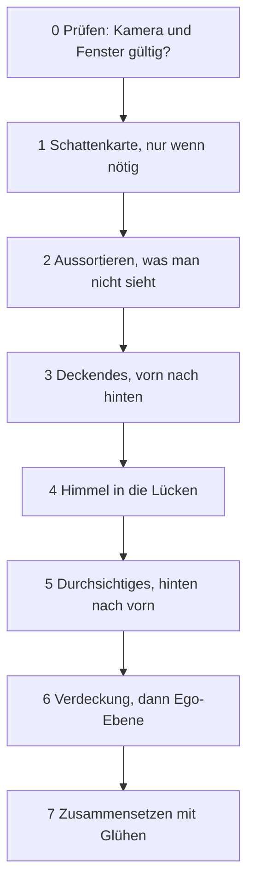

# 4 Grafik – wie Kern 60 Bilder pro Sekunde malt

> **Dein Level:** Jetzt schaust du der Engine beim Malen zu. Du erfährst, wie C++-Code im Browser
> die Grafikkarte erreicht, wie aus Dreiecken, Licht und Schatten ein Bild wird und mit welchen
> Tricks Kern so wenig Arbeit wie möglich macht. Am Ende leuchten die Fenster einer ganzen Stadt –
> ohne dass jemand ein einziges Fenster gebaut hat.

> **Wörter, die du brauchst:**
>
> - **C++ und JavaScript** – zwei Programmiersprachen. Kern ist in C++ geschrieben. Der Browser
>   bietet seine Grafik aber nur für JavaScript an.
> - **Mesh** – das Drahtgitter aus Dreiecken, aus dem ein 3D-Ding besteht.
> - **Instanz** – eine Kopie desselben Meshes an einer anderen Stelle, etwa der 50. Baum einer Allee.
> - **Matrix** – eine kleine Zahlentabelle, die sagt, wo etwas steht, wie es gedreht und wie groß
>   es ist ([Anhang B.1](B-grundlagen-rendering.md)).
> - **Shader** – ein kleines Malprogramm, das die Grafikkarte für jede Ecke und jedes Pixel
>   gleichzeitig ausführt, wie tausend Schüler, die dieselbe Aufgabe mit anderen Zahlen rechnen.
> - **Malbefehl** – ein Auftrag an die Grafikkarte: „Mal dieses Mesh!“ Jeder Auftrag kostet Zeit,
>   egal wie klein er ist.
> - **Textur** – ein Bild, das auf eine Form geklebt wird wie ein Aufkleber. Ihre Pixel heißen
>   **Texel**.
> - **Tiefenpuffer** – ein unsichtbares Bild, in dem die Grafikkarte für jedes Pixel notiert, wie
>   weit das bisher vorderste Ding weg ist. Nur was näher ist, darf drübermalen.

Dieses Kapitel zeigt, **was Kern macht**. Warum Licht, Schatten und Perspektive so funktionieren,
erklärt [Anhang B](B-grundlagen-rendering.md) mit Bildern und Rechenbeispielen. Wenn du tiefer
einsteigen willst, lies dort vorher B.2, B.3 und B.5.

## 4.1 Überblick

Der **Renderer** ist der Teil von Kern, der die Bilder malt. Bevor es losgeht, ein Grundbild: Im
Computer arbeiten **zwei getrennte Arbeiter**, jeder mit eigenem Speicher. Der **Prozessor** ist der
Kopf. Er denkt sich das Spiel aus: wer wo steht, was sich bewegt. Die **Grafikkarte** ist wie tausend
schnelle Malerhände. Was die Hände malen sollen, muss erst zu ihnen hinübergetragen werden. Das heißt
**hochladen**, und jeder Weg hinüber kostet Zeit.

Drei Grundregeln halten den Renderer zusammen:

1. **Ein Programm für alles.** Jedes Objekt wird mit demselben Shader gemalt. Warum? Jeder Wechsel
   des Malprogramms kostet Zeit ([Anhang B.11](B-grundlagen-rendering.md)). Spiele ändern das
   Aussehen über kleine Erweiterungen, die in dieses eine Programm eingesetzt werden (4.6).
2. **Einmal hochladen, danach nur Bewegung.** Die Form geht einmal vom Prozessor zur Grafikkarte,
   danach nur noch, *wo* etwas steht. Die Arbeit pro Bild hängt davon ab, was sich bewegt – nicht von
   der Größe der Welt.
3. **Die eigene Kopie ist die Wahrheit.** Kern behält Ecken, Farben und Positionen jedes Objekts
   selbst, im Speicher des Prozessors. Daraus berechnet es, was sichtbar ist und was man anklicken
   kann. Und wenn die Grafikkarte plötzlich alles vergisst (das kann passieren, 4.11), baut Kern
   daraus alles neu auf.

> **So kannst du es dir vorstellen:** Theater. Die Kulissen werden einmal aufgebaut, während der
> Vorstellung laufen nur die Schauspieler herum. Und der Regisseur hat den Plan der Bühne im Kopf –
> brennt sie ab, baut er sie genauso wieder auf.

## 4.2 Die Brücke zur Grafikkarte

Kern ist C++, die Grafik im Browser (sie heißt **WebGL2**) gibt es aber nur für JavaScript. Also
braucht Kern eine Brücke. Das Prinzip: **Über die Brücke gehen nur Zahlen.**

> **So kannst du es dir vorstellen:** Garderobe im Theater. Du gibst deinen Mantel ab und bekommst
> eine Marke mit der Nummer 7. Später sagst du nur „Nummer 7“ und bekommst ihn zurück. Du musst den
> Mantel nicht die ganze Zeit mit dir herumtragen.

Genau so arbeitet Kern:

- **Grafikobjekte sind Nummern.** Die echten Dinge auf der Grafikkarte liegen bei JavaScript in
  einer Liste: Texturen, Programme und **Puffer** (ein Stück Speicher auf der Grafikkarte, etwa für
  alle Ecken eines Meshes). Kern bekommt nur die Platznummer. 0 heißt „nichts“.
- **Daten sind „ab hier, so viel“.** Kerns Speicher ist eine lange Reihe nummerierter Fächer. In
  jedes passt ein **Byte**, das sind 8 **Bit** (8 Ja-Nein-Stellen), genug für eine Zahl von 0 bis
  255. Will Kern zum Beispiel 1000 Ecken hochladen, sagt es nur: „Ab Fach 5000, so viele Bytes“.
  JavaScript liest direkt in Kerns Speicher nach, ohne etwas abzuschreiben. Wie eine Seitenangabe im
  Buch statt einer Abschrift.

Welche Grafikbefehle Kern benutzen darf, steht in **einer** kurzen Liste. Beim Start sagt Kern
„ich brauche diese Befehle“, und JavaScript reicht sie herein (man nennt das **Importe**). Für Tests
ohne Browser gibt es eine Attrappe, die die Befehle nur mitschreibt. So prüfen die Tests, welche
Befehle Kern geschickt hätte.

Die JavaScript-Seite ist absichtlich dünn: Kern laden, Nummernlisten verwalten, einen bequemen
Zugang anbieten. **Spiel-Logik steckt dort keine.** Warum? Dieselbe Engine läuft auch ohne Browser:
bei den Tests und im Lehrer, wenn er auf einem Computer ohne Browser übt. Dort gibt es kein
JavaScript. Was in JavaScript stünde, müsste man dort ein zweites Mal schreiben, und die Tests
könnten es nicht prüfen. Ob C++-Spiel ([Kapitel 12](12-eigene-spiele.md)), JavaScript-Programm wie
SpawnCity oder Kern Studio ([Kapitel 11](11-studio.md)): Alle benutzen denselben Renderer.

> **Für Profis:** Die Zeichenfläche legt die Webseite an, nicht die Engine. Kerns eigene Seite
> schaltet die Kantenglättung dabei ab, weil Kern ohnehin in eigene Bildpuffer malt (4.7), wo sie
> nichts bewirken würde; Studio und exportierte Spiele schalten sie ein. Die genauen Namen und Werte
> stehen im blauen Buch, Kapitel 4.

## 4.3 Programme und der Merkzettel

Ein **Programm** ist ein fertiger Shader aus zwei Teilen: dem **Vertex-Shader**, der für jede Ecke
ausrechnet, wo sie auf dem Bildschirm landet, und dem **Fragment-Shader**, der für jedes Pixel die
Farbe ausrechnet ([Anhang B.3](B-grundlagen-rendering.md)). Die Grafikkarte muss das
Malprogramm erst in ihre eigene Sprache **übersetzen**. Klappt das nicht, schreibt Kern die
Fehlermeldung mit einem Namensschild ins **Log**, das Protokoll, in dem Kern Meldungen sammelt. So
sieht man, welcher Shader schuld ist.

**Uniforms** sind Einstellungen, die für einen ganzen Malbefehl gelten, etwa „Rauheit = 0,5“ oder
„die Sonne kommt von links“. Einmal gesetzt, bleiben sie stehen, bis man sie ändert. Das nutzt Kern
mit einem **Merkzettel**: Er notiert jeden zuletzt geschickten Wert. Bevor Kern einen Wert schickt,
schaut es nach. Steht dort schon dieselbe Zahl, schickt es nichts.

> **So kannst du es dir vorstellen:** Eine Lehrerin schreibt nicht jede Stunde die ganze Tafel neu.
> Sie wischt nur weg und schreibt hin, was sich geändert hat.

Warum der Aufwand? Jeder Befehl nimmt den weiten Weg von C++ über JavaScript zum Browser, der ihn
erst prüft, und dann hinüber zur Grafikkarte. Bei hunderten Objekten mit gleichem Material spart
der Merkzettel die meisten Wege. Bei langen Zahlenlisten notiert er nur einen Fingerabdruck
(**Hash**, siehe [Kapitel 2](02-bauen-und-testen.md)). Die Knochen bewegter Figuren (wie ein Arm,
der sich beugt, siehe 4.5) gehen ohne Merkzettel raus – sie ändern sich ohnehin jedes Bild.

## 4.4 Mesh, Material und Instanzen

Ein **Mesh** ist eine Form aus Dreiecken, das **Material** sagt, wie sie aussieht: Farbe, Glanz,
Leuchten.

### Was jede Ecke und jede Kopie mitbringt

Jede **Ecke** bringt mit: wo sie ist, wohin ihre Fläche zeigt (die **Normale**, ein Pfeil, der
senkrecht aus der Fläche herausschaut), welche Farbe sie hat und welche Stelle der Textur auf ihr
liegt. Bei Figuren kommt dazu, an welchen Knochen sie hängt. Jede **Instanz** bringt mit: wo sie
steht (als Matrix), wie sie **getönt** ist und wie ihre Normalen gedreht werden. Die Tönung ist eine
Farbe, mit der die ganze Kopie eingefärbt wird, etwa ein rot blinkender Gegner. Das alles hat feste
Plätze, die der Shader kennt – wie Fächer in einem Setzkasten.

Kern malt **jedes** Mesh als Instanzen, auch wenn es nur einmal vorkommt. So gibt es nur einen
einzigen Malweg, egal ob für einen Baum oder für tausend. Die Normalen brauchen eine eigene Drehung:
Zieht man ein Ding in die Breite, würden sie sonst schief stehen. Diese Drehung rechnet Kern selbst
aus ([Anhang B.1](B-grundlagen-rendering.md), „Extrawurst“). Eine Matrix, die ein Objekt zu einer
flachen Scheibe zusammendrückt, lehnt es ab. Denn bei einer plattgedrückten Form kann man nicht mehr
ausrechnen, wohin ihre Flächen zeigen.

> **Für Profis:** Der Shader hat 16 feste Plätze für Eckdaten. Zwei davon sind für Erweiterungen
> frei (4.6). Eine Figur darf höchstens 32 Knochen haben, eine Szene höchstens 6 Lampen gleichzeitig.
> Die genaue Belegung steht im blauen Buch, Kapitel 4.

### Das Material

Ein Material hat diese Eigenschaften:

| Eigenschaft | Was sie tut |
|---|---|
| Farbe | die Grundfarbe |
| Deckkraft | deckend, ausgestanzt oder durchsichtig |
| Rauheit, Metall | matt oder glänzend, Kunststoff oder Metall |
| Eigenleuchten | leuchtet selbst, wird zum Glühen |
| ohne Licht | zeigt die Farbe pur, ohne Schatten |
| beidseitig | auch die Rückseite wird gemalt |
| wirft Schatten | an oder aus |
| Ego-Ebene | wird zuletzt gemalt |

**Ausgestanzt** heißt: Ein Pixel ist entweder ganz da oder ganz weg – wie bei einem Blatt oder einem
Maschendrahtzaun, die als Bild auf einem Viereck kleben. **Durchsichtig** ist Glas oder Rauch.

Jede Farbe besteht aus drei Zahlen: Rot, Grün und Blau. Ein Bildschirm hat für jede davon nur 256
Helligkeitsstufen. Gespeichert werden Farben in **sRGB**: Dunkle Töne bekommen mehr der Stufen, weil
das Auge dort feiner sieht. Fürs Licht macht Kern sie erst **linear**, das heißt: doppelt so viel
Licht = doppelt so große Zahl ([Anhang B.6](B-grundlagen-rendering.md)).

Nur **deckende** Materialien werfen Schatten. Warum? Die Schattenkarte (4.8.1) merkt sich pro
Kästchen nur eine Entfernung: „Hier ist etwas.“ Ein „halb durchsichtig“ oder „hier ausgestanzt“
kann sie nicht speichern. Kerns Schatten-Malprogramm schaut sich die Farbe gar nicht an.

Die **Ego-Ebene** ist für die Waffe in der Hand bei einem Ego-Shooter und für Studios Gizmos (die
bunten Pfeile zum Verschieben in Studio): Kern löscht vorher den Tiefenpuffer und malt sie ganz
zuletzt. So kann keine Wand, vor der du stehst, deine Hand abschneiden.

Normalerweise lässt Kern die Rückseiten der Dreiecke weg; man erkennt sie daran, dass ihre Ecken
andersherum laufen ([Anhang B.2](B-grundlagen-rendering.md)). Ein Spiegelbild dreht diesen
Umlaufsinn um. Sind **alle** Kopien eines Meshes gespiegelt, lässt Kern darum die Vorderseiten weg.
Sind nur **manche** gespiegelt, lässt es gar nichts weg. Denn ein Malbefehl kann nur eine Regel für
alle seine Kopien haben.

### Anlegen: alles oder nichts

Erst ein kleines Bild: Ein Würfel hat 8 Ecken, aber 12 Dreiecke. Jede Ecke gehört also zu mehreren
Dreiecken. Darum speichert ein Dreieck nicht drei eigene Ecken, sondern nur drei **Eckennummern**,
etwa „Ecke 1, 2 und 5“. So steht jede Ecke nur einmal in der Liste.

Ein neues Mesh muss nur die Positionen der Ecken mitbringen; was fehlt, ergänzt Kern (weiß, eine
Instanz am Nullpunkt; Normalen passend zu jeder Fläche, wenn das Mesh keine Eckennummern hat, sonst
einfach nach oben). Dann gilt: **alles oder nichts.** Erst prüft Kern alles:
Sind alle Zahlen echte Zahlen? Zeigt jede Eckennummer auf eine vorhandene Ecke? Passen die Längen
der Listen? Ergeben die Knochen-Anteile jeder Ecke (siehe 4.5) zusammen 100 %? Nur wenn alles
stimmt, baut Kern das neue Mesh und tauscht es gegen das alte.

> **So kannst du es dir vorstellen:** Erst checkst du, ob alle Zutaten da sind, dann kochst du. Fehlt
> das Mehl, fängst du gar nicht an – und der alte Kuchen steht noch auf dem Tisch.

> **Krass, aber wahr:** Deshalb kann ein Editor beim Tippen nichts kaputtmachen. Ein ungültiger
> Zwischenstand löscht kein Objekt – Kern zeigt einfach weiter den letzten guten.

> **Für Profis:** Die Nummern der Meshes vergibt nur der Renderer selbst. Zwei Programmteile können
> sich so nie denselben Platz teilen.

### Platz sparen beim Hochladen

Jedes Dreieck wird als drei Eckennummern hochgeladen. Hat ein Mesh höchstens 65 536 Ecken, nimmt
Kern für jede Nummer nur 16 Bit (16 Ja-Nein-Stellen) statt 32, denn mit 16 Bit kann man
2¹⁶ = 65 536 verschiedene Nummern schreiben. Das halbiert die Dreiecksliste. Große, ruhige
Objekte bekommen außerdem einen Suchbaum, damit ein Mausklick sie schnell findet
([Kapitel 5](05-szene-und-geometrie.md), Bild dazu in [Anhang B.10](B-grundlagen-rendering.md)).

### Bewegen: nur was sich ändert

Für alles, was sich bewegt, gibt es einen eigenen Weg, der nur die Instanzen neu schickt:

- Nur die Tönung ist neu? Dann geht nur sie raus, und die Schatten bleiben gültig.
- Alles ist genau gleich wie vorher? Dann passiert gar nichts.
- Mehr Instanzen als Platz? Dann wird der Platz **mindestens verdoppelt**.

> **So kannst du es dir vorstellen:** Deine Sammlung wächst. Kaufst du jedes Mal ein Regal mit nur
> einem Fach mehr, schleppst du ständig Regale. Kaufst du gleich ein doppelt so großes, hast du lange
> Ruhe.

Läuft das Spiel ruhig vor sich hin, legt Kern beim Bewegen nicht einmal neuen Speicher an. Es
benutzt immer wieder dieselben Regale.

Andere Befehle ändern Knochen, Sichtbarkeit oder Material. Ändert sich etwas an einem Ding, das
Schatten wirft, zählt Kern einen **Schattenzähler** hoch – dann weiß es, dass die Schattenkarte neu
muss (4.8.1).

### Ebenen

**Ebenen** sind Schalter in einer einzigen Zahl. Jeder Schalter hat einen Wert, und jeder Wert ist
doppelt so groß wie der vorige:

| Schalter | Wert |
|---|---|
| 1 | 1 |
| 2 | 2 |
| 3 | 4 |
| 4 | 8 |

Man addiert die Werte der eingeschalteten Schalter. 5 = 4 + 1 heißt also „Schalter 3 und Schalter 1
an“. Jede Summe kommt nur auf genau eine Art zustande, darum steckt in einer Zahl die ganze
Schalterreihe. Beim Malen, bei Schatten und beim Anklicken fragt Kern: Ist die Ebene dieses Objekts
eingeschaltet? Kern Studio trennt so zum Beispiel das Raster am Boden und die Gizmos von der
eigentlichen Welt.

### Texturen

**Texturen** legt Kern entweder selbst an und behält eine Kopie der Pixel, oder ein
JavaScript-Programm meldet ein eigenes Bild an und hinterlegt ein Rezept, wie man es neu füllt. Beides
dient Grundregel 3: Vergisst die Grafikkarte alles, kann Kern jede Textur wiederherstellen (4.11).
Ein Mesh hat höchstens **eine** Textur.

## 4.5 Der Standard-Shader

Der Standard-Shader ist **ein** Malprogramm für alles. Kern setzt es beim Start aus festen
Bausteinen zusammen; an markierten Stellen kommen die Stückchen der Erweiterungen hinein (4.6).

Der **Vertex-Shader** schiebt jede Ecke an ihre Stelle: Er holt die Matrix der Instanz, rechnet bei
Figuren die Knochen ein und bringt die Ecke auf den Bildschirm. Knochen funktionieren so: Eine Ecke
am Ellbogen hängt zu 70 % am Oberarm und zu 30 % am Unterarm. Hebt sich der Unterarm um 10 cm, wandert
die Ecke 0,3 · 10 = 3 cm mit. So knickt die Haut weich statt eckig.

Der **Fragment-Shader** rechnet für jedes Pixel: Farbe aus Textur und Material holen, ausgestanzte
Pixel wegwerfen, Licht ausrechnen, alles auf Bildschirm-Helligkeit bringen, Nebel drüber. Dabei
schreibt er **drei Ergebnisse auf einmal**: das fertige Bild, das helle Rohlicht für das Glühen
(4.8.3) und einen Zettel für die Verdeckung (4.8.4). So muss Kern die Szene nicht dreimal malen.

### Licht und Material

Licht kommt auf zwei Arten an. **Direkt**: Ein Sonnenstrahl oder eine Lampe trifft die Fläche auf
geradem Weg. **Indirekt**: Licht, das vorher am Himmel, am Boden oder an Wänden abgeprallt ist.
Darum ist es im Schatten nicht stockdunkel. Die Ideen dahinter erklärt
[Anhang B.4](B-grundlagen-rendering.md). Kern mischt diese Zutaten:

| Zutat | direkt oder indirekt | Beispiel |
|---|---|---|
| Sonne | direkt | Sonnenfleck auf dem Boden |
| bis zu 6 Lampen | direkt | Scheinwerfer, Orbs |
| Himmelsverlauf | indirekt | blaues Licht von oben |
| Halbkugel-Licht | indirekt | schwache Aufhellung nachts |
| Glanz | beides | Glanzpunkt, Spiegelung |
| Glas | indirekt | Fensterscheibe |
| Leuchten | leuchtet selbst | Lampenschirm, Fenster |

Beim **Himmelsverlauf** zählt, wohin die Fläche zeigt: Ein Dach schaut zum Himmel und bekommt
Himmelsfarbe, eine senkrechte Wand schaut halb zum Himmel, halb zum Boden und bekommt eine Mischung
aus beiden. **Zenit** heißt: genau über dir. Das **Halbkugel-Licht** ist eine einfachere Rechnung
derselben Art, mit nur zwei Farben (Himmel oben, Boden unten). Der Himmelsverlauf hat drei Farben mit
eigenem Horizont, und aus ihm kommt auch die Spiegelung des Himmels. Im Spiel liefert darum der
Himmelsverlauf das Tageslicht; das Halbkugel-Licht hellt nur noch die Nacht ein wenig auf.

Das indirekte Licht führt Kern **getrennt** mit. Warum? Später soll die Verdeckung in Ecken (4.8.4)
nur dieses Licht abdunkeln – die Sonne hat ja schon ihren eigenen Schatten.

**Glanz** ist beides: Der helle Glanzpunkt der Sonne ist direktes Licht, der gespiegelte Himmel
indirektes. Metall hat keinen matten Anteil, es spiegelt nur. „Ohne Licht“ zeigt die Grundfarbe pur.
Den Glanzpunkt der Sonne begrenzt Kern nach oben, damit sehr glatte Flächen keine einzelnen
superhellen Pixel bekommen, die im Glühen flackern würden. **Glas** setzt ein Spiel über eine
Erweiterung (4.6, Beispiel in 4.13). Es spiegelt den Himmel, je flacher du draufschaust, desto mehr.
**Leuchten** hat keine Obergrenze. Was heller als 1 ist (1 = das Hellste, was der Bildschirm zeigen
kann, gleich mehr dazu), glüht später.

> **Mission:** Öffne Kern Studio über https://kernengine.de/, wähle **Datei › Neues Level...** (File ›
> New Level...) › **Basis** (Basic) und klick in der Werkzeugleiste auf **Hinzufügen** (Add) ›
> **Formen** (Shapes) › **Kugel** (Sphere) (dasselbe findest du auch in der **Inhaltsablage** (Content
> Drawer), Strg+Leertaste). Stell in **Details** unter **Material** **Rauheit** (Roughness) auf 1 und
> **Metallisch** (Metallic) auf 0: Die Kugel ist matt wie Gummi. Dann **Rauheit** 0,1 und
> **Metallisch** 1: Sie spiegelt den Himmel wie eine Christbaumkugel. Zum Schluss dreh **Leuchtfarbe**
> (Emissive color) auf eine Farbe und **Leuchtstärke** (Emissive strength) hoch – sie glüht und
> strahlt über ihren Rand hinaus.

### Vom Rohlicht zum Pixel

Das ausgerechnete Licht kann viel heller als 1 sein, der Bildschirm zeigt aber nur 0 bis 1. Darum
kommt am Ende eine Kette:

1. **Rohlicht sichern** – für das Glühen (4.8.3).
2. **Belichtung** – heller oder dunkler, wie bei einer Kamera.
3. **Zusammendrücken** mit einer Filmkurve: in der Mitte fast unverändert, das sehr Helle sanft
   gestaucht (das heißt **Tonemapping**, Bild in [Anhang B.6](B-grundlagen-rendering.md)).
4. **Farbstimmung** – etwas kräftigere Farben, wärmere Lichter, kühlere Schatten. Abschaltbar.
5. **Nach sRGB** – fertig für den Bildschirm.
6. **Nebel** drüber.

Beim Nebel hat Kern drei Extras: **Höhennebel** – der Dunst liegt am Boden wie Milch unten im Glas,
über den Dächern ist es klar. **Sonnenstreuung** – schaust du Richtung Sonne, leuchtet der Nebel in
ihrer Farbe. **Horizontnebel** – der Himmel verschwimmt am Horizont in der Nebelfarbe (4.8.2).

Auf den Zettel für die Verdeckung schreibt der Shader zwei Dinge. Erstens, **welcher Anteil des
Lichts indirekt ist**: Kommen von 1,0 Licht 0,3 vom Himmel, steht dort 0,3. Zweitens, **wie hell
die Farbe der Fläche ist**; das braucht der Mehrfach-Abprall in 4.8.4. Durchsichtiges und die
Ego-Ebene schreiben 0 – sie werden nie abgedunkelt. Beide fehlen nämlich im Tiefenpuffer, aus dem
die Verdeckung rechnet (4.7).

## 4.6 Shader-Erweiterungen

Eine **Shader-Erweiterung** ist ein Stückchen Malprogramm, das ein Spiel in Kerns Shader einsetzt,
ohne Kern selbst zu ändern. Das Spiel gibt seine Erweiterungen beim Start ab.

> **So kannst du es dir vorstellen:** Ein Lückentext. Kern schreibt den Text, das Spiel füllt nur die
> Lücken. Der Rest bleibt, wie er ist – und funktioniert weiter.

Die Lücken sitzen an zwei Arten von Stellen: dort, wo Ecken an ihren Platz geschoben werden, und
dort, wo Pixel ihre Farbe bekommen. Ein Spiel kann dort zum Beispiel die Farbe ändern, ein Pixel
wegwerfen oder eine Fläche glänzen lassen wie Glas. Eine Erweiterung darf auch eigene Daten pro Ecke
mitbringen (dafür sind die zwei freien Plätze aus 4.4) und eigene Einstellungen.

Vor jedes eingesetzte Stückchen schreibt Kern eine Zeile mit dem Namen der Erweiterung. Geht etwas
schief, steht in der Fehlermeldung, wessen Stückchen es war. Ein Beispiel folgt in 4.13. Die genauen
Namen der Lücken stehen im blauen Buch, Kapitel 4.

## 4.7 Der Ablauf eines Bildes

Ein Bild entsteht in festen Schritten, jedes Mal 60-mal pro Sekunde:



Die wichtigsten Gründe:

- **Erst prüfen.** Ist die Kamera kaputt – schaut sie zum Beispiel genau senkrecht nach oben, sodass
  es kein eindeutiges „rechts“ gibt ([Anhang B.1](B-grundlagen-rendering.md)) –, bricht Kern ab,
  bevor es irgendetwas verstellt hat.
- **Aussortieren.** Unsichtbares, ausgeschaltete Ebenen und alles außerhalb des Blickfelds fallen
  weg. Dafür hat jedes Ding eine gespeicherte **Hülle**, eine unsichtbare Kugel, die es ganz
  umschließt. Kern prüft nur die Kugel, das geht schnell ([Anhang B.10](B-grundlagen-rendering.md)).
  Nur Figuren mit Knochen werden nicht aussortiert: Ihr Arm kann aus der Hülle herausragen.
- **Deckendes von vorn nach hinten.** Dann steht im Tiefenpuffer schon das Nahe, und alles
  Verdeckte fällt beim Tiefentest durch, bevor der teure Fragment-Shader rechnet.
- **Durchsichtiges von hinten nach vorn.** Wie Buntglasscheiben, die du übereinanderlegst: Die
  hintere muss zuerst liegen, sonst stimmen die Mischfarben nicht. Durchsichtiges prüft den
  Tiefenpuffer, **trägt sich aber nicht ein**. Sortiert wird nämlich nur grob nach der Mitte jedes
  Dings. Würde eine Glasscheibe ihre Tiefe eintragen, könnte sie eine zweite Scheibe dahinter
  aussperren, die erst danach drankommt. Die wäre dann unsichtbar statt durchscheinend.
- **Himmel nach dem Deckenden** – er füllt nur noch die Lücken (4.8.2).
- **Verdeckung vor der Ego-Ebene.** Die Verdeckung (das Abdunkeln von Ecken, 4.8.4) braucht die
  Tiefe der Welt. Für die Ego-Ebene wird der Tiefenpuffer aber gelöscht.

Für Glühen und Verdeckung braucht Kern eigene **Bildpuffer** – unsichtbare Bilder, in die es malt,
bevor das Ergebnis auf den Bildschirm kommt. Darin liegen das fertige Bild, das Rohlicht, der Zettel
mit dem indirekten Anteil und die Tiefe. Wird das Fenster aber in mehrere Teilfenster aufgeteilt,
malt Kern jedes Teilfenster direkt auf den Bildschirm, ohne diese Puffer – und dann gibt es weder
Glühen noch Verdeckung. Am Ende zählt Kern Malbefehle, Dreiecke und Instanzen (4.12).

> **Für Profis:** Fertiges Bild, Rohlicht und Verdeckungs-Zettel brauchen zusammen genau 16 Byte pro
> Pixel. So viel passt bei Handy-Grafikchips, die das Bild in kleinen Kacheln malen, in den schnellen
> Kachelspeicher. Darum ist der Zettel absichtlich grob gespeichert. Die genauen Formate stehen im
> blauen Buch, Kapitel 4.


Kern Studio malt jeden Viewport einzeln. Ein einzelner großer Viewport ist kein Teilfenster und
bekommt Glühen und Verdeckung; in der Vier-Ansicht fehlt beides.

> **Mission:** Lade **Datei › Beispiel-Levels › Orb Run** (File › Example Levels › Orb Run) und zieh
> in den **Welteinstellungen** (World Settings) die **Tageszeit** (Time of day) auf 0,9 – jetzt ist
> Nacht, und viele Fenster leuchten. Flieg so nah an ein paar Häuser, dass die Fenster gut zu sehen
> sind. Schalte im Menü **≡** des Viewports, **Viewport-Optionen** (Viewport options), unter
> **Aufteilung** (Layout) auf **4 Viewports** (4 viewports). Nur einer der vier zeigt die Welt mit
> Perspektive und Licht (die anderen zeigen Drahtgitter von oben, vorn und der Seite); darin suchst du
> dir dieselben Fenster. Dann machst du ihn mit dem Knopf ganz rechts in seiner Leiste wieder einzeln
> und groß (sein Tooltip: **Diesen Viewport maximieren** (Maximise this viewport)).
> **Was du siehst:** Groß hat jedes leuchtende Fenster einen weichen Lichtschein, der über seinen
> Rand hinaus auf die Wand strahlt. In der Vier-Ansicht sind die Fenster nur scharfe, helle Rechtecke
> ohne Schein. **Was du lernst:** Das Glühen entsteht erst in Kerns eigenen Bildpuffern – im
> Teilfenster fehlt es. Dasselbe gilt für die Verdeckung, die du in 4.8.4 bei Tag ausprobierst.
> (Ist dein Gerät sehr langsam, hat Kern das Glühen vielleicht schon ganz abgeschaltet, siehe 4.8.3.)

## 4.8 Die Zusatz-Durchgänge im Detail

Neben dem eigentlichen Malen macht Kern vier Extra-Durchgänge: Sonnenschatten, Himmel, Glühen und
Verdeckung.

### 4.8.1 Sonnenschatten

Für die Schatten der Sonne macht Kern ein „Foto“ aus Sicht der Sonne, in dem nur steht, wie weit weg
das Nächste ist – die **Schattenkarte** ([Anhang B.5](B-grundlagen-rendering.md)). Die Sonne ist so
weit weg, dass ihre Strahlen parallel sind. Wie gut die Schatten aussehen, hängt an einer einzigen
Frage: **Wie groß ist ein Kästchen (Texel) der Karte in Metern?** Kleine Kästchen geben scharfe
Schatten, große Kästchen Schatten aus groben Klötzchen. (Die genauen Einstellungen der Karte
stehen im blauen Buch, Kapitel 4.)

**Schattendistanz.** In den **Welteinstellungen** (World Settings) legt das Feld
**Schattenreichweite (kleiner: schärfer)** (Shadow distance (smaller: sharper)) fest, wie weit die Schatten in deine
Sicht reichen (im Micro-Duck-Level nur 10 m, für sehr scharfe Schatten). Kern deckt dann genau den
Teil deines Blickfelds bis zu dieser Entfernung mit der Karte ab – und zwar mit einer **Kugel**.

Stell dir dein Blickfeld als liegende, eckige Eistüte vor: Die Spitze ist dein Auge, die Öffnung
ist ein Rechteck in der Schattendistanz – so groß wie das Bild, das du in dieser Entfernung siehst.
Kern legt eine Kugel um die ganze Tüte. Bei einer weitwinkligen Kamera wie der von Studio liegt der
Mittelpunkt der Kugel genau in der Mitte dieses Rechtecks, und die Kugel reicht bis zu seinen Ecken.
(Bei einem sehr engen Blickwinkel rückt der Mittelpunkt etwas näher zu dir.) Von oben gesehen, rechts
die Kugel und zum Vergleich links ein Kasten:


Dein Auge liegt näher an der Mitte als die Ecken, also steckt die ganze Tüte in der Kugel.

**Durchgerechnet** mit Studios Kamera: Bei 80 m Schattendistanz ist die Kugel rund 230 m breit.
Die Karte ist so breit wie die Kugel, und Studio gibt ihr 2048 Kästchen: 230 ÷ 2048 ≈ **11 cm** pro
Kästchen. Bei 10 m Schattendistanz ist die Kugel nur knapp 30 m breit, ein Kästchen ≈ **1,4 cm**.
Kleinere Distanz heißt also schärfere Schatten, die weniger weit reichen.

> **Für Profis:** So kommt man auf die Kugel. Studios Kamera hat 70° Öffnung und ein Bild im
> Format 16 : 9. Bei 70° ist das Bild in jeder Entfernung etwa 1,4-mal so hoch, wie es weit weg ist
> (diese 1,4 ist „Höhe ÷ Entfernung“, nicht der Zoomfaktor 1,43 aus Anhang B.1). In 80 m ist das
> Rechteck also 1,4 · 80 = 112 m hoch und 112 · 16 ÷ 9 ≈ 199 m breit. Von der Mitte zur Ecke sind es
> 56 m hoch und 99,6 m quer. Mit dem Satz des Pythagoras: Radius = √(56² + 99,6²) ≈ 114 m, die
> Kugel ist also 228 m breit.

Und warum eine Kugel? **Dreh dich auf der Stelle.** Die Eistüte schwenkt herum, ihr Rechteck kippt
in alle möglichen Lagen – aber eine Kugel sieht von jeder Seite gleich aus. Ihre Größe bleibt, also
auch die Größe der Kästchen. Eine Kiste müsste beim Drehen mal größer, mal kleiner werden, und die
Schatten würden dabei pumpen. Ohne Schattendistanz gibt es den einfachen Fall: Die Karte deckt ein
festes Quadrat um den Punkt ab, auf den die Kamera schaut.

**Einrasten.** Rutscht die Karte mit der Kamera um Bruchteile eines Kästchens mit, fallen
Schattenkanten in jedem Bild etwas anders aufs Raster – sie „schwimmen“ und flimmern. Kern
verschiebt die Karte deshalb nur um **ganze Kästchen**.

> **So kannst du es dir vorstellen:** Karopapier, auf dem du dein Bild nur um ganze Kästchen
> verschieben darfst. Jede Linie liegt dann immer auf denselben Kästchen.

**Wiederverwenden.** Aus Lage, Sonnenrichtung und Größe der Karte bildet Kern einen Fingerabdruck,
dazu kommen der Schattenzähler aus 4.4 und die eingeschalteten Ebenen. Bleibt alles gleich, wird die
Karte nicht neu gemalt.

> **Krass, aber wahr:** Steht die Kamera still über einer ruhigen Stadt, kostet der Schatten danach
> **keinen einzigen** Malbefehl.

**Malen und Abfragen.** Die Sonne „fotografiert“ nur deckende Dinge, die Schatten werfen. Gegen
Streifen und Treppenkanten nutzt Kern die Gegenmittel aus [Anhang B.5](B-grundlagen-rendering.md):
etwas Abstand und das Mitteln mehrerer Nachbarkästchen. Flächen, die von der Sonne weg zeigen,
fragen die Karte gar nicht erst – die Sonne erreicht sie ohnehin nicht. Außerhalb der Karte gilt
alles als beleuchtet. Mit Schattendistanz blendet der Schatten auf dem letzten Zehntel weich aus,
statt an der Kante abzureißen.

> **Mission:** Lade Orb Run und flieg nah an ein Haus heran, bis der Boden weniger als 10 m vor dir
> liegt. Stell in den **Welteinstellungen** die **Schattenreichweite (kleiner: schärfer)** auf 10, dann 80,
> dann 500. Bei 10 sind die Schatten direkt vor dir am schärfsten, alles weiter als 10 m hat keinen.
> Bei 500 reichen sie weit, aber ihre Kanten werden gröber – dieselben Kästchen müssen eine viel
> größere Kugel abdecken.

### 4.8.2 Himmel

Der Himmel wird **nach** allem Deckenden gemalt, als ein riesiges Dreieck ganz hinten, das über
den ganzen Bildschirm hinausragt und ihn so ganz bedeckt:


Warum ein Dreieck und kein Viereck? Ein Dreieck reicht, wenn es groß genug ist, und es ist für die
Grafikkarte der einfachste Malauftrag. Der Tiefentest lässt den Himmel nur dort durch, wo noch nichts
gemalt ist. So rechnet das teure Himmels-Malprogramm nur da, wo man wirklich Himmel sieht.

Er mischt: einen **Verlauf** vom Horizont zum Zenit, die **goldene Stunde** (tiefe Sonne: Horizont
orange, Zenit violett), die **Sonne** mit Lichthof und Scheibe, nachts **Mond und Sterne**, und
**Wolken**, die mit dem Wind ziehen – eine Explosion drückt sie sogar weg. Die Wolken entstehen aus
**Rauschen**: zufällig aussehende, aber weiche Hell-Dunkel-Flecken, wie Wattebausche. Auf Wunsch
verschwimmt der Horizont im **Horizontnebel**. Die Physik dahinter steht in
[Anhang B.9](B-grundlagen-rendering.md). Ansichten ohne Perspektive (etwa von oben) haben keinen
Himmel.

Im Spiel wird das ganze Licht aus der **Tageszeit** ausgerechnet: Sonnenstand, Himmel, Nebel,
Nacht ([Kapitel 8](08-spiel-laufzeit.md)). Alle Startwerte für Licht, Kamera und Schatten stehen
im blauen Buch, Kapitel 4.

### 4.8.3 Glühen und Zusammensetzen

**Glühen** (*Bloom*) ist der Lichtschein um sehr helle Dinge, wie bei einer Straßenlaterne im
Dunkeln ([Anhang B.7](B-grundlagen-rendering.md)). Kern macht es so: Helles aus dem Rohlicht
ausschneiden, auf einem verkleinerten Bild weichzeichnen, noch einmal kleiner und noch weicher, und
dann zurückmischen. Verkleinert, weil das viel schneller geht und der Schein dabei von selbst breiter
wird: Ein Pixel im kleinen Bild deckt viele Pixel im großen ab.

Das Rohlicht hat Werte über 1. Ein normales Bild kann aber nur 0 bis 1 speichern. Darum braucht das
Glühen Bildpuffer mit Kommazahlen, die auch 2,5 festhalten können. Kann das Gerät nicht in solche
Puffer malen, meldet Kern „nicht unterstützt“ und malt ohne Glühen direkt.

Beim **Zusammensetzen** steckt ein Kniff. Einfach das Glühen dazuzählen geht nicht: Die Filmkurve ist
krumm. Wie viel heller ein Pixel durch das Glühen wird, sieht man erst, wenn man es durch die Kurve
schickt. Das Rohlicht samt Glühen einfach neu durch die Kurve zu schicken, geht aber auch nicht: Das
fertige Bild enthält schon den Nebel, das Rohlicht nicht. Der Nebel wäre weg. Also rechnet Kern
zweimal durch dieselbe Kurve und addiert nur den **Unterschied**:

| Rechnung | Ergebnis |
|---|---|
| Rohlicht ohne Glühen, durch die Kurve (ohne Nebel) | 0,60 |
| Rohlicht mit Glühen, durch die Kurve (ohne Nebel) | 0,70 |
| Unterschied = was das Glühen ausmacht | 0,10 |
| fertiges Pixel (schon mit Nebel) | 0,50 |
| fertiges Pixel + Unterschied | 0,60 |

(Die Zahlen sind ausgedacht, damit man das Prinzip sieht.) Der Nebel bleibt, das Glühen kommt dazu.
Auf dieselbe Weise kommt auch die Verdeckung ins Bild (4.8.4). Pixel ohne Glühen und ohne Verdeckung
werden bloß kopiert – das spart Zeit.

**Bildzeit-Wächter.** Kern schaut ständig auf den Durchschnitt, wie lange ein Bild dauert.
Einzelne Ausreißer, etwa ein kurzes Hängen, zählen nicht. Braucht ein Bild 3,5 Sekunden lang im
Schnitt mehr als 27 Millisekunden – das sind weniger als 1000 ÷ 27 ≈ 37 Bilder pro Sekunde –,
schaltet sich das Glühen ab. Das Zusammensetzen läuft für die Verdeckung weiter. Ist die Seite
verborgen, fängt der Wächter von vorn an, denn der Browser bremst Seiten im Hintergrund absichtlich.

> **So kannst du es dir vorstellen:** Fährst du mit dem Fahrrad bergauf und wirst zu langsam,
> schaltest du einen Gang runter. Du verzichtest auf etwas Tempo, kommst aber flüssig weiter.

### 4.8.4 Umgebungsverdeckung (GTAO)

In Ecken, Fugen und unter Dingen kommt weniger Himmelslicht an, weil ein Teil des Himmels verdeckt
ist. Das heißt **Umgebungsverdeckung** (englisch *Ambient Occlusion*, kurz AO). Kern nutzt dafür ein
Verfahren namens **GTAO**, dessen Idee [Anhang B.8](B-grundlagen-rendering.md) mit Bildern erklärt.
Das Besondere in Kern ist der Einbau: **Es muss nichts ein zweites Mal gemalt werden.**

1. Beim normalen Malen notiert der Shader auf seinem Zettel, welcher Anteil jedes Pixels
   indirektes Licht ist (4.5).
2. GTAO schaut nur in den fertigen Tiefenpuffer und rechnet aus, wie versteckt jeder Punkt ist.
3. Das Zusammensetzen dunkelt **nur** den indirekten Anteil ab. Sonne und Lampen bleiben, wie sie
   sind – sie haben ihre eigenen Schatten.

Die Normale, also wohin eine Fläche zeigt, **errät Kern aus der Tiefe**. Ein Beispiel mit drei
Pixeln nebeneinander:

| Pixel | Tiefe |
|---|---|
| links | 10 m |
| Mitte | 10,5 m |
| rechts | 11 m |

Nach rechts wird es gleichmäßig weiter weg, also kippt die Fläche nach hinten weg, wie eine Wand, auf
die du schräg schaust. Daraus folgt, wohin sie zeigt. Springt die Tiefe bei einem Nachbarn plötzlich
stark, gehört er wohl zu einem anderen Ding; dann nimmt Kern lieber den Nachbarn auf der anderen
Seite.

Der **Radius** sagt in Metern, wie weit Kern um einen Punkt nach Verdeckern sucht. Nur die
Nachbarschaft zählt: Was nahe an diesem Rand liegt, zählt immer weniger, und was weiter weg ist, gar
nicht. Sonst würde ein Haus in 50 m Entfernung den Boden vor dir abdunkeln.

> **Für Profis:** Damit es schnell geht, sucht Kern pro Pixel nur in wenigen Richtungen und dreht
> diese Richtungen von Pixel zu Pixel nach einem festen Muster weiter. Ein Filter mittelt das Muster
> danach glatt, ohne über Kanten zu verschmieren. Einen eigenen Tiefen-Vorabdurchgang spart sich Kern,
> weil Handy-Grafikchips Verdecktes ohnehin früh wegwerfen.

**Mehrfach-Abprall:** Helle Flächen werfen Licht in ihre Ecke zurück, darum werden ihre Ecken
weniger dunkel. Ein Beispiel: GTAO rechnet für eine Ecke die **Sichtbarkeit** 0,5 aus – nur der halbe
Himmel ist zu sehen. Bei einer dunklen Fläche, die nur 10 % des Lichts zurückwirft, zählt Kern
praktisch weiter mit Sichtbarkeit 0,51. Bei einer hellen Fläche, die 80 % zurückwirft, zählt es mit
Sichtbarkeit 0,81. Die Zahlen kommen aus einer fertigen Formel aus der Forschung. Wichtig ist nur:
Je heller die Fläche, desto mehr Licht bekommt sie zurück. Wie hell sie ist, steht auf dem Zettel
aus 4.5.

Es gibt Qualitätsstufen von *low* bis *ultra* (mehr Richtungen, mehr Schritte). Auf langsamen
Geräten stuft ein Wächter wie beim Glühen die Qualität herunter und rechnet dann mit halber
**Auflösung**, also mit halb so vielen Pixeln in jeder Richtung. AO läuft nur mit Perspektive und
nur mit Kerns eigenen Bildpuffern – die gehören zum Glühen. Kann das Gerät keine
Kommazahl-Bildpuffer (4.8.3), gibt es darum auch keine Verdeckung. Den Radius bestimmt die
Szene selbst: **Welteinstellungen › Umgebungsverdeckung (0 = aus)** (World Settings › Ambient
occlusion radius (0 = off)). Stufen und Startwerte stehen
im blauen Buch, Kapitel 4.

> **Mission:** Stell in den **Welteinstellungen** die **Umgebungsverdeckung (0 = aus)** auf 0, dann
> auf 3. Schau in einem großen Viewport auf Hausecken im Schatten und den Boden unter Objekten. Der
> Effekt ist dezent; am deutlichsten ist er im Schatten, denn dort kommt fast nur indirektes Licht
> an – und nur das dunkelt die Verdeckung ab.

## 4.9 Partikel und Punktlichter

**Partikel** sind kleine Vierecke, die sich immer zur Kamera drehen – Funken, Rauch, Mündungsfeuer.
Alle Partikel eines Systems sind zusammen **ein** Mesh mit vielen Instanzen, durchsichtig, ohne
Kollision, ohne Licht und ohne Schatten. Jedes Partikel hat Startort, Tempo, Farbe, Lebensdauer,
Größe, Schwerkraft, Wachstum und Ausblenden.

Die Bahn eines Funkens ist der Wurf aus dem Alltag: Erst steigt er, die Schwerkraft bremst ihn immer
mehr, dann fällt er. Ein Funke, der mit 5 m/s nach oben startet und so stark fällt wie alles auf
der Erde:

| Zeit | Höhe |
|---|---|
| 0,25 s | 0,94 m |
| 0,5 s | 1,27 m |
| 0,75 s | 0,99 m |
| 1 s | 0,10 m |

Mit der Zeit wird er durchsichtiger, bis er verschwindet. Kern sortiert die Partikel von hinten nach
vorn (wie Buntglas in 4.7). Das muss Kern selbst tun, denn alle Funken sind ja ein einziger
Malbefehl, und darin mischt die Grafikkarte die Kopien einfach in ihrer Reihenfolge. Und selbst wenn
die Uhr des Spiels nach einer Pause zurückspringt, lässt Kern die Partikel nie rückwärts altern –
sonst tauchten schon verloschene Funken wieder auf.

> **Für Profis:** Die Höhe ist Starttempo mal Zeit minus ½ · 9,81 · Zeit². Nach 0,5 s: 5 · 0,5 −
> ½ · 9,81 · 0,25 ≈ 1,27 m. Das ist das Fallgesetz aus dem Physikunterricht.

Der Shader schafft nur **6 Lampen** gleichzeitig. Ein Spiel darf aber viel mehr anfragen, bis zu 64 pro Bild.
Kern wählt in jedem Bild die wichtigsten aus:

> Punkte = Stärke ÷ (1 + Abstand ÷ Reichweite)

Lampe A (Stärke 10, Reichweite 5, 20 m weit): 10 ÷ (1 + 4) = 2. Lampe B (Stärke 4, Reichweite 20,
10 m weit): 4 ÷ (1 + 0,5) ≈ 2,67. **B gewinnt, obwohl sie schwächer ist** – sie ist näher und reicht
weiter. Bei Gleichstand gewinnt die frühere Anfrage. In Orb Run fragt das Auto einen Scheinwerfer an
und jeder Orb ein Licht.

## 4.10 Einstellungen

Alles, was in diesem Kapitel vorkommt, kann man einstellen: Bildgröße, Schatten, Glühen,
Verdeckung, Farbstimmung, Lichtfarben, Nebel, Belichtung und Kamera. Im Spiel musst du davon fast
nichts selbst setzen, denn das Spiel rechnet das Licht aus der Tageszeit aus (4.8.2), und in
Studio stellst du alles in den **Welteinstellungen** (World Settings) ein. Die Kamera hat, wie überall in Kern, **+Z oben**:
Zu x und y aus dem Matheheft kommt eine dritte Achse z, und die zeigt nach oben
([Anhang B.1](B-grundlagen-rendering.md)). Die vollständige Liste mit allen Startwerten steht im
blauen Buch, Kapitel 4.

## 4.11 Kontextverlust

Der Browser darf Kern die Grafikkarte **jederzeit** wegnehmen – wenn der Speicher knapp wird, der
Grafiktreiber neu startet oder das Handy die Seite in den Hintergrund schickt. Das heißt
**Kontextverlust**.

1. **Verlust:** Kern vergisst alle Grafik-Nummern aus 4.2 (die Dinge dahinter gibt es nicht mehr)
   und malt nicht mehr. Seine eigenen Kopien bleiben. Neue Meshes kann man trotzdem anlegen; sie
   warten in der Kopie.
2. **Wiederherstellung:** Kern baut alle Malprogramme, Zusatz-Durchgänge und Erweiterungen neu und
   lädt alles aus seinen Kopien wieder hoch.
3. **Scheitert das,** räumt Kern auf und versucht es später von vorn.

Derselbe Weg erlaubt Betrieb **ganz ohne Grafikkarte** – so rechnet der Lehrer
([Kapitel 14](14-lehrer.md)) dieselbe Welt, ohne zu malen.

> **Vorsicht, Falle:** Wer seine Daten nur auf der Grafikkarte hat, sieht nach einem Kontextverlust
> schwarz. Genau dafür gibt es Grundregel 3.

## 4.12 Performance-Tipps

Fast alles läuft auf eine Regel hinaus: **möglichst wenige Malbefehle und nur schicken, was sich
ändert** ([Anhang B.11](B-grundlagen-rendering.md)). Jeder Malbefehl kostet Zeit für den Weg zur
Grafikkarte, wie jeder einzelne Gang zum Laden. Hundertmal ein Teil holen dauert länger als einmal
mit großem Korb.

- **Instanzieren:** Die Stadt malt alle Baumstämme als ein Mesh, alle Kronen als ein zweites.
- **Zusammenfassen:** wenige große Meshes statt vieler kleiner – das sind weniger Gänge.
- **Nur Änderungen schicken**; reine Farbwechsel lassen den Schatten gültig.
- **Schatten schonen:** Jeder bewegte Schattenwerfer malt die ganze Karte neu. Straßen, Boden und
  Partikel brauchen keinen Schatten – schalte **Wirft Schatten** (Cast shadow) bei ihnen aus. Mit Schattendistanz
  malt auch eine bewegte Kamera die Karte neu, sobald sie sich um ein Kästchen verschiebt.
- **Unsichtbares aussortieren lassen** – das Aussortieren nur dort abschalten, wo die gespeicherte
  Hülle (die Kugel aus 4.7) nicht stimmt. Bei Partikeln etwa ist das so: Die Funken fliegen
  ständig woandershin, eine feste Kugel um sie gibt es nicht.
- **Messen:** Kern zählt Malbefehle, Dreiecke, Instanzen und Zeiten. Glühen und Verdeckung schalten
  auf langsamen Geräten ohnehin selbst herunter (4.8.3, 4.8.4).

> **Mission:** Lade Orb Run, schalte in der Leiste des Viewports über **Anzeigen** (Show) die
> **Statistik** (Stats) ein und
> flieg durch die Stadt. **Was du siehst:** Im Viewport steht, wie viele Bilder pro Sekunde (fps)
> Kern schafft. Bleib erst still stehen, dann dreh dich schnell im Kreis. **Was du lernst:** Obwohl
> die Stadt aus tausenden Bäumen, Häusern und Fenstern besteht, bleibt die Zahl auf einem normalen
> Computer hoch, denn gleiche Dinge sind Instanzen und kosten zusammen nur einen Malbefehl. Sinkt die
> Zahl beim Drehen (am ehesten auf einem Handy), liegt das unter anderem an der Schattenkarte: Steht
> die Kamera still, wird sie wiederverwendet, beim Drehen muss sie neu gemalt werden.

## 4.13 Beispiel: Fenster, die nachts leuchten

Die Häuser in Orb Run haben **keine** Fenster in ihrer Form – nur glatte Wände. Trotzdem leuchten
nachts tausende. Das macht eine Shader-Erweiterung aus 4.6. Jede Ecke einer Wand trägt einen kleinen
Datensatz: wie lang und hoch die Wand ist, eine Kennzahl für das Haus und die Stockwerkshöhe. Außerdem
weiß der Shader für jedes Pixel einer Wand, wie viele Meter es vom Wandanfang entfernt ist (u) und
wie hoch es liegt.


Die Idee: Die Wand wird gedanklich in Felder geteilt, **3 m breit** und **ein Stockwerk hoch**. In
die Mitte jedes Feldes kommt ein Fenster. Das Herzstück, in Worten statt in Shader-Sprache:

```
Spalte    = Ganzes von  u ÷ 3
Stockwerk = Ganzes von  Höhe ÷ Stockwerkshöhe
x im Feld = Rest von    u ÷ 3
y im Feld = Rest von    Höhe ÷ Stockwerkshöhe
Fenster   = x zwischen 0,22 und 0,78
            UND y zwischen 0,28 und 0,78
```

„Ganzes“ ist die Zahl vor dem Komma, „Rest“ das, was hinter dem Komma steht.

> **Vorsicht, Falle:** „Rest“ meint hier **nicht** den Rest aus der Grundschule
> (10 : 3 = 3 Rest 1). Gemeint ist der Teil hinter dem Komma: 10 ÷ 3 = 3,33, Rest also 0,33. Er sagt,
> wie weit du im Feld schon bist: ein Drittel.

Zeile 1: Bei u = 10 m ist 10 ÷ 3 = 3,33, also **Spalte 3**. Zeile 2: genauso die Stockwerke. Zeilen
3–4: Der Rest sagt, wo du **im Feld** bist: 0,33 heißt „ein Drittel von links“. Zeilen 5–6: Ein
Fenster ist da, wo der Rest waagerecht zwischen 0,22 und 0,78 liegt und senkrecht zwischen 0,28 und
0,78. 0,33 passt waagerecht. Stimmt auch die Höhe, stehst du vor einem Fenster.

Ein Shader kennt kein „UND“ wie Scratch. Er rechnet jede Bedingung als Zahl aus: 1 für ja, 0 für
nein. Dann **multipliziert** er die vier Zahlen. Nur 1 · 1 · 1 · 1 ergibt 1; ist irgendwo eine 0
dabei, kommt 0 heraus. So wird aus „mal“ ein „und“.

Der Rest:

- Fenster gibt es nur auf Wänden, ab dem ersten Stock bis 1 m unters Dach.
- Ob ein Fenster leuchtet, entscheidet ein **Hash** aus Spalte, Stockwerk und Haus: eine Rechnung,
  die durcheinander aussieht wie Zufall, aber für dieselben Zahlen **immer dasselbe** ergibt. Wie ein
  Würfel, der für jedes Fenster einmal geworfen wurde und dann liegen bleibt. Darum bleibt ein
  Fenster die ganze Nacht an oder aus und flackert nicht. Etwa 58 % der Fenster sind an.
- Leuchtende Fenster bekommen warmes **Leuchten** und glühen deshalb im Bloom. Dunkle Fenster
  werden **Glas** und spiegeln den Himmel.
- Ist ein Haus weit weg, passen mehrere Fenster in ein Pixel. Dann trifft das Pixel in einem Bild ein
  Fenster, im nächsten die Wand, und das Bild flackert. Darum leuchtet in der Ferne stattdessen die
  ganze Fassade gleichmäßig schwach.
- Straßen und Boden haben keinen Datensatz. Dort liest der Shader 0, und nichts passiert.
- Wie dunkel es ist, sagt eine einzige Einstellung „Nacht“, die das Spiel einmal pro Bild über den
  Merkzettel aus 4.3 setzt. Das Spiel dreht an **einer** Zahl, und tausende Fenster reagieren.

> **Für Profis:** Der Wand-Datensatz wird **unverändert** an die Pixel weitergegeben, nicht zwischen
> den Ecken gemischt wie sonst ([Anhang B.2](B-grundlagen-rendering.md)). Mischen würde winzige
> Rundungsfehler erzeugen, und schon die würden den Hash verwürfeln. Den echten Shader-Code
> zeigt das blaue Buch, Kapitel 4.

Kern Studio und exportierte Spiele haben diese Erweiterung immer dabei. Ob die Häuser einer Stadt den
Datensatz bekommen, entscheidet die Komponente **Prozedurale Stadt** (Procedural City) mit
**Erleuchtete Fenster bei Nacht** (Lit windows at night) ([Kapitel 5](05-szene-und-geometrie.md)).

> **Mission:** Lade Orb Run und zieh in den **Welteinstellungen** (World Settings) die **Tageszeit**
> (Time of day) auf etwa 0,9 (0,25 ist Sonnenaufgang, 0,5 Mittag, 0,75 Sonnenuntergang; bei 0,9 ist
> volle Nacht): Die Fenster gehen an. Wähle im Outliner den Actor „City“ und schalte in **Details**
> **Erleuchtete Fenster bei Nacht** aus und wieder
> ein. **Was du siehst:** Die Fenster verschwinden, und die Häuser sind nur noch glatte Wände. Wieder
> an, leuchten die Fenster wieder. **Was du lernst:** Die Form der Häuser bleibt dieselbe, nur das
> Malprogramm denkt sich die Fenster dazu.

## Level geschafft!

- Kern spricht mit der Grafikkarte nur über Nummern – wie mit Garderobenmarken.
- Drei Grundregeln: ein Programm, einmal hochladen, die eigene Kopie ist die Wahrheit.
- Ein neues Mesh wird erst ganz geprüft und dann getauscht: alles oder nichts.
- Ein Bild entsteht in festen Schritten, und du kennst den Grund für jede Reihenfolge.
- Warum Kerns Schatten nicht zittern: Kugel, Einrasten, Wiederverwenden.
- Glühen und Verdeckung kommen ins Bild, ohne dass etwas zweimal gemalt wird.
- Eine Erweiterung lässt eine ganze Stadt leuchten, mit Rest-Rechnung und „mal heißt und“.

## Rätsel-Ecke

1. Warum wird Deckendes von vorn nach hinten gemalt, Durchsichtiges von hinten nach vorn?
2. Ein Mesh hat 70 000 Ecken. Reichen 16 Bit für seine Eckennummern?
3. Warum fehlen in Studios Vier-Ansicht Glühen und Verdeckung?
4. Lampe A: Stärke 8, Reichweite 10, 30 m weit. Lampe B: Stärke 3, Reichweite 30, 30 m weit.
   Wer gewinnt?
5. **Boss-Rätsel:** Die Kamera steht still, ein Auto fährt durch die Stadt. Wird die Schattenkarte neu
   gemalt? Und wenn beim Auto „wirft Schatten“ ausgeschaltet wäre?

### Lösungen

1. Vorn nach hinten: Verdecktes fällt früh am Tiefentest durch und kostet keine Rechenzeit.
   Hinten nach vorn: Durchsichtiges muss wie Buntglas in der richtigen Reihenfolge übereinanderliegen.
2. Nein: Mit 16 Bit gibt es nur 2¹⁶ = 65 536 verschiedene Nummern. Für 70 000 Ecken braucht Kern
   32 Bit.
3. Jeder Viewport ist ein Teilfenster und wird direkt auf den Bildschirm gemalt. Glühen und
   Verdeckung brauchen aber Kerns eigene Bildpuffer mit Rohlicht und Tiefe.
4. A: 8 ÷ (1 + 3) = 2. B: 3 ÷ (1 + 1) = 1,5. A gewinnt.
5. Ja: Ein Schattenwerfer bewegt sich, der Schattenzähler steigt, und die ganze Karte wird neu
   gemalt. Ohne Schatten zählt das Auto nicht als Schattenwerfer, die Karte bliebe gültig – aber das
   Auto hätte keinen Schatten.

---

© 2026 Christian Heinrich Hohlfeld · Alle Rechte vorbehalten · [Impressum und Rechte](00-impressum.md)
