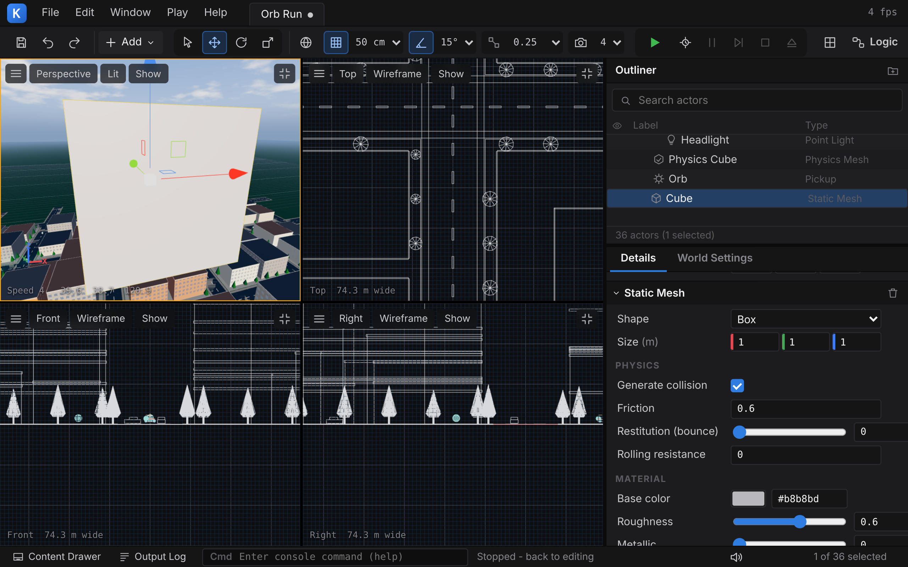

# 4 Grafik – wie Kern 60 Bilder pro Sekunde malt

> **Dein Level:** Jetzt schaust du der Engine beim Malen zu. Du erfährst, wie C++-Code im Browser
> die Grafikkarte erreicht, wie aus Dreiecken, Licht und Schatten ein Bild wird und mit welchen
> Tricks Kern so wenig Arbeit wie möglich macht. Am Ende leuchten die Fenster einer ganzen Stadt –
> ohne dass jemand ein einziges Fenster modelliert hat.

Dieses Kapitel zeigt, **was Kern konkret macht**. Die Grundlagen – Koordinaten und Matrizen, wie ein
Dreieck zu Pixeln wird, Shader, Tiefenpuffer, Licht, Schatten, PBR, Gamma – erklärt
[Anhang B](B-grundlagen-rendering.md) mit Bildern und Rechenbeispielen. Klingt hier etwas fremd,
blättere dort nach.

## 4.1 Überblick

Der **Renderer** malt die Bilder. Drei Grundregeln halten ihn zusammen:

1. **Ein Programm für alles.** Jedes Objekt wird mit demselben Shader gemalt. Spiele ändern das
   Aussehen über kleine Erweiterungen, die in dieses eine Programm eingesetzt werden (4.6).
2. **Einmal hochladen, danach nur Bewegung.** Die Form geht einmal zur Grafikkarte, danach nur noch,
   *wo* etwas steht. Die Arbeit pro Bild hängt davon ab, was sich bewegt – nicht von der Größe der Welt.
3. **Die eigene Kopie ist die Wahrheit.** Kern behält Ecken, Farben und Positionen jedes Objekts
   selbst. Daraus berechnet es, was sichtbar ist und was man anklicken kann – und baut alles neu auf,
   wenn der Browser die Grafikkarte wegnimmt (4.11).

> **So kannst du es dir vorstellen:** Theater. Die Kulissen werden einmal aufgebaut, während der
> Vorstellung laufen nur die Schauspieler herum. Und der Regisseur hat den Plan der Bühne im Kopf –
> brennt sie ab, baut er sie genauso wieder auf.

## 4.2 Die WebGL2-Anbindung

Kern wird mit dem Werkzeug *wasi-sdk* zu WebAssembly übersetzt, ohne das bekannte Emscripten und ohne
automatisch erzeugten JavaScript-Kleber. Die Grafikbefehle sind gewöhnliche **Importe**: Das Modul
sagt beim Laden „Ich brauche `drawElementsInstanced` aus dem Paket `kern_gl`“, und JavaScript reicht
die Funktion herein. Die Liste in `gl.h` ist „genau das, was die Engine benutzt“; ein neuer Befehl
kommt dort und in `web/kern.mjs` dazu. Tests ohne Browser nutzen eine Attrappe, die nur mitschreibt.

Über die Grenze wandern **nur Zahlen**:

- **Grafikobjekte sind Nummern.** JavaScript legt das echte Objekt in eine Tabelle und gibt die
  Platznummer zurück; 0 heißt „nichts“.
- **Daten sind Adresse plus Länge.** „Ab Speicherstelle X, so viele Bytes“ – JavaScript liest direkt
  im Speicher des Moduls, ohne zu kopieren. Wächst der Speicher, erneuert es seine Sichtfenster darauf.

`kern.mjs` hat genau drei Aufgaben und keine Spiel-Logik: das Modul mit seinen Importen laden
(Grafik, dazu Uhr, Geländehöhe, Status, Mausfang, Log, der schnelle Weg der Logik-Graphen aus
[Kapitel 9](09-logik.md) und ein Mini-WASI für Konsole, Zufall und Uhr), die Nummern-Tabellen samt
Kontextverlust verwalten und die Hülle `KernRenderer` anbieten. **Die Engine fasst keine Dateien an.**

Die Zeichenfläche erzeugt die Webseite, bei `kern.mjs` ohne Kantenglättung, weil der Renderer in
eigene Bildpuffer malt (4.7). Kern Studio und exportierte Spiele schalten sie ein.

**C++-Spiele** schreiben eine `App`: pro Bild erst Spiellogik, dann Malen
([Kapitel 12](12-eigene-spiele.md)). **JavaScript-Programme** wie SpawnCity nehmen genau einen
`KernRenderer` pro Modul. Kern Studio hat einen eigenen Zugang ([Kapitel 11](11-studio.md)) zum
selben Renderer.

## 4.3 Programme und der Uniform-Cache

Ein **Programm** ist ein fertiger Shader aus Vertex- und Fragment-Teil
([Anhang B.3](B-grundlagen-rendering.md)). Scheitert das Übersetzen, landet die Meldung des Treibers
(bis 767 Zeichen) mit einem Etikett wie „standard fragment shader:“ im Log. Fragt Kern nach einer
Einstellung, die der Shader gar nicht benutzt, kommt Platz 0 zurück – und alles an Platz 0 wird
ignoriert. Wegoptimiertes kostet also nichts und erzeugt keinen Fehler.

**Uniforms** sind Werte, die für einen ganzen Zeichenbefehl gelten, etwa „Rauheit = 0,5“. Einmal
gesetzt, bleiben sie stehen. Der **Uniform-Cache** merkt sich jeden zuletzt geschickten Wert:

```cpp
void UniformCache::set_float(u32 location, f32 v) {
  if (!location) return;
  Entry& e = entry(location);
  if (e.kind == 2 && e.count == 1 && e.f[0] == v) return;
  e.kind = 2; e.count = 1; e.f[0] = v;
  gl::uniform1f(location, v);
}
```

Zeile 2: Platz 0 – nichts tun. Zeile 3: Merkzettel holen. Zeile 4: Steht dort schon diese Zahl?
Fertig. Zeile 5: neuen Wert notieren. Zeile 6: erst jetzt wirklich schicken.

Bei Listen und Matrizen merkt er sich nur einen 64-Bit-„Fingerabdruck“ (Hash); Knochen gehen
absichtlich ungecacht raus, sie ändern sich jedes Bild. Das lohnt sich, weil jeder Befehl den weiten
Weg über JavaScript zum Browser nimmt.

## 4.4 Mesh, Material und MeshInput

Ein **Mesh** ist eine Form aus Dreiecken, das **Material** beschreibt Farbe, Glanz und Leuchten.

### Feste Plätze

| Platz | Inhalt | gilt pro |
|---|---|---|
| 0–3 | Position, Normale, Farbe, UV | Ecke |
| 4–7 | Modellmatrix | Instanz |
| 8 | Tönung mit Deckkraft | Instanz |
| 9–11 | Normalenmatrix | Instanz |
| 12–13 | Knochen und Gewichte | Ecke |
| 14–15 | frei für Erweiterungen | Ecke |

Kern zeichnet **jedes** Mesh instanziert ([Anhang B.3](B-grundlagen-rendering.md)), auch wenn es nur
einmal vorkommt. Die Normalenmatrix ([Anhang B.1](B-grundlagen-rendering.md)) rechnet es pro Instanz
auf dem Prozessor aus; eine Matrix, die ein Objekt platt drückt, wird abgelehnt. Grenzen: 32 Knochen,
6 Punktlichter, 2 Erweiterungsströme, 8 Zusatzzahlen im Material.

### Das Material

| Feld | Bedeutung |
|---|---|
| `color`, `alpha` | Grundfarbe; deckend, ausgestanzt, durchsichtig |
| `roughness`, `metalness` | Rauheit, Metall |
| `emissive` | Eigenleuchten, speist das Glühen |
| `unlit`, `double_sided` | ohne Licht; beide Seiten |
| `cast_shadow` | wirft Schatten |
| `viewmodel` | Ego-Ebene, zuletzt gemalt |
| `lines` | Linien statt Dreiecke |

Farben sind **sRGB** und werden fürs Licht linear gemacht ([Anhang B.6](B-grundlagen-rendering.md)),
außer ein Schalter sagt „schon linear“; `emissive` ist immer linear. Nur **deckende** Materialien
werfen Schatten. Die **Ego-Ebene** (die Waffe in der Hand, Studios Gizmos) kommt nach einem Löschen
des Tiefenpuffers zuletzt – keine Wand schneidet sie ab. **Linien** haben weder Licht noch Schatten
und sind nicht anklickbar. Weggelassen wird ([Anhang B.2](B-grundlagen-rendering.md)) normal die
Rückseite, bei lauter gespiegelten Instanzen die Vorderseite, bei zweiseitigen, Linien oder teils
gespiegelten Meshes nichts – ein Spiegelbild dreht den Umlaufsinn der Ecken um.

### Anlegen mit `upsert`

`upsert` bekommt Positionen (Pflicht) und wahlweise alles andere; Fehlendes wird ergänzt (weiß, eine
Instanz am Ursprung, flache Normalen). Es ist **alles oder nichts**: Erst prüft Kern, ob alle Zahlen
echt sind, jeder Index auf eine Ecke zeigt, die Längen passen und die vier Knochengewichte jeder Ecke
1 ergeben (±0,001). Nur dann wird das neue Mesh gebaut und gegen das alte getauscht.

> **Krass, aber wahr:** Deshalb kann ein Editor beim Tippen nichts kaputtmachen. Ein ungültiger
> Zwischenstand löscht kein Objekt – Kern zeigt einfach weiter den letzten guten.

Mesh-Nummern vergibt nur der Renderer selbst; zwei Programmteile können sich so nie einen Platz teilen.

Beim Hochladen entstehen feste Puffer für die Eckdaten, drei veränderliche für die Instanzen und einer
für die Dreiecksliste. Bis 65 536 Ecken speichert Kern jede Eckennummer mit 16 statt 32 Bit, denn
2¹⁶ = 65 536 – mehr Nummern passen nicht hinein. Das halbiert die Dreiecksliste.
Ruhige, große Objekte (ab 36 Dreiecken, eine Instanz, ohne Knochen) bekommen einen Suchbaum zum
Anklicken ([Kapitel 5](05-szene-und-geometrie.md)).

### Bewegen mit `update_instances`

- Nur neue Tönungen? Dann geht nur dieser Puffer raus; Schatten bleiben gültig. (Ohne genau 4 Zahlen
  pro Instanz gilt „alle weiß“.)
- Alles Byte für Byte gleich? Dann passiert gar nichts.
- Mehr Instanzen als Platz? Der Platz wird **mindestens verdoppelt**, damit eine schwankende Anzahl
  nicht ständig neuen Speicher braucht.

Andere Befehle ändern Knochen, Sichtbarkeit, Material oder Ebenen. Jede Änderung an einem
Schattenwerfer zählt den Schattenzähler hoch (4.8.1).

**Ebenen** sind eine Zahl, deren Bits wie Schalter wirken (Standard 1). Beim Malen, für Schatten und
beim Anklicken wird gefiltert. Kern Studio legt so Raster, Symbole, Gizmos pro Viewport,
Kollisionsformen und die Welten mehrerer Netzwerk-Spieler auseinander.

**Texturen** legt Kern selbst an und behält die Pixel (mit Mipmaps, gekachelt oder im Pixel-Look),
oder JavaScript meldet eigene an, samt Rezept zum Neufüllen. Ein Mesh hat höchstens **eine**.

## 4.5 Der Standard-Shader

Der Standard-Shader wird beim Start aus festen Bausteinen zusammengesetzt; an festen Stellen kommen
die Schnipsel der Erweiterungen hinein. Heraus kommt **ein** Programm.

Der **Vertex-Shader** baut die Modellmatrix aus den Instanz-Spalten, rechnet bei Figuren die Knochen
ein (*Linear Blend Skinning*) und schiebt die Ecke auf den Bildschirm. Beispiel Skinning: Eine Ecke am
Ellbogen hängt zu 70 % am Oberarm und zu 30 % am Unterarm. Hebt sich der Unterarm um 10 cm, wandert
die Ecke 0,3 · 10 = 3 cm mit. So knickt die Haut weich.

Der **Fragment-Shader** schreibt **drei Ergebnisse auf einmal**: das fertige Bild (8 Bit, sRGB, mit
Nebel), das helle Rohlicht für das Glühen (4.8.3) und einen Datensatz für die Verdeckung (4.8.4).
Unterwegs: Textur lesen, Deckkraft (Instanz × Material × Textur), ausgestanzte Pixel wegwerfen,
Farbe linear machen, Licht, Tonemapping, Nebel.

### Licht und Material

Kern orientiert sich am Standardmaterial der Web-Engine three.js. Die Theorie (Lambert, Fresnel, GGX)
rechnet [Anhang B.4](B-grundlagen-rendering.md) vor. Kern mischt sieben Zutaten: **Sonne** (mal
Schatten), **Halbkugel-Licht** (Himmel von oben, Boden von unten), **Himmelsverlauf**, bis zu 6
**Punktlichter**, **Glanz**, **Glas** und **Leuchten**.

Beim **Himmelsverlauf** zählt, wohin die Fläche zeigt: Eine senkrechte Wand bekommt halb Boden-, halb
Himmelsfarbe. Rauheit gilt von 0,04 bis 1. Das Licht von Himmel und Umgebung (*indirekt*) führt
Kern **getrennt** mit, denn die Verdeckung soll später nur dieses abdunkeln. Metall hat keinen matten
Anteil, `unlit` zeigt die Grundfarbe pur. **Glanz** gibt es nur bei Metall oder Rauheit unter 0,95;
der Sonnen-Glanzpunkt ist nach oben begrenzt, damit keine superhellen Einzelpixel im Glühen flackern.
**Glas** (von Erweiterungen gesetzt) spiegelt den Himmel, je flacher du draufschaust, desto mehr.
**Leuchten** hat keine Obergrenze; Werte über 1 werden zum Glühen.

> **Mission:** Öffne Kern Studio über https://kernengine.de/, wähle **File › New Level...** ›
> **Basic** und setze über **+ Add** eine **Sphere** (Shapes). Stell in **Details** unter *Material*
> **Roughness** auf 1 und **Metallic** auf 0: matt. Dann Roughness 0,1 und Metallic 1: Die Kugel
> spiegelt den Himmel. Zum Schluss dreh **Emissive** (Farbe und Stärke) hoch – sie glüht.

### Vom Rohlicht zum Pixel

Zuerst wird das Rohlicht fürs Glühen gespeichert. Dann wird mit Belichtung ÷ 0,6 multipliziert und
die **ACES-Filmkurve** (Fassung von three.js) drückt alle Helligkeiten auf 0 bis 1
([Anhang B.6](B-grundlagen-rendering.md)). Danach Kerns abschaltbares **Farb-Grading**: Sättigung
× 1,14, eine weiche S-Kurve (22 %), wärmere Lichter, kühlere Schatten. Zuletzt sRGB.

Der **Nebel** kommt wie bei three.js *nach* der sRGB-Umwandlung. Drei Extras: **Höhennebel** (Kern
mittelt die Dichte entlang deiner Blicklinie; der Dunst liegt am Boden, über den Dächern ist es klar),
**Sonnenstreuung** (Richtung Sonne färbt sich der Nebel) und **Horizontnebel** (4.8.2). Sind alle aus,
sieht der Nebel aus wie in three.js.

In den **AO-Datensatz** schreibt der Shader pro Farbkanal, welcher Anteil des Lichts indirekt ist
(schon um den Nebel verringert), und wie hell die Grundfarbe ist. Kommen von 1,0 Licht 0,3 vom
Himmel, steht dort 0,3. Durchsichtiges und die Ego-Ebene schreiben 0, gelten also als unverdeckt.

## 4.6 Shader-Erweiterungen

Eine **Shader-Erweiterung** liefert GLSL-Schnipsel für feste Einfügestellen. Die Engine bleibt
unverändert; das Spiel gibt seine Erweiterungen beim Start ab.

| Einfügestelle | Wo | Erlaubt |
|---|---|---|
| `vertex_declarations` | Vertex | eigene Variablen |
| `vertex` | Vertex | Farbe, Deckkraft, UV ändern |
| `fragment_declarations` | Fragment | Variablen, Funktionen |
| `fragment_discard` | Fragment, früh | Pixel wegwerfen |
| `fragment_input` | Fragment | „Farbe ist linear“ umstellen |
| `fragment_surface` | vor dem Licht | Farbe, Glas, Leuchten ändern |

Vor jeden Schnipsel setzt Kern eine Kommentarzeile mit dem Namen der Erweiterung, damit Fehler
zuzuordnen sind. Erweiterungen dürfen eigene Datenströme pro Ecke mitbringen (1 bis 4 Zahlen, zusammen
höchstens zwei, Plätze 14 und 15; fehlt einem Mesh der Strom, liest der Shader (0, 0, 0, 1)),
ganzzahlige Materialwerte (zusammen höchstens 8) und eigene Uniforms, am besten über den Cache und
nach jedem Neubau des Programms neu nachgeschlagen. Ein Beispiel folgt in 4.13.

## 4.7 Der Ablauf eines Bildes

Den Überblick als Bild zeigt [Anhang B.11](B-grundlagen-rendering.md). Im Detail:

0. **Prüfen** von Bildausschnitt und Kamera, bevor irgendetwas verstellt wird.
1. **GPU-Zeit messen**, falls möglich; die Antwort kommt Bilder später (höchstens 4 unterwegs).
2. **Sonnenschatten**, nur wenn sich etwas geändert hat (4.8.1).
3. **Ziel wählen.** Ohne Teil-Rechteck malt Kern in eigene Bildpuffer, dann gibt es Glühen und
   Verdeckung. Mit Teil-Rechteck direkt auf den Bildschirm, ohne beides.
4. **Einsortieren.** Unsichtbares, abgeschaltete Ebenen und alles außerhalb der Sichtpyramide fallen
   weg – außer Figuren mit Knochen, deren Pose den gespeicherten Umriss verlassen kann. Deckendes wird
   **vorn nach hinten** sortiert (Verdecktes fällt früh am Tiefentest durch), Durchsichtiges **hinten
   nach vorn** (damit sich Farben richtig überlagern).
5. **Deckende Objekte:** gemeinsame Werte einmal pro Bild, dann ein Zeichenbefehl pro Mesh; Textur
   und Seiten-Weglassen nur bei Wechsel umstellen.
6. **Himmel** (4.8.2). 7. **Durchsichtiges**, ohne in den Tiefenpuffer zu schreiben.
8. **Verdeckung** – *vor* der Ego-Ebene, weil deren Löschen die Welttiefe vernichtet.
9. **Ego-Ebene.** 10. **Zusammensetzen** (4.8.3). 11. **Statistik.**

| Bildpuffer | Größe | Inhalt |
|---|---|---|
| Schattenkarte | eigene | Tiefe aus Sicht der Sonne |
| Szene: Farbe, 4 Byte | voll | fertiges Bild |
| Szene: HDR, 8 Byte | voll | Rohlicht |
| Szene: AO, 4 Byte | voll | indirekter Anteil |
| Szene: Tiefe | voll | für GTAO |
| Glühen | 1/4 und 1/8 | weiches Licht |
| GTAO | halb oder voll | Sichtbarkeit, Tiefe |

4 + 8 + 4 = **16 Byte pro Pixel** – genau so viel passt bei Handy-Chips, die in Kacheln malen, in
den schnellen Kachelspeicher. Darum hat der AO-Datensatz nur 8 Bit pro Kanal. Auch der Himmel
schreibt alle drei Ergebnisse; WebGL verlangt das.



Kern Studio malt jeden Viewport einzeln. Ein einzelner großer Viewport hat kein Teil-Rechteck und
bekommt Glühen und Verdeckung; in der Vier-Ansicht fehlt beides.

> **Mission:** Lade **File › Example Levels ▸ Orb Run** und schalte in der Toolbar mit **Layout** auf
> 4 Viewports. Vergleiche die Perspektive mit der Einzelansicht (Knopf **Maximieren** in der Leiste des
> Viewports): Groß wirken Ecken und Fugen dunkler – dort läuft die Verdeckung.

## 4.8 Die Passes im Detail

### 4.8.1 Sonnenschatten

Die Idee der Schattenkarte und ihre typischen Fehler stehen in [Anhang B.5](B-grundlagen-rendering.md).
Hier: wie Kern sie löst. Kern nutzt **eine** Tiefenkarte aus Sicht der Sonne mit parallelen Strahlen.

| Feld | Standard | erlaubt |
|---|---|---|
| Auflösung | 512 Texel | Zweierpotenz 128–4096 |
| halbe Breite | 120 m | 10–2000 m |
| Tiefenversatz | 0,0012 | 0 bis unter 0,04 |
| Filter | 9 Abtastungen | 1, 4 oder 9 |

Kern Studio wählt den Filter nach Gerät: Handys 4, Computer 9.

**Schattendistanz.** World Settings › **Shadow distance** legt fest, wie weit die Karte in deine Sicht
reicht (Standard 80 m, im Micro-Duck-Level 10 m). Kern legt eine **Kugel** um diesen Teil der
Sichtpyramide. Warum Kugel? Dreh dich auf der Stelle – sie bleibt gleich groß, also auch die Texel.

Rechnen wir mit 60° Öffnung, Format 16:9 und 2048 Texeln (so legt Studio die Karte an): Bei 80 m
ergibt sich ein Kugelradius von etwa 94 m. Die Karte ist 2 · 94 = 188 m breit, ein Texel
188 ÷ 2048 ≈ **9 cm**. Bei 10 m: Radius knapp 12 m, ein Texel ≈ **1,2 cm**. Kleinere Distanz heißt
schärfere Schatten, die weniger weit reichen.

**Einrasten.** Rutscht die Karte mit der Kamera um Bruchteile eines Texels, fallen Schattenkanten in
jedem Bild etwas anders aufs Raster – sie „schwimmen“. Kern rundet die Lage deshalb auf **ganze
Texel**. Entlang der Sonne genügt ein grober 8-m-Schritt.

> **So kannst du es dir vorstellen:** Karopapier, auf dem du dein Bild nur um ganze Kästchen
> verschieben darfst. Jede Linie liegt dann immer auf denselben Kästchen.

**Wiederverwenden.** Gerundete Lage, Sonnenrichtung und Größe ergeben einen Fingerabdruck; dazu kommen
Schattenzähler und Ebenen. Bleibt alles gleich, wird nicht neu gemalt.

> **Krass, aber wahr:** Steht die Kamera still über einer ruhigen Stadt, kostet der Schatten danach
> **keinen einzigen** Zeichenbefehl.

**Malen und Abfragen.** Die Sonne „fotografiert“ nur die Tiefe der deckenden Schattenwerfer;
*Polygon-Offset* hilft gegen Akne. Die Gegenmittel PCF und Normal Offset erklärt
[Anhang B.5](B-grundlagen-rendering.md): Stufe 1 ist der Vierer-Vergleich der Hardware, Stufe 4 und 9
setzen nach Ignacio Castaño (2013, Spiel „The Witness“) daraus weiche 3 × 3- bzw. 5 × 5-Filter
zusammen. Außerhalb der Karte ist alles beleuchtet; mit Schattendistanz blendet der Schatten auf dem
letzten Zehntel aus. Orb Run (C++) nutzt 2048 Texel auf ±110 m, also 220 ÷ 2048 ≈ 11 cm pro Texel,
das Beispiel *hello* 1024 Texel auf ±40 m.

> **Mission:** Stell in **World Settings** die **Shadow distance (smaller: sharper)** auf 10, dann 80,
> dann 500. Bei 10 sind nahe Schatten gestochen scharf, ferne fehlen. Bei 500 reichen sie weit, sind
> aber verwaschen.

### 4.8.2 Himmel

Der Himmel ist ein einziges bildschirmfüllendes Dreieck ganz hinten auf der Fernebene, gemalt **nach**
dem Deckenden. Der Tiefentest lässt ihn nur in die Lücken – der teure Himmels-Shader rechnet nur, wo
man Himmel sieht. Er mischt einen **Verlauf** von Horizont zu Zenit, die **goldene Stunde** (tiefe Sonne: Horizont
orange, Zenit violett), **Sonne** mit Lichthof und Scheibe, nachts **Mond und Sterne**, **Wolken** aus
Rauschen in 5 Feinheitsstufen, die mit dem Wind ziehen (eine Explosion drückt sie weg), und auf Wunsch
**Horizontnebel** in der Nebelfarbe der Szene. Die Physik dahinter steht in
[Anhang B.9](B-grundlagen-rendering.md). Ansichten ohne Perspektive haben keinen Himmel.

### 4.8.3 Glühen und Zusammensetzen

Was **Bloom** ist, erklärt [Anhang B.7](B-grundlagen-rendering.md). Kern braucht dafür Bildpuffer mit
Kommazahlen; fehlen sie, meldet es „unsupported“ und malt direkt. Ablauf: Helles ausschneiden (weiche
Schwelle von 0,88 bis 1,23) auf einem Viertel der Auflösung, weichzeichnen, auf ein Achtel
verkleinern, noch einmal weichzeichnen, zusammensetzen.

Beim **Zusammensetzen** steckt ein Kniff: Das fertige Bild enthält schon den Nebel, das Rohlicht nicht.
Neu tonemappen würde den Nebel löschen. Also rechnet Kern „Rohlicht mit Glühen und Verdeckung“ und
„Rohlicht ohne“ durch dieselbe Kurve und addiert nur den **Unterschied**. Pixel ohne beides werden
bloß kopiert.

**Bildzeit-Wächter.** Kern führt einen gleitenden Mittelwert der Bilddauer (Ausreißer über 200 ms
zählen nicht). Liegt er 3,5 s lang über 27 ms – also unter etwa 37 Bildern pro Sekunde –, schaltet sich
das Glühen ab, außer es ist erzwungen; das Zusammensetzen läuft für die Verdeckung weiter.

### 4.8.4 Umgebungsverdeckung (GTAO)

In Ecken und Fugen kommt weniger Himmelslicht an; das Verfahren GTAO erklärt
[Anhang B.8](B-grundlagen-rendering.md). Kern folgt Intels XeGTAO. Das Besondere ist der Einbau,
**ohne zusätzlichen Geometrie-Malgang**:

1. Der normale Malgang notiert den indirekten Anteil jedes Pixels (4.5).
2. GTAO rechnet aus dem fertigen Tiefenpuffer, wie verdeckt jeder Punkt ist.
3. Das Zusammensetzen dunkelt **nur** den indirekten Anteil ab.

Auch einen Tiefen-Vorgang spart Kern: Chips von Apple und Mali verwerfen Verdecktes ohnehin selbst.

Kern **errät die Normale aus der Tiefe** (der Nachbar mit dem kleineren Tiefensprung liegt eher auf
derselben Fläche). Der Radius wird in Pixel umgerechnet, höchstens 20 % der Bildhöhe; unter 1,5 Pixeln
gilt ein Punkt als frei. Ferne Punkte zählen auf den letzten 61,5 % des Radius immer weniger. Die
Sichtbarkeit wird noch mit 2,2 potenziert (mindestens 0,03). Ein 4 × 4-Muster dreht die Richtungen von
Pixel zu Pixel; ein Filter mittelt es weg, ohne über Kanten zu verschmieren.

**Mehrfach-Abprall:** Helle Flächen werfen Licht hin und her. Bei Sichtbarkeit 0,5 bleibt eine dunkle
Fläche (Helligkeit 0,1) bei 0,51, eine helle (0,8) steigt auf 0,81.

| Qualität | Richtungen | Schritte pro Seite |
|---|---|---|
| low | 1 | 2 |
| medium | 2 | 2 |
| high | 3 | 3 |
| ultra | 9 | 3 |

Standard: an, medium, halbe Auflösung, Radius 1,6 m, anpassend – ein Wächter wie beim Glühen stuft auf
langsamen Geräten bis *low* herunter und dann auf halbe Auflösung. Studio nimmt auf Handys medium in
halber, sonst high in voller Auflösung. AO läuft nur mit eigenem Bildpuffer und Perspektive. Den
Radius setzt die Szene: World Settings › **Ambient occlusion radius (0 = off)**.

> **Mission:** Stell **Ambient occlusion radius (0 = off)** auf 0, dann auf 3. Schau in einem großen
> Viewport auf Hausecken und den Boden unter Objekten: Mit Radius wird es dort dunkler und plastischer.

## 4.9 Partikel und Punktlichter

**Partikel** sind kleine, zur Kamera gedrehte Vierecke – Funken, Rauch, Mündungsfeuer –, alle zusammen
**ein** instanziertes, durchsichtiges Mesh ohne Kollision. Jedes hat Startort, Tempo, Farbe,
Lebensdauer (Standard 350 ms, 16 bis 10 000), Größe (0,35 m), Schwerkraft, Wachstum und
Extra-Ausblenden; ein System fasst 1 bis 4096. Die Bahn ist der Wurf aus dem Physikunterricht: Startet
ein Funke mit 5 m/s nach oben bei 9,81 m/s², ist er nach 0,5 s bei 5 · 0,5 − ½ · 9,81 · 0,5² ≈
**1,27 m**. Die Zeit läuft nie rückwärts (sonst kämen alte Funken zurück), sortiert wird hinten nach
vorn, die Deckkraft sinkt auf 0. Kein Licht, kein Schatten; die Spiel-Laufzeit fasst 512 Partikel.

Der Shader kennt nur 6 Punktlichter. Die **LightPool** wählt pro Bild die wichtigsten aus beliebig
vielen Anfragen:

> Punkte = Intensität ÷ (1 + Abstand ÷ Reichweite), Reichweite mindestens 4

Lampe A (Intensität 10, Reichweite 5, 20 m weit): 10 ÷ 5 = 2. Lampe B (Intensität 4, Reichweite 20,
10 m weit): 4 ÷ 1,5 ≈ 2,67. B gewinnt, obwohl schwächer. Bei Gleichstand gewinnt die frühere Anfrage;
Intensität und Reichweite sind auf 100 bzw. 1000 begrenzt. Orb Run fragt einen Scheinwerfer und ein
Licht pro Orb an.

## 4.10 Einstellungen

**Beim Start:** 960 × 540 Pixel, Schatten aus (512 / 120 / 0,0012 / 9), Glühen, AO und Grading an –
alles später umstellbar. **Licht** („production day“, linear): Sonnenlicht (2,8; 2,47; 2,11),
Nebeldichte 0,00085, Belichtung 1, Umgebung 0,9, Atmosphären-Extras aus. Der Himmel hat eigene Werte
für Sonne, Mond, Nacht, Wolken, Wind und Explosion. Im Spiel rechnet die Laufzeit alles aus der
**Tageszeit**, mit Sonne zu Himmelslicht etwa 5 : 1 ([Kapitel 8](08-spiel-laufzeit.md)). **Pro Bild**
gibt es Hintergrundfarbe, Teil-Rechteck, „Seite verborgen“, Ebenen und Himmel an/aus. **Kamera:** oben
ist +Z, 60° Öffnung, nahe Ebene 0,05 m, ferne 1800 m.

## 4.11 Kontextverlust

Der Browser darf Kern die Grafikkarte **jederzeit** wegnehmen – bei Speichermangel, Treiber-Neustart
oder wenn das Handy die Seite in den Hintergrund schickt.

1. **Verlust:** Kern vergisst alle Grafik-Nummern (die Objekte sind schon tot) und malt nicht mehr.
   Die Kopien bleiben, `upsert` geht weiter.
2. **Wiederherstellung:** Programme, Passes und Erweiterungen neu bauen, alles aus den Kopien hochladen.
3. **Scheitert das,** räumt Kern auf und versucht es später von vorn.

Derselbe Weg erlaubt Betrieb **ganz ohne Grafikkarte** – so rechnet der Lehrer
([Kapitel 14](14-lehrer.md)) dieselbe Welt, ohne zu malen.

> **Vorsicht, Falle:** Wer seine Daten nur auf der Grafikkarte hat, sieht nach einem Kontextverlust
> schwarz. Genau dafür gibt es Grundregel 3.

## 4.12 Performance-Tipps

- **Instanzieren:** Die Stadt malt alle Baumstämme als ein Mesh, alle Kronen als ein zweites.
- **Zusammenfassen:** wenige große Meshes statt vieler kleiner.
- **Nur Änderungen schicken**; reine Farbwechsel lassen den Schatten gültig.
- **Schatten schonen:** Straßen, Boden und Partikel brauchen keinen – `cast_shadow = false`.
- **Indizes:** `weld` ([Kapitel 5](05-szene-und-geometrie.md)) macht lose Dreiecke zu indizierten.
- **Sichtpyramiden-Test anlassen**, außer der Umriss stimmt nicht (Partikel).
- **Messen:** Die Statistik nennt Befehle, Dreiecke, Instanzen und Zeiten; in Studio zeigt
  **Show › Stats** die Bilder pro Sekunde. Glühen und AO passen sich selbst an.

## 4.13 Beispiel: Fenster, die nachts leuchten

Die Häuser in Orb Run haben **keine** Fenster in ihrer Form. Trotzdem leuchten nachts tausende. Jede
Ecke trägt einen „Wand-Datensatz“: Wandlänge (−1 Dach, −2 Gesims), Wandhöhe, eine Zufallszahl des
Hauses und die Stockwerkshöhe. Die UVs der Wände sind Meter: u entlang der Wand, v nach oben. Das
Herzstück der Erweiterung, verkürzt:

```glsl
float column = floor(u / 3.0);
float floorIndex = floor(z / storey);
vec2 cell = vec2(fract(u / 3.0), fract(z / storey));
float win = step(0.22, cell.x) * step(cell.x, 0.78)
          * step(0.28, cell.y) * step(cell.y, 0.78);
```

Zeile 1: Die Wand wird in **3 m breite Spalten** geteilt; bei u = 10 m ist das Spalte 3. Zeile 2:
genauso die Stockwerke. Zeile 3: `fract` ist der Rest hinter dem Komma, also wo du in der Zelle bist:
10 ÷ 3 = 3,33, Rest 0,33. Zeilen 4–5: `step(a, b)` ist 1, wenn b ≥ a, sonst 0. Ein Fenster ist da, wo
der Rest waagerecht zwischen 0,22 und 0,78 und senkrecht zwischen 0,28 und 0,78 liegt. 0,33 passt – du
stehst vor einem Fenster.

Außerdem: Der Datenstrom „wall“ liegt auf Platz 14 und geht **unverändert** (`flat`) an die Pixel –
Mischen würde die Zufallszahl verwürfeln. Fenster gibt es nur auf Wänden, ab dem ersten Stock bis 1 m
unters Dach; eine Zufallszahl aus Spalte, Stockwerk und Haus schaltet etwa 58 % an. Wird ein Fenster
kleiner als ein Pixel (`fwidth` misst das), glüht die Fassade stattdessen gleichmäßig – gegen
Flimmern. Dunkle Fenster werden **Glas**, leuchtende bekommen warmes **Leuchten** über 1 und glühen im
Bloom. `uNight` kommt einmal pro Bild über den Cache. Straßen und Boden haben keinen Strom; dort
liest der Shader 0, und nichts passiert. Kern Studio
und exportierte Spiele melden eine Kopie dieser Erweiterung immer an; in der Komponente **Procedural
City** entscheidet **Lit windows at night**, ob die Häuser den Strom bekommen
([Kapitel 5](05-szene-und-geometrie.md)).

> **Mission:** Lade Orb Run und zieh in World Settings **Time of day** auf etwa 0,9 (0,25 ist
> Sonnenaufgang, 0,5 Mittag, 0,75 Sonnenuntergang): Die Fenster gehen an. Wähle im Outliner den Actor
> mit der Procedural City und schalte in Details **Lit windows at night** aus und wieder ein.
## Level geschafft!

- C++ steuert die Grafikkarte über Nummern und Speicheradressen.
- Drei Grundregeln: ein Programm, einmal hochladen, Kopie ist die Wahrheit.
- Mesh, Material, Instanz – und warum `upsert` alles oder nichts ist.
- Der Ablauf eines Bildes, vom Prüfen bis zum Zusammensetzen.
- Warum Kerns Schatten nicht zittern: Kugel, Einrasten, Wiederverwenden.
- Glühen und Verdeckung ohne Extra-Malgang.
- Eine Erweiterung beleuchtet eine ganze Stadt.

## Rätsel-Ecke

1. Warum wird Deckendes von vorn nach hinten gemalt, Durchsichtiges von hinten nach vorn?
2. Ein Mesh hat 70 000 Ecken. Bekommt es 16-Bit-Indizes?
3. Warum fehlt in Studios Vier-Ansicht die Umgebungsverdeckung?
4. Lampe A: Intensität 8, Reichweite 10, 30 m weit. Lampe B: Intensität 3, Reichweite 30, 30 m weit.
   Wer gewinnt?
5. **Boss-Rätsel:** Die Kamera steht still, ein Auto fährt durch die Stadt. Wird die Schattenkarte neu
   gemalt? Und wenn das Auto `cast_shadow = false` hätte?

### Lösungen

1. Verdecktes fällt so früh am Tiefentest durch; Durchsichtiges muss richtig übereinanderliegen.
2. Nein: 16 Bit reichen für 2¹⁶ = 65 536 Nummern, 70 000 Ecken brauchen 32 Bit.
3. Jeder Viewport hat ein Teil-Rechteck und wird direkt gemalt – ohne eigenen Bildpuffer kein AO.
4. A: 8 ÷ (1 + 3) = 2. B: 3 ÷ (1 + 1) = 1,5. A gewinnt.
5. Ja: Ein Schattenwerfer bewegt sich, der Schattenzähler steigt, die ganze Karte wird neu gemalt.
   Ohne `cast_shadow` bliebe die Karte gültig – aber das Auto hätte keinen Schatten.

---

© 2026 Christian Heinrich Hohlfeld · Alle Rechte vorbehalten · [Impressum und Rechte](00-impressum.md)
