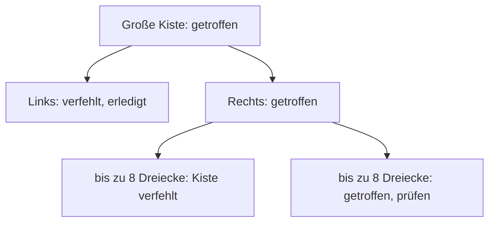
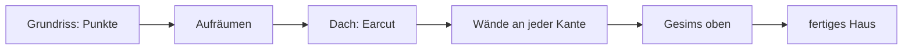
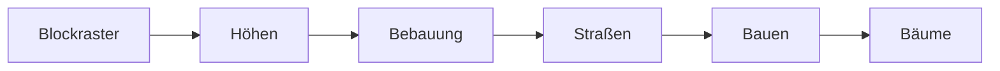

# 5 Szene und Geometrie – Eine Stadt aus Dreiecken

> **Dein Level:** Kern entscheidet, was die Kamera sehen kann, findet blitzschnell das Dreieck
> unter deiner Maus und baut aus ein paar Zahlen eine ganze Stadt. Hier lernst du, wie.

> **Wörter, die du brauchst:**
>
> - **Mesh** – das Drahtgitter aus Dreiecken, aus dem ein 3D-Ding besteht.
> - **Ecke** (englisch *Vertex*) – ein Punkt im Mesh. Jede Ecke hat eine Lage und oft noch eine
>   Farbe, eine Normale und eine UV.
> - **Indizes** – eine Liste von Nummern, die sagt, welche drei Ecken zusammen ein Dreieck bilden.
> - **Normale** – ein kleiner Pfeil, der senkrecht aus einer Fläche zeigt. Mit ihm rechnet das
>   Licht: Fläche zur Sonne hell, Fläche weg von der Sonne dunkel.
> - **UV** – zwei Zahlen pro Ecke, die sagen, welche Stelle eines Bildes (einer **Textur**) dort
>   aufgeklebt wird, wie bei einem Aufkleber.
> - **Matrix** – eine kleine Zahlentabelle, die sagt, wie ein Ding verschoben, gedreht und
>   gestreckt wird.
> - **Instanz** – dasselbe Mesh noch einmal an einem anderen Ort, nur mit einer anderen Matrix.
>   Hundert Bäume, aber nur ein gespeicherter Baum.
> - **Actor** – ein Ding im Level von Kern Studio, zum Beispiel eine Kiste, ein Licht oder die
>   ganze Stadt.

Dieses Kapitel hat zwei Teile. Die **Szene** beantwortet Fragen über fertige Meshes: Was sieht die
Kamera? Was liegt unter der Maus? Die **Geometrie** baut neue Meshes: Dächer, Wände, Straßen, Boden.
Am Ende setzt Kern alles zu einer ganzen Stadt zusammen. Wie gemalt wird, erklärt
[Kapitel 4](04-grafik.md), die Mathematik dahinter [Anhang B](B-grundlagen-rendering.md).

## 5.1 Die Spielregeln

Überall in Kern gelten zwei Regeln: **Z zeigt nach oben**, und gemessen wird in **Metern**. Ein
Haus mit 20 Metern Höhe reicht also von z = 0 bis z = 20. So passen Grafik, Physik und Ton ohne
Umrechnen zusammen.

In der Schule zeichnest du ein Koordinatensystem auf ein Blatt: x nach rechts, y nach oben. In 3D
kommt eine dritte Achse dazu. Leg das Blatt flach auf den Tisch, wie eine Landkarte: x zeigt nach
rechts (Osten), y nach hinten (Norden), und die neue Achse z zeigt zur Decke. Sie ist die Höhe
über der Karte. Weil Kern ganze Städte aus Kartendaten baut, ist diese Landkarten-Sicht praktisch.

```
        z (oben)
        │   y (hinten, Norden)
        │  ╱
        │ ╱
        │╱
        └──────── x (rechts, Osten)
```

In diesem Kapitel kommen mehrere **Bauer** vor. Ein Bauer ist ein Programmteil, der aus ein paar
Zahlen eine neue Form baut, zum Beispiel aus einem Grundriss ein Haus. Alle Bauer liefern ihr
Ergebnis in derselben Form: eine Liste von **Ecken** (mit Lage, Normale, Farbe und UV) und, wenn
es sich lohnt, eine Liste von **Indizes**.

> **So kannst du es dir vorstellen:** Ein Würfel hat 8 Ecken und 6 Seiten, jede Seite sind
> 2 Dreiecke, zusammen 12. Ohne Indizes schreibst du für jedes Dreieck seine drei Ecken auf:
> 12 · 3 = 36 Ecken, viele davon doppelt. Das heißt **Triangle Soup** (gesprochen „Trai-än-gel
> Suup“, Dreieckssuppe). Mit Indizes
> schreibst du jede Ecke einmal auf und dahinter nur noch Nummern wie „Dreieck 1 = Ecke 0, 1, 2“.
> Das ist wie ein Malen-nach-Zahlen-Bild: erst die Punkte, dann die Linien zwischen ihren Nummern.

Farben und den Weg der Daten zur Grafikkarte erklärt [Kapitel 4](04-grafik.md). Die genauen Namen
und Werte stehen im blauen Buch, Kapitel 5.

## 5.2 Frustum-Culling: Nicht im Bild, nicht gezeichnet

Was nicht im Bild ist, muss nicht gezeichnet werden. Die Kamera sieht in eine abgeschnittene
Pyramide mit sechs Wänden (links, rechts, oben, unten, nah, fern). Diese Pyramide heißt **Frustum**.
Alles, was sicher draußen liegt, lässt Kern weg. Das heißt **Culling** (Aussortieren).

```
  Blick von oben auf das Sichtfeld der Kamera

    ○ A        ╲      ○ B     ╱
    draußen     ╲    drin    ╱      ◐ C
                 ╲          ╱     auf der Kante:
                  ╲        ╱      wird gezeichnet
                   ╲      ╱
                    ╲____╱
                    Kamera
```

Der Test muss viel schneller sein als das Zeichnen, sonst lohnt er nicht. Darum prüft Kern nicht
tausende Dreiecke, sondern **eine Kugel**, die das ganze Mesh umschließt. Liegt ihr Mittelpunkt
**weiter als ihr Radius** auf der Außenseite einer der sechs Wände, ist die ganze Kugel draußen,
und damit auch das Mesh.

> **So kannst du es dir vorstellen:** Ein Basketball hat 12 cm Radius. Liegt sein Mittelpunkt 30 cm
> hinter der Hallenwand, ist er ganz draußen (30 > 12). Liegt der Mittelpunkt nur 5 cm dahinter,
> ragt er noch 7 cm herein (5 < 12).

Der Test ist **vorsichtig**: Nahe einer Ecke der Pyramide wird eine Kugel manchmal umsonst
gezeichnet, aber nie fälschlich weggelassen. Lieber einmal zu viel malen als ein Loch im Bild.
Kaputte Kugeln gelten deshalb als sichtbar. Kaputt heißt: Beim Rechnen kam Unsinn heraus, zum
Beispiel keine echte Zahl.

Die Kugel berechnet Kern einmal, wenn das Mesh zur Grafikkarte geht. Hat ein Mesh viele Instanzen,
umschließt eine einzige Kugel **alle** zusammen.

> **Vorsicht, Falle:** Ein Wald als *ein* Mesh mit Bäumen über die ganze Karte hat eine riesige
> Kugel. Die ist fast immer im Bild, also wird der ganze Wald immer gemalt. Besser: den Wald in
> Gruppen teilen, die nah beieinanderstehen.

Zwei Ausnahmen: Animierte Figuren lässt Kern nie weg, weil ein ausgestreckter Arm über die Kugel
der Grundhaltung hinausragen kann. Und man kann das Culling für ein Mesh abschalten. Auch für die
Schatten nutzt Kern denselben Test: Dort tut Kern so, als wäre die Sonne eine Kamera mit eigener
Sichtpyramide.

> **Für Profis:** Die sechs Wände liest Kern direkt aus der Matrix der Kamera, und wie stark eine
> Instanz-Matrix eine Kugel höchstens streckt, schätzt Kern absichtlich etwas zu groß. Wie das
> geht, steht im blauen Buch, Kapitel 5.

## 5.3 Die BVH: Kisten in Kisten

Ein **Strahl** ist eine gerade Linie, die Kern von einem Punkt aus in eine Richtung in die Welt
schießt, zum Beispiel von der Kamera durch den Mauszeiger (mehr dazu in 5.4). Willst du wissen,
welches Dreieck ein Strahl trifft, musst du im schlimmsten Fall jedes einzelne prüfen, und eine
Stadtkachel hat zehntausende. Eine **BVH** (englisch *Bounding Volume
Hierarchy*, auf Deutsch etwa „Stufen von Hüllkisten“) packt die Dreiecke in kleine Kisten, die
Kisten in größere Kisten und so weiter. Verfehlt der Strahl eine Kiste, ist ihr ganzer Inhalt auf
einmal erledigt.



**Bauen:** Kern schaut, in welcher Richtung die Dreiecke am weitesten verteilt sind, und teilt sie
dort genau in der Mitte, sodass links und rechts gleich viele liegen (diese Mitte heißt
**Median**). Das wiederholt Kern so lange, bis in jeder kleinsten Kiste **höchstens 8** Dreiecke
liegen. Dann hört Kern auf zu teilen.

> **So kannst du es dir vorstellen:** Im Wörterbuch schlägst du die Mitte auf, siehst, in welche
> Hälfte dein Wort gehört, und halbierst weiter. Bei 10 000 Dreiecken halbiert Kern so oft, bis es
> höchstens 8 sind: 10 000 → 5000 → 2500 → … → 20 → 10 → 5. Nach 11 Halbierungen liegen nur noch
> etwa 5 in einer Kiste, das ist unter der Grenze 8. Statt 10 000 Tests braucht ein Strahl dann
> nur ein paar Dutzend.

**Suchen:** Der Strahl prüft zuerst Kisten, dann erst die Dreiecke in den kleinsten Kisten. **Die
nähere Kiste kommt zuerst dran.** Findet der Strahl dort schon einen Treffer, kann er alle Kisten
überspringen, die weiter weg liegen.

Eine BVH lohnt sich nur für **feste Weltgeometrie**: ein großes Mesh, das nur eine einzige
Instanz hat, unverschoben dasteht und nicht animiert ist. Die Kisten der BVH stehen nämlich fest an
bestimmten Stellen in der Welt. Verschiebt man das Mesh, stehen die Kisten an der falschen Stelle,
und der Strahl würde danebenzielen. Darum wirft Kern die BVH dann weg; steht das Mesh wieder
unverschoben da, baut Kern sie neu. Alles andere prüft Kern Dreieck für Dreieck. Die genauen
Bedingungen stehen im blauen Buch, Kapitel 5.

## 5.4 Picking: Was liegt unter der Maus?

**Picking** heißt: herausfinden, was du gerade angeklickt hast. Dafür schickt Kern vom Mauszeiger
aus einen **Strahl** in die Welt. Das erste Dreieck, das er trifft, ist angeklickt.

```
  Auge ─────► Pixel unter der Maus ─────────► Haus
            (auf dem Bildschirm)      Strahl: erster Treffer
```

Der Strahl beginnt im Auge der Kamera und geht durch den Pixel unter der Maus, also genau durch
die Pyramide aus 5.2, von ihrer nahen bis zu ihrer fernen Wand. Für jedes Mesh, das in Frage kommt,
macht Kern zwei Tests:

1. **Grobtest:** Trifft der Strahl die Kugel um das Mesh? Wenn nein, ist das Mesh erledigt.
2. **Feintest:** mit der BVH oder Dreieck für Dreieck. Animierte Figuren prüft Kern in ihrer
   **aktuellen Haltung**: Was du siehst, kannst du auch anklicken.

Der Treffer verrät unter anderem, welches Mesh getroffen wurde und an welchem Punkt. In einem
kleinen Beispielprogramm von Kern färbt ein Klick so eine Kiste rot.

**Kern Studio** fragt danach noch: Zu welchem Actor gehört dieses Mesh? Den Boden und Actors, die
du mit einem Schloss gesperrt hast, lässt es den Strahl einfach durchfliegen. Lichter und leere
Actors haben kein Mesh, sie wählst du über ihr Symbol im Bild.

> **Mission:** Öffne auf https://kernengine.de/ **Datei › Beispiel-Levels › Orb Run** (File › Example
> Levels › Orb Run) und klick ein Hochhaus an. Ausgewählt wird der Actor „City“: Im **Outliner** (der
> Liste aller Actors) ist „City“ markiert, und **Details** zeigt die Einstellungen der Stadt. Was ist passiert? Der Strahl hat
> ein Dreieck des Hochhauses getroffen, aber das Hochhaus ist kein eigener Actor: Es gehört zur
> Stadt, also wählt Studio die ganze Stadt aus.

> **Für Profis:** Der Dreieckstest heißt nach seinen Erfindern Möller-Trumbore. Rückseiten von
> Dreiecken zählen nur bei Materialien, die beidseitig gemalt werden.

## 5.5 Earcut: Vielecke in Dreiecke schneiden

Die Grafikkarte kann nur Dreiecke malen. Ein Hausdach aus Kartendaten ist aber ein **Vieleck**,
oft mit Knick (L-Form) und manchmal mit Loch (Innenhof). Ein Vieleck mit Knick nach innen heißt
**nicht konvex**: Du kannst zwei Punkte darin finden, deren Verbindungslinie hinausläuft. Kern
zerlegt solche Vielecke mit **Earcut**, einem bewährten Verfahren, das jeder kostenlos benutzen
darf.

**Ohren abschneiden:** Ein Vieleck mit n Ecken hat immer mindestens zwei **Ohren**. Ein Ohr ist eine
Ecke, deren Dreieck mit den beiden Nachbarecken ganz im Vieleck liegt. Schneidest du es ab, bleibt
ein Vieleck mit einer Ecke weniger. Das wiederholst du, bis nur noch ein Dreieck übrig ist. Es
entstehen immer **n − 2 Dreiecke**.

```
  A─────B          L-Form mit 6 Ecken: A B C D E F
  │     │
  │     C─────────D
  │               │
  F───────────────E

  Schritt  abgeschnitten      übrig bleibt
  1        Dreieck A B C      A C D E F  (5 Ecken)
  2        Dreieck D E F      A C D F    (4 Ecken)
  3        Dreieck C D F      A C F      (3 Ecken)
  4        Dreieck A C F      nichts mehr
```

In Schritt 1 ist B das Ohr: Die Linie von A nach C schneidet die Ecke B ab, wie wenn du mit der
Schere eine Ecke vom Papier schneidest. In Schritt 2 ist E das Ohr, in Schritt 3 ist D das Ohr.
Was danach übrig ist, ist schon ein Dreieck. Aus 6 Ecken wurden 6 − 2 = 4 Dreiecke.

Ein Ohr muss nach außen zeigen, und keine andere Ecke darf in seinem Dreieck liegen. Bei C zum
Beispiel zeigt die Ecke nach innen, C ist darum am Anfang kein Ohr.

**Wenn es klemmt:** Kartendaten sind selten sauber. Findet Earcut kein Ohr mehr, räumt es auf
(doppelte Ecken weg), repariert kleine Überkreuzungen und teilt das Vieleck zuletzt mit einer
Linie in zwei Hälften, die es einzeln zerlegt.

**Löcher:** Earcut kann nur einen einzigen Ring zerschneiden. Darum schneidet es vorher eine schmale
**Brücke** vom Loch zum Außenrand, hin und zurück. Jetzt ist der Innenhof ein Teil des Randes, und
alles ist wieder ein Ring.

```
  vorher: Rand und Loch        nachher: ein einziger Ring
  ┌────────────┐               ┌─────┐┌─────┐
  │   ┌────┐   │               │   ┌─┘└─┐   │
  │   │Hof │   │               │   │Hof │   │
  │   └────┘   │               │   └────┘   │
  └────────────┘               └────────────┘
```

Stell dir vor, du fährst mit dem Finger den Rand entlang. Vorher kommst du nie an den Hof heran.
Nachher läufst du oben durch den schmalen Schlitz hinein, einmal um den Hof herum, durch den
Schlitz wieder hinaus und weiter am Außenrand. Ein einziger Weg, also ein einziger Ring.

**Große Vielecke:** Bei vielen Ecken prüft Earcut nur Ecken in der Nähe, statt jedes Mal alle.

**Kontrolle:** Danach vergleicht der Häuserbauer die Fläche aller Dreiecke mit der Fläche des
Grundrisses. Weichen sie deutlich ab, wird das Haus übersprungen. Lieber ein Haus weniger als eins
mit kaputtem Dach.

> **Für Profis:** Kern nutzt eine C++-Fassung von Earcut von Mapbox. Die Brücke findet es nach einem
> Verfahren von David Eberly. Nahe Ecken findet es über Nummern, bei denen nahe Punkte ähnliche
> Nummern bekommen (z-Order). Version, Lizenz und Grenzwerte stehen im blauen Buch, Kapitel 5.

## 5.6 Primitive: der Baukasten

**Primitive** sind fertige Grundformen, die Kern auf Knopfdruck baut, alle mit Z nach oben:
**Quader**, **Kugel**, **Kapsel** (eine Pille: ein Zylinder mit einer Halbkugel an jedem Ende),
**Torus** (ein Ring wie ein Donut), **Zylinder**, **Kegel** und **Ebene**. Zylinder und Kegel
stehen auf dem Boden, die anderen sitzen um ihren Mittelpunkt.

Formen lassen sich **aneinanderhängen**, verschoben und gedreht, sodass ein einziges Mesh
herauskommt. Ein Mesh ist für die Grafikkarte schneller als viele kleine, denn jedes Mesh braucht
einen eigenen Malbefehl, und jeder Malbefehl kostet Zeit. So ist das Auto in Orb
Run aus drei Quadern gebaut, und alle Bodenplatten der Stadt sind **ein** Mesh.

Ein Würfel aus dem Baukasten hat übrigens 24 Ecken, nicht 8. Warum, steht gleich in 5.7.

## 5.7 Welding: doppelte Ecken verschmelzen

**Welding** (Verschweißen) macht aus einer Triangle Soup ein Mesh mit Indizes: Jede Ecke, die
mehrfach vorkommt, wird nur einmal gespeichert, und die Dreiecke zeigen mit Nummern auf sie. Das
spart Speicher und Ladezeit. Und es hilft der Grafikkarte beim Malen: Sie muss für jede Ecke
ausrechnen, wo sie auf dem Bildschirm landet. Kommt dieselbe Ecken-Nummer im nächsten Dreieck
gleich wieder vor, nimmt sie das schon fertige Ergebnis, statt neu zu rechnen.

Kern verschmilzt dabei nur Ecken, die **ganz genau gleich** sind: gleiche Lage, gleiche Normale,
gleiche Farbe, gleiche UV, bis zur letzten Stelle. Darum geht nichts verloren, und scharfe Kanten
bleiben scharf.

> **So kannst du es dir vorstellen:** Schau dir eine Würfelecke an. Dort treffen drei Seiten
> zusammen: oben, vorn und rechts. Jede Seite hat ihre eigene Normale, also ihren eigenen Pfeil.
>
> ```
>        ↑ Normale der Oberseite
>        │
>        ●───→ Normale der rechten Seite
>       ╱
>      ↙ Normale der Vorderseite
> ```
>
> Gleiche Lage, aber drei verschiedene Pfeile: Das sind für den Computer drei verschiedene Ecken.
> Die Soup hat 36 Ecken. Welding legt alle zusammen, die wirklich gleich sind, und es bleiben
> 8 · 3 = 24. Würde Kern alle drei Pfeile zu einem mitteln, sähe der Würfel weich und rund aus.

Um gleiche Ecken schnell zu finden, nutzt Kern eine **Hashtabelle**: Aus den Zahlen jeder Ecke
wird eine Fachnummer berechnet, wie die Fachnummer in einem Schrank mit vielen Schubladen. Gleiche
Ecken landen im selben Fach, also muss Kern nur dort nachsehen. Und Kern indiziert **nur, wenn es
sich lohnt**: Spart es keinen Platz, bleibt die Soup, wie sie ist.

> **Krass, aber wahr:** Mit 1300 Gebäuden aus Konstanz brauchen Bauen und Welding in Kern etwa
> 45 ms. Die frühere JavaScript-Lösung brauchte etwa 1260 ms, fast 28-mal so lange.

Eine ähnliche Nummer nutzt Kern auch als **Prüfnummer**: Aus allen Zahlen eines fertigen Meshes
wird eine einzige Nummer gerechnet. Ist ein neu gebautes Stadtstück Zahl für Zahl gleich wie das
alte, kommt dieselbe Nummer heraus, und Kern sieht sofort, dass sich nichts geändert hat. Bei der
Stadt (5.11) rechnet Kern so eine Nummer aus allen Einstellungen: Bleibt sie gleich, muss die
Stadt nicht neu gebaut werden.

## 5.8 Häuser aus Grundrissen

Der **Häuserbauer** macht aus Grundrissen fertige Häuser: Er zieht den Grundriss in die Höhe, setzt
ein Dach darauf und baut an jede Kante eine Wand. Ein Grundriss ist dabei nur eine Liste von
Punkten: der Außenrand und, wenn es einen gibt, der Rand des Innenhofs. Dazu kommen eine
Zufallszahl (der **Seed**, siehe 5.11) für Farben und Fassade, die Höhe des Fußes und die Höhe der
Dachkante.



Pro Haus passiert Folgendes:

1. **Aufräumen:** Punkte, die fast aufeinanderliegen, fliegen raus. Ist der Rand danach winzig,
   wird das Haus übersprungen.
2. **Umlaufrichtung festlegen:** Der Außenrand läuft gegen den Uhrzeigersinn, Innenhöfe mit dem
   Uhrzeigersinn. Warum hilft das? Geh in Gedanken gegen den Uhrzeigersinn um ein Haus herum: Das
   Haus ist immer links von dir, draußen ist immer rechts. Beim Innenhof läufst du andersherum,
   und wieder ist rechts von dir „draußen“, nämlich der Hof. So weiß Kern bei jeder Wand, wo außen
   ist, und lässt die Normale dorthin zeigen.
3. **Dach:** Earcut zerlegt den Grundriss in Dreiecke, alle mit der Normale nach oben. Innenhöfe
   bleiben offen.
4. **Wände:** Jede Kante bekommt eine Wand aus zwei Dreiecken, vom Fuß bis zur Dachkante. Ihre UVs
   sind **in Metern**: Die UV einer Ecke ist einfach, wie viele Meter sie entlang der Wand und über
   dem Fuß liegt. Ein Muster wird dann wie Fliesen jeden Meter wiederholt, so ist es auf einer
   kurzen und einer langen Wand gleich groß.
5. **Gesims:** Bei großen Häusern läuft oben ein vorstehendes Band um das Dach, wie ein Rahmen.
6. **Farben:** Der Seed wählt Wand- und Dachfarbe und die Stockwerkshöhe.

Jede Ecke bekommt außerdem einen kleinen **Wand-Steckbrief**: Wie lang ist diese Wand, wie hoch,
wie hoch ist ein Stockwerk? Daraus malt ein **Shader** (ein kleines Malprogramm, das auf der
Grafikkarte läuft) nachts leuchtende Fenster, ohne dass ein einziges Fenster gebaut wird
([Kapitel 4](04-grafik.md), 4.13).

**In Häppchen bauen:** Der Häuserbauer sortiert die Häuser in quadratische Kartenstücke, die
**Chunks**. Jeder Chunk wird ein eigenes Mesh. Große Chunks bedeuten weniger Malbefehle an die
Grafikkarte, kleine Chunks lassen sich besser aussortieren (5.2). Und der Bauer arbeitet mit einem
**Zeitbudget**: In jedem Bild baut er nur so viele Häuser, wie in ein paar Millisekunden passen,
dann ist das nächste Bild dran. So entsteht auch eine riesige Stadt, ohne dass das Spiel ruckelt.

**Von außen bestellen:** Auch eine Webseite kann bei Kern Häuser bestellen und sie so über viele
Bilder hinweg bauen lassen. Ist ein Chunk fertig, wird er verschweißt (5.7) und zur Grafikkarte
geschickt. Danach wirft Kern den Zwischenspeicher sofort weg, denn die Grafikkarte hat jetzt ihre
eigene Kopie. Das ist wie ein Schmierzettel, den du wegwirfst, sobald du alles ins Heft
übertragen hast. Und nennt die Webseite für den Wand-Steckbrief einen Speicherplatz, den es nicht
gibt, meldet Kern einen Fehler, statt die Daten still woanders abzulegen. Ein Fehler soll
auffallen, nicht versteckt werden.

Die genauen Namen, Maße und Befehle stehen im blauen Buch, Kapitel 5.

## 5.9 Straßen

Der **Straßenbauer** macht aus einer Linie auf der Karte ein Straßenband mit Bordstein, Fahrbahn
und gestrichelter Mittellinie. Damit die Straße einem Hügel folgt statt in der Luft zu hängen, teilt
er sie in kurze Stücke von wenigen Metern. Jedes Stück bekommt an seinen Ecken die Höhe des
Geländes.

Bordstein, Fahrbahn und Mittellinie liegen jeweils **ein paar Zentimeter höher** als die Schicht
darunter. Lägen sie genau gleich hoch, könnte die Grafikkarte nicht entscheiden, welche Fläche vorn
ist, und würde bei jedem Bild anders entscheiden. Das Bild flackert dann, das heißt
**Z-Fighting**.

Die Höhe liefert eine **Höhenabfrage**: „Wie hoch ist der Boden bei x, y?“ Gibt es keine, ist der
Boden flach. Wichtig ist, dass die Grafik **dieselbe** Höhe benutzt wie die Physik. Sonst führen
die Autos ein Stück über oder unter der Straße, die du siehst. Liefert die Abfrage Unsinn, bricht
der Bauer lieber ab, als eine kaputte Straße zu bauen.

Wie beim Häuserbauer gibt es Chunks und ein Zeitbudget.

## 5.10 Gelände-Kacheln

Der Boden einer großen Karte besteht aus **Kacheln**. Eine Kachel ist ein Gitter aus Quadraten,
jede Gitterecke hat ihre eigene Höhe, und jedes Quadrat wird an der Diagonale in zwei Dreiecke
geteilt. Liegen die Ecken verschieden hoch, werden die Dreiecke schräg, und es entstehen Hügel.

```
  Höhen der Gitterecken        seitlich gesehen

   2   3   5                      ╱╲
   1   2   4                  ___╱  ╲___
   1   1   2
```

Für das Licht braucht jede Ecke eine **Normale**, denn ein Hang zur Sonne ist hell, ein Hang weg von
ihr dunkel. Kern schaut dafür auf die Nachbarn: Liegt links eine Ecke auf 4 m und rechts eine auf 6
m, jeweils 1 m entfernt, steigt der Boden auf 2 m Strecke um 2 m. Das ist 100 % Steigung, und die
Normale kippt entsprechend zur Seite: 100 % Steigung ist ein 45°-Hang, also kippt sie um 45°. Für
die Ecken am Rand schaut Kern dafür auch eine Reihe in die Nachbarkachel. So passen zwei Kacheln
ohne sichtbare Naht aneinander.

Kartendaten sind in Längen- und Breitengraden angegeben, Kern rechnet in Metern. Ein **Umrechner**
macht aus Grad Meter östlich und nördlich eines Mittelpunkts. So landen echte Grundrisse direkt
in der Spielwelt.

## 5.11 Die prozedurale Stadt

**Prozedural** heißt: nicht von Hand gebaut, sondern nach Regeln berechnet. Die Komponente
**Prozedurale Stadt** (Procedural City) (in **Actors platzieren** (Place Actors), Gruppe **Welt**
(World)) ist der Stadtgenerator von Orb Run. Aus ein
paar Zahlen erzeugt sie Häuser, Straßen, Bodenplatten, Bäume, Verkehr und die
**Kollisionskörper**: die unsichtbaren Formen, an denen du in der Physik anstößt.


In **Details** stellst du unter anderem ein: den **Seed**, wie viele Blöcke pro Seite, wie weit die
Blöcke auseinanderliegen, wie breit die Straßen sind, wie hoch das höchste Haus wird, ob es Bäume
gibt, wie viele Autos fahren und ob nachts Fenster leuchten. Unsinnige Werte lehnt Kern ab.

**Gleicher Seed, gleiche Stadt.** Der Computer würfelt nicht wirklich. Er rechnet aus einer
Startzahl, dem **Seed**, eine lange Folge von Zahlen, die zufällig aussieht, aber immer gleich ist.

> **So kannst du es dir vorstellen:** Ein Kartenstapel, der immer auf genau dieselbe Weise gemischt
> wird. Wer denselben Stapel bekommt, zieht dieselben Karten in derselben Reihenfolge. Ein anderer
> Seed ist ein anders gemischter Stapel.



1. **Blockraster:** Die Stadt ist ein Schachbrett aus Blöcken, dazwischen Straßen. Jeder Block
   bekommt eine flache Bodenplatte.
2. **Höhen:** Jeder Block hat eine **Zentrumsnähe** von 0 (Rand) bis 1 (Mitte). Kern nimmt sie
   **mal sich selbst** (quadriert sie). Die Höchsthöhe reicht dann von 14 m bis zum Wert in Details,
   im Beispiel 84 m. Der Spielraum dazwischen ist 84 − 14 = 70 m. Bei Nähe 0,5 sind das
   14 + 0,5 · 0,5 · 70 = 14 + 17,5 = 31,5 m.
3. **Bebauung:** Jeder Block bekommt eine von vier Arten: ein großes Haus (oft mit Innenhof), vier
   Einzelhäuser mit Gassen, ein L-Haus plus ein kleines oder drei lange Riegel.
4. **Straßen** an jeder Blockkante, ein Stück über die Stadt hinaus, mit Bordstein und Mittellinie.
5. **Bauen:** Häuser- und Straßenbauer aus 5.8 und 5.9 bauen alles in Chunks, danach wird alles
   geweldet (5.7).
6. **Bäume** an den Blockrändern, mit Lücken. Stämme sind Zylinder, Kronen Kegel, beide je **ein**
   Mesh mit vielen Instanzen.

Warum quadrieren? Schau dir einen Schnitt durch die Stadt an:

```
  Höhe
  84 m |               ▇
       |             ▇ ▇ ▇
       |           ▇ ▇ ▇ ▇ ▇
  14 m | ▇ ▇ ▇ ▇ ▇ ▇ ▇ ▇ ▇ ▇ ▇ ▇ ▇ ▇ ▇ ▇
       +-------------------------------- 
        Rand          Mitte          Rand
```

Kleine Zahlen werden beim Quadrieren noch kleiner: 0,5 · 0,5 = 0,25, aber 0,9 · 0,9 = 0,81. Darum
bleiben die meisten Blöcke niedrig, und nur ganz in der Mitte wächst ein steiler **Hochhausberg**.

Die ganze Stadt hängt an **einer** Matrix, der des City-Actors. Verschiebst du die Stadt um
100 m, ändert Kern nur die Zahlen in dieser kleinen Tabelle, und alle Häuser rücken mit. Gebaut
wird dabei nichts neu, genau wie ein Bild gleich bleibt, wenn du den Rahmen an der Wand versetzt.
Neu gebaut wird nur, wenn du eine Einstellung änderst (das merkt die Prüfnummer aus 5.7). Steht
die Stadt unverschoben da, bekommt jeder Chunk eine BVH (5.3), und Picking in der Stadt geht
schnell.

Für die Physik ist die ganze Stadt **ein** fester Körper aus vielen Quadern. Die Autos stehen im
Editor still und fahren erst los, wenn die Welt läuft: mit **Spielen** (Play) – du spielst selbst
mit – oder **Simulieren** (Simulate) – die Physik läuft, und du schaust nur zu. Stehst du weniger als
10 m vor einem Auto auf seiner Spur, hält es an. Mehr zur Physik erklärt [Kapitel 6](06-physik.md).

> **Mission:** Wähle in Orb Run den Actor „City“, ändere in **Details** den **Seed** und
> **Höchstes Gebäude** (Tallest building). Gib dann wieder 20261022 und 84 ein: Die alte Stadt ist
> exakt zurück. Gleicher Seed, gleiche Stadt.

> **Mission:** Exportiere Orb Run mit **Datei › Spiel verpacken (HTML)...** (File › Package Game
> (HTML)...) und starte es mit **Spielen** (Play it). Jetzt fährst du selbst durch die Stadt aus dem
> Bild oben.

## 5.12 Formen im Level und eingebaute Meshes

Jede Form, die du als **Statisches Mesh** (Static Mesh) ins Level stellst, kommt aus dem Baukasten in
5.6. Dazu gibt es noch die Form **Rampe** (Ramp), einen Keil, der an einer Seite hoch und an der anderen flach ist. Kern
baut die Form weiß und mit ihrer Mitte genau auf dem **Ursprung** des Actors, also auf dem Punkt,
den du verschiebst, wenn du den Actor bewegst. Die Farbe kommt erst vom Material. Auch hier laufen
die UVs bei Quader, Ebene und Rampe in Metern, wie bei den Hauswänden in 5.8: So ist ein Muster
auf großen und kleinen Flächen gleich groß. Welcher Kollisionskörper zur Form passt, erklärt
[Kapitel 6](06-physik.md).

Die Form **Mesh** nimmt ein Netz, das fest in Kern eingebaut ist: die Bauteile der **Micro Duck**
von Pollen Robotics, zum Beispiel ihr Hals oder ein Bein. Diese Teile
gehören Pollen Robotics und dürfen nicht verkauft werden; darum sind sie in diesem Buch nicht
abgebildet.

**Fehler sichtbar machen:** Gibst du einen **unbekannten Namen** ein, erscheint ein kleiner
10-cm-Würfel. Das ist Absicht: Ein Fehler soll auffallen. Wäre einfach nichts da, würdest du
lange suchen, ob die Form fehlt, unsichtbar ist oder woanders steht. Den Würfel siehst du sofort.

Wie die Ente aus ihren Teilen zusammengesetzt wird, zeigt [Kapitel 13](13-micro-duck.md). Die
genauen Namen stehen im blauen Buch, Kapitel 5.

## Level geschafft!

- Du weißt, woraus ein Mesh besteht: Ecken, Normalen, UVs und Indizes.
- Du weißt, warum Kern Kugeln gegen sechs Wände testet.
- Du kannst erklären, wie „Kisten in Kisten“ das Picking schnell machen.
- Du weißt, wie Earcut aus n Ecken n − 2 Dreiecke schneidet.
- Du kennst die Schritte vom Grundriss zum Haus und weißt, warum Straßenschichten verschieden hoch
  liegen.
- Du kannst mit einem Seed deine eigene Stadt erzeugen und wiederfinden.

## Rätsel-Ecke

1. Wie viele Dreiecke macht Earcut aus einem Grundriss mit 10 Ecken?
2. Eine Kugel mit 3 m Radius liegt mit dem Mittelpunkt 2 m hinter einer Frustum-Wand. Wird sie
   weggelassen?
3. Eine flache, quadratische Bodenplatte als Soup hat 2 Dreiecke. Wie viele Ecken hat sie vor und
   nach dem Welding?
4. **Boss-Rätsel:** Du verschiebst die Stadt um 100 m. Was wird neu gebaut, und was passiert mit
   den BVHs?

### Lösungen

1. **8**, denn 10 − 2 = 8.
2. **Nein**, denn 2 m < 3 m: Sie ragt noch 1 m herein.
3. Vorher 2 · 3 = **6**, nachher **4**. Alle Ecken haben dieselbe Normale (nach oben), also sind
   die zwei Ecken auf der Diagonale doppelt und werden verschmolzen. Es lohnt sich auch: 4 Ecken
   plus 6 kurze Nummern brauchen weniger Platz als 6 volle Ecken mit Lage, Normale, Farbe und UV.
4. Nichts wird neu gebaut, nur die Matrix der Stadt ändert sich. Weil die Chunks jetzt verschoben
   sind, wirft Kern die BVHs weg; Picking geht dann Dreieck für Dreieck. Stellst du die Stadt
   zurück, baut Kern die BVHs wieder.

---

© 2026 Christian Heinrich Hohlfeld · Alle Rechte vorbehalten · [Impressum und Rechte](00-impressum.md)
