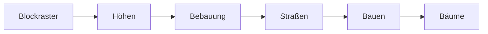

# 5 Szene und Geometrie – Eine Stadt aus Dreiecken

> **Dein Level:** Kern entscheidet, was die Kamera sehen kann, findet blitzschnell das Dreieck
> unter deiner Maus und baut aus ein paar Zahlen eine ganze Stadt. Hier lernst du, wie.

Zwei Bausteine liegen rund um den Renderer: **Szene** (Sichtbarkeit, BVH, **Picking**) und
**Geometrie** (Formen auf dem Prozessor bauen). Danach kommt die prozedurale Stadt. Den Renderer
erklärt [Kapitel 4](04-grafik.md), die Mathematik [Anhang B](B-grundlagen-rendering.md).

## 5.1 Die Spielregeln

- **Z zeigt nach oben**, gemessen wird in **Metern** – überall in Kern.
- Alle Bauer liefern `MeshData`: Positionen, Normalen (wohin eine Fläche zeigt), Farben, UVs, auf
  Wunsch einen **Zusatzstrom** – und **Indizes**. Ohne Indizes ist das Mesh eine **Triangle Soup**:
  Je drei Ecken hintereinander sind ein Dreieck.
- Farben sind **sRGB**, wie alle Eckfarben des Standard-Shaders.
- Beim Hochladen kommt der Zusatzstrom in einen von zwei Erweiterungsplätzen; Platz 2 oder höher
  heißt „weglassen“.

## 5.2 Frustum-Culling: Nicht im Bild, nicht gezeichnet

Die Kamera sieht in eine abgeschnittene Pyramide mit sechs Wänden, das **Frustum**. Damit der Test
billiger ist als das Zeichnen, prüft Kern nur **eine Kugel** pro Mesh gegen die Wände. Liegt ihr Mittelpunkt **weiter als
der Radius** hinter einer Wand, ist sie sicher draußen. Die Wände liest Kern direkt aus der
View-Projektionsmatrix (Verfahren von Gribb und Hartmann) und **normiert** sie, damit der Abstand in
Metern herauskommt.

> **So kannst du es dir vorstellen:** Ein Basketball (Radius 12 cm) mit dem Mittelpunkt 30 cm
> hinter der Hallenwand ist ganz draußen; bei 5 cm ragt er noch herein.

Der Test ist **vorsichtig**: Nahe einer Ecke wird eine Kugel manchmal umsonst gezeichnet, aber nie
fälschlich weggelassen. Kaputte Kugeln gelten als sichtbar.

Die Kugeln entstehen beim Hochladen: eine um das Mesh, eine um alle Instanzen. Wie stark eine
Matrix höchstens streckt, schätzt Kern lieber zu groß – mit der Wurzel aus der Quadratsumme ihrer
neun Dreh- und Streckzahlen. Streckt eine Matrix nur x auf das Doppelte, ist
das √(4 + 1 + 1) ≈ 2,45 statt 2.

> **Vorsicht, Falle:** Ein Wald als *ein* instanziertes Mesh über die ganze Karte gilt fast immer
> als sichtbar. Besser in räumliche Gruppen teilen.

Nie verworfen werden animierte (geskinnte) Figuren, weil eine Pose über die Ruhehaltung hinausragen
kann, und Meshes mit `frustum_culled = false`. Der Schattenpass testet genauso gegen das Frustum der
Sonne.

## 5.3 Die BVH: Kisten in Kisten

Picking testet einen Strahl gegen Dreiecke – in einer Stadtkachel zehntausende. Eine **BVH** packt
sie in Kisten, diese in größere Kisten. Verfehlt der Strahl eine Kiste, ist ihr Inhalt erledigt.

> **So kannst du es dir vorstellen:** Im Wörterbuch schlägst du die Mitte auf und halbierst weiter.
> Bei 10 000 Dreiecken reichen etwa 13 Halbierungen, denn 2¹³ = 8192 und 2¹⁴ = 16 384.

**Bauen:** Kern teilt die Dreiecke entlang der Richtung, in der ihre Mittelpunkte am weitesten
streuen, genau **am Median**. Höchstens 8 Dreiecke sind ein Blatt. Der Baum ist höchstens 32 tief,
also reicht ein fester Stapel mit 64 Plätzen; alles liegt in flachen Listen.

**Suchen:** Strahl gegen Kiste (der „Slab-Test“, auch an Kanten zuverlässig), im Blatt gegen die
Dreiecke. **Die nähere Kiste kommt zuerst** dran; ein früher, naher Treffer streicht alle ferneren.

Eine BVH bekommt nur **feste Weltgeometrie** (keine Linien, eine unverschobene Instanz, nicht
animiert, ab 36 Dreiecken). Bewegt man das Mesh, fliegt sie raus; steht es still, kommt sie neu.

## 5.4 Picking: Was liegt unter der Maus?

Kern schickt den Pixel rückwärts durch die Kamera auf die nahe und die ferne Ebene; die Verbindung
ist der **Strahl**. Perspektivisch startet er im Auge, orthografisch auf der nahen Ebene (alle
Strahlen parallel).

Für jedes Mesh, das in Frage kommt:

1. **Grobtest** gegen die Weltkugel (nicht bei animierten Figuren).
2. **Feintest** mit BVH oder Dreieck für Dreieck. Animierte Figuren nimmt Kern in ihrer **aktuellen
   Pose** – was du siehst, kannst du anklicken.
3. **Dreieckstest** nach Möller und Trumbore; Rückseiten nur bei zweiseitigen Materialien.

Der Treffer nennt Mesh, Instanz, Dreieck, Abstand, Punkt und Normale, bis 1800 m weit. Im Beispiel
`hello` färbt ein Klick so eine Kiste rot.

**Kern Studio** übersetzt das Mesh in seinen Actor, lässt den Strahl durch Boden und gesperrte
Actors weiterfliegen und wählt Lichter über ihr Symbol.

> **Mission:** Öffne auf https://kernengine.de/ File › Example Levels › **Orb Run** und klick ein
> Hochhaus an. Ausgewählt wird der Actor **City** – die ganze Stadt gehört zu ihm.

## 5.5 Earcut: Vielecke in Dreiecke schneiden

Grundrisse sind oft nicht konvex (L-Form) und haben Löcher (Innenhöfe). Kern zerlegt sie mit einer
C++-Fassung von **Earcut** v3.0.2 von Mapbox (ISC-Lizenz). Sie soll wie die JavaScript-Vorlage
rechnen; der Vergleichstest liegt im SpawnCity-Projekt, Kern selbst prüft Flächen und Dreieckszahlen.

**Ohren abschneiden:** Ein Vieleck mit n Ecken hat immer mindestens zwei „Ohren“ – Ecken, deren
Dreieck mit den Nachbarn ganz im Vieleck liegt. Abschneiden, wiederholen: Es entstehen **n − 2
Dreiecke**. Ein Viereck gibt 2, eine L-Form mit 6 Ecken gibt 4. Ein Ohr muss nach außen zeigen, und
keine andere Ecke darf im Dreieck liegen. Prüfen muss Earcut nur nahe Ecken, die nach innen zeigen.

**Wenn es klemmt** (Kartendaten sind selten sauber): doppelte Ecken entfernen, Überschneidungen
reparieren, zuletzt mit einer Diagonale teilen.

**Löcher** werden vorher mit einer „Brücke“ an den Außenring angeschlossen (Verfahren von Eberly):
vom Lochpunkt ganz links zu einer sichtbaren Ecke außen, hin und zurück geschnitten. Dann ist alles
ein Ring.

**Ab 80 Ecken** bekommt jede Ecke eine **z-Order-Nummer**: Die Bits von x und y werden wie die Zähne
eines Reißverschlusses verschränkt. Nahe Punkte haben ähnliche Nummern, also prüft Earcut nur Ecken
mit passender Nummer.

Danach vergleicht der Häuserbauer die Dreiecksflächen mit dem Grundriss. **Über 0,7 % Abweichung**
wird das Haus übersprungen statt mit kaputtem Dach gebaut.

## 5.6 Primitive: der Baukasten

Fertige Bauer, Z oben: **Quader** (24 Ecken; auch „am Boden“), **Kugel**, **Kapsel**, **Torus**,
**Zylinder**, **Kegel** (beide auf z = 0) und **Ebene**. `append` hängt ein Mesh mit einer Matrix an
ein anderes (ohne Zusatzstrom). So ist das Auto in Orb Run aus drei Quadern, und alle Bodenplatten
der Stadt sind **ein** Mesh.

## 5.7 Welding: doppelte Ecken verschmelzen

In einer Triangle Soup stehen Ecken mehrfach im Speicher. Ein **indiziertes** Mesh speichert jede
einmal – das spart Speicher und Ladezeit. Kern verschmilzt nur **bitgleiche** Ecken. Darum
geht nichts verloren, und scharfe Kanten bleiben scharf.

> **So kannst du es dir vorstellen:** Ein Würfel als Soup hat 12 · 3 = 36 Ecken. Jede Würfelecke
> berührt drei Seiten mit drei Normalen. Nach dem Welding bleiben 24 – genau wie beim Quader-Bauer.

Gesucht wird mit einer **Hashtabelle** (aus den Bits wird eine Fachnummer). Indiziert wird **nur,
wenn es sich lohnt**; Voraussetzung sind keine Indizes und höchstens 4 Zusatzwerte.

> **Krass, aber wahr:** Mit 1300 Gebäuden aus Konstanz brauchen Bauen und Welding in Kern etwa
> 45 ms. Die frühere JavaScript-Lösung brauchte etwa 1260 ms – fast 28-mal so lange.

Ein **Inhalts-Hash** verrät, ob ein neu gebautes Stück sich vom alten unterscheidet.

## 5.8 Häuser aus Grundrissen

Der Häuserbauer zieht Grundrisse als Zahlenliste in die Höhe und sortiert die Häuser in
quadratische **Chunks**. In C++:

```cpp
FootprintStream footprints;
footprints.begin(seed, 0, height);  // Seed, Fuß, Traufe
footprints.ring(outer, 4);          // äußerer Ring
footprints.ring(court, 4);          // Loch (Innenhof)
```

Zeile 2 beginnt ein Haus (der Seed wählt Farben und Fassade), Zeile 3 gibt den Außenring, Zeile 4
einen Innenhof. Pro Haus:

1. **Aufräumen:** Punkte unter 1,5 cm Abstand fliegen raus; unter 3 Punkten oder 0,08 m² ist der
   Ring leer.
2. **Drehsinn:** außen gegen, Löcher mit dem Uhrzeigersinn.
3. **Aussortieren** bei leerem Ring, Wand bis 0,1 m oder Earcut-Fehler über 0,7 %.
4. **Farben** aus dem Seed; ein Stockwerk ist 3,1 bis 3,6 m hoch.
5. **Dach** aus Earcut-Dreiecken, nach oben zeigend; Innenhöfe bleiben offen.
6. **Wände** für jede Kante; UVs in Metern entlang und nach oben.
7. **Gesims** (bei Kanten über 1,2 m und Wänden über 3,5 m): 0,55 m hoch, 0,24 m vorstehend.

Vier Zusatzwerte pro Ecke (Wandlänge mit −1 für Dach und −2 für Gesims, Wandhöhe, Seed-Zahl,
Stockwerkshöhe) nutzt `NightWindows` ([Kapitel 4](04-grafik.md)) für leuchtende Fenster.

```cpp
BuildingBuilder b;
b.begin(stream, length, options);
while (!b.step(4.0)) { /* nächster Frame */ }
```

`step(4.0)` baut, was in etwa 4 ms passt, und meldet `true`, wenn alles fertig ist – eine riesige
Stadt verteilt sich so ruckelfrei auf viele Frames. Große Chunks sparen Zeichenaufrufe, kleine
verbessern das Culling; Standard: 320 m, höchstens 2600 Häuser.

## 5.9 Straßen

Der Straßenbauer legt Bordstein, Fahrbahn und gestrichelte Mittellinie aufs Gelände, alle 6 m
geteilt, damit sie Hügeln folgen. Höhen: 9 cm, 11,2 cm und 13,5 cm. Lägen sie gleich hoch, flackerte
es (**Z-Fighting**). Striche: 3 m lang, alle 7 m. Ein Radius schneidet einen Kartenausschnitt aus.

Die Höhe liefert ein **HeightSampler** („Höhe bei x, y?“), ohne ihn ist der Boden flach. Im
Quelltext heißt er „physics truth“: dieselbe Höhe wie in der Physik, damit Autos genau auf der
sichtbaren Straße fahren. Keine endliche Zahl heißt Abbruch. In JavaScript: `kern.heightSampler`.

## 5.10 Gelände-Kacheln

Eine Gelände-Kachel ist ein Gitter aus 1 bis 128 mal so vielen Quadraten, jedes entlang der
Diagonale Südwest–Nordost geteilt. Die Normalen kommen aus den Nachbarhöhen: links 4 m, rechts 6 m
bei 1 m Abstand sind 2 m auf 2 m, also 100 % Steigung. Eine Extra-Reihe rundherum sorgt für
nahtlose Nachbarkacheln; auf Wunsch meldet die Kachel ihre kleinste und größte Höhe.

Der **GeoProjector** rechnet Längen- und Breitengrade (WGS84) in Meter um, mit Erdradius
6 378 137 m. So landen Kartendaten direkt in Kern-Koordinaten.

## 5.11 Geometrie aus JavaScript

`renderer.beginBuildings(...)` startet einen Häuserauftrag mit 4 ms pro Frame; `commit` weldet jeden
Chunk, lädt ihn hoch, meldet die Bytes und gibt den Speicher frei. Einen unbekannten Strom-Namen in
`extraKey` lehnt es mit Fehler ab. `upsertTerrainTile` baut eine Gelände-Kachel in einem Rutsch. Der
Schalter `weld` weldet ein Mesh vor dem Hochladen – wenn es eine reine Soup mit Normalen ist.

## 5.12 Die prozedurale Stadt

Die Komponente **Procedural City** (Place Actors, Gruppe **World**) ist der Stadtgenerator von Orb
Run. Sie erzeugt Häuser, Straßen, Bodenplatten, Bäume, Kollisionskörper und Verkehr.


Felder in Details (Standard): **Seed** (20261022), **Blocks per side** (7; 1–16), **Block pitch**
(80 m; ab 30), **Street width** (16 m; ab 6, höchstens halber Pitch), **Tallest building** (84 m),
**Trees**, **Traffic cars** (22), **Lit windows at night**. Ungültiges wird abgelehnt.

**Gleicher Seed, gleiche Stadt.** Der Zufallsgenerator (ein „xorshift32“) liefert laut Quelltext
dieselbe Folge wie in Orb Run.



1. **Blockraster:** 7 × 7 Blöcke im Abstand von 80 m. Jeder bekommt eine 18 cm hohe Bodenplatte und
   einen Kollisionsquader.
2. **Höhen:** Jeder Block hat eine „Zentrumsnähe“ von 0 bis 1, die **quadriert** wird. Die
   Höchsthöhe reicht von 14 m bis 84 m; bei Nähe 0,5 sind es 14 + 0,25 · 70 = 31,5 m. So wächst ein
   Hochhausberg in der Mitte.
3. **Bebauung**, eine von vier Arten: ein blockgroßes Haus (in 60 % der Fälle mit 14 m tiefem
   Innenhof), vier Einzelhäuser mit 5 m Gassen, ein L-Haus plus ein kleines, oder drei Riegel.
4. **Straßen** an jeder Blockkante, 60 m über die Stadt hinaus, mit Bordstein und Mittellinie.
5. **Bauen** in 200-m-Chunks mit sechs Wand- und drei Dachfarben; alles wird geweldet.
6. **Bäume** alle 11 m an den Blockrändern, mit 35 % Lücken. Stämme sind Zylinder, Kronen Kegel –
   je **ein** instanziertes Mesh.

Jeder Chunk ist ein Mesh mit der Matrix des City-Actors als Instanz; Verschieben ändert nur die
Matrix, neu gebaut wird nur bei echten Parameteränderungen. Straßen werfen keinen Schatten. Liegt die
Stadt unverschoben im Ursprung, bekommt jeder Chunk eine BVH.

Für die Physik ist die Stadt **ein** fester Box3D-Körper mit einem Quader pro Gebäudeflügel und
Platte (Reibung 0,5, [Kapitel 6](06-physik.md)). Die Autos (9 bis 15 m/s, fünf Farben, ein
instanziertes Mesh) parken im Editor. In Play und Simulate fahren sie als kinematische Körper,
springen am Stadtrand auf die andere Seite und **halten an**, wenn der Spieler weniger als 10 m vor
ihnen steht. Zufällige Straßenpunkte verteilen die Orbs von Orb Run.

> **Mission:** Wähle in Orb Run **City**, ändere in Details den **Seed** und **Tallest building**.
> Gib dann wieder 20261022 ein: Die alte Stadt ist exakt zurück.

## 5.13 Formen im Level und eingebaute Meshes

Ein Static Mesh hat eine Form: Box, Sphere, Cylinder, Cone, Capsule, Plane, Torus, Ramp oder Mesh,
um den Actor-Ursprung, weiß (die Farbe macht das Material). Quader, Ebene und Rampe haben UVs in
Metern mal „Texture tiling“. Die Rampe ist ein Keil, an +X hoch. Für die Physik gibt es Ausmaße,
Hüllenpunkte und die Wahl eines passenden Colliders ([Kapitel 6](06-physik.md)).

Die Form **Mesh** nimmt ein eingebautes Netz: die Bauteile der **Micro Duck** von Pollen Robotics
(etwa `duck/neck`). Sie stehen unter CC BY-NC-SA 4.0, sind **nicht kommerziell** nutzbar, hier nicht
abgebildet und fehlen im kommerziellen Build. Gespeichert sind sie sparsam (8 und 16 Bit pro
Wert, dazu Hüllenpunkte), ausgepackt beim ersten Zugriff. Auf dem
PC schützt ein Mutex diesen Speicher, weil der Lehrer auf mehreren Threads baut
([Kapitel 14](14-lehrer.md)). Gespiegelte Streckung dreht die Dreiecke um. Ein **unbekannter Name**
ergibt einen 10-cm-Würfel, damit der Fehler auffällt. Mehr in [Kapitel 13](13-micro-duck.md).

> **Mission:** Exportiere Orb Run mit File › **Package Game (HTML)...** und starte es mit
> **Play it** – wie im Bild in 5.12.

## Level geschafft!

- Du weißt, warum Kern Kugeln gegen sechs Wände testet.
- Du kannst erklären, wie „Kisten in Kisten“ das Picking schnell machen.
- Du weißt, wie Earcut aus n Ecken n − 2 Dreiecke schneidet.
- Du kennst die Schritte vom Grundriss zum Haus und von der Linie zur Straße.
- Du kannst mit einem Seed deine eigene Stadt erzeugen.

## Rätsel-Ecke

1. Wie viele Dreiecke macht Earcut aus einem Grundriss mit 10 Ecken?
2. Eine Kugel mit 3 m Radius liegt mit dem Mittelpunkt 2 m hinter einer Frustum-Wand. Wird sie
   weggelassen?
3. **Boss-Rätsel:** Du verschiebst die Stadt um 100 m. Was wird neu gebaut, und was passiert mit
   den BVHs?

### Lösungen

1. **8**, denn 10 − 2 = 8.
2. **Nein**, sie ragt noch 1 m herein.
3. Nichts wird neu gebaut, nur die Instanzmatrix ändert sich. Weil sie nicht mehr die Einheitsmatrix
   ist, wirft Kern die BVHs weg; Picking geht dann Dreieck für Dreieck.

---

© 2026 Christian Heinrich Hohlfeld · Alle Rechte vorbehalten · [Impressum und Rechte](00-impressum.md)
