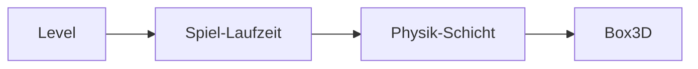

# 6 Physik – Box3D an der Leine

> **Dein Level:** Kisten stapeln, Türen schwingen, Brücken brechen. Hier siehst du, wie Kern
> Box3D benutzt, welche Regeln es sich gibt und wie ein echter Servo zum Modell wird.

> **Wörter, die du brauchst:**
>
> - **Starrer Körper** – ein Ding, das sich nie verbiegt oder eindrückt, wie ein Holzklotz.
> - **Newton (N)** und **Gewichtskraft** – Newton ist die Einheit der Kraft. Die Erde zieht an
>   jedem Kilogramm mit 9,81 N, also ist die Gewichtskraft **Masse · 9,81**. Eine Tafel
>   Schokolade (100 g) drückt mit knapp 1 N auf deine Hand.
> - **Impuls** – ein einzelner kurzer Stoß, wie ein Tritt gegen einen Ball. Er ändert das Tempo
>   auf einen Schlag: Impuls = Masse · Tempoänderung.
> - **Drehmoment** – wie stark etwas dreht: Kraft mal Hebel. 1 N am Ende eines 1 m langen
>   Schraubenschlüssels ist 1 Newtonmeter (N·m). Langer Schlüssel, gleiche Kraft, mehr Drehmoment.
> - **Trägheitsmoment** – wie schwer sich ein Ding andrehen lässt. Auf dem Bürostuhl drehst du dich
>   mit angezogenen Armen schneller als mit ausgestreckten: Masse weit außen macht träge.
> - **Radiant (rad)** – ein anderes Winkelmaß. Leg eine Schnur so lang wie der Radius auf den
>   Kreisrand: Der Winkel dazu ist 1 rad, etwa 57°. Ganz herum passt die Schnur gut 6,28-mal.
> - **Hertz (Hz)** – wie oft pro Sekunde. Eine Feder mit 2 Hz wippt zweimal pro Sekunde hin und
>   her; 60 Hz Takt heißt 60 Rechenschritte pro Sekunde.
> - **Dämpfung** – die Bremse beim Schwingen, wie der Stoßdämpfer am Fahrrad. Viel Dämpfung: Die
>   Feder kommt ohne Nachwippen zur Ruhe.

Kern simuliert **starre Körper** mit **Box3D**, einer freien Physik-Engine von Erin Catto. Box3D
liegt **unverändert** in Kern. Wie Physik im Computer grundsätzlich denkt, erklärt
[Anhang C](C-grundlagen-physik.md); hier geht es darum, wie Kern damit arbeitet.

Die Grundregel: **Box3D wird nie an Kern angepasst.** Passt ein Modell nicht zu Box3D, wird **das
Modell** angepasst: vergrößert, Massen anders verteilt, feiner gerechnet. Das ist wie beim
Fußball: Wenn deine Taktik nicht funktioniert, änderst du die Taktik, nicht die Spielregeln. Ein
echtes Gerät wie ein Servo bekommt ein eigenes kleines Modell (6.17).


> **Mission:** Öffne auf https://kernengine.de/ File › Example Levels › **Physics Lab** und drück
> **Simulate** (Alt+S). Pack eine Kiste der Pyramide mit der linken Maustaste, heb sie hoch und lass
> los: Sie fliegt mit Schwung weiter. Stoß das Pendel an und öffne die Tür.

## 6.1 Aufbau der Schicht

Zwischen dem Spiel und Box3D liegt eine dünne **Schicht**. Sie ist die **einzige Stelle**, an der
Kern mit Box3D spricht. Dort wird jeder unsinnige Wert abgefangen, etwa ein negativer Radius oder
eine Lage, die keine Zahl ist. Box3D bekommt nur Sauberes. Wie bei einem Türsteher: Wer nicht
passt, kommt gar nicht erst hinein, und der Fehler wird gemeldet ([Kapitel 3](03-grundlagen.md)).



Die Schicht rechnet in **Metern, Sekunden und Kilogramm**, mit **Z nach oben**, genau wie die
Grafik. Winkel sind in **Radiant**. Grad siehst du nur in Kern Studio und in Leveldateien; die
Umrechnung passiert einmal, beim Aufbau. Eine **Welt** besitzt alles, was in ihr entsteht, und
räumt es beim Schließen mit auf.

Die genauen Namen und Befehle stehen im blauen Buch, Kapitel 6.

## 6.2 Die richtige Größe

Box3D fühlt sich mit Dingen zwischen **10 cm und 10 m** am wohlsten. Der Grund: Es arbeitet mit
festen Toleranzen in Metern. Zum Beispiel duldet es bis zu **5 mm** Überlappung zwischen zwei
Körpern, bevor es sie auseinanderdrückt. Bei einer Kiste von 1 m fällt das nicht auf. Bei einem
Roboterbein von 2 cm ist das ein Viertel des Beins.

Daher Regel eins: **Bewegte Körper zwischen 0,1 m und 10 m, nie unter 1 cm.** Kern hebt winzige
bewegte Formen automatisch auf mindestens 1 cm an.

> **Krass, aber wahr:** Die Micro Duck in echter Größe hat Glieder von 2 bis 4 cm. Ihr Rumpf sank in
> 10 Bildern 9 cm durch die eigenen Beine. Vierfach vergrößert halten die Gelenke.

### Skalieren statt Regeln verstellen

Box3D könnte seine Toleranzen umstellen, aber nur für die ganze Welt, und in einem Level stehen
Autos neben kleinen Robotern. Darum macht Kern es andersherum: Ein kleines echtes Modell wird als
Ganzes mit einem **Faktor S** vergrößert, und jede Größe wird passend umgerechnet. Für die Micro
Duck ist **S = 4**:

| Größe | Faktor | bei S = 4 |
|---|---|---|
| Länge | S | ×4 |
| Masse | S · S · S | ×64 |
| Zeit | Wurzel aus S | ×2 |

**Masse ×64**, weil ein Würfel mit vierfacher Kante 4 · 4 · 4 = 64-mal so viel Volumen hat. Aus
demselben Holz ist er also 64-mal so schwer.

**Zeit ×2**, weil ein viermal so langes Pendel halb so schnell schwingt. Die vergrößerte Ente
bewegt sich also wie in Zeitlupe, halb so schnell. Eine echte Sekunde sind zwei Sekunden in der
Welt.

> **Probier's aus:** Lass einen Schlüsselbund an einer kurzen Schnur pendeln (etwa 25 cm) und zähl
> die Schwünge in 10 Sekunden. Dann nimm eine viermal so lange Schnur (1 m). Du zählst nur noch etwa
> halb so viele Schwünge.

Wichtig: Das ist **dieselbe Ente**, nur in anderen Einheiten, wie wenn du eine Strecke statt in
Metern in Zentimetern angibst. Nach außen geht alles wieder in echten Einheiten: an das **Netz**
(das lernende Programm, das die Ente steuert), in Logs und an [Kapitel 16](16-kalibrierung.md).
Eine Garantie für den echten Roboter ist eine Simulation aber nie.

> **Für Profis:** Auch Trägheitsmoment (×1024), Drehmoment (×256) und Dämpfung (×512) werden
> umgerechnet, die Schwerkraft bleibt gleich. Das heißt Froude-Ähnlichkeit. Frei hängend rechnen
> einfache und vierfache Ente sogar Bit für Bit gleich (Anhang C.9). Am Boden wirken Box3Ds feste
> Toleranzen, darum werden einige Kontaktwerte gemessen statt umgerechnet. Alle Werte stehen im
> blauen Buch, Kapitel 6.

## 6.3 Die Welt

Eine **Welt** ist der Raum, in dem die Physik rechnet. Sie hat eine **Schwerkraft** von 9,81 m/s²
in Richtung **minus Z**: Z zeigt nach oben, also zieht minus Z nach unten. Und sie wird nicht
fließend, sondern in **kleinen, festen Schritten** weitergerechnet: Standard sind 60 Schritte pro
Sekunde, jeder noch einmal in 4 **Sub-Steps** (Teilschritte) geteilt. Wie lang ein Schritt ist,
entscheidet das Spiel (6.13).

Zwei Dinge stellt Kern immer gleich ein: Box3D rechnet auf **einem einzigen** Rechenkern, damit die
Reihenfolge immer gleich ist (6.14), und es fragt Kern bei jedem Kontakt nach der **Paar-Reibung**
(6.6). Nach jedem Schritt liegen die Meldungen dieses Schritts bereit (6.10).

Die Standardwerte der Welt stehen im blauen Buch, Kapitel 6.

## 6.4 Körper

Ein **Körper** ist ein Ding, das sich in der Physik bewegen kann. Es gibt drei Arten. In Kern
Studio wählst du sie in Details unter **Rigid Body (Box3D)** › **Mobility**:

- **Static** (fest): bewegt sich nie. Boden, Wände, Häuser.
- **Kinematic** (kinematisch): bewegt sich, wie du es sagst, und lässt sich durch nichts aufhalten.
  Fahrende Plattformen, Drehbalken, die Autos der Stadt.
- **Dynamic** (dynamisch): reagiert auf Kräfte, Stöße und Schwerkraft. Echte Physik.

> **So kannst du es dir vorstellen:** Static ist die Hallenwand, Kinematic ist die Rolltreppe (sie
> fährt, egal wer drauf steht), Dynamic ist der Ball.

Ein Körper hat außerdem Lage, Drehung, Anfangstempo und eine Bremse gegen Bewegung (Dämpfung). Er
kann **schlafen**: Liegt er lange still, rechnet Box3D ihn nicht mehr, bis ihn etwas anstößt. Das
spart viel Zeit. Ein **Bullet** ist ein sehr schneller Körper, den Box3D besonders sorgfältig gegen
alles prüft, damit er nicht durch Dinge hindurchfliegt.

Bewegen kann man einen Körper auf zwei Arten: mit einer **Kraft**, die nur einen Schritt lang wirkt
(wie Schieben), oder mit einem **Impuls**, der das Tempo auf einen Schlag ändert (wie ein Tritt).
Man kann auch einzelne Richtungen **sperren**, sodass ein Körper zum Beispiel nicht umkippt.

**Masse und Trägheitsmoment** rechnet Box3D aus der Form und der **Dichte** (wie viel ein Kubikmeter
wiegt). Man kann sie auch selbst vorgeben. So bekommen nachgebaute Roboter ihre gemessenen Werte,
und die Form sorgt dann nur noch dafür, wo sie anstoßen.

## 6.5 Formen

Ein Körper besteht aus einer oder mehreren einfachen **Formen**: **Box**, **Kugel**, **Kapsel**
(ein Zylinder mit runden Enden, wie eine Tablette), **Hülle** und **Mesh**. In Kern Studio heißt so
eine Physikform **Collider**. Hat ein Actor keinen eigenen, baut Studio automatisch einen passenden
zu seiner Grundform.

Eine **Hülle** ist die Form, die entsteht, wenn du ein Gummiband um eine Handvoll Nägel spannst,
nur in 3D: außen herum, ohne Dellen nach innen. Solche Formen ohne Dellen heißen **konvex**, und mit
ihnen kann Box3D besonders schnell und zuverlässig rechnen (Anhang C.3). Eine Box ist für Box3D auch
eine Hülle.

Ein **Mesh** aus beliebigen Dreiecken ist nur für **feste** Körper erlaubt, zum Beispiel für einen
hügeligen Boden. Dabei passt Kern auf, dass nichts an der Naht zwischen zwei Dreiecken hängen
bleibt. Ohne diese Vorsicht könnte eine rollende Kugel an der Naht hüpfen, als wäre da eine
unsichtbare Kante. Das heißt **Geisterkollision**.

Jede Form hat ein **Material**. Die Standardwerte in Kern Studio:

| Feld | Standard | Bedeutung |
|---|---|---|
| Dichte | 1000 kg/m³ | wie Wasser |
| Reibung | 0,6 | wie stark sie bremst |
| Restitution | 0 | Sprungkraft, 0 bis 1 |
| Rollwiderstand | 0 | bremst Rollen |
| Oberfläche | keine | für Paar-Reibung (6.6) |
| Sensor | aus | nur Überlappung melden |

Ein **Sensor** stößt nicht an, er meldet nur, wer hineinläuft. So funktionieren Zielzonen und
Trigger.

> **Für Profis:** Die Physik-Schicht selbst setzt die Dichte von sich aus auf 1 kg/m³.
> Wer in Kern Studio oder mit einer Leveldatei baut, bekommt aber 1000 kg/m³: Ein Würfel von 1 m
> wiegt dann eine Tonne, wie ein Würfel aus Wasser.

**Wer stößt mit wem zusammen?** Jede Form kann auf **Kanälen** sagen, zu welcher Gruppe sie gehört
und mit welchen Gruppen sie zusammenstoßen will. Ein Beispiel: Kugeln sollen durch Geister
hindurchfliegen, aber an Wänden abprallen. Dann gehören Geister zu einem Kanal, auf den die Kugeln
nicht achten. Außerdem können Formen eine **Gruppe** bekommen: Formen derselben „Nie“-Gruppe stoßen
nie zusammen. So stolpert ein Roboter nicht über seine eigenen Beine.

## 6.6 Oberflächen mit Paar-Reibung

Berühren sich zwei Formen mit verschiedener Reibung, braucht der Kontakt **einen** Wert. Box3D nimmt
eine Faustregel: die Wurzel aus dem Produkt der beiden Werte, √(a · b). Bei 0,5 und 0,5 sind das
0,5, bei 0 und irgendetwas immer 0. Warum gerade so, erklärt Anhang C.4.

Für echte Materialpaare stimmt die Faustregel aber nicht immer. Das zeigt die Micro Duck: Sie hebt
eine Socke mit dem Schnabel auf. Das weiche Polster am Schnabel muss auf der Socke **greifen**, die
Socke muss aber auf dem Holzboden **rutschen**. Ein einziger Reibwert pro Form kann nicht beides.

Darum kennt Kern **Oberflächen**: Baumwollstrick (*cloth*), weiches gedrucktes Gummi (*tpu*) und
Holz- oder Laminatboden (*floor*). Für Paare aus diesen Oberflächen gibt es gemessene Werte:

| Paar | Reibung | Wie im Alltag |
|---|---|---|
| Strick auf Strick | 0,5 | Socke auf Socke |
| Gummi auf Strick | 0,8 | Schnabel greift Socke |
| Strick auf Holz | 0,4 | Socke rutscht übers Parkett |

Box3D bleibt dafür unverändert. Es fragt bei jedem Kontakt: „Welche Reibung gilt hier?“ Kern
antwortet: Hat das Paar einen gemessenen Wert, gilt der, sonst die Faustregel. Sprungkraft und
Rollwiderstand bleiben, wie sie sind.

Die Sohlen der Ente haben **keine** Oberfläche. Sie behalten die Reibung, mit der Pollen Robotics
ihr Netz trainiert hat (1,0 auf einem Boden mit 1,0, also √(1 · 1) = 1). Oberflächen stehen in der
Leveldatei; ein eigenes Feld in Details gibt es dafür noch nicht. Mehr zur Ente in
[Kapitel 13](13-micro-duck.md).

## 6.7 Reibung, Sprungkraft, Rollwiderstand

Drei Werte bestimmen, wie sich Dinge berühren:

- **Reibung** bremst das Rutschen. 0 ist Eis, 1 ist Gummi auf Asphalt.
- **Restitution** (Sprungkraft) bestimmt, wie viel Tempo nach einem Aufprall übrig bleibt. 0 bleibt
  liegen, 1 springt perfekt zurück. Box3D nimmt das **Größere** von beiden Formen: Ein Gummiball
  springt auch auf Beton. Stöße unter 1 m/s prallen gar nicht ab, sonst würde Ruhendes ewig zittern.
- **Rollwiderstand** bremst das Rollen. Eine perfekte Kugel auf einem perfekten Boden würde ewig
  rollen. Echte Bälle und Böden geben ein wenig nach, und das bremst.

In Kern Studio stellst du sie unter Details › Static Mesh › **Physics** ein (für den automatischen
Collider) oder unter Details › **Collider**. Den endlosen Boden stellst du unter World Settings ›
Physics (Box3D) › **Ground friction** und **Ground bounciness** ein.

Rollwiderstand setzt Kern bei runden Dingen. Der Ball im Micro-Duck-Level hat 0,03, denn „ein
Gummiball auf Holzboden rollt aus“. Die Socke besteht aus runden Stoffklumpen und hat 0,5, denn „ein
Stoffklumpen rollt nicht“. Ohne ihn kroch die Socke von allein über den Boden. **Roboterfüße** sind
dagegen breit, flach und griffig.

> **Mission:** Läuft noch Simulate, stopp mit Esc. Wähle im Physics Lab die oberste Kiste,
> **Crate 15**. Setz in Details › Collider die **Friction** von 0,7 auf 0. Starte Simulate, setz die
> Kiste mit der Maus auf den Boden und schubs sie an. Sie gleitet wie auf Eis. Warum? 0 mal
> irgendetwas ist 0, und die Wurzel aus 0 ist auch 0.

## 6.8 Gelenke

Ein **Gelenk** verbindet zwei Körper so, dass sie sich nur noch auf eine bestimmte Weise
gegeneinander bewegen können. Jedes Gelenk hat eine **Achse**: Bei einem Scharnier ist es die
Linie, um die sich etwas dreht, bei einer Schiene die Linie, entlang der etwas gleitet.

```
   Tür von oben:              Lift von der Seite:

   Rahmen ●──────── Tür          ║ ▲
          ↻                      ║ █  Kabine gleitet
   Achse: senkrecht durch ●      ║ ▼  entlang der Schiene
```

Die Gelenke in Kern Studio:

| Im Studio | Wofür |
|---|---|
| Hinge | Scharnier: Tür, Brücke |
| Slider | Schiene: Lift |
| Ball | Kugelgelenk wie die Schulter |
| Fixed | starr oder leicht federnd verbinden |
| Distance/rope | fester Abstand oder Seil: Pendel |
| Wheel | Rad mit Federung und Antrieb |
| Motor | zieht eine Lage per Tempo und Feder |
| Parallel | hält zwei Achsen weich parallel |
| No collision | verhindert nur das Zusammenstoßen |

Je nach Gelenk gibt es eine **Feder** (wie oft sie pro Sekunde schwingen will, in Hz, und wie stark
sie gedämpft ist), **Grenzen** (die Tür geht nur bis zur Wand auf) und einen **Motor** (dreht oder
schiebt mit einem Tempo, aber nie stärker als seine Höchstkraft). Gebaut wird ein Gelenk immer in
der Ruhelage: Dort ist der Winkel 0. Normalerweise stoßen zwei verbundene Körper nicht
zusammen.

**Brechen:** Man kann einem Gelenk eine **Bruchkraft** geben. Zieht mehr Kraft daran, meldet Box3D
das. Die Spiel-Laufzeit zerstört das Gelenk dann, zählt es, schreibt `Joint on "…" broke` ins
Output Log und spielt ein Bruchgeräusch. Im Physics Lab haben die drei mittleren Gelenke der
Brücke so eine Schwelle: die Gelenke von Plank 06, 07 und 08, mit je 60 000 N.

> **Mission:** Stopp ein laufendes Simulate mit Esc. Wähle **Plank 06** und trag in Details ›
> Constraint › Breaking als **Break force** 20 000 ein. Starte Simulate: Die Brücke hält noch. Pack
> die Planke mit der Maus (6.11) und zieh sie kräftig zwei, drei Meter hoch. Das Gelenk bricht,
> das Output Log meldet es, und die Statusleiste zählt mit („1 broken“). Warum? Die straff
> gespannte Brücke zieht schon in Ruhe mit über 10 000 N an diesem Gelenk. Das reicht noch nicht,
> aber dein Griff legt etwas drauf. Probier danach auch 2000: Dann reißt das Gelenk schon gleich
> nach dem Start, ganz ohne dich.

> **Für Profis:** Box3D will Gelenkfedern in Hertz, ein Servo rechnet in N·m pro Radiant. Kern
> rechnet an der Grenze um, jeden Schritt neu, weil es dabei auf die aktuelle Lage der Glieder
> ankommt (Anhang C.5). Die englischen Box3D-Namen der Gelenke stehen im blauen Buch, Kapitel 6.

## 6.9 Abfragen

Man kann die Physikwelt auch **fragen**, ohne etwas zu bewegen:

- **Strahl:** Was trifft eine Linie zuerst? Beispiel: Steht die Figur auf dem Boden? Schick einen
  Strahl ein Stück nach unten. Trifft er, steht sie.
- **Kugel schieben:** wie ein Strahl, aber mit einer Kugel statt einer dünnen Linie, wie ein dicker
  Strahl. Er rutscht nicht durch eine schmale Lücke oder an einer Kante vorbei.
- **Explosion:** Alle Körper in einem Umkreis bekommen einen Stoß nach außen. Mit negativem Wert
  ziehen sie nach innen (Implosion).
- **Schieben:** Läuft eine Spielfigur gegen eine Kiste, bekommt die Kiste genau so viel Stoß, dass
  sie vor der Figur nicht langsamer ist als diese.

Ein Treffer verrät die Form, den Körper, den Punkt und die Normale. Strahlen ignorieren dabei
Sensoren, und man kann Körper ausnehmen. Ein Robotersensor sieht so seine eigenen Glieder nicht.

## 6.10 Kontakte und Ereignisse

Nach jedem Schritt meldet die Physik, was in **diesem** Schritt passiert ist: Wer hat angefangen
oder aufgehört, wen zu berühren? Wer ist in einen Sensor gelaufen oder wieder heraus? Wer ist hart
aufgeprallt (ein **Hit**, mit Punkt und Tempo)? Und welches Gelenk ist über seiner Schwelle?

**Meldungen kosten Zeit.** Darum schaltet die Spiel-Laufzeit sie nur dort ein, wo das Spiel sie
auch liest: an Sensoren, am Spieler, an Dingen mit Aufprallgeräusch und in Levels mit Logik.

Man kann einen Körper auch direkt fragen: An welchen Punkten berührst du gerade etwas? Wen berührst
du, und wie fest? So spürt die Micro Duck, ob ihr Fuß den Boden berührt und ob sie sich selbst
anstößt ([Kapitel 13](13-micro-duck.md)).

> **Mission:** Schalte im Physics Lab unter Window › Show (oder im Show-Menü oben im Viewport)
> **Collision Shapes**, **Constraints** und **Contact Points** ein und starte Simulate. Jetzt siehst
> du, womit Box3D wirklich rechnet: die einfachen Formen statt der hübschen Meshes, die Gelenke und
> die Punkte, an denen sich Dinge berühren.

## 6.11 Der Maus-Griff

Wenn du in Simulate etwas mit der Maus packst, hängt es an einer **unsichtbaren Feder**. Deine Maus
zieht am einen Ende, das Ding hängt am anderen.

```
   Maus ◉ ~~~~~~~~~~ Feder ~~~~~~~~~~ ▣ Kiste
        zieht                 hängt am Griffpunkt,
                              kann kippen und anstoßen
```

Weil es eine Feder ist und kein Teleport, bleibt das Ding ein echter Physikkörper: Es stößt an,
kippt, schwingt und fliegt beim Loslassen mit seinem Schwung weiter. Die Feder ist so gedämpft,
dass sie nicht nachwippt. Und sie schafft höchstens das **100-Fache der Gewichtskraft**. Eine
300-kg-Kiste aus dem Physics Lab wiegt 300 · 9,81 ≈ 2943 N, die Feder zieht also höchstens mit rund
294 000 N. Bei einer 15-kg-Brückenplanke sind es rund 14 700 N, genug, um das Gelenk in der Mission
oben zu brechen.

Normalerweise darf sich das Ding am Griff frei drehen. Hebst du die Micro Duck hoch, hält eine
zweite Feder sie aufrecht, wie eine Hand, statt dass sie am Griffpunkt baumelt. Feste und
kinematische Körper kann man nicht greifen.

## 6.12 Der Character Mover

Spielfiguren laufen anders als Kisten rollen. Kern nutzt dafür Box3Ds **Character Mover**: Die
Figur ist eine **Kapsel**, die ihre Bewegung selbst ausrechnet, statt sich von Kontakten
herumschubsen zu lassen. Läuft sie gegen eine Kiste, schiebt sie die Kiste an.

Der Trick für Treppen ist eine **Pogo-Feder**: Die Kapsel schwebt auf einer unsichtbaren Feder ein
Stück über dem Boden, wie auf einem Pogo-Stab. Kommt eine Stufe, die niedriger ist als dieser
Abstand, federt die Kapsel einfach hinauf.

```
            ┌─┐
            │ │  Kapsel
            └┬┘
             ┊   Pogo-Feder
   ──────────┘     ┌──────    Stufe niedriger als die Feder:
                   │          die Kapsel federt hinauf
   ────────────────┘
```

Pro Schritt rechnet der Mover: bremsen, beschleunigen, springen, fallen. Dann schaut er, welche
Wände und Böden er berührt, und schneidet die Bewegung an ihnen ab. **Gegen eine Wand drücken macht
also nicht schneller**, du gleitest an ihr entlang. Zu steile Flächen gelten nicht als Boden.

Die Spielertypen **Character** und **Soldier** nutzen den Mover ([Kapitel 8](08-spiel-laufzeit.md)).
Die Character-Figur fällt dabei 1,5-mal so stark wie die Welt, damit Sprünge knackiger wirken; der
Soldier fällt mit der echten Schwerkraft. Die genauen Werte stehen im blauen Buch, Kapitel 6.

## 6.13 Der Takt: Zeitschritt und Sub-Steps

Box3D bekommt **immer gleich lange Schritte**, egal wie schnell dein Bildschirm ist. Lange Schritte
würden Federn aufschaukeln, und jeder Computer käme woanders an (Anhang C.2). Die **Schrittrate**
stellst du im Level ein: Standard sind 60 Schritte pro Sekunde, nie weniger als 30 verwenden.

Wie passt das zu Bildern, die mal 10 ms und mal 25 ms dauern? Mit einem **Zeit-Sparschwein**: Jedes
Bild wirft seine Zeit hinein. Immer wenn genug für einen ganzen Schritt drin ist, rechnet die Physik
einen Schritt und nimmt die Zeit wieder heraus. Ein Beispiel bei 60 Hz (ein Schritt dauert
1/60 s ≈ 16,7 ms): Ein Bild dauert 25 ms, also ein Schritt, 8,3 ms bleiben im Schwein. Das nächste
Bild dauert wieder 25 ms, jetzt sind 33,3 ms drin, also zwei Schritte.

Kerns Sicherungen dabei:

- **Kein Teufelskreis:** Hängt der Computer einmal lange, zählt Kern höchstens eine Viertelsekunde
  und rechnet pro Bild höchstens 0,1 s nach. Sonst könnte jeder Nachholschritt das nächste Bild noch
  langsamer machen, und die Physik holt nie mehr auf (die „Spiral of Death“). Im Notfall fallen
  lieber ein paar Schritte weg.
- **Schritte zählen:** Die Spielzeit ist „Anzahl Schritte geteilt durch Schrittrate“. Würde Kern
  stattdessen jedes Mal 0,0167 dazuzählen, sammelten sich winzige Rundungsfehler an.
- **Eingaben gelten pro Schritt.** Auch das Netz, das die Ente steuert, zählt Schritte, nicht
  Sekunden.

Gezeichnet wird **zwischen** den letzten beiden Physikständen: Ist vom nächsten Schritt erst 40 %
der Zeit vergangen, zeigt das Bild den Körper bei 40 % des Weges. So sieht die Bewegung bei jedem
Bildschirm flüssig aus. Die Kamera folgt dieser Lage, sonst wackeln schnelle Autos.

**Sub-Steps** teilen jeden Schritt noch einmal (Standard 4, im Level 1 bis 16). Kleinere Schritte
halten lange **Gelenkketten** fester zusammen: An der Hüfte der Ente wuchs die Lücke bei 4 Sub-Steps
unter Last auf 5 cm, bei 16 blieb sie unter 1 mm. Fügt Studio einen Roboter ein, stellt es darum
16 Sub-Steps und den Takt des Roboters ein (Micro Duck: 100 Hz) und sagt dir das.

Eine Feder darf nicht schneller schwingen, als die Sub-Steps „hinschauen“. Sonst sieht die Physik
die Feder nur zufällig mal hier, mal da und rechnet Unsinn. Kern begrenzt darum jede Feder:

**höchste Federfrequenz = 0,5 · Schrittrate · Sub-Steps**

Bei 60 Hz und 4 Sub-Steps sind das 0,5 · 60 · 4 = 120 Hz: höchstens 120 Schwingungen pro Sekunde.

> **Mission:** Starte im Physics Lab Simulate und stoß das Pendel an. Drück dann die Taste
> **Pause** (oder Play › Pause) und danach mehrmals **.** (Punkt). Jeder Druck ist genau ein
> fester Schritt: Das Pendel rückt jedes Mal ein winziges Stück weiter. Schrittrate und Sub-Steps
> findest du unter World Settings › Physics (Box3D) als **Step rate** und **Sub-steps**.

> **Für Profis:** Box3D selbst begrenzt Gelenke und Kontakte noch strenger. Servogelenke bekommen
> eine besonders steife Einstellung, damit leichte Glieder sich nicht dehnen. Die Werte stehen im
> blauen Buch, Kapitel 6.

## 6.14 Determinismus

**Deterministisch** heißt: gleicher Anfang, gleiche Eingaben, **genau** gleiches Ergebnis, bis auf
das letzte Bit. Kern schafft das auf PCs, auf Macs und als WebAssembly, der Form, in
der Kern im Browser läuft.

Warum ist das schwer? Computer **runden** nach jeder Rechnung, und dann zählt die Reihenfolge:

```
(0,1 + 0,2) + 0,3  =  0,6000000000000001
0,1 + (0,2 + 0,3)  =  0,6
```

Ein winziger Unterschied, aber Physik ist **chaotisch**: Aus einem Unterschied im letzten Bit wird in
Sekunden ein anderer Schritt der Ente. Würde jeder Computer ein bisschen anders runden, lernte der
Roboter auf jedem Computer etwas anderes, und Fehler ließen sich nicht nachstellen.

Kern sorgt deshalb dafür, dass überall **in derselben Reihenfolge und mit denselben Regeln**
gerechnet wird: fester Takt (6.13), ein einziger Rechenkern für Box3D, keine Abkürzungen beim
Übersetzen des Programms und eigene Rechenregeln für sin, cos und Co. Geprüft wird das mit einem
**Fingerabdruck**: Die Ente läuft 400 Regeltakte. Nach jedem Takt wird ihr ganzer Zustand zu einer
langen Prüfnummer verrechnet. Ändert sich auch nur ein Bit, ändert sich die Nummer. Alle 400
Nummern müssen eine gespeicherte Liste treffen ([Kapitel 14](14-lehrer.md)).

> **Für Profis:** Geprüft wird mit GCC auf x86, Apple clang auf ARM und WebAssembly. Box3D läuft
> ohne Vektorbefehle, alles wird ohne zusammengefasste Multiplikation-plus-Addition übersetzt, und
> Kern bringt eine eigene Mathe-Bibliothek mit (Anhang C.9 und blaues Buch, Kapitel 6).

## 6.15 Die Regeln

Kern hat ein verbindliches Regelwerk für alle, die Physik ändern oder einen Roboter, ein Fahrzeug
oder eine Gliederpuppe bauen. Es stützt sich auf Erin Cattos eigene Ratschläge und auf Messungen in
Kern. Die wichtigsten Grundsätze, jeder mit seinem Grund:

1. **Lieber das Modell anpassen als die Physik.** Box3D bleibt, wie es ist. Passt etwas nicht, wird
   das Modell skaliert, anders gebaut oder feiner gerechnet.
2. **Nicht zu klein, nicht zu ungleich.** Bewegte Teile zwischen 10 cm und 10 m (6.2). Nachbarteile
   höchstens etwa 10-mal so schwer wie das andere, sonst dehnen sich die Gelenke. Ein starres Teil
   ist **ein** Körper mit mehreren Formen, nicht mehrere zusammengeklebte.
3. **Immer gleich lange Schritte** (6.13), für Roboter mehr Sub-Steps.
4. **Gelenke in der Ruhelage bauen**, und jeder Motor bekommt eine **Höchstkraft**. Ein Motor ohne
   Grenze wäre unendlich stark, so etwas gibt es nicht.
5. **Keine Hilfskräfte, die es in echt nicht gibt.** Kein heimliches Aufrichten, kein Festhalten,
   kein direktes Setzen von Tempo bei Körpern mit Gelenken. Einmal wurde versucht, die Ente mit so
   einem „Kreisel“ direkt über ihr Tempo gerade zu halten. Das kämpfte gegen die Gelenke, und der
   Rumpf sprang. Ein Netz, das mit Hilfskräften laufen lernt, kann es am echten Roboter nicht.
6. **Ein Roboter muss fallen können.** Bei Laufrobotern wird darum nie eine Richtung gesperrt. Und
   Spieler und Roboter schlafen nie, denn langsames Gehen sähe für Box3D wie Stillstand aus.
7. **Dauerkräfte jeden Schritt neu geben**, denn eine Kraft gilt nur einen Schritt. Ein Sprung ist
   dagegen ein einzelner Impuls.

Automatische **Tests** prüfen all das: Körper, Formen, Meldungen, Strahlen, alle neun Gelenke, den
Griff, die Skalierung, das Physics Lab samt Brückenbruch, den Character Mover und den Fingerabdruck.
Das ganze Regelwerk mit Checkliste steht im blauen Buch, Kapitel 6.

## 6.16 Wie die Spiel-Laufzeit die Physik nutzt

Ein Spiel baut seine Körper nicht von Hand, sondern aus dem Level: Erst **plant** die Spiel-Laufzeit,
welche Körper und Formen nötig sind (Studio zeichnet die Collider mit demselben Plan), dann baut sie
die **Körper**, dann die **Gelenke**. In jedem Schritt laufen erst Steuerung, Animationen, Verkehr
und Servos, dann rechnet Box3D, dann kommen die Meldungen. Wie das im Einzelnen abläuft, steht in
[Kapitel 8](08-spiel-laufzeit.md).

## 6.17 Das Servomodell – Brücke zur Micro Duck

Ein **Servo** ist ein kleiner Motor mit Getriebe und eingebautem Regler, der ein Gelenk auf einen
befohlenen **Zielwinkel** dreht. Box3D kennt keine Servos, nur Körper und Gelenke. Darum baut Kern
den Servo als kleines **Rechenmodell** nach, mit Werten, die am echten Servo gemessen wurden.

> **So kannst du es dir vorstellen:** Der Servo zieht das Gelenk wie ein **Gummiband** zum
> Zielwinkel. Je weiter es weg ist, desto stärker zieht er. Aber nie stärker, als sein Motor kann.
> Dazu kommt ein Stoßdämpfer, der zu schnelles Drehen bremst.

Das Modell hat vier Teile:

1. **Feder:** zieht zum Ziel, umso stärker, je größer der Abstand ist.
2. **Höchstkraft:** Ab einem bestimmten Abstand zieht der Servo nicht mehr stärker. Kern erreicht das
   mit einem Trick: Es setzt das Ziel nie weiter weg, als der Motor ziehen kann.
3. **Reibung im Getriebe:** Ein kleines Gegendrehmoment hält das Gelenk fest, bis genug Kraft
   anliegt.
4. **Verzögerung:** Ein Befehl kommt erst etwa 20 ms nach dem Senden beim Servo an. Kern lässt die
   Befehle darum durch eine **Warteschlange** laufen, wie Briefe, die einen Tag unterwegs sind.

Kern baut das nur aus Box3Ds eigenen Teilen: Die Feder ist die Gelenkfeder des Scharniers, die
Reibung ist ein Gelenkmotor mit Tempo 0. Dieselbe Rechnung treibt Kern Studio, das Training
([Kapitel 14](14-lehrer.md)) und den Prüfstand für die Kalibrierung. In der Leveldatei macht ein
Schalter aus einem Hinge einen Servo.

Die Werte stehen in einem **Profil**: Steifigkeit, Dämpfung, Reibung, Höchstkraft, Trägheit des
Motors und Verzögerung. Ein anderer Servo ist einfach ein anderes Profil. Weil keine Messung ganz
genau ist, steht im Profil auch, **wie sicher** jeder Wert ist. Beim Training bekommt jeder Servo
eigene Werte in diesem Bereich. So verlässt sich das Netz nicht auf etwas, das niemand genau weiß.
Eingebaut ist der Servo der Micro Duck, so wie Pollen Robotics ihn trainiert hat. Wie Profile
gemessen werden, zeigt [Kapitel 16](16-kalibrierung.md).

Die Vergrößerung aus 6.2 passiert **genau einmal**, an der Grenze zu Box3D. Auch die Verzögerung
wird umgerechnet: Die Zeit läuft in der Welt doppelt so langsam, also werden aus 20 ms echt 40 ms
Weltzeit. Bei 100 Schritten pro Sekunde dauert ein Schritt 10 ms, die Warteschlange ist also
**4 Schritte** lang.

> **Für Profis:** Als Formel: Drehmoment = Steifigkeit · (Ziel − Winkel), begrenzt auf die
> Höchstkraft, minus Dämpfung · Drehtempo. Anhang C.7 rechnet das mit den echten Zahlen des Servos
> vor. Die Werte des Profils und alle Namen stehen im blauen Buch, Kapitel 6.

## Level geschafft!

- Du weißt, warum Kern das Modell anpasst und nie Box3D.
- Du kannst erklären, warum die Ente vierfach groß, 64-mal schwer und halb so schnell simuliert
  wird und trotzdem dieselbe bleibt.
- Du kennst die drei Körperarten, die Formen und wofür die Gelenke da sind.
- Du verstehst Paar-Reibung, Rollwiderstand und brechende Gelenke.
- Du weißt, warum die Physik in festen Schritten rechnet und auf jedem Gerät gleich herauskommt.
- Du kannst erklären, wie ein Servo als Gummiband mit Grenze und Verzögerung nachgebaut wird.

## Rätsel-Ecke

1. Welche Körperart passt zu einer Plattform, die stur ihrer Bahn folgt?
2. Socke (Strick) auf Holzboden: Welche Reibung gilt? Und ohne Oberflächen, wenn eine Form
   Reibung 0 und die andere 0,9 hat?
3. 100 Hz, 16 Sub-Steps: Wie oft pro Sekunde darf eine Feder höchstens schwingen?
4. **Boss-Rätsel:** Ein Roboter hat 20 ms Verzögerung, wird mit S = 9 vergrößert und läuft mit
   150 Schritten pro Sekunde. Wie lang ist die Warteschlange?

### Lösungen

1. **Kinematic**: Sie folgt der Vorgabe und lässt sich nicht bremsen.
2. Mit Oberflächen der gemessene Paarwert **0,4**. Ohne Oberflächen gilt die Faustregel, und
   0 mal 0,9 ist 0, also **0**: Die Form bleibt rutschig wie Eis.
3. 0,5 · 100 · 16 = **800 Hz**.
4. Die Zeit wächst mit der Wurzel aus S, und die Wurzel aus 9 ist 3. Aus 20 ms werden 60 ms
   Weltzeit. Ein Schritt dauert 1/150 s, also etwa 6,67 ms, und 60 ÷ 6,67 = **9 Schritte**.

---

© 2026 Christian Heinrich Hohlfeld · Alle Rechte vorbehalten · [Impressum und Rechte](00-impressum.md)
