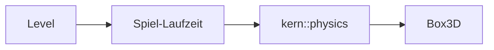

# 6 Physik – Box3D an der Leine

> **Dein Level:** Kisten stapeln, Türen schwingen, Brücken brechen. Hier siehst du, wie Kern
> Box3D benutzt, welche Regeln es sich gibt und wie ein echter Servo zum Modell wird.

Kern simuliert **starre Körper** mit **Box3D** von Erin Catto, dem 3D-Nachfolger von Box2D v3. Es
liegt **unverändert** im selben WebAssembly-Modul wie der Renderer. Die schmale Schicht
`kern::physics` ist die **einzige Stelle**, an der Kern mit Box3D spricht. Wie Physik innen denkt,
erklärt [Anhang C](C-grundlagen-physik.md); hier geht es darum, wie Kern damit arbeitet.

Die Grundregel: **Box3D wird nie an Kern angepasst** – weder Quelltext noch Konstanten noch
Solver-Einstellungen. Passt ein Modell nicht, wird **das Modell** angepasst: skaliert, Massen
verteilt, mehr Sub-Steps. Ein echtes Gerät wie ein Servo bekommt ein eigenes Gerätemodell (6.17).


> **Mission:** Öffne auf https://kernengine.de/ File › Example Levels › **Physics Lab** und drück
> **Simulate** (Alt+S). Pack eine Kiste der Pyramide mit der linken Maustaste, heb sie hoch und lass
> los – sie fliegt mit Schwung weiter. Stoß das Pendel an und öffne die Tür.

## 6.1 Aufbau der Schicht



- Meter, Sekunden, Kilogramm; **Z oben** – wie im Renderer.
- Winkel in **Radiant** (ein Kreis ≈ 6,28). Grad gibt es nur in Leveldateien und im Details-Panel.
- Körper, Formen und Gelenke sind **Handles**, 64-Bit-Nummern; 0 heißt „keins“.
- Eine Welt besitzt alles, was in ihr entsteht, und räumt es mit sich auf.
- Fehler liefern ein ungültiges Handle oder `false`; `last_error()` sagt warum
  ([Kapitel 3](03-grundlagen.md)). Unsinnige Werte erreichen Box3D nie.

Gebaut wird die Schicht mit `kern/build.sh --physics` ([Kapitel 2](02-bauen-und-testen.md)).

## 6.2 Die richtige Größe

Box3D hat feste Toleranzen **in Metern**: 5 mm erlaubte Überlappung („Linear Slop“), 20 mm für
spekulative Kontakte, bis 50 mm Polster um die Hüllkisten und 50 mm fürs Wiederverwenden von
Kontakten. Daher Regel eins: **Bewegte Körper zwischen 0,1 m und 10 m, nie unter 1 cm.** Die
Spiel-Laufzeit hebt bewegte Formen auf mindestens 1 cm an (Kugeln 5 mm Radius); feste dürfen 2 mm
dünn sein.

> **Krass, aber wahr:** Die Micro Duck in echter Größe hat Glieder von 2 bis 4 cm. Ihr Rumpf sank in
> 10 Frames 9 cm durch die eigenen Beine. Vierfach vergrößert halten die Gelenke.

### Skalieren statt Toleranzen verstellen

Box3D könnte seine Längeneinheit umstellen – aber nur für die ganze Welt, und in einem Level stehen
Autos neben kleinen Robotern. Kern rechnet Einheiten deshalb **an genau einer Stelle** um: an der
Grenze zu Box3D. Kleine echte Modelle werden als Ganzes mit einem Faktor S vergrößert, jede Größe
passend zu ihrer Einheit. Für die Micro Duck ist **S = 4**:

| Größe | Faktor | bei S = 4 |
|---|---|---|
| Länge | S | ×4 |
| Zeit, Geschwindigkeit | √S | ×2 |
| Masse | S³ | ×64 |
| Trägheitsmoment | S⁵ | ×1024 |
| Drehmoment, Steifigkeit | S⁴ | ×256 |
| Dämpfung | S⁴ · √S | ×512 |
| Schwerkraft | 1 | ×1 |
| Frequenzen | 1/√S | ×½ |

Masse ×64, weil ein Würfel mit vierfacher Kante 4 · 4 · 4 = 64-mal so viel Volumen hat. Zeit ×2,
weil ein viermal so langes Pendel halb so schnell schwingt (probier es mit einem Schlüsselbund).
Das ist **Froude-Ähnlichkeit**: gleiche Posen und Gangart, im Wohlfühlbereich von Box3D.

Im Rahmen der Modellgenauigkeit bleibt es dieselbe Ente – ein **Wechsel der Einheiten**, kein
größerer Roboter. Nach außen (Netze, Logs, [Kapitel 16](16-kalibrierung.md)) geht alles in echten
Einheiten. Eine Garantie für den echten Roboter ist eine Simulation aber nie.

Ein Test baut ein kleines Servo-Bein in 1-, 4- und 8-facher Größe. **Frei hängend** laufen 1× und
4× **Bit für Bit gleich** (Zweierpotenzen runden exakt gleich). **Am Boden** wirken Box3Ds feste
Längen: 4× und 8× liegen 0,23 mm auseinander, 1× und 4× 0,27 mm. Was in echten Einheiten fest
eingestellt ist, wird deshalb **kalibriert, nicht skaliert**: Kontaktsteifigkeit 30 Hz in der Welt
entspricht 60 Hz am echten Roboter, 3 m/s Ausdrückgeschwindigkeit 1,5 m/s, die Restitutionsschwelle
1 m/s 0,5 m/s und die Servo-Gelenkweichheit 240 Hz 480 Hz. Abweichungen kommen also aus den Modellen
(Servo, Kontakt, Massen), nicht aus der Skalierung.

## 6.3 Die Welt

```cpp
physics::WorldSettings ws;
physics::World world;
if (!world.create(ws)) { /* last_error() */ }
world.step(1.0f / 60, 4);  // 1/60 s, 4 Sub-Steps
```

Standardwerte nehmen, Welt bauen, Fehler prüfen, dann ein Schritt von 1/60 s in 4 Teilschritten.

Standard: Schwerkraft (0, 0, −9,80665) m/s², Schlaf und Continuous Collision an,
Restitutionsschwelle 1 m/s (2 Durchgänge), Hits ab 1 m/s, Kontakte mit 30 Hz, Dämpfung 10 und
3 m/s Ausdrückgeschwindigkeit, Tempolimit 400 m/s. Kern setzt immer **einen einzigen Thread**
(WebAssembly hat nur einen) und seine **Paar-Reibung** (6.6). Auf dem PC schützt ein Schloss das Erzeugen von
Welten, weil der Lehrer viele Welten auf mehreren Threads betreibt ([Kapitel 14](14-lehrer.md)).

Ein `step` ignoriert unsinnige Zeiten, rechnet mit 1 bis 64 Sub-Steps und sammelt die neuen
Ereignisse (6.10). **Wie lang** ein Schritt ist, entscheidet der Aufrufer (6.13). Zählen lassen
sich Körper, wache Körper und Schritte.

## 6.4 Körper

```cpp
physics::BodySettings bs;
bs.type = physics::BodyType::dynamic;
bs.position = {0, 0, 3};
const physics::Body ball = world.create_body(bs);
```

Ein dynamischer Körper, 3 m über dem Ursprung. Es gibt drei Typen:

- **fixed:** bewegt sich nie – Boden, Wände, Häuser.
- **kinematic:** bewegt sich, wie du sagst, und lässt sich nicht aufhalten – fahrende Plattformen,
  Drehbalken, die Autos der Stadt.
- **dynamic:** reagiert auf Kräfte, Stöße und Schwerkraft.

Dazu kommen Drehung, Anfangstempo, Dämpfung, **Schwerkraftfaktor**, Schlaf und **Bullet**
(schnelle Körper auch gegen bewegte prüfen). Zur Laufzeit: Lage und Tempo lesen und setzen,
**Kräfte** (gelten einen Schritt) und **Impulse** aufbringen, Achsen **sperren**, Zielposen für
Kinematisches. Was Kraft und Impuls sind: [Anhang C](C-grundlagen-physik.md).

Masse und Trägheit ergeben sich aus Form und Dichte. Man kann nur die **Masse** setzen (die Trägheit
wächst mit) oder **alles**: Masse, Schwerpunkt, sechs Trägheitswerte. So bekommen importierte Roboter
ihre gemessenen Werte; die Formen sorgen dann nur für den Kontakt.

## 6.5 Formen

Ein Körper trägt beliebig viele Formen: **Box** (intern eine Hülle), **Kugel**, **Kapsel** entlang Z,
**Hülle** (konvex, ab 4 Punkten) und **Mesh** (beliebige Dreiecke, **nur an festen Körpern**).
Unsinn wird abgelehnt. Bei Meshes verschweißt Kern Ecken unter 0,5 mm Abstand und lässt Box3D
innere Kanten erkennen – so holpert nichts über die Naht zweier Dreiecke (**Geisterkollisionen**).

Jede Form hat ein **Material**:

| Feld | Standard | Bedeutung |
|---|---|---|
| Dichte | 1 kg/m³ | ab 0,0001 |
| Reibung | 0,6 | ≥ 0 |
| Restitution | 0 | Sprungkraft 0 bis 1 |
| Rollwiderstand | 0 | bremst Rollen |
| Oberfläche | keine | für Paar-Reibung |
| Sensor | aus | nur Überlappung |

Dazu **Kanäle**: A und B stoßen nur zusammen, wenn A's Kategorie in B's Maske liegt und umgekehrt.
Formen mit derselben **negativen Gruppe** stoßen nie zusammen – so kollidiert ein Roboter nicht mit
sich selbst. Und Schalter für Kontakt-, Sensor- und Hit-Ereignisse.

`hull_mesh` erzeugt die Dreiecke einer Hülle mit demselben Bauer, der auch kollidiert; Studio zeichnet
damit Hüllen-Collider (4 bis 4096 Punkte, nicht flach).

## 6.6 Oberflächen mit Paar-Reibung

Box3D verrechnet zwei Reibwerte zu √(a · b) und die Sprungkraft als das Größere (warum, steht in
[Anhang C](C-grundlagen-physik.md)). Für echte Paare stimmt das nicht immer: TPU auf Baumwolle hat
laut Quelltext einen eigenen gemessenen Wert, nicht das Mittel aus TPU auf TPU und Baumwolle auf
Baumwolle.

Darum kennt Kern **Oberflächen**: `cloth` (Baumwollstrick), `tpu` (weiches gedrucktes Gummi),
`floor` (Holz oder Laminat) und `none`. Gemessene Haftreibung, trocken:

| Paar | Reibung | Bereich laut Code |
|---|---|---|
| cloth – cloth | 0,5 | Strick auf Strick 0,4–0,6 |
| cloth – tpu | 0,8 | Gummi auf Stoff 0,6–1,0 |
| cloth – floor | 0,4 | Stoff auf Holz 0,3–0,5 |

Box3D bleibt dafür unverändert: Die Oberfläche steht als Material-Nummer in der Form, und die Welt
bekommt eine eigene **Reibungsfunktion**, die Box3D bei jedem Kontakt fragt. Hat das Paar einen
Wert, gilt er, sonst √(a · b). Sprungkraft und Rollwiderstand bleiben unberührt.

> **Vorsicht, Falle:** Wer eine Oberfläche ergänzt, muss auch die Obergrenze der Nummern in der
> Reibungsfunktion (heute 3), den Namen und die Paare nachziehen.

Oberflächen stehen als Text in der Leveldatei (an Mesh-Collidern, eigenen Collidern und dem
endlosen Boden); ein Details-Feld gibt es (Stand dieses Codes) nicht. Die Micro Duck
([Kapitel 13](13-micro-duck.md)): Socke `cloth`, Schnabelpolster `tpu`, Holzboden `floor` (der
endlose Boden ist auch `floor`, aber aus). Sohlen haben **keine** Oberfläche und behalten ihre
Trainingswerte: 1,0 auf 1,0 ergibt √(1 · 1) = 1.

## 6.7 Reibung, Sprungkraft, Rollwiderstand

Im Studio stellst du **Reibung**, **Restitution** und **Rollwiderstand** unter Details › Static Mesh
› Physics ein (für den automatischen Collider) oder unter Details › Collider. Für den endlosen Boden:
World Settings › Physics (Box3D) › **Ground friction** und **Ground bounciness**, dort auch Contact
stiffness, Contact damping ratio und Contact push-out speed.

Restitution nimmt Box3D als das Größere beider Formen; Stöße unter 1 m/s prallen nicht ab.
**Rollwiderstand** zählt mit dem größeren Wert beider Formen, mal einem Rollradius: Radius bei Kugel
und Kapsel, ein Viertel des Innenradius bei Hüllen (auch Quader sind Hüllen). Kern setzt ihn für
runde Dinge: Ball im Micro-Duck-Level 0,03 („rollt aus“), Rover-Reifen im Physics Lab 0,02,
Sockenklumpen 0,5 („ein Stoffklumpen rollt nicht“). **Roboterfüße** sind breit, flach und griffig.

> **Mission:** Wähle im Physics Lab die oberste Kiste, **Crate 15**. Setz in Details › Collider die
> **Friction** von 0,7 auf 0, starte Simulate, setz die Kiste auf den Boden und schubs sie an: Sie
> gleitet wie auf Eis – denn √(0 · Bodenreibung) ist immer 0.

## 6.8 Gelenke

Ein Gelenk verbindet zwei Körper über je einen kleinen **Rahmen** (Ort plus Achsen). Scharnier,
Kugel- und Parallel-Gelenk arbeiten **um Z** des Rahmens, Schiene und Rad **entlang X**. Der Winkel 0
liegt dort, wo beide Rahmen übereinstimmen; eine Hilfsfunktion baut den Rahmen aus Anker und Achse.

| Im Studio | Box3D | Wofür |
|---|---|---|
| Hinge | revolute | Scharnier: Tür, Brücke |
| Slider | prismatic | Schiene: Lift |
| Ball | spherical | Kugelgelenk mit Kegelgrenze |
| Fixed | weld | starr oder weich |
| Distance/rope | distance | Abstand, Seil: Pendel |
| Wheel | wheel | Rad mit Federung, Antrieb |
| Motor | motor | treibt Lage per Tempo, Feder |
| Parallel | parallel | hält Achsen weich parallel |
| No collision | filter | nur Kollision verhindern |

Je nach Typ gibt es **Feder** (Hz, Dämpfung), **Grenzen** und **Motor** (Tempo, Höchstkraft).
Vertauschte Grenzen dreht Kern um, negative Höchstkräfte werden 0. Alle Gelenke haben „verbundene
Körper kollidieren“ (Standard: nein) und eine Gelenkweichheit (Box3D-Standard 60 Hz, Dämpfung 2). Ein
Gelenk eines Körpers mit sich selbst wird abgelehnt. Zur Laufzeit lassen sich Motor, Feder und
Bruchschwellen setzen und Winkel, Drehtempo, Zwangskraft und -moment lesen.

**Brechen:** Box3D meldet Gelenke über ihrer Kraft- oder Momentschwelle. Die Spiel-Laufzeit
zerstört sie dann, zählt sie, schreibt `Joint on "…" broke` ins Log und spielt den Bruch-Sound. Im
Physics Lab haben die drei mittleren Brückenplanken so eine Schwelle (60 000 N).

> **Mission:** Wähle **Plank 06** und senke in Details › Constraint › Breaking die **Break force**
> auf 2000. Starte Simulate und reiß die Planke mit der Maus hoch. Das Gelenk bricht, das Output Log
> meldet es, und die Statusleiste zählt mit.

**Feder in echten Einheiten:** Box3D will Federn in Hertz und Dämpfungsgrad, Servos rechnen in
N·m/rad und N·m·s/rad. Kern rechnet an der Grenze um, wie Box3D intern, mit der **effektiven Masse**
des Gelenks ([Anhang C](C-grundlagen-physik.md)). Weil die sich mit der Lage ändert, wird die Feder
**jeden Schritt** neu gesetzt. Box3D löst sie implizit: stabil bei jeder Steifigkeit.

## 6.9 Abfragen

**Strahlen** finden den nächsten Treffer (ohne Sensoren und ausgenommene Körper). **Kugeln
schieben** ist ein „dicker Strahl“ für Bodenproben. **Explosionen** stoßen Körper von einem Punkt weg (negativ: Implosion). **Schieben**
gibt einem Körper so viel Stoß, dass er vor einem laufenden Charakter nicht langsamer ist als dieser.
Ein Treffer liefert Form, Körper, Punkt, Normale und Streckenanteil. Für den Character Mover gibt es
zwei Extras: Wie weit kommt die Kapsel, und welche Ebenen (bis 32) berührt sie?

## 6.10 Kontakte und Ereignisse

Nach jedem Schritt liegen die Ereignisse **dieses** Schritts bereit: Kontakte beginnen und enden,
Sensoren werden betreten und verlassen, **Hits** (harte Stöße mit Punkt, Normale, Tempo) und Gelenke
über der Schwelle. Die Ereignisse tragen auch die Körper, falls eine Form schon zerstört ist.

**Ereignisse kosten Zeit**, also schaltet die Spiel-Laufzeit sie nur ein, wo das Spiel sie liest:
Sensoren, Spieler, Aufprall-Sounds und Levels mit Logik.

Zwei Abfragen lesen Box3Ds Kontakte direkt: die **Kontaktpunkte** eines Körpers (Studio zeigt sie
mit dem Show-Flag **Contact Points**) und die **Berührungen** – wen berührt der Körper, wie fest? So
spürt die Micro Duck Fußkontakt und Eigenkollision ([Kapitel 13](13-micro-duck.md)).

> **Mission:** Schalte im Physics Lab unter Window › Show **Collision Shapes**, **Constraints** und
> **Contact Points** ein und starte Simulate. Jetzt siehst du, womit Box3D wirklich rechnet.

## 6.11 MouseGrab

Der Maus-Griff zieht mit einer **Feder**: ein unsichtbarer kinematischer „Maus-Körper“ plus ein
**Motor-Gelenk** zum Körper. Die Feder hat 7,5 Hz, ist kritisch gedämpft (kein Nachwippen) und schafft höchstens das 100-Fache der
Gewichtskraft. Bei einer 300-kg-Kiste aus dem Physics Lab sind das rund 290 000 N. Drehen darf der
Körper frei; mit „Ausrichtung halten“ hält eine zweite Feder ihn aufrecht wie eine Hand – so baumelt
eine hochgehobene Micro Duck nicht. Der Körper bleibt ganz in der Physik: Er stößt an, kippt und
fliegt beim Loslassen weiter. Feste und kinematische Körper lassen sich nicht greifen. Studio nutzt
den Griff in Simulate, nach Eject (F8) und mit der Observer-Kamera.

## 6.12 Der Character Mover

Der Character Mover ist eine Spielfigur als Kapsel auf Box3Ds noch experimenteller Mover-Technik.
Sie läuft **außerhalb des Solvers**: Sie rechnet ihre Bewegung selbst und schubst Körper an, in die
sie läuft. Standardwerte: Radius 0,4 m, Höhe 1,8 m, Stufenhöhe 0,45 m, 6 m/s Höchsttempo,
Beschleunigung 10 und Bodenreibung 8 pro Sekunde, 25 % Steuerung in der Luft, konstante Reibung unter
3 m/s, Sprung 6 m/s, Sprint ×1,6, eigene Schwerkraft 20 m/s² (knackiger als die Welt), Böden bis
50°, Schubkraft 1.

Pro Schritt: Reibung, Beschleunigung, Sprung, Schwerkraft; eine **Pogo-Feder** (4 Hz) hält die
Kapsel auf Stufenhöhe – so geht sie Treppen hinauf. In bis zu fünf Runden wird die Bewegung an
berührten Ebenen ausgerichtet (gegen die Wand drücken macht nicht schneller), dann gibt es
Schubser. Die Spielertypen Character und Soldier nutzen den Mover ([Kapitel 8](08-spiel-laufzeit.md)).

## 6.13 Der Takt: Zeitschritt und Sub-Steps

Box3D bekommt **nie** eine schwankende Schrittlänge. Die Schrittrate ist eine Level-Einstellung:
Standard **60 Hz**, erlaubt 15 bis 480, aber nie gröber als 30 Hz verwenden. Warum, und wie der
Akkumulator funktioniert, steht in [Anhang C](C-grundlagen-physik.md). Kerns Grenzen dabei:

- Ein langer Frame zählt höchstens 0,25 s, pro Frame laufen höchstens 0,1 s Simulation – gegen die
  „Spiral of Death“, in der die Simulation nie aufholt. Im Rückstand fallen ganze Schritte weg.
- Die Simulationszeit **zählt Schritte** statt Kommazahlen aufzusummieren.
- Eingaben gelten **pro Schritt**; ein Netz mit 50 Hz zählt Schritte, nicht Sekunden.

Gezeichnet wird **zwischen** den letzten zwei Physikständen: Liegt ein Bild bei 40 % der Zeit,
steht der Körper bei 40 % des Weges. Die Kamera folgt dieser Lage, sonst wackeln schnelle Autos.

**Sub-Steps** teilen jeden Schritt noch einmal (Standard 4, im Level 1 bis 16). Lange Gelenkketten
dehnen sich dann weniger: An der Hüfte der Ente wuchs die Lücke bei 4 Sub-Steps unter Last auf 5 cm,
bei 16 bleibt sie unter 1 mm. Fügt Studio einen Roboter ein, stellt es 16 Sub-Steps und dessen Takt
ein (Micro Duck: 100 Hz) und meldet das.

Box3D deckelt Gelenksteifigkeit auf ein Viertel, Kontaktsteifigkeit auf ein Achtel der
Sub-Step-Rate. Kern hält zusätzlich jede Feder unter der Hälfte:

**höchste Federfrequenz = 0,5 · Schrittrate · Sub-Steps**

Bei 60 Hz und 4 Sub-Steps sind das 120 Hz. Servogelenke bekommen 240 Hz Weichheit (oder die Grenze)
mit Dämpfung 2.

> **Mission:** Starte im Physics Lab Simulate, drück **Pause** und dann mehrmals **.** (Punkt):
> Jeder Druck ist genau ein fester Schritt. Step rate und Sub-steps findest du in World Settings ›
> Physics (Box3D).

## 6.14 Determinismus

Kern ist **Bit für Bit deterministisch** auf allen geprüften Plattformen: GCC auf x86, Apple clang
auf ARM und WebAssembly. Warum das schwer ist, erklärt [Anhang C](C-grundlagen-physik.md). Die Physik
hilft mit festem Takt, einem einzigen Thread, Box3D ohne Vektorbefehle (SIMD), dem Compilerschalter
`-ffp-contract=off` und Kerns eigener Mathe-Bibliothek (`kern::dm::sin` usw.; `sqrt`, `fabs` und
`floor` sind ohnehin exakt). Ein **Fingerabdruck** prüft das: Die Ente geht 400 Regeltakte, jeder
Takt wird zu einer Prüfnummer, und alle müssen eine gespeicherte Liste treffen
([Kapitel 14](14-lehrer.md)).

> **Für Profis:** Code, der die Simulation speist, nutzt `kern::dm::` statt `std::` für sin, cos,
> tan, asin, acos, atan, atan2, exp, expm1, log, log10, pow und hypot – ohne threadabhängige Summen
> und ohne `-ffast-math`.

## 6.15 Die Regeln

`docs/physics.md` ist Pflicht, bevor man Physik oder Spiel-Laufzeit ändert oder einen Roboter,
ein Fahrzeug oder eine Gliederpuppe baut. Grundlage sind Erin Cattos Dokumentation und Vorträge und
Messungen in Kern mit Tests:

- **Größen:** Meter, Kilogramm, Sekunden, Radiant; bewegte Körper 0,1–10 m; umrechnen nur an der
  Grenze; kleine Modelle mit S skalieren. **Verboten:** Box3Ds Längeneinheit umstellen.
- **Massen:** Nachbarn höchstens etwa 10 : 1, sonst dehnen sich Gelenke. (Erin Cattos Rezept für
  einen Panzer mit 467 : 1: Leichtes schwerer, Schweres leichter machen.) Ein starres Teil ist
  **ein** Körper mit mehreren Formen – **verboten:** Körper zusammenschweißen. Leichte Glieder
  bekommen eine Mindestmasse (die 5-g-Hüftbügel der Ente mindestens 20 g).
- **Takt:** wie in 6.13. **Verboten:** schwankende Schritte.
- **Gelenke:** in der **Ruhepose** bauen, Grenzen um 0; Scharniere um Z; Eigenkollision mit negativer
  Gruppe oder „No collision“; Box3Ds Gelenkweichheit nur für Servos erhöhen.
- **Motoren und Servos:** immer ein **endliches** Höchstmoment. Servos sind die Gelenkfeder mit
  Zielwinkel, mit echten Werten und begrenztem Fehler (6.17) – **nicht** Erin Cattos Tempo-Regelung
  „Motortempo = Faktor × Fehler“, denn das Netz hat einen nachgiebigen Servo gelernt.
  Rotorträgheit ist eine Scheibe auf der Achse; was Box3D nicht kann, wird aufgeschrieben, nicht
  vorgetäuscht. Gelenkreibung ist ein Motor mit Tempo 0. Aufrecht halten per **Parallel-Gelenk**.
- **Verboten: die Physik umgehen** – keine Zusatzmomente, keine gesetzten Geschwindigkeiten an
  Körpern mit Gelenken oder Kontakten, keine Kreisel, Sperren oder Stützkräfte für Roboter. In der
  echten Welt gibt es sie auch nicht. (Ein „Kreisel“ auf Tempo-Ebene ließ die Ente springen.)
- **Kräfte:** Dauerlasten jeden Schritt als Kraft; Sprünge als Impuls; die eingebaute Dämpfung
  nutzen statt einer selbst gebauten Bremskraft.
- **Körper:** an der Endlage erzeugen (nicht teleportieren), Typ gleich festlegen; Kinematisches per
  Tempo oder Zielpose bewegen; Charaktere auf dem Mover; Sperren **nie bei Laufrobotern** – ein Roboter muss fallen können.
  Nicht in Nullstellung gebaute Gelenke merken sich ihren Bauwinkel.
- **Kollision und Schlaf:** Continuous Collision an, schnelle Spielerfahrzeuge als Bullets;
  Spieler und Roboter schlafen nie (langsames Gehen liegt unter der Schlafschwelle von 5 cm/s).

**Checkliste für ein neues Modell mit Gelenken:** (1) Jedes bewegte Teil ist ≥ 10 cm, sonst
skalieren. (2) Ein Körper pro starrem Teil. (3) Massen innerhalb 10 : 1, Mindestmassen. (4) In der
Ruhepose bauen. (5) Servos als Gelenkfeder, Reibung als Motor, keine Hilfskräfte. (6) 8–16
Sub-Steps. (7) Eigenkollision filtern. (8) Ein Test: Das Modell steht, Gelenklücken unter 1 % der
Gliedlänge, es tut seine Aufgabe – deterministisch.

## 6.16 Wie die Spiel-Laufzeit die Physik nutzt

Spiele bauen Körper aus dem Level ([Kapitel 8](08-spiel-laufzeit.md)): Erst wird **geplant**, welche
Körper und Formen nötig sind (Studio zeichnet die Collider mit demselben Plan), dann werden **Körper**
mit Material, Kanälen, Ereignissen und Masse gebaut, dann **Gelenke** (Grad in Radiant, Federgrenze,
Servoweichheit, Bruchschwellen). In jedem Schritt laufen Steuerungen, Animationen, Verkehr,
Laufroboter, Servos und Maus-Griff, dann Box3D, dann die Ereignisse.

## 6.17 Das Servomodell – Brücke zur Micro Duck

Ein echter Servo hat einen Regler, Reibung im Getriebe und eine Verzögerung auf dem Datenbus. Kern
bildet das als kleines **Gerätemodell** mit einem **Profil** in echten Einheiten nach. Ein anderer
Servo ist ein anderes Profil; Profile werden an Messungen eingestellt und an anderen überprüft
([Kapitel 16](16-kalibrierung.md)). Das Gesetz für einen Positionsservo wie den Dynamixel XL330:
Moment = Steifigkeit K × (Ziel − Winkel), begrenzt auf ± Höchstmoment T, minus Dämpfung D × Tempo;
dazu Reibung F, die Rotorträgheit A und eine Verzögerung. Wie so ein Regler arbeitet, rechnet
[Anhang C](C-grundlagen-physik.md) mit Zahlen vor.

Kern setzt es nur mit Box3Ds eigenen Bausteinen um. Die Funktion `servo_step` macht pro Schritt:

1. **Feder:** Die Gelenkfeder zieht zum Ziel – aber das Ziel liegt höchstens T/K vom aktuellen
   Winkel entfernt. So wird K × Fehler nie größer als T, genau wie ein echter Servo sättigt.
2. **Reibung:** ein Gelenkmotor mit Tempo 0, dessen Höchstmoment F ist.

Dieselbe Funktion treibt Studio, Lehrer und Kalibrier-Prüfstand.

Im Level macht der Schalter `servo` ein Hinge zum Servo (Standard: Ziel 0°, K = 50 N·m/rad,
D = 2 N·m·s/rad, F = 0,1 N·m, T = Motor-Höchstkraft; Schlüssel `servoTarget`, `servoStiffness`,
`servoDamping`, `servoFriction`, `maxMotorForce`).

Ein **Profil** ist eine JSON-Datei (`"kind": "servo"`) mit Name, Quelle, K, D, F, T, A,
Verzögerung und **Streuungen**. Beim Training zieht jeder Servo eigene Werte in diesen Grenzen,
damit das Netz sich nicht auf Ungemessenes verlässt. Werte außerhalb der Bereiche werden abgelehnt.
Eingebaut ist der XL330-M288 bei 7,4 V, wie Pollen Robotics ihn trainiert (Modell „m6“ aus BAM –
Better Actuator Models von Rhoban):

| Wert | Zahl |
|---|---|
| K Steifigkeit | 0,554 N·m/rad |
| D Dämpfung | 0,053 N·m·s/rad |
| F Reibung | 0,0048 N·m |
| T Höchstmoment | 0,963 N·m |
| A Armature | 0,0018 kg·m² |
| Verzögerung | 20 ms (Training 15–30) |
| Streuung | Armature, Reibung je ±10 % |

An der Grenze zu Box3D wird **genau einmal** skaliert: Steifigkeit, Reibung, Höchstmoment × S⁴,
Dämpfung × S⁴ · √S, Trägheit × S⁵. Aus 0,963 N·m werden bei S = 4 also 0,963 · 256 ≈ 246,5 N·m.
Die Armature kommt als dünne **Scheibe** auf der Achse dazu (voller Wert um die Achse, halber quer) –
eine Trägheit nur um eine Achse wäre kein echter Körper, und Box3D gewänne damit Energie. Die
Verzögerung läuft durch eine **Warteschlange** ganzer Schritte: 20 ms echt sind bei S = 4 genau
40 ms Weltzeit, bei 100 Hz also **4 Schritte**. Mehr in [Kapitel 13](13-micro-duck.md).

## 6.18 Tests

Tests prüfen Körper, Formen, Ereignisse, Strahlen, alle neun Gelenke, den Griff, die Skalierung,
Hüllen, Materialien, das Physics Lab samt Brückenbruch, den Character Mover und den Fingerabdruck.

## Level geschafft!

- Du weißt, warum Kern das Modell anpasst und nie Box3D.
- Du kannst erklären, warum die Ente vierfach groß, 64-mal schwer und doppelt so langsam simuliert
  wird – und trotzdem dieselbe bleibt.
- Du kennst Körpertypen, Formen, Materialien und die neun Gelenke.
- Du verstehst Paar-Reibung, Rollwiderstand und brechende Gelenke.
- Du kannst erklären, wie aus einem Servo ein Profil und eine Gelenkfeder wird.

## Rätsel-Ecke

1. Welcher Körpertyp passt zu einer Plattform, die stur ihrer Bahn folgt?
2. Socke (`cloth`) auf Holzboden (`floor`): Welche Reibung gilt? Und ohne Oberflächen, mit 0,4 und
   0,9?
3. 100 Hz, 16 Sub-Steps: Wie hoch darf eine Feder höchstens schwingen?
4. **Boss-Rätsel:** Ein Roboter hat 20 ms Busverzögerung, S = 9, Takt 150 Hz. Wie lang ist die
   Warteschlange?

### Lösungen

1. **Kinematisch** – sie folgt der Vorgabe und lässt sich nicht bremsen.
2. Mit Oberflächen der Paarwert **0,4**; ohne √(0,4 · 0,9) = √0,36 = **0,6**.
3. 0,5 · 100 · 16 = **800 Hz**.
4. Zeit wächst mit √9 = 3, also 60 ms Weltzeit. Ein Schritt dauert 1/150 s ≈ 6,67 ms, also
   **9 Schritte**.

---

© 2026 Christian Heinrich Hohlfeld · Alle Rechte vorbehalten · [Impressum und Rechte](00-impressum.md)
