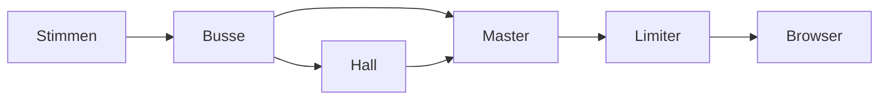

# 7 Audio – Kern dreht den Ton auf

> **Dein Level:** Ein Spiel ohne Ton ist ein Stummfilm. Hier lernst du ein komplettes Tonstudio
> kennen: ein Mischpult für 3D-Klang, einen Synthesizer, der jedes Geräusch aus Mathe baut, und die
> Stimme der Micro Duck.

Kern hat eine eigene **Sound-Engine** in C++, im selben WebAssembly-Programm wie Grafik und Physik.
Der Browser ist nur Lautsprecher und entpackt importierte Dateien.

Schall ist zitternde Luft. Der Computer misst die Welle sehr oft pro Sekunde, jede Messung ist ein
**Sample**. Wie oft gemessen wird, heißt **Abtastrate**: 48 000 Hz sind 48 000 Zahlen pro Sekunde und
Ohr. So eine Zahlenreihe heißt **PCM**.

## 7.1 Warum ein eigener Mixer?

- **Immer gleich:** Dieselben Ereignisse ergeben auf jedem Gerät dieselben Samples
  (*deterministisch*).
- **Ein Code für alles:** Studio, exportierte Spiele und Tests nutzen denselben C++-Code.
- **Volle Kontrolle:** kein Klicken, kein Übersteuern – jedes Sample bleibt zwischen −1 und +1.

## 7.2 Der Mixer

> **So kannst du es dir vorstellen:** ein DJ-Pult. Jede Spur hat einen Regler, Spuren laufen in
> Gruppen zusammen, am Ende sitzt der Hauptregler vor den Boxen.

Der Mixer hat einen festen Vorrat an **Stimmen** – Tönen, die gerade laufen. Studio nimmt 64,
möglich sind 128. Ausgegeben wird Stereo. Abgespielt werden **Clips**: Stücke PCM, mono oder stereo,
höchstens so groß wie 60 Sekunden Stereo bei 384 000 Hz. Passt die Rate einer Datei nicht zum Gerät,
rechnet Kern sie **einmal** beim Laden um, mit einem sauberen, teuren Filter (*Windowed Sinc*), der
falsche „Spiegeltöne“ verhindert.

Jede Stimme bekommt Einstellungen: Lautstärke (0 bis 16), Tonhöhe (*pitch*, 0,05 bis 8), Pan,
Loop, Bus, Einblenden, Priorität und für 3D-Töne Ort, Tempo, `min_distance` (1 m), `max_distance`
(50 m), Abfallkurve, Breite und Doppler. Unsinnige Werte werden gestutzt. Die Nummer einer Stimme
enthält einen Zähler, der bei jedem Start steigt: Eine veraltete Nummer trifft nie einen fremden Ton.

**Alle Plätze voll?** Dann klaut Kern eine Stimme mit gleicher oder kleinerer Priorität: die
unwichtigste, dann die leiseste, dann die älteste. Sind alle wichtiger, startet der neue Ton nicht.

**Stoppen** blendet immer aus, mindestens 5 ms – hart abgeschnitten **klickt** es. Auch
Lautstärkeänderungen gleiten (30 ms). Die Spielpause hält Stimmen an, ohne ihre Position zu
verlieren.

**Mischen:** Der Mixer arbeitet in Blöcken zu 128 Samples. Pro Block rechnet er für jede Stimme die
Lautstärke links und rechts aus und lässt sie im Block sanft gleiten, sonst schnarrt es. Pro Sample
liest er den Clip; liegt die Position zwischen zwei Samples, legt er durch vier Nachbarn eine weiche
Kurve (*Hermite-Interpolation*). Dann folgen ein Tiefpass (7.3), das Addieren in den Bus und das
Weiterrücken um „Tonhöhe × Doppler“.

> **Krass, aber wahr:** Ist eine 3D-Stimme leiser als 0,00001, wird sie **virtuell**: nicht
> gemischt, aber ihre Position läuft weiter. Kommst du zur Maschine zurück, brummt sie an der
> richtigen Stelle weiter.

> **Mission:** Öffne in Kern Studio auf https://kernengine.de/ den Content Drawer (Ctrl+Space), Tab
> **Sounds**. Ein Klick spielt einen Sound an. Hör aus jeder Kategorie einen an. Ton gibt es erst
> nach deinem ersten Klick oder Tastendruck.

## 7.3 3D-Klang

Der **Hörer** sitzt an der Kamera. Für jede 3D-Stimme fragt Kern: Wie laut? Welche Seite? Wie
dumpf? Wie hoch?

**Entfernung:** Bei der Kurve `inverse` ist die Lautstärke `min_distance` geteilt durch den Abstand.
Mit 1 m: in 2 m Abstand 0,5, in 4 m 0,25, in 10 m 0,1. `linear` fällt gleichmäßig bis null,
`exponential` steiler als `inverse`. Auf den letzten 20 % vor `max_distance` blendet Kern zusätzlich
aus, damit es dahinter wirklich still ist.

**Links oder rechts:** Aus der Lage der Quelle wird ein Pan-Wert von −1 bis +1, bei nahen und
breiten Quellen schwächer. Dann gilt **Equal Power**:

```
a     = (pan + 1) · π/4
left  = cos(a) · √2
right = sin(a) · √2
```

Bei Pan 0 ist a = 45°: cos und sin ≈ 0,707, mal √2 ergibt beide Seiten 1. Bei Pan +1 ist a = 90°:
links 0, rechts ≈ 1,41. Weil cos² + sin² = 1 (Pythagoras im Kreis), klingt der Ton überall gleich
laut. Linear überblendet wäre er in der Mitte zu leise.

**Dumpfer:** Hohe Töne verlieren sich in der Luft schneller. Ein **Tiefpass** lässt nur Töne bis zu
einer Grenze durch: vor dir 20 000 Hz, in 120 m nur 10 000 Hz. Hinter dir wird es noch dumpfer. Das
ist das wichtigste Zeichen, an dem du vorn und hinten unterscheidest.

**Doppler:** Ein Krankenwagen fährt vorbei – erst höher, dann tiefer.

```
f' = f · (c − v_Hörer) / (c − v_Quelle)
```

`c` = 343 m/s. Ein Auto kommt mit 34,3 m/s auf dich zu: f' = f · 343 / 308,7 ≈ 1,11 · f, also 11 %
höher. Kern begrenzt den Faktor auf 0,5 bis 2 und lässt ihn gleiten.

> **Mission:** Platziere aus Place Actors › Audio ein **Radio**, starte **Simulate** (Alt+S) und
> flieg mit gehaltener rechter Maustaste und W A S D herum. Hörst du Abstand und Richtung?

## 7.4 Busse, Hall und Limiter

Jede Stimme spielt auf einem **Bus**: `music`, `sfx` (Effekte), `ambience` (Hintergrund), `ui`
(Oberfläche) oder `voice` (Stimmen). Alle münden im `master`.



Jeder Bus hat Lautstärke, Stummschaltung (gleitet, klickt also nicht), optional einen Tiefpass und
einen Hall-Regler. Anfangs: Musik 0,7, Ambience 0,8, Effekte und Stimmen etwas Hall. Kern misst pro
Bus Spitzen- und Durchschnittspegel.

**Hall:** Kern nutzt **Freeverb**, ein freies Hall-Rezept: pro Kanal acht **Kammfilter** – Echos, die
sich selbst einspeisen und leiser werden, die Höhen schneller – und danach vier **Allpässe**, die den
Rest verwischen. Der rechte Kanal hat etwas längere Echos; das macht den Hall breit.

> **So kannst du es dir vorstellen:** Klatsch in einer leeren Turnhalle. Echos von allen Wänden
> verschmelzen zu einem Hallschweif. Die acht Kämme spielen diese Wände nach.

**Limiter:** Keine Spitze darf über 0,92. Der Limiter senkt die Verstärkung **sofort** und lässt in
etwa 120 ms wieder los. Den Rest rundet eine weiche Kurve (`tanh`) ab. Die Statistik des Mixers
(Stimmen, Clips, Pegel) zeigt die Statusleiste des Studios als **Pegelanzeige**; die Spitze fällt
mit 20 dB pro Sekunde wie eine echte Pegelnadel.

> **Mission:** Lege mit File › New Level... ein **Basic**-Level an, platziere aus Place Actors ›
> Physics einen **Crate Stack** und wirf in **Simulate** mit der linken Maustaste Kisten herum.
> Beobachte den Pegel unten. Stoppe mit Esc, setze in **World Settings** › Audio **Reverb** auf 1 und
> probier es nochmal.

## 7.5 Der Synthesizer

Kern bringt **keine einzige Sound-Datei** mit. Jeder eingebaute Sound entsteht beim Laden aus Code,
in einem kleinen Synthesizer nach dem Retro-Tool sfxr, erweitert um Resonanzfilter, Rauschfarben, FM
und Schichten, dazu ein Step-Sequencer für Musik. Feste Zufalls-Startwerte machen alles überall
gleich.

Ein Sound ist ein **Patch**, eine Reglerliste: Wellenform (Rechteck, Sägezahn, Sinus, Dreieck,
Rauschen, rosa Rauschen, Puls), Hüllkurve (Anstieg, Halten, „Punch“, Abklingen), Tonhöhe mit
Gleiten, Vibrato und Sprung, Pulsbreite, FM, Tief- und Hochpass, Tremolo, Wiederholen, Bitcrush.

- Rauschen wird im Takt der Tonfrequenz neu gewürfelt, tiefes klingt dunkler.
- Gleiten, Vibrato und Filterfahrten werden nur alle 16 Samples neu berechnet. Spart Zeit, und so
  kurze Stufen hört niemand.
- Bitcrush hält Werte fest – der kaputte Retro-Klang.
- Wiederholen ergibt den Power-up-Sound, ein einzelner Tonsprung den Pickup-Sound.
- Hilfsfunktionen schichten Töne und machen **nahtlose Loops**, indem das Ende weich über den Anfang
  geblendet wird.

Das Rezept für `pickup` (gekürzt):

```cpp
SynthPatch a = patch(Wave::pulse, 988,
                     0.002f, 0.05f, 0.28f, 0.42f);
a.duty = 0.35f;
a.arp_ratio = 1.5f;
a.arp_time = 0.065f;
out = synthesize(a, rate);
```

Ein Pulston mit 988 Hz und vier Hüllkurvenzeiten, Pulsbreite 35 %. Nach 65 ms springt er aufs
1,5-Fache, eine Quinte höher. Dann wird gerechnet; im Original kommt noch eine Glocke dazu.

**Anschläge:** Für Aufprall kleiner fester Dinge mischt Kern einige schnell verklingende Sinustöne –
die **Moden** des Körpers – mit einem kurzen Rauschstoß. Massives Plastik klingt weder tief noch
lang, sonst klänge es nach hohler Kiste. Deshalb liegen die Töne von `plastic` bei 760, 1650 und
3100 Hz.

**Musik:** `music_drive` hat 120 Schläge pro Minute, Am–F–C–G, Bassdrum, Snare, Bass, Arpeggio und
Flächen. `music_calm` hat 80 Schläge, ruhige Akkorde und eine Glockenmelodie. Beide: 8 Takte,
Stereo, nahtlos. Weil Musik einige hundert Millisekunden Rechenzeit braucht, rechnet Kern sie **in
Häppchen** von etwa einem Takt. So ruckelt das Laden nicht.

Eingebaute Sounds heißen `builtin:` plus Name (* = Loop):

| Kategorie | Sounds |
|---|---|
| Gameplay | pickup, powerup, jump, land, goal, hazard, checkpoint, lose, laser |
| Combat | gunshot, smg, pistol, sniper, launcher, reload, hit, down |
| Physics | explosion, impact, impact_light, break, step, plastic, plastic_step |
| Vehicle | engine*, hover*, boost |
| Ambience | wind*, city*, hum* |
| Robot | servo*, quack, beep |
| UI | click, confirm, error |
| Music | music_drive*, music_calm* |

## 7.6 Die Stimme der Micro Duck

Die Micro Duck hat einen eigenen Synthesizer, übertragen aus dem Original-Projekt von Pollen
Robotics (dort in Rust). Eine einzige Zahl, der **Seed**, legt ihren Klang fest: Tonlage, Nasalität,
Vibrato, Atem, „Quakigkeit“, Tempo und mehr. Derselbe Seed klingt immer gleich. Kern bildet ihn wie
der Roboter aus einer Kennung, über einen **SHA-256**-Fingerabdruck. Der Roboter nimmt seine
Seriennummer, Kern Name und Nummer des Actors.

Ein Laut besteht aus sieben Obertönen, einer Tonhöhenkurve mit Vibrato, schnellem
Lautstärke-Flattern (das „Quaken“) und etwas Rauschen als Atem. Es gibt sieben Laut-Arten: `alarm`,
`greet`, `inquire`, `peck`, `chirp`, `coo`, `wheee` – je 6 bis 12 Varianten, von denen eine zufällig
gespielt wird. `wheee` hat Anfang, Schleife und Ende, damit es so lange dauert wie eine Fahrt.

> **Krass, aber wahr:** Die Entenstimme ist **bitgenau** wie das Original. Vergleicht man alle 328
> Laute mit dem Rust-Original, haben sie dieselbe Länge und eine Abweichung von genau 0.

Zum Schluss entfernt ein Filter alles unter 300 Hz – so tief kann der kleine Lautsprecher des
Roboters nicht. Im Spiel klingt jeder Laut auf dem Bus `voice` am **Kopf** der Ente. Ein neuer Laut
schneidet den alten ab – wie bei einem einzigen echten Lautsprecher. Während `wheee` werden andere
Laute weggelassen. Weil ein Laut auf dem Handy einige zehn Millisekunden Rechenzeit kostet,
berechnet Kern sie vorab, einen pro Bild. Wann die Ente was ruft: [Kapitel 13](13-micro-duck.md).

## 7.7 Klang im Spiel

Im Level wird ein Sound als Text genannt: `builtin:<name>`, die Nummer eines importierten Sounds
(WAV, MP3, OGG, M4A, FLAC; die Datei steckt im Level), `none` für Stille oder `auto` für den
Standard.

Die **SoundBank** macht daraus Clips. Eingebaute Sounds rechnet sie in Häppchen, importierte
entpackt der Browser. Vor dem Start bestellt sie **alles**, was das Level brauchen kann, damit bei
Play alles bereit ist.

**GameAudio** überträgt jedes Bild die Level-Einstellungen auf den Mixer (Reverb geht an Effekte,
Stimmen und Hintergrund, nie an Musik und Oberfläche) und macht dann:

1. **Pause** der Welt übernehmen.
2. **Hörer** an die Kamera. Springt sie schneller als 200 m/s, war es ein Schnitt, ihr Tempo zählt
   als 0 – sonst gäbe es einen absurden Doppler-Heuler.
3. **Musik und Hintergrund** als Loops starten (Priorität 100).
4. **Motor des Spielers** als 3D-Loop (Priorität 90), **ohne Doppler**, weil die Kamera mitfährt.
   Mehr Tempo und Gas: lauter und höher. Bei der Ente surren die Servos.
5. **Audio Sources** folgen ihren Actors (Loops Priorität 40, einmalige 20).
6. **Cues** spielen (7.8). Ist ein Clip nach 0,25 s nicht fertig, fällt der Cue weg.

> **Vorsicht, Falle:** Ein Knall eine halbe Sekunde nach dem Blitz wirkt kaputt. Zu spät ist
> schlimmer als nie – darum wirft Kern verspätete Cues weg.

Cues haben Priorität 10 (auf dem Bus `ui` 50) und verdrängen deshalb nie Musik, Motor oder Loops.
Warten mehr als 64 Cues, wird abgeschnitten. Der **Lautsprecher-Knopf** in der Statusleiste des
Studios schaltet den Master stumm; das bleibt auch über Play und Stop hinweg so. Bei Motor „auto“ bekommen Hover Car
und Flyer `hover`, Vehicle `engine`, die Micro Duck `servo`, die anderen keinen.

## 7.8 Cues und Aufprallgeräusche

Die Simulation spielt nie selbst Ton. Sie schreibt in den festen Physikschritten **Cues**, kleine
Bestellzettel: Sound, Ort, Lautstärke, Bus, Actor. Darum sind sie deterministisch. Im Netzwerkspiel
werden Sounds ohne Garantie verschickt, wichtige Ereignisse wie ein eingesammeltes Pickup dagegen
sicher ([Kapitel 10](10-netzwerk.md)). Ohne Zuhörer (zum Beispiel beim Training) hebt Kern nur die
neuesten 64 Cues auf.

Jeder Rigid Body hat einen **Aufprall-Sound** (Standard `builtin:impact`) und eine Schwelle von
2,5 m/s. Jeder Collider kann einen eigenen haben – die Sohle der Ente macht `plastic_step`, ihr
Gehäuse `plastic`. Die Regeln:

1. Höchstens 6 Aufprallgeräusche pro Physikschritt.
2. Unter der Schwelle bleibt es still.
3. **Entprellen:** Ein Schritt klingt höchstens alle 0,5 s, ein Klopfen alle 0,09 s – eine abrollende
   Sohle hüpft winzig und meldet sonst viele Treffer.
4. **Lautstärke** = (v − Schwelle) / (5 · Schwelle) + 0,2, zwischen 0,2 und 1. Bei Schwelle 2,5 m/s
   und 10 m/s: 7,5 / 12,5 + 0,2 = 0,8.
5. Leichte Stöße (unter dem 2,2-Fachen der Schwelle) spielen das sanftere `impact_light`.
6. Schwere Dinge klingen tiefer, leichte nur ein wenig höher – sehr hoch klänge es nach Glas.

Die Micro Duck hat die Schwelle 0,12 m/s. Brechende Gelenke spielen `builtin:break`.

## 7.9 Level-Einstellungen und Audio Source

In **World Settings** › Audio stehen Master volume, Music, Ambience mit ihren Lautstärken, Reverb
(0,25) und Doppler.

Die Komponente **Audio Source** macht jeden Actor zur Schallquelle:

| Feld | Standard | Bedeutung |
|---|---|---|
| Sound | `builtin:hum` | welcher Sound |
| Volume, Pitch | 1, 1 | Lautstärke, Tempo |
| Loop, Play on start | an, an | wiederholen, mit Play starten |
| Spatial (3D) | an | aus: ohne Ort |
| Inner radius | 2 m | bis hier voll laut |
| Falloff distance | 40 m | ab hier still |
| Pitch by speed | 0 | höher, je schneller |
| Start delay | 0 s | Wartezeit |

Dazu Bus, Roll-off und Doppler. Fertige Varianten: Audio Source, Ambient Wind, City Ambience, Radio
([Kapitel 11](11-studio.md)).

> **Mission:** Platziere einen **Physics Cube** (Place Actors › Physics) und lass ihn ausgewählt.
> Doppelklicke im Tab **Sounds** auf `engine` – die Kiste bekommt eine Audio Source. Setze **Pitch
> by speed** auf 1, starte Simulate und wirf die Kiste. Der Motor heult mit dem Tempo hoch!

## 7.10 Die Browser-Anbindung

**KernAudio** bringt die Zahlen in den Lautsprecher. Es gibt dem Mixer die Abtastrate des Geräts,
damit nichts umgerechnet werden muss. Auf dem iPhone meldet es sich als Wiedergabe, damit der
Stummschalter Spiele nicht stumm macht. **Ton gibt es erst nach einer Geste** – dem ersten Klick,
Tastendruck oder Fingertipp. Alle 20 ms füllt ein Zeitgeber nach, auch wenn der Tab im Hintergrund
liegt.

Bevorzugt läuft der Ton über ein **AudioWorklet**, ein Mini-Programm nur für Ton. Kern schickt ihm
Stücke in eine **Warteschlange** und hält anfangs 70 ms Vorrat. Läuft sie leer, kommen 30 ms dazu,
bis 200 ms; nach 15 s ohne Aussetzer schrumpft der Vorrat wieder. Ist sie doch leer, gleitet der Ton
in 2 ms auf null statt zu knacken. Ohne Worklet nimmt Kern den älteren *ScriptProcessor*.

**Importierte Dateien** entpackt der Browser (`decodeAudioData`) und gibt die Zahlen an die Engine.
Hat eine Datei mehr als zwei Kanäle, wird sie vorher auf Stereo gemischt. Klappt das Entpacken nicht,
meldet KernAudio den Fehler, und Cues mit diesem Sound werden verworfen statt ewig zu warten.

> **So kannst du es dir vorstellen:** ein Wasserkanister mit Hahn. Oben gießt das Spiel nach, unten
> fließt es gleichmäßig. Lief er einmal leer, füllst du künftig mehr vor.

## 7.11 Tipps für deine Spiele

- Eingebaute Sounds kosten keinen Download; eigene Dateien lohnen sich für Musik.
- Busse richtig nutzen und `max_distance` ehrlich setzen.
- Dauerklänge hohe, kurze Effekte niedrige Priorität.
- Zu niedrige Aufprall-Schwellen lassen liegende Körper dauernd klopfen.

> **Für Profis:** Der Mixer hängt nicht an der Spiel-Laufzeit. In einem eigenen C++-Programm
> ([Kapitel 12](12-eigene-spiele.md)) nutzt du Mixer und Synthesizer direkt, musst aber selbst eine
> Browser-Ausgabe wie KernAudio anbinden. Wer es ganz genau wissen will: das blaue Buch.

## Level geschafft!

- Du weißt, was Samples, Abtastrate und PCM sind.
- Du verstehst Stimmen, Prioritäten und Voice Stealing.
- Du kannst Lautstärke, Panning und Doppler ausrechnen.
- Du kennst Busse, Hall und Limiter.
- Du weißt, dass alle Sounds und die Entenstimme aus Mathe entstehen.
- Du weißt, warum der Browser erst nach einem Klick Ton macht.

## Rätsel-Ecke

1. Wie viele Stimmen nutzt Studio, wie viele wären möglich?
2. `inverse`-Kurve, `min_distance` 2 m, Abstand 8 m: Wie laut ist die Quelle?
3. Warum hat der Motor des Spielers keinen Doppler?
4. 30 Kisten prallen im selben Physikschritt auf. Wie viele Aufprallgeräusche gibt es höchstens?
5. **Boss-Rätsel:** Eine Quelle fährt mit 68,6 m/s von dir weg. Um wie viel Prozent ändert sich die
   Tonhöhe? (Tipp: Beim Wegfahren steht c + 68,6 im Nenner.)

### Lösungen

1. 64, höchstens 128.
2. 2 / 8 = 0,25 – ein Viertel.
3. Die Kamera fährt mit. Hörer und Motor bewegen sich gemeinsam, ein Doppler klänge falsch.
4. Sechs. Mehr würde der Mixer sowieso wieder klauen.
5. 343 / 411,6 ≈ 0,83. Der Ton wird etwa 17 % tiefer.

---

© 2026 Christian Heinrich Hohlfeld · Alle Rechte vorbehalten · [Impressum und Rechte](00-impressum.md)
