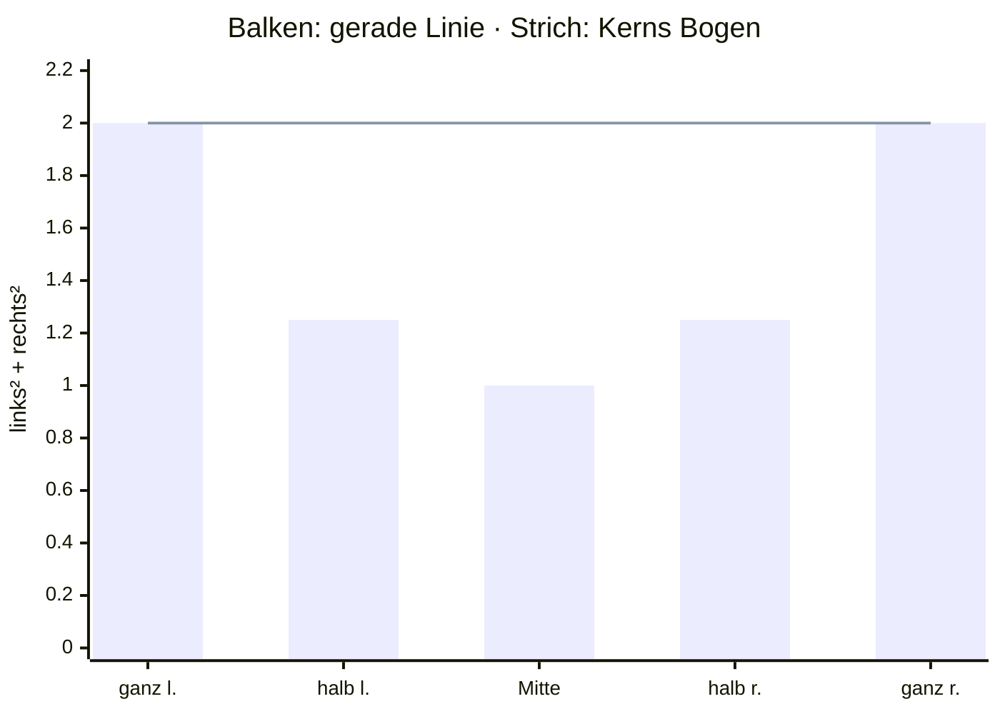
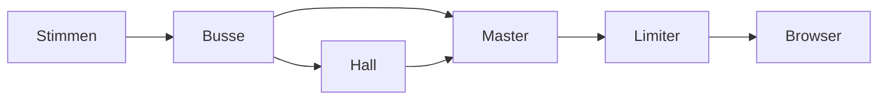
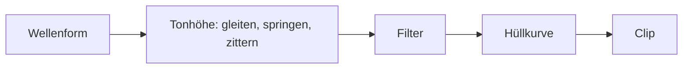

# 7 Audio – Kern dreht den Ton auf

> **Dein Level:** Ein Spiel ohne Ton ist ein Stummfilm. Hier lernst du ein komplettes Tonstudio
> kennen: ein Mischpult für 3D-Klang, einen Synthesizer, der jedes Geräusch aus Mathe baut, und die
> Stimme der Micro Duck.

> **Wörter, die du brauchst:**
> - **Hertz (Hz)** – „pro Sekunde“. 48 000 Hz heißt: 48 000-mal in jeder Sekunde.
> - **Frequenz** – wie oft ein Ton pro Sekunde hin- und herzittert. Hohe Frequenz = hoher Ton.
> - **Mono / Stereo** – ein Tonkanal für beide Ohren / zwei Kanäle, einer links, einer rechts.
> - **Clip** – ein fertiges Tonstück im Speicher, zum Beispiel das Geräusch beim Springen.
> - **Loop** – ein Ton, der sich endlos wiederholt, etwa ein Motorbrummen.
> - **Pan** – wie weit links oder rechts ein Ton klingt: −1 ganz links, 0 Mitte, +1 ganz rechts.
> - **deterministisch** – bei gleichen Eingaben kommt immer genau dasselbe heraus.
> - **Filter** – ein Sieb für Töne: Ein *Tiefpass* lässt nur die tiefen durch, die hohen bleiben hängen.

Kern hat eine eigene **Sound-Engine**. Sie rechnet jeden Ton selbst aus. Der Browser ist nur noch der
Lautsprecher und packt Sounddateien aus, die du selbst importierst.

Schall ist zitternde Luft. Der Computer misst diese Welle sehr oft pro Sekunde. Jede Messung ist eine
Zahl und heißt **Sample**. Wie oft gemessen wird, heißt **Abtastrate**: 48 000 Hz sind 48 000 Zahlen
pro Sekunde und Ohr. So eine lange Zahlenreihe nennt man **PCM**.

> **So kannst du es dir vorstellen:** Zeichne eine Wellenlinie auf Karopapier und setz auf jede
> senkrechte Linie einen Punkt, genau dort, wo die Welle sie schneidet. Die Höhen der Punkte sind
> die Samples. Je enger die Kästchen, desto genauer beschreiben die Punkte die Welle.

## 7.1 Warum ein eigener Mixer?

Ein **Mixer** mischt viele Töne zu einem Stereo-Signal für die Boxen. Kern baut seinen eigenen,
statt die Ton-Bausteine des Browsers zu nehmen. Das bringt drei Dinge:

- **Immer gleich:** Dieselben Ereignisse ergeben auf jedem Gerät dieselben Samples. Der Ton ist
  deterministisch, genau wie die Physik.
- **Ein Programm für alles:** Studio, exportierte Spiele und die automatischen Tests benutzen
  denselben Mixer.
- **Volle Kontrolle:** kein Klicken beim Stoppen, kein Übersteuern.

**Übersteuern** heißt: Die Lautsprechermembran kann nur bis zu einem höchsten Ausschlag schwingen,
im Computer ist das die Zahl 1 (nach unten −1). Was darüber liegt, wird abgeschnitten, die Welle
bekommt platte Spitzen und klingt kratzig. Darum bleibt bei Kern jedes Sample zwischen −1 und +1
(wie, steht in 7.4).

## 7.2 Der Mixer

Der Mixer hat einen festen Vorrat an **Stimmen**. Eine Stimme ist ein Ton, der gerade läuft. Studio
nimmt 64 Stimmen. Jede Stimme spielt einen Clip ab, mit eigenen Einstellungen: Lautstärke, Tonhöhe,
Pan, Loop, eine Gruppe (*Bus*, 7.4), eine **Priorität** (wie wichtig sie ist) und für 3D-Töne der Ort
im Raum.

> **So kannst du es dir vorstellen:** ein DJ-Pult mit 64 Spuren. Jede Spur hat ihren Regler, Spuren
> laufen in Gruppen zusammen, am Ende sitzt der Hauptregler vor den Boxen.

**Alle Plätze voll?** Dann nimmt Kern einer anderen Stimme den Platz weg. Das heißt **Voice
Stealing** (Stimmen klauen). Geklaut wird nur bei gleicher oder kleinerer Priorität: zuerst die
unwichtigste Stimme, bei Gleichstand die leiseste, dann die älteste. Sind alle anderen wichtiger,
startet der neue Ton gar nicht. So verdrängt ein Knall nie die Musik.

**Nie hart abschneiden.** Stell dir vor, die Welle steht gerade ganz oben, und im nächsten Sample ist
sie plötzlich 0. Die Lautsprechermembran springt in einem Ruck zurück, und du hörst einen **Knacks**.
Darum blendet Kern beim Stoppen immer aus, und auch Lautstärkeänderungen gleiten sanft. Die
Spielpause hält Stimmen an, ohne zu vergessen, wo sie waren.

**Tonhöhe durch Tempo.** Tonhöhe 2 heißt: doppelt so schnell abspielen, eine Oktave höher. Bei
Tonhöhe 1,5 bräuchte der Mixer Sample 0, 1,5, 3 … Sample 1,5 gibt es nicht. Kern schätzt es aus den
Nachbarn mit einer weichen Kurve, wie eine Linie, die du durch die Punkte auf dem Karopapier ziehst.

Hat eine importierte Datei eine andere Abtastrate als dein Gerät, rechnet Kern sie **einmal beim
Laden** sorgfältig um. Die teure Arbeit fällt so nur einmal an.

> **Krass, aber wahr:** Ist eine 3D-Stimme so weit weg, dass sie praktisch unhörbar ist, wird sie
> **virtuell**: Sie wird nicht mehr gemischt, aber ihre Position im Clip läuft weiter. Fliegst du zur
> Maschine zurück, brummt sie an der richtigen Stelle weiter und fängt nicht von vorn an.

> **Mission:** Öffne in Kern Studio auf https://kernengine.de/ den Content Drawer (Ctrl+Space), Tab
> **Sounds**. Ein Klick auf einen Sound spielt ihn an. Ton gibt es erst nach deinem ersten Klick oder
> Tastendruck. Hör aus jeder Kategorie einen an. Dann klick zwei Sounds schnell nacheinander: Der
> erste bricht nicht mit einem Knacks ab, sondern wird in einer zwanzigstel Sekunde ausgeblendet.

## 7.3 3D-Klang

Im Spiel kommt jeder Ton von einem Ort. Der **Hörer** sitzt an der Kamera. Für jede 3D-Stimme fragt
Kern vier Dinge: Wie laut kommt sie an? Von welcher Seite? Wie dumpf? Wie hoch?

**Wie laut: Entfernung.** In der Natur gilt: doppelter Abstand, halbe Lautstärke. Kern rechnet
standardmäßig genauso. Bis zu einem **inneren Radius** ist der Ton voll laut, danach gilt
Lautstärke = innerer Radius geteilt durch Abstand. Mit 1 m: in 2 m Abstand 0,5, in 4 m 0,25, in 10 m
0,1. Diese Kurve wird nie ganz null. Darum blendet Kern kurz vor der **Hörweite** (*Falloff
distance*) zusätzlich aus, damit es dahinter wirklich still ist. Zwei weitere Kurven (gerade und
steiler) kannst du in Studio unter **Roll-off** wählen.

**Welche Seite: Panning.** Aus der Lage der Quelle wird ein Pan-Wert. Am einfachsten wäre: Je weiter
rechts, desto leiser links und lauter rechts, auf gerader Linie. Dann klingt der Ton in der Mitte
aber **leiser**. Unser Ohr spürt nämlich die **Leistung**, und die wächst mit dem **Quadrat** der
Zahl: Halb so große Zahlen haben nur ein Viertel der Leistung.

| Quelle | gerade (links / rechts) | Kerns Bogen (links / rechts) |
|---|---|---|
| ganz links | 1,41 / 0 | 1,41 / 0 |
| halb links | 1,06 / 0,35 | 1,31 / 0,54 |
| Mitte | 0,71 / 0,71 | 1 / 1 |
| links² + rechts² in der Mitte | 0,5 + 0,5 = 1 | 1 + 1 = 2 |

Ganz links ist die Leistung 1,41² ≈ 2. In der Mitte hat die gerade Linie nur noch 1, die Hälfte.
Kern nimmt deshalb einen Bogen, bei dem links² + rechts² **überall 2** ergibt: **Equal Power**
(gleiche Leistung). Eine Quelle, die vorbeifährt, wird in der Mitte nicht leiser.

Ganz nahe Quellen schiebt Kern weniger zur Seite, sonst spränge ein Ton am Kopf hart hin und her.

> **Für Profis:** Trägst du links und rechts als Punkt in ein Koordinatensystem ein, liegen alle
> Punkte von Kerns Bogen auf einem Viertelkreis um den Ursprung. Pythagoras sagt: links² + rechts² =
> Radius². Der Radius ist √2, also ist die Summe immer 2.

**Wie dumpf: Luft und Richtung.** Hohe Töne verlieren sich in der Luft schneller, ein fernes
Gewitter grollt nur noch. Kern schickt jede 3D-Stimme durch einen Tiefpass: nah vor dir kommt alles
bis 20 000 Hz durch, in 120 m nur noch bis 10 000 Hz. Von hinten klingt es zusätzlich dumpfer. Daran
unterscheidest du vorn und hinten.

**Wie hoch: Doppler.** Ein Krankenwagen fährt vorbei: erst höher, dann tiefer. Kommt die Quelle auf
dich zu, treffen die Wellenberge dichter hintereinander ein. Für einen
stehenden Hörer gilt: neue Tonhöhe = Tonhöhe · 343 / (343 − v). Dabei sind 343 m/s die
Schallgeschwindigkeit und v das Tempo der Quelle **auf dich zu** (fährt sie weg, ist v negativ).

Beispiel: Ein Auto kommt mit 34,3 m/s auf dich zu. 343 / (343 − 34,3) = 343 / 308,7 ≈ 1,11. Der Ton
ist 11 % höher. Bewegst du dich selbst, rechnet Kern das mit ein, und der Faktor gleitet sanft.

> **Mission:** Platziere aus Place Actors › Audio ein **Radio**, starte **Simulate** (Alt+S) und
> flieg mit gehaltener rechter Maustaste und W A S D herum. Dreh dich so, dass das Radio links, rechts
> und hinter dir ist. Hörst du, wie es leiser, seitlicher und hinten dumpfer wird?

## 7.4 Busse, Hall und Limiter

Ein **Bus** ist eine Sammelleitung: Viele Stimmen laufen hinein und lassen sich gemeinsam lauter,
leiser oder stumm schalten. Kern hat fünf: **Music**, **Effects** (Effekte), **Ambience**
(Hintergrund), **Interface** (Klicks der Oberfläche) und **Voice** (Stimmen). Alle münden im
**Master**, dem Hauptregler.

Auch das Stummschalten gleitet, klickt also nicht. Jeder Bus kann einen eigenen Tiefpass haben und
einen Regler, wie viel er in den Hall schickt.

**Hall:** Klatsch in einer leeren Turnhalle. Der Schall prallt von allen Wänden zurück, die Echos
kommen leicht versetzt und werden immer leiser, bis sie zu einem langen Hallschweif verschmelzen.
Kern baut das mit dem freien Rezept **Freeverb** nach: Acht Echo-Schleifen verschiedener Länge
spielen die Wände. Jede schickt ihr Echo immer wieder in sich zurück, jedes Mal leiser, die Höhen
schneller als die Tiefen. Weitere Stufen verwischen die letzten Kanten. Der rechte Kanal hat etwas
längere Echos, das macht den Hall breit. Musik und Oberfläche bekommen keinen Hall.

**Limiter:** Am Ende sitzt ein Türsteher. Keine Spitze darf über 0,92. Kommt eine zu laute Stelle,
dreht der Limiter die Lautstärke **sofort** herunter und lässt sie dann langsam (in etwa einer
Zehntelsekunde) wieder hoch. Was trotzdem noch durchrutscht, rundet eine weiche Kurve ab. So bleibt
jedes Sample sicher zwischen −1 und +1.

Die **Pegelanzeige** in der Statusleiste von Studio zeigt, wie laut es gerade ist.

> **Mission:** Lege mit File › New Level... ein **Basic**-Level an, platziere aus Place Actors ›
> Physics einen **Crate Stack** und wirf in **Simulate** mit der linken Maustaste Kisten herum.
> Beobachte die Pegelanzeige unten. Stoppe mit Esc, setze in **World Settings** › Audio **Reverb**
> auf 1 und probier es nochmal. Jetzt hallt jeder Aufprall nach, als stündest du in einer großen
> Halle.

## 7.5 Der Synthesizer

> **Krass, aber wahr:** Kern bringt **keine einzige Sound-Datei** mit. Jeder eingebaute Sound,
> vom Sprung bis zur Musik, wird beim Laden aus Mathe berechnet.

Das erledigt ein **Synthesizer**, ein Programm, das Klänge aus einfachen Schwingungen baut. Jeder
Sound ist ein Rezept aus Reglern (ein **Patch**). Alle Zufallswerte haben feste Startzahlen, also
klingt jeder Sound auf jedem Gerät gleich.

So entsteht ein Klang:

**1. Die Wellenform** gibt die Klangfarbe:

| Wellenform | Form | klingt wie |
|---|---|---|
| Sinus | rund wie eine Wasserwelle | weiches Pfeifen, Glocke |
| Rechteck, Puls | springt zwischen oben und unten | Piepsen alter Videospiele |
| Sägezahn | steigt schräg, fällt senkrecht | schnarrend, scharf |
| Dreieck | gerade hoch, gerade runter | zwischen Sinus und Rechteck |
| Rauschen | zufälliges Gezappel | Zischen, Wind, Explosion |

**2. Die Tonhöhe** kann gleiten (ein Laser zischt von hoch nach tief), zittern (*Vibrato*) oder
springen. **3. Filter** nehmen Höhen oder Tiefen weg, zum Beispiel macht ein Tiefpass aus Rauschen
dumpfes Wind-Rauschen. **4. Die Hüllkurve** bestimmt, wie die Lautstärke über die Zeit verläuft:
Anstieg, Halten, Abklingen. Ein Klavierton ist sofort da und klingt lang aus, ein Geigenton schwillt
langsam an.

Ein Beispiel aus Kern, der **Pickup**-Sound beim Einsammeln: ein Pulston mit 988 Hz, in zwei
Tausendstelsekunden voll da, kurz gehalten, in knapp drei Zehntelsekunden ausgeklungen. Nach 0,065 s
springt er auf das 1,5-Fache, also 1482 Hz. Darunter liegt leise eine Glocke. Fertig ist das typische
„Pling-plong“.

Für bestimmte Sounds hat Kern Extra-Tricks:

- **Anschläge:** Ein Gegenstand, auf den etwas prallt, schwingt mit wenigen eigenen Tönen, die
  schnell verklingen. Kern mischt ein paar Sinustöne mit einem kurzen Rauschstoß. Für Plastik liegen
  sie in der Mitte und klingen kurz, sonst klänge es nach hohler Kiste.
- **Nahtlose Loops:** Das Ende wird weich über den Anfang geblendet, damit man die Nahtstelle beim
  Wiederholen nicht hört.
- **Musik:** Zwei Stücke sind als Noten gespeichert: `music_drive` (flott) und `music_calm` (ruhig).
  Musik zu berechnen dauert einige hundert Millisekunden, darum rechnet Kern sie **in Häppchen**,
  etwa einen Takt nach dem anderen. So ruckelt das Spiel beim Laden nicht.

Eingebaute Sounds heißen `builtin:` plus Name (* = Loop):

| Kategorie | Sounds |
|---|---|
| Gameplay | pickup, powerup, jump, land, goal, hazard, checkpoint, lose, laser |
| Combat | gunshot, smg, pistol, sniper, launcher, reload, hit, down |
| Physics | explosion, impact, impact_light, break, step, plastic, plastic_step |
| Vehicle | engine*, hover*, boost |
| Ambience | wind*, city*, hum* |
| Robot | servo*, quack, beep |
| UI | click, confirm, error |
| Music | music_drive*, music_calm* |

Die genauen Regler und Werte jedes Sounds stehen im blauen Buch, Kapitel 7.

## 7.6 Die Stimme der Micro Duck

Auch die Micro Duck hat keine Aufnahmen, sondern einen eigenen kleinen Synthesizer, übernommen aus
dem Original-Projekt von Pollen Robotics. **Eine einzige Zahl**, der **Seed**, legt fest, wie die
Ente klingt: Tonlage, wie nasal, wie zittrig, wie „quakig“, wie schnell. Derselbe Seed klingt immer
gleich. Der echte Roboter macht den Seed aus seiner Seriennummer, über einen **Fingerabdruck**: eine
Zahl, die zufällig aussieht, aber zum gleichen Namen immer gleich ist. Kern nimmt dafür Name und
Nummer des Actors.

Ein Laut besteht aus einem Grundton und leiseren **Obertönen** (Töne mit doppelter, dreifacher …
Frequenz, sie geben die Klangfarbe), dazu Vibrato, schnelles Lautstärke-Flattern (das „Quaken“) und
etwas Rauschen als Atem. Es gibt sieben Laut-Arten, etwa Gruß, Frage, Alarm und Zwitschern, jede in
mehreren Varianten. Gespielt wird eine zufällige, damit die Ente nicht wie eine hängende Aufnahme
klingt.

> **Krass, aber wahr:** Die Entenstimme ist **bitgenau** wie das Original. Vergleicht man alle 328
> Laute mit dem Original-Programm, sind sie gleich lang, und jedes einzelne Sample stimmt exakt.

Zum Schluss nimmt ein Filter die ganz tiefen Töne weg, so tief kann der kleine Lautsprecher des
Roboters nicht. Im Spiel klingt jeder Laut am **Kopf** der Ente, wo der Lautsprecher sitzt, und ein
neuer Laut schneidet den alten ab. Kern berechnet die Laute vorab, einen pro Bild, damit das Handy
nicht ins Stocken kommt. Wann die Ente was
ruft: [Kapitel 13](13-micro-duck.md).

## 7.7 Cues und Aufprallgeräusche

Die Simulation spielt **nie selbst** Ton. Stattdessen schreibt sie in ihren festen Physikschritten
**Cues**, kleine Bestellzettel: „Spiel den Sound `pickup` an diesem Ort, so laut, auf diesem Bus.“
Später im Bild holt die Ton-Schicht die Zettel ab und spielt sie (7.8).

> **So kannst du es dir vorstellen:** ein Restaurant. Die Kellner (die Simulation) kochen nicht
> selbst, sie hängen Bestellzettel an die Küchenleiste. Die Küche (der Mixer) arbeitet sie ab.

Warum der Umweg? Die festen Schritte laufen auf jedem Gerät gleich, also auch die Zettel. Die
Simulation bleibt deterministisch und läuft sogar ohne Lautsprecher, etwa beim Training der Ente.

**Aufprallgeräusche.** Jeder Körper hat einen Aufprall-Sound (sonst `impact`) und eine **Schwelle**,
eine Mindestgeschwindigkeit. Jeder Collider kann einen eigenen Sound haben: Die Sohle der Ente macht
`plastic_step`, ihr Gehäuse `plastic`. Die Regeln:

1. Unter der Schwelle bleibt es still. Leichtes Anstupsen klingt nicht.
2. **Je härter der Aufprall, desto lauter**, von leise bis voll. Sanfte Stöße spielen das leisere
   `impact_light`.
3. Schwere Dinge klingen tiefer, leichte nur ein bisschen höher, sonst klänge es nach Glas.
4. Höchstens **sechs** Aufprallgeräusche pro Physikschritt. Mehr hört ohnehin niemand heraus.
5. **Entprellen:** Eine Sohle rollt von der Ferse zur Spitze ab und hüpft dabei winzig. Die Physik
   meldet jeden Hüpfer als Treffer. Darum klingt ein Schritt höchstens alle halbe Sekunde, ein Klopfen
   höchstens etwa alle zehntel Sekunde.

Die Micro Duck hat eine sehr kleine Schwelle, damit man schon leichte Berührungen hört. Brechende
Gelenke spielen `break`.

## 7.8 Klang im Spiel

Im Level nennt man einen Sound beim Namen: ein eingebauter, ein importierter (WAV, MP3, OGG, M4A,
FLAC; die Datei steckt im Level), „none“ für Stille oder „auto“ für den passenden Standard.

**Vor dem Start** bestellt Kern **alles**, was das Level an Tönen brauchen könnte, und berechnet
oder entpackt es. So ist bei Play alles bereit.

**In jedem Bild** passiert dann der Reihe nach:

1. Ist das Spiel pausiert, pausiert auch der Ton.
2. Der **Hörer** wird an die Kamera gesetzt.
3. **Musik und Hintergrund** laufen als Loops.
4. Der **Motor des Spielers** brummt am Fahrzeug, lauter und höher mit Tempo und Gas.
5. **Audio Sources** (7.9) folgen ihren Actors.
6. Die **Cues** aus 7.7 werden gespielt.

Bei vielen Tönen gleichzeitig zählt die Rangliste der **Prioritäten**: Musik und Hintergrund > Motor >
Dauerklänge aus Audio Sources > einmalige Töne > Effekt-Cues. Ein kurzer Effekt verdrängt also nie die Musik,
aber die Musik darf einem Effekt den Platz wegnehmen.

Zwei schlaue Kleinigkeiten:

- Der Motor des Spielers hat **keinen Doppler**, denn die Kamera fährt mit. Hörer und Motor bewegen
  sich gemeinsam.
- Springt die Kamera an einen anderen Ort (ein Schnitt), wäre ihr Tempo riesig, und alles würde
  aufheulen. Kern erkennt solche Sprünge und zählt das Tempo dann als 0.

> **Vorsicht, Falle:** Ein Knall eine halbe Sekunde nach dem Blitz wirkt kaputt. Zu spät ist
> schlimmer als nie. Ist der Clip eines Cues nach einer Viertelsekunde noch nicht fertig, wirft Kern
> den Cue weg.

Der **Lautsprecher-Knopf** in der Statusleiste schaltet alles stumm, auch über Play und Stop hinweg.
Steht der Motor-Sound auf „auto“, schwebt das Hover Car mit `hover`, das Vehicle brummt mit `engine`,
bei der Micro Duck surren die Servos. Die genauen Prioritätszahlen stehen im blauen Buch, Kapitel 7.

## 7.9 Level-Einstellungen und Audio Source

In **World Settings** › Audio stellst du für das ganze Level ein: Master volume, Musik und Hintergrund
mit ihren Lautstärken, **Reverb** (wie viel Hall) und **Doppler** (wie stark der Effekt ist).

Die Komponente **Audio Source** macht jeden Actor zur Schallquelle, etwa eine brummende Maschine oder
ein Radio:

| Feld | Standard | Bedeutung |
|---|---|---|
| Sound | `builtin:hum` | welcher Sound |
| Volume, Pitch | 1, 1 | Lautstärke, Tonhöhe |
| Loop, Play on start | an, an | wiederholen, mit Play starten |
| Spatial (3D) | an | aus: ohne Ort im Raum |
| Inner radius | 2 m | bis hier voll laut |
| Falloff distance | 40 m | ab hier still |
| Pitch by speed | 0 | höher, je schneller |
| Start delay | 0 s | Wartezeit |

Dazu kommen Bus, Roll-off und Doppler. Fertige Varianten im Katalog: Audio Source, Ambient Wind,
City Ambience und Radio ([Kapitel 11](11-studio.md)).

> **Mission:** Platziere einen **Physics Cube** (Place Actors › Physics) und lass ihn ausgewählt.
> Doppelklicke im Tab **Sounds** auf `engine`, und die Kiste bekommt eine Audio Source. Setze **Pitch
> by speed** auf 1, starte Simulate und wirf die Kiste. Der Motor heult mit dem Tempo hoch!

## 7.10 Die Browser-Anbindung

> **So kannst du es dir vorstellen:** ein Wasserkanister mit Hahn. Oben gießt das Spiel Ton nach,
> unten fließt er gleichmäßig in den Lautsprecher. Lief der Kanister einmal leer, füllst du künftig
> etwas mehr vor.

Kern rechnet immer ein Stück Ton im Voraus und legt es in eine **Warteschlange**, einen Vorrat von
einigen hundertstel Sekunden. Ein kleines Ton-Programm im Browser spielt ihn gleichmäßig ab. Läuft
der Vorrat leer, weil das Spiel kurz hakt, vergrößert Kern ihn. Läuft lange alles glatt, wird er
wieder kleiner, denn ein kleiner Vorrat heißt: Der Ton kommt schneller nach deinem Tastendruck. Ist
er doch einmal leer, gleitet der Ton kurz auf null, statt zu knacken. Ein Zeitgeber füllt auch nach,
wenn der Tab im Hintergrund liegt. Der Mixer rechnet gleich mit der Abtastrate deines Geräts, und auf
dem iPhone macht der Stummschalter Spiele nicht stumm.

**Ton erst nach einem Klick.** Browser spielen erst Ton, wenn du einmal geklickt, getippt oder eine
Taste gedrückt hast. Das ist eine Regel der Browser, kein Fehler von Kern: Webseiten sollen nicht
ungefragt losplärren.

**Importierte Dateien** packt der Browser aus und gibt die Samples an Kern weiter. Hat eine Datei mehr
als zwei Kanäle, wird sie vorher auf Stereo gemischt. Klappt das Auspacken nicht, meldet Kern den
Fehler, und Cues mit diesem Sound werden verworfen, statt ewig zu warten.

> **Für Profis:** Das kleine Ton-Programm heißt **AudioWorklet** und läuft im Browser getrennt vom
> Rest der Seite. Die Millisekunden für den Vorrat und die Namen der Browser-Funktionen stehen im
> blauen Buch, Kapitel 7.

## 7.11 Tipps für deine Spiele

- Eingebaute Sounds kosten keinen Download. Eigene Dateien lohnen sich für Musik und besondere
  Geräusche.
- Leg jeden Ton auf den passenden Bus: Musik auf Music, Dauergeräusche auf Ambience, Effekte auf
  Effects. Dann wirken Regler und Hall wie erwartet.
- Setz die **Falloff distance** nicht größer als nötig. Hinter ihr werden Stimmen virtuell und kosten
  keine Rechenzeit.
- Dauerklänge bekommen eine hohe, kurze Effekte eine niedrige Priorität. Sonst wird bei viel Action
  das Falsche geklaut.
- Zu niedrige Aufprall-Schwellen lassen liegende Körper dauernd klopfen.

> **Für Profis:** Der Mixer hängt nicht an der Spiel-Laufzeit. In einem eigenen C++-Programm
> ([Kapitel 12](12-eigene-spiele.md)) kannst du Mixer und Synthesizer direkt nutzen, musst aber selbst
> eine Ausgabe zum Browser anbinden. Wer es ganz genau wissen will: das blaue Buch.

## Level geschafft!

- Du weißt, was Samples, Abtastrate und PCM sind.
- Du verstehst Stimmen, Prioritäten und Voice Stealing.
- Du kannst Lautstärke und Doppler ausrechnen und weißt, warum Panning einen Bogen braucht.
- Du kennst Busse, Hall und Limiter.
- Du weißt, wie ein Synthesizer Klänge aus Wellen baut und warum Kern keine Sounddatei braucht.
- Du weißt, warum die Simulation Bestellzettel schreibt, statt selbst Ton zu spielen.
- Du weißt, warum der Browser erst nach einem Klick Ton macht.

## Rätsel-Ecke

1. Alle 64 Stimmen sind belegt, und eine Kiste prallt auf. Wann bekommt ihr Aufprall trotzdem einen
   Platz, und wann nicht?
2. Innerer Radius 2 m, Abstand 8 m, natürliche Abfallkurve: Wie laut ist die Quelle?
3. Warum hat der Motor des Spielers keinen Doppler?
4. 30 Kisten prallen im selben Physikschritt auf. Wie viele Aufprallgeräusche gibt es höchstens?
5. **Boss-Rätsel:** Eine Quelle fährt mit 68,6 m/s von dir weg. Um wie viel Prozent ändert sich die
   Tonhöhe? (Tipp: Fährt sie weg, ist v negativ.)

### Lösungen

1. Nur wenn es eine Stimme mit gleicher oder kleinerer Priorität gibt, dann wird die unwichtigste
   geklaut. Sind alle anderen wichtiger (Musik, Motor, Loops), bleibt der Aufprall still.
2. 2 / 8 = 0,25, also ein Viertel.
3. Die Kamera fährt mit. Hörer und Motor bewegen sich gemeinsam, ein Doppler klänge falsch.
4. Sechs. Kern lässt höchstens sechs pro Schritt zu.
5. 343 / (343 + 68,6) = 343 / 411,6 ≈ 0,83. Der Ton wird etwa 17 % tiefer.

---

© 2026 Christian Heinrich Hohlfeld · Alle Rechte vorbehalten · [Impressum und Rechte](00-impressum.md)
