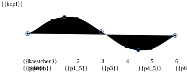
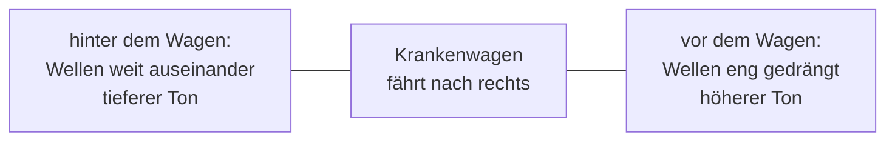
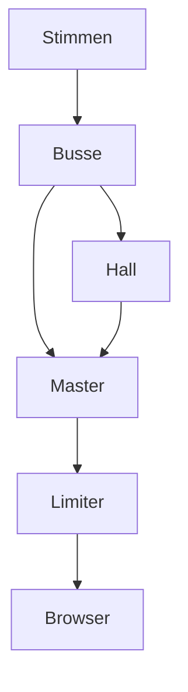
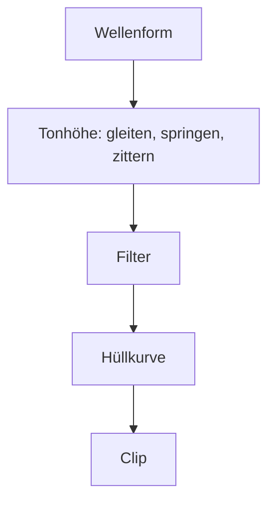

# 7 Audio – Kern dreht den Ton auf

> **Dein Level:** Ein Spiel ohne Ton ist ein Stummfilm. Hier lernst du ein komplettes Tonstudio
> kennen: ein Mischpult für 3D-Klang, einen Synthesizer, der jedes Geräusch aus Mathe baut, und die
> Stimme der Micro Duck.

> **Wörter, die du brauchst:**
> - **Hertz (Hz)** – „pro Sekunde“. 48 000 Hz heißt: 48 000-mal in jeder Sekunde.
> - **Frequenz** – wie oft ein Ton pro Sekunde hin- und herzittert. Hohe Frequenz = hoher Ton.
> - **Mono / Stereo** – ein Tonkanal für beide Ohren / zwei Kanäle, einer links, einer rechts.
> - **Clip** – ein fertiges Tonstück im Speicher, zum Beispiel das Geräusch beim Springen.
> - **Schleife** (englisch *Loop*) – ein Ton, der sich endlos wiederholt, etwa ein Motorbrummen.
> - **Pan-Wert** – wie weit links oder rechts ein Ton klingt: −1 ganz links, 0 Mitte, +1 ganz rechts.
> - **deterministisch** – bei gleichen Eingaben kommt immer genau dasselbe heraus.
> - **Filter** – ein Sieb für Töne: Ein *Tiefpass* lässt nur die tiefen durch, die hohen bleiben hängen.

Kern hat eine eigene **Sound-Engine**. Sie rechnet jeden Ton selbst aus. Der Browser ist nur noch der
Lautsprecher und packt Sounddateien aus, die du selbst importierst. (MP3 und Co. sind
zusammengepresst, damit sie wenig Platz brauchen. Der Browser macht daraus wieder die lange
Zahlenreihe, von der gleich die Rede ist.)

Schall ist zitternde Luft. Der Computer misst diese Welle sehr oft pro Sekunde. Jede Messung ist eine
Zahl und heißt **Sample**. Wie oft gemessen wird, heißt **Abtastrate**: 48 000 Hz sind 48 000 Zahlen
pro Sekunde und Ohr.

> **So kannst du es dir vorstellen:** Zeichne eine Wellenlinie auf Karopapier und setz auf jede
> senkrechte Linie einen Punkt, genau dort, wo die Welle sie schneidet. Die Höhen der Punkte sind
> die Samples. Je enger die Kästchen, desto genauer beschreiben die Punkte die Welle.

## 7.1 Warum ein eigener Mixer?

Ein **Mixer** mischt viele Töne zu einem Stereo-Signal für die Boxen. Kern baut seinen eigenen,
statt die Ton-Bausteine des Browsers zu nehmen. Das bringt drei Dinge:

- **Immer gleich:** Dieselben Ereignisse ergeben auf jedem Gerät dieselben Samples. Der Ton ist
  deterministisch, genau wie die Physik. So können automatische Tests den Ton Zahl für Zahl prüfen,
  und eine Wiederholung klingt genau wie das Original.
- **Ein Programm für alles:** Studio, exportierte Spiele und die automatischen Tests benutzen
  denselben Mixer.
- **Volle Kontrolle:** kein Klicken beim Stoppen, kein Übersteuern.

**Übersteuern** heißt: Die Lautsprechermembran kann nur bis zu einem höchsten Ausschlag schwingen,
im Computer ist das die Zahl 1 (nach unten −1). Was darüber liegt, wird abgeschnitten, die Welle
bekommt platte Spitzen und klingt kratzig. Darum bleibt bei Kern jedes Sample zwischen −1 und +1
(wie, steht in 7.4).

## 7.2 Der Mixer

Der Mixer hat einen festen Vorrat an **Stimmen**. Eine Stimme ist ein Ton, der gerade läuft. Studio
nimmt 64 Stimmen. Jede Stimme spielt einen Clip ab, mit eigenen Einstellungen: Lautstärke, Tonhöhe,
Pan, Loop, eine Gruppe (*Bus*, 7.4), eine **Priorität** (wie wichtig sie ist) und für 3D-Töne der Ort
im Raum.

> **So kannst du es dir vorstellen:** ein DJ-Pult mit 64 Spuren. Jede Spur hat ihren Regler, Spuren
> laufen in Gruppen zusammen, am Ende sitzt der Hauptregler vor den Boxen.

**Alle Plätze voll?** Dann nimmt Kern einer anderen Stimme den Platz weg. Das heißt **Voice
Stealing** (Stimmen klauen). Geklaut wird nur bei gleicher oder kleinerer Priorität: zuerst die
unwichtigste Stimme, bei Gleichstand die leiseste, dann die älteste. Sind alle anderen wichtiger,
startet der neue Ton gar nicht. So verdrängt ein Knall nie die Musik.

**Nie hart abschneiden.** Stell dir vor, die Welle steht gerade ganz oben, und im nächsten Sample ist
sie plötzlich 0. Die Lautsprechermembran springt in einem Ruck zurück, und du hörst einen **Knacks**,
so wie wenn man ein Kopfhörerkabel bei laufender Musik herauszieht. Darum blendet Kern beim Stoppen
immer aus, und auch Lautstärkeänderungen gleiten sanft. Das gilt auch, wenn eine Quelle an dir
vorbeifliegt: Ihre Lautstärke ändert sich nicht in Sprüngen von Block zu Block, sondern gleitet
innerhalb jedes kleinen Rechenblocks weich zum neuen Wert. Sonst würde es leise knistern. Die
Spielpause hält Stimmen an, ohne zu vergessen, wo sie waren.

**Tonhöhe durch Tempo.** Tonhöhe 2 heißt: doppelt so schnell abspielen. Die Welle zittert dann
doppelt so oft pro Sekunde, und der Ton klingt eine **Oktave** höher (derselbe Ton, nur eine Stufe
höher, so wie eine Frauenstimme dieselbe Melodie höher singt als eine Männerstimme). Doppelt so
schnell abspielen heißt für den Mixer: Er liest nur jede zweite Zahl, also Sample 0, 2, 4 … Bei
Tonhöhe 1,5 springt er jedes Mal um anderthalb Kästchen weiter:

Bei 0, 3 und 6 liegt ein Punkt. Bei 1,5 und 4,5 liegt keiner, denn Sample 1,5 gibt es nicht. Kern
schätzt den Wert dort aus den Nachbarn mit einer weichen Kurve, wie eine Linie, die du durch die
Punkte auf dem Karopapier ziehst.

Hat eine importierte Datei eine andere Abtastrate als dein Gerät (mehr dazu in 7.10), muss Kern sie
auf die Rate des Geräts umrechnen. Dafür gibt es eine gründliche Rechnung, die sehr genau, aber
langsam ist. Darum macht Kern sie nur **einmal beim Laden**. Beim Abspielen genügt danach die
schnelle Schätzung mit der weichen Kurve.

> **Krass, aber wahr:** Ist eine 3D-Stimme so weit weg, dass sie praktisch unhörbar ist, wird sie
> **virtuell**: Sie wird nicht mehr gemischt, aber ihre Position im Clip läuft weiter. Fliegst du zur
> Maschine zurück, brummt sie an der richtigen Stelle weiter und fängt nicht von vorn an.

> **Für Profis:** Wer eine Stimme startet, bekommt eine Nummer, mit der er sie später leiser machen
> oder stoppen kann. In der Nummer steckt auch, die wievielte Belegung des Platzes das ist. Wurde der
> Platz inzwischen neu vergeben, passt die alte Nummer nicht mehr und läuft ins Leere, statt aus
> Versehen eine fremde Stimme zu verstellen.

> **Mission:** Öffne in Kern Studio auf https://kernengine.de/ die **Inhaltsablage** (Content Drawer)
> mit Strg+Leertaste, Tab **Sounds**. Ein Klick auf einen Sound spielt ihn an. Ton gibt es erst nach deinem ersten Klick oder
> Tastendruck. Hör aus jeder Kategorie einen an. Dann klick einen langen Sound wie `music_calm` an
> und, während er läuft, gleich einen zweiten. Achte genau auf den Moment, in dem die Musik aufhört:
> Sie verschwindet ohne Klicken, so schnell und weich, dass du nur den neuen Sound hörst. Kein
> Knacks wie beim herausgezogenen Kopfhörerkabel, denn Kern blendet aus, statt abzuschneiden.

## 7.3 3D-Klang

Im Spiel kommt jeder Ton von einem Ort. Der **Hörer** sitzt an der Kamera. Für jede 3D-Stimme fragt
Kern vier Dinge: Wie laut kommt sie an? Von welcher Seite? Wie dumpf? Wie hoch?

**Wie laut: Entfernung.** In der Natur gilt: doppelter Abstand, halbe Lautstärke. Kern rechnet
standardmäßig genauso. Bis zu einem **inneren Radius** ist der Ton voll laut, danach gilt
Lautstärke = innerer Radius geteilt durch Abstand. Mit 1 m: in 2 m Abstand 0,5, in 4 m 0,25, in 10 m
0,1. Diese Kurve wird nie ganz null. Darum blendet Kern kurz vor der **Hörweite** (in Studio das
Feld **Abfallentfernung** (Falloff distance)) zusätzlich aus, damit es dahinter wirklich still ist.
Zwei weitere Kurven (gerade und steiler) kannst du in Studio unter **Abfall** (Roll-off) wählen.

**Welche Seite: Panning.** Aus der Lage der Quelle wird ein Pan-Wert. Dann verteilt Kern den Ton auf
den linken und den rechten Lautsprecher. Am einfachsten wäre eine gerade Linie: ganz links 1 / 0,
in der Mitte 0,5 / 0,5. Doch dann klingt der Ton in der Mitte **leiser**. Für unser Ohr zählt
nämlich nicht die Zahl selbst, sondern die Zahl **mal sich selbst**. Rechne nach:

| Quelle | gerade Linie | Bogen (gleiche Stärke) |
|---|---|---|
| ganz links (links / rechts) | 1 / 0 | 1 / 0 |
| Mitte (links / rechts) | 0,5 / 0,5 | 0,71 / 0,71 |
| Ohr-Stärke ganz links | 1·1 + 0·0 = 1 | 1·1 + 0·0 = 1 |
| Ohr-Stärke Mitte | 0,25 + 0,25 = **0,5** | 0,5 + 0,5 = **1** |

Mit der geraden Linie ist in der Mitte nur noch halb so viel Ohr-Stärke da. Kern nimmt deshalb
einen Bogen, bei dem die Summe **überall gleich** bleibt: **Equal Power** (gleiche Stärke). Eine
Quelle, die vorbeifährt, wird in der Mitte nicht leiser.

Ganz nahe Quellen schiebt Kern weniger zur Seite, sonst spränge ein Ton am Kopf hart hin und her.
Und eine Quelle kann auch **breit** sein, dann schiebt der Mixer sie weniger oder gar nicht zur
Seite. Das passt zu Geräuschen, die dich umgeben, statt aus einem Punkt zu kommen. (Der fertige
**Wind** (Ambient Wind) aus dem Katalog geht noch weiter: Er hat gar keinen Ort im Raum, siehe
**Räumlich (3D)** (Spatial (3D)) in 7.9.)

> **Für Profis:** Trägst du links und rechts als Punkt in ein Koordinatensystem ein, liegen alle
> Punkte des Bogens auf einem Viertelkreis um den Ursprung. Pythagoras sagt: links² + rechts² =
> Radius². Kern nimmt zusätzlich alles mal √2 ≈ 1,41, damit die Mitte genau 1 / 1 ergibt. Darum gibt
> Kern ganz links 1,41 / 0 aus und in der Mitte 1 / 1.

**Wie dumpf: Luft und Richtung.** Hohe Töne verlieren sich in der Luft schneller, ein fernes
Gewitter grollt nur noch. Kern schickt jede 3D-Stimme durch einen Tiefpass: nah vor dir kommt alles
bis 20 000 Hz durch, in 120 m nur noch bis 10 000 Hz. Mit zwei Ohren hörst du gut, ob etwas links
oder rechts ist. Ob es vorn oder hinten ist, klingt aber erst einmal gleich, denn beide Ohren sind
gleich weit weg. Darum lässt Kern Töne von hinten zusätzlich dumpfer klingen. Daran unterscheidest
du vorn und hinten.

**Wie hoch: Doppler.** Ein Krankenwagen fährt vorbei: erst höher, dann tiefer. Kommt die Quelle auf
dich zu, treffen die Wellenberge dichter hintereinander ein. Mehr Wellenberge pro Sekunde heißt
höhere Frequenz, also ein höherer Ton. Fährt sie weg, kommen sie weiter auseinander an, und der Ton
wird tiefer.

Für einen stehenden Hörer gilt: neue Tonhöhe = Tonhöhe · 343 / (343 − v). Dabei sind 343 m/s die
Schallgeschwindigkeit und v das Tempo der Quelle **auf dich zu** (fährt sie weg, ist v negativ).

Beispiel: Ein Auto kommt mit 34,3 m/s auf dich zu. 343 / (343 − 34,3) = 343 / 308,7 ≈ 1,11. Der Ton
ist 11 % höher. Bewegst du dich selbst, rechnet Kern das mit ein, und der Faktor gleitet sanft.

> **Mission:** Platziere aus **Actors platzieren › Audio** (Place Actors › Audio) ein **Radio**,
> starte **Simulieren** (Simulate) (Alt+S) und flieg mit gehaltener rechter Maustaste und W A S D
> herum. Dreh dich so, dass das Radio links, rechts und hinter dir ist. Hörst du, wie es leiser,
> seitlicher und hinten dumpfer wird? Stell dann in der Werkzeugleiste die **Kamerageschwindigkeit**
> (Camera speed) hoch und flieg schnell am Radio vorbei: Hörst du den Doppler,
> erst etwas höher, dann tiefer?

## 7.4 Busse, Hall und Limiter

Ein **Bus** ist eine Sammelleitung: Viele Stimmen laufen hinein und lassen sich gemeinsam lauter,
leiser oder stumm schalten. Kern hat fünf: **Musik** (Music), **Effekte** (Effects), **Atmosphäre**
(Ambience) für den Hintergrund, **Oberfläche** (Interface) für Klicks der Oberfläche und **Stimme**
(Voice) für Stimmen. Alle münden im
**Master**, dem Hauptregler.

Auch das Stummschalten gleitet, klickt also nicht. Jeder Bus kann einen eigenen Tiefpass haben und
einen Regler, wie viel er in den Hall schickt.

**Hall:** Klatsch in einer leeren Turnhalle. Der Schall prallt von allen Wänden zurück, die Echos
kommen leicht versetzt und werden immer leiser, bis sie zu einem langen Hallschweif verschmelzen.
Kern baut das mit dem freien Rezept **Freeverb** nach: Acht Echo-Schleifen spielen die Wände. Jede
schickt ihr Echo immer wieder in sich zurück, jedes Mal leiser, die Höhen schneller als die Tiefen.
Die Schleifen sind **verschieden lang**, darum kommen ihre Echos durcheinander an und verschmelzen
zu einer dichten Echo-Wolke. Wären alle gleich lang, kämen die Echos im Gleichschritt, und es
klänge eher wie in einem Blechrohr als in einer Halle. Weitere Stufen mischen die Echos so
durcheinander, dass man sie nicht mehr einzeln heraushört. Der rechte Kanal hat etwas längere Echos
als der linke. Dadurch klingen links und rechts etwas verschieden, und der Hall scheint von überall
zu kommen statt aus der Mitte. Musik und Oberfläche bekommen keinen Hall.

**Limiter:** Am Ende sitzt ein Türsteher. Keine Spitze darf über 0,92. Kommt eine zu laute Stelle,
dreht der Limiter die Lautstärke **sofort** herunter, damit keine einzige Spitze durchkommt. Dann
lässt er sie **langsam** (in etwa einer Zehntelsekunde) wieder hoch. Ginge sie sofort wieder hoch,
würde die Lautstärke bei jedem lauten Knall hörbar auf und ab flattern. Was trotzdem noch
durchrutscht, rundet eine weiche Kurve ab. So bleibt jedes Sample sicher zwischen −1 und +1.

Die **Pegelanzeige** in der Statusleiste von Studio zeigt, wie laut es gerade ist.

> **Mission:** Lege mit **Datei › Neues Level...** (File › New Level...) ein Level mit der Vorlage
> **Basis** (Basic) an, platziere aus **Actors platzieren › Physik** (Place Actors › Physics)
> einen **Kistenstapel** (Crate Stack) und starte **Simulieren** (Simulate). Greif eine Kiste mit der
> linken Maustaste, halt die Taste gedrückt, zieh die Kiste schnell zur Seite und lass los, damit sie
> fliegt. Beobachte die Pegelanzeige unten. Stoppe mit Esc, setze in den **Welteinstellungen** (World
> Settings) unter **Audio** den **Hall** (Reverb) auf 1 und probier es nochmal. Jetzt hallt jeder Aufprall nach, als stündest du in einer großen
> Halle.

## 7.5 Der Synthesizer

> **Krass, aber wahr:** Kern bringt **keine einzige Sound-Datei** mit. Jeder eingebaute Sound,
> vom Sprung bis zur Musik, wird beim Laden aus Mathe berechnet.

Das erledigt ein **Synthesizer**, ein Programm, das Klänge aus einfachen Schwingungen baut. Jeder
Sound ist ein Rezept aus Reglern (ein **Patch**). Auch das Rauschen darin ist kein echter Zufall:
Computer-Zufall ist eine lange Rechenkette, und wer mit derselben Startzahl (dem **Seed**, siehe
[Kapitel 5](05-szene-und-geometrie.md)) beginnt, bekommt dieselbe Kette. Darum klingt jeder Sound
auf jedem Gerät gleich.

So entsteht ein Klang:

**1. Die Wellenform** gibt die Klangfarbe:

| Wellenform | Form | klingt wie |
|---|---|---|
| Sinus | rund wie eine Wasserwelle | weiches Pfeifen, Glocke |
| Rechteck, Puls | springt zwischen oben und unten | Piepsen alter Videospiele |
| Sägezahn | fällt schräg, springt senkrecht hoch | schnarrend, scharf |
| Dreieck | gerade hoch, gerade runter | zwischen Sinus und Rechteck |
| Rauschen | zufälliges Gezappel | Zischen, Wind, Explosion |

So sehen die fünf Wellen aus, je drei Schwingungen, in der Höhe so groß, wie Kern sie erzeugt:

**2. Die Tonhöhe** kann gleiten (ein Laser zischt von hoch nach tief), zittern (*Vibrato*) oder
springen. **3. Filter** nehmen Höhen oder Tiefen weg, zum Beispiel macht ein Tiefpass aus Rauschen
dumpfes Wind-Rauschen. **4. Die Hüllkurve** bestimmt, wie die Lautstärke über die Zeit verläuft:
Anstieg, Halten, Abklingen. Ein Klavierton ist sofort da und klingt lang aus, ein Geigenton schwillt
langsam an.

Ein Beispiel aus Kern, der **Pickup**-Sound beim Einsammeln: ein kurzer, heller Piepston aus einer
Pulswelle (einer Art Rechteckwelle), der sofort da ist. Nach einem Augenblick springt er ein Stück
nach oben. Darunter klingt leise eine Glocke. Fertig ist das typische „Pling-plong“.

**Teure Rechnungen seltener.** Das Gleiten, Zittern und Filtern verändert sich ständig. Es für jedes
der 48 000 Samples pro Sekunde neu auszurechnen, kostet viel Zeit. Kern rechnet es nur alle 16
Samples neu, das ist alle drei Zehntausendstelsekunden. So kleine Stufen hört niemand, aber der
Synthesizer ist viel schneller fertig.

Für bestimmte Sounds hat Kern Extra-Tricks:

- **Anschläge:** Ein Gegenstand, auf den etwas prallt, schwingt mit wenigen eigenen Tönen, die
  schnell verklingen. Kern mischt ein paar Sinustöne mit einem kurzen Rauschstoß. Tiefe, lange
  klingende Töne wirken wie eine hohle Kiste. Ein festes Plastikteil klingt aber weder tief noch
  lang. Darum nimmt Kern für Plastik mittelhohe Töne, die sehr schnell verklingen.
- **Nahtlose Loops:** Das Ende wird weich über den Anfang geblendet, damit man die Nahtstelle beim
  Wiederholen nicht hört.
- **Musik:** Zwei Stücke sind als Noten gespeichert: `music_drive` (flott) und `music_calm` (ruhig).
  Kommt dieselbe Note mehrmals vor, rechnet Kern sie nur einmal aus und benutzt sie wieder, so wie
  du ein Wort, das du schon nachgeschlagen hast, nicht noch einmal suchst. Trotzdem dauert die Musik
  einige hundert Millisekunden. Darum rechnet Kern sie **in Häppchen**, etwa einen Takt nach dem
  anderen. So ruckelt das Spiel beim Laden nicht.

Kern bringt 38 eingebaute Sounds in acht Gruppen mit. Alle hörst du im Tab **Sounds** der
**Inhaltsablage** (Content Drawer). Im Level heißen sie `builtin:` plus Name. Zum Nachschlagen
(* = Schleife):

| Kategorie | Sounds |
|---|---|
| **Spielablauf** (Gameplay) | pickup, powerup, jump, land, goal, hazard, checkpoint, lose, laser |
| **Kampf** (Combat) | gunshot, smg, pistol, sniper, launcher, reload, hit, down |
| **Physik** (Physics) | explosion, impact, impact_light, break, step, plastic, plastic_step |
| **Fahrzeug** (Vehicle) | engine*, hover*, boost |
| **Atmosphäre** (Ambience) | wind*, city*, hum* |
| **Roboter** (Robot) | servo*, quack, beep |
| **Oberfläche** (UI) | click, confirm, error |
| **Musik** (Music) | music_drive*, music_calm* |

Die genauen Regler und Werte jedes Sounds stehen im blauen Buch, Kapitel 7.

## 7.6 Die Stimme der Micro Duck

Auch die Micro Duck hat keine Aufnahmen, sondern einen eigenen kleinen Synthesizer, übernommen aus
dem Original-Projekt von Pollen Robotics. **Eine einzige Zahl**, der **Seed**, legt fest, wie die
Ente klingt: Tonlage, wie nasal, wie zittrig, wie „quakig“, wie schnell. Derselbe Seed klingt immer
gleich. Der echte Roboter macht den Seed aus seiner Seriennummer, über einen **Fingerabdruck**: eine
Zahl, die zufällig aussieht, aber zum gleichen Namen immer gleich ist. Kern nimmt dafür Name und
Nummer des Actors.

Ein Laut besteht aus einem Grundton und leiseren **Obertönen** (Töne mit doppelter, dreifacher …
Frequenz, sie geben die Klangfarbe), dazu Vibrato, schnelles Lautstärke-Flattern (das „Quaken“) und
etwas Rauschen als Atem. Es gibt sieben Laut-Arten, etwa Gruß, Frage, Alarm und Zwitschern, jede in
mehreren Varianten. Gespielt wird eine zufällige, damit die Ente nicht wie eine hängende Aufnahme
klingt.

> **Krass, aber wahr:** Die Entenstimme ist **bitgenau** wie das Original. Vergleicht man alle 328
> Laute mit dem Original-Programm, sind sie gleich lang, und jedes einzelne Sample stimmt exakt.
> So klingt die Ente im Spiel genau wie der echte Roboter.

Zum Schluss nimmt ein Filter die ganz tiefen Töne weg, so tief kann der kleine Lautsprecher des
Roboters nicht. Im Spiel klingt jeder Laut am **Kopf** der Ente, wo der Lautsprecher sitzt, und ein
neuer Laut schneidet den alten ab, wie bei einem einzelnen Lautsprecher, der nur eins auf einmal
kann.

Ein Laut ist besonders: das **Wheee**, das die Ente beim Flitzen ruft. Er ist in drei Teile
geteilt: Anfang, ein Mittelstück, das sich wiederholt, und Ende. So dauert er genau so lange wie
die Fahrt, egal ob die zwei oder zehn Sekunden dauert. Das ist derselbe Trick wie beim Motorbrummen,
das als Loop läuft, solange der Motor an ist.

Kern berechnet die Laute vorab, einen pro Bild, damit das Handy nicht ins Stocken kommt. Wann die
Ente was ruft: [Kapitel 13](13-micro-duck.md).

## 7.7 Cues und Aufprallgeräusche

Die Simulation spielt **nie selbst** Ton. Stattdessen schreibt sie in ihren festen Physikschritten
**Cues**, kleine Bestellzettel: „Spiel den Sound `pickup` an diesem Ort, so laut, auf diesem Bus.“
Später im Bild holt die Ton-Schicht die Zettel ab und spielt sie (7.8).

> **So kannst du es dir vorstellen:** ein Restaurant. Die Kellner (die Simulation) kochen nicht
> selbst, sie hängen Bestellzettel an die Küchenleiste. Die Küche (der Mixer) arbeitet sie ab.

Warum der Umweg? Die festen Schritte laufen auf jedem Gerät gleich, also auch die Zettel. Die
Simulation bleibt deterministisch und läuft sogar ohne Lautsprecher, etwa beim Training der Ente.

Im Mehrspieler gilt dieselbe Idee weiter: Sounds werden per „Postkarte“ verschickt, die verloren
gehen darf. Wichtige Ereignisse wie ein eingesammelter Pickup kommen dagegen per „Einschreiben“
an ([Kapitel 10](10-netzwerk.md)). Ein verlorener Knall ist egal, ein verlorener Punkt nicht.

**Aufprallgeräusche.** Jeder Körper hat einen Aufprall-Sound (normalerweise `impact`) und eine
**Schwelle**, eine Mindestgeschwindigkeit. Auch jedes Formteil, mit dem die Physik rechnet (ein
**Kollider** (Collider), siehe [Kapitel 6](06-physik.md)), kann einen eigenen Sound haben: Die Sohle der Ente
macht `plastic_step`, ihr Gehäuse `plastic`.

Aufpralle zu melden, kostet die Physik Arbeit. Darum meldet sie nur dort, wo jemand zuhört: bei
Formen, die einen Sound haben (oder die der Spieler oder die Logik brauchen). Wie empfindlich sie
meldet, richtet sich nach der kleinsten Schwelle aller klingenden Körper. Ein Aufprall-Sound ist
also nicht ganz umsonst. Die Regeln:

1. Unter der Schwelle bleibt es still. Leichtes Anstupsen klingt nicht.
2. **Je härter der Aufprall, desto lauter**, von leise bis voll. Sanfte Stöße spielen das leisere
   `impact_light`.
3. Schwere Dinge klingen tiefer, leichte nur ein bisschen höher, sonst klänge es nach Glas.
4. Höchstens **sechs** Aufprallgeräusche pro Physikschritt. Mehr hört ohnehin niemand heraus.
5. **Entprellen:** Eine Sohle rollt von der Ferse zur Spitze ab und hüpft dabei winzig. Die Physik
   meldet jeden Hüpfer als Treffer. Darum klingt ein Schritt höchstens alle halbe Sekunde, ein Klopfen
   höchstens etwa alle zehntel Sekunde.

Die Micro Duck hat eine sehr kleine Schwelle, damit man schon leichte Berührungen hört. Brechende
Gelenke spielen `break`.

## 7.8 Klang im Spiel

Im Level nennt man einen Sound beim Namen: ein eingebauter, ein importierter (in einem gängigen
Tonformat; die Datei steckt im Level), „none“ für Stille oder „auto“ für den passenden Standard.

**Vor dem Start** bestellt Kern **alles**, was das Level an Tönen brauchen könnte, und berechnet
oder entpackt es. So ist beim Spielen alles bereit.

**In jedem Bild** passiert dann der Reihe nach:

1. Ist das Spiel pausiert, pausiert auch der Ton.
2. Der **Hörer** wird an die Kamera gesetzt.
3. **Musik und Hintergrund** laufen als Loops.
4. Der **Motor des Spielers** brummt am Fahrzeug, lauter und höher mit Tempo und Gas. Steht sein
   Sound auf „auto“, passt Kern ihn an: Das **Hovercar** (Hover car) schwebt mit `hover`, das
   **Fahrzeug** (Vehicle) brummt mit `engine`, bei der Micro Duck surren die Servos.
5. Jede **Audioquelle** (Audio Source) aus 7.9 folgt ihrem Actor.
6. Die **Cues** aus 7.7 werden gespielt.

Bei vielen Tönen gleichzeitig zählt die Rangliste der **Prioritäten**. Die vergibt Kern von selbst:

1. Musik und Hintergrund
2. Motor des Spielers
3. Audioquellen mit **Schleife** (Loop): Dauerklänge, etwa eine brummende Maschine
4. Audioquellen ohne **Schleife** (spielen einmal und hören auf)
5. Bestellzettel der Simulation (Sprung, Aufprall, Pickup …)

Ein kurzer Effekt verdrängt also nie die Musik, aber die Musik darf einem Effekt den Platz
wegnehmen.

Zwei schlaue Kleinigkeiten:

- Der Motor des Spielers hat **keinen Doppler**, denn die Kamera fährt mit. Hörer und Motor bewegen
  sich gemeinsam.
- Springt die Kamera an einen anderen Ort (ein Schnitt), wäre ihr Tempo riesig, und alles würde
  aufheulen. Kern erkennt solche Sprünge und zählt das Tempo dann als 0.

> **Vorsicht, Falle:** Ein Knall eine halbe Sekunde nach dem Blitz wirkt kaputt. Zu spät ist
> schlimmer als nie. Ist der Clip eines Cues nach einer Viertelsekunde noch nicht fertig, wirft Kern
> den Cue weg.

## 7.9 Level-Einstellungen und Audioquelle

In den **Welteinstellungen** (World Settings) unter **Audio** stellst du für das ganze Level ein:
**Gesamtlautstärke** (Master volume), **Musik** (Music) und **Atmosphäre** (Ambience) mit ihren
Lautstärken, **Hall** (Reverb) und **Doppler** (wie stark der Effekt ist).

Die Komponente **Audioquelle** (Audio Source) macht jeden Actor zur Schallquelle, etwa eine brummende
Maschine oder ein Radio:

| Feld | Standard | Bedeutung |
|---|---|---|
| **Sound** | `builtin:hum` | welcher Sound |
| **Lautstärke** (Volume), **Tonhöhe** (Pitch) | 1, 1 | wie laut, wie hoch |
| **Schleife** (Loop), **Beim Start abspielen** (Play on start) | an, an | wiederholen, beim Spielstart starten |
| **Räumlich (3D)** (Spatial (3D)) | an | aus: ohne Ort im Raum |
| **Innerer Radius** (Inner radius) | 2 m | bis hier voll laut |
| **Abfallentfernung** (Falloff distance) | 40 m | ab hier still |
| **Tonhöhe nach Tempo** (Pitch by speed) | 0 | höher, je schneller |
| **Startverzögerung** (Start delay) | 0 s | Wartezeit |

Dazu kommen **Bus**, **Abfall** (Roll-off) und **Doppler**. Fertige Varianten im Katalog:
**Audioquelle**, **Wind** (Ambient Wind), **Stadtatmosphäre** (City Ambience) und **Radio**
([Kapitel 11](11-studio.md)).

> **Mission:** Platziere einen **Physik-Würfel** (Physics Cube) aus **Actors platzieren › Physik**
> (Place Actors › Physics) und lass ihn ausgewählt. Doppelklicke im Tab **Sounds** auf `engine`, und
> die Kiste bekommt eine **Audioquelle**. Setze **Tonhöhe nach Tempo** auf 1, starte **Simulieren**
> (Simulate) und wirf die Kiste. Der Motor heult mit dem Tempo hoch!

## 7.10 Die Browser-Anbindung

> **So kannst du es dir vorstellen:** ein Wasserkanister mit Hahn. Oben gießt das Spiel Ton nach,
> unten fließt er gleichmäßig in den Lautsprecher. Lief der Kanister einmal leer, füllst du künftig
> etwas mehr vor.

Kern rechnet immer ein Stück Ton im Voraus und legt es in eine **Warteschlange**, einen Vorrat von
einigen hundertstel Sekunden. Ein kleines Ton-Programm im Browser spielt ihn gleichmäßig ab.

Wie groß soll der Vorrat sein? Das ist ein Tauschgeschäft:

- **Zu klein:** Hakt das Spiel kurz, läuft der Kanister leer, und es gibt eine Lücke im Ton.
- **Zu groß:** Der Ton kommt spät. Was du hörst, wurde vor einer Weile berechnet, also passt er
  nicht mehr genau zu deinem Tastendruck.

Darum stellt Kern die Größe selbst ein: Läuft der Vorrat leer, vergrößert Kern ihn. Läuft lange
alles glatt, wird er wieder kleiner, damit der Ton schnell auf deine Tasten reagiert.

Zwei Sicherungen kommen dazu. Ist der Vorrat doch einmal leer, gleitet der Ton kurz auf null, statt
zu knacken. Und ein Zeitgeber füllt auch dann nach, wenn der Tab im Hintergrund liegt.

Der Mixer rechnet von Anfang an mit der Abtastrate deines Geräts. So muss der Browser nichts mehr
umrechnen.

**Ton erst nach einem Klick.** Browser spielen erst Ton, wenn du einmal geklickt, getippt oder eine
Taste gedrückt hast. Das ist eine Regel der Browser, kein Fehler von Kern: Webseiten sollen nicht
ungefragt losplärren.

Der Lautsprecher-Knopf **Ton an / aus** (Sound on / off) in der Statusleiste von Studio schaltet
alles stumm, auch über **Spielen** (Play) und **Stopp** (Stop) hinweg.

**Importierte Dateien** packt der Browser aus und gibt die Samples an Kern weiter. Klappt das
Auspacken nicht, meldet Kern den Fehler, und Cues mit diesem Sound werden verworfen, statt ewig zu
warten.

> **Für Profis:** Das kleine Ton-Programm heißt **AudioWorklet** und läuft im Browser getrennt vom
> Rest der Seite. Noch zwei Kleinigkeiten: Auf dem iPhone sorgt Kern dafür, dass der Stummschalter
> das Spiel nicht stumm macht. Und eine Datei mit mehr als zwei Kanälen (etwa Kino-Raumklang) wird
> vor dem Abspielen auf Stereo gemischt. Die Millisekunden für den Vorrat stehen im blauen Buch,
> Kapitel 7.

## 7.11 Tipps für deine Spiele

- Eingebaute Sounds kosten keinen Download. Eigene Dateien lohnen sich für Musik und besondere
  Geräusche.
- Leg jeden Ton auf den passenden Bus (Feld **Bus** der **Audioquelle** (Audio Source)): Musik auf
  **Musik** (Music), Dauergeräusche auf **Atmosphäre** (Ambience), Effekte auf **Effekte** (Effects).
  Dann wirken Regler und Hall wie erwartet.
- Setz die **Abfallentfernung** (Falloff distance) nicht größer als nötig. Hinter ihr werden Stimmen
  virtuell und kosten keine Rechenzeit.
- Überleg, ob ein Ton ein Dauerklang ist. Kern gibt Audioquellen mit **Schleife** (Loop) von selbst
  Vorrang vor einmaligen Tönen und Effekten (7.8). Ein wichtiges Dauergeräusch sollte also als Loop laufen, damit
  es bei viel Action nicht geklaut wird.
- Wähl die Aufprall-Schwelle nicht zu klein. Liegende oder rollende Körper berühren den Boden
  ständig ein winziges bisschen neu. Mit zu kleiner Schwelle zählt jede dieser Mini-Berührungen als
  Aufprall, und der Körper klopft dauernd.

> **Für Profis:** Der Mixer hängt nicht an der Spiel-Laufzeit. In einem eigenen C++-Programm
> ([Kapitel 12](12-eigene-spiele.md)) kannst du Mixer und Synthesizer direkt nutzen, musst aber selbst
> eine Ausgabe zum Browser anbinden. Wer es ganz genau wissen will: das blaue Buch.

## Level geschafft!

- Du weißt, was Samples und Abtastrate sind und warum schnelleres Abspielen den Ton höher macht.
- Du verstehst Stimmen, Prioritäten und Voice Stealing.
- Du kannst Lautstärke und Doppler ausrechnen und weißt, warum Panning einen Bogen braucht.
- Du kennst Busse, Hall und Limiter.
- Du weißt, wie ein Synthesizer Klänge aus Wellen baut und warum Kern keine Sounddatei braucht.
- Du weißt, warum die Simulation Bestellzettel schreibt, statt selbst Ton zu spielen.
- Du weißt, warum der Browser erst nach einem Klick Ton macht.

## Rätsel-Ecke

1. Alle 64 Stimmen sind belegt, und eine Kiste prallt auf. Wann bekommt ihr Aufprall trotzdem einen
   Platz, und wann nicht?
2. Innerer Radius 2 m, Abstand 8 m, natürliche Abfallkurve: Wie laut ist die Quelle?
3. Warum hat der Motor des Spielers keinen Doppler?
4. 30 Kisten prallen im selben Physikschritt auf. Wie viele Aufprallgeräusche gibt es höchstens?
5. **Boss-Rätsel:** Eine Quelle fährt mit 68,6 m/s von dir weg. Um wie viel Prozent ändert sich die
   Tonhöhe? (Tipp: Fährt sie weg, ist v negativ.)

### Lösungen

1. Nur wenn es eine Stimme mit gleicher oder kleinerer Priorität gibt, dann wird die unwichtigste
   geklaut. Sind alle anderen wichtiger (Musik, Motor, Loops), bleibt der Aufprall still.
2. 2 / 8 = 0,25, also ein Viertel.
3. Die Kamera fährt mit. Hörer und Motor bewegen sich gemeinsam, ein Doppler klänge falsch.
4. Sechs. Kern lässt höchstens sechs pro Schritt zu.
5. 343 / (343 + 68,6) = 343 / 411,6 ≈ 0,83. Der Ton wird etwa 17 % tiefer.

---

© 2026 Christian Heinrich Hohlfeld · Alle Rechte vorbehalten · [Impressum und Rechte](00-impressum.md)
