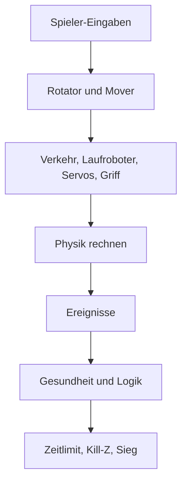
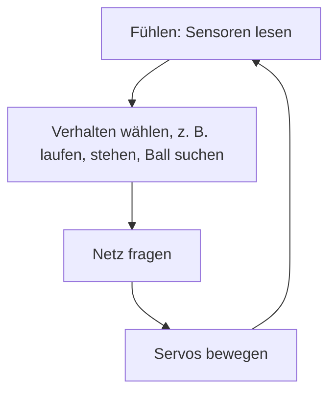

# 8 Die Spiel-Laufzeit – vom Bauplan zum Spiel

> **Dein Level:** Hier wird aus Kern eine echte Game Engine. Du erfährst, woraus ein Level besteht,
> wie es gespeichert wird und was in jedem einzelnen Bild passiert, während du spielst. Danach weißt
> du, wie Fahrzeuge fahren, Trigger auslösen und Spiele gewonnen werden.

> **Wörter, die du brauchst:**
> - **Actor** – ein Ding im Level: eine Kiste, eine Lampe, ein Auto, die Spielfigur.
> - **Komponente** – ein Baustein, der einem Actor eine Fähigkeit gibt, etwa „sichtbar sein“.
> - **Kollider** (englisch *Collider*) – die unsichtbare Form, mit der die Physik prüft, ob Dinge
>   zusammenstoßen.
> - **Sensor** – ein Kollider, der nichts aufhält, sondern nur meldet, wenn etwas hineinkommt.
> - **statisch / kinematisch / dynamisch** – steht fest / wird vom Spiel bewegt, lässt sich aber
>   nicht schubsen / echte Physik mit Fallen und Stoßen.
> - **fester Schritt** – die Physik rechnet in immer gleich langen Zeitstücken, meist 60 pro Sekunde.
> - **Server** – im Mehrspieler der eine Computer, der entscheidet, was wirklich passiert.
> - **Netz** – ein Programm, das durch langes Üben gelernt hat, statt Regel für Regel programmiert
>   zu sein.

Ein **Level** ist ein Dokument aus Actors, die Komponenten tragen. Kern Studio bearbeitet Levels und
speichert sie als Datei mit der Endung `.klevel`. Die **GameWorld** spielt ein Level ab: Sie zeigt es
an und lässt es mit der Physik-Engine Box3D laufen, mit Steuerung, Kamera, Regeln, Triggern, Ton und
Logik. Studio benutzt dieselbe GameWorld zum Bearbeiten, zum **Simulieren** (Simulate) und zum
**Spielen** (Play). Exportierte Spiele
laufen mit genau demselben Programm. Die genauen Namen der Programmteile, alle Felder und alle
Standardwerte stehen im blauen Buch, Kapitel 8.

> **So kannst du es dir vorstellen:** Das Level ist das Rezept, die GameWorld ist die Küche. Das
> Rezept liegt ordentlich im Kochbuch. Gekocht wird mit einer Kopie, damit das Buch sauber bleibt.

## 8.1 Das ganze Leben eines Spiels

Ein Spiel durchläuft immer dieselben vier Stationen: vorbereiten, starten, Schritt für Schritt
weiterrechnen, stoppen.

```mermaid
flowchart TB
  A[Vorbereiten] --> B[Start: Kopie anlegen]
  B --> C[Schritt]
  C --> C
  C --> D[Stopp]
  D --> A
```

1. **Vorbereiten:** Die GameWorld bringt die 3D-Modelle auf den Stand des Levels und schickt sie an
   die Grafikkarte. Hast du nur eine Kiste verschoben, wird auch nur sie neu geschickt.
2. **Start:** Die GameWorld legt eine **Kopie** des Levels an, baut daraus die Physikwelt und startet
   **Simulieren** (Simulate) oder **Spielen** (Play).
3. **Schritt:** In jedem Bild rechnet sie weiter, bewegt die Kamera und zeichnet (8.9).
4. **Stopp:** Alles wird abgebaut, und du siehst wieder dein unverändertes Level.

Was während des Spiels passiert, landet also **nicht** in deinem Level. Umgekippte Kisten stehen nach
dem Stoppen wieder ordentlich da. Wer eine simulierte Lage behalten will, nimmt in Studio
**Simulationsänderungen übernehmen** (Keep Simulation Changes) (Taste K, 8.8).

## 8.2 Die Spielregeln für Zahlen

Damit alle Teile von Kern dasselbe meinen, gelten feste Regeln:

- **Einheiten:** Meter, Sekunden, Kilogramm.
- **Z zeigt nach oben.** X und Y liegen flach auf dem Boden.
- **Drehungen** stehen als drei Winkel in Grad.

> **So kannst du es dir vorstellen:** ein Flugzeug. Bei Kern schaut ein Fahrzeug in Richtung x,
> also ist x seine Längsachse von hinten nach vorn. **Rollen** heißt, es kippt um seine Längsachse
> und eine Tragfläche geht nach unten (Drehung um x). **Nicken** heißt, die Nase geht hoch oder
> runter (um y). **Gieren** heißt, die Nase schwenkt nach links oder rechts wie beim Lenken (um z).

- **Eltern und Kinder:** Ein Actor kann einem anderen untergeordnet sein. Seine Position gilt dann
  **relativ zu seinem Eltern-Actor**. Ein Rad als Kind eines Autos steht zum Beispiel „1,2 m vor der
  Automitte“, egal wo das Auto gerade ist. Fährt das Auto, fährt das Rad mit.
- **Angeschweißt:** Hat ein Kind keinen eigenen Physik-Körper, wird es beim Simulieren an den Körper
  seines Eltern-Actors „angeschweißt“. Beim Hovercar in Orb Run sind Kabine, Spoiler und Düsen solche
  Kinder: Für die Physik ist das ganze Fahrzeug **ein** Körper aus mehreren Formen.

## 8.3 Level und Actor

Ein **Level** enthält:

- einen Namen und die **Welteinstellungen** (World Settings), also Einstellungen für die ganze Welt
  (8.5),
- alle Actors,
- importierte Bilder und Sounds (sie stecken direkt in der Datei),
- einen Logik-Graphen für das ganze Level ([Kapitel 9](09-logik.md)),
- die Position der Editor-Kamera.

Der **Spieler** ist der Actor, der in den **Welteinstellungen** im Feld
**Spieler (beim Spielen gesteuert)** (Player (controlled in Play)) eingetragen ist. Fehlt der
Eintrag, nimmt Kern den ersten Actor mit Steuerung.

Ein **Actor** hat:

- eine eindeutige **Nummer** und einen **Namen**. Den Namen siehst du im **Outliner**, der Liste
  aller Actors in Studio,
- einen **Eltern-Actor** (oder keinen) und optional einen Ordner im Outliner,
- **Ausgeblendet (Editor und Spiel)** (Hidden (editor and game)), also unsichtbar, und
  **Gesperrt (nicht auswählbar)** (Locked (not selectable)), also im Viewport nicht anklickbar,
- eine **Transformation** (Transform): **Position** (Location), **Drehung** (Rotation) und
  **Skalierung** (Scale),
- **Tags**, freie Schlagworte, nach denen die Logik suchen kann,
- **Komponenten**: von den meisten Arten höchstens eine, von Collidern und Gelenken beliebig viele.
  Ein Ding sieht nur auf eine Art aus, kann aber aus mehreren Stoßformen bestehen und an mehreren
  Stellen festhängen,
- einen eigenen **Logik-Graphen**.

## 8.4 Die Komponenten

Komponenten sind wie Aufsätze aus dem Baukasten: Ein nackter Actor ist nur ein Punkt im Raum. Steckst du ein Mesh
drauf, wird er sichtbar. Steckst du einen **Starrkörper** (Rigid Body) dazu, fällt er herunter. So
baust du alles aus denselben Bausteinen zusammen.

| Komponente | Was sie kann | Beispiel |
|---|---|---|
| **Statisches Mesh** (Static Mesh) | sichtbare Form mit Material | Kiste, Kugel, Rampe |
| **Punktlicht** (Point Light) | Lampe mit Farbe und Reichweite | Straßenlaterne |
| **Starrkörper** | macht den Actor zum Physik-Körper | Kiste, die umfällt |
| **Kollider** (Collider) | Form für Zusammenstöße | Kopf eines Soldaten |
| **Gelenk** (Constraint) | Gelenk zu einem anderen Actor | Tür im Scharnier |
| **Spieler-Steuerung** (Player Controller) | macht den Actor steuerbar | Hovercar, Kugel |
| **Waffe** (Weapon), **Gesundheit** (Health) | Waffe und Lebenspunkte | Schießstand, Fass |
| **Pickup** | etwas zum Einsammeln | Orb, Stern |
| **Trigger** | unsichtbarer Schalter | Ziel, Sprungfeld |
| **Audioquelle** (Audio Source) | Schallquelle ([Kapitel 7](07-audio.md)) | Radio |
| **Rotator** | dreht sich ständig | Drehtür, Stern |
| **Beweger** (Mover) | pendelt hin und her | Aufzug, Plattform |
| **Prozedurale Stadt** (Procedural City) | baut eine ganze Stadt | Orb Run |

Ein paar Bausteine im Einzelnen:

**Statisches Mesh** ist die sichtbare Form: Box, Kugel, Zylinder, Kegel, Kapsel, Ebene, Ring, Rampe oder
ein eingebautes Modell, etwa ein Glied der Micro Duck wie ihr Hals. Das **Material** bestimmt das Aussehen:
Farbe, wie rau oder glänzend, ob metallisch, ob es selbst leuchtet, ob man durchsehen kann. Ein Mesh
kann automatisch einen passenden Kollider mitbringen. Dessen Reibung, Sprungkraft und Oberfläche
([Kapitel 6](06-physik.md)) stellst du gleich hier ein, unter **Statisches Mesh › Physik** (Static
Mesh › Physics). Sie gehören neben das Aussehen, denn sie sind die Physik des Dings.

**Starrkörper** macht den Actor zum Physik-Körper. In Studio wählst du bei **Mobilität** (Mobility)
**Statisch** (Static) – bewegt sich nie –, **Kinematisch** (Kinematic) – wird bewegt, lässt sich aber
nicht schubsen – oder **Dynamisch (Physik simulieren)** (Dynamic (simulate physics)) – echte Physik.
Dazu kommen Masse, Schwerkraft-Faktor, Startgeschwindigkeit und **Kontinuierlich (Geschoss)**
(Continuous (bullet)), in Box3D „Bullet“ genannt. Ein Bullet ist für sehr schnelle Körper: In einem einzigen Schritt könnte eine schnelle Kugel von vor der Wand bis hinter die Wand
springen, ohne sie je zu berühren. Ein Bullet prüft die Strecke dazwischen besonders sorgfältig
([Kapitel 6](06-physik.md)), damit nichts durch Wände rutscht.

**Kollider** geben die Form für Zusammenstöße an: automatisch ans Mesh angepasst, Box, Kugel, Kapsel
oder eine eng anliegende Hülle. Jeder Kollider hat eine **Dichte**, aus der Kern die Masse
ausrechnet. Im Level ist sie anfangs 1000 kg/m³, so dicht wie Wasser. Ein Würfel mit 1 m
Kantenlänge wiegt also eine Tonne, wenn du nichts änderst. Trägst du beim **Starrkörper** dagegen
selbst eine **Masse** ein, gilt die statt der Dichte. Ein Kollider kann ein **Sensor** sein. Mit Kanälen
und Gruppen legst du fest, wer mit wem überhaupt zusammenstoßen kann, etwa damit Kugeln durch
die eigenen Mitspieler hindurchfliegen, aber an Wänden abprallen ([Kapitel 6](06-physik.md)).

Die Komponente **Gelenk** verbindet zwei Actors: Scharnier, Schiene, Kugelgelenk, verschweißt, Seil,
Rad und einige mehr. Gelenke können Grenzen, einen Motor und eine Feder haben und bei zu großer Kraft **brechen**.
Ein Scharnier kann ein **Servo** sein, wie die Motoren echter Roboter: Je weiter das Gelenk von
seinem Zielwinkel weg ist, desto stärker drückt es zurück, und je schneller es sich dreht, desto
stärker bremst es. Doppelt so weit weg heißt doppelt so starke Drehkraft, wie bei einem Gummiband.

**Rotator** und **Beweger** bewegen Dinge ohne Logik: Der Rotator dreht gleichmäßig, der Beweger pendelt
weich, hin und zurück oder springt am Ende zurück an den Anfang. Beide rechnen mit der Spielzeit, also
laufen sie bei jedem Start gleich.

**Prozedurale Stadt** baut aus einer einzigen Zahl (dem Seed) eine ganze Stadt mit Straßen, Häusern,
Bäumen, Autos und nachts leuchtenden Fenstern ([Kapitel 5](05-szene-und-geometrie.md)).

Die übrigen Bausteine (Spieler-Steuerung, Waffe, Pickup, Trigger) kommen in 8.10 bis 8.13 dran.

> **Für Profis:** Ein Name kann verwirren: In [Kapitel 6](06-physik.md) heißt der Typ **Statisch**
> im Programm „fixed“. Mit dem Gelenk **Fest (verschweißt)** (Fixed (weld)) hat er nichts zu tun. Und wer in Kapitel 6
> direkt mit der Physik arbeitet, ohne Level, startet mit einer Dichte von 1 kg/m³ statt 1000.

> **Mission:** Öffne auf https://kernengine.de/ über **Datei › Beispiel-Levels** (File › Example
> Levels) das Level Physics Lab. Klick die Tür an und schau in **Details**: Welche Komponenten hat
> sie? Finde beim **Gelenk** den **Typ** (Type), die **Grenzen** (Limits) und die **Feder** (Spring).
> Die Grenzen legen fest, wie weit die Tür aufgeht, die Feder zieht sie wieder zu. Starte danach
> **Simulieren** (Simulate) (Alt+S), schubs die Tür mit der linken Maustaste an und prüf, ob das
> stimmt. Schalte unter **Fenster › Anzeigen** (Window › Show) – oder mit dem Knopf **Anzeigen** oben
> im Viewport – **Kollisionsformen** (Collision Shapes) und **Gelenke** (Constraints) ein. Die Farben verraten den Typ: statisch grün,
> kinematisch blau, dynamisch orange, Sensor violett, schlafend grau. „Schlafend“ heißt: Ein Körper
> liegt schon lange still, darum rechnet die Physik ihn nicht mehr, bis ihn etwas anstößt.

## 8.5 Die Welteinstellungen

Manche Einstellungen gelten nicht für ein Ding, sondern für die ganze Welt. Die stehen in den
**Welteinstellungen** (World Settings):

| Bereich | Beispiele |
|---|---|
| Physik | Stärke der Schwerkraft, wie viele feste Schritte pro Sekunde |
| Himmel | Tageszeit (0,25 Aufgang, 0,5 Mittag, 0,75 Untergang), Tageslänge |
| Bild | Nebel, Helligkeit, Wolken |
| Boden | endloser Boden an oder aus, Farbe, Reibung |
| Spiel | Titel, Siegbedingung, Zeitlimit, Spieler, Kill-Z |
| Audio | Lautstärken, Musik, Hall, Doppler ([Kapitel 7](07-audio.md)) |

Die Tageszeit ist ein Bruchteil des Tages: 0,5 ist die Hälfte, also Mittag. Zwei Besonderheiten:
**Kill-Z (darunter Wiedereinstieg)** (Kill Z (respawn below)) ist eine Höhe. Fällt ein Spieler
tiefer, etwa von der Welt herunter, wird er zurückgesetzt. Und mit
**Beobachterkamera (Spielen: fliegen, zuschauen, Körper ziehen)** (Observer camera (Play: fly, watch,
drag bodies)) startet **Spielen** (Play) mit einer freien Kamera; mit F8 übernimmst du dann den
Spieler.

## 8.6 Das `.klevel`-Format

Ein Level wird als **JSON** gespeichert. Das ist ganz normaler, lesbarer Text mit Klammern, Namen und
Werten. Du kannst eine `.klevel`-Datei mit jedem Texteditor öffnen. Ein Actor sieht so aus
(gekürzt):

```json
{
  "id": 12, "name": "Door", "parent": 3,
  "transform": {"position": [5.2, -12, 1.5]},
  "tags": ["door"],
  "components": {"mesh": {}, "body": {}}
}
```

Zeile für Zeile: Der Actor hat die Nummer 12, heißt „Door“ und ist ein Kind von Actor 3. Er steht bei
x = 5,2 m, y = −12 m, z = 1,5 m (relativ zu seinem Eltern-Actor). Er trägt das Schlagwort „door“ und
hat ein Mesh und einen Starrkörper. Was beim Einlesen in den geschweiften Klammern fehlt, bekommt
Standardwerte. Beim Speichern schreibt Kern jede Komponente vollständig hin; nur leere Angaben wie
ein fehlender Eltern-Actor oder keine Schlagwörter lässt es weg.

**Beim Lesen** gilt ein schlauer Grundsatz: **nachsichtig bei Fehlendem, streng bei Falschem.**

- **Fehlt** etwas, nimmt Kern den Standardwert. Unbekannte Einträge überspringt es. So laden alte
  Dateien auch in neuen Versionen von Kern.
- **Falsch** ist zum Beispiel Text, wo eine Zahl hingehört. Dann meldet Kern einen Fehler, etwa
  „friction must be a number“, und nennt den Actor.
- Eine Datei aus einer **neueren** Kern-Version lehnt es ganz ab. Warum nicht einfach das Unbekannte
  überspringen? Eine neuere Datei könnte Dinge enthalten, die das alte Kern falsch verstehen würde.
  Dann sähe das Level anders aus als gebaut. Lieber gar nicht laden als falsch.
- Zahlen außerhalb ihres sinnvollen Bereichs werden auf den nächsten erlaubten Wert gesetzt, so wie
  ein Lautstärkeregler nicht über „ganz laut“ hinausgeht.
- Fehlende oder doppelte Nummern werden neu vergeben. Ein Eltern-Actor, den es nicht gibt, wird zu
  „keiner“, und **Kreise** in der Familie werden aufgebrochen.

> **Vorsicht, Falle:** Ein Kreis heißt: A ist Elternteil von B, und B ist Elternteil von A. So etwas
> entsteht leicht, wenn man Dateien von Hand bearbeitet. Ohne Prüfung würde das Programm endlos „nach
> oben“ suchen und hängen bleiben.

**Prüfen vor dem Start:** Bevor das Spielen beginnt, sucht Kern nach Problemen. **Fehler**
verhindern den Start, zum Beispiel eine Größe von 0, ein Gelenk, das einen Actor mit sich selbst
verbindet, oder eine Steuerung ohne Physik-Körper. **Warnungen** landen nur im **Ausgabeprotokoll**
(Output Log), zum Beispiel ein Sound-Name, den
es nicht gibt (dann bleibt es still), oder mehr als ein Spieler.

## 8.7 Vom Level zur Physikwelt

Bevor simuliert wird, macht Kern einen **Plan**: Welche Physik-Körper braucht dieses Level, und welche
Formen gehören zu welchem Körper? Das Wichtige daran: **Derselbe Plan** zeichnet auch die Kollider im
Editor. Was du im Editor mit **Anzeigen › Kollisionsformen** (Show › Collision Shapes) siehst, ist
also genau das, womit später gerechnet wird.

```mermaid
flowchart LR
  L[Level] --> P[Plan: Körper und Formen]
  P --> W[Physikwelt]
  P --> E[Collider im Editor]
```

Die Regeln des Plans:

1. Jeder Actor mit **Starrkörper** (Rigid Body) bekommt einen Körper. Ein statischer Körper mit
   **Rotator** oder **Beweger** (Mover) wird kinematisch, er muss sich ja bewegen.
2. Manche Dinge brauchen einen Körper, obwohl du keinen Starrkörper gesetzt hast: eine Wand mit
   Kollider, ein Stern zum Einsammeln, ein Trigger. Sie bekommen einen **unsichtbaren eigenen
   Körper**, statisch oder, wenn sie sich bewegen, kinematisch.
3. Jeder Actor gibt seine Formen an seinen Körper, auch angeschweißte Kinder (8.2). Ein automatischer
   Kollider wird ans Mesh angepasst.
4. Pickups und Trigger werden zu Sensoren. Haben sie gar keine Form, bekommen sie eine Sensor-Kugel
   mit 1 m Radius.
5. Die Stadt wird ein einziger statischer Körper aus vielen Boxen: für die Häuser (Hofhäuser und
   L-Häuser aus mehreren) und für die Bodenplatten.
6. Der endlose Boden ist eine riesige flache Box, deren Oberseite genau bei z = 0 liegt.

## 8.8 Die GameWorld starten

Drückst du **Spielen** (Play), geht die GameWorld diese Schritte durch:

1. **Prüfen** (8.6). Ein Fehler bricht ab.
2. **Kopie anlegen.** Gespielt wird mit der Kopie, das Original bleibt unberührt.
3. **Physikwelt bauen:** Schwerkraft setzen, dann alle Körper, Gelenke und Laufroboter nach dem Plan
   aus 8.7 anlegen, Eltern vor ihren Kindern. Die Autos der Stadt fahren los.
4. **Spieler übernehmen** (nur beim Spielen). Er bekommt einen **Pawn**: ein Notizblatt, auf dem Kern
   sich alles über die Steuerung dieses Spielers merkt, also letzte Eingabe, Blickrichtung,
   Startpunkt und Boost.
5. **Regeln und Logik starten:** Punkte, Zeit, Gesundheit und Munition auf Anfang, die Bestzeit
   bleibt. Dann laufen die Logik-Graphen los.

Spieler-Fahrzeuge bekommen dabei immer die Sonderbehandlung „Bullet“, damit sie bei hohem Tempo nicht
durch Wände rutschen. Fahrzeuge, Figuren und Flieger werden gegen Umkippen gesichert, nur die
Rollkugel und die laufende Ente dürfen kippen.

> **Für Profis:** Ein Gelenk verbindet einen Actor mit seinem **Ziel**. Bewegt wird dabei der Actor
> gegenüber dem Ziel. Positive Werte, etwa der Weg einer Schiene, der Winkel eines Scharniers oder
> das Tempo eines Motors, bewegen also den Actor und nicht das Ziel.

**Melden nur, wo jemand zuhört.** Jede Berührung zu melden, kostet die Physik Arbeit. Darum schaltet
Kern Meldungen nur dort ein, wo sie jemand liest: bei Sensoren, beim Spieler, bei Körpern mit
Aufprall-Sound und, wenn das Level Logik hat, bei allem Beweglichen. Eine Kiste, die niemanden
interessiert, fällt still und spart Rechenzeit.

**Die Modi:**

| Modus | Bedeutung |
|---|---|
| none | keine Simulation, nur Editor |
| simulate | Physik und Logik laufen, niemand wird gesteuert, Körper lassen sich greifen |
| play | wie simulate, dazu Spieler, Regeln und HUD |
| replica | Kopie eines Server-Spiels bei einem Mitspieler ([Kapitel 10](10-netzwerk.md)) |

Zwischen **Simulieren** (Simulate) und **Spielen** kannst du mitten im Lauf wechseln (Studio: F8),
der Spieler behält dabei seinen Zustand. Du kannst neu starten (Strg+R), pausieren und genau einen Schritt
weitergehen (Taste `.`).

> **Mission:** Starte im Physics Lab **Simulieren**, drücke **Pause** (den Pause-Knopf
> neben **Spielen** in der Werkzeugleiste, oder Alt+Umschalt+P) und dann mehrmals die Taste **.** –
> die Welt läuft Schritt für Schritt. Drück noch einmal **Pause**, damit es weiterläuft, und greif
> eine Kiste mit der linken Maustaste. Klick dann eine umgefallene Kiste im Viewport kurz an (ohne zu
> ziehen), so wählst du sie aus. Drück **K** (**Spielen › Simulationsänderungen übernehmen**
> (Play › Keep Simulation Changes)): Die Simulation endet, und die Kiste steht in deinem Level genau
> so, wie sie lag.

## 8.9 Was in einem Bild passiert

Die Bildrate deines Computers schwankt, die Physik will aber **feste Schritte** (warum, erklärt
[Kapitel 6](06-physik.md)). Darum sammelt die GameWorld die vergangene Zeit wie in einer Spardose und
zahlt sie in festen Schritten aus.

> **So kannst du es dir vorstellen:** Jedes Bild wirft die Zeit, die seit dem letzten Bild vergangen
> ist, in die Spardose. Die Physik nimmt so lange 1/60-Sekunden-Münzen heraus, wie genug drin ist,
> und rechnet für jede Münze einen Schritt. Der Rest bleibt fürs nächste Bild liegen. Ein langes
> Bild wirft viel hinein, dann gibt es mehrere Schritte. Ein kurzes wirft wenig hinein, dann
> vielleicht gar keinen.

Hängt ein Bild sehr lange, rechnet die Physik höchstens 0,1 s nach, den Rest wirft sie weg. Sonst
entstünde ein Rechenstau: Das Nachrechnen würde so lange dauern, dass das nächste Bild noch mehr
nachzurechnen hätte. Die Folge: Die Welt läuft dann kurz langsamer, statt stecken zu bleiben.

Feste Schritte setzen auch eine Grenze: Eine Feder kann nicht schneller hin- und herschwingen, als
die Physik Schritte rechnet. Darum begrenzt Kern beim Start die Härte jeder Feder und jedes Gelenks
passend zur Schrittrate. Warum, steht in [Kapitel 6](06-physik.md).

Ein fester Schritt:



1. **Spieler:** Für jeden Spieler die Eingabe holen und sein Fahrzeug oder seine Figur bewegen.
2. **Animation:** Rotator und Beweger bekommen ihr Ziel für diesen Schritt.
3. **Verkehr** (Autos halten vor dem Spieler), Laufroboter, Servos und der **Maus-Griff**.
4. **Box3D rechnet** einen Physikschritt.
5. **Ereignisse:** Was wurde eingesammelt, welcher Trigger berührt, wer getroffen, welches Gelenk
   gebrochen? Daraus entstehen auch die Aufprallgeräusche.
6. **Gesundheit** (Heilen, Wiederkehr) und die **Logik** ([Kapitel 9](09-logik.md)).
7. **Regeln:** Zeitlimit, Kill-Z, Punktestand, gewonnen oder verloren?

Danach wird gezeichnet. Bildschirme zeigen oft mehr Bilder pro Sekunde, als die Physik Schritte macht.
Darum zeichnet Kern nicht einfach den letzten Schritt, sondern einen **Zwischenstand** zwischen den
letzten beiden Schritten. Das heißt **interpolieren**. Liegt ein Bild genau in der Mitte, steht die
Kiste genau in der Mitte zwischen ihren zwei letzten Positionen. So bleibt die Bewegung auch bei 144
Bildern pro Sekunde flüssig. Zuletzt bewegt sich die Kamera, eingesammelte Pickups verschwinden, und
nachts leuchten die Fenster.

**Im Studio** kommt pro Bild noch die Arbeit des Editors dazu, etwa Haltepunkte der Logik prüfen und
Meldungen ins **Ausgabeprotokoll** (Output Log) schreiben.

## 8.10 Controller: fahren, rollen, laufen, fliegen

Ein **Controller** macht aus Tasten Bewegung. Pro Bild bekommt jeder Spieler eine **Eingabe**: vor
und zurück, links und rechts (je von −1 bis 1), hoch und runter, Springen, Boost, Kameradrehung, beim
Soldaten Feuern, Zielen, Nachladen, Ducken und Benutzen. Bei der Micro Duck kommen ihre Bewegungen
dazu (Sitzen, Aufheben, zwei Kicks, Rolle, Schnabel, Zwitschern, Wheee, Sprung), alle zusammen in einer
einzigen Zahl.

> **Krass, aber wahr:** Neun Entenbewegungen passen in eine einzige Zahl. Jede Bewegung bekommt
> einen Wert, und jeder Wert ist das Doppelte des vorigen: 1, 2, 4, 8, 16, 32, 64 … So ein Ein-Aus-
> Schalter heißt **Bit**. Willst du gleichzeitig aufheben (2) und zwitschern (64), schickst du
> einfach 66. Der Trick mit dem Verdoppeln: Alle kleineren Werte zusammen sind immer kleiner als der
> nächste (1 + 2 + 4 = 7, weniger als 8). Darum lässt sich jede Summe nur auf eine Art zerlegen, 66
> nur als 64 + 2. Mit den Werten 1, 2, 3 ginge das nicht: 3 könnte „3“ heißen oder „1 und 2“.

Bei **Rollende Kugel** (Rolling ball), **Figur** (Character) und **Flieger** (Flyer) ist die
Bewegung **kamerarelativ**: „Vor“ heißt dorthin, wohin die Kamera blickt.

Die Modi stehen in der **Spieler-Steuerung** (Player Controller) im Feld **Bewegung** (Movement):

| Modus | So bewegt er sich |
|---|---|
| **Hovercar** (Hover car) | schwebt auf einer unsichtbaren Feder über dem Boden, Gas schiebt, eine Seitenkraft verhindert Rutschen; sein Wippen und Neigen ist nur Aussehen |
| **Fahrzeug** (Vehicle) | wie das Hovercar, aber auf dem Boden; Gas wirkt nur mit Bodenkontakt |
| **Rollende Kugel** | eine Kugel, die du anschubst; springen nur vom Boden |
| **Figur** | eine Spielfigur, die läuft, springt und Stufen hochsteigt |
| **Flieger** | fliegt in jede Richtung, auch hoch und runter, die Schwerkraft wird aufgehoben |
| **Soldat (Ego-Shooter)** (Soldier (first person shooter)) | wie die Figur, für Ego-Shooter (8.13) |
| **Läufer (Roboter auf seinem trainierten Netz)** (Walker (robot on its trained network)) | die Micro Duck läuft mit ihren eigenen Motoren (8.14) |

Figur und Soldat benutzen den **Character Mover** aus [Kapitel 6](06-physik.md). Die
Figur fällt absichtlich schneller als in echt, damit Sprünge knackig wirken und
nicht schwebend. Der Soldat fällt wie in echt, so wie in Ego-Shootern üblich.

Für alle gilt: **Boost** ist ein Vorrat von 0 bis 1. Beim Boosten sinkt er um 0,45 pro Sekunde, sonst
wächst er um 0,22 pro Sekunde. Nach einem tiefen Fall spielt eine Landung den Sound `land`.

Rechne mal: Ein voller Boost-Vorrat hält 1 / 0,45 ≈ 2,2 Sekunden. Ganz neu füllen dauert
1 / 0,22 ≈ 4,5 Sekunden.

**Mehrere Spieler:** Jeder Spieler hat seinen eigenen **Pawn** (8.8). Kommt im Mehrspieler jemand
dazu, kopiert Kern die Spielfigur samt Kindern und stellt die Kopie auf eine Spirale um den
Startpunkt, jeden neuen Spieler ein Stück weiter außen. So steht keiner auf dem anderen.

## 8.11 Kamera

Die Kamera folgt der **interpolierten** Lage des Spielers (8.9), also immer dem flüssigen
Zwischenstand:

- **Verfolger** (Chase) **bei Fahrzeugen:** hinter dem Fahrzeug, umso weiter weg, je schneller es fährt.
- **Verfolger sonst:** kreist mit Maus oder Stick um den Spieler. Ein **Prüfstrahl**, eine unsichtbare
  Linie vom Spieler zur Kamera, hält sie aus Wänden heraus: Trifft die Linie eine Wand, rückt die
  Kamera davor.
- **Ego-Perspektive** (First person): die Augen am Körper.
- **Von oben** (Top down): von oben.

Über 30 m/s (etwa 108 km/h) wird das Sichtfeld etwas weiter, das fühlt sich schneller an. Harte
Treffer schütteln die Kamera. Soldaten haben eine eigene Kamera.

## 8.12 HUD, Regeln und Trigger

Das **HUD** ist die Anzeige über dem Spiel: Status, Titel, Meldung, Punkte, Pickups, Zeit, Restzeit,
Tempo, Boost, Bestzeit und beim Soldaten Gesundheit und Munition.


**Siegbedingungen** stellst du in Studio unter **Welteinstellungen › Siegbedingung** (World Settings ›
Win condition) ein:

| Ziel | Gewonnen, wenn … |
|---|---|
| **Keine (Sandkasten)** (None (sandbox)) | nie – Sandkasten |
| **Alle Pickups sammeln** (Collect all pickups) | alle Pickups gesammelt (gibt es einen Ziel-Trigger, danach noch dorthin) |
| **Ein Ziel erreichen** (Reach a goal trigger) | Ziel-Trigger erreicht |
| **Das Zeitlimit überleben** (Survive the time limit) | Zeitlimit überstanden |
| **Eine Punktzahl erreichen** (Reach a target score) | Zielpunkte erreicht |

Mit Zeitlimit verliert man bei 0, außer bei **Das Zeitlimit überleben**. Eine Gefahr (Hazard-Trigger)
verliert immer. Am
Ende setzt Kern den Status, spielt eine kurze Melodie, merkt sich die Bestzeit und meldet der Logik
„Spiel vorbei“.

**Pickups:** Berührt ein Spieler eines, bekommt er Punkte, Heilung oder Munition, dazu Sound und
Funken, und die Logik erfährt davon. Ein reines Heilpaket bleibt liegen, solange du volle Gesundheit
hast. Mit Wiederkehr-Zeit taucht es später wieder auf.

**Trigger-Aktionen:** Ein Trigger ist ein unsichtbarer Schalter. Was er tut, legt seine Aktion fest:

| Aktion in Studio | Wirkung | Fertig im Katalog |
|---|---|---|
| **Ziel (Sieg)** (Goal (win)) | gewinnt | **Ziel** (Goal) |
| **Gefahr (Niederlage)** (Hazard (lose)) | verliert | **Gefahr** (Hazard) |
| **Checkpoint (hier wieder einsteigen)** (Checkpoint (respawn here)) | neuer Startpunkt 1 m darüber | **Checkpoint** |
| **Nachricht** (Message) | zeigt eine Meldung | **Nachrichten-Trigger** (Message Trigger) |
| **Sprungfeld (Start)** (Jump pad (launch)) | schleudert hoch und nach vorn | **Sprungfeld** (Jump Pad) |
| **Teleport** | versetzt zum Ziel-Actor | **Teleporter** |
| **Schadenszone** (Damage zone) | zieht Lebenspunkte ab | **Schadenszone** (Damage Zone) |
| **Nur Logik-Ereignis** (Logic event only) | nur ein Ereignis für die Logik | – |

Fast jede Aktion spielt ihren passenden Sound. Der Teleporter sperrt sich 1 s lang, damit du nicht sofort
zurückgebeamt wirst. Jeder Trigger meldet sich vorher bei der Logik. Mit **Nur einmal** (Only once)
ist er danach verbraucht, außer Ziel, Gefahr und Teleporter.

> **Mission:** Lege mit **Datei › Neues Level...** (File › New Level...) ein Level mit der Vorlage
> **Basis** (Basic) an. Platziere aus **Actors platzieren** (Place Actors) eine
> **Rollende Kugel** (Rolling Ball) aus der Gruppe **Spieler** (Players), dreimal **Stern** (Star) und ein
> **Ziel** aus der Gruppe **Spielablauf** (Gameplay). Stell in den **Welteinstellungen** die
> **Siegbedingung** auf **Alle Pickups sammeln** und drück **Spielen** (Play) (Alt+P). Was passiert,
> wenn du das Ziel vor dem letzten Stern berührst? Und was danach?

> **Mission:** Baue in dein Level ein **Sprungfeld** und einen **Teleporter** (beide unter
> **Spielablauf**) und probiere sie mit der rollenden Kugel aus. Der Teleporter besteht aus zwei Feldern: Du betrittst A
> und kommst bei B an.

## 8.13 Soldaten und Figuren

Der **Soldat** ist das Spielmodell für Ego-Shooter, übernommen aus Kerns Vorgänger-Spiel SpawnCity.
Er läuft mit dem Character Mover, duckt sich, sprintet und springt. Ein Sprungdruck kurz vor der
Landung oder kurz nach einer Kante zählt noch, das fühlt sich fair an.

Ein Schuss ist ein gerader **Prüfstrahl** aus dem Auge. Die Kugel fliegt nicht wirklich, Kern prüft
nur, was auf der Linie zuerst getroffen wird. Die Streuung ist **deterministisch**: Sie wird aus der
Nummer des Schützen und der Zahl seiner Schüsse berechnet, statt gewürfelt. So rechnen der Server und
jede Wiederholung genau dieselben Treffer aus.

**Lag-Kompensation:** Im Mehrspieler kommt dein Schuss mit etwas Verspätung beim Server an. In der
Zwischenzeit sind die anderen weitergelaufen. Der Server schaut deshalb nach, **wo der Gegner war, als
du abgedrückt hast**, und prüft den Treffer dort, höchstens eine halbe Sekunde zurück.

> **So kannst du es dir vorstellen:** ein Schiedsrichter mit Videobeweis. Er spult zu dem Moment
> zurück, in dem du geschossen hast, und entscheidet dann.

Dazu kommen Rüstung (fängt einen Teil des Schadens ab), kurzer Schutz nach dem Wiedereinstieg,
Fallschaden bei harten Landungen und **Wiederkehr**: Ein Spieler startet nach einer Wartezeit neu,
andere Actors verschwinden und tauchen, wenn eingestellt, an ihrem Platz wieder auf. Ein Fass mit
Explosionsradius explodiert und schubst, was in der Nähe ist. Figur und Waffe sind aus einfachen Körpern
gebaut und reine Darstellung: Sie ändern nichts an der Simulation.

## 8.14 Läufer

Ein **Läufer** (Walker) ist ein Roboter mit Gelenken, der mit seinen eigenen Servos läuft. In Kern ist das die
Micro Duck. Gesteuert wird sie nicht von Regeln, die jemand programmiert hat, sondern von einem
**Netz**, das Pollen Robotics trainiert hat: Es hat durch sehr viel Üben gelernt, welche
Motorbewegung zu welcher Lage passt.

In jedem Schritt läuft ein Kreislauf:



**Verhalten wählen** heißt: Ein Programm entscheidet, was die Ente als Nächstes tun will, etwa
herumlaufen, ruhig stehen oder mit dem Ball spielen. Das Netz sorgt dann dafür, dass sie dabei nicht
umfällt.

Das Netz wird regelmäßig gefragt, aber nur alle paar Physikschritte. Genau so oft wurde es beim
Training gefragt, und so oft fragt es auch der echte Roboter. Wie bei echten Servos kommt sein
Befehl außerdem mit einer kleinen Verzögerung an den Motoren an, und auch die bildet Kern absichtlich
nach. Das klingt seltsam: Warum etwas schlechter machen, als es sein könnte? Weil das Netz mit
genau dieser Verzögerung laufen gelernt hat. Ohne sie würde es sich verschätzen und stolpern. Das
ist ein Grundsatz des ganzen Buchs: Die Simulation soll sich so verhalten wie der echte Roboter.
Alles Weitere über die Ente steht in [Kapitel 13](13-micro-duck.md).

## 8.15 Sound-Anbindung

Die Simulation spielt nie selbst Ton, sondern schreibt in ihren festen Schritten **Cues**,
Bestellzettel für Geräusche: für Sprünge, Landungen, Pickups, Trigger, Treffer, Explosionen,
Aufpralle und mehr. Darum bleibt sie deterministisch. Wie die Zettel entstehen und abgespielt werden,
steht in [Kapitel 7](07-audio.md), Abschnitte 7.7 und 7.8.

## 8.16 Touch, Maus und Gamepad

Auch die Touch-Steuerung stammt aus SpawnCity und ist in die Engine eingebaut, damit Studio und
exportierte Spiele sie gleich nutzen.

Ein **Schiedsrichter** entscheidet, welches Gerät gerade steuert: Das zuletzt benutzte gewinnt. Ein
Finger auf dem Bildschirm schaltet auf Touch, jede echte Taste auf Maus und Tastatur, auch am Handy.
Eine Maus am Tablet schaltet aber **nicht** auf Desktop: Am Handy oder Tablet ist der Finger die
Hauptsteuerung, und eine angesteckte Maus soll die Touch-Knöpfe nicht verschwinden lassen. Den
**Pointer-Lock** gibt es nur mit Maus: Dabei bleibt der Mauszeiger im Spiel gefangen, damit du dich
endlos umdrehen kannst.

Die **Touch-Steuerung** hat zwei Sticks in den unteren Ecken. Links bewegst du dich (**LAUFEN**
(MOVE), bei Fahrzeugen **LENKEN / GAS** (STEER / GAS), beim Flieger **FLIEGEN** (FLY)), rechts
schaust du (**SCHAUEN** (LOOK)). Daneben liegen Knöpfe je nach Bewegungsart (in Klammern die
englische Beschriftung; KICK L, KICK R, BOOST, DRIFT und LIFT heißen in beiden Sprachen gleich):

| Bewegung | Knöpfe |
|---|---|
| Soldat | SPRUNG (JUMP), LADEN (RELOAD), ZIELEN (AIM), DUCKEN (CROUCH), NUTZEN (USE) |
| Läufer | QUAK (QUACK), GREIFEN (PICK), SITZ (SIT), KICK L, KICK R, ROLLEN (ROLL), SCHNABEL (BEAK), HUIII (WHEEE), HÜPFEN (HOP) |
| Figur | SPRUNG (JUMP), NUTZEN (USE) |
| Rollende Kugel | SPRUNG (JUMP), BOOST |
| Flieger | HOCH (UP), RUNTER (DOWN), BOOST |
| Hovercar | BOOST, DRIFT, LIFT, SICHT (VIEW) |
| Fahrzeug | BOOST, DRIFT, HÜPFEN (HOP), SICHT (VIEW) |

Jeder Finger bekommt genau eine Aufgabe, und zwar dort, wo er zuerst aufsetzt. Liegt dort ein
Knopf, drückt er den Knopf und wird nie zum Stick, auch wenn er danach weiterwischt. Liegt dort kein
Knopf, aber ein Stick, bewegt er den Stick. Setzt er auf dem freien Bildschirm auf, schießt er beim
Soldaten mit Waffe (und zielt dabei), bei allen anderen schaut er sich um. Linker Stick ganz nach
vorn heißt Sprinten. Ziehst du den rechten Stick bis an den Rand, drehst du dich einfach weiter
(**Edge Turn**). Gamepads bekommen **Totzonen**: Ganz kleine Wackler am Stick werden ignoriert.

## 8.17 Logik in der Welt

Jeder Actor und das Level können einen Logik-Graphen tragen ([Kapitel 9](09-logik.md)). Die GameWorld
startet sie beim **Spielen** (Play) und **Simulieren** (Simulate), meldet ihnen **Ereignisse** (Überlappung, Treffer, Pickup, Trigger,
Schaden, Tod, Taste, Spielende, neuer Spieler …) und lässt sie **Dinge tun** (Werte ändern, Kopien
erzeugen, schieben, Punkte geben, Spiel beenden …).

Logik läuft nur dort, wo das Spiel **„die Wahrheit hat“**. Allein ist das dein eigener Computer. Im
Mehrspieler ist es nur der **Server**: Er entscheidet, was passiert, und die Mitspieler bekommen das
Ergebnis geschickt. Würde jeder Computer seine eigene Logik rechnen, könnte bei einem eine Tür offen
und beim anderen zu sein. Darum schreibt Kern alles mit, was Logik verändert, und der Server schickt
es an alle ([Kapitel 10](10-netzwerk.md)).

## 8.18 Die Demo-Levels

Unter **Datei › Beispiel-Levels** (File › Example Levels) und **Datei › Neues Level...** (File › New
Level...) findest du die eingebauten Levels:

- **Orb Run:** eine Stadt mit Verkehr, ein Hovercar und 24 Orbs zum Einsammeln. Es ist später
  Nachmittag, und der Lauf endet in der Nacht. Studio startet mit diesem Level.
- **Physics Lab:** alle Gelenkarten – Kistenpyramide, Pendel, Tür, Seilbrücke (drei Gelenke können
  brechen), Drehteller, Lift, ein selbstfahrender Rover. Du rollst als Kugel, sammelst fünf Sterne
  und erreichst das Ziel, vorbei an einer drehenden Gefahr.
- **Shooting Range:** ein Schießstand mit Zielscheiben in 10 bis 60 m, Deckung, Kisten, einem Fass
  und einem Turm. Ziel: 150 Punkte. Auch im Mehrspieler spielbar.
- **Micro Duck:** ein Zimmer im Maßstab des Roboters mit Ball und Socken. Die Ente läuft
  selbstständig. Ein Level-Graph lässt sie zwitschern, wenn ihre Kopfkamera den Ball sieht.
  **Spielen** (Play) beginnt hier mit eingeschalteter Beobachterkamera, mit **F8** übernimmst du die
  Ente.
- **Basis** (Basic): Boden, Sonne, Himmel und ein Würfel.
- **Leer** (Empty): gar nichts, nicht einmal Boden.

Automatische Tests spielen diese Levels durch und prüfen zum Beispiel, dass ein Ziel gewinnt und eine
Gefahr verliert.

> **Mission:** Öffne **Orb Run** und starte **Spielen** (Alt+P). Sammle ein paar Orbs, dann drück
> **F8**: Du steigst aus, das Spiel läuft weiter, und du fliegst frei herum. Noch einmal **F8**, und
> du sitzt wieder am Steuer. Wie viele Sekunden brauchst du für alle 24?

## Level geschafft!

- Du weißt, wie Level, Actors und Komponenten zusammenhängen.
- Du kennst die wichtigsten Komponenten und ihre Aufgaben.
- Du kannst eine `.klevel`-Datei lesen und weißt: nachsichtig bei Fehlendem, streng bei Falschem.
- Du verstehst, warum Editor und Spiel denselben Plan für die Physik benutzen.
- Du weißt, was in jedem festen Schritt passiert und warum Kern zwischen zwei Schritten interpoliert.
- Du kennst die Controller, Siegbedingungen und Trigger-Aktionen.
- Du kannst ein kleines Spiel mit Ziel selbst bauen.

## Rätsel-Ecke

1. Was passiert mit deinen Änderungen, die beim Simulieren entstehen, wenn du stoppst?
2. Ein Pickup ohne Mesh und ohne Kollider – womit merkt Kern, dass du es berührst?
3. Die **Siegbedingung** (Win condition) ist **Alle Pickups sammeln** (Collect all pickups), und es
   gibt einen Ziel-Trigger. Du hast alle Orbs.
   Hast du gewonnen?
4. Bei der Micro Duck soll gleichzeitig „Sitzen“ (1) und „Zwitschern“ (64) gedrückt werden. Welche
   Zahl schickt die Eingabe?
5. **Boss-Rätsel:** Die Physik läuft mit 60 Schritten pro Sekunde. Dein Computer schafft gerade nur
   20 Bilder pro Sekunde. Wie viele feste Schritte rechnet Kern im Schnitt pro Bild? Und wie viele
   wären es höchstens, wenn ein Bild eine ganze Sekunde hängt?

### Lösungen

1. Sie verschwinden. Simuliert wird an einer Kopie. Behalten kannst du die Lage ausgewählter Actors
   nur mit **Simulationsänderungen übernehmen** (Keep Simulation Changes), Taste K.
2. Mit einer Sensor-Kugel von 1 m Radius, die Kern beim Planen der Physik automatisch anlegt.
3. Noch nicht. Erst wenn du danach das Ziel erreichst.
4. 1 + 64 = 65.
5. Ein Bild dauert 1/20 s = 0,05 s, das sind 3 Schritte zu je 1/60 s. Hängt ein Bild eine Sekunde,
   rechnet Kern trotzdem höchstens 0,1 s nach, also 6 Schritte. Die Welt läuft dann kurz langsamer,
   statt in einem Rechenstau stecken zu bleiben.

---

© 2026 Christian Heinrich Hohlfeld · Alle Rechte vorbehalten · [Impressum und Rechte](00-impressum.md)
