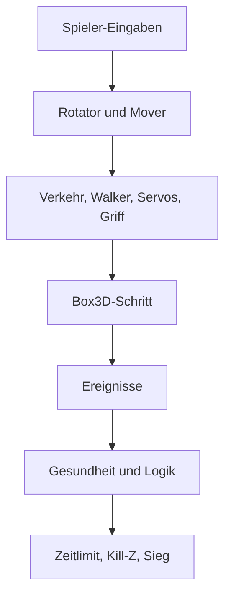

# 8 Die Spiel-Laufzeit – vom Bauplan zum Spiel

> **Dein Level:** Hier wird aus Kern eine echte Game Engine. Du erfährst, woraus ein Level besteht,
> wie es gespeichert wird und was in jedem einzelnen Bild passiert, während du spielst. Danach weißt
> du, wie Fahrzeuge fahren, Trigger auslösen und Spiele gewonnen werden.

Ein **Level** ist ein Dokument aus **Actors**, also Dingen in der Welt, die **Komponenten** tragen.
Kern Studio bearbeitet Levels und speichert sie als `.klevel`-Datei. Die **GameWorld** zeigt ein
Level an und spielt es mit der Physik-Engine Box3D: mit Steuerung, Kamera, Regeln, Triggern, Sound
und Logik. Studio nutzt dieselbe GameWorld für Bearbeiten, Simulate und Play, und exportierte Spiele
laufen mit genau diesem Code.

> **So kannst du es dir vorstellen:** Das Level ist das Rezept, die GameWorld ist die Küche. Das
> Rezept liegt ordentlich im Kochbuch. Gekocht wird an einer Kopie, damit das Buch sauber bleibt.

Der Code liegt im Bereich `kern::game`: Level, Dateiformat, GameWorld, Soldat, Logik, Sound,
Touch, Mehrspieler, die Micro Duck und Demo-Levels.

## 8.1 Das ganze Leben eines Spiels in fünf Zeilen

```cpp
GameWorld world(renderer, &night_windows);
world.sync(level);
world.start(level, SimMode::play);
world.step(dt, input);
world.stop();
```

1. Die GameWorld wird mit dem Renderer angelegt.
2. `sync` bringt die 3D-Modelle auf den Stand des Levels. Nur Geändertes wird neu hochgeladen.
   Während eine Simulation läuft, wird `sync` ignoriert.
3. `start` kopiert das Level, baut die Physikwelt und startet Simulate oder Play.
4. Jedes Bild: `step` rechnet weiter. Dazu kommen Kamera (`update_camera`) und Zeichnen
   (`present`).
5. `stop` reißt alles ab und zeigt wieder das bearbeitete Level.

Was während des Spiels passiert, landet also **nicht** im Dokument. Wer simulierte Posen behalten
will, nimmt in Studio „Keep Simulation Changes“.

> **Für Profis:** Beim Levelwechsel entfernt `sync` eine alte Stadt über ihre eigenen Modelle, nicht
> über die Actor-Nummer. Das neue Level könnte dieselbe Nummer dem Boden geben – der fehlte sonst.

## 8.2 Die Spielregeln für Zahlen

- Einheiten: Meter, Sekunden, Kilogramm. **Z zeigt nach oben.**
- Drehungen stehen als drei Winkel in Grad: x = Rollen, y = Nicken, z = Gieren (*Yaw*), angewendet
  wie ein Rotator im Editor.
- Farben sind sRGB von 0 bis 1, in der Datei als `#rrggbb`.
- Die Position eines Actors gilt **relativ zu seinem Eltern-Actor**.
- Kind-Actors ohne eigenen Körper werden beim Simulieren an den Körper ihres nächsten Vorfahren
  „angeschweißt“. Mehrere Formen bilden dann einen gemeinsamen Körper (*Compound*).

## 8.3 Level und Actor

Ein **Level** enthält Namen, **World Settings** (8.5), Actors, importierte Bilder und Sounds (in der
Datei selbst), einen Logik-Graphen, die Editor-Kamera und die nächste freie Actor-Nummer. Der
**Spieler** ist der Actor, der in den World Settings als Player steht und einen Player Controller
hat, sonst der erste mit Controller.

Ein **Actor** hat:

- eine eindeutige **Nummer** (0 heißt „keiner“) und einen **Namen** im Outliner,
- einen **Eltern-Actor** und einen **Outliner-Ordner**,
- **Hidden** (unsichtbar) und **Locked** (im Viewport nicht anklickbar),
- eine **Transform**: Position, Drehung, Skalierung,
- **Tags**, freie Schlagworte (für die Logik oder als Kopf-Markierung `head`),
- **Komponenten**: von den meisten Arten höchstens eine, von Collidern und Gelenken beliebig viele,
- einen eigenen **Logik-Graphen**.

## 8.4 Die Komponenten

Komponenten sind wie Lego-Aufsätze: Jeder gibt dem Actor eine Fähigkeit. In der Datei hat jedes Feld
einen Schlüssel, beim Lesen werden Zahlen auf sinnvolle Bereiche begrenzt (8.6).

**Static Mesh** – die sichtbare Form: Box, Sphere, Cylinder, Cone, Capsule, Plane, Torus, Ramp oder
ein eingebautes Modell (etwa ein Servomotor der Micro Duck). Es kann automatisch einen passenden
Collider erzeugen, mit Reibung (0,6), Abprall (*Restitution*), Rollwiderstand und **Oberfläche**
([Kapitel 6](06-physik.md)) – in Details unter Mesh › Physics. Dazu kommt das **Material**: Farbe,
Rauheit, Metall, Leuchten, Durchsichtigkeit, Schatten, Textur.

**Point Light** – eine Lampe mit Farbe, Helligkeit (20) und Reichweite (12 m).

**Rigid Body** – macht den Actor zum Physik-Körper. Er ist `static` (bewegt sich nie), `kinematic`
(wird bewegt, aber nicht geschubst) oder `dynamic` (echte Physik). Dazu: Masse (0 = aus der Dichte),
Dämpfung, Schwerkraft-Faktor, „Bullet“ für sehr schnelle Körper, Schlafen, Achsensperren,
Startgeschwindigkeit, Aufprall-Sound ([Kapitel 7](07-audio.md)). Importierte Roboter dürfen
Schwerpunkt und Trägheit genau vorgeben.

**Collider** – die Form für Zusammenstöße: automatisch ans Mesh angepasst, Box, Kugel, Kapsel oder
konvexe Hülle. Dazu Versatz, Dichte (1000 kg/m³ wie Wasser), Reibung, Abprall, **Sensor** (merkt nur
Überlappungen), Kollisionskanäle, Gruppe und ein eigener Aufprall-Sound.

**Constraint** – ein Gelenk zu einem anderen Actor oder zur Welt: Hinge (Scharnier), Slider
(Schiene), Ball (Kugelgelenk), Fixed (verschweißt), Distance (Seil), Wheel (Rad), Motor, Parallel und
No Collision. Gelenke haben Anker, Achse, Grenzen (Standard −45° bis 45°), Motor, Feder und
**Bruchkraft** (0 = unzerbrechlich) mit Bruch-Sound. Ein Scharnier kann ein **Servo** sein wie die
Motoren echter Roboter. Dann gilt:

```
Moment = Steifigkeit · (Ziel − Winkel)
         − Dämpfung · Drehgeschwindigkeit
```

Höchstens bis zur Maximalkraft, dazu etwas Gelenkreibung. Ein Zahlenbeispiel mit Steifigkeit
50 N·m/rad: Ist das Gelenk 0,1 rad (knapp 6°) vom Ziel entfernt und steht still, drückt der Servo
mit 5 N·m zurück. Je weiter weg, desto stärker – wie ein Gummiband.

**Player Controller** – macht den Actor steuerbar. Bewegungsarten: Hover Car, Rolling Ball,
Character, Flyer, Vehicle, Soldier und Walker (die Micro Duck). Einstellbar: Höchsttempo
(36 m/s), Beschleunigung, Drehrate, Sprung (6 m/s, 0 = keiner), Boost, Schwebehöhe, Kamera-Art
(Chase, First Person, Top Down) und Sounds. Der Soldat hat Ducktempo, Augenhöhe und
Mausempfindlichkeit, der Walker Felder wie „läuft allein“, Gangart und Rollschuhe
([Kapitel 13](13-micro-duck.md)).

**Weapon** und **Health** – für das Ego-Shooter-Spielmodell. Die Waffe gibt es als Gewehr, Pistole,
Schrotflinte oder Scharfschützengewehr. Jeder Typ bringt eigene Werte für Schaden, Feuerrate,
Magazin, Nachladen, Streuung und Reichweite mit. Ein Schuss ist ein gerader Prüfstrahl (*Hitscan*).
Health gibt Lebenspunkte (100), Rüstung, Regeneration, Wiederkehr, Punkte und optional eine
Explosion – auch für Zielscheiben und Fässer.

**Pickup** – etwas zum Einsammeln: Punkte (1), Partikelfarbe, Wiederkehr (0 = weg), Sound,
Heilung, Munition.

**Trigger** – ein unsichtbarer Schalter mit einer Aktion (8.12), Meldungstext, „nur einmal“, Sound,
Stärke und Teleport-Ziel.

**Audio Source** – eine Schallquelle, ausführlich in [Kapitel 7](07-audio.md).

**Rotator, Mover, City** – Bewegung und Stadt:

- Der **Rotator** dreht ständig, Standard 60° pro Sekunde um Z.
- Der **Mover** pendelt um einen Versatz (Standard 1 m nach oben) mit einer Periode (2 s). Modus
  `sine` gleitet weich, `pingPong` hin und zurück, `loop` springt zurück. Beides rechnet die
  GameWorld aus der Simulationszeit.
- **City** baut eine ganze Stadt aus einem Seed: 7 × 7 Blöcke, 80 m Raster, 16 m breite Straßen,
  Häuser bis 84 m, Bäume, 22 Autos und nachts leuchtende Fenster.

> **Mission:** Öffne auf https://kernengine.de/ über File › Example Levels das Level **Physics Lab**.
> Klick die Tür an und schau in Details: Welche Komponenten hat sie? Finde beim Constraint den Typ,
> die Grenzen und die Feder. Starte danach **Simulate** (Alt+S) und schalte im Viewport unter Show
> **Collision Shapes** und **Constraints** ein.

## 8.5 Die World Settings

Die World Settings gelten fürs ganze Level:

| Bereich | Einstellungen |
|---|---|
| Physik | Schwerkraft −9,80665 m/s², 4 Sub-Steps, 60 Schritte/s, Kontaktweichheit |
| Himmel | Tageszeit (0,25 Aufgang, 0,5 Mittag, 0,75 Untergang), Tageslänge, Sonnenstand |
| Bild | Nebel, Belichtung, Umgebungsverdeckung, Schattenweite, Wolken |
| Boden | endloser Boden an/aus, Farbe, Reibung, Abprall |
| Spiel | Titel, Siegbedingung, Zeitlimit, Zielpunkte, Spieler, Kill-Z |
| Audio | Lautstärken, Musik, Hintergrund, Hall, Doppler |

Zwei Besonderheiten: **Kill-Z** (−50 m) setzt einen Spieler zurück, der darunter fällt. Und mit
**Observer camera** startet Play mit freier Kamera; F8 übernimmt dann den Spieler.

## 8.6 Das `.klevel`-Format

Ein Level ist eine **JSON-Datei**, also gut lesbarer Text. Ganz oben stehen `"format": "kern-level"`,
eine Version (1), Name, World Settings, Editor-Kamera, nächste freie Nummer, die Actors (höchstens
100 000), Bilder, Sounds und der Level-Graph. Ein Actor sieht so aus (gekürzt):

```json
{
  "id": 12, "name": "Door", "parent": 3,
  "transform": {"position": [5.2, -12, 1.5]},
  "tags": ["door"],
  "components": {"mesh": {}, "body": {}}
}
```

**Beim Schreiben** wird auf sechs Nachkommastellen gerundet, −0 wird 0. Felder mit Standardwert
werden oft weggelassen, das hält die Datei klein.

**Beim Lesen** ist Kern nachsichtig bei Fehlendem und streng bei Falschem:

- Unbekannte Schlüssel werden ignoriert, fehlende bekommen Standardwerte. So laden alte Dateien in
  neuen Versionen. Eine Datei mit zu neuer Version wird abgelehnt.
- Falsche Typen sind Fehler mit Meldung, etwa „friction must be a number“. Die Meldung nennt den
  Actor.
- Zahlen werden auf ihren Bereich begrenzt: Reibung 0 bis 10, Rauheit 0 bis 1, Schrittrate 15 bis
  480 Hz, Sichtfeld 20° bis 120° und so weiter. Vektorwerte müssen endlich und höchstens 10 Millionen groß sein.
- Fehlende oder doppelte Nummern werden neu vergeben. Ein Eltern-Actor, den es nicht gibt, wird zu
  „keiner“, und **Kreise** (A ist Elternteil von B, B von A) werden aufgebrochen.

> **Vorsicht, Falle:** Eltern-Kreise entstehen leicht, wenn man Dateien von Hand bearbeitet. Ohne
> diese Prüfung würde das Programm endlos „nach oben“ suchen und hängen.

**Prüfen vor dem Start:** Eine Prüfung (`validate`) sucht Probleme. **Fehler** verhindern Play, zum
Beispiel doppelte Nummern, eine Skalierung von 0, ein Gelenk, das einen Actor mit sich selbst
verbindet, ein Controller ohne Körper oder eine Stadt, die nicht ganz oben im Baum hängt.
**Warnungen** landen nur im Output Log, zum Beispiel ein Sound-Name, den es nicht gibt (dann bleibt
es still), eine Waffe ohne Soldat oder mehr als ein Spieler.

## 8.7 Vom Level zur Physikwelt

Bevor simuliert wird, plant Kern, welche Box3D-Körper es braucht. Derselbe Plan zeichnet auch die
Collider im Editor – beide sehen also exakt dasselbe.

1. Actors mit Rigid Body bekommen einen Körper. Ein statischer Körper mit Rotator oder Mover wird
   kinematisch.
2. Actors mit Collidern, kollidierende Meshes, Pickups und Trigger, die zu keinem Körper gehören,
   bekommen einen **unsichtbaren eigenen Körper**: statisch oder, wenn sie animiert sind,
   kinematisch.
3. Jeder Actor gibt seine Formen an seinen Körper. Ein automatischer Collider wird ans Mesh
   angepasst: Box und Plane werden eine Box, Sphere eine Kugel, Capsule eine Kapsel, alles andere
   eine konvexe Hülle. Pickups und Trigger werden zu Sensoren; ohne Form bekommen sie eine
   Sensor-Kugel mit 1 m Radius.
4. Unsichtbare Körper ohne Form fallen weg.
5. Die Stadt wird ein statischer Körper mit einer Box je Haus und Gehweg.
6. Der endlose Boden ist eine statische Box von 20 × 20 km, deren Oberkante bei z = 0 liegt.

Die Skalierung geht genau in die Maße ein. Bewegte Formen sind mindestens 1 cm groß, feste
mindestens 2 mm.

## 8.8 Die GameWorld starten

`start` geht diese Schritte durch:

1. Das Level prüfen. Ein Fehler bricht ab.
2. Eine Arbeitskopie anlegen, das Original merken.
3. Die Box3D-Welt mit Schwerkraft und Kontaktweichheit bauen. Ein Treffer zählt ab 2 m/s (für Logik
   und Kamerawackeln); für leise Aufprall-Sounds wird die Schwelle gesenkt, aber nie unter 0,05 m/s.
4. Alle Actors „lebendig“ setzen, Eltern vor Kindern sortieren.
5. Körper, dann Gelenke, dann Walker anlegen.
6. Den Stadtverkehr starten: kinematische Autos auf den Fahrspuren.
7. Den **Spieler** übernehmen (nur bei Play). Er bekommt einen **Pawn** mit Startpunkt.
8. Regeln, HUD, Gesundheit und Munition zurücksetzen. Die Bestzeit bleibt.
9. Die **Logik** starten.

**Körper anlegen:** Spieler-Fahrzeuge sind immer „Bullets“, Spieler schlafen nie. Fahrzeuge,
Figuren und Flieger werden gegen Umkippen gesperrt; nur Rolling Ball und Walker dürfen kippen. Box3D
meldet Ereignisse nur dort, wo sie jemand liest. Abgelehnte Formen werden mit Meldung übersprungen.

**Gelenke anlegen:** Fehlt einem Ende der Körper, wird das Gelenk mit Meldung übergangen. Ziel 0
heißt „an der Welt festgemacht“. Ein positiver Motorwert bewegt den Actor relativ zu seinem Ziel
(beim Rad gilt Box3Ds eigene Ordnung). Federn werden begrenzt, damit sie stabil bleiben.

**Die Modi:**

| Modus | Bedeutung |
|---|---|
| none | keine Simulation, nur Editor |
| simulate | Physik und Logik laufen, niemand wird gesteuert, Körper lassen sich greifen |
| play | wie Simulate, dazu Spieler, Regeln und HUD |
| replica | Kopie eines Server-Spiels im Netz ([Kapitel 10](10-netzwerk.md)) |

Zwischen Simulate und Play kann man mitten im Lauf wechseln (Studio: F8); der Spieler behält seinen
Zustand. Man kann neu starten (Ctrl+R), pausieren und genau einen Schritt weitergehen (Taste `.`).

> **Mission:** Starte im Physics Lab **Simulate**, drücke **Pause** und dann mehrmals die Taste
> **.** – die Welt läuft Schritt für Schritt. Greif zwischendurch eine Kiste mit der linken
> Maustaste. Mit **K** übernimmst du die Posen ausgewählter Actors ins Level.

## 8.9 Was in einem Bild passiert

Die Bildrate schwankt, die Physik will aber **feste Schritte** (Standard 60 pro Sekunde). Darum
sammelt `step` die Zeit wie in einer Spardose und zahlt sie in festen Schritten aus. Ein Bild wird
höchstens 0,25 s angerechnet und höchstens 0,1 s simuliert, damit ein Hänger keine Lawine auslöst
([Kapitel 6](06-physik.md)).

> **So kannst du es dir vorstellen:** Ein Bus fährt genau alle 10 Minuten, egal wann die Fahrgäste
> kommen. Kommen viele auf einmal, fahren eben zwei Busse hintereinander. Die Physik ist der Bus,
> die Bilder sind die Fahrgäste.

Ein fester Schritt:



1. **Spieler:** Für jeden Pawn die Eingabe holen (lokal oder zuletzt übers Netz empfangen), daraus
   Ereignisse für die Logik machen und den Controller fahren.
2. **Animation:** Rotator- und Mover-Körper bekommen ihr Ziel für den Schritt.
3. **Verkehr** (Autos halten vor dem Spieler), **Walker**, **Servos** und der **Maus-Griff**.
4. **Box3D rechnet** mit seinen Sub-Steps.
5. Schrittzähler und Spielzeit weiterzählen.
6. **Ereignisse:** Pickups, Trigger, Überlappungen, Treffer, Kamerawackeln, Aufprall-Sounds,
   brechende Gelenke.
7. **Gesundheit** (Heilen, Wiederkehr) und der **Logik-Tick**.
8. Wiederkehrende Pickups, Zeitlimit, Kill-Z, Tempo fürs HUD, Zielpunktzahl.

Danach läuft die Tageszeit weiter, und die Posen werden zwischen den letzten zwei Schritten
**interpoliert** – so bleibt die Bewegung auch bei 144 Bildern pro Sekunde flüssig. Dann bewegt sich
die Kamera, und `present` gibt alles an den Renderer: eingesammelte Pickups und benutzte Trigger
bleiben unsichtbar, Verkehr, Schüsse und Partikel kommen dazu, nachts leuchten die Fenster.

**Im Studio** kommen pro Bild dazu: Kameras und Touch, Breakpoints prüfen, Meldungen ins Output Log,
beim Bearbeiten das Level abgleichen, zuletzt Zeichnen und Audio. Auch hier zählt ein Bild höchstens
0,1 s.

## 8.10 Controller: fahren, rollen, laufen, fliegen

Pro Bild bekommt jeder Spieler eine **Eingabe**: Bewegung vor/zurück und links/rechts (je −1 bis 1),
hoch/runter, Springen, Boost, Kameradrehung, Zoom, beim Soldaten Feuern, Zielen, Nachladen, Ducken
und Benutzen, Gamepad-Werte und bei der Micro Duck Bewegungen als **Bits** (Sitzen, Aufheben, Kicks,
Rolle, Schnabel, Zwitschern, Wheee, Sprung).

> **Krass, aber wahr:** Neun Entenbewegungen passen in eine einzige Zahl. Jede Bewegung ist ein Bit:
> 1, 2, 4, 8, 16 … Willst du gleichzeitig aufheben (2) und zwitschern (64), schickst du einfach 66.

Bei Rolling Ball, Character und Flyer ist die Bewegung **kamerarelativ**: „Vor“ heißt dorthin, wohin
die Kamera blickt.

| Modus | So bewegt er sich |
|---|---|
| Hover Car | Gas als Kraft, Seitenhaftung als Kraft, Lenkung nach Tempo; eine Feder über einem Strahl hält die Schwebehöhe |
| Vehicle | wie Hover Car ohne Schweben, Antrieb nur mit Bodenkontakt |
| Rolling Ball | Kraft in Laufrichtung, Sprung als Stoß, nur am Boden |
| Character | Box3Ds Character Mover: Kapsel, Stufen bis 22 % der Höhe, Schwerkraft 1,5-fach |
| Flyer | Wunschtempo inklusive hoch und runter, die Schwerkraft wird aufgehoben |
| Soldier | Character Mover mit echter Schwerkraft (8.13) |
| Walker | das trainierte Netz der Micro Duck steuert ihre Servos |

Für alle gilt: **Boost** ist ein Vorrat von 0 bis 1, der beim Boosten um 0,45 pro Sekunde sinkt und
sonst um 0,12 pro Sekunde wächst. Nach einem Fall mit über 3,5 m/s spielt eine Landung den Sound
`land`.

Rechne mal: Ein voller Boost-Vorrat hält 1 / 0,45 ≈ 2,2 Sekunden. Ganz neu füllen dauert
1 / 0,12 ≈ 8,3 Sekunden.

**Pawns:** Ein Pawn ist der Steuerzustand eines Spielers – Actors, letzte Eingabe, Blickrichtung,
Startpunkt, Boost. Kommt im Mehrspieler jemand dazu, kopiert Kern den Spieler-Actor samt Kindern auf
einen Ring um den Start: Der Winkel wächst je Spieler um etwa 2,4 rad, der Radius mit der Wurzel der
Spielerzahl. So steht keiner auf dem anderen.

## 8.11 Kamera

Die Kamera folgt der **interpolierten** Pose des Spielers:

- **Chase bei Fahrzeugen:** hinter dem Fahrzeug, umso weiter weg, je schneller es fährt.
- **Chase sonst:** kreist mit Maus oder Stick um den Spieler. Ein Strahl hält sie aus Wänden heraus.
- **First Person:** die Augen am Körper.
- **Top Down:** von oben.

Über 30 m/s wird das Sichtfeld weiter (bis 10,5° mehr) – das fühlt sich schneller an. Harte Treffer
schütteln die Kamera. Soldaten haben eine eigene Kamera.

## 8.12 HUD, Regeln und Trigger

Das **HUD** zeigt über dem Spiel Status, Titel, Meldung, Punkte, Pickups, Zeit, Restzeit, Tempo,
Boost, Bestzeit und beim Soldaten Gesundheit und Munition.


**Siegbedingungen:**

| Ziel | Gewonnen, wenn … |
|---|---|
| none | nie – Sandkasten |
| collectAll | alle Pickups gesammelt (gibt es ein Goal, danach noch dorthin) |
| reachGoal | Goal-Trigger erreicht |
| survive | Zeitlimit überstanden |
| score | Zielpunkte erreicht |

Mit Zeitlimit verliert man bei 0, außer bei `survive`. Ein Hazard verliert immer. Am Ende setzt Kern
den Status, spielt eine kurze Melodie, merkt die Bestzeit und meldet der Logik „Spiel vorbei“.

**Pickups:** Berührt ein Spieler eines, bekommt er Heilung und Munition, Punkte, Sound, Partikel,
und die Logik erfährt davon. Ein reines Heilpaket bleibt liegen, solange du volle Gesundheit hast.
Mit Wiederkehr-Zeit taucht es später wieder auf.

**Trigger-Aktionen:**

| Aktion | Wirkung | Sound |
|---|---|---|
| goal | gewinnt | goal |
| hazard | verliert | hazard |
| checkpoint | neuer Startpunkt 1 m darüber | checkpoint |
| message | zeigt eine Meldung | confirm |
| launch | schleudert hoch und nach vorn | boost |
| teleport | versetzt zum Ziel-Actor | powerup |
| damage | zieht Lebenspunkte ab | – |
| event | nur ein Ereignis für die Logik | – |

Der Teleporter sperrt sich 1 s lang, damit du nicht sofort zurückgebeamt wirst. Jeder Trigger meldet
sich vorher bei der Logik. Mit „nur einmal“ ist er danach verbraucht – außer Goal und Hazard.

> **Mission:** Lege mit File › New Level... ein **Basic**-Level an. Platziere aus Place Actors einen
> **Rolling Ball** (Players), drei **Stars** und ein **Goal** (Gameplay). Stell in World Settings die
> **Win condition** auf „Collect all pickups“ und drück **Play** (Alt+P). Was passiert, wenn du das
> Goal vor dem letzten Stern berührst?

> **Mission:** Baue in dein Level ein **Jump Pad** und einen **Teleporter** und probiere beide mit
> dem Rolling Ball aus.

## 8.13 Soldaten und Figuren

Der **Soldat** ist das Spielmodell für Ego-Shooter, übernommen aus SpawnCity. Er läuft mit dem
Character Mover, duckt, sprintet und springt; ein Druck kurz vor der Landung oder kurz nach einer
Kante zählt noch. Ein Schuss ist ein Prüfstrahl aus dem Auge, die Streuung ist **deterministisch**
(aus Actor-Nummer und Schusszahl berechnet). Im Mehrspieler gleicht der Server die Netzverzögerung
aus (*Lag-Kompensation*, höchstens 0,5 s zurück). Rüstung fängt bis zu zwei Drittel des Schadens ab, frisch
gespawnte Spieler sind 2,5 s geschützt, und ab 7,7 m/s Landetempo gibt es Fallschaden (ab 15 m/s
tödlich). Bei 0 Lebenspunkten startet ein Spieler nach einer Wartezeit neu; andere Actors
verschwinden und kehren, wenn eingestellt, an ihren Platz zurück. Ein Actor mit Explosionsradius
explodiert dabei und schubst und beschädigt, was in der Nähe ist. Figur und Waffe sind aus Grundformen gebaut und reine Darstellung. Eine eigene Kamera
gehört dazu.

## 8.14 Walker

Ein **Walker** ist ein Roboter mit Gelenken, der auf seinen eigenen Servos läuft – die Micro Duck
mit dem trainierten Netz von Pollen Robotics. Beim Start legt die GameWorld für jeden Walker einen
Steuerzustand an. Jeden Schritt liest sie seine Sensoren, wählt das Verhalten, fragt das Netz (alle
vier Physikschritte), wartet die Verzögerung der Servos ab und treibt dann die Servos. Dazu gibt es
viele Schnittstellen für Sensoren, Befehle, Training und Spiel. Alles Weitere steht in
[Kapitel 13](13-micro-duck.md).

## 8.15 Sound-Anbindung

Die Simulation spielt nie selbst Ton. In ihren festen Schritten schreibt sie **Sound-Cues**, kleine
Bestellzettel, und bleibt so deterministisch:

```cpp
struct SoundCue {
  std::string sound;
  Vec3 position;
  f32 volume = 1, pitch = 1;
  bool spatial = true;
  audio::Bus bus = audio::Bus::sfx;
  ActorId actor = 0;
  bool voice = false, silence = false;
};
```

Zeile für Zeile: welcher Sound, wo, wie laut und hoch, ob mit Ort im Raum, auf welchem Bus, zu
welchem Actor und ob es seine Stimme ist (eine zur Zeit). Höchstens 64 Cues werden gesammelt – für
Sprünge, Landungen, Pickups, Trigger, Treffer, Explosionen, Aufpralle und mehr. Aufprall-Regeln und
das Abspielen über GameAudio stehen in [Kapitel 7](07-audio.md).

## 8.16 Touch, Maus und Gamepad

Auch die Touch-Steuerung stammt aus SpawnCity und läuft in C++, damit Studio und exportierte Spiele
sie gleich nutzen.

Ein **Schiedsrichter** entscheidet, welches Gerät steuert – das zuletzt benutzte gewinnt. Ein
Finger schaltet auf Touch, jede echte Taste auf Maus und Tastatur (auch am Handy). Eine Maus am
Tablet schaltet **nicht** auf Desktop. Pointer-Lock gibt es nur mit Maus.

Die **Touch-Steuerung** hat zwei Sticks von 168 px in den unteren Ecken (kleiner nur, wenn zwei
nicht passen). Links bewegst du dich (MOVE, bei Fahrzeugen STEER / GAS, beim Flyer FLY), rechts
schaust du (LOOK). Daneben liegen Knöpfe je nach Controller:

| Controller | Knöpfe |
|---|---|
| Soldier | JUMP, RELOAD, AIM, CROUCH, USE |
| Walker | QUACK, PICK, SIT, KICK L, KICK R, ROLL, BEAK, WHEEE, HOP |
| Character | JUMP, USE |
| Rolling Ball | JUMP, BOOST |
| Flyer | UP, DOWN, BOOST |
| Hover Car, Vehicle | BOOST, HOP, USE |

Knöpfe gehen vor Sticks, Sticks vor dem Bildschirm. Linker Stick ganz vorn heißt Sprinten. Wer den
rechten Stick über 92 % seines Radius zieht, dreht weiter (**Edge Turn**). Gamepads bekommen
Totzonen, damit kleine Wackler nichts bewegen.

## 8.17 Logik in der Welt

Jeder Actor und das Level können einen Logik-Graphen tragen. Die GameWorld startet sie in Play und
Simulate, aber nur dort, wo das Spiel „die Wahrheit“ hat: im Einzelspiel oder auf dem Server. Sie
liefert ihnen Ereignisse (Überlappung, Treffer, Pickup, Trigger, Schaden, Tod, Interact, Taste,
Spielende, neuer Spieler …) und erlaubt ihnen Aktionen (Werte setzen, Kopien erzeugen, schieben,
Punkte geben, Spiel beenden …). Was Logik verändert, wird fürs Netz mitgeschrieben. Mehr in
[Kapitel 9](09-logik.md).

## 8.18 Die Demo-Levels

Unter File › Example Levels und File › New Level findest du die eingebauten Levels:

- **Orb Run:** Stadt mit Verkehr, ein Hover Car (1200 kg), 24 Orbs zum Einsammeln. Ein Tag dauert
  480 s, der Lauf endet in der Nacht. Studio startet mit diesem Level.
- **Physics Lab:** alle Gelenkarten – Kistenpyramide, Pendel, Tür, Seilbrücke (drei Gelenke brechen
  bei 60 000 N), Drehteller, Lift, Rover. Du rollst als Kugel, sammelst fünf Sterne und erreichst das
  Goal, vorbei an einem drehenden Hazard.
- **Shooting Range:** ein Schießstand mit Zielscheiben in 10 bis 60 m, Deckung, Kisten, einem Fass
  und einem Turm. Ziel: 150 Punkte. Auch im Mehrspieler spielbar.
- **Micro Duck:** ein Zimmer im Maßstab des Roboters (2,5 × 2,5 m echt, 10 × 10 m in der Welt) mit
  Ball und Socken. Die Ente läuft selbstständig, 100 Schritte pro Sekunde, Observer-Kamera. Ein
  Level-Graph lässt sie zwitschern, wenn ihre Kopfkamera den Ball sieht. Weil Play hier mit der
  Observer camera beginnt, übernimmst du die Ente mit **F8**.
- **Basic:** Boden 40 × 40 m und ein Würfel.
- **Empty:** gar nichts, nicht einmal Boden.

> **Mission:** Öffne **Orb Run** und starte **Play** (Alt+P). Sammle ein paar Orbs, dann drück
> **F8**: Du steigst aus, das Spiel läuft weiter, und du fliegst frei herum. Noch einmal **F8**, und
> du sitzt wieder am Steuer. Wie viele Sekunden brauchst du für alle 24?

## 8.19 Was die GameWorld sonst noch kann

Weitere Schnittstellen gibt es für Darstellung, Zustand, Meldungen, Kampf, Netz, Logik, Greifen und
Debug-Linien (Collider farbig: statisch grün, kinematisch blau, dynamisch orange, Sensor violett,
schlafend grau). Wer es ganz genau wissen will: das blaue Buch.

## 8.20 Tests

Automatische Tests prüfen Drehungen, Speichern und Laden, Körperplanung, Stadt, Orb Run, Physics
Lab, die Regeln (Goal gewinnt, Hazard verliert), Kamera, Soldat, Character Mover, Sound-Felder und
Physik-Material.

## Level geschafft!

- Du weißt, wie Level, Actors und Komponenten zusammenhängen.
- Du kennst die wichtigsten Komponenten und ihre Aufgaben.
- Du kannst eine `.klevel`-Datei lesen und weißt, wie Kern Fehler darin behandelt.
- Du verstehst, wie aus einem Level eine Physikwelt wird.
- Du weißt, was in jedem festen Schritt passiert und warum Posen interpoliert werden.
- Du kennst die Controller, Siegbedingungen und Trigger-Aktionen.
- Du kannst ein kleines Spiel mit Ziel selbst bauen.

## Rätsel-Ecke

1. Was passiert mit deinen Änderungen, die während Simulate entstehen, wenn du stoppst?
2. Ein Pickup ohne Mesh und ohne Collider – womit merkt Kern, dass du es berührst?
3. Die Win condition ist „Collect all pickups“, und es gibt einen Goal-Trigger. Du hast alle Orbs.
   Hast du gewonnen?
4. Bei der Micro Duck soll gleichzeitig „Sitzen“ (1) und „Zwitschern“ (64) gedrückt werden. Welche
   Zahl schickt die Eingabe?
5. **Boss-Rätsel:** Die Physik läuft mit 60 Schritten pro Sekunde. Dein Computer schafft gerade nur
   20 Bilder pro Sekunde. Wie viele feste Schritte rechnet Kern im Schnitt pro Bild? Und wie viele
   wären es höchstens, wenn ein Bild eine ganze Sekunde hängt?

### Lösungen

1. Sie verschwinden. Simuliert wird an einer Kopie. Behalten kannst du Posen nur mit „Keep
   Simulation Changes“ (K).
2. Mit einer Sensor-Kugel von 1 m Radius, die Kern automatisch anlegt.
3. Noch nicht. Erst wenn du danach das Goal erreichst.
4. 1 + 64 = 65.
5. Ein Bild dauert 1/20 s = 0,05 s, das sind 3 Schritte zu je 1/60 s. Hängt ein Bild eine Sekunde,
   simuliert Kern trotzdem höchstens 0,1 s, also 6 Schritte. Die Welt läuft dann kurz langsamer,
   statt in einer Rechenlawine stecken zu bleiben.

---

© 2026 Christian Heinrich Hohlfeld · Alle Rechte vorbehalten · [Impressum und Rechte](00-impressum.md)
