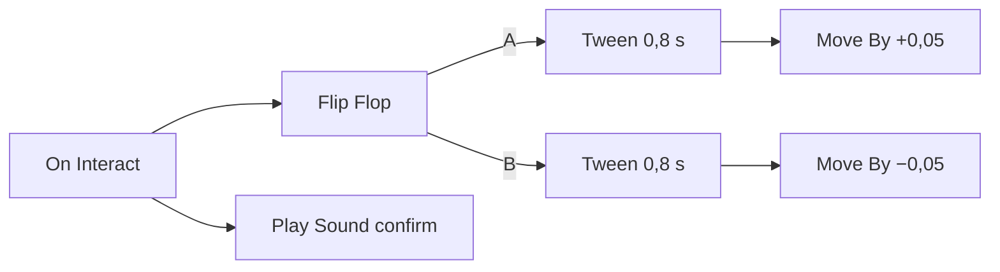

# 9 Logik-Graphen – programmieren mit Kästchen und Drähten

> **Dein Level:** Jetzt lernst du, wie Spiele „denken“: Türen, die aufgehen, Ampeln, die umschalten,
> Punkte für eine Zone. In Kern schreibst du dafür keinen Code, sondern verbindest Kästchen mit
> Drähten. Und du erfährst, wie Kern diese Bilder blitzschnell in Maschinencode verwandelt.

Kern hat **keine Skriptsprache**. Spiellogik sind **Graphen** wie die Blueprints der Unreal Engine:
Knoten (Kästchen) und Drähte. Ein Graph ist reine Beschreibung, jeder Knotentyp ist eine
C++-Funktion. Kern prüft den Graphen und führt ihn in den festen Simulationsschritten aus – nur dort,
wo das Spiel „die Wahrheit“ hat: im Einzelspiel oder auf dem Netzwerk-Server. Was er bewirkt, wird
an alle anderen Spieler weitergegeben.

Dabei gibt es **drei Stufen**: einen **Interpreter**, der den Graphen Knoten für Knoten abarbeitet;
einen **JIT**, der den Graphen beim Start von Play oder Simulate in WebAssembly übersetzt, woraus der
Browser Maschinencode macht; und einen **Export als lesbares C++**, das man ins Spiel einbauen kann.
Alle drei müssen exakt dasselbe Ergebnis liefern (9.9).

> **So kannst du es dir vorstellen:** wie Scratch – Bausteine statt Text. Nur stapelst du sie nicht,
> du verbindest sie mit Drähten.

## 9.1 Das Modell

- **Exec-Pins** (weiße Pfeile) sagen, was als Nächstes läuft. Ein **Event-Knoten** startet eine
  Kette, **Aktionen** setzen sie fort, **Flow-Knoten** verzweigen, wiederholen oder warten.
- **Daten-Pins** tragen Werte mit Typ. Eingänge **ziehen**: Rechenknoten (*pure*, etwa Mathe) werden
  erst ausgerechnet, wenn jemand ihren Wert braucht. Ausgänge von Aktionen behalten den Wert ihres
  letzten Laufs. Ein Eingang ohne Draht nimmt den Wert, der im Knoten eingetragen ist.
- **Variablen** gehören zum Graphen, haben einen Typ und einen Startwert.
- **State Machines** (Zustandsautomaten) haben Zustände und Übergänge. Ein Übergang feuert bei einem
  Event, nach einer Zeit, solange eine Bedingung wahr ist, oder sofort. Betreten und Verlassen lösen
  Events aus.
- **Latente Knoten** wie Delay und Tween pausieren die Kette und machen später weiter.

Das Level hat einen **Level-Graphen**, jeder Actor kann einen eigenen haben. Für ihn ist „Self“ der
Actor selbst.

Die Pin-Typen sind Exec, Bool, Int, Float, Vector, Text und Actor. Welche Drähte erlaubt sind:

- gleicher Typ immer, Exec nur mit Exec,
- **alles nach Text** („alles lässt sich ausdrucken“),
- Zahlen untereinander (Bool, Int, Float),
- Actor nach Bool („gibt es ihn?“),
- Zahl nach Vector (in alle drei Komponenten).

Die Umrechnungen sind festgelegt: Text „0“ oder „false“ ist falsch, ein Vektor als Zahl ist seine
Länge, eine Kommazahl als Int wird abgeschnitten (3,9 wird 3).

Gespeichert wird ein Graph als JSON im Level ([Kapitel 8](08-spiel-laufzeit.md)): Variablen, Knoten,
Drähte als `[von, Ausgang, zu, Eingang]`, State Machines und Kommentarrahmen.

## 9.2 Knoten und die Bibliothek

Jeder Knotentyp ist eine **Definition**: Schlüssel (etwa `flow.branch`), Titel, Kategorie, Hilfe,
Art (event, action, pure, flow), Pins, Einstellungen und die C++-Funktion `run`. Pins und Titel
können von Einstellungen abhängen („Every 3 s“).

`run` liefert zurück, **an welchem Exec-Ausgang** es weitergeht – oder „Stopp“ (die Kette endet) oder
„Warten“ (ein latenter Knoten macht später weiter). Über einen **Kontext** liest eine Knotenfunktion
ihre Eingänge, setzt Ausgänge, wartet, merkt sich Zustand und kommt an die Welt heran.

Kern bringt eingebaute Knoten mit; die Spiel-Knoten melden sich beim Programmstart selbst an. Ein
echtes Beispiel, der Knoten „Add Score“ (gekürzt):

```cpp
lib.add(action("game.add_score", "Add Score",
  "Game",
  {data("points", "Points", PinType::number, 10.0)},
  {},
  [](Context& c, GameWorld& w) {
    w.add_score(c.in_number("points")); },
  "Adds points ...", "points reward"));
```

Zeile 1–2: eine Aktion mit Schlüssel, Titel und Kategorie. Zeile 3: ein Zahleneingang „Points“, Standard
10. Zeile 4: keine Datenausgänge. Zeile 5–6: die Funktion liest „Points“ und gibt der Welt die
Punkte. Zeile 7: Hilfetext und Suchwörter. Den Exec-Eingang und den Ausgang „then“ ergänzt `action`
von selbst.

## 9.3 Prüfen

Bevor ein Graph läuft, sucht Kern **Fehler**: unbekannte Knoten, Einstellungen, die auf fehlende
Variablen oder Zustände zeigen, Drähte zu Pins, die es nicht gibt, falsche Typen, zwei Drähte in
einen Dateneingang, Rechenknoten, die von sich selbst abhängen, und State Machines ohne genau einen
Anfangszustand. Eine **Warnung** gibt es für Knoten, die nie laufen können.

Ein Graph mit Fehlern wird beim Start abgeschaltet und gemeldet, der Rest des Spiels läuft weiter.
Im Studio zeigt **Compile** (F7) das Ergebnis.

## 9.4 Ausführung

Eine **Runtime** führt alle Graphen einer Welt aus, jeder läuft als **Instanz** für seinen Besitzer.
Jede Instanz kennt ihre Stufe: Interpreter, „compiling“, „compiled (WebAssembly)“ oder „native C++“.

Im **Tick** jedes Schritts laufen erst fällige Wartezeiten weiter, dann das Event „Tick“, dann die
Übergänge der State Machines. Ein **Event** geht an alle passenden Instanzen.

Der Interpreter arbeitet mit einem **Stapel**. Merkt sich ein Knoten etwas für später vor (eine
Sequence ihre weiteren Ausgänge), kommt es auf den Stapel. Endet ein Zweig, geht es mit dem obersten
Eintrag weiter.

> **So kannst du es dir vorstellen:** ein Stapel Hausaufgabenzettel. Du arbeitest die aktuelle
> Aufgabe ab. Fällt dir unterwegs ein „danach noch Mathe“, legst du den Zettel oben drauf. Bist du
> fertig, nimmst du den obersten.

Daten werden bei jedem Lesen gezogen, bis zu 48 Rechenknoten tief.

**Schutz vor Endlosschleifen:**

- Mehr als **200 000** Knoten in einem Schritt: Die Instanz wird abgeschaltet („infinite loop? The
  graph is stopped.“).
- Events, die Events auslösen, dürfen höchstens 64 tief verschachteln.
- Im kompilierten Code stoppen mehr als 512 verschachtelte Schleifen.

> **Vorsicht, Falle:** Ein While Loop, dessen Bedingung nie falsch wird, friert in vielen Engines das
> ganze Spiel ein. In Kern stoppt nur dein Graph – mit Meldung. Lies sie im Output Log!

**State Machines:** Beim Start betritt jede ihren Anfangszustand. Pro Maschine und Prüfung feuert
höchstens **ein** Übergang, automatische Ketten gehen also einen Zustand pro Schritt weiter. Ein
Übergang „aus jedem Zustand“ führt nie in seinen Zielzustand selbst zurück. Mit Set State springt
man direkt.

## 9.5 Kern-Knoten

Kern bringt **76** eingebaute Knoten mit:

| Kategorie | Beispiele |
|---|---|
| Events | Begin Play, Event Tick, Every N Seconds, Custom Event |
| State Machines | On State Entered/Left, Set State, Current State |
| Flow | Branch, Sequence, For, While, Do Once, Do N, Gate, Flip Flop, Delay, Tween, Switch |
| Variablen | Get, Set, Add |
| Mathe | plus, minus, mal, geteilt, Rest, sin/cos (Grad), Wurzel, Zufall |
| Logik | Compare, AND, OR, XOR, NOT, Select |
| Vektor | Make, Break, Länge, Abstand, Skalarprodukt, Kreuzprodukt |
| Text, Werte | Append, Contains, Literale |
| Utilities | Game Time, Print |

**Tween** zählt in einer Dauer weich von 0 bis 1, **Gate** ist eine Tür für die Kette. **Zufall**
kommt von der Welt und ist **deterministisch** – Wiederholungen und Netz stimmen überein.

## 9.6 Spiel-Knoten

Dazu kommen **71** Spiel-Knoten. Ein Actor-Eingang ohne Draht bedeutet „Self“.

**Events:** On Begin/End Overlap (etwas betritt oder verlässt den Sensor), On Entered Sensor, On Hit
(Aufprall ab 2 m/s), On Collected, On Trigger, On Damaged, On Death, On Respawn, On Interact (Taste F
oder Y am Gamepad, Blick auf den Actor bis 3 m oder ein Actor in 2 m Nähe), On Player Joined, On Game
Over, On Input Action und On Key. Eine Überlappung zählt den Besucher als Ganzes: Kapsel und Kopf
eines Spielers sind ein Besucher.

**Actors:** Self, Get Player, Find Actor by Name oder Tag, Ort, Drehung, Bewegen, Spawn Actor
(Kopie einer Vorlage), Destroy und Set Property, das jeden Komponentenwert über seinen Pfad ändert,
etwa `components.mesh.material.color`.

**Physik:** Tempo, Stoß, Kraft, Launch, Physik an/aus, Gelenkmotor, Explosion, Line Trace.

**Spiel und Effekte:** Punkte, Show Message, Win, Lose, Schaden, Heilen, Munition, Licht, Farbe,
Funken, Kamerawackeln, Play Sound.

**Roboter:** Die Micro Duck lässt sich lenken (vorwärts bis 0,4 m/s, drehen bis 57° pro Sekunde –
die trainierten Bereiche), den Kopf drehen, Bewegungen auslösen (Sitzen, Aufheben, Kicks, Rolle,
Sprung), zwitschern, und man kann ihren Abstandssensor (ToF) und ihre Kamera abfragen. Einzelheiten:
[Kapitel 13](13-micro-duck.md).

> **Mission:** Öffne auf https://kernengine.de/ ein **Basic**-Level und klicke in der Toolbar auf
> **Logic**. Klicke **Begin Play**, zieh vom Ausgang „then“ einen Draht ins Leere, tippe „show
> message“, Enter, und trage einen Text ein. Zurück mit **Viewport**, platziere einen **Rolling
> Ball** und drück **Play**. Dein Text erscheint im HUD!

## 9.7 Logik in der GameWorld

Die GameWorld startet Logik nur in Play oder Simulate, nur auf dem Rechner mit „der Wahrheit“ und
nur, wenn es Graphen gibt. Dann bekommt jeder Graph seine Instanz.

Die Welt liefert der Logik die **Zeit** (Simulationszeit, nicht die Wanduhr), **Ausgaben** („Logic:
…“ im Output Log) und **Zufall** mit festem Startwert.

Ein Ereignis geht an den Graphen des betroffenen Actors – oder, wenn der keinen hat, an den seines
nächsten Vorfahren mit Graph. Der Collider einer Tür meldet sich also bei der Tür. Der Level-Graph
bekommt jedes Ereignis zusätzlich. Der Logik-Tick läuft am Ende jedes Schritts nach der Physik.
Damit Graphen überhaupt etwas mitbekommen, schaltet Kern mit Logik die Überlappungs- und
Treffermeldungen für alle beweglichen Körper ein.

Was Logik ändert – Werte, neue Kopien, versetzte Körper –, wird mitgeschrieben. Der Server schickt
es an alle, auch an Spieler, die später dazukommen ([Kapitel 10](10-netzwerk.md)).

## 9.8 Vom Graphen zu Maschinencode

Kern hat zwei Übersetzer mit **demselben Plan**: einen für WebAssembly (der Browser macht daraus
Maschinencode, der die C++-Knoten der Engine direkt aufruft) und einen für C++-Quelltext.

Direkt übersetzt werden Kontrollfluss, Zahlenvariablen, Mathe und Vergleiche. **Alles andere**
ruft die C++-Funktion des Knotens auf.

Der Zustand liegt an festen Speicherplätzen: Fächer für Zahlenvariablen, acht Fächer je Knoten
(Schleifenzähler, offene Gates, Ergebnisse), ein Stapel mit 512 Plätzen und Zähler fürs Budget.

Das erzeugte Programm ist **eine Schleife mit einem Programmzähler** und einem Fall je Knoten. Jeder
Durchlauf zählt mit; über dem Budget meldet es eine Endlosschleife. Im C++-Export ist das eine
Endlosschleife `for (;;)` mit einem `switch (pc)` darin.

Der exportierte Code meldet sich mit einem **Fingerabdruck** (*Hash*) des Graphen an. In den Hash
gehen Positionen und Kommentare nicht ein. Knoten verschieben macht den Export also nicht ungültig,
jede inhaltliche Änderung schon – dann musst du neu exportieren.

**Im Browser:** Beim Start prüft Kern den Graphen. Gibt es eingebauten C++-Code für seinen Hash,
gewinnt der. Sonst übersetzt der Browser das WebAssembly-Modul im Hintergrund. Bis es fertig ist,
läuft der Graph im **Interpreter**, danach ruft Kern direkt den Maschinencode auf. Schlägt das
Übersetzen fehl, bleibt der Interpreter.

> **Krass, aber wahr:** Der übersetzte Graph ist etwa **55-mal schneller** als der Interpreter.
> Gemessen wird das mit einer Million Schleifendurchläufen.

## 9.9 Warum alle drei Stufen gleich rechnen müssen

Die Stufen werden **mitten im Spiel** getauscht. Ein Graph beginnt im Interpreter – Begin Play, die
ersten Ticks, laufende Zähler – und wechselt in den Maschinencode, sobald der fertig ist. Deshalb
liegt der Zustand in **denselben Speicherfächern**, die auch der erzeugte Code benutzt. Beim Wechsel
muss nichts umkopiert werden.

Außerdem ist Kern deterministisch ([Kapitel 6](06-physik.md)): Rechnete der Browser anders als der
Interpreter, wären Wiederholungen, Training und Fehlersuche wertlos. Auch das Budget zählt überall
gleich, und Breakpoints funktionieren auch im übersetzten Code.

Geprüft wird das mit denselben Testfällen in allen drei Stufen (Schleifen, Gates, verschachtelte
While Loops, State Machines, Endlosschleife …). Ergebnis muss **identisch** sein. Wer einen Knoten
ändert, muss ihn darum an drei Stellen gleich ändern.

## 9.10 Bearbeiten im Studio

Der Logik-Editor sieht aus wie Unreals Blueprint-Editor; die Oberfläche beschreibt
[Kapitel 11](11-studio.md). Die Webseite zeichnet nur. Jede Bearbeitung ist ein Befehl an die Engine
und **ein Undo-Schritt** im Level.

Du suchst Knoten im **Aktionsmenü** (zieht man von einem Pin, erscheinen nur passende), setzt sie
aufs 8-px-Raster, verbindest, legst Variablen und State Machines an, machst einen Pin zur Variable
(„Promote to Variable“), fügst per Doppelklick auf einen Draht einen Umleitungsknoten ein, prüfst,
exportierst C++ und setzt mit **F9** Breakpoints: Läuft der Knoten, hält das Spiel nach dem Schritt
an, und der Editor springt hin. Beim Spielen siehst du live, welche Knoten liefen und welche Werte
die Variablen haben.

> **Mission:** Füge im Level-Graphen deines Levels mit dem Rolling Ball über **Templates** die
> Vorlage **Traffic light (state machine)** ein und drück **Play**: Das HUD zeigt Grün, Gelb, Rot.
> Wähle dann im Graphen einen Knoten, setze mit **F9** einen Breakpoint und spiel erneut – das Spiel
> hält an, sobald der Knoten läuft.

## 9.11 Beispiele

Alle sind echte Graphen aus Kern, die meisten auch als Vorlage.

**Punktezone:** On Begin Overlap → Add Score (10) → Show Message („+10“) → Play Sound (pickup).

**Tür:**



Interact wechselt zwischen Öffnen und Schließen. Jeder Tween läuft 0,8 s und schiebt die Tür jeden
Schritt um 5 cm. Bei 60 Schritten pro Sekunde sind das rund 48 Schritte, also etwa 2,4 m.

**Spawner:** Alle 3 s, solange „Spawned“ unter 10 liegt: einen Physics Cube bei (0, 0, 6) erzeugen und
„Spawned“ um 1 erhöhen.

**Ampel:** Eine State Machine: Grün → (4 s) → Gelb → (1,5 s) → Rot → (4 s) → Grün. Beim Betreten
jedes Zustands wird sein Name angezeigt.

**Hindernis ausweichen:** Die Micro Duck läuft nicht mehr allein. Alle 0,25 s: Sieht ihr ToF etwas
näher als 1,6 m, dreht sie 0,6 s auf der Stelle, sonst geht sie geradeaus.

**Die Ente zwitschert beim Ball:** Im Level Micro Duck fragt ein Graph alle 0,25 s: Sieht die
Kopfkamera den Ball, und hat sie ihn vorher **nicht** gesehen? Dann zwitschert sie. Eine
Variable „Ball Seen“ merkt sich den letzten Stand, sonst ginge das Zwitschern alle 0,25 s los. Ein
Kommentar im Graphen sagt: Das ist eine Demo, kein Verhalten des echten Roboters.

> **Mission:** Öffne File › Example Levels › **Micro Duck** und dort den Level-Graphen (**Logic**).
> Finde die Variable „Ball Seen“ und den Branch. Starte Play und roll der Ente den Ball vor die
> Kamera.

## Level geschafft!

- Du kennst Exec-Pins, Daten-Pins, Variablen und State Machines.
- Du weißt, welche Drähte erlaubt sind und wie Werte umgewandelt werden.
- Du verstehst, wie der Interpreter mit einem Stapel arbeitet.
- Du weißt, wie Kern Endlosschleifen abfängt.
- Du kennst die drei Stufen Interpreter, WebAssembly und C++ und weißt, warum sie gleich rechnen
  müssen.
- Du kannst im Studio einen eigenen Graphen bauen und debuggen.

## Rätsel-Ecke

1. Was zeigt ein Draht zwischen zwei Exec-Pins an?
2. Darf man einen Actor-Ausgang mit einem Text-Eingang verbinden?
3. Ein Text-Eingang bekommt die Zahl 3,9, ein Int-Eingang auch. Was kommt jeweils an?
4. Du verschiebst nach dem C++-Export ein paar Knoten. Musst du neu exportieren?
5. **Boss-Rätsel:** Ein Custom Event führt bei jedem Aufruf 4000 Knoten aus. Wie oft darf es in
   einem Schritt laufen, bevor Kern den Graphen abschaltet?

### Lösungen

1. Die Reihenfolge: was als Nächstes läuft.
2. Ja. Alles lässt sich in Text umwandeln.
3. Beim Text kommt die Zahl als Text an, beim Int wird abgeschnitten: 3.
4. Nein. Positionen zählen nicht zum Hash. Erst eine inhaltliche Änderung verlangt einen neuen
   Export.
5. 200 000 / 4000 = 50-mal. Beim 51. Mal wäre das Budget überschritten.

---

© 2026 Christian Heinrich Hohlfeld · Alle Rechte vorbehalten · [Impressum und Rechte](00-impressum.md)
