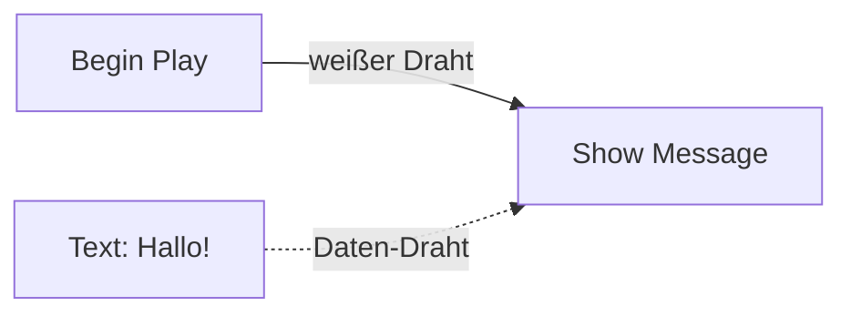
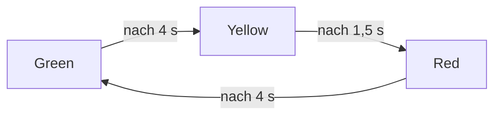
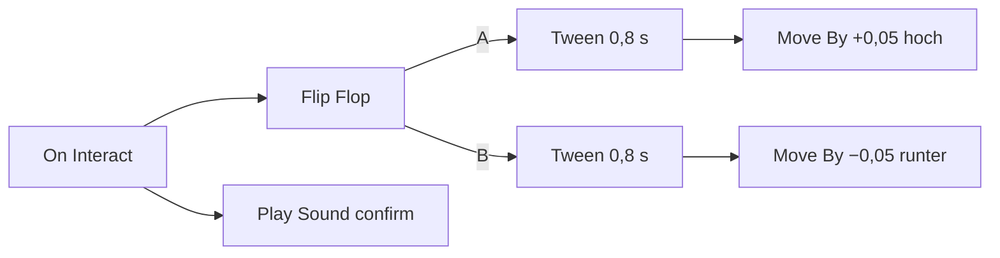

# 9 Logik-Graphen – programmieren mit Kästchen und Drähten

> **Dein Level:** Jetzt lernst du, wie Spiele „denken“: Türen, die aufgehen, Ampeln, die umschalten,
> Punkte für eine Zone. In Kern schreibst du dafür keinen Code, sondern verbindest Kästchen mit
> Drähten. Und du erfährst, wie Kern diese Bilder im Hintergrund blitzschnell macht.

> **Wörter, die du brauchst:**
> - **Graph** – ein Bild aus Kästchen und Verbindungslinien.
> - **Knoten** – ein Kästchen im Graphen, das eine Sache tut oder etwas ausrechnet.
> - **Pin** – ein Anschluss am Rand eines Knotens, an den ein Draht kommt.
> - **Event** – ein Ereignis, das etwas in Gang setzt, etwa „Spiel beginnt“ oder „etwas berührt mich“.
> - **Variable** – ein beschriftetes Fach im Speicher, in dem sich der Graph einen Wert merkt.
> - **Schritt** – ein fester Rechenschritt der Simulation, meist 60 pro Sekunde
>   ([Kapitel 8](08-spiel-laufzeit.md)).
> - **Server** – im Mehrspieler der eine Computer, der entscheidet, was wirklich passiert.
> - **deterministisch** – bei gleichen Eingaben kommt immer genau dasselbe heraus.

> **So kannst du es dir vorstellen:** wie Scratch – Bausteine statt Text. Nur stapelst du sie nicht,
> du verbindest sie mit Drähten.

Kern hat **keine Skriptsprache**, in die man Text tippt. Spiellogik sind **Graphen**, gebaut wie die
Blueprints der Unreal Engine: Knoten und Drähte. Hinter jedem Kästchen steckt ein kleines Stück
Programm in der Engine. Kern prüft deinen Graphen und führt ihn in den festen Schritten der
Simulation aus.

**Wo läuft die Logik?** Nur dort, wo das Spiel **„die Wahrheit hat“**. Spielst du allein, ist das dein
Computer. Im Mehrspieler ist es nur der **Server**. Er rechnet die Logik, und die Mitspieler bekommen
das Ergebnis geschickt: Geht die Tür auf, sehen alle sie offen. So kann es nie passieren, dass sie bei
dir offen und bei deinem Freund zu ist.

**Wie läuft die Logik?** Dafür hat Kern drei Stufen, die alle genau dasselbe tun, nur verschieden
schnell:

> **So kannst du es dir vorstellen:** ein Buch in einer fremden Sprache.
> - **Vorlesen:** Ein Dolmetscher liest Satz für Satz und übersetzt jeden Satz in dem Moment, in dem
>   er ihn vorliest. Das klappt sofort, ist aber langsam.
> - **Übersetzen:** Das Buch wird einmal ganz übersetzt. Danach liest man es direkt, viel schneller.
>   Nur das Übersetzen selbst dauert einen Moment.
> - **Gedruckt mitliefern:** Die fertige Übersetzung wird gleich mit ins Spiel gepackt.

Liegt dem Spiel schon eine gedruckte Übersetzung bei, nimmt Kern gleich die. Sonst beginnt Kern
mit dem Vorlesen, übersetzt im Hintergrund und wechselt dann um. Wie das geht und warum dabei kein
einziges Ergebnis anders sein darf, steht in 9.8 und 9.9.

## 9.1 Das Modell

Ein Graph hat zwei Arten von Drähten. **Weiße Drähte** (zwischen den **Exec-Pins**) sagen, **was als
Nächstes passiert**. **Farbige Drähte** (zwischen den **Daten-Pins**) tragen **Werte**, zum Beispiel
eine Zahl oder einen Text.

Lies das Bild so: Wenn das Spiel beginnt, läuft Show Message. Woher kommt der Text? Über den
Daten-Draht vom Textkästchen.

- Ein **Event-Knoten** startet eine Kette, etwa Begin Play. **Aktionen** setzen sie fort, etwa Show
  Message. **Flow-Knoten** verzweigen (Branch: wenn … dann …), wiederholen oder warten.
- **Rechenknoten** wie Plus oder Mal haben keine weißen Pins. Sie rechnen erst, wenn ein anderer
  Knoten ihr Ergebnis gerade braucht, so wie du einen Taschenrechner erst benutzt, wenn du das
  Ergebnis brauchst. Und sie rechnen **jedes Mal neu**, wenn jemand fragt. Ein Eingang ohne Draht
  nimmt den Wert, der im Knoten eingetragen ist.
- **Aktionen** dagegen rechnen nur, wenn der weiße Draht sie startet. Manche geben dabei einen Wert
  aus, zum Beispiel liefert **Spawn Actor** die neue Kopie. Diesen Wert **behält** der Ausgang, bis
  die Aktion das nächste Mal läuft. Liest du ihn später, bekommst du das Ergebnis vom letzten Lauf.
  So wie ein Kassenzettel: Er zeigt den letzten Einkauf, nicht den, den du gerade vorhast. Darum
  kann ein solcher Wert „alt“ sein, ein Rechenknoten dagegen nie.
- **Variablen** gehören zum Graphen, haben einen Typ und einen Startwert.
- **Wartende Knoten** wie **Delay** (warte ein paar Sekunden) und **Tween** (zähle in einer Zeit weich
  von 0 bis 1, damit lässt du zum Beispiel ein Tor in 0,8 Sekunden weich aufgehen, siehe 9.11) halten
  die Kette an und machen später weiter. Ruft man ein wartendes Delay noch einmal auf, überhört es
  das. Die Variante **Retriggerable Delay** fängt dann stattdessen von vorn an zu warten. Damit baust
  du zum Beispiel ein Licht, das 5 Sekunden nach der **letzten** Bewegung ausgeht: Jede neue Bewegung
  startet das Warten neu.
- **Kommentarrahmen** ordnen den Graphen für dich. Auf das Spiel wirken sie nicht.

Das Level hat einen **Level-Graphen**, und jeder Actor kann einen eigenen haben. Für ihn ist „Self“
der Actor selbst.

### Zustandsautomaten am Beispiel Ampel

Eine Ampel ist immer in genau **einem Zustand**: Grün, Gelb oder Rot. Nach einer Zeit wechselt sie in
den nächsten. Genau das ist eine **State Machine** (Zustandsautomat).

Die Pfeile heißen **Übergänge**. Ein Übergang kann auf vier Arten auslösen: bei einem bestimmten
Event, nach einer Zeit (wie bei der Ampel), solange eine Bedingung wahr ist, oder sofort, also beim
nächsten Schritt (mehr dazu in 9.4). Ein Übergang kann auch **aus jedem Zustand** starten. Das ist
praktisch für einen Not-Aus: Du könntest einen Übergang bauen, bei dem ein Event „Störung“ die Ampel
sofort auf Rot schaltet, egal ob sie gerade Grün oder Gelb zeigt. Betritt oder verlässt die
Maschine einen Zustand, gibt es dafür ein Event. Daran hängst du Aktionen, etwa
„zeige den Namen des neuen Zustands an“. Genau diese Ampel gibt es als Vorlage (Mission in 9.10).

### Die Datentypen

Jeder Daten-Pin hat einen **Typ**. Scratch kennt Zahl, Text und wahr/falsch. Kern unterscheidet
genauer:

| Typ | bedeutet | Beispiel |
|---|---|---|
| Exec | „jetzt weiter“, kein Wert | der weiße Draht |
| Bool | wahr oder falsch | „Tür offen?“ |
| Int | ganze Zahl | 3, −7, 120 |
| Float | Kommazahl | 3,9 oder 0,25 |
| Vector | drei Zahlen x, y, z | eine Position (5, −12, 1,5) |
| Text | Buchstaben und Zeichen | „Hallo!“ |
| Actor | ein Ding im Level | die Tür, der Spieler |

Ein Vector ist wie ein Pfeil im Raum. Er hat auch eine **Länge**. Zeichne den Pfeil (3, 4, 0) auf
Karopapier: 3 Kästchen nach rechts, 4 nach oben. Miss die schräge Linie vom Start bis zur Spitze
mit dem Lineal: Sie ist genau 5 Kästchen lang.

> **Für Profis:** Ausrechnen kannst du die Länge mit dem Satz des Pythagoras:
> √(3² + 4²) = √(9 + 16) = √25 = 5. Bei drei Zahlen kommt einfach z² dazu.

**Welche Drähte sind erlaubt?**

- gleicher Typ immer, ein weißer Exec-Draht nur mit Exec,
- **alles nach Text** („alles lässt sich ausdrucken“),
- Zahlen untereinander (Bool, Int, Float),
- Actor nach Bool („gibt es ihn?“),
- Zahl nach Vector (die Zahl kommt in alle drei Stellen).

Die Umwandlungen sind genau festgelegt: Der Text „0“ oder „false“ wird zu falsch, ein Vector als Zahl
ist seine Länge (beim Pfeil oben also 5), eine Kommazahl als Int wird abgeschnitten (3,9 wird 3,
nicht gerundet).

## 9.2 Knoten und die Bibliothek

Hinter jedem Kästchen steckt ein kleines Stück Programm in der Engine. Alle Knotentypen zusammen
bilden die **Bibliothek**. Jeder Typ hat dort eine Beschreibung: Titel, Kategorie, Hilfetext, seine
Pins und Einstellungen. Das Aktionsmenü im Editor durchsucht genau diese Bibliothek. So kennt der
Editor automatisch jeden Knoten, den die Engine kann. Ein neuer Knoten ist nur ein neuer Eintrag in
der Bibliothek, und schon taucht er im Menü auf.

Wenn ein Knoten gelaufen ist, sagt er, wie es weitergeht: an welchem weißen Ausgang (ein Branch nimmt
**True** oder **False**), ob die Kette hier endet oder ob er erst einmal wartet.

Wie ein Knoten im Programm genau aussieht, steht im blauen Buch, Kapitel 9.

## 9.3 Prüfen

Bevor ein Graph läuft, sucht Kern nach **Fehlern**: unbekannte Knoten, Drähte zu Pins, die es nicht
gibt, Typen, die nicht zusammenpassen, zwei Drähte in denselben Dateneingang (welcher Wert sollte
dann gelten?), Einstellungen, die auf eine Variable zeigen, die es nicht gibt, oder eine State
Machine ohne genau einen Anfangszustand. Ein Fehler ist auch ein **Kreis aus Rechenknoten**: Braucht
Plus das Ergebnis von Mal, und Mal wieder das Ergebnis von Plus, würde jeder auf den anderen warten,
und keiner käme je zu einem Ergebnis.
Eine **Warnung** gibt es für Knoten, die nie laufen können, weil kein weißer Draht zu ihnen führt.

Ein Graph mit Fehlern wird beim Start abgeschaltet und gemeldet. Der Rest des Spiels läuft weiter.
Im Studio zeigt **Compile** (F7) das Ergebnis.

## 9.4 Ausführung

Jeder Graph läuft für seinen **Besitzer**: ein Actor oder das Level. Spawnst du zehn Kopien einer
Kiste mit Graph, laufen zehn eigene Ausführungen, jede mit ihren eigenen Variablen. Wie zehn Schüler,
die alle dasselbe Arbeitsblatt bekommen, aber jeder schreibt in sein eigenes.

**In jedem Schritt** passiert der Reihe nach: Wartende Knoten, deren Zeit um ist, machen weiter. Dann
kommt das Event **Tick**. Dann prüfen die State Machines ihre Übergänge. Ein **Event** wie „etwas
überlappt“ geht an alle passenden Graphen, auch an die von Actors, die gerade erst entstanden sind.

Eigene Events baust du mit **Custom Event**: Du gibst ihm einen Namen, und ein **Call Event** mit
diesem Namen löst es aus, in allen Graphen oder nur beim Ziel-Actor. Derselbe Name kann auch einen
Übergang einer State Machine schalten.

**Der Stapel.** Manche Knoten haben mehrere Ausgänge nacheinander, etwa **Sequence** („erst das,
dann das, dann das“). Kern macht den ersten sofort und legt sich die anderen auf einen **Stapel**.
Endet ein **Zweig** (eine Kette aus weißen Drähten, nach der nichts mehr kommt), nimmt es den
obersten Eintrag vom Stapel und macht dort weiter. Schleifen benutzen denselben Stapel: Kern legt
sich die Schleife selbst als Zettel oben drauf, führt einmal den Inhalt aus und kommt danach zur
Schleife zurück, um zu prüfen, ob noch eine Runde fällig ist.

> **So kannst du es dir vorstellen:** ein Stapel Hausaufgabenzettel. Du arbeitest die aktuelle
> Aufgabe ab. Fällt dir unterwegs ein „danach noch Mathe“, legst du den Zettel oben drauf. Bist du
> fertig, nimmst du den obersten.

**Schutz vor Endlosschleifen:** Kern zählt mit, wie viele Knoten ein Graph in einem Schritt ausführt.
Sind es mehr als **200 000**, schaltet Kern diesen Graphen ab und meldet „infinite loop? The graph is
stopped.“ Ebenso stoppt eine Kette, wenn Events immer wieder neue Events auslösen: Event A ruft
Event B, B ruft wieder A, A wieder B, und so weiter. Wird diese Kette zu lang, bricht Kern sie ab.

> **Vorsicht, Falle:** Ein While Loop, dessen Bedingung nie falsch wird, friert in vielen Engines das
> ganze Spiel ein. In Kern stoppt nur dein Graph – mit Meldung. Lies sie im **Ausgabeprotokoll**
> (Output Log)!

**State Machines im Takt:** Beim Start betritt jede Maschine ihren Anfangszustand. Pro Schritt darf
jede Maschine **höchstens einen** Übergang machen. Warum? Gäbe es „sofort“-Übergänge von Gelb nach
Rot und von Rot zurück nach Gelb, könnte die Maschine sonst in einem einzigen Schritt endlos
hin- und herspringen. Hätte die Ampel einen Übergang „sofort“ von Gelb nach Rot, stünde sie also
trotzdem einen Schritt lang auf Gelb. Mit **Set State** springst du direkt in einen Zustand.

> **Für Profis:** Daten-Drähte werden bei jedem Lesen neu ausgerechnet, durch höchstens 48
> Rechenknoten hintereinander. Die übrigen Grenzen stehen im blauen Buch, Kapitel 9.

## 9.5 Kern-Knoten

Kern bringt **76** eingebaute Knoten mit:

| Kategorie | Beispiele |
|---|---|
| Events | Begin Play, Event Tick, Every N Seconds, Custom Event |
| State Machines | On State Entered/Left, Set State, Current State |
| Flow | Branch, Sequence, For, While, Do Once, Do N, Gate, Flip Flop, Delay, Tween, Switch |
| Variablen | Get, Set, Add |
| Mathe | plus, minus, mal, geteilt, Rest, Wurzel, Zufall, Rechnen mit Winkeln |
| Logik | Compare, AND, OR, XOR, NOT, Select |
| Vektor | zusammenbauen, zerlegen, Länge, Abstand |
| Text, Werte | Append, Contains, feste Werte |
| Utilities | Game Time, Print |

Viele Namen sind englisch. Was aus Scratch bekannt ist:

- **For** = „wiederhole mit Zähler“, **While** = „wiederhole, solange …“.
- **Switch** = je nach Zahl oder Text einer von mehreren Ausgängen, wie eine Weiche mit vielen
  Gleisen.
- **AND, OR, NOT** = „und“, „oder“, „nicht“. **XOR** = „entweder – oder, aber nicht beides“.
- **Append** = Texte aneinanderhängen, **Contains** = „enthält der Text …?“.

Ein paar Flow-Knoten erklärt: **Do Once** lässt nur beim ersten Mal durch, **Do N** genau N-mal.
**Gate** ist eine Tür für die Kette, die man öffnen und schließen kann. **Flip Flop** nimmt
abwechselnd Ausgang A und B, wie ein Lichtschalter. **Select** wählt je nach wahr oder falsch einen
von zwei Werten.

**Zufall** kommt von der Welt und ist **deterministisch**: Er beginnt bei jedem Start desselben Levels
mit derselben Startzahl.
So stimmen Wiederholungen und alle Mitspieler im Netz überein.

## 9.6 Spiel-Knoten

Dazu kommen **71** Spiel-Knoten. Ein Actor-Eingang ohne Draht bedeutet „Self“.

**Events:** On Begin/End Overlap (etwas betritt oder verlässt den Sensor), On Entered Sensor, On Hit
(Aufprall ab 2 m/s), On Collected, On Trigger, On Damaged, On Death, On Respawn, On Interact (Taste F
oder Y am Gamepad, wenn du den Actor anschaust oder direkt daneben stehst), On Player Joined, On Game
Over, On Input Action und On Key. Eine Überlappung zählt den Besucher als Ganzes: Körper und Kopf
eines Spielers sind ein Besucher.

Begin Overlap und Entered Sensor klingen gleich, kommen aber von verschiedenen Seiten. **On Begin
Overlap** meldet der Sensor selbst: „Jemand ist in mich hineingekommen.“ **On Entered Sensor**
meldet der Besucher: „Ich bin in einen fremden Sensor gekommen.“ Ein Ziel-Feld benutzt also das
erste, eine Spielfigur, die auf jedes Feld reagieren soll, das zweite.

**Actors:** Self, Get Player, Find Actor by Name oder Tag, Ort, Drehung, Bewegen, Spawn Actor (eine
Kopie einer Vorlage), Destroy und Set Property. Set Property ändert jeden Wert, den du auch in
**Details** einstellen kannst, etwa die Farbe.

**Physik:** Tempo, Stoß, Kraft, Hochschleudern, Physik an/aus, Gelenkmotor, Explosion und **Line
Trace**, ein Prüfstrahl, der meldet, was er zuerst trifft. Stoß und Kraft unterscheiden sich wie in
[Kapitel 6](06-physik.md): Ein **Stoß** ist ein einmaliger Schubs, wie ein Tritt gegen einen Ball.
Eine **Kraft** schiebt nur einen Schritt lang. Soll sie länger schieben, rufst du sie in jedem
Schritt neu auf, etwa bei Tick.

**Spiel und Effekte:** Punkte, Show Message, Win, Lose, Schaden, Heilen, Munition, Licht, Farbe,
Funken, Kamerawackeln, Play Sound und For Each Actor with Tag.

**Was alle sehen und was nur einer.** Logik läuft im Mehrspieler nur auf dem Server (Kapitelanfang).
Manche Knoten wirken trotzdem bei allen: Eine **Show Message** sehen alle Spieler. **Camera Shake**
wackelt dagegen nur die Kamera des Computers, auf dem die Logik läuft. Stellt dein Freund den
Server und du spielst mit, wackelt also nur seine Kamera, deine nicht. Bei Tasten ist es ähnlich:
**On Key** hört nur auf die Tastatur dieses Computers, also auf den Spieler, der dort sitzt. **On Input Action** („springen“, „feuern“ …)
meldet dagegen jeden Spieler, egal mit welchem Gerät. Für Mehrspieler-Spiele ist On Input Action
also die richtige Wahl.

**Roboter:** Die Micro Duck lässt sich lenken (in den Grenzen, die ihr Netz trainiert hat), den Kopf
drehen, Bewegungen auslösen (Sitzen, Aufheben, Kicks, Rolle, Sprung), zwitschern („Chirp“), den
Schnabel bewegen, die Autonomie an- und ausschalten. Man kann ihren Abstandssensor (**ToF**, misst wie
weit das Nächste vor ihr ist), ihre Kamera und ihren Zustand abfragen. Einzelheiten:
[Kapitel 13](13-micro-duck.md).

> **Mission:** Öffne auf https://kernengine.de/ ein Level mit der Vorlage **Grundformen** (Basic) und
> klicke in der Werkzeugleiste auf **Logik** (Logic). Der Logik-Editor selbst bleibt auch auf Deutsch
> englisch. Klicke **Begin Play**, zieh vom Ausgang „then“ einen Draht ins Leere, tippe „show
> message“, Enter, und trage einen Text ein. Zurück mit **Viewport**, platziere eine
> **Rollende Kugel** (Rolling Ball) – sie ist dein Spieler: Ohne steuerbaren Actor startet das Spiel
> gar nicht – und drück **Spielen** (Play). Dein Text erscheint im HUD!

## 9.7 Logik in der GameWorld

Die GameWorld startet Logik nur beim **Spielen** (Play) oder **Simulieren** (Simulate), nur auf dem
Computer, der die Wahrheit hat
(siehe Kapitelanfang), und nur, wenn es überhaupt Graphen gibt.

Die Welt gibt der Logik drei Dinge: die **Zeit**, die **Ausgabe** und den **Zufall**. Die Zeit ist
**Spielzeit**, gezählt in festen Schritten, nicht die Uhr an der Wand. Pausierst du das Spiel, steht
auch die Zeit der Logik. Und ein Graph tickt auf einem langsamen Computer genauso wie auf einem
schnellen. Was ein Graph ausgibt, erscheint als „Logic: …“ im **Ausgabeprotokoll** (Output Log).

Ein Ereignis geht an den Graphen des betroffenen Actors. Hat der keinen, sucht Kern beim Eltern-Actor
weiter, dann bei dessen Eltern-Actor und so weiter nach oben (diese ganze Reihe nennt man
**Vorfahren**, wie Eltern, Großeltern, Urgroßeltern). Der erste mit Graph bekommt das Ereignis. Hat
die Tür also ein angeschweißtes Kind ohne eigenen Graphen, etwa die Klinke, meldet sich die Klinke
bei der Tür. Der Level-Graph bekommt jedes Ereignis zusätzlich. Die Logik läuft am Ende jedes
Schritts, nach der Physik.

Damit Graphen überhaupt von Berührungen erfahren, schaltet Kern in Levels mit Logik die
Berührungsmeldungen der Physik für alle beweglichen Körper ein ([Kapitel 6](06-physik.md)). Ohne
Logik spart es sich diese Arbeit.

Was Logik ändert, etwa einen Wert, eine neue Kopie oder eine versetzte Wand, schreibt Kern mit. Der
Server schickt es an alle Mitspieler, auch an die, die erst später dazukommen
([Kapitel 10](10-netzwerk.md)).

## 9.8 Vom Graphen zu schnellem Code

Kern übersetzt deinen Graphen beim Start von **Spielen** (Play) oder **Simulieren** (Simulate)
**im Hintergrund** in schnellen Code.
Bis die Übersetzung fertig ist, läuft der Graph im langsamen „Vorlese“-Modus, aber schon richtig.
Danach ist er etwa **55-mal schneller**. Klappt das Übersetzen einmal nicht, bleibt es einfach beim
Vorlesen.

Übersetzt wird nicht jeder Knoten. Ein Übersetzer lässt Eigennamen ja auch stehen, statt „Berlin“
neu zu erfinden. Einfache Dinge wie Verzweigungen, Schleifen, Zahlen und Rechnungen werden direkt
übersetzt. Genau diese Teile laufen in Schleifen oft tausendfach. Für alles andere, etwa „Spawn
Actor“, ruft der übersetzte Code das fertige Programmstück des Knotens in der Engine auf. Diese
Programmstücke sind schon fertig übersetzter, schneller Code der Engine. Sie noch einmal zu
übersetzen, brächte nichts.

Einen Graphen kannst du auch **exportieren**, als fertigen Programmtext, der mit ins Spiel kommt.
Damit Kern weiß, zu welchem Graphen der Export gehört, bekommt er einen **Fingerabdruck** (*Hash*):
eine Zahl, die aus dem Inhalt des Graphen berechnet wird. Ändert sich der Inhalt, ändert sich die
Zahl. Positionen und Kommentare zählen nicht mit. Knoten verschieben macht den Export also nicht
ungültig, jede inhaltliche Änderung schon. Dann musst du neu exportieren. Gibt es zu einem Graphen
einen passenden Export, nimmt Kern gleich den.

> **Für Profis:** Das Übersetzen im laufenden Spiel heißt **JIT** („just in time“, gerade
> rechtzeitig). Kern übersetzt in **WebAssembly**, die Sprache, die der Browser blitzschnell in
> Maschinencode verwandelt. Der Export ist lesbares **C++**. Beide Übersetzer bauen dasselbe
> Programm: eine Schleife mit einem Zähler, der auf den gerade laufenden Knoten zeigt.

## 9.9 Warum alle drei Stufen gleich rechnen müssen

Der Wechsel vom Vorlesen zum übersetzten Code passiert **mitten im Spiel**. Ein Graph beginnt im
Vorlese-Modus, macht Begin Play, die ersten Ticks, zählt vielleicht schon eine Schleife hoch, und
dann übernimmt der schnelle Code.

> **So kannst du es dir vorstellen:** ein Staffellauf. Der zweite Läufer muss genau dort
> weiterlaufen, wo der erste aufgehört hat, mit demselben Stab in der Hand. Kern sorgt dafür, dass
> beide Stufen ihre Zahlen (Variablen, Schleifenzähler, offene Gates) am selben Platz im Speicher
> ablegen. Beim Wechsel muss nichts übergeben werden, der Stab liegt schon da.

Und Kern ist **deterministisch** ([Kapitel 6](06-physik.md)). Würde der übersetzte Code auch nur ein
winziges bisschen anders rechnen als das Vorlesen, liefe eine Wiederholung anders als das Original,
und beim Training der Ente oder bei der Fehlersuche könnte man den Ergebnissen nicht mehr trauen.
Auch die Grenze gegen Endlosschleifen zählt überall gleich, und Haltepunkte (9.10) funktionieren
auch im übersetzten Code.

Geprüft wird das mit **denselben Testfällen** in allen drei Stufen: Schleifen, Gates, verschachtelte
While Loops, State Machines, eine absichtliche Endlosschleife. Das Ergebnis muss **identisch** sein.

> **Für Profis:** Ein einfacher Knoten wie Branch steckt damit an drei Stellen: im Vorleser und in
> den beiden Übersetzern. Wer ihn ändert, muss ihn an allen drei Stellen gleich ändern. Genau dafür
> gibt es die gemeinsamen Testfälle: Vergisst man eine Stelle, schlägt der Test Alarm.

## 9.10 Bearbeiten im Studio

Der Logik-Editor sieht aus wie Unreals Blueprint-Editor; seine Oberfläche beschreibt
[Kapitel 11](11-studio.md). Der Editor selbst ändert nichts. Er zeichnet nur, was die Engine ihm
beschreibt, und schickt jede deiner Änderungen als Befehl an die Engine, wie ein Kellner, der
Bestellungen weitergibt. Die Engine führt die Änderung aus und schreibt sie in dieselbe Liste wie
jede andere Änderung am Level. Darum ist jede Bearbeitung **ein Undo-Schritt** im Level, und du
kannst alles mit Strg+Z zurücknehmen.

Der Logik-Editor bleibt auch in der deutschen Oberfläche englisch: Knöpfe wie **Compile** und
**Templates**, die Menüs und alle Knotennamen stehen darum hier so, wie Studio sie zeigt.

Du suchst Knoten im **Aktionsmenü**. Ziehst du dabei von einem Pin, zeigt es nur Knoten, die dazu
passen. Du verbindest Knoten, legst Variablen und State Machines an, prüfst mit **Compile** und
exportierst. Mit **Promote to Variable** an einem Pin legt Kern eine neue Variable vom passenden Typ
an und hängt sie gleich an diesen Pin. Mit **F9** setzt du einen **Breakpoint** (Haltepunkt):
Läuft der Knoten, hält das Spiel nach dem Schritt an, und der Editor springt hin. Beim Spielen
siehst du live, welche Knoten liefen und welche Werte die Variablen haben.

> **Mission:** Füge im Level-Graphen deines Levels mit der rollenden Kugel über **Templates** die
> Vorlage **Traffic light (state machine)** ein und drück **Spielen** (Play): Das HUD zeigt
> nacheinander Green, Yellow, Red. Stoppe mit **Esc**, klick im Graphen den Knoten
> **On State Entered** an, setze mit **F9** einen Breakpoint und drück wieder **Spielen**. Das Spiel
> hält an, sobald die Ampel einen Zustand betritt (gleich am Anfang bei Green), und der Editor zeigt
> den Knoten. Mit dem Knopf Resume in der Leiste über dem Graphen (der Logik-Editor bleibt englisch)
> geht es weiter, bis zum nächsten Wechsel.

## 9.11 Beispiele

Alle sind echte Graphen aus Kern, die meisten gibt es als Vorlage unter **Templates**.

**Punktezone:** On Begin Overlap → Add Score (10) → Show Message („+10“) → Play Sound (pickup). Wer
den Sensor betritt, bekommt 10 Punkte, eine Meldung und einen Ton.

**Tor** (Vorlage **Door that opens on Interact**):

Interact wechselt per Flip Flop zwischen Öffnen und Schließen. Jeder Tween läuft 0,8 s und schiebt
das Tor in jedem Schritt um 5 cm nach oben oder unten, wie ein Garagentor. Bei 60 Schritten pro
Sekunde sind das rund 48 Schritte, also etwa 2,4 m.

**Spawner:** Alle 3 s, solange die Variable „Spawned“ unter 10 liegt: einen Physik-Würfel in 6 m Höhe
erzeugen und „Spawned“ um 1 erhöhen. Die Kopien sehen alle Mitspieler.

**Ampel:** die State Machine aus 9.1. Beim Betreten jedes Zustands wird sein Name angezeigt.

**Hindernis ausweichen:** Die Micro Duck läuft nicht mehr allein. Alle 0,25 s: Sieht ihr ToF etwas
näher als 1,6 m, dreht sie 0,6 s auf der Stelle, sonst geht sie geradeaus.

**Die Ente zwitschert beim Ball:** Im Level Micro Duck fragt ein Graph alle 0,25 s: Sieht die
Kopfkamera den Ball, und hat sie ihn vorher **nicht** gesehen? Dann zwitschert sie. Eine Bool-Variable
„Ball Seen“ merkt sich den letzten Stand, sonst ginge das Zwitschern alle 0,25 s los, solange der Ball
im Bild ist. Ein Kommentar im Graphen sagt: Das ist eine Demo, kein Verhalten des echten Roboters.

> **Mission:** Öffne **Datei › Beispiel-Levels › Micro Duck** (File › Example Levels › Micro Duck)
> und dort den Level-Graphen mit dem Knopf **Logik** (Logic). Finde die Variable „Ball Seen“ und den
> Branch. Starte **Spielen** (Play). Das Spiel beginnt hier mit der freien Kamera: Greif den Ball mit der linken Maustaste und zieh ihn vor den Kopf der Ente. Sie zwitschert
> einmal, und erst wieder, wenn der Ball weg war und neu auftaucht.

## Level geschafft!

- Du kennst weiße Exec-Drähte, Daten-Drähte, Variablen und State Machines.
- Du weißt, was Bool, Int, Float und Vector sind, welche Drähte erlaubt sind und wie Werte umgewandelt
  werden.
- Du verstehst, wie Kern mit einem Stapel arbeitet und Endlosschleifen abfängt.
- Du weißt, warum Logik nur auf dem Computer mit der Wahrheit läuft.
- Du kennst die drei Stufen Vorlesen, Übersetzen und Mitliefern und weißt, warum sie gleich rechnen
  müssen.
- Du kannst im Studio einen eigenen Graphen bauen und mit Haltepunkten untersuchen.

## Rätsel-Ecke

1. Was zeigt ein weißer Draht zwischen zwei Knoten an?
2. Darf man einen Actor-Ausgang mit einem Text-Eingang verbinden?
3. Ein Text-Eingang bekommt die Zahl 3,9, ein Int-Eingang auch. Was kommt jeweils an?
4. Du verschiebst nach dem Export ein paar Knoten. Musst du neu exportieren?
5. **Boss-Rätsel:** Ein Custom Event führt bei jedem Aufruf 4000 Knoten aus, sonst läuft keine
   Logik. Wie oft darf es in einem Schritt laufen, bevor Kern den Graphen abschaltet?

### Lösungen

1. Die Reihenfolge: was als Nächstes passiert.
2. Ja. Alles lässt sich in Text umwandeln.
3. Beim Text kommt die Zahl als Text an, beim Int wird abgeschnitten: 3.
4. Nein. Positionen zählen nicht zum Fingerabdruck. Erst eine inhaltliche Änderung verlangt einen
   neuen Export.
5. 200 000 / 4000 = 50-mal. Das sind genau 200 000 Knoten, also noch erlaubt. Beim 51. Mal wäre die
   Grenze überschritten.

---

© 2026 Christian Heinrich Hohlfeld · Alle Rechte vorbehalten · [Impressum und Rechte](00-impressum.md)
