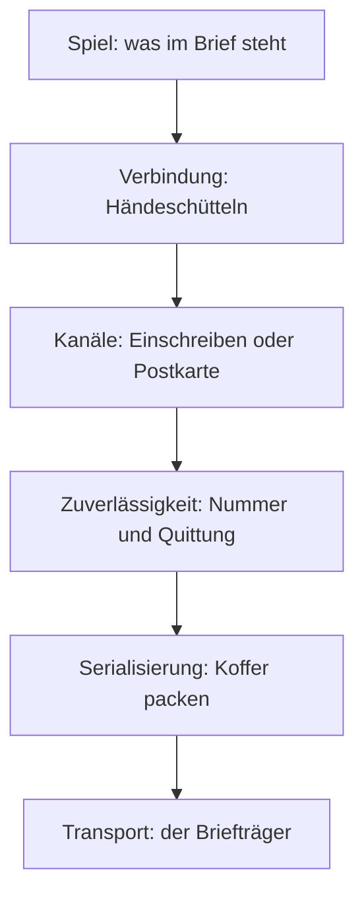

# 10 Zusammen spielen: Kern im Netz

> **Dein Level:** Wie können mehrere Spieler in derselben Welt unterwegs sein, obwohl das Internet
> Päckchen verliert und verspätet? Hier lernst du die Tricks, mit denen Kern das versteckt.

> **Wörter, die du brauchst:**
> - **Server** – der Rechner, der das Spiel leitet und entscheidet, was wirklich passiert.
> - **Client** – ein Mitspieler, der sich mit dem Server verbindet.
> - **Datagramm** – ein einzelnes kleines Datenpäckchen, das ohne Garantie losgeschickt wird.
> - **Bit** – ein einzelnes Ja oder Nein (1 oder 0). **8 Bit sind 1 Byte.**
> - **Ping** – wie lange eine Nachricht hin und zurück braucht, in **ms** (Millisekunden,
>   tausendstel Sekunden; 100 ms sind 0,1 s).
> - **Salt** – eine Zufallszahl, die der Client beim Anklopfen mitschickt.
> - **Challenge** – die Antwort des Servers mit seiner eigenen Zufallszahl („Beweis es mir!“).
> - **Slot** – die Spielernummer, die der Server einem Client zuteilt, wie ein fester Sitzplatz.

Das Internet ist wie die Post an einem schlechten Tag: Briefe kommen zu spät, in falscher
Reihenfolge, doppelt oder gar nicht. Ein Spiel, das zu mehreren läuft, muss damit klarkommen. Kern
hat dafür ein eigenes Netzwerk-System. Sein oberster Teil macht **aus jedem Level ein
Mehrspieler-Spiel**, ohne dass du am Level etwas vorbereiten musst (10.7).

Von der Leitung braucht Kern nur eines: Datagramme verschicken und empfangen. Alles andere – Ordnung,
Quittungen, Handschlag – baut es selbst darauf. Darum läuft es überall: zwischen Tabs, zwischen
Rechnern und sogar ganz ohne echtes Netz im Speicher eines einzigen Programms.

> **Für Profis:** Kerns Netzwerk folgt den Artikeln von Glenn Fiedler („Gaffer On Games“) und dem
> Aufbau seiner Bibliotheken yojimbo, reliable.io und netcode.io.

---

## 10.1 Die Schichten

Das Netzwerk ist wie ein Stapel gebaut. Jede Stufe löst genau **ein** Problem und verlässt sich auf
die Stufe darunter. Stell es dir als Post vor:

Im Bild steht das Spiel oben und der Briefträger unten. Die folgenden Abschnitte gehen den Stapel
von unten nach oben durch, also im Bild von der untersten Stufe aufwärts.

---

## 10.2 Serialisierung: Koffer packen

**Serialisierung** heißt: Zahlen und Texte in eine Reihe von Bits verwandeln, damit sie in ein
Päckchen passen – und auf der anderen Seite wieder auspacken. Je enger gepackt, desto mehr passt
hinein. Wie beim Koffer: T-Shirts rollen statt falten.

Der Trick: Eine Zahl, deren Bereich man kennt, bekommt nur so viele Bits, wie sie braucht. Mit jedem
Bit verdoppelt sich die Zahl der möglichen Werte:

| Bits | mögliche Werte | reicht für |
|---|---|---|
| 1 | 2 | Ja oder Nein |
| 4 | 2⁴ = 16 | 0 bis 15 |
| 8 | 2⁸ = 256 | 0 bis 255 |
| 32 | über 4 Milliarden | jede normale Ganzzahl |

Normale Ganzzahlen bekommen im Computer 32 Bit, egal wie klein sie gerade sind – so ist für jede
Zahl Platz. Kern macht es sparsamer:

**Beispiel:** Die Spielernummer (der Slot) liegt zwischen 0 und 254. Das sind 255 Werte, und 256
reicht. Also braucht sie **8 Bit** statt 32 – ein Viertel des Platzes.

Kern beschreibt jedes Päckchen **nur ein einziges Mal**. Dieselbe Beschreibung packt ein, packt aus
und zählt vorher die Bits, damit Kern weiß, ob alles in ein Päckchen passt. Sender und Empfänger
benutzen also dieselbe Packliste und können nie verschiedener Meinung sein, wo welche Zahl steckt.

**Der Empfänger ist misstrauisch.** Beim Auspacken prüft Kern alles: Liegt eine Zahl außerhalb ihres
Bereichs, ist das Päckchen zu kurz oder eine Länge falsch, wird das Päckchen weggeworfen. Ein kaputtes
oder gefälschtes Päckchen kann das Spiel so nie zum Absturz bringen.

> **Krass, aber wahr:** Positionen reisen auf **1 mm** genau, in einem Bereich von −8192 m bis
> +8192 m. Das sind 16 384 000 Millimeterschritte, und 2²⁴ = 16 777 216 reicht: 24 Bit pro Koordinate
> statt 32. Kern rundet die Kommazahl also auf ein Millimeter-Raster.

> **Für Profis:** Eine Drehung speichert Kern als Quaternion, also als vier Zahlen
> ([Kapitel 3](03-grundlagen.md)). Ihre Quadrate ergeben zusammen genau 1. Darum kann Kern die größte
> der vier weglassen und beim Auspacken aus den anderen drei ausrechnen („smallest three“).

---

## 10.3 Zuverlässigkeit: Nummern und Quittungen

Ein Päckchen allein weiß nicht, ob es angekommen ist. Darum trägt jedes eine **Nummer**, und jedes
Päckchen in die Gegenrichtung trägt eine **Quittung**: „Das hier habe ich schon.“

> **So kannst du es dir vorstellen:** Im Klassenchat schreibst du: „Bis Nachricht 500 gelesen, und
> von den 32 davor fehlen mir nur 497 und 490.“ Eine einzige Antwort gibt so Auskunft über
> 33 Nachrichten auf einmal: 31 sind angekommen, 2 fehlen.

Genau so macht es Kern: Die Quittung nennt die neueste angekommene Nummer und dazu für die 32 davor
je ein Ja/Nein-Bit. Steht bei einer Nummer „Nein“, weiß der Sender: Dieses Päckchen ist unterwegs
verloren gegangen. Geht eine Quittung verloren, macht das nichts – die nächste enthält dieselbe
Information noch einmal.

**Senden wartet nie.** Man könnte es auch anders machen: nach jedem Brief warten, bis die Quittung
da ist, und erst dann den nächsten schicken. Bei schlechtem Netz stünde dann alles still. Kern
schickt einfach weiter, sofort, und merkt sich nur, was bestätigt wurde. Ob
etwas Verlorenes noch einmal geschickt wird, entscheidet diese Schicht nicht selbst. Das macht die Schicht
darüber, denn manches lohnt sich gar nicht nachzuschicken (10.4). Zu große Päckchen werden in Stücke
zerlegt und beim Empfänger wieder zusammengesetzt – wie ein Umzug in mehreren Kartons.

Nebenbei misst Kern drei Werte: den **Ping**, den **Verlust** (wie viel Prozent der Päckchen nicht
ankommen) und die **Bandbreite** (wie viele Daten pro Sekunde durch die Leitung gehen). Die Werte sind
**geglättet**: Jede neue Messung zählt nur ein bisschen, damit ein einzelner Ausreißer die Anzeige
nicht springen lässt.

> **Krass, aber wahr:** Die Nummer hat 16 Bit, reicht also nur bis 65 535. Danach fängt sie wieder
> bei 0 an, wie ein Kilometerzähler, der überläuft. Kern kommt damit klar: Nummer 2 gilt als neuer
> als 65 530, weil sie nur wenige Schritte „hinter der Null“ liegt.

> **Für Profis:** Der Kopf eines Päckchens – seine Nummer und die ganze Quittung – wird auf höchstens
> 9 Byte zusammengedrückt, und zerlegt wird, was größer als 1024 Byte ist. Die genauen Namen und Werte stehen im blauen Buch, Kapitel 10.

---

## 10.4 Kanäle: Einschreiben oder Postkarte

Nicht jede Nachricht ist gleich wichtig. Darum gibt es zwei **Kanäle**:

- **Einschreiben** (zuverlässig und geordnet): Jede Nachricht kommt **genau einmal** und **in der
  richtigen Reihenfolge** an. Fehlt die Quittung, schickt Kern sie neu, bis sie bestätigt ist. Große
  Nachrichten reisen in Stücken, eins nach dem anderen.
- **Postkarte** (unzuverlässig): Die Nachricht fährt einmal mit dem nächsten Päckchen mit. Geht sie
  verloren, ist sie eben weg.

Wie schafft das Einschreiben „genau einmal und in Reihenfolge“? Auch hier mit Nummern. Jede
Einschreiben-Nachricht hat ihre eigene Nummer. Kommt eine Nummer zum zweiten Mal, wirft der Empfänger
sie weg. Kommt Nummer 8, während 7 noch fehlt, legt er 8 beiseite und gibt sie erst ans Spiel
weiter, wenn 7 da ist – wie Kapitel eines Fortsetzungsromans, die du erst liest, wenn die Lücke
gefüllt ist.

Und wann gilt eine Nachricht als verloren? Kern wartet ungefähr so lange, wie ein Päckchen hin und
zurück braucht, also etwa einen Ping (aber nie kürzer als eine feste Mindestzeit). Kam bis dahin
keine Quittung, schickt es die Nachricht neu. Früher wäre unnötig, denn die Quittung könnte ja noch
unterwegs sein.

Warum überhaupt Postkarten? Weil manches **verspätet wertlos** ist. Wo das Auto deines Freundes vor
einer halben Sekunde war, interessiert niemanden mehr – das nächste Päckchen bringt schon die neue
Position. Würde Kern die alte nachschicken, käme sie zu spät und würde nur Platz verstopfen. Darum
reisen Positionen, Eingaben, Töne und Effekte per Postkarte, Dinge wie „Pickup eingesammelt“ per
Einschreiben.

---

## 10.5 Verbindung: das Händeschütteln

Bevor gespielt wird, müssen Client und Server sicher sein, dass sie wirklich miteinander reden – und
nicht mit einem Fremden, einem Fälscher oder einem ganz anderen Spiel. Dafür gibt es einen
**Handschlag**.

> **So kannst du es dir vorstellen:** Der Bestätigungscode per SMS. Du meldest dich irgendwo mit
> deiner Handynummer an, und der Dienst schickt einen Code an genau diese Nummer. Nur wer das Handy
> wirklich in der Hand hat, kann den Code eintippen. Wer eine fremde Nummer angibt, sieht den Code nie.

1. Der Client schickt eine Anfrage mit einer Zufallszahl, dem **Salt**. Auf jedem Päckchen steht
   wie ein Absender die Adresse, von der es kommt.
2. Der Server antwortet mit einer **Challenge**, die seine eigene Zufallszahl trägt – und zwar an
   genau diese Absenderadresse.
3. Der Client mischt beide Zahlen und schickt das Ergebnis zurück.
4. Stimmt es und kommt es von derselben Adresse, bekommt der Client einen **Slot** (seine
   Spielernummer), und das gemischte Ergebnis wird die **Verbindungsnummer**. Sie steht ab jetzt auf
   jedem Päckchen.

Warum bleiben Fälscher draußen? Wer eine fremde Absenderadresse auf seine Anfrage schreibt, dessen
Challenge landet bei dieser fremden Adresse. Der Fälscher bekommt die Zahl des Servers nie zu sehen,
kann sie also nicht mischen und nicht richtig antworten. Die Zahlen sind kein Geheimnis zum
Weitersagen – entscheidend ist, dass die Rückfrage nur an der echten Adresse ankommt.

Päckchen mit falscher Verbindungsnummer oder von Unbekannten ignoriert Kern. Ist der Server voll,
wird der Client abgewiesen. Damit eine Verbindung nicht aus Versehen als tot gilt, gehen ständig Päckchen hin
und her, auch wenn gerade nichts zu sagen ist – sie sind **Lebenszeichen**; kommt eine Weile gar
nichts mehr, ist die Verbindung getrennt.

Eine Besonderheit: Die Anfrage des Clients ist **absichtlich aufgepolstert**, auf 1000 Byte – viel
größer als die Antwort des Servers. Warum? Sonst könnte jemand mit kleinen, gefälschten Anfragen den Server dazu bringen, viele
große Antworten an jemand anderen zu schicken – wie Pizzabestellungen in fremdem Namen. So bekommt man
nie mehr zurück, als man geschickt hat.

> **Für Profis:** „Mischen“ heißt hier XOR: Bit für Bit wird verglichen, gleich ergibt 0, verschieden
> ergibt 1. Aus 1010 und 0110 wird 1100. Ohne Päckchen ist nach 6 s Schluss.

### Die Prüfsumme

Jedes Päckchen beginnt mit einer **Prüfsumme** (Fachname CRC32): einer Zahl, die aus dem ganzen Inhalt und einer
festen Spielkennung von Kern ausgerechnet wird. Der Empfänger rechnet nach. Passt sie nicht, ist das
Päckchen kaputt, von einem anderen Spiel oder von einer anderen Kern-Version – und fliegt raus, bevor
es überhaupt ausgepackt wird.

> **So kannst du es dir vorstellen:** Der Strichcode an der Supermarktkasse. Seine letzte Ziffer
> wird aus den anderen berechnet. Liest der Scanner eine Ziffer falsch, passt die Rechnung nicht,
> und die Kasse piept nicht – sie verlangt einen neuen Versuch.

---

## 10.6 Transporte: der austauschbare Briefträger

Weil Kern vom Transport nur „Päckchen hin, Päckchen her“ braucht, ist der Briefträger austauschbar.
Es gibt zwei:

- ein **Netz im Speicher**: Server und Clients laufen im selben Programm und reichen sich die
  Päckchen direkt weiter. Das nutzen die Tests und Studio, wenn du zu zweit an einem Rechner spielst.
- ein **Übergabe-Fach für den Browser**: Kern legt Päckchen hinein, und die Webseite verschickt sie
  wirklich (10.10).

In beiden steckt ein **Simulator** für schlechtes Internet. Er kann Päckchen verzögern, die
Verzögerung schwanken lassen (das heißt **Jitter**), Päckchen verlieren und doppelt zustellen.

Das Besondere: Ein schlechtes Netz ist jedes Mal **genau gleich schlecht**. Zufall im Computer ist
nämlich eine berechnete Zahlenfolge, die mit einem **Startwert** beginnt. Gleicher Startwert, gleiche
Folge – wie ein Würfel, der immer dieselben Zahlen würfelt. Darum gehen bei jedem Testlauf dieselben
Päckchen verloren, und ein Fehler lässt sich so oft wiederholen, bis er gefunden ist.

---

## 10.7 NetGame: ein Spiel, viele Spieler

> **So kannst du es dir vorstellen:** Ein Fußballspiel mit Schiedsrichter. Die Spieler rufen, was sie
> tun wollen, aber nur der Schiedsrichter entscheidet, was wirklich passiert – und alle richten sich
> nach ihm.

Bei Kern ist der **Server** der Schiedsrichter. Das nennt man **autoritativ**: Nur er rechnet Physik,
Regeln, Pickups, Trigger und Logik.

- Jeder, der beitritt, bekommt einen **Pawn**: eine Kopie der Spielfigur des Levels, die ihm gehört.
- 30-mal pro Sekunde schickt der Server jedem Client einen **Snapshot**, ein Foto der Welt: das HUD
  und die Lage aller Dinge, die sich bewegen können. Beim Spielmodell Soldat stecken darin auch
  Gesundheit und Munition des eigenen Soldaten.
- Der Client spielt eine **Replika**, eine Nachbildung: dasselbe Level, aber ohne eigene Physik und
  ohne Logik. Alle beweglichen Dinge sind dort wie Marionetten (kinematisch, siehe
  [Kapitel 6](06-physik.md)): Sie bewegen sich nur dorthin, wo die Fotos sie hinstellen. Nur der Stadtverkehr fährt bei jedem selbst, weil er reine Dekoration ist.
- Der Client schickt nur seine **Eingabe**: Bewegung, Sprung, Boost, Blickrichtung, Feuern, Zielen,
  Nachladen, Ducken, Benutzen.
- Er zeigt die Welt absichtlich etwa **0,1 s in der Vergangenheit**. Warum, erklärt der Abschnitt
  „Uhr und Zwischenbilder“.

Was **ankommen muss**, geht per Einschreiben: das Willkommen, „Spieler kommt“ und „Spieler geht“,
„Pickup ist weg“ und alles, was Logik geändert hat. Sounds und Schüsse gehen per Postkarte.

Beide brauchen **dasselbe Level**. Das Willkommen enthält darum eine Prüfsumme des Levels; spielt der
Server ein anderes, wird der Client abgewiesen. Wer später dazukommt, bekommt nach dem Willkommen alle
Pawns, alle Änderungen durch Logik und die Liste der eingesammelten Pickups. So sieht auch ein
Nachzügler dieselbe Welt.

**Kein Sprung geht verloren.** Eingaben reisen per Postkarte, und Postkarten gehen manchmal verloren.
Darum schickt der Client immer seine **letzten vier** Eingaben mit. Springen und Feuern zählen, wenn
sie in **irgendeiner** davon stehen. Geht ein Päckchen verloren, steht dein Sprung eben im nächsten.
Jede Eingabe trägt eine Nummer. Der Server nimmt je Client nur die neueste; kommt eine ältere zu spät
oder dieselbe doppelt an, wirft er sie weg. So läuft deine Figur nie rückwärts in der Zeit.

> **Für Profis:** Wenn du schießt, sah deine Welt schon etwas älter aus als die des Servers. Darum dreht
> der Server für die Treffer-Prüfung die Zeit zurück, um etwa den halben Ping plus die 0,1 s
> Verspätung (höchstens 0,5 s). Das heißt **Lag-Kompensation** ([Kapitel 8](08-spiel-laufzeit.md)).
> Ein Online-Spiel nimmt normalerweise bis zu 8 Gäste auf, dazu den Host; im Studio an einem
> einzigen Rechner testest du mit bis zu 4 Spielern (10.8). Die genauen Namen und Werte stehen im
> blauen Buch, Kapitel 10.

### Der Prioritätstopf

Ein Snapshot muss in **ein** Päckchen passen. Bei vielen Dingen ist das zu wenig Platz. Wer darf mit?

> **So kannst du es dir vorstellen:** Ein Wartezimmer mit Punkten. Jede Runde bekommt jeder Punkte,
> wer dringend ist, viele. Aufgerufen wird, wer die meisten hat – und danach fängt er wieder bei 0 an.

Für jeden Client hat jedes Ding einen Punktetopf. Pro Snapshot gibt es:

- **+10**, wenn sich das Ding seit dem letzten Senden bewegt hat (oder noch nie gesendet wurde),
- **+0,25**, wenn es still steht.

Dein **eigener Pawn** kommt immer zuerst mit. Dann wird nach Punkten sortiert und eingepackt, bis das
Päckchen voll ist. Wer mitkommt, fällt auf 0.

**Beispiel:** Ein fahrendes Auto hat nach einem Snapshot 10 Punkte. Eine ruhende Kiste braucht dafür
10 ÷ 0,25 = **40 Snapshots**. Bewegtes kommt also ständig dran, Ruhendes selten – aber nie gar nicht.

### Uhr und Zwischenbilder

> **So kannst du es dir vorstellen:** Ein Daumenkino, bei dem manche Seiten fehlen. Kern blättert
> nicht auf der neuesten Seite, sondern ein Stück dahinter. So hat es fast immer eine Seite davor und
> eine danach – und malt die Bilder dazwischen selbst.

Snapshots kommen nur 30-mal pro Sekunde, und manche gehen verloren. Würde der Client immer das neueste
Foto zeigen, ruckelte alles. Darum zeigt er die Welt 0,1 s in der Vergangenheit. Dann liegen fast
immer **zwei** bekannte Fotos um die gezeigte Zeit herum, und er rechnet dazwischen. Das heißt
**interpolieren**.

**Beispiel:**

| Zeit | Was der Client weiß | Was er zeigt |
|---|---|---|
| 1,00 s | Foto A: Auto bei x = 10 m | – |
| 1,05 s | liegt genau in der Mitte | x = 11 m |
| 1,10 s | Foto B: Auto bei x = 12 m | – |

Fehlt Nachschub, rechnet er die letzte Bewegung noch kurz weiter und hält das Ding dann an.

Bleibt eine Frage: 0,1 s vor **welcher** Zeit? Jedes Foto trägt die Uhrzeit des Servers. Damit der
Client weiß, welche Fotos zu „Serverzeit jetzt minus 0,1 s“ gehören, muss er die **Uhr des Servers**
kennen – seine eigene Uhr geht anders.

Dazu vergleicht er bei jedem Foto die Uhrzeit darauf mit seiner eigenen Uhr beim Empfang. Doch jedes
Foto war eine Weile unterwegs, mal kürzer, mal länger. Ein Foto, das lange gebummelt hat, trägt eine
schon ziemlich alte Uhrzeit. Nach ihm sieht es so aus, als ginge die Serveruhr weiter **zurück**.

Hier geht Kern absichtlich auf Nummer sicher: Sagt ein Foto „die Serveruhr ist weiter zurück als
gedacht“, übernimmt der Client das **schnell**. Sagt eines „sie ist weiter vorn“, glaubt er es nur
**ganz langsam**. Seine Schätzung richtet sich also nach den **am stärksten verspäteten** Päckchen.
Warum? **Lieber etwas zu weit in der Vergangenheit zeigen als zu weit vorn.** Dann gibt es fast immer
schon ein Foto *nach* der gezeigten Zeit, und der Client muss nicht raten, wie es weitergeht – auch
wenn die Verspätung stark schwankt.

> **So kannst du es dir vorstellen:** Ein Live-Stream mit Puffer. Er läuft ein paar Sekunden hinter
> dem echten Geschehen her. Dafür ist immer schon das nächste Stück geladen, und nichts bleibt
> hängen. Ein Stream, der ganz vorn an der Live-Kante klebt, stockt beim kleinsten Wackler im Netz.

> **Für Profis:** In Zahlen: Eine Stichprobe „weiter zurück“ zieht die Schätzung um 20 % ihres
> Abstands mit, eine Stichprobe „weiter vorn“ nur um 2 %. Weiterrechnen ohne Nachschub darf der
> Client höchstens eine Viertelsekunde lang. Die genauen Namen und Werte stehen im blauen Buch,
> Kapitel 10.

---

## 10.8 Mehrspieler im Studio

Im Studio kannst du allein an einem Rechner mit mehreren Spielern testen.
**Spielen › Anzahl der Spieler** (Play › Number of Players), 1 bis 4, macht deine Welt zum
**Listen-Server**, einem Server, der selbst mitspielt. Jeder
weitere Spieler ist ein echter Client mit eigener Welt und eigenem Viewport, verbunden über das Netz
im Speicher (10.6). War nur ein Viewport offen, schaltet Studio auf vier: Viewport 1 ist der Server,
Viewport 2 der erste Client, jeder mit eigenem HUD. Nur der **aktive Viewport** bekommt deine Eingabe,
die anderen Spieler stehen still. Die Statuszeile zeigt Rolle, Spieler, Ping, Verlust und Bandbreite.

Mit **Spielen › Netzwerk-Emulation** (Play › Network Emulation) machst du die Leitung absichtlich
schlechter:

| Stufe | Verzögerung (± Jitter) | Verlust |
|---|---|---|
| **Perfekt** | 0 | 0 |
| **LAN** | 5 ms (±1) | 0 |
| **Mittel** | 50 ms (±10) | 1 % |
| **Schlecht** | 150 ms (±40) | 5 % |
| **Sehr schlecht** | 300 ms (±100) | 20 % |

Im Menü stehen Verzögerung und Verlust gleich mit im Namen, zum Beispiel **Mittel (50 ms, 1 %
Verlust)**.

> **Mission:** Öffne Orb Run in Studio auf https://kernengine.de/, stell
> **Spielen › Anzahl der Spieler** auf **2 Spieler (Listen-Server)** (2 Players (listen server)) und
> drück **Spielen** (Play). Klick in Viewport 2 und fahr. Gib mit **Umschalt+F1** die Maus frei (Esc
> würde stoppen), stell **Spielen › Netzwerk-Emulation** auf **Sehr schlecht (300 ms, 20 % Verlust)**
> und fahr weiter. **Was siehst du?** Ping und Verlust in der Statuszeile steigen stark. Achte auf dein
> Auto: Es reagiert später auf deine Tasten, denn jede Eingabe muss erst zum Server und das Ergebnis
> zurück. Gleitet es trotzdem, arbeiten die Zwischenbilder aus 10.7. Springt es, waren die Lücken
> größer als der Vorrat von 0,1 s.

**Online:** Mit **Spielen › Online-Spiel hosten...** (Play › Host Online Game...) bietest du ein
Spiel an, mit **Online-Spiel beitreten...** (Join Online Game...) trittst du bei. Beide wählen
denselben **Raum** (Room) – einen Namen, unter dem ihr euch
trefft, wie ein Chatraum (Standard „kern“). Bleibt das Feld **Relay (optional)** leer, finden sich
nur Tabs desselben Browsers; für verschiedene Rechner braucht ihr einen Relay (10.10). Alle brauchen
dasselbe Level. Ist im Raum kein Host, meldet Studio das beim Beitreten nach ein paar Sekunden.
**Online-Spiel verlassen** (Leave Online Game) beendet die Sitzung, und der Host merkt, wenn ein Gast
geht. Ein Host in einem Hintergrund-Tab läuft weiter, damit seine Gäste nicht
rausfliegen.

> **Mission:** Öffne Studio in zwei Tabs mit demselben Level. Tab 1: **Online-Spiel hosten...**, Raum
> „kern“, **Hosten** (Host). Tab 2: **Online-Spiel beitreten...**, derselbe Raum, **Beitreten** (Join). Beide Tabs brauchen
> dasselbe Level, sonst weist der Host den Gast ab. **Was siehst du?** Fahr in Tab 2 los und schalte
> zu Tab 1: Dort fährt dein Auto als zweites Auto mit.

Die genauen Befehle dazu stehen im blauen Buch, Kapitel 10.

---

## 10.9 Exportierte Spiele im Netz

Auch ein exportiertes Spiel ([Kapitel 11](11-studio.md)) kann online spielen. Du sagst es ihm über
seine **Adresse**: Hinter den Dateinamen kommt ein Fragezeichen und ein Zusatz.

**Beispiel:** Aus `meinspiel.html` wird `meinspiel.html?host=klasse7b`. Dieses Spiel bietet den Raum
„klasse7b“ an. Ein Freund öffnet `meinspiel.html?join=klasse7b` und tritt bei. Für verschiedene
Rechner hängt man noch `&relay=` und die Adresse des Relays an. Ohne Raumnamen gilt „kern“.

Klappt die Verbindung nicht, startet das Spiel einfach allein.

---

## 10.10 Der Briefträger im Browser: KernNet und der Relay

Viele Spiele verschicken ihre Päckchen über **UDP**, die „Postkarten-Post“ des Internets: schnell,
aber ohne Garantie. Webseiten können kein UDP senden. Darum hat Studio einen eigenen kleinen Boten,
**KernNet**. Er trägt nur Päckchen hin und her – Nummern, Quittungen und Handschlag macht weiter Kerns
Netzwerk-System. Für KernNet gibt es zwei Wege:

- **Im selben Browser** reden Tabs direkt miteinander, über einen **Rundfunk-Kanal**, den alle Tabs
  dieses Browsers hören. Ein Server ist dafür nicht nötig.
- **Zwischen Rechnern** braucht es einen **Relay**: ein kleines Programm auf einem Rechner im Netz.
  Jeder Browser hält eine dauerhafte Leitung zu ihm. Der Relay gibt jedem eine Nummer, nimmt
  Päckchen an und stellt sie dem richtigen Empfänger zu.

> **So kannst du es dir vorstellen:** Der Relay ist ein Briefträger, der keine Briefe öffnet. Er hat
> keine eigene Spiellogik. Ob ein Päckchen echt ist, prüfen die Empfänger selbst – mit der Prüfsumme
> und der Verbindungsnummer aus dem Handschlag (10.5).

Zu große Päckchen oder Päckchen an Unbekannte wirft der Relay weg. Geht der Host, ist der Raum für
neue Gäste geschlossen.

> **Für Profis:** Der Rundfunk-Kanal heißt im Browser **BroadcastChannel**, die dauerhafte Leitung
> **WebSocket**. Der Relay ist ein Node-Programm (Node führt JavaScript außerhalb des Browsers aus)
> aus dem Repository von Kern. Starte ihn zusammen
> mit einem Erwachsenen oder deiner Lehrerin. Danach trägst du im Feld **Relay (optional)** eine Adresse ein, die mit
> ws:// beginnt. Befehl, Port und alle Fehlermeldungen stehen im blauen Buch, Kapitel 10.

---

## 10.11 Was wo läuft

| Aufgabe | Server | Client |
|---|---|---|
| Physik, Regeln, Logik | rechnet | bekommt Ergebnisse |
| Schüsse, Treffer | rechnet, dreht die Zeit zurück | zeigt sie an |
| Sounds | erzeugt | spielt ab |
| Stadtverkehr | simuliert | fährt selbst, als Deko |
| Kamera, Eingabe | lokal | lokal, Eingabe geht zum Server |

Kurz: **Der Server entscheidet, der Client zeigt an und schickt Tasten.**

---

## 10.12 Tests

Kern prüft sein Netzwerk automatisch, bei jedem Testlauf: das Packen, die Quittungen, die Kanäle,
den Handschlag (auch mit Hunderten Müll-Päckchen), Spiele im Netz, den Soldaten, Logik-Änderungen und
Mehrspieler im Studio. Dank des festen Startwerts (10.6) ist jeder Lauf gleich.

> **Krass, aber wahr:** Im Härtetest gehen 25 % der Päckchen verloren, die Verzögerung schwankt
> zwischen 30 und 90 ms, und 10 % kommen doppelt – trotzdem kommt jede Einschreiben-Nachricht
> vollständig und in der richtigen Reihenfolge an.

> **Mission:** Spiel zu zweit im Studio, einmal mit der Netzwerk-Emulation **Perfekt** (Perfect),
> einmal mit **Schlecht (150 ms, 5 % Verlust)** (Bad (150 ms, 5% loss)). Wie ändern sich
> Ping und Verlust in der Statuszeile? Und merkst du beim Fahren einen Unterschied? Wenn kaum: Dann haben
> Zwischenbilder und der Vorrat von 0,1 s ihre Arbeit getan.

---

## Level geschafft!

- Du weißt, warum Kern Daten eng packt und jedes Päckchen misstrauisch auspackt.
- Du kennst Nummern und Quittungen, Einschreiben und Postkarte.
- Du verstehst, wie der Handschlag Fremde aussperrt und wozu die Prüfsumme da ist.
- Du weißt, warum nur der Server entscheidet und was ein Snapshot ist.
- Du kannst erklären, wie der Prioritätstopf und die Zwischenbilder arbeiten – und warum der Client
  die Serveruhr lieber zu spät als zu früh schätzt.
- Du testest im Studio mit mehreren Spielern und schlechtem Netz.

## Rätsel-Ecke

1. Welcher Kanal passt für „Pickup eingesammelt“?
2. Wie viele Bit braucht eine Zahl von 0 bis 15?
3. Warum zeigt der Client absichtlich die Vergangenheit?
4. **Boss-Rätsel:** Kiste und Auto wurden beide schon einmal gesendet und stehen bei 0 Punkten.
   Jetzt ruht die Kiste, das Auto fährt, und pro Snapshot passt genau ein Ding (ohne deinen Pawn).
   Wer wird gesendet, und welche Punkte bleiben?

### Lösungen

1. **Einschreiben** – das Pickup muss bei allen verschwinden, auch wenn ein Päckchen verloren geht.
2. **4 Bit**: 16 Werte, und 2⁴ = 16.
3. So hat er fast immer zwei Snapshots, zwischen denen er rechnen kann. Das Bild bleibt ruhig, auch
   wenn ein Päckchen fehlt.
4. Auto 10, Kiste 0,25: Das **Auto** wird gesendet und fällt auf 0, die Kiste behält **0,25**.

---

© 2026 Christian Heinrich Hohlfeld · Alle Rechte vorbehalten · [Impressum und Rechte](00-impressum.md)
