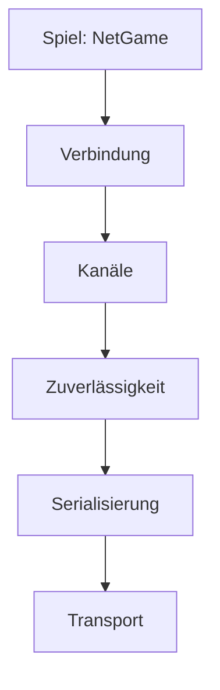

# 10 Zusammen spielen: Kern im Netz

> **Dein Level:** Wie können mehrere Spieler in derselben Welt unterwegs sein, obwohl das Internet
> Päckchen verliert und verspätet? Hier lernst du die Tricks, mit denen Kern das versteckt.

Kern hat ein eigenes Netzwerk-System in C++, gebaut nach den Artikeln von Glenn Fiedler („Gaffer On
Games“) und seinen Bibliotheken yojimbo, reliable.io und netcode.io. Obendrauf sitzt **NetGame**: Es
macht **aus jedem Level ein Mehrspieler-Spiel**. Von der Leitung braucht Kern nur kleine Päckchen
(**Datagramme**). Darum läuft es im Browser über einen **BroadcastChannel** (Tabs auf einem Rechner)
oder einen **Relay** (verschiedene Rechner) und in Tests und im Studio über ein Netz im Speicher.

---

## 10.1 Die Schichten



Jede Schicht baut auf der darunter auf, vom Päckchentragen bis zum Spiel.

---

## 10.2 Serialisierung: jedes Bit zählt

Für jeden Datentyp gibt es **eine einzige** Funktion `serialize()`, die schreibt, liest **und** Bits
zählt. So können Sender und Empfänger nie verschiedener Meinung sein. Eine Zahl mit Bereich bekommt
nur so viele Bits wie nötig: Der Spielerplatz liegt zwischen 0 und 254, das sind 255 Werte, und
2⁸ = 256 reicht – also **8 Bit** statt 32. Ja/Nein braucht 1 Bit.

> **So kannst du es dir vorstellen:** T-Shirts rollen statt falten. Drehungen packt Kern mit
> „smallest three“: Von vier Zahlen, deren Quadrate zusammen 1 ergeben, lässt es die größte weg –
> sie lässt sich aus den anderen drei ausrechnen.

**Leser prüfen alles.** Wert außerhalb des Bereichs, Puffer zu kurz, Länge falsch: Das Päckchen wird
verworfen, statt das Spiel abstürzen zu lassen. Hier wohnt auch die Prüfsumme CRC32.

---

## 10.3 Zuverlässigkeit: Nummern und Quittungen

Jedes Päckchen trägt eine **Nummer** (16 Bit) und eine **Quittung**: „Dein letztes war Nummer 500“,
plus 32 Ja/Nein-Bits für die 32 davor – zusammengedrückt auf höchstens 9 Byte. **Senden wartet nie**;
ob etwas neu geschickt wird, entscheidet die Schicht darüber. Päckchen über 1024 Byte werden zerlegt.
Nebenbei misst Kern **Ping**, **Verlust** und **Bandbreite**, geglättet gegen Ausreißer.

> **So kannst du es dir vorstellen:** Im Klassenchat: „Bis 500 gelesen, von den 32 davor fehlen 497
> und 490.“ Eine Antwort quittiert 33 Nachrichten.

---

## 10.4 Kanäle: Einschreiben oder Postkarte

- **Zuverlässig und geordnet** (Einschreiben): genau einmal, in Reihenfolge. Unbestätigtes wird neu
  geschickt, frühestens nach 0,1 s oder dem 1,25-Fachen des Pings. Große Nachrichten (über 512 Byte)
  reisen in Blöcken.
- **Unzuverlässig** (Postkarte): einmal mit dem nächsten Päckchen – für Positionen, Eingaben und
  Effekte, die verspätet wertlos sind.

---

## 10.5 Verbindung: das Händeschütteln

1. Der Client schickt Anfragen mit einer Zufallszahl (**Salt**), absichtlich aufgepolstert: Ein
   gefälschter Request bringt den Server nie dazu, mehr zurückzuschicken, als er bekam.
2. Der Server antwortet mit einer **Challenge** und seinem eigenen Salt.
3. Der Client schickt beide Zahlen mit XOR verknüpft zurück.
4. Der Server vergibt einen **Slot**; das XOR-Ergebnis ist ab jetzt die **Verbindungs-ID**.

Päckchen von Fremden oder mit falscher ID ignoriert Kern. Jedes Datagramm beginnt mit einem
**CRC32** über die Kennung „KERN0001“ und den Inhalt – andere Spiele und Versionen fliegen raus.
Standard: höchstens 16 Clients, nach 6 s ohne Päckchen ist Schluss, Lebenszeichen alle 0,1 s. Ist
der Server voll, wird der Client abgewiesen.

---

## 10.6 Transporte

Ein Datagramm hat höchstens 1400 Byte. **LoopbackNetwork** ist das Speicher-Netz, **HostTransport**
reicht Päckchen an die Browserseite weiter. In beiden steckt ein **Simulator** für Verzögerung,
Schwankung (Jitter), Verlust und doppelte Päckchen. Mit festem Zufalls-Startwert ist ein schlechtes
Netz jedes Mal **genau gleich schlecht** – ideal zum Testen.

---

## 10.7 NetGame: ein Spiel, viele Spieler

- Der **Server** ist der Chef: Nur er rechnet Physik, Regeln, Pickups und Trigger. Jeder Spieler
  bekommt einen **Pawn** (eine Kopie der Spielfigur). 30-mal pro Sekunde geht an jeden Client ein
  **Snapshot** mit HUD und der Lage aller beweglichen Dinge.
- Der **Client** spielt eine **Replika** ohne eigene Physik und Logik, schickt seine Eingabe und
  zeigt die Welt etwa **100 ms in der Vergangenheit**. Nur der Stadtverkehr fährt bei ihm selbst.
- Wichtiges (Willkommen, Spieler kommt/geht, Pickup weg, Logik-Änderung) geht per Einschreiben,
  Sounds und Schüsse per Postkarte.
- Beide brauchen **dasselbe Level**. Das Willkommen trägt eine Prüfsumme (ohne die Editor-Kamera);
  passt sie nicht, kommt „the server plays a different level“.

```cpp
game::NetGame net(world);
net.host(level, transport);
net.update(time, dt, local_input);
```

Zeile 1 verbindet Netz und Welt. Zeile 2 macht dich zum Server; ein Client ruft stattdessen `join`
mit der Serveradresse auf. Zeile 3 läuft jeden Frame. Einstellbar sind Ticks pro Sekunde (30), die
Verzögerung (0,1 s), der Platz pro Snapshot (900 Byte) und die Spielerzahl (8).

Eine Eingabe enthält Bewegung, Sprung, Boost, Blick, Feuern, Zielen, Nachladen, Ducken und Benutzen.
Der Client schickt immer die letzten vier mit. Springen und Feuern zählen, wenn sie in
**irgendeiner** davon stehen – ein Sprung geht so nie verloren. Beim Spielmodell Soldat kommen
dessen HUD-Werte wie Gesundheit und Munition mit.

> **Für Profis:** Für die **Lag-Kompensation** dreht der Server die Zeit bei deinem Schuss um etwa
> „halber Ping plus 100 ms“ zurück (höchstens 0,5 s) – so sah deine Welt aus, als du abgedrückt
> hast ([Kapitel 8](08-spiel-laufzeit.md)).

### Der Prioritätstopf

Ein Snapshot muss in ein Päckchen passen. Jeder Client hat pro Ding einen Punktetopf: bewegt **+10**,
sonst **+0,25**. Der eigene Pawn kommt immer zuerst, dann nach Punkten, bis 900 Byte voll sind. Wer
mitkommt, fällt auf 0. Eine ruhende Kiste braucht 10 ÷ 0,25 = **40 Ticks**, um aufzuholen.

> **Krass, aber wahr:** Positionen reisen auf **1 mm** genau im Bereich ±8192 m. Das sind über 16
> Millionen Werte, und 2²⁴ = 16 777 216 reicht: 24 Bit pro Koordinate.

### Uhr und Zwischenbilder

Bei jedem Snapshot gleicht der Client seine **Uhr** ab: kleineren Zeitabständen folgt er schnell
(20 %), größeren langsam (2 %), denn das schnellste Päckchen war am wenigsten aufgehalten. Dann
**interpoliert** er: A sagt bei 1,00 s „x = 10 m“, B bei 1,10 s „x = 12 m“; gezeigt wird 1,05 s, also
x = 11 m. Fehlt Nachschub, rechnet er bis zu 250 ms weiter.

> **So kannst du es dir vorstellen:** Ein Daumenkino mit fehlenden Seiten. Kern zeigt eine Seite,
> die etwas zurückliegt, und malt die Bilder dazwischen selbst.

---

## 10.8 Mehrspieler im Studio


**Play › Number of Players** (1–4) macht die Welt zum **Listen-Server**, einem Server, der
mitspielt. Jeder weitere Spieler ist ein echter Client mit eigener Welt und eigenem Viewport. Studio
schaltet auf vier Viewports; Client 1 erscheint in Viewport 2. Nur der **aktive Viewport** bekommt
deine Eingabe. Die Statuszeile zeigt Rolle, Spieler, Ping, Verlust, Bandbreite und je Client den
Puffer.

| Network Emulation | Verzögerung (± Jitter) | Verlust |
|---|---|---|
| Perfect | 0 | 0 |
| LAN | 5 ms (±1) | 0 |
| Average | 50 ms (±10) | 1 % |
| Bad | 150 ms (±40) | 5 % |
| Terrible | 300 ms (±100) | 20 % |

> **Mission:** Öffne Orb Run in Studio auf https://kernengine.de/, stell **Play › Number of
> Players** auf **2 Players** und drück **Play**. Klick in Viewport 2 und fahr. Stell dann **Play ›
> Network Emulation** auf **Terrible** und beobachte Ping und Verlust.

**Online:** **Play › Host Online Game…** bzw. **Join Online Game…** fragt nach einem **Raum**
(Standard „kern“) und optional einem **Relay**; leer heißt: Tabs dieses Browsers. Alle brauchen
dasselbe Level. **Leave Online Game** beendet die Sitzung.

> **Mission:** Öffne Studio in zwei Tabs mit demselben Level. Tab 1: **Host Online Game…**, Raum
> „kern“, **Host**. Tab 2: **Join Online Game…**, derselbe Raum, **Join**. Jetzt fahrt ihr zusammen.

---

## 10.9 Exportierte Spiele im Netz

Ein exportiertes Spiel ([Kapitel 11](11-studio.md)) liest seine Adresse: `?host=raum` hostet,
`?join=raum` tritt bei, `&relay=` plus Adresse nutzt einen Relay. Klappt es nicht, erscheint „Online
play failed: … – playing alone“.

---

## 10.10 Der Bote im Browser: KernNet

**KernNet** trägt nur Bytes, wie UDP es täte; alles andere macht der C++-Teil. Lokal nutzt es einen
BroadcastChannel: Der Host meldet sich alle 500 ms, ein Gast wartet bis zu 4 s, sonst „no game is
hosted in room …“. Mit Relay geht es über eine WebSocket-Verbindung.

---

## 10.11 Der Relay

Browser können kein UDP senden. Darum leitet `tools/net_relay.mjs` (Node, Paket `ws`) Datagramme
zwischen Rechnern weiter – **ohne eigene Logik**:

```sh
npm install ws
node tools/net_relay.mjs 8790
```

Zeile 1 installiert das Paket, Zeile 2 startet den Relay auf Port 8790 (dem Standard). In den Dialog
trägst du `ws://`, den Rechnernamen und `:8790` ein. Der Relay vergibt Nummern, setzt sie vor jedes
Datagramm und stellt zu. Zu große oder unzustellbare Päckchen wirft er weg; geht der Host, ist der
Raum für Neue zu.

> **So kannst du es dir vorstellen:** Ein Briefträger, der keine Briefe öffnet. Ob ein Päckchen echt
> ist, prüfen die Empfänger mit CRC32 und Verbindungs-ID.

---

## 10.12 Was wo läuft

| Aufgabe | Server | Client |
|---|---|---|
| Physik, Regeln, Logik | ja | bekommt Ergebnisse |
| Schüsse, Treffer | ja, lag-kompensiert | zeigt sie an |
| Sounds | erzeugt | spielt ab |
| Stadtverkehr | simuliert | lokal, Deko |
| Kamera, Eingabe | lokal | lokal, Eingabe geht zum Server |

---

## 10.13 Tests

`kern/tests/run.sh` prüft Serialisierung, Quittungen, Kanäle, Handschlag (auch mit 500
Müll-Päckchen), Spiele im Netz, den Soldaten, Logik-Änderungen und Number of Players im Studio.

> **Krass, aber wahr:** Im Härtetest gehen 25 % der Päckchen verloren, die Verzögerung schwankt
> zwischen 30 und 90 ms, 10 % kommen doppelt – und trotzdem kommt jede Nachricht vollständig und in
> Reihenfolge an.

> **Mission:** Spiel zu zweit im Studio, einmal mit **Perfect**, einmal mit **Bad**. Wie ändern
> sich Ping, Verlust und Puffer?

---

## Level geschafft!

- Du weißt, warum Kern Daten eng packt und jedes Päckchen misstrauisch liest.
- Du kennst Nummern, Quittungen, Einschreiben und Postkarte.
- Du verstehst den Handschlag mit Salt, Challenge und XOR.
- Du weißt, was Snapshots, Prioritätstopf und Interpolation tun.
- Du testest im Studio mit mehreren Spielern und schlechtem Netz.

## Rätsel-Ecke

1. Welcher Kanal passt für „Pickup eingesammelt“?
2. Wie viele Bit braucht eine Zahl von 0 bis 15?
3. Warum zeigt der Client absichtlich die Vergangenheit?
4. **Boss-Rätsel:** Eine Kiste ruht, ein Auto fährt; beide starten mit 0 Punkten, und pro Snapshot
   passt genau ein Ding (ohne deinen Pawn). Wer wird gesendet, und welche Punkte bleiben?

### Lösungen

1. **Einschreiben** – das Pickup muss bei allen verschwinden.
2. **4 Bit**: 16 Werte, 2⁴ = 16.
3. So hat er fast immer zwei Snapshots, zwischen denen er rechnen kann.
4. Auto 10, Kiste 0,25: Das **Auto** wird gesendet und fällt auf 0, die Kiste behält **0,25**.

---

© 2026 Christian Heinrich Hohlfeld · Alle Rechte vorbehalten · [Impressum und Rechte](00-impressum.md)
