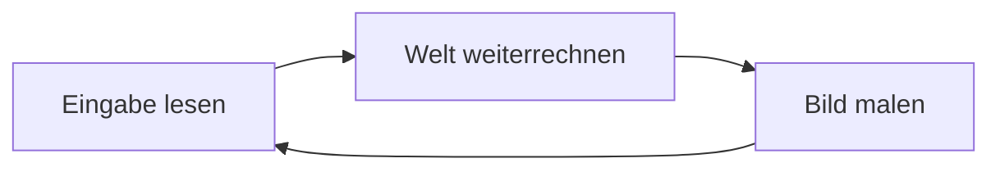

# 12 Dein eigenes Spiel

> **Dein Level:** Jetzt baust du ein ganzes Spiel – mit Spielfigur, Hindernissen, Orbs, Gefahr,
> Logik und Ton – und verschickst es als eine Datei. Danach schaust du Profis über die Schulter und
> lernst das wichtigste Prinzip jedes Spiels kennen: die Spielschleife.

> **Wörter, die du brauchst:**
>
> - **Engine** – das fertige Grundgerüst, das malt, Physik rechnet und Töne spielt; dein Spiel
>   benutzt es.
> - **Trigger** – eine unsichtbare Zone, die etwas auslöst, sobald jemand hineinläuft.
> - **Frame** – ein Einzelbild des Spiels, wie eine Seite im Daumenkino.
> - **dt** – die Zeit seit dem letzten Bild, in Sekunden.
> - **Compiler** – ein Übersetzer, der aus Programmtext ein Programm für den Computer macht.
> - **Modul** – die übersetzte Spieldatei, die der Browser lädt und ausführt.
> - **Webserver** – ein Programm, das Dateien so ausliefert wie eine Internetseite.

Kern bietet **drei Wege** zum eigenen Spiel. Alle drei benutzen dieselbe Engine, also dieselbe
Grafik und dieselbe Physik:

| Weg | Womit | Für wen |
|---|---|---|
| **A** Studio | klicken und ziehen, ohne Code | für dich – das ganze Spiel in diesem Kapitel |
| **B** C++ | programmieren in der Sprache, in der Kern selbst geschrieben ist | Profis mit eigener Spielidee |
| **C** JavaScript | programmieren in der Sprache von Webseiten | Profis mit eigener Webseite |

Weg A baust du hier vollständig nach. B und C sind zum Reinschnuppern: Du lernst, wie ein
programmiertes Spiel im Inneren tickt, ohne selbst programmieren zu müssen.

---

## 12.1 Weg A: Orb Garden, ein Spiel ohne Code

Wir bauen ein Sammelspiel: Eine Figur läuft über eine Fläche mit Hindernissen, sammelt Orbs, weicht
einer Gefahr aus und gewinnt, wenn alles eingesammelt ist. Die Fenster von Studio erklärt
[Kapitel 11](11-studio.md).

### Schritt 1: Ein neues Level

**File › New Level...**, Vorlage **Basic**, **Create** – mit Boden (40 × 40 m), Sonne, Himmel und
einem Würfel. In **World Settings** setzt du **Level name** und **Game title** auf „Orb Garden“.
Warum nicht Empty? Da gibt es nicht mal einen Boden. **Endless ground** ginge zwar, aber ein
sichtbarer Boden ist für den Anfang anschaulicher.

### Schritt 2: Die Spielfigur

Content Drawer (**Ctrl+Space**) › **Players** › **Character** in den Viewport ziehen. Das Log meldet
„Character is the player now“, im Outliner steht **PLAYER**. In **Details › Player Controller**
stellst du **Max speed**, **Acceleration**, **Jump speed** und die Kamera ein (**Chase**, **First
person**, **Top down**). **Play** (Alt+P): W A S D läuft, die Leertaste springt, **Esc** führt
zurück. Spieler ist die zuletzt platzierte Figur oder die per Rechtsklick › **Make Player**.

> **Mission:** Bau Schritt 1 und 2 nach. Spiel einmal mit **Top down** und einmal mit **First
> person**. Welche Sicht passt besser zu einem Sammelspiel?

### Schritt 3: Hindernisse und Physik

Drei Sorten Dinge machen ein Level lebendig: Manche stehen fest, manche reagieren auf Physik, und
manche bewegen sich von selbst.

1. **Fest:** Aus **Shapes** ein paar **Cube**, eine **Ramp** und eine **Plane** platzieren und mit
   **W**, **E**, **R** zurechtrücken; das Raster (0,5 m) hält die Kanten sauber, **End** setzt auf den
   Boden.
2. **Physik:** Aus **Physics** einen **Crate Stack** und eine **Hinged Door** – sie reagieren auf
   deine Figur.
3. **Von selbst:** Aus **Gameplay** eine **Moving Platform** und einen **Spinner**.
4. Mit **Simulate** (Alt+S) prüfen, Kisten greifen und werfen. **K** übernimmt die Lage der
   gewählten Kisten ins Level – praktisch für einen Stapel, der natürlich umgefallen aussehen soll.
   Wähl dafür in Simulate die **einzelnen Kisten** (Klick, Shift+Klick für weitere), nicht den
   ganzen Stapel.

> **Vorsicht, Falle:** Ein **Cube** aus Shapes hat Kollision, fällt aber nicht. Gib ihm mit **+ Add ›
> Rigid Body** einen Körper und stell **Mobility** auf **Dynamic** – das heißt: Er fällt und lässt
> sich schubsen. Oder nimm gleich die **Physics Cube** ([Kapitel 6](06-physik.md)).

### Schritt 4: Etwas zum Einsammeln

Verteile **Orbs** (1 Punkt) und einen **Star** (10 Punkte); mit **Alt + Gizmo ziehen** kopierst du
schnell. Wähle alle Orbs und leg sie mit dem Ordner-Knopf im Outliner in einen Ordner. Dann **World
Settings › Win condition** auf **Collect all pickups**.

### Schritt 5: Gefahr, Checkpoint und Zeitlimit

Jetzt bekommt dein Spiel Spannung. Es gibt zwei Arten von Gefahr, und sie wirken verschieden:

- Ein **Hazard** beendet die Runde sofort: Das Spiel ist **verloren**. Ein Checkpoint hilft da nicht.
- Eine **Damage Zone** nimmt der Figur Gesundheit. Das wirkt nur bei Figuren, die Gesundheit haben:
  Gib deinem Character dafür mit **+ Add › Health** eine. Ist sie aufgebraucht, taucht die Figur nach
  einem kurzen Moment wieder auf – am letzten **Checkpoint**, falls sie einen berührt hat, sonst am
  Start.

Beide ziehst du mit Scale auf die gewünschte Größe. Ein **Checkpoint** merkt sich, wo die Figur
neu startet. Das gilt auch, wenn sie unter **Kill Z** fällt – das ist die Höhe, unter der eine Figur
als heruntergefallen gilt (World Settings). Wer mag, setzt ein **Time limit**; das HUD zählt
herunter. Andere Ziele: **Reach a goal trigger** (mit **Goal**), **Survive the time limit**, **Reach
a target score**.

> **Mission:** Bau Schritt 3 bis 5 mit 60 Sekunden Zeitlimit. Zu leicht? Leg den Star auf die Moving
> Platform.

### Schritt 6: Logik ohne Programmieren

Logik heißt: „Wenn das passiert, dann tu jenes.“ Statt sie zu programmieren, steckst du sie aus
fertigen Kästchen zusammen ([Kapitel 9](09-logik.md)).

1. Einen **Message Trigger** platzieren, in Details › Trigger die **Action** auf **Logic event
   only**. Damit tut der Trigger nichts Eigenes, sondern sagt nur deiner Logik Bescheid, wenn jemand
   hineinläuft.
2. In Details auf **Logic** klicken; der Logik-Editor öffnet den Graphen dieses Actors.
3. **Templates › Score zone (overlap +10)**: Betreten gibt 10 Punkte, „+10“ und einen Ton.
4. **Compile** (F7): Studio prüft deinen Plan auf Fehler. **Viewport** führt zurück.

Weitere Vorlagen: eine Tür, die aufgeht, wenn die Figur davorsteht und **F** drückt
(**Interact**), ein Spawner, eine Ampel und ein Verhalten für die Micro Duck.

> **Vorsicht, Falle:** Ein Graph mit Fehlern hält Play nicht auf – Kern schaltet nur ihn ab. Passiert
> in deiner Zone nichts, schau ins Output Log.

### Schritt 7: Ton

In **World Settings › Audio** eine **Music** und eine **Ambience** wählen. Aus **Audio** etwa
**Ambient Wind** platzieren, oder im Tab **Sounds** eine eigene Datei importieren und in den
Viewport ziehen. Figuren, Pickups und Trigger bringen ihre Geräusche schon mit
([Kapitel 7](07-audio.md)).

### Schritt 8 bis 10: Testen, Speichern, Exportieren

- **Play** testet, **F8** lässt die Figur los und übernimmt sie wieder. **Play › Number of Players ›
  2 Players** testet zu zweit. **Fehler im Level**, etwa ein Gelenk zu einem gelöschten Actor,
  verhindern Play und stehen im Output Log.
- **Ctrl+S** speichert eine Level-Datei samt Texturen und Sounds, die du weitergeben und in jedem
  Studio öffnen kannst. Ungespeichertes sichert Studio zusätzlich im Browser.
- **File › Package Game (HTML)...**, Titel prüfen, **Package**: Studio lädt die Datei
  Orb_Garden.html herunter (das Leerzeichen wurde zu einem Unterstrich) und bietet **Play it** an.

Diese eine Datei enthält alles: die Engine, dein Level und das Programm, das es abspielt. Sie läuft
ohne Internet, per Doppelklick, von jeder Webseite und auf dem Handy mit Touch-Sticks.


> **Mission:** Exportiere Orb Garden, klick **Play it** und spiel eine Runde. Öffne die Datei dann
> auf einem Handy oder Tablet (lass dir beim Übertragen ruhig helfen): Die Touch-Sticks erscheinen
> von allein.

---

## 12.2 Weg B: ein Spiel in C++

Bei Weg B schreibt man das Spiel als Programmtext. Die Engine ruft dieses Programm in jedem Moment
auf, fragt „Was jetzt?“, und malt danach das Ergebnis. Um den Browser kümmert sich ein kleiner
Helfer, die Plattformschicht (12.3).

> **So kannst du es dir vorstellen:** Die Engine ist Spielfeld und Anzeigetafel, dein Programm die
> Mannschaft. Jeden Moment heißt es „Du bist dran“ – sie macht ihren Zug, die Tafel zeigt ihn.

### Die Spielschleife

Ein Spiel ist ein Daumenkino. Jedes Einzelbild heißt **Frame**, und flüssig wirkt es ab etwa 30
Bildern pro Sekunde. Für jedes Bild läuft dieselbe Runde:



1. **Eingabe:** Welche Tasten sind gedrückt, wo ist die Maus, wo die Finger?
2. **Rechnen:** Figur bewegen, Zusammenstöße prüfen, Punkte zählen.
3. **Malen:** Die Engine zeichnet die neue Lage.

Dazu kommen zwei Sonderfälle: **einmal am Anfang** alles aufbauen (Formen, Licht, Kamera) und **einmal
am Ende** aufräumen. Ein C++-Spiel füllt genau diese Stellen: Aufbauen, die Runde für jedes Bild und
Aufräumen.

Ein Detail ist wichtig: Kern kennt zwei Fragen an eine Taste. „Ist sie **gerade eben** gedrückt
worden?“ – das gilt nur für das eine Bild, in dem du sie herunterdrückst, gut für einen einzelnen
Sprung. Und „Wird sie **gehalten**?“ – das gilt in jedem Bild, solange dein Finger drauf ist, gut zum
Laufen oder Drehen. Weil sich beides von Bild zu Bild ändert, fragt das Spiel in jeder Runde neu,
statt eine alte Antwort aufzuheben.

### Das wichtigste Prinzip: dt

Nicht jeder Rechner schafft gleich viele Bilder pro Sekunde. Würde sich eine Figur pro Bild um ein
festes Stück bewegen, wäre sie auf einem schnellen Rechner schneller als auf einem langsamen. Darum
bekommt das Spiel in jeder Runde **dt**: die Zeit seit dem letzten Bild, in Sekunden. Bewegung wird
immer mit dt malgenommen.

So steht es im kleinsten Kern-Spiel „hello“ (64 Kisten, um die du die Kamera kreisen lässt):

```cpp
if (in.down(Key::left)) yaw_ += frame.dt * 1.5f;
if (in.down(Key::right)) yaw_ -= frame.dt * 1.5f;
```

- `in.down(…)` ist die Frage „Wird die Taste gehalten?“.
- `yaw_` ist der Name einer Variablen, also eines Kästchens, in dem der Drehwinkel steht. Der
  Unterstrich gehört einfach zum Namen.
- `1.5f` ist die Zahl 1,5. Das `f` sagt dem Computer nur: eine Kommazahl.
- Zeile 1: Hältst du ←, wächst der Drehwinkel um dt × 1,5 (`+=` heißt „erhöhe um“).
- Zeile 2: Bei → schrumpft er um dasselbe Stück (`-=` heißt „verringere um“).

**Rechne nach:** Bei 60 Bildern pro Sekunde ist dt = 1 ÷ 60. Pro Bild kommen 1,5 ÷ 60 = 0,025
dazu, nach 60 Bildern also 1,5. Bei 30 Bildern ist dt = 1 ÷ 30, pro Bild kommen 0,05 dazu, nach 30
Bildern 30 × 0,05 = 1,5. **Gleich schnell – egal wie flott dein Rechner ist.** 1,5 ist hier ein
Winkel in Radiant ([Kapitel 3](03-grundlagen.md)) und bedeutet knapp eine Viertelumdrehung pro
Sekunde.

dt hat eine Obergrenze: höchstens 0,1 s. Hängt der Rechner einmal eine ganze Sekunde, rechnet das
Spiel trotzdem nur mit 0,1 s weiter. Ohne diese Grenze würde die Figur nach dem Hänger mit einem
Satz meterweit springen – vielleicht mitten durch eine Wand.

In hello kannst du außerdem eine Kiste anklicken, und sie färbt sich rot. Wie ein Spiel weiß, worauf
du klickst, kennst du aus [Kapitel 5](05-szene-und-geometrie.md): Es schießt einen Strahl durch den
Punkt unter der Maus und schaut, was er trifft.

> **Krass, aber wahr:** Die 64 Kisten in hello sind **eine** Form mit 64 Kopien. Jede Kopie hat nur
> ihre eigene Lage, Drehung, Größe und Farbe. Die Grafikkarte malt alle mit **einem** Zeichenbefehl –
> viel schneller als 64 einzelne.

### Vom Text zum Spiel: Module

Ein Browser kann C++ nicht direkt lesen. Ein **Übersetzer** (Compiler) macht aus dem Programmtext
eine Datei, die der Browser ausführen kann. Diese Datei heißt **Modul** (im Format WebAssembly).
Beim Übersetzen wählt man, welche Teile der Engine hinein sollen: Grafik ist immer dabei, Physik,
Levels oder Studio kommen nur auf Wunsch dazu – wie ein Baukasten, aus dem man nur nimmt, was das
Spiel braucht. Übersetzt wird nur, was sich seit dem letzten Mal geändert hat.

Wie man Kern auf dem eigenen Rechner baut, zeigt [Kapitel 2](02-bauen-und-testen.md). Die genauen
Namen und Werte stehen im blauen Buch, Kapitel 12.

### Ein ganzes Spiel: orbrun

Das zweite Beispiel heißt **orbrun** und ist ein Rennspiel: Ein Hovercar sammelt in einer
Zufallsstadt 24 Orbs, während es Nacht wird.

> **Vorsicht, Falle:** Das klingt genau wie das Level **Orb Run** aus Studio – ist aber ein anderes
> Programm. Orb Run im Studio ist aus Actors und Komponenten gebaut und benutzt die Physik-Engine.
> orbrun hier ist dieselbe Spielidee, aber von Hand in C++ programmiert, mit eigener Fahrphysik und
> eigener Kollision. Dieselbe Idee lässt sich also aus Bausteinen zusammenstecken oder selbst
> schreiben.

Jede Runde der Spielschleife liest orbrun die Eingabe, fährt, bewegt den Verkehr, sammelt
Orbs, stellt Licht und Kamera ein und schickt das Veränderte an die Grafikkarte. Zwei Ideen daraus
lohnen sich:

- **Kollision ohne Physik-Engine:** Das Auto ist für die Rechnung nur ein Kreis. Steckt der Kreis in
  einem Haus, schiebt das Spiel ihn hinaus und lässt das Auto an der Wand abprallen.
- **Nicht durch Wände flutschen:** Beim Boost legt das Auto in einem Bild ein großes Stück zurück. In
  einem Bild noch vor der Wand, im nächsten schon dahinter – und den Zusammenstoß gäbe es nie. Darum
  bewegt es sich in kleinen Teilschritten von höchstens 0,6 m und prüft jeden davon.

**Rechne nach:** Mit Boost fährt das Auto höchstens 60 m/s, das sind 60 × 3,6 = **216 km/h**. Bei 30
Bildern pro Sekunde sind das 2 m pro Bild – mehr als dreimal so viel wie ein Teilschritt.

Noch eine Idee: Nachts leuchtet vor dem Auto der Scheinwerfer, und jeder Orb hat ein eigenes Licht.
Die Engine kann aber nur **sechs** solche Punktlichter gleichzeitig malen. Darum sammelt orbrun alle
Lichtwünsche und gibt der Engine nur die sechs wichtigsten – mehr Wünsche als Platz, also entscheiden
Prioritäten, wie beim Prioritätstopf in [Kapitel 10](10-netzwerk.md).

> **Für Profis:** Die Häuser bekommen nachts leuchtende Fenster, obwohl die Engine keine Fenster
> kennt. Das Spiel hängt dafür ein kleines Zusatzprogramm an das Malprogramm der Grafikkarte (einen
> **Shader**), ohne die Engine zu verändern ([Kapitel 4](04-grafik.md)).

---

## 12.3 Die Plattformschicht

Zwischen Engine und Browser sitzt ein kleiner Helfer in JavaScript, die **Plattformschicht**. Sie
erledigt nur, was ein Browser ausschließlich in JavaScript erlaubt: Sie lädt das Modul, hält die
Zeichenfläche passend groß, reicht Tasten, Maus und Finger weiter und ruft für jedes Bild die
Spielschleife auf.

> **So kannst du es dir vorstellen:** Das Spiel ist die Kassette, die Plattformschicht die Konsole
> mit Controller-Anschluss und Fernseher-Kabel. Dieselbe Kassette läuft auf jeder Konsole.

Ein paar Dinge erledigt sie, damit das Spiel nicht daran denken muss: Pfeiltasten scrollen die Seite
nicht weg. Wechselst du das Fenster, lässt sie alle Tasten los, damit keine „hängen bleibt“. Und stürzt
die Grafikkarte kurz ab, baut sie alles wieder auf. Die genauen Namen und Werte stehen im blauen Buch,
Kapitel 12.

---

## 12.4 Weg C: aus JavaScript

Bei Weg C schreibt man die eigene Webseite in JavaScript und lässt Kern nur bestimmte Arbeiten
machen. Drei Möglichkeiten gibt es:

- **Nur malen lassen:** Die Spielregeln stehen in JavaScript, Kern zeichnet. So arbeitet zum
  Beispiel ein Drohnenspiel namens SpawnCity.
- **Ein Studio-Level einbauen:** Eine eigene Seite spielt ein Level aus Studio ab und kann es
  steuern – zum Beispiel mit eigenen Bildschirmknöpfen, die die Figur laufen und springen lassen,
  oder mit einem eigenen Siegerbildschirm.
- **Logik-Graphen als C++:** Der Knopf **C++** im Logik-Editor macht aus deinem Graphen
  Programmtext. Normalerweise wird der Graph erst beim Spielen vorgelesen oder übersetzt, wie ein
  Buch, das ein Dolmetscher Satz für Satz vorliest oder kurz vorher übersetzt. Als C++ eingebaut ist
  die Übersetzung schon fertig mitgeliefert – mit genau demselben Ergebnis
  ([Kapitel 9](09-logik.md)).

Die genauen Namen und Werte stehen im blauen Buch, Kapitel 12, und in
[Kapitel 17](17-referenz.md).

---

## 12.5 Hosten

Ein exportiertes Studio-Spiel ist eine einzige Datei. Ein C++-Spiel besteht aus mehreren: einer
Webseite, dem Modul und der Plattformschicht. Die Seite **lädt** das Modul und die Plattformschicht
**nach**, und das erlaubt ein Browser aus Sicherheitsgründen nur über einen **Webserver** – nicht,
wenn du die Datei per Doppelklick öffnest. Ein Webserver ist ein Programm, das Dateien so ausliefert
wie eine Internetseite; für den eigenen Rechner reicht ein ganz einfacher.

> **So kannst du es dir vorstellen:** Das exportierte Studio-Spiel ist ein fertiges Lunchpaket in
> einer Dose. Das C++-Spiel ist Kochen in der Schulküche – du brauchst die Küche dazu.

---

## 12.6 Veröffentlichen

**Die Regeln in einfach:** Kern ist Open Source, also frei benutzbar.

| Du darfst | Du darfst nicht |
|---|---|
| eigene Spiele weitergeben und sogar verkaufen | dein Spiel „Kern“ nennen |
| „Made with Kern“ draufschreiben | die Lizenzhinweise entfernen |
| deinen eigenen Code geheim halten | das Aussehen der Ente verkaufen |

Mit dem Spiel gibst du auch Kern selbst weiter, und dazu gehört ein Hinweis auf Kerns Lizenz. Bei
einem exportierten Studio-Spiel musst du dafür nichts tun: Studio schreibt den Hinweis beim Export
schon unsichtbar mit in die Datei, ganz oben. Du darfst ihn nur nicht herauslöschen. Teile von
anderen behalten ihre eigenen Regeln ([Anhang D](D-lizenzen.md)).

**Ausnahme Micro Duck:** Das Aussehen der Ente stammt von Pollen Robotics und darf **nur nicht
kommerziell** benutzt werden, also nicht in einem Spiel, mit dem man Geld verdient. Für ein Spiel
zum Verkaufen gibt es eine besondere Bauweise von Studio ohne dieses Aussehen (Profis bauen sie aus
dem Quellcode). Darin hat die Ente **gar kein Aussehen** – du müsstest ihr ein
eigenes geben. Pollens Netze dürfen mit.

**Studio-Spiele** lädst du – am besten zusammen mit einem Erwachsenen – auf einen Webspace oder eine
kostenlose Projektseite, oder du verschickst die Datei einfach. Mit Ente gehören zwei Ordner mit
ihren Netzen daneben, sonst kann sie nur laufen ([Kapitel 11](11-studio.md)). Wie man online
zusammen spielt, steht in [Kapitel 10](10-netzwerk.md).

**C++-Spiele** kommen mit allen ihren Dateien auf einen Webserver. Kern selbst macht das automatisch:
Bei jeder Änderung baut ein Automat Studio und die Beispiele neu und stellt alles auf
https://kernengine.de/. Der Quellcode liegt auf https://github.com/ChristianHohlfeld/kernengine.de.

| Prüfliste | Studio-Spiel | C++-Spiel |
|---|---|---|
| keine Fehler | Output Log | Fehleranzeige des Browsers |
| Handy | Sticks kommen von selbst | Touch selbst auswerten |
| Ton | nach erstem Klick | Sache des Spiels |
| Dateien | eine HTML (plus Ente-Ordner) | Seite, Modul, Plattformschicht |
| Auslieferung | beliebig, auch als Datei | Webserver |

> **Mission:** Geh die Prüfliste für Orb Garden durch: Log ohne Fehler? Läuft es am Handy? Musik nach
> dem ersten Tipp? Dann: veröffentlichen!

---

## Level geschafft!

- Du kennst die drei Wege zu einem Kern-Spiel.
- Du hast ein Sammelspiel in zehn Schritten gebaut, gespeichert und exportiert.
- Du weißt, was Hazard, Damage Zone und Checkpoint unterscheidet.
- Du kennst die Spielschleife: Eingabe, Rechnen, Malen – in jedem Bild.
- Du weißt, warum Spiele mit dt rechnen und warum schnelle Dinge in Teilschritten fahren.
- Du kennst die Regeln fürs Weitergeben und Verkaufen.

## Rätsel-Ecke

1. Warum ist **Basic** ein besserer Start als **Empty**?
2. Dein Shapes-Würfel fällt nicht. Was fehlt?
3. Deine Figur läuft in eine Damage Zone und hat danach keine Gesundheit mehr. Wo taucht sie wieder
   auf? Und was passiert stattdessen bei einem Hazard?
4. Warum läuft das exportierte Studio-Spiel per Doppelklick, das C++-Spiel nicht?
5. **Boss-Rätsel:** Ein Spiel macht in jedem Bild „ändere x um 5 · dt“. Rechner A schafft 50 Bilder
   pro Sekunde, B 25. Wie weit kommt die Figur in 2 Sekunden? Und mit „ändere x um 0,1“ ohne dt?

### Lösungen

1. Empty hat **keinen Boden** – die Figur fiele ins Leere.
2. Ein **Rigid Body** mit **Mobility = Dynamic** – oder gleich eine Physics Cube.
3. Am letzten **Checkpoint**, den sie berührt hat (ohne Checkpoint am Start). Ein Hazard dagegen
   beendet die Runde: Das Spiel ist verloren.
4. Das Studio-Spiel hat **alles in einer Datei**. Das C++-Spiel lädt Modul und Plattformschicht nach,
   und das erlaubt der Browser nur über einen Webserver.
5. Mit dt beide **10 m** (5 m pro Sekunde mal 2 s). Ohne dt kommt A 100 × 0,1 = 10 m weit, B nur
   50 × 0,1 = **5 m**. Darum rechnen Spiele mit dt.

---

© 2026 Christian Heinrich Hohlfeld · Alle Rechte vorbehalten · [Impressum und Rechte](00-impressum.md)
