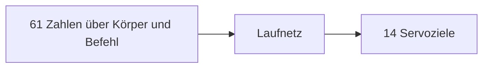

# 13 Die Micro Duck – ein echter Roboter, Servo für Servo

> **Dein Level:** Jetzt wird es echt. Die Micro Duck ist ein Laufroboter, den es wirklich gibt, und
> Kern lässt im Browser genau die Netze laufen, die auch den echten Roboter steuern. Du lernst ihre
> Motoren, Sensoren und Netze kennen – und alles, was die Ente kann.

> **Wörter, die du brauchst:**
>
> - **Servo** – ein kleiner Motor, dem man einen Winkel nennt und der dann dorthin fährt.
> - **Neuronales Netz** – ein Rechenrezept, das durch sehr viel Ausprobieren gelernt hat, aus
>   Messwerten Befehle zu machen, hier: Motorbefehle.
> - **Simulation** – ein Programm, das eine Welt mit ihrer Physik nachrechnet, statt sie zu bauen.
> - **Drehmoment** – wie stark etwas dreht. Wie beim Schraubenschlüssel: mehr Kraft oder ein
>   längerer Hebel dreht stärker.
> - **Trägheit** – wie schwer sich etwas in Drehung versetzen oder wieder anhalten lässt.
> - **Dämpfung** – eine Bremse gegen schnelle Bewegung, wie Honig in einem Gelenk.
> - **Rauschen** – kleine zufällige Fehler in einer Messung.
> - **Weltzeit und Roboterzeit** – die Uhr in Kerns großer Nachbau-Welt und die Uhr des echten
>   Roboters. Sie laufen verschieden schnell (Abschnitt 13.3).

Die Micro Duck stammt von der Firma **Pollen Robotics**: rund 25 cm groß, 0,74 kg schwer, mit 14
Servos in Beinen und Hals und einem fünfzehnten für den Unterschnabel.

Laufen hat Pollen der Ente nicht mit Regeln beigebracht („wenn du kippst, setz den Fuß nach links“),
sondern mit **neuronalen Netzen**. Die Netze haben in einer Physiksimulation tausendfach geübt, bis
die Ente lief. Das fertige Netz ist eine Datei, und genau diese Datei lädt auch der echte Roboter.
Wie so ein Netz innen aussieht, erklärt [Anhang A](A-grundlagen-neuronale-netze.md).

Kern baut den Roboter auf seiner eigenen Physik nach und rechnet dieselben Netze. Das Ziel heißt
**Treue**: dasselbe Modell, dieselben Servos, derselbe Takt. Dazu kommen drei Dinge, die nur Kern
hat: der **Lehrer** zum Trainieren eigener Netze ([Kapitel 14](14-lehrer.md)), ein **Sprung** und
die **Spielschicht**, die entscheidet, was die Ente mit Ball und Socke macht.

> **Für Profis:** Pollen trainiert in der Simulation MuJoCo; die Netze sind ONNX-Dateien. Die
> Servos sind vom Typ Dynamixel XL330. Die genauen Namen und Werte stehen im blauen Buch, Kapitel 13.

> **Mission:** Öffne Kern Studio auf https://kernengine.de/ und wähle
> **Datei › Beispiel-Levels › Micro Duck** (File › Example Levels › Micro Duck). Drück **Spielen**
> (Play) (Alt+P) und schau mit der Beobachterkamera zu, wie die Ente den Raum erkundet. Mit **F8** übernimmst du sie, mit noch einmal F8 schaust du wieder zu.

## 13.1 Wo der Code liegt

Der Code der Ente ist nach Aufgaben getrennt: Aufbau und Steuerung, Netze, Servos, eigenes
Verhalten und Spielschicht stehen jeweils in einem eigenen Teil. Pollens Dateien (Netze, Baupläne)
liegen getrennt von Kerns eigenen Netzen – so sieht man immer, was von wem stammt. Die genauen Namen
stehen im blauen Buch, Kapitel 13.

## 13.2 Die Grundregel: nicht schummeln

Ein trainiertes Netz funktioniert nur, wenn die Simulation dieselbe Physik rechnet wie im Training.
Darum gelten feste Regeln:

- Keine Hilfskräfte, kein Festhalten, kein Teleport, kein weiches Überblenden von einem Netz zum
  anderen (also nie zwei Netze, die gleichzeitig halb steuern). Die Ente steht nur durch ihre Servos und ihre Fußkontakte.
- Ein Servo besteht nur aus Bauteilen, die die Physik-Engine sowieso hat (Abschnitt 13.4).
- Die Zeit läuft in festen Schritten. Gleiche Eingaben ergeben **Bit für Bit** denselben Gang, auf
  jedem Gerät. Das heißt **Determinismus** ([Kapitel 14](14-lehrer.md)).

> **Vorsicht, Falle:** Eine kleine unsichtbare Stütze, „damit sie nicht umfällt“, klingt harmlos.
> Aber das Netz würde sich darauf verlassen – und am echten Roboter gibt es keine.

## 13.3 Das Modell

### Bauplan, Glieder, Gelenke

Pollen beschreibt die Ente in einer Bauplan-Datei: welche Teile es gibt, wie schwer sie sind und wie
sie mit Gelenken verbunden sind. Ein Werkzeug übersetzt diesen Bauplan in Kerns Modell und prüft
dabei, ob alles zusammenpasst – Namen und Reihenfolge der Gelenke, Grundstellung, Aufbau des Netzes.
Passt etwas nicht, bricht es ab. Lieber gar keine Ente als eine falsche.

Die Ente besteht aus **16 Teilen** (Gliedern): dem Rumpf und 15 Teilen, die je an einem Servogelenk
hängen. Der Rumpf hat kein eigenes Gelenk, darum sind es 16 Teile, aber 15 Servos:

- **jedes Bein 5 Gelenke:** Hüfte gieren, Hüfte rollen, Hüfte nicken, Knie, Knöchel,
- **Hals und Kopf 4 Gelenke:** Hals nicken, Kopf nicken, Kopf gieren, Kopf rollen,
- **der Mund** als 15. Servo.

**Gieren, Nicken, Rollen** sind die drei Drehrichtungen: „nein“ schütteln, „ja“ nicken, den Kopf zur
Schulter neigen. Die 14 Gelenke in Beinen und Hals steuern die Netze, den Mund nicht.

Jedes Gelenk hat harte Grenzen und einen **Home-Winkel** für die Grundstellung. Winkel misst Kern in
**Radiant** (rad). Stell dir einen Kreis vor und lege seinen Radius als Faden um den Rand: Der Winkel,
der zu diesem Bogen gehört, ist 1 rad, etwa 57°. Eine ganze Umdrehung sind gut 6,28 rad.

> **Krass, aber wahr:** Das Kopf-Gieren reicht bis knapp 3 rad in jede Richtung, rund ±170°. Die
> Ente kann fast nach hinten schauen.

### Massen und Armatur

Aus dem Bauplan kommen für jedes Teil die Masse, der **Schwerpunkt** (der Punkt, an dem man das Teil
balancieren könnte) und die **Trägheit**.

Im Servo dreht ein winziger Motor über ein Getriebe: 288 Umdrehungen des Motors ergeben eine Umdrehung
des Gelenks. Der schnell kreiselnde Motor wirkt wie ein kleines Schwungrad und macht jede Bewegung
des Gelenks träger. Diese Drehmasse des Motors heißt **Armatur**. Warum macht so ein Winzling so viel
aus? Weil die Übersetzung doppelt zählt: Will das Gelenk schneller werden, muss der Motor 288-mal so
stark beschleunigt werden, und seine Gegenwehr kommt über das Getriebe noch einmal 288-fach verstärkt
am Gelenk an. Darum wirkt er viel träger, als er aussieht. Kerns Physik kennt keine Getriebe,
darum bekommt jedes Glied eine gedachte dünne Scheibe auf seiner Gelenkachse, die genauso träge macht.
Nicht exakt, aber ohne sie zappelt die Ente gut dreimal so stark (Abschnitt 13.14).

> **Für Profis:** Warum eine ganze Scheibe und nicht einfach „träge nur um die Achse“? Einen Körper,
> der nur um eine einzige Achse träge ist, gibt es in Wirklichkeit nicht. Die Physik-Engine würde
> damit Energie aus dem Nichts gewinnen, und die Ente zappelte immer wilder. Eine dünne Scheibe ist
> dagegen ein echter, gültiger Körper.

### Was die Welt berührt

Für Zusammenstöße benutzt Kern vereinfachte Formen, **konvexe Hüllen**: wie Geschenkpapier, straff um
ein Teil gespannt, ohne Dellen nach innen. Damit rechnet die Physik viel schneller als mit jeder
kleinen Kante.

Jede Hülle hat eine **Reibung**: 0 heißt glatt wie Eis, je größer, desto griffiger. Die Sohlen und
das Gummipolster im Schnabel greifen gut (1), die Servogehäuse sind glatt (0, genau wie im Training),
die Schalen von Rumpf und Kopf liegen dazwischen (0,5) – so rutscht eine gestürzte Ente nicht wie auf
Eis.

Zwei Stoffe, die sich berühren, mischt die Physik normalerweise zu einem gemeinsamen Wert. Für
manche Paare stimmt das Mischen aber nicht. Darum kennt Kern **Oberflächen** mit eigenen,
gemessenen Werten: Stoff auf Stoff, Gummi auf Stoff und Stoff auf Holz.

**Beispiel aus dem Micro-Duck-Level:** Der Holzboden hat Reibung 1. Die Sohlen (1) greifen darauf
also mit 1, genau wie im Training. Die Socke ist aber aus Baumwolle, und Baumwolle auf Holz hat einen
eigenen Wert: 0,4. Darum rutscht eine Socke über denselben Boden, auf dem die Ente sicher steht.

> **Für Profis:** Alle übrigen Paare mischt die Physik als geometrisches Mittel: Wurzel aus a mal b.
> Sohle 1 auf einem Boden mit 0,6 ergibt √0,6 ≈ 0,77. Die genauen Werte stehen im blauen Buch,
> Kapitel 13.

### Maßstab 4

Kerns Physik-Engine Box3D rechnet am besten mit Körpern von 10 cm bis 10 m. Die Glieder der Ente
sind aber nur 2 bis 4 cm groß. Darum baut Kern sie **4-mal so groß** und rechnet an genau einer
Stelle um. Lässt man alles passend mitwachsen, verhält sich die große Welt genau wie die kleine:

- **Länge** mal 4.
- **Masse** mal 64, weil ein Würfel mit 4-facher Kantenlänge 4 · 4 · 4 = 64-mal so viel Inhalt hat.
- **Zeit** mal 2. Große Dinge bewegen sich gemächlicher: Ein Ball fällt aus 1 m Höhe in knapp einer
  halben Sekunde, aus 4 m in knapp einer ganzen. Viermal so hoch dauert nur doppelt so lang.

Damit gibt es zwei Uhren. Die **Weltzeit** läuft in Kerns großer Welt, die **Roboterzeit** beim
echten Roboter. **1 Sekunde Weltzeit sind ½ Sekunde Roboterzeit.** Das Netz merkt davon nichts:
Kern rechnet alles, was hineingeht, vorher in echte Werte um. Auch alle Angaben in diesem Kapitel
sind Roboterzeit und echte Zentimeter, außer es steht „Weltzeit“ dabei.

> **So kannst du es dir vorstellen:** Wenn im Film ein Modellhaus einstürzt, sieht es nur echt aus,
> wenn man es in Zeitlupe abspielt. Kern macht es umgekehrt: Es baut groß und weiß, dass die große
> Welt langsamer läuft.

### Aussehen, Rollschuhe, Einbau

Das Aussehen der Ente stammt aus Pollens 3D-Modellen und darf nur nicht kommerziell benutzt werden.
Darum zeigen die Bilder dieses Buchs eine eigene Gestaltung. Im Katalog gibt es auch **Micro Duck
(Rollers)**: Kufen mit je zwei frei drehenden Rädern statt Sohlen.

Setzt du eine Ente aus dem Katalog in ein Level, stellt Studio die Uhr der Welt gleich passend ein:
so viele Physikschritte pro Sekunde, wie der Takt der Ente braucht (Abschnitt 13.5). Was es dabei
geändert hat, meldet es. Aus einem eigenen Programm geht das genauso; die genauen Namen stehen im
blauen Buch, Kapitel 13.

## 13.4 Das Servomodell

Ein Servo ist für Kern ein **Gerätemodell**: ein kleines Gesetz, das beschreibt, wie das echte Gerät
sich verhält, und dazu ein **Profil** mit seinen gemessenen Zahlen. Das Gesetz ist einfach: Der Servo
zieht das Gelenk zum Ziel, je weiter weg, desto stärker – aber nur bis zu einer Grenze.

> **So kannst du es dir vorstellen:** Ein Gummiband zwischen Gelenk und Ziel. Je weiter weg, desto
> stärker der Zug, bis zu einer Grenze. Die Dämpfung ist wie Honig im Gelenk.

| Zahl im Profil | was sie bedeutet |
|---|---|
| **K** Steifigkeit | wie stark er pro Radiant Abstand zieht |
| **T** Höchstmoment | mehr Drehmoment geht nicht |
| **D** Dämpfung | bremst schnelle Bewegung |
| **F** Reibung | bremst im Gelenk |
| **A** Armatur | Schwungrad-Trägheit des Motors |
| Verzögerung | Befehle kommen 20 ms später an |

Das Gesetz in Schulmathe: **Zug = K · (Ziel − Winkel)**, aber höchstens T. Dazu bremsen Dämpfung D
und Reibung F. Drehmoment misst man in
Newtonmeter (N·m). Für den Servo der Ente ist K = 0,554 und T = 0,963 N·m – etwa so viel, wie ein
Kilogramm am Ende eines 10 cm langen Hebels drückt.

**Rechenbeispiel:** Steht das Gelenk 0,5 rad neben dem Ziel, zieht der Servo mit 0,554 · 0,5 ≈ 0,28
N·m. Das ist nicht einmal ein Drittel seiner Höchstkraft. Volle Kraft hat er erst bei
0,963 ÷ 0,554 ≈ 1,7 rad Abstand, fast 100°. Die Servos der Ente sind also **weich**: Sie geben nach,
wie ein Gummiband.

Kern baut dieses Gesetz nur aus Teilen, die die Physik-Engine schon hat: einer Gelenkfeder für das
Gummiband und einer Gelenkbremse für die Reibung. Das hat zwei Gründe. Erstens wird nicht geschummelt
(13.2). Zweitens rechnet die Physik ihre eingebaute Feder so, dass sie bei jeder Steifigkeit ruhig
bleibt. Eine selbst gebastelte Feder könnte bei sehr steifen Werten anfangen zu zittern und sich
aufschaukeln. Ein und dasselbe Stück Code macht das in jedem
Physikschritt, im Studio, im Lehrer und auf dem Prüfstand aus [Kapitel 16](16-kalibrierung.md). Jede
Ente, sogar jeder einzelne Servo, kann ein eigenes Profil bekommen.

> **Vorsicht, Falle:** Die Software im echten Servo kann den Strom begrenzen. Dann hat er nur noch
> 0,64 statt 0,963 N·m, rund zwei Drittel – und die Ente kommt nicht mehr vom Rücken hoch. Pollen
> trainiert ohne diese Grenze, Kern auch.

## 13.5 Der Takt

Drei Dinge laufen im Takt, aber verschieden schnell: die Physik, das Netz und die Spielschicht. Die
Physik rechnet in kleinen Schritten. Das Netz entscheidet nur alle **4 Physikschritte** neu; das ist
der **Regeltakt**. Die Spielschicht entscheidet nur in jedem zweiten Regeltakt.

| Was | Weltzeit (Kern) | Roboterzeit |
|---|---|---|
| ein Physikschritt | 10 ms | 5 ms – wie im Training |
| Regeltakt = 4 Schritte | 40 ms | 20 ms, also 50-mal pro Sekunde |
| Spielschicht = 8 Schritte | 80 ms | 40 ms, also 25-mal pro Sekunde |

Weil die Weltzeit doppelt so schnell zählt (Abschnitt 13.3), sind 10 ms in Kerns Welt genau die 5 ms
des Trainings. Auch die **Verzögerung** ist in Schritten gezählt: Die Servos bekommen immer das Ziel
von vor 4 Schritten, das sind 20 ms Roboterzeit. Im Training war die Verzögerung mal kürzer, mal
länger; das Netz kommt also mit einem festen Wert aus diesem Bereich gut zurecht. Passt die Uhr der
Welt nicht zur Ente, sagt Studio dir, was du einstellen musst.

Wie Kern trotz schwankender Bildrate immer mit gleich langen Schritten rechnet, erklärt
[Kapitel 8](08-spiel-laufzeit.md): Übrige Zeit wird aufgehoben, bis sie für einen ganzen Schritt
reicht.

> **So kannst du es dir vorstellen:** Der Schlagzeuger spielt in schnellen Schlägen (Physik), die
> Sängerin setzt auf jedem vierten Schlag ein (Regeltakt), der Chor nur auf jedem achten
> (Spielschicht).

## 13.6 Die Netze der Ente

Für jede Bewegung gibt es ein eigenes gelerntes Netz. Kern lädt **dieselben Netz-Dateien** wie der
echte Roboter. Das Netz fürs Laufen und Stehen ist fest eingebaut, die anderen lädt Studio nach.

Kern liest die Netz-Dateien selbst. Es nimmt nur genau die Bauart an, die Pollens Training erzeugt,
und lehnt alles andere mit Begründung ab. Ein Test vergleicht das eingebaute Laufnetz mit einer
genauen Vergleichsrechnung: Die Ergebnisse weichen erst in der fünften Stelle nach dem Komma ab.

| Bewegung | von wem |
|---|---|
| Laufen und Stehen (dazu eine ältere Gangart) | Pollen |
| Sitzen / Aufstehen | Pollen |
| Socke aufheben | Pollen |
| Kick links / rechts | Pollen |
| Rolle | Pollen |
| Rollschuh fahren, Ducken auf Rollen | Pollen |
| **Sprung** | Kern |

Das Laufnetz läuft dauernd. Die anderen sind **Episoden** mit fester Dauer: Kick ½ s, Rolle 1 s
(gehalten rollt sie weiter), Sprung 2 s, Sitzen 2 s, Aufstehen 1 s, Aufheben knapp 3 s. Der Schnabel
ist ein Servo ohne Netz.

### Wer gerade dran ist

Es gibt immer nur ein Netz, das die Beine steuert. Wer drankommt, regelt eine feste **Vorfahrt** – wie
an einer Kreuzung. In jedem Regeltakt läuft dieselbe Reihenfolge ab wie in Pollens Steuerprogramm auf
dem Roboter:

1. Abgelaufene Bewegungen beenden.
2. Ein Netz wählen. Vorfahrt hat eine laufende Bewegung, dann Aufheben, Sitzen, Rollschuhfahren und
   zuletzt Laufen und Stehen (bei der älteren Gangart ein eigenes Stehnetz).
3. Das Netz rechnen und seine Antwort in Servoziele umrechnen.
4. Die Uhren der Bewegungen weiterstellen – jede Bewegung hat ihre eigene Stoppuhr, damit Kern
   weiß, wann sie vorbei ist.

Jedes Netz bekommt genau die Befehle, mit denen es trainiert wurde. Eine Bewegung startet nur, wenn
keine andere läuft, die Ente nicht sitzt und das Netz geladen ist – sonst sagt Kern, warum nicht.
Fehlt ein Netz, springt **kein anderes** ein: Die Servos halten die Grundstellung, und die Ente
meldet einmal, welche Datei fehlt.

### Vom Netz zum Servoziel

Das Netz antwortet nicht mit fertigen Winkeln, sondern damit, wie weit jedes Gelenk von seiner
Grundstellung abweichen soll. Servoziel = Home-Winkel plus Antwort des Netzes.

Kern nimmt die Antwort **genau so, wie trainiert**. Pollens Programm auf dem echten Roboter macht es
anders: Es schwächt die Antwort auf 90 % ab und lässt das Ziel weich nachziehen, statt es sofort zu
setzen – wie ein Hund an der Leine, der nur langsam hinterherkommt. Das ist Feinabstimmung für die
echte Hardware. Im **Details**-Panel wählst du mit **Aktionen zu Servo-Zielen** (Actions to servo
goals) zwischen zwei Einträgen:

- **Wie trainiert (Faktor 1, kein Filter)** (As trained (scale 1, no filter)), der Standard; im
  Level steht dafür `training`.
- **Wie der Daemon des Roboters (Faktor 0,9, Tiefpass 0,5 / 0,7)** (As the robot's daemon (scale
  0.9, low-pass 0.5 / 0.7)), also wie auf dem Roboter; im Level steht dafür `robot`.

Das Prinzip dahinter: **Ein Netz funktioniert am besten genau so, wie es trainiert wurde.** Schon
kleine Änderungen können es umwerfen.

> **Mission:** Läuft das Level, stopp es mit **Esc** – beim Spielen lässt sich nichts einstellen.
> Wähl im Outliner den Actor „Micro Duck“ und stell im **Details**-Panel **Aktionen zu Servo-Zielen**
> auf `robot`, also **Wie der Daemon des Roboters (Faktor 0,9, Tiefpass 0,5 / 0,7)**. Starte
> **Spielen** (Play), übernimm die Ente mit **F8** und drück **3** für den Kick. Dann dasselbe mit
> `training`, also **Wie trainiert (Faktor 1, kein Filter)**. Was du sehen solltest: Mit `robot` kippt sie beim Kick um, mit `training` bleibt
> sie stehen. Laufen kann sie mit beiden.

## 13.7 Was das Netz sieht: 61 hinein, 14 heraus

In jedem Regeltakt bekommt das Laufnetz **61 Zahlen**, in Gruppen:

- wie schnell sich der Rumpf dreht,
- wo „unten“ ist (so merkt es, ob es schief steht),
- die 14 Gelenkwinkel, gemessen ab der Grundstellung,
- wie schnell sich die Gelenke drehen (einen Takt alt, genau wie im Training),
- seine eigene letzte Antwort,
- der Laufbefehl: vorwärts (bis 0,4 m/s), seitwärts (bis 0,3 m/s), drehen,
- der Kopfbefehl und die Körperhaltung (wie hoch der Rumpf sein soll und wie geneigt).

Heraus kommen **14 Zahlen**: die Servoziele für Beine und Hals. Dazwischen rechnet das Netz durch
drei Schichten aus 512, 256 und 128 Rechenknoten, den **Neuronen**.

Der Laufbefehl springt nicht sofort auf den neuen Wert, sondern rückt in jedem Takt **20 %** des
Rests näher, genau wie auf dem Roboter. Von 0 auf 1 geht es also 0,2 – 0,36 – 0,49 … Rechne nach:
0,2 + 20 % von 0,8 = 0,36.

> **Für Profis:** Warum bekommt das Netz seine letzte Antwort zurück? So kennt es seinen letzten
> Befehl, obwohl die Servos ihn erst 20 ms später bekommen. Kern liefert diese Zahlen genau wie im
> Training.

## 13.8 Sensoren

Die Ente sieht nur, was der echte Roboter sieht, von denselben Stellen aus.

**Abstandssensor (ToF):** „Time of Flight“ heißt Flugzeit. Der Sensor schickt Licht los und misst,
wie lange es bis zum Hindernis und zurück braucht – daraus folgt die Entfernung. Er teilt sein
Sichtfeld (45° × 45°) in 8 × 8 Zonen, reicht 4 m weit und misst 15-mal pro Sekunde. In Kern ist jede
Zone ein **Strahltest**: ein gedachter Laserpointer, der die eigenen Glieder überspringt und meldet,
was er zuerst trifft. Jede Zone gilt als **Boden** (der Strahl zeigt nach unten und trifft erst tief
unten), **zu nah** (unter 10 cm) oder **Hindernis**. Dazu meldet er, ob links oder rechts frei ist.

**Kopfkamera:** hochkant eingebaut. „Sieht sie den Ball?“ heißt: Seine Mitte liegt im Bild, und ein
gedachter Strahl dorthin trifft zuerst den Ball, nicht etwas davor.

**Lagesensor (IMU):** spürt Drehung und wo unten ist – wie das Gleichgewichtsorgan in deinem Ohr.
„Gefallen“ heißt: 200 ms lang deutlich schief. Kurzes Stolpern zählt nicht. Das Laufnetz steht von
selbst wieder auf.

**Mund-Encoder:** Ein Encoder misst den Winkel des Mund-Servos. Ist der Mund auf „zu“ gestellt und
steht trotzdem mehr als 2° offen, steckt etwas drin. Leer schließt er ganz, eine Socke hält ihn
3,6–7,8° offen.

> **Mission:** Beim Spielen zeigt das Studio oben rechts **KOPFKAMERA** (HEAD CAMERA) mit
> Kamerabild und Zustand (der Zustand bleibt englisch) und **TOF 8×8**: rot Hindernis (heller, je näher), grün Boden,
> gelb zu nah. Übernimm die Ente mit **F8**, lenk sie auf eine Wand zu und beobachte, wie das Gitter
> von Grün zu immer hellerem Rot wechselt. Die Anzeige schaltest du unter
> **Fenster › Anzeigen › Roboterkamera** (Window › Show › Robot Camera).

## 13.9 Wer steuert?

Drei können der Ente Befehle geben. Es gilt eine feste Rangfolge:

1. **Hand:** Du mit Stick oder Robot-Taste. Jede Eingabe gibt dir 2 s Vorrang.
2. **Logik:** die Blueprint-Knoten **Walk** oder **Look** ([Kapitel 9](09-logik.md)).
3. **Autonomie:** ihr eigenes Verhalten, wenn im **Details**-Panel **Autonom (Kamera, ToF)**
   (Autonomous (camera, ToF)) an ist.

Steht die Ente still und hat 2 s niemand ihren Kopf gesteuert, übernimmt der **Idle-Blick** aus
Pollens Software: weiche Kopfbewegungen, langsames Umherschauen und Muster, die Pollen „Dösen“ und
„Gähnen“ nennt.

### Hochgehoben

Wird der echte Roboter hochgehoben, sollen die Beine nicht in der Luft weiterlaufen. Dafür liest
Pollens kleines Netz in jedem Regeltakt die Messwerte der letzten Sekunde und antwortet mit einer
Wahrscheinlichkeit p für „wird gehalten“. p = 0,8 heißt: zu 80 % sicher.

- **Pause**, wenn p 5 Takte hintereinander über 0,8 liegt: Die Beine gleiten in 300 ms in die
  Standhaltung, der Zustand heißt „Held“.
- **Weiter**, wenn p 4 Takte hintereinander unter 0,35 liegt, frühestens nach 300 ms. Die Netze
  starten frisch.

Warum zwei verschiedene Grenzen? Läge beides bei 0,5, würde die Ente bei einem Wert um 0,5 ständig
zwischen Pause und Laufen hin- und herflackern. Mit Abstand zwischen den Grenzen und mehreren Takten
in Folge entscheidet sie sich klar.

Ausgewertet wird nur, solange Lauf- oder Stehnetz fahren und eine volle Sekunde Messwerte da ist.
Mit einer nur halb gefüllten Sekunde hat das kleine Netz nie geübt – und ein Netz arbeitet am
besten genau so, wie es trainiert wurde (13.6).
Der echte Roboter misst auch die Ströme seiner Servos; die hat Kern nicht. Das ist kein Problem,
denn Pollens Netz benutzt diese Werte gar nicht.

> **Mission:** Starte **Simulieren** (Simulate) (Alt+S) und zieh die Ente mit der linken Maustaste
> **am Rumpf** hoch (beim Spielen geht das, solange du mit der Beobachterkamera zuschaust). Der Griff hält sie fest wie eine
> Hand. Die Beine stoppen. Setz sie ab – sie läuft weiter.

## 13.10 Selbstständig: das Verhaltensprogramm

Steuert niemand, sucht ein Programm aus, was die Ente tut. Kern übernimmt dafür Pollens eigenes
Verhaltensprogramm mit allen Zuständen und Zahlen. Ein **Zustand** ist eine Tätigkeit, die eine
Weile dauert; danach wählt das Programm die nächste:

- **Chill** (ruhig stehen), **LookAround** (sich umschauen), **Wander** (1–3 m zu einem Ziel
  laufen), **TurnInPlace** (auf der Stelle drehen), **Zoomies** (mit vollem Tempo und „Wheee“
  herumflitzen, nur mit viel Platz),
- **Stretch** (strecken), **Ruffle** (Federn schütteln), **Dance** (tanzen), **Sneeze** (niesen),
- **GroundPick** (etwas aufheben), **Nap** (sich setzen und dösen), **Petted** (gestreichelt
  werden), **BallPlay** und **Kick**.

Wie das Programm wählt: Eine **Energie** zwischen 0 und 1 macht manche Zustände wahrscheinlicher –
mit viel Energie eher Wander, Dance oder Zoomies, mit wenig eher Nap. Ein **Neuheitsraster** merkt sich, wo die Ente
schon war, damit sie lieber neue Orte besucht. Ein **Hindernismodell** sorgt für Abstand: Unter 45 cm
bremst sie und weicht aus, unter 15 cm dreht sie weg und meidet die Stelle 5 Minuten. Dazu kommen
Quak-Salven und Hören. Mikrofon und Berührungssensor hat Kern nicht; Hören und Streicheln kommen
über Logik-Befehle.

Sogar der **Zufall** ist bei Kern vorhersagbar: Die Zufallszahlen kommen aus einem Rechenverfahren
mit festem Startwert für jede Ente. Gleiche Ausgangslage, gleiche „Zufälle“ – so bleibt der
Determinismus aus Abschnitt 13.2 erhalten. Solange eine Bewegung läuft oder die Ente gefallen ist,
wählt das Programm nichts Neues.

### BallPlay

Pollens frühere Software hatte einen Zustand BallPlay. Ihren Code kann niemand lesen, er ist nicht
öffentlich; es gibt nur eine kurze Beschreibung, was BallPlay tut. Nach dieser Beschreibung hat Kern
es selbst nachgebaut, mit Pollens Kick-Netz. Er ist **standardmäßig an** und läuft wie ein Rezept in
fünf Schritten:

1. **Sehen:** Ein Ball liegt im Kamerabild.
2. **Anlaufen:** Kopf gesenkt, immer langsamer, bis etwa 35 cm. Nur der Kopf nickt, der Hals
   bleibt gerade: Ein gebeugter Hals würde das Gewicht nach vorn verlagern, und der Gang litte. Liegt der Ball weit seitlich, dreht
   sie sich erst auf der Stelle.
3. **Ausrichten:** kleine Schritte, bis der Ball genau dort vor dem linken Fuß liegt, wo er auch im
   Kick-Training lag. Verliert sie ihn dicht vor sich, tritt sie zurück, bis sie ihn wieder sieht.
4. **Kicken:** Kopf gerade, 3 s ruhig stehen, Kick, Quaklaute. Danach ist dieser Ball ein paar
   Sekunden uninteressant.
5. **Aufgeben:** wenn sie ihn lange nicht mehr sieht oder lange nicht zum Kicken kommt; dann schaut
   sie sich um.

Gekickt wird nur links, weil die Ente beim rechten Kick in Kern manchmal umkippt. Das „Sehen“ ist ein
geometrischer Sichttest, kein Netz, das Bilder erkennt. Mit
**Kern-Extras (Ballspiel, Socke holen, Schnabel beim Greifen)** (Kern extras (ball play, sock
fetching, beak in the pick)) übernimmt statt BallPlay die Spielschicht.

## 13.11 Die Spielschicht

Pollens Netze sind Bewegungen; keins davon sieht. Was die Ente mit Ball oder Socke tut – hinschauen,
hingehen, kicken, aufheben, wegtragen, ausspucken –, entscheidet bei Kern ein weiteres gelerntes
Netz, die **Spielschicht**. Drumherum gibt es nur Wahrnehmung, keine handgeschriebenen Spielregeln.

Die Spielschicht sitzt an der Stelle, an der sonst ein Mensch mit Gamepad sitzt. 25-mal pro Sekunde
(Roboterzeit) antwortet sie mit Laufbefehl, Kopf, Schnabel und welche Bewegung starten soll; der
Zustand heißt dann „Play“. Sie braucht im **Details**-Panel
**Kern-Extras (Ballspiel, Socke holen, Schnabel beim Greifen)** (Kern extras (ball play, sock
fetching, beak in the pick)) und **Autonom (Kamera, ToF)** (Autonomous (camera, ToF)), dazu einen
Mund-Servo, keine Rollschuhe und ihr Netz. Sie greift ein, solange sie ein Ding kennt, etwas im
Schnabel ist oder ihre Bewegung läuft – und niemand von Hand oder per Logik steuert.

> **Mission:** Stopp das Beispiel-Level mit **Esc**, wähl den Actor „Micro Duck“ und schalte im
> **Details**-Panel **Kern-Extras (Ballspiel, Socke holen, Schnabel beim Greifen)** aus. Starte
> **Spielen** (Play): Jetzt spielt nicht das gelernte Netz, sondern
> BallPlay. Was du sehen solltest: Die Ente kümmert sich nur noch gezielt um den Ball und kickt ihn.
> Zu den Socken geht sie nicht mehr gezielt – Hingehen, Aufheben und Wegtragen kann nur die
> Spielschicht.

### Detektor und Tracker

Der **Detektor** ist wie der Servo ein Gerätemodell, hier für die Kamera. Er meldet für Ball und
Socke jeweils das nächste sichtbare Ding. Als Ort nimmt er dessen **Mitte**: den Durchschnitt der
Positionen aller seiner Teile – bei der Socke also aller sieben Stoffklumpen. Gemeldet wird der Punkt
auf dem Boden genau unter dieser Mitte. Liegt die Mitte zu hoch, beim Ball über 8 cm, bei der Socke
über 3 cm, zählt das Ding nicht – etwa die Socke im Schnabel.

Damit es echt wird, kann der Detektor **Rauschen** (kleine zufällige Fehler im Ort) und **Aussetzer**
(ab und zu sieht er gar nichts) einbauen. **Rechenbeispiel** mit ausgedachten Werten aus dem Bereich, den
der Lehrer würfelt (0 bis 0,4 cm plus 0 bis 3 %): Der Fehler ist 0,2 cm plus 1 % der Entfernung. Bei 1 m sind das 0,2 cm + 1 cm = 1,2 cm. Je weiter weg,
desto ungenauer – wie Schätzen mit einem Auge. Im Studio ist der Detektor rauschfrei, im Training
würfelt der Lehrer die Werte für jede Übungsrunde neu – damit das Netz auch mit schlechten Augen
zurechtkommt.

Der **Tracker** ist das Gedächtnis. Verschwindet ein Ding aus dem Bild, merkt er sich, wo es zuletzt
war, und wie lange das her ist – so wie du weißt, dass der Ball hinter dem Sofa liegt, obwohl du ihn
nicht siehst. Nach ein paar Sekunden vergisst er es, bei Dingen direkt vor der Ente erst viel später: Ein Ding
dicht vor ihr liegt unter der Kamera, wo sie es nicht sieht, und es läuft ja nicht von selbst weg.
Einen eben gekickten Ball und eine weggetragene Socke meldet er eine Weile gar nicht, damit die Ente
nicht sofort wieder hinrennt. Ab dem Zugreifen zählt er, wie weit und wie lange sie trägt.

### 23 hinein, 9 heraus

Die Spielschicht bekommt **23 Zahlen**, alle in echten Metern aus Sicht der Ente:

- **Ball und Socke:** ob sie bekannt sind, wo sie vermutlich liegen, wie alt die Meldung ist,
- **Schnabel:** ob etwas drin ist und wie weit er offen ist,
- **Körper:** wo der linke Fuß steht, wo unten ist, ob sie läuft, aufhebt oder kickt,
- **Uhren:** wie weit und lange sie trägt, wie lange sie steht oder geht.

Die wahren Positionen bekommt sie **nie**, nur die Schätzungen des Detektors – genau wie ein echter
Roboter.

Eine der Uhren ist „wie lange steht sie schon still“. Kern zählt das an den Beinen, nicht am Befehl:
Stehen heißt, beide Sohlen stehen auf dem Boden, und keine Bewegung läuft. Denn auf einen winzigen
Laufbefehl setzt Pollens Gang manchmal gar nicht an – befohlen ist dann „laufen“, aber die Ente
steht. Zählte Kern nach dem Befehl, würde die Spielschicht glauben, sie liefe.

Heraus kommen **9 Zahlen**: vorwärts, seitwärts, drehen, Kopf gieren, Kopf nicken, Schnabel auf,
Kick links, Aufheben, Hals beugen. Die Laufbefehle haben eine **Totzone** wie ein Gamepad-Stick:
Unter 20 % steht die Ente. Ein Netz, das 0,1 statt 0 antwortet, läuft also nicht los. Außerdem
begrenzt Kern alle Antworten, und unsinnige Werte setzt es auf 0 – so kann eine verrückte
Netzantwort die Ente nicht verbiegen.

- Eine Bewegung startet nur, wenn keine läuft und der Schnabel leer ist.
- Beim Aufheben steuert das Netz den Schnabel selbst: Es hat gelernt, wann es öffnet und zubeißt.

> **Für Profis:** Ohne Spielschicht öffnet Kern-Extras den Schnabel beim Aufheben zu einem festen
> Zeitpunkt und beißt kurz danach zu. Rückwärts fährt die Spielschicht an wie Pollens Programm: erst
> kurz kräftig, danach nie ganz langsam, weil der Gang aus dem Stand sonst nicht ansetzt. Die genauen
> Werte stehen im blauen Buch, Kapitel 13.

### Socke, Ball, Beispiel-Level

Die **Socke** besteht aus sieben weichen Stoffklumpen, lose zu einem 3,4 cm hohen Häufchen gelegt
(vier unten, zwei darauf, einer oben), zusammen 25 g. Weiche Federn verbinden Nachbarn: Was der
Schnabel packt, zieht den Rest mit. Damit die runden Klumpen nicht wegrollen und der Haufen nicht
davonkriecht, bremst ein **Rollwiderstand** sie.

Der **Ball der Ente** ist 12 cm groß und 50 g schwer. Auch er hat einen kleinen Rollwiderstand – sonst rollte
er ewig.

Das **Beispiel-Level** ist ein Zimmer von 2,5 × 2,5 m mit Holzboden, Schuhkarton, Bücherstapel,
Kiste, Blumentopf, Ball und zwei Socken. Die Ente ist autonom, Kern-Extras sind an. Ein
Level-Blueprint lässt die Ente einmal zwitschern, wenn der Ball ins Kamerabild kommt – eine
Vorführung der Logik-Knoten, kein Verhalten der Ente.

### Wie gut es klappt

Gemessen wurde in 32 Übungsrunden, einmal mit sauberem Roboter, einmal mit **Variation** (zufällige
kleine Abweichungen bei Bau, Servos und Sensoren). So wird gezählt:

- In **11** Runden lag nur ein Ball. Nur diese zählen für den Ball.
- In den übrigen **21** Runden lag eine Socke, manchmal mit Ball daneben. Liegen beide da, ist die
  Socke die Aufgabe, darum zählen diese Runden für die Socke. „Geschafft“ heißt: aufgehoben, ein
  Stück weggetragen und wieder ausgespuckt.
- Stürze zählen in allen 32 Runden.

| Ergebnis | sauber | Variation |
|---|---|---|
| Ball weggekickt | 9 von 11 | 7 von 11 |
| Socke weggetragen | 1 von 21 | 0 von 21 |
| Stürze | 2 von 32 | 10 von 32 |

Ehrlich: Kicken klappt gut, Tragen noch kaum. Die Ente geht zur Socke, hebt an und beißt zu, aber
die Socke rutscht meist wieder aus dem Schnabel – der Griff ist in dieser Physik schwer, nicht die
Entscheidung. Mit Variation fällt die Ente öfter, denn mit steiferen Servos und rutschigeren Sohlen
kippt Pollens Gang beim Drehen auf der Stelle leichter. Die vollständige Tabelle mit allen
Zwischenschritten steht im blauen Buch, Kapitel 13. Zwei Tests
prüfen, dass nur das Netz entscheidet: Einen Ball 30 cm vor ihr kickt die Ente über 25 cm weit; zu
einer Socke 30 cm vor ihr geht sie hin, hebt sie auf und beißt zu.

## 13.12 Die Ente steuern

| Bewegung | Taste | Gamepad / Touch |
|---|---|---|
| Sitzen / Aufstehen | 1 | B / SITZ (SIT) |
| Aufheben (Rollen: Ducken) | 2 | Y / GREIFEN (PICK) |
| Kick links / rechts | 3 / 4 | – / KICK L, KICK R |
| Rolle (gehalten weiter) | 5 | X / ROLLEN (ROLL) |
| Schnabel auf / zu | 6 | – / SCHNABEL (BEAK) |
| Quaken | Leertaste | RT / QUAK (QUACK) |
| „Wheee“ (gehalten) | V | LT / HUIII (WHEEE) |
| **Sprung** | **7** | – / **HÜPFEN** (HOP) |

Die Touch-Knöpfe heißen wie in Studios deutscher Oberfläche, in Klammern englisch. Laufen: W/S vor
und zurück, A/D drehen, sonst linker Stick oder der Stick LAUFEN (MOVE). Am Telefon liegen QUAK und
GREIFEN unten am Daumen. Jede dieser Eingaben gibt dir für 2 s Vorrang (Abschnitt 13.9).

Die Laute der Ente – Begrüßen, Fragen, Zwitschern, „Wheee“, ein Picken beim Hinsetzen – kommen aus
einem genauen Nachbau von Pollens Klangerzeuger, mit einer eigenen Stimme für jede Ente
([Kapitel 7](07-audio.md)).

**Der Sprung:** Taste 7, HÜPFEN oder der Logik-Knoten **Robot Move** mit „jump“. Kern wechselt auf das
Sprungnetz und nach 2 s zurück. Woher weiß das Netz, wie weit der Sprung schon ist? Kern schreibt die
Zeit in zwei der 61 Eingaben, die Pollens Netze nie benutzen. Im Studio gelangen 3 von 3 echten
Sprüngen: ein kleiner Hüpfer von knapp 1 cm, danach steht und läuft die Ente wieder.

> **Krass, aber wahr:** In Pollens Netzsatz gibt es keinen Sprung. Dieses Netz hat Kerns eigener Lehrer
> trainiert, auf derselben Physik, die du im Studio siehst ([Kapitel 14](14-lehrer.md)).

### Netze laden

Nur das Laufnetz ist eingebaut. Die anderen Netze lädt Studio erst, wenn die Engine meldet, dass sie
eins braucht: Pollens Netze aus einem Ordner, Kerns eigene (Sprung und Spielschicht) aus einem
zweiten. Klappt das Laden nicht, versucht Studio es später noch einmal, mit immer längeren Pausen. Bis dahin bleibt die Ente bei dieser Bewegung stehen und meldet,
was fehlt.

Was du mit dem Lehrer im Browser trainierst, speichert er auf deinem Gerät. Studio lädt es von dort
ebenfalls, und ein offenes Studio übernimmt ein neues Netz sofort – ohne eine Datei zu kopieren.

Im **Details**-Panel stellst du in der Gruppe **Läufer** (Walker) ein, ob die Ente
**Autonom (Kamera, ToF)** (Autonomous (camera, ToF)) ist, welche Gangart sie benutzt
(**Laufnetz** (Walking network)), wie Netzantworten zu Servozielen werden
(**Aktionen zu Servo-Zielen** (Actions to servo goals)) und ob die
**Kern-Extras (Ballspiel, Socke holen, Schnabel beim Greifen)** (Kern extras (ball play, sock
fetching, beak in the pick)) an sind. In der Logik (der Logik-Editor bleibt englisch) gibt es eine
eigene Kategorie **Robots** mit Knoten wie
**Walk**, **Look**, **Robot Move**, **Robot ToF** oder **Robot Holds Something**
([Kapitel 9](09-logik.md)). Die genauen Namen und Werte stehen im blauen Buch, Kapitel 13.

## 13.13 Die Ente aus C++ steuern

Alles, was du in Studio mit Tasten und Logik-Knoten machst, geht auch aus einem eigenen Programm:
einen Laufbefehl für eine bestimmte Zeit geben, den Kopf drehen, eine Bewegung starten, fragen, ob
etwas im Schnabel ist, die Sensoren lesen oder den Zustand abfragen. Startet eine Bewegung nicht,
antwortet Kern mit dem Grund, statt still zu scheitern. Die genauen Namen stehen im blauen Buch,
Kapitel 13; was der Lehrer zusätzlich braucht, in [Kapitel 14](14-lehrer.md).

## 13.14 Nachgemessen

Wie treu ist Kerns Ente? Ein Test gibt Kern und Pollens Simulation dieselben Befehle und vergleicht:

| Befehl | Kern | Pollen (MuJoCo) |
|---|---|---|
| nichts tun | steht, rutscht unter 2 mm | steht |
| vorwärts 0,4 m/s | ≈ 0,135 m/s | ≈ 0,17 m/s |
| drehen 1 rad/s | ≈ 0,61 rad/s | ≈ 0,97 rad/s |
| auf dem Rücken | steht nach ≤ 12 s | steht auf |

Ein Befehl ist ein Wunsch, kein Versprechen: Schon in Pollens eigener Simulation läuft die Ente viel
langsamer als befohlen. Entscheidend ist darum der Vergleich der beiden Spalten. Er zeigt: Kerns Ente
macht dasselbe, läuft und dreht aber noch etwas langsamer als das Original.

Ohne Armatur zappelte Kerns Ente gut dreimal so stark. Alle Bewegungen gelingen, der Kick links
schießt den Ball 4 m weit; der Kick rechts kippt manchmal, und sie steht wieder auf. Kein Gelenk
überschreitet seine Grenzen nennenswert. BallPlay kickt auch ohne Kern-Extras, ohne Sturz.

## 13.15 Was noch fehlt

Ehrlich gesagt ist Kerns Ente noch nicht perfekt:

- **Getriebespiel:** Im echten Servo wackeln die Zahnräder ein kleines bisschen (etwa 1°), wie eine
  ausgeleierte Fahrradkette. Kern rechnet das nicht.
- Die **Armatur** ist nur eine mitdrehende Scheibe, kein echtes Getriebe.
- Kerns Physik **mischt Reibung** zweier Flächen anders als Pollens Simulation.
- Der **rechte Kick** kippt manchmal; warum, ist noch offen.
- **BallPlay** ist ein Nachbau nach einer Beschreibung.
- **Servoströme** misst Kern nicht.

Warum läuft die Ente trotzdem? Weil sie im Training Störungen geübt hat. Das Getriebespiel wurde
dort zufällig verändert, also ist das Netz gegen solches Wackeln robust. Und der andere Reibungswert
läge auf einem Boden mit Reibung 0,6 bei 0,77 – mitten in dem Bereich (0,7 bis 1,3), den das
Training sowieso durchgespielt hat. Im Beispiel-Level macht er gar keinen Unterschied. Das Prinzip:
**Wer im Training Störungen übt, verträgt kleine Fehler der Simulation.**

Dafür gibt es nur in Kern die Spielschicht, das Schnabel-Timing beim Aufheben und den Sprung. Wer
mit dem echten Roboter arbeitet: Die Sicherheitsregeln stehen in
[Kapitel 16](16-kalibrierung.md) – nur zusammen mit einem Erwachsenen.

## Level geschafft!

- Du kennst die Micro Duck: 25 cm, 0,74 kg, 14 Servos plus Schnabel, gesteuert von gelernten Netzen.
- Du weißt, warum Kern bei der Physik nie schummelt.
- Du unterscheidest Weltzeit und Roboterzeit und weißt, warum Kern die Ente 4-mal so groß baut.
- Du verstehst den Servo als Gummiband und rechnest sein Drehmoment aus.
- Du weißt, was das Laufnetz sieht (61 Zahlen) und befiehlt (14 Ziele).
- Du kennst die Sensoren und die Rangfolge Hand – Logik – Autonomie.
- Du weißt, dass die Spielschicht wie ein Spieler mit Gamepad nur schätzt, wo Ball und Socke liegen.

## Rätsel-Ecke

1. Was bewegt der fünfzehnte Servo der Ente?
2. Warum baut Kern die Ente 4-mal so groß?
3. Servo A steht 0,2 rad neben seinem Ziel, Servo B 0,4 rad. Welcher zieht stärker, und wie viel
   stärker? Und warum zieht ein Servo, der 3 rad daneben steht, nicht 15-mal so stark wie A?
4. Die Ente hat eine Socke im Schnabel. Warum meldet der Detektor sie nicht?
5. **Boss-Rätsel:** Ein Physikschritt dauert in Kern 10 ms Weltzeit. Wie viel Roboterzeit liegt
   zwischen zwei Entscheidungen der Spielschicht? Und wie viel Weltzeit?

### Lösungen

1. Den Unterschnabel. Die anderen 14 sitzen in Beinen und Hals.
2. Kerns Physik rechnet am besten mit Körpern ab etwa 10 cm; die Glieder sind nur 2–4 cm groß.
3. B zieht **doppelt** so stark: Der Zug wächst mit dem Abstand (K · 0,4 statt K · 0,2). Aber nur bis
   zum Höchstmoment. Das erreicht er schon bei etwa 1,7 rad – bei 3 rad zieht er nicht stärker als
   bei 1,7 rad.
4. Der Detektor nimmt die Mitte der Socke, den Durchschnitt aller sieben Klumpen. Liegt diese Mitte
   höher als 3 cm über dem Boden, zählt die Socke nicht – und im Schnabel liegt sie höher.
5. Ein Schritt sind 5 ms Roboterzeit, ein Regeltakt 4 Schritte, und die Spielschicht entscheidet in
   jedem zweiten Takt: 8 · 5 ms = **40 ms Roboterzeit**. In Weltzeit sind es doppelt so viel:
   8 · 10 ms = **80 ms**.

---

© 2026 Christian Heinrich Hohlfeld · Alle Rechte vorbehalten · [Impressum und Rechte](00-impressum.md)
