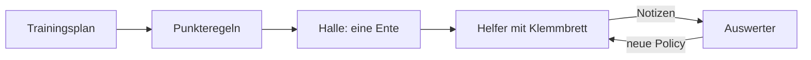

# 14 Der Lehrer – eine Trainingshalle für die Ente

> **Dein Level:** Du schaust in Kerns eigene Trainingshalle. Dutzende Enten üben dort gleichzeitig,
> bis aus Zufallszahlen ein Netz geworden ist, das die Micro Duck springen lässt. Du erfährst, wie der
> Lehrer arbeitet und warum er auf jedem Gerät bis zur letzten Stelle dasselbe Netz baut.

> **Wörter, die du brauchst:**
> - **Netz** – eine Rechenmaschine aus sehr vielen Zahlen, wie ein Mischpult mit unzähligen Reglern
> - **Belohnung** – Punkte, die die Ente für gute Bewegungen bekommt und für schlechte verliert
> - **Rauschen** – ein bisschen Zufall, der beim Lernen zu jeder Bewegung dazukommt
> - **Episode** – ein Versuch von Anfang bis Ende, bis zum Sturz oder bis die Zeit um ist
> - **Policy** – die Entscheidungsregel der Ente: Was tue ich, wenn ich das hier messe?
> - **Actor** – die Spielerin: das Netz, das entscheidet und später ins Studio kommt
> - **Kritiker** – der Trainer am Rand: schätzt, wie viele Punkte noch zu erwarten sind
> - **Iteration** – eine Trainingsrunde: alle Enten probieren, dann wird daraus gelernt

Der **Lehrer** ist Kerns eigenes Trainingsprogramm für die Micro Duck. Er bringt ihr neue Bewegungen
bei, zum Beispiel einen Sprung. Er läuft auf einem großen Rechner und genauso im Browser, auf Computer
und Handy.

Das Wichtigste zuerst: Die Ente im Lehrer ist **dieselbe** wie im Studio – dieselbe Spielwelt,
dieselben Servos und Sensoren, dieselbe Physik ([Kapitel 13](13-micro-duck.md)). Darum läuft ein Netz,
das hier gelernt hat, ohne jede Änderung im Studio. Auf dem echten Roboter ist ein selbst trainiertes
Netz nicht erprobt: Wer es auf Hardware lädt, tut das auf eigenes Risiko – und nur zusammen mit einem
Erwachsenen ([Kapitel 16](16-kalibrierung.md)).

So sind Kerns zwei eigene Netze entstanden: der **Sprung** und die **Spielschicht** (Ball und Socke).
Wie du selbst eins trainierst, steht in [Kapitel 15](15-eigene-modelle.md).

> **Für Profis:** Simulation, Lernen und Export sind in C++ geschrieben und laufen ohne Python und
> PyTorch, die man sonst meist zum Trainieren nimmt. Im Browser läuft derselbe Code als WebAssembly.

## Was du dafür wissen musst

Die Wörter aus dem Kasten oben hängen zusammen. Hier siehst du, wie; noch genauer erklärt es
[Anhang A](A-grundlagen-neuronale-netze.md).

**Das Netz ist ein Mischpult.** Ein neuronales Netz ist eine Rechenmaschine aus sehr vielen Zahlen,
stell sie dir als Regler an einem riesigen Mischpult vor. Vorne kommt hinein, was die Ente misst
(Neigung, Gelenkwinkel …), hinten kommen 14 Zahlen heraus: wohin jeder Servo drehen soll. Am Anfang
stehen die Regler zufällig, und heraus kommt Unsinn. **Lernen** heißt: jeden Regler ein kleines Stück
in die richtige Richtung drehen, immer wieder.

**Lernen durch Belohnung.** Niemand sagt der Ente, welche Bewegung richtig ist. Sie probiert, und
eine Regel verteilt **Punkte**: Plus fürs Aufrechtbleiben, Minus fürs Hinfallen. Ihr Ziel ist, in
einem Versuch **insgesamt** möglichst viele Punkte zu sammeln – auch die, die erst später kommen.
Damit sie überhaupt Neues entdeckt, kommt beim Lernen zu jeder Bewegung etwas **Zufall** dazu, das
**Rauschen**.

**Episode.** Ein Versuch von Anfang bis Ende heißt Episode. Er endet, wenn die Ente stürzt oder die
Zeit um ist (beim Sprung nach 2 Sekunden). Dann beginnt eine neue.

**Policy.** Die Policy ist die Entscheidungsregel der Ente: Was tue ich, wenn ich das hier messe? Das
ist das Netz mit seinem Zufall. Lernen heißt, die Policy zu verbessern.

**Spielerin und Trainer (Actor und Kritiker).** Beim Lernen gibt es zwei Netze. Der **Actor** ist die
Spielerin: Er entscheidet, was die Ente tut. Der **Kritiker** ist der Trainer am Rand: Er schätzt, wie
viele Punkte von einer Lage aus noch zu erwarten sind. Lief es besser als geschätzt, war die Bewegung
gut. Auf den Platz, also später ins Studio und auf den Roboter, darf nur die Spielerin.

## 14.1 Überblick

Der Lehrer bringt der Ente einen Sprung in drei Schritten bei, so wie du vielleicht ein Kunststück
auf dem Skateboard lernst:

1. **Ein Vorbild suchen:** Ein Suchverfahren probiert viele Sprünge durch, bis einer klappt.
2. **Nachmachen:** Das Netz lernt, dieses Vorbild nachzuahmen.
3. **Üben:** Das Netz übt selbst weiter und sammelt Punkte, bis der Sprung sicher sitzt – auch mit
   einer etwas anderen Ente.

Was davon schon fertig ist:

| Teil | Stand |
|---|---|
| Simulation, Netz, Lernen mit Belohnung, Speichern als Datei | fertig |
| Variation, Lernen im Browser, überall gleiches Ergebnis | fertig |
| Sprung: Vorbild → Nachmachen → Üben | fertig |
| Servos des echten Roboters nachmessen | Werkzeug fertig, echte Messungen fehlen noch |
| Spielen mit Ball und Socke | in Überarbeitung |

Was „Variation“ und „überall gleiches Ergebnis“ bedeuten, erklären 14.3 und 14.7, das Nachmessen
[Kapitel 16](16-kalibrierung.md). Die Dateien und Programmteile stehen im blauen Buch, Kapitel 14.

## 14.2 Architektur

Der Lehrer teilt die Arbeit in fünf Rollen auf. Dadurch können die Rollen an verschiedenen Orten
laufen: auf vielen **Rechenkernen** eines Computers – ein Prozessor hat mehrere davon, und jeder kann
für sich rechnen – oder in mehreren Helfern im Browser (14.11).

> **So kannst du es dir vorstellen:** eine Sportschule. Der **Trainingsplan** (das Rezept) legt fest,
> was geübt wird und wie. Die **Punkteregeln** (die Aufgabe) sagen, wofür es Punkte gibt. In jeder
> **Halle** (der Umgebung) turnt eine Ente. **Helfer mit Klemmbrett** (die Sammler) schreiben alles
> mit. Der **Auswerter am Schreibtisch** (der Lerner) liest alle Notizen und schreibt neue Anweisungen –
> die neue Policy. Die bekommen die Helfer für die nächste Runde.

Eine solche Runde – alle Enten probieren, der Auswerter lernt daraus – heißt **Iteration**. Ein
Training hat Hunderte bis Tausende davon.

Der Trainingsplan ist überall derselbe, auf dem Rechner wie im Browser. Das ist eine Voraussetzung
dafür, dass überall dasselbe Netz herauskommt (14.7).

> **Für Profis:** Sammler und Lerner packen ihre Daten in einfache Zahlenreihen, die man zwischen
> Rechenkernen oder Browser-Helfern verschicken kann. Die ganze Trainingsschleife ist darum nur wenige
> Zeilen lang; sie steht im blauen Buch, Kapitel 14.

## 14.3 Die Umgebung der Ente

### Ein Schritt ist ein Regeltakt

Die Umgebung ist eine Ente in ihrer eigenen kleinen Welt, ohne Bild – es wird nur gerechnet. Jeder
Schritt ist ein **Regeltakt** von 20 Millisekunden, also 50 Schritte pro Sekunde. In jedem Takt läuft
derselbe Kreislauf:

1. **Schauen:** Die Ente misst, wie sie gerade steht: Neigung, Gelenkwinkel, Fußkontakt.
2. **Entscheiden:** Das Netz rechnet daraus 14 Servoziele.
3. **Bewegen:** Die Servos drehen, die Physik rechnet weiter. Ab und zu bekommt die Ente einen
   kleinen Schubs.
4. **Punkte:** Die Aufgabe prüft die neue Lage, verteilt Punkte und sagt, ob die Episode zu Ende ist.

Dann beginnt der Kreislauf von vorn.

> **So kannst du es dir vorstellen:** wie beim Fahrradfahren. Du spürst, dass du kippst, lenkst ein
> bisschen gegen, spürst wieder – nur dass die Ente das 50-mal pro Sekunde macht.

### Die Aufgabe

Die **Aufgabe** sind die Punkteregeln: womit eine Episode beginnt, wofür es Punkte gibt und wann
Schluss ist. Jeder Punkte-Posten hat einen **Namen**, etwa „aufrecht“ oder „Sturz“. So kann man später
für jeden Posten einzeln nachsehen, woher die Punkte kamen (mit dem Kommandozeilen-Programm,
[Kapitel 15](15-eigene-modelle.md)).

Die Punkte werden pro Takt verteilt, und zwar so, dass es auf die **Zeit** ankommt. Jeder Posten hat
dazu ein **Gewicht**: eine Zahl, die sagt, wie viel dieser Posten zählt (mit den Gewichten im Netz aus
[Anhang A](A-grundlagen-neuronale-netze.md) hat das nichts zu tun). Ein Takt dauert 20 Millisekunden,
das sind **0,02 Sekunden**. Rechnen wir den Posten „aufrecht“ mit dem Gewicht 2 durch: Steht die Ente
perfekt gerade, bringt jeder Takt Gewicht × Taktdauer = 2 × 0,02 = 0,04 Punkte. Eine Sekunde hat
50 Takte, also 50 × 0,04 = **2 Punkte pro Sekunde**. Ein Sturz dagegen zählt einmal und auf einen
Schlag.

Eingebaut sind zwei Aufgaben. **Stehen** ist der Schnelltest: kurz stehen bleiben, Punkte fürs
Aufrechtbleiben, für die Grundstellung und die richtige Höhe, ein kleiner Abzug fürs Zappeln; ein
Sturz kostet Punkte und beendet die Episode. **Springen** kommt in 14.6.

### Der asymmetrische Kritiker

Actor und Kritiker sehen **nicht** dasselbe – darum „asymmetrisch“, also ungleich. Der Actor sieht nur,
was die Sensoren des Roboters liefern, mit allen Messfehlern. Nur er kommt später auf den Roboter. Den
Kritiker gibt es nur beim Lernen. Er bekommt die Messwerte ohne Fehler und dazu Dinge, die kein Sensor
misst, beim Sprung etwa die wahre Höhe des Rumpfs und ob die Ente schon in der Luft war. So schätzt er
genauer, und seine Urteile werden besser.

> **So kannst du es dir vorstellen:** Die Spielerin auf dem Platz sieht nur, was vor ihr passiert. Der
> Trainer am Rand hat die Zeitlupe. Seine Tipps werden dadurch besser – spielen muss aber sie.

### Variation

Der echte Roboter ist nie genau so wie die Simulation. Mal ist ein Servo etwas schwergängiger, mal
der Boden glatter. Darum baut der Lehrer für jede Episode eine **etwas andere Ente**. Das heißt
**Variation** (Fachwort: Domain Randomization).

| Bereich | Was sich ändert |
|---|---|
| Start | Blickrichtung, leichte Schräglage, Glätte des Bodens |
| Bau | Gewicht und Schwerpunkt des Körpers |
| Servos | Reibung, Verzögerung |
| Sensoren | kleine Messfehler (nur beim Actor) |
| Stöße | ab und zu ein Schubs |

Ein Netz, das nur mit **einer** Masse und **einem** Boden stehen kann, steht auf dem echten Roboter
nicht. Mit Variation lernt es, sich auf nichts zu verlassen, was die Simulation nicht genau weiß.

Die Schubser kommen erst, wenn die Ente schon etwas kann – wie im Sport: Erst übst du ohne Gegner,
später kommt einer dazu. Die Übung wird also mit der Zeit schwerer. So etwas heißt **Lehrplan**.
Gemessen wird jedes Netz am Ende zweimal: auf dem **sauberen** Roboter ohne Variation und mit
**voller** Variation. Die genauen Bereiche stehen im blauen Buch, Kapitel 14.

### Zufall, der sich wiederholt

Der Zufall im Lehrer ist ein besonderer Zufall: Er wiederholt sich. Ein Computer würfelt nicht
wirklich, er rechnet Zufallszahlen aus einer **Startzahl** aus, dem **Seed**. Gleicher Seed – gleiche
Zahlenreihe, jedes Mal.

> **So kannst du es dir vorstellen:** ein Würfel, der immer dieselbe Reihe würfelt, wenn du ihm
> dieselbe Nummer sagst. Mit Nummer 1 kommt vielleicht 4, 2, 6, 6, 1 … und beim nächsten Mal mit
> Nummer 1 wieder genau 4, 2, 6, 6, 1.

Jede Ente bekommt ihre eigene Zahlenreihe, ausgerechnet aus dem Seed und ihrer Nummer. Darum lässt
sich jeder Lauf genau wiederholen – und ein Fehler, der einmal passiert ist, passiert beim nächsten
Mal wieder und lässt sich finden.

> **Für Profis:** Der Zufallsgenerator heißt splitmix64. Die Formel für die Startzahl jeder Ente steht
> im blauen Buch, Kapitel 14.

## 14.4 Das Netz und seine Helfer

Das Netz des Sprungs ist ein Mischpult mit mehreren **Schichten**: Die Messwerte gehen durch drei
Zwischenschichten, dann kommen die 14 Servoziele heraus. Wie ein einzelner Rechenknoten rechnet und
wie die Regler gedreht werden, zeigt [Anhang A](A-grundlagen-neuronale-netze.md) Schritt für Schritt.
Drei Helfer arbeiten mit dem Netz zusammen.

**Der Umrechner (Normalisierer).** Die Messwerte der Ente sind sehr verschieden groß: Ein Gelenkwinkel
ist vielleicht 0,3, eine Drehgeschwindigkeit 25. Bevor das Netz rechnet, bringt der Umrechner alle auf
eine ähnliche Größe. Er merkt sich dazu laufend, wie groß jeder Wert normalerweise ist.

> **So kannst du es dir vorstellen:** In einer Klasse mit Noten von 1 bis 6 und einem Test mit 0 bis
> 100 Punkten kann man beides erst vergleichen, wenn man es auf dieselbe Skala umrechnet.

**Der Warmstart.** Der Lehrer fängt nicht bei null an. Er nimmt das fertige Lauf- und Stehnetz von
Pollen Robotics (velstand, [Kapitel 13](13-micro-duck.md)) samt Umrechner als Startpunkt – ein Netz,
das schon stehen kann. Der Sprung braucht aber eine neue Eingabe, die velstand nie gesehen hat: wie
weit der Sprung schon fortgeschritten ist (14.6). Deren Regler stehen am Anfang auf 0. So handelt das
neue Netz zuerst genau wie das alte und lernt erst nach und nach, die neue Eingabe zu nutzen.

**Der Regler-Dreher (Adam).** Ein kluger Regler-Dreher namens Adam dreht beim Lernen die Regler. Er
wählt für jeden Regler eine passende Schrittgröße und hat etwas Schwung, wie eine rollende Kugel.
Davor sitzt eine **Notbremse**: Sagt eine Rechnung einmal „dreh alles ganz weit“, wird der Schritt
trotzdem auf eine feste Höchstlänge gekürzt. So kann ein einziger Ausreißer das Netz nicht
zerstören. Beides erklärt [Anhang A](A-grundlagen-neuronale-netze.md) mit Bildern.

> **Für Profis:** Die genaue Form der Schichten, die Formel des Umrechners und die Einstellungen von
> Adam stehen im blauen Buch, Kapitel 14.

## 14.5 PPO Schritt für Schritt

**PPO** heißt das Verfahren, mit dem die Ente durch Belohnung lernt – dasselbe, mit dem auch Pollen
Robotics die Netze der Micro Duck trainiert. Die Idee in einem Satz: **in kleinen, vorsichtigen
Schritten besser werden.**

> **So kannst du es dir vorstellen:** Du schmeckst eine Suppe ab. Nach jedem Probieren gibst du eine
> Prise Salz dazu, nicht den halben Streuer. Denn was du geschmeckt hast, gilt für die Suppe von eben.
> Kippst du zu viel hinein, ist die Suppe verdorben, und jedes weitere Probieren schmeckt nur noch
> nach Salz.

Bei der Ente ist es genauso: Alles, was die Helfer aufgeschrieben haben, stammt von der **alten**
Policy. Der Auswerter lernt aber **mehrmals hintereinander aus denselben Notizen** – das spart
Rechenzeit, denn neue Notizen zu sammeln ist teuer. Mit jedem Durchgang entfernt sich die Policy
weiter von der, die die Notizen geschrieben hat. Ändert sie sich zu stark, passen die Notizen nicht
mehr – und eine gute Ente kann in einem einzigen Schritt alles verlernen. Darum braucht PPO eine
Bremse.

Eine Iteration läuft so ab:

1. **Probieren:** Jede Ente macht 48 Takte. Das Netz nennt in jedem Takt sein Wunschziel, dazu kommt
   etwas Rauschen. So probiert jede Ente leicht andere Bewegungen. Eine Iteration ist nur ein
   **Ausschnitt**: Eine Episode (beim Sprung 2 Sekunden = 100 Takte) bricht nach 48 Takten nicht ab,
   sondern läuft in der nächsten Iteration einfach weiter. Erst ein Sturz oder das Zeitende startet
   sie neu.
2. **Ordnen:** Der Auswerter legt alle Notizen in eine **feste Reihenfolge**, Takt für Takt, Ente für
   Ente. Warum das wichtig ist, zeigt 14.7.
3. **Bewerten:** Für jede Bewegung fragt er: Lief es danach **besser oder schlechter als erwartet**?
   Erwartet heißt: so viele Punkte, wie der Kritiker geschätzt hatte. Die Differenz heißt **Vorteil**.
4. **Verbessern:** Bewegungen mit Plus werden etwas wahrscheinlicher, solche mit Minus etwas
   unwahrscheinlicher – aber nie viel auf einmal.
5. **Wiederholen** mit der neuen Policy.

Ein Beispiel zu Schritt 3: Der Kritiker schätzt, dass die Ente von hier aus noch 5 Punkte holt. Sie
holt 7. Vorteil: 7 − 5 = **+2**, die Bewegung war gut und wird etwas häufiger. Holt sie nur 3, ist der
Vorteil −2, und die Bewegung wird seltener.

Wie vorsichtig „nie viel auf einmal“ ist, regelt Kern dreifach:

- Pro Iteration darf eine Bewegung höchstens um etwa ein Fünftel wahrscheinlicher oder
  unwahrscheinlicher werden. Beispiel: Wählte die alte Policy eine Bewegung in 10 von 100 Fällen,
  darf die neue sie höchstens in etwa 12 von 100 Fällen wählen, auch wenn sie noch so gut war.
- Hat sich die Policy schon stark verändert, wird der nächste Schritt automatisch kleiner. Die Größe
  der Schritte heißt **Lernrate**.
- Ein kleiner **Neugier-Bonus** sorgt dafür, dass das Rauschen nicht zu früh verschwindet und die Ente
  weiter Neues ausprobiert.

Noch ein Detail mit Sinn: Endet eine Episode mit einem **Sturz**, kommen danach keine Punkte mehr. Endet
sie, weil die **Zeit um** ist, wäre es eigentlich weitergegangen – dann schätzt der Kritiker, wie viele
Punkte noch gekommen wären. Zeitablauf ist kein Scheitern.

> **Krass, aber wahr:** 32 Enten × 48 Takte = 1536 Takte pro Iteration. Jeder Takt sind 0,02 s, also
> sammelt der Lehrer pro Iteration 1536 × 0,02 s ≈ 31 Sekunden Entenleben.

**Kritiker zuerst:** Nach dem Nachmachen (14.6) ist die Spielerin schon gut, der Trainer aber
ahnungslos – er hat die neue Spielerin noch nie gesehen. Seine falschen Urteile würden ihr alles
kaputtmachen. Darum lernt in den ersten Runden **nur der Kritiker**.

**Spielstand:** Der Lehrer kann den ganzen Lernstand speichern, wie einen Spielstand. Ein Training
lässt sich unterbrechen und genau dort fortsetzen.

> **Für Profis:** Alle Einstellungen des Sprungs (wie viele Lernschritte pro Iteration, wie weit
> vorausgeschaut wird, die Formeln für Vorteil und Lernrate) stehen im blauen Buch, Kapitel 14.

## 14.6 Nachahmen, Vorbilder und CMA-ES

### Warum Lernen durch Belohnung allein scheiterte

Reines PPO hat den Absprung nie gefunden, egal mit welchen Einstellungen. Drei Gründe:

- Für den Absprung müssen **alle Beinservos gleichzeitig** mit voller Kraft drücken. Die Servos sind
  weich: Volle Kraft geben sie erst, wenn das Ziel weit vom jetzigen Winkel entfernt ist. Das Netz
  muss also absichtlich weiter zielen, als das Gelenk überhaupt drehen kann. Durch zufälliges
  Ausprobieren passiert das praktisch nie.
- Stehen ist sicher und bringt Punkte. Ein missglückter Versuch kostet einen Sturz.
- Mit nur ein paar Dutzend Enten sind die Notizen jeder Runde wenige und zufällig. Die Richtung, in
  die gelernt wird, wackelt darum stark, und die Bremse aus 14.5 hält die Schritte klein. Wie eine
  Umfrage mit nur drei Leuten: Das Ergebnis springt hin und her, und du traust dich nicht, viel
  daraus zu machen.

> **So kannst du es dir vorstellen:** Du tippst zufällig auf einer Tastatur und hoffst, dass ein
> Gedicht herauskommt. Ein Buchstabe stimmt vielleicht mal – aber dass alle gleichzeitig stimmen,
> erlebst du nicht.

Darum: **Vorbild suchen → Nachmachen → Üben.** Das Vorbild gibt es nur beim Lernen; im Studio springt
allein das Netz.

### Ein Sprung in 15 Zahlen

Das Vorbild ist ein Sprung, beschrieben mit nur **15 Zahlen**: wohin Hüfte, Knie und Knöchel des
linken Beins zu fünf Zeitpunkten zielen sollen – **Hocke, Abdruck, Anziehen, Landen, Abfedern**. Das
rechte Bein macht es spiegelbildlich. Vor und nach dem Sprung hält velstand die Balance.

Die 15 Zahlen findet ein Suchverfahren namens **CMA-ES**, das wie die Evolution arbeitet:

1. Es streut viele Kandidaten um eine Mitte herum – eine **Suchwolke**.
2. Jeder Kandidat springt mehrmals: einmal auf dem sauberen Roboter, die anderen Male mit Variation.
   Dabei springen in einer Generation **alle Kandidaten auf denselben** zufälligen Enten, und jede
   neue Generation bekommt andere. So ist der Vergleich fair – wie bei einem Wettlauf, bei dem alle
   auf derselben Bahn bei demselben Wind laufen. Und weil die Enten jede Generation wechseln, gewinnt
   kein Vorbild, das nur auf ein paar bestimmten Enten klappt.
3. Es gibt Punkte fürs Steigen, für Flugzeit und Höhe, fürs Landen auf beiden Sohlen und für einen
   echten Sprung. Abzug gibt es fürs Kippen und für Stürze – frühe Stürze kosten mehr.
4. Die Wolke wandert zu den besseren Kandidaten. Dann beginnt die nächste Generation.

> **So kannst du es dir vorstellen:** Topfschlagen mit vielen Mitspielern. Alle tasten an
> verschiedenen Stellen, und wer „heiß“ hört, zieht die ganze Gruppe ein Stück in seine Richtung.

Am Ende nimmt der Lehrer die **Mitte der Suchwolke**, nicht den besten Kandidaten. Warum? Weil jede
Bewertung etwas Zufall enthält: Der Beste kann einfach Glück gehabt haben. Die Mitte ist der
Durchschnitt vieler guter Kandidaten und darum verlässlicher. Das eingebaute Vorbild entstand in
einigen Hundert Generationen.

### Nachahmen mit DAgger

Nachmachen klingt einfach: Das Vorbild springt, das Netz schaut zu und lernt. Das hat aber einen
Haken. Das Netz kennt dann nur Lagen, in die das Vorbild gerät. Macht es selbst einen kleinen Fehler,
landet es in einer Lage, die es nie gesehen hat. Dort macht es einen größeren Fehler – und die Fehler
wachsen. Das heißt **Verteilungsverschiebung**.

> **So kannst du es dir vorstellen:** Radfahren lernst du nicht, indem du nur zuschaust. Du musst
> selbst fahren, und jemand läuft nebenher und ruft: „Jetzt nach links lenken!“

Genau das macht **DAgger**: Das Netz fährt selbst, und das Vorbild sagt in jedem Takt, was **es** jetzt
getan hätte.

1. **Runde 0:** Das Vorbild springt, und jede Lage wird mit seiner Bewegung beschriftet.
2. **Ab Runde 1:** Das Netz springt selbst. Das Vorbild schreibt zu jeder Lage, was es getan hätte.
3. Nach jeder Runde lernt das Netz aus **allen** bisherigen Beispielen.

So landen genau die Lagen in der Sammlung, in die das Netz selbst gerät – mit der richtigen Antwort.
Dafür muss das Vorbild in jeder Lage eine sinnvolle Antwort haben. Nach 8 Runden kann das Netz
springen, und dann **übt** es mit PPO weiter: mit wenig Rauschen, Kritiker zuerst, voller Variation
und Extrapunkten, solange es nah am Vorbild bleibt.

### Die Aufgabe „Springen“

Woher weiß das Netz, **wann** im Sprung es gerade ist? Es bekommt ein **Phasensignal**.

> **So kannst du es dir vorstellen:** eine Uhr mit einem einzigen Zeiger, der in 2 Sekunden einmal
> herumläuft. Zu Beginn der Episode zeigt er nach rechts, nach einer Viertelrunde – einer halben
> Sekunde – nach oben. Das Netz bekommt die zwei Koordinaten der Zeigerspitze, mehr nicht.

Sonst gibt es keine Hilfe: kein Skript, keine Kräfte von außen. Die ganze Bewegung kommt allein aus
den 14 Servozielen des Netzes. Eine Episode dauert 2 Sekunden. Die wichtigsten Punkte-Posten:

| Posten | Wofür |
|---|---|
| fliegen, abdrücken | viele Punkte, aber nur aufrecht |
| landen | Punkte fürs Landen auf beiden Sohlen |
| nachahmen | Punkte, solange es nah am Vorbild ist |
| aufrecht / kippen | Plus fürs Aufrechtbleiben, Abzug fürs Kippen |
| nachhüpfen, rutschen | Abzug |
| zappeln | Abzug, wird mit der Zeit größer |
| Sturz | großer Abzug, einmalig, wird mit der Zeit größer |

Eine Episode endet sofort bei einem Sturz **und bei jedem Bodenkontakt eines Teils, das keine Sohle
ist**.

> **Vorsicht, Falle:** Ohne diese Regel lernt das Netz, sich auf Schnabel oder Schwanz zu stützen.
> Für die Punkte ist das die sicherste Wette – aber kein Sprung.

**Ein echter Sprung** heißt: mindestens 60 Millisekunden lang sind alle Teile in der Luft, der Rumpf
steigt dabei mindestens 5 Millimeter, die Ente kippt nie mehr als 30°, und am Ende steht sie aufrecht
auf beiden Sohlen. Nur die Füße anziehen gilt nicht.

## 14.7 Determinismus

**Deterministisch** heißt: gleiche Eingabe, gleiches Ergebnis – bis zur allerletzten Stelle. Bei Kern
gilt das auf ganz verschiedenen Computern und im Browser. Wozu? Ein Fehler in der Simulation wird
dadurch zu einem festen Fehler, den man wiederholen und finden kann, statt zu einem Rauschen, das auf
jedem Rechner anders aussieht.

Das klingt selbstverständlich – ist es aber nicht. Der Grund ist das **Runden**. Stell dir einen
Taschenrechner vor, der sich nur **drei Ziffern** merkt und alles andere rundet:

- (100 + 0,4) + 0,4: Erst 100 + 0,4 = 100,4, gerundet **100**. Dann 100 + 0,4 = 100,4, gerundet
  **100**.
- 100 + (0,4 + 0,4): Erst 0,4 + 0,4 = 0,8. Dann 100 + 0,8 = 100,8, gerundet **101**.

Dieselben drei Zahlen, nur in anderer Reihenfolge addiert – und ein anderes Ergebnis! Ein Computer
merkt sich viel mehr Ziffern, aber nicht unendlich viele. An der letzten Stelle passiert genau
dasselbe.

> **So kannst du es dir vorstellen:** der Schmetterling. Wetterforscher sagen, dass ein einziger
> Flügelschlag Wochen später über das Wetter ganz woanders entscheiden kann – winzige Unterschiede
> wachsen. Bei der Ente genauso: Eine andere letzte Stelle, und nach ein paar Sekunden setzt sie einen
> Fuß anders auf. Dann läuft sie einen anderen Gang, und am Ende kommt ein anderes Netz heraus.

Was Kern dafür tut:

- **Immer gleich runden:** Manche Prozessoren rechnen „mal und plus“ in einem Zug und runden nur
  einmal, andere zweimal. Kern verbietet den Abkürzungsweg, damit alle gleich runden.
- **Eigene Mathe:** Sinus, Kosinus und Co. rechnet jedes Betriebssystem an der letzten Stelle ein
  bisschen anders. Kern bringt seine eigene Version mit und nutzt überall dieselbe.
- **Feste Reihenfolge:** Jede Ente bekommt ihren Zufall aus ihrer eigenen Nummer, nicht aus dem Helfer,
  der sie gerade rechnet. Und der Auswerter addiert immer in derselben Reihenfolge – egal, wie viele
  Helfer mitrechnen. Das ist genau die Lehre aus dem Taschenrechner.

Darum gilt: **Gleicher Seed und gleich viele Enten ergeben dasselbe Netz** – auf einem Rechenkern, auf
16 Rechenkernen oder in 4 Browser-Helfern. Mehr Helfer machen es nur schneller.

Geprüft wird das mit einem **Fingerabdruck**: Eine Ente läuft 400 Takte, und nach jedem Takt wird aus
ihrer genauen Lage eine Prüfzahl gebildet, ähnlich wie eine Quersumme. Diese Prüfzahlen werden auf
allen Plattformen verglichen. Weichen sie ab, zeigt der erste abweichende Takt, wo zwei Rechner
auseinanderlaufen.

> **Für Profis:** Wer selbst Code für Kerns Simulation schreibt, muss diese Regeln einhalten: Kerns
> eigene Mathefunktionen statt der des Systems, Summen in fester Reihenfolge, keine
> „schnelle-Mathe“-Einstellung beim Übersetzen. Die genauen Schalter stehen im blauen Buch,
> Kapitel 14; wie Kern gebaut wird, in [Kapitel 2](02-bauen-und-testen.md).

## 14.8 Die Spielschicht lernen

Die **Spielschicht** ([Kapitel 13](13-micro-duck.md)) ist ein zweites, kleineres Netz. Sie entscheidet
nicht, wie die Beine sich bewegen, sondern **was** die Ente als Nächstes tut:

> Ziel suchen → hingehen → anhalten → kicken oder aufheben → tragen → ausspucken

Für das Gehen und den Kick selbst sorgen weiter die Netze von Pollen Robotics. Die Spielschicht
entscheidet 25-mal pro Sekunde und lernt wie der Sprung: Vorbild, Nachmachen mit DAgger, Üben mit PPO.

In jeder Episode liegt ein Ball, eine Socke oder beides vor der Ente, mal direkt vor ihr, mal hinter
ihr. Bälle sind verschieden groß, schwer und rollig. Dazu kommt Variation, auch für die Kamera: Sie
erkennt Ball und Socke ungenau und übersieht sie manchmal. Punkte gibt es, wenn die Ente dem Ziel
näher kommt, die Socke aufhebt und festhält, den Ball wegkickt oder die Socke ein Stück weiter
wieder ausspuckt. Jede Sekunde ohne Erfolg kostet ein bisschen, ein Sturz viel.

**Das Vorbild darf nicht mehr wissen als das Netz.** Es sieht nur dieselben Messwerte wie das Netz und
merkt sich fast nichts. Warum? Sonst kann das Netz es nicht nachmachen. Das wäre wie ein Lehrer, der
in die Lösung schaut: Er weiß das Ergebnis, aber du kannst seinen Weg nicht nachvollziehen. Jede
Entscheidung des Vorbilds folgt darum aus dem, was das Netz jetzt sieht, und daraus, wie lange es
schon steht. Wie man solche Regeln entwirft, steht in [Kapitel 15](15-eigene-modelle.md), Abschnitt
15.10.

**Selbst gemessen statt hingeschrieben:** Wo der Schnabel eine Socke gut greift, misst der Lehrer bei
jedem Lauf neu: Er legt die Socke an vielen Stellen vor die Ente und prüft, wo sie nach 3 Sekunden
Tragen noch im Schnabel ist. Keine Bissstelle steht als feste Zahl im Programm. Ändert sich die Physik,
stimmt die Messung trotzdem.

**Ergebnis.** Kerns Spielnetz wurde in 32 Probe-Episoden geprüft, einmal auf dem sauberen Roboter
und einmal mit voller Variation. In 11 davon lag nur ein Ball, in den anderen 21 eine Socke (manchmal
zusätzlich ein Ball). Darum zählt der Ball von 11 und die Socke von 21:

| Ergebnis | sauber | Variation |
|---|---|---|
| Ball weggekickt | 9 von 11 | 7 von 11 |
| Socke getragen, ausgespuckt | 1 von 21 | 0 von 21 |
| Stürze | 2 von 32 | 10 von 32 |

Den Ball kickt das Netz meistens weg, die Socke bringt es fast nie ans Ziel. Der **Ball ist
gelernt**. Die Socke steuert das Netz genauso richtig an, aber der Biss hält selten:
Der Schnabel rutscht auf der Baumwolle ab. Der Engpass ist also der **Griff in der Physik, nicht die
Entscheidung**. Darum heißt es in der Tabelle in 14.1: in Überarbeitung.

> **Für Profis:** Wie groß das Spielnetz ist, wie oft Ball und Socke vorkommen, wie viele Punkte
> jeder Posten bringt und die ganze Ergebnistabelle stehen im blauen Buch, Kapitel 14.

## 14.9 Ergebnisse des Sprungs

Kerns Sprungnetz wurde mit 32 Enten trainiert, Seed 1, und dann je 40 Episoden lang geprüft:

| Messung | sauber | volle Variation |
|---|---|---|
| echte Sprünge | 40 von 40 | 36 von 40 |
| Kippen (größtes, im Mittel) | 8° | 9° |
| Stürze | 0 | 0 |

Das Netz springt also fast immer echt, auch mit einer veränderten Ente, und fällt dabei nie. Der Weg
dahin: Erst suchte der Lehrer einmalig das Vorbild. Danach sprang das Netz schon während des
Nachmachens zum ersten Mal echt. Den Rest erledigte das Üben.

Weil alles überall bis zur letzten Stelle gleich gerechnet wird, gelten diese Ergebnisse auf jedem
Gerät. Nur die **Zeit** ist verschieden: Im Browser dauert es auf demselben Computer vier- bis
fünfmal so lange wie mit dem Programm – aber es kommt **dasselbe Netz** heraus.

> **Für Profis:** Der Browser ist langsamer, weil er ohne bestimmte Beschleuniger rechnet. Die Physik
> ließe sich auch mit halb so vielen Unterschritten rechnen und wäre dann schneller – aber die
> Bewegungen der Ente würden sich ändern, und das Netz passte nicht mehr zum Studio. Wie hoch und wie
> lange die Ente fliegt und alle Zeiten stehen im blauen Buch, Kapitel 14.

> **Mission:** Öffne Kern Studio auf https://kernengine.de/ und lade
> **Datei › Beispiel-Levels › Micro Duck** (File › Example Levels › Micro Duck); läuft gerade
> **Spielen** (Play) oder **Simulieren** (Simulate), erst mit Esc stoppen. Starte **Spielen**,
> übernimm die Ente mit F8 und drücke **7**. Das ist das Sprungnetz aus diesem Kapitel. Auf dem Handy
> heißt der Knopf **HÜPFEN** (HOP).
> Schau genau hin: Hocke, Abdruck, Anziehen, Landen, Abfedern – erkennst du die fünf Zeitpunkte des
> Vorbilds wieder?

## 14.10 ONNX-Export und Metadaten

Das fertige Netz wird als Datei im Format **ONNX** gespeichert. ONNX ist wie PDF für Netze: Ganz
verschiedene Programme können die Datei öffnen – das Studio genauso wie die Software des echten
Roboters. Kern speichert seine Netze in genau der Form, die auch Pollen Robotics benutzt.

Gespeichert wird nur die **Spielerin**, also der Actor, mit seinem Umrechner vorne dran – und zwar nur
ihr Wunschziel **ohne das Rauschen**. Das Wackeln war nur zum Ausprobieren beim Lernen da; auf dem
Roboter soll sie ruhig und immer gleich entscheiden. Der Kritiker bleibt zu Hause; er wird nur beim
Lernen gebraucht. Dazu kommt ein **Beipackzettel** (die
Metadaten): die Namen der Gelenke, die Grundstellung, welche Aufgabe das Netz kann und dass Kern es
trainiert hat.

Zur Sicherheit liest Kern die Datei nach dem Speichern selbst wieder ein und prüft, dass das Netz
dasselbe rechnet wie vorher.

> **Für Profis:** Wie die Datei innen aufgebaut ist und welche Einträge der Beipackzettel genau hat,
> steht im blauen Buch, Kapitel 14.

## 14.11 Der Lehrer im Browser

Den Lehrer kannst du selbst im Browser laufen lassen. Die Startseite https://kernengine.de/ verlinkt
ihn. Damit das schnell geht, verteilt die Seite die Arbeit auf mehrere **Helfer** (Fachwort: Web
Worker). Ein Helfer ist ein Programmteil, das im Hintergrund rechnet, und jeder kann einen eigenen
**Rechenkern** deines Prozessors benutzen.

> **So kannst du es dir vorstellen:** Ein Prozessor mit mehreren Rechenkernen ist wie eine Küche mit
> mehreren Köchen. Jeder Koch kann gleichzeitig etwas anderes schnippeln.

Jeder Helfer ist ein **Sammler** mit seiner eigenen Gruppe Enten. Ein weiterer Helfer ist der
**Auswerter**: Er lässt das Netz nachmachen, lernt mit PPO, prüft alle 25 Iterationen den Sprung und
speichert das Netz.

Du stellst ein: welche Bewegung (Sprung oder „Stehen“ als Schnelltest), wie viele Helfer (auf der
Seite „Worker“), wie viele Enten je Helfer, wie viele Iterationen und den Seed. Zwei weitere Felder
für Rauschen und Lernrate kannst du leer lassen, dann gilt der Trainingsplan. Die Seite zeigt dir,
was passiert, als Zahlen und als Kurve. Was die Zahlen bedeuten, erklärt
[Kapitel 15](15-eigene-modelle.md).

Alle 25 Iterationen speichert die Seite das Netz **auf deinem Gerät**, und Kern Studio im selben
Browser übernimmt es sofort. Mit „.onnx herunterladen“ bekommst du die Datei. Die Spielschicht lässt
sich hier nicht trainieren, nur Sprung und Stehen.

> **Mission:** Öffne den Lehrer, wähle „Stehen (Schnelltest)“ und drücke Start. Rechne: Worker × Enten
> je Worker = Enten insgesamt. Wie viele Schritte pro Sekunde schafft dein Gerät? Das ist die Anzeige
> „Schritte / s“.

> **Mission:** Teste den Determinismus. Wähle „Stehen (Schnelltest)“, lass Seed auf 1 und trage bei
> „Iterationen“ **20** ein. Drücke Start und warte, bis die Seite „Fertig“ meldet. Schreib die Zahl
> bei „mittlere Episoden-Rückgabe“ auf. Lade die Seite neu, trag wieder 20 ein, ändere sonst nichts und
> starte noch einmal. Stimmt die Zahl genau? Probier danach Seed 2: Jetzt kommt eine andere Zahl.

## 14.12 Tests

Ein **Test** ist ein kleines Programm, das nachprüft, ob alles noch so rechnet wie gestern. Kern lässt
seine Tests nach jeder Änderung laufen. Für den Lehrer prüfen sie unter anderem:

- ob das Netz richtig lernt und PPO eine einfache Aufgabe schafft,
- ob dieselbe Episode bis zur letzten Stelle gleich abläuft,
- ob der Fingerabdruck auf allen Plattformen stimmt,
- ob 1, 2 oder 4 Helfer genau dasselbe Netz ergeben,
- ob die gespeicherte Datei richtig gelesen wird,
- ob die Ente im Studio wirklich echt springt,
- ob das Nachmessen der Servos funktioniert ([Kapitel 16](16-kalibrierung.md)).

Die Namen der Tests stehen im blauen Buch, Kapitel 14.

## Level geschafft!

- Du kennst die Rollen: Trainingsplan, Punkteregeln, Halle, Helfer und Auswerter.
- Du weißt, warum der Kritiker mehr sehen darf als der Actor.
- Du kannst erklären, warum jede Episode eine etwas andere Ente baut.
- Du weißt, warum PPO in kleinen, vorsichtigen Schritten lernt.
- Du kennst den Weg zum Sprung: Vorbild suchen, nachmachen, üben.
- Du weißt, was ein echter Sprung ist und warum die Regeln streng sind.
- Du kannst mit dem Drei-Ziffern-Taschenrechner zeigen, warum die Reihenfolge beim Rechnen zählt.

## Rätsel-Ecke

1. Wie oft pro Sekunde entscheidet das Netz der Ente, wohin die Servos drehen?
2. Rechne mit dem Drei-Ziffern-Taschenrechner: (200 + 0,3) + 0,3 und 200 + (0,3 + 0,3). Was lernst
   du daraus?
3. Warum bekommt nur der Actor die Messfehler der Sensoren?
4. 32 Enten auf 2 Rechenkernen gegen 32 Enten auf 16 Rechenkernen – gleiches Netz? Und mit 16 Enten?
5. **Boss-Rätsel:** Warum beendet ein Schnabel am Boden die Episode, statt nur ein paar Punkte
   abzuziehen?

### Lösungen

1. 50-mal: Ein Regeltakt dauert 20 Millisekunden, und 1000 : 20 = 50.
2. Links: 200,3 wird zu 200, und noch einmal 200,3 wird wieder 200. Rechts: 0,6 dazu ergibt 200,6, also
   201. Die Reihenfolge ändert das Ergebnis. Darum addiert Kern immer in derselben Reihenfolge.
3. Nur der Actor läuft später mit echten, ungenauen Sensoren auf dem Roboter. Er muss lernen, damit
   klarzukommen. Der Kritiker soll dagegen möglichst genau urteilen und wird später nicht gebraucht.
4. Ja, die Zahl der Rechenkerne ändert nur das Tempo. Mit 16 Enten entstehen aber andere Erfahrungen
   und darum ein anderes Netz.
5. Die Ente will in einer Episode insgesamt möglichst viele Punkte sammeln. Wäre Abstützen nur etwas
   teurer, könnte es sich lohnen: Sie fällt dann nicht und sammelt weiter Punkte fürs Aufrechtbleiben.
   Ein sofortiges Ende nimmt ihr alle späteren Punkte – so ist Abstützen nie die sichere Wette.

---

© 2026 Christian Heinrich Hohlfeld · Alle Rechte vorbehalten · [Impressum und Rechte](00-impressum.md)
