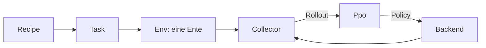

# 14 Der Lehrer – eine Trainingshalle für die Ente

> **Dein Level:** Du schaust in Kerns eigene Trainingshalle. Dutzende Enten üben dort gleichzeitig,
> bis aus Zufallszahlen ein Netz geworden ist, das die Micro Duck springen lässt. Du erfährst, wie der
> Lehrer gebaut ist und warum er auf jedem Gerät Bit für Bit dasselbe Netz baut.

Der **Lehrer** ist Kerns eigenes Trainingssystem für die Micro Duck. Simulation, Lernen und Export
sind in C++ geschrieben und laufen auf Kerns Engine und der Physik Box3D – ohne Python und PyTorch.
Er lernt auf allen Prozessorkernen eines Rechners (auch ohne Bildschirm auf einem Server) und als
WebAssembly im Browser, auf Computer und Handy.

Die Ente im Lehrer ist **dieselbe** wie im Studio: dieselbe Spielwelt, dieselben Servos und Sensoren,
derselbe Regler mit 50 Takten pro Sekunde, dieselbe Physik mit 16 Unterschritten
([Kapitel 13](13-micro-duck.md)). Ein Netz von hier läuft darum unverändert im Studio. Gespeichert wird
es im Format der Netze von Pollen Robotics. Auf dem echten Roboter ist es nicht erprobt: Wer ein selbst trainiertes Netz
auf Hardware lädt, tut das auf eigenes Risiko – und nur zusammen mit einem Erwachsenen
([Kapitel 16](16-kalibrierung.md)).

So sind Kerns Netze `jump.onnx` (der Sprung) und `play.onnx` (die Spielschicht) entstanden. Was ein
Netz ist und wie Nachahmen und Belohnung funktionieren, erklärt
[Anhang A](A-grundlagen-neuronale-netze.md). Die Bedienung steht in
[Kapitel 15](15-eigene-modelle.md).

## 14.1 Überblick

Der Code liegt in `src/lehrer/` und `include/kern/lehrer/`: Umgebung und Aufgaben, das Netz mit Adam
und Normalisierer, PPO, Threads, Rezepte, Vorbild und CMA-ES, Spielschicht, ONNX-Export, Kalibrierung,
Fingerabdruck und Browser-Schnittstelle. Dazu kommen das Werkzeug `kern_lehrer` und die Webseite.

| Schritt | Stand |
|---|---|
| Simulation, Netz, PPO, ONNX-Export | fertig |
| Variation, Browser, Determinismus | fertig |
| Sprung: Vorbild → Nachahmen → Üben | fertig |
| Digitaler Zwilling, Kalibrierung | fertig (ohne echte Messdaten) |
| Spielen mit Ball und Socke | in Überarbeitung |

## 14.2 Architektur

Der Lehrer teilt die Arbeit in fünf Rollen, damit sie an verschiedenen Orten laufen können.



> **So kannst du es dir vorstellen:** eine Sportschule. Das **Rezept** ist der Trainingsplan. Die
> **Aufgabe** (`Task`) sagt, wofür es Punkte gibt. In der **Halle** (`Env`) turnt eine Ente. **Helfer
> mit Klemmbrett** (`Collector`) schreiben mit (`Rollout`). Der **Trainer** (`Ppo`) wertet aus und gibt
> neue Anweisungen heraus (`Policy`). Das **Gebäude** (`Backend`) bestimmt, wie viele Hallen offen sind.

Die Umgebung `DuckEnv` nimmt 61 Beobachtungen und gibt 14 Aktionen; `PlayEnv` für die Spielschicht
23 und 9. Das Rezept ist überall dasselbe, im Werkzeug wie im Browser. Sammler und Lerner packen ihre
Daten in flache Zahlenpuffer, die man zwischen Threads oder Web Workern verschicken kann. Die ganze
Trainingsschleife besteht darum im Kern aus drei Zeilen:

```cpp
backend.collect(ppo.policy(), steps, it, rollouts);
ppo.set_parallel(backend.update_parallel());
return ppo.learn(ptrs);
```

Zeile 1: Alle Sammler fahren ihre Enten mit der aktuellen Policy. Zeile 2: Der Lerner darf die Threads
mitbenutzen. Zeile 3: Er lernt aus allen Rollouts. Vorher ruft das Backend die Lehrpläne auf.

## 14.3 Die Umgebung der Ente

### Ein Schritt ist ein Regeltakt

Eine `DuckEnv` baut eine Ente auf ebenem Boden in ihrer eigenen Welt, ohne etwas zu zeichnen. Der
Regler nimmt die Aktion des Lehrers: Grundstellung plus Aktion, mit der Busverzögerung des
Servoprofils. Läuft eine feste Bewegung wie Aufheben, hat sie Vorrang.

Ein Schritt ist **ein Regeltakt**, 20 Millisekunden:

1. Die Aktion geht an den Regler, die Welt rechnet 4 Weltschritte.
2. Ist es Zeit dafür, bekommt die Ente einen kleinen Schubs.
3. Eine Messsonde liest Rumpf, Schwerkraftrichtung, Sohlenkontakt, Fußhöhen und Gelenke aus – in
   echten Robotermaßen, nicht in der viermal größeren Studiowelt.
4. Die Aufgabe berechnet daraus die **Belohnung** und ob Schluss ist.
5. Die neue Beobachtung entsteht: erst das, was der Regler sieht, dann die Befehle in den Plätzen
   48–60. Der Kritiker bekommt sie **sauber**, nur der Actor zum Schluss **mit Sensorfehlern**.

### Die Aufgabe

Eine `Task` legt fest: Start, Befehle, Belohnung, Ende, Lehrpläne und was der Kritiker extra sieht.
Jede Teilbelohnung (ein **Term**) zählt als *Gewicht × Term × 0,02 s*, mit Namen, damit man sie einzeln
ansehen kann. Nur einmalige Terme wie der Sturz zählen ohne × 0,02.

Eingebaut sind zwei Aufgaben. **`stand`** ist der Schnelltest: 4 s stehen, Punkte für aufrecht (2),
Beine (2) und Hals (1) in Grundstellung, richtige Höhe (1, Ziel 0,115 m), Abzug fürs Zappeln (−0,1);
ein Sturz kostet −4 und beendet die Episode. **`jump`** ist der Sprung (14.6).

### Der asymmetrische Kritiker

Der **Actor** sieht nur, was die Sensoren liefern, mit allen Fehlern. Nur er wird exportiert. Den
**Kritiker** gibt es nur beim Lernen; er sieht alles sauber und dazu Werte, die kein Sensor misst. Beim
Sprung sind es 9: Rumpfhöhe über dem Start, Rumpftempo in x, y, z, beide Sohlenkontakte, beide
Fußhöhen und ob die Ente schon geflogen ist. So urteilt er genauer.

> **So kannst du es dir vorstellen:** Die Spielerin auf dem Platz sieht nur, was vor ihr passiert. Der
> Trainer am Rand hat die Zeitlupe. Seine Tipps werden dadurch besser – spielen muss aber sie.

### Variation

Der echte Roboter ist nie genau wie die Simulation. Darum ist jede Episode ein bisschen anders:

| Bereich | Was variiert | Wie stark |
|---|---|---|
| Start | Richtung, Neigung, Reibung | ±180°, ±3°, × 0,7–1,3 |
| Bau | Masse, Schwerpunkt | ±5 %, ±3 mm (Sprung bis 15 mm) |
| Servos | Reibung, Verzögerung | ±10 %, 15–30 ms |
| Sensoren | Rauschen, Versatz, Verzug | nur beim Actor |
| Stöße | Schubs alle 3–6 s | bis ±0,3 m/s |

Die Stöße kommen per Lehrplan: bis Iteration 300 keine, bis 500 mit 27 % Stärke, dann voll. Ein Netz,
das nur mit **einer** Masse und **einer** Reibung steht, steht auf dem echten Roboter nicht. Darum misst
Kern jedes Netz zweimal: auf dem **sauberen** Roboter und mit **voller** Variation.

### Zufall, der sich wiederholt

Der Zufallsgenerator ist **splitmix64**: Mit demselben Startwert, dem **Seed**, kommen immer dieselben
Zahlen. Jede Ente hat ihren eigenen Strom: Bei Seed s bekommt Ente k den Seed `s · 1000003 + k`.

## 14.4 Netze: `Mlp`, `Normalizer`, `Adam`

Das Netz ist ein **MLP** wie bei der Lernbibliothek rsl_rl, mit ELU zwischen den Schichten. Der
Sprung-Actor hat die Form 61 → 512 → 256 → 128 → 14. Wie ein Neuron rechnet, steht in Anhang A.

- **Start:** zufällige Gewichte zwischen −1/√n und +1/√n (n = Eingänge der Schicht), wie bei PyTorch.
- **Vorwärts:** Kern rechnet vier Eingaben auf einmal. Die Gewichte liegen so im Speicher, dass der
  Compiler beschleunigen kann, **ohne die Reihenfolge der Additionen zu ändern** (wichtig für 14.7).
- **Rückwärts:** Schicht für Schicht von hinten (Backpropagation). Ergebnisse werden **addiert**,
  damit sich Teilstücke zu einem Ganzen summieren. Ein Test prüft das gegen eine Probe-Rechnung.

Der **Normalizer** bringt jeden Eingang auf eine Größenordnung: *(x − Mittel) / (Streuung + 0,01)*.
Mittel und Streuung werden laufend nachgeführt. Er gehört fest zum Netz und steht im Export vorne in
der Datei. Beim **Warmstart** übernimmt der Lehrer ein fertiges Netz samt Normalisierer und **friert**
ihn ein. Neue Eingänge (beim Sprung die Plätze 55 und 56) bekommen Gewicht 0 – dann handelt das neue
Netz zuerst genau wie das alte.

**Adam** nutzt die Standardwerte von PyTorch. Davor sitzt eine Notbremse: Ist der Gradient länger als
1,0, wird er auf 1,0 gekürzt.

## 14.5 PPO Schritt für Schritt

Kern folgt dem PPO von rsl_rl, mit dem Pollen die Netze der Ente trainiert. Die Idee erklärt Anhang A,
hier stehen die Zahlen des Sprung-Rezepts:

| Einstellung | Sprung | Bedeutung |
|---|---|---|
| Takte je Ente | 48 | pro Iteration |
| Epochen × Minibatches | 5 × 4 | 20 Lernschritte |
| Clip | 0,2 | höchstens 20 % mehr/weniger |
| γ, λ | 0,99, 0,95 | Vorausschau |
| Lernrate | 10⁻⁴ | Startwert |
| Entropie | 0,005 | Neugier-Bonus |
| Rauschen am Anfang | 0,3 | vor dem Nachahmen |

Ohne Rezept gelten Lernrate 10⁻³, Rauschen 1,0, 24 Takte und Entropie 0,01. Der Kritiker hat in
allen Rezepten die Schichten 256 und 128.

1. **Sammeln:** Jede Ente läuft 48 Takte. Der Actor wählt sein Ziel μ, dazu kommt Rauschen:
   `a = μ + σ · ε`, mit ε aus dem eigenen Zufallsstrom der Ente.
2. **Ordnen:** Der Lerner legt alle Daten in **eine feste Reihenfolge**, Takt für Takt, Ente für Ente.
   Dann lernen die Normalisierer aus allen Zeilen.
3. **Neu bewerten:** Mit den frischen Normalisierern rechnet er die alte Policy nach. Bei wenigen
   Dutzend Enten verschieben sie sich sonst so, dass alt und neu schief verglichen würden.
4. **Vorteil (GAE):** Rückwärts durch die Zeit schätzt er, ob jede Aktion besser oder schlechter als
   erwartet war. Ein **Sturz** hat keine Zukunft (Wert 0). Bei **Zeitablauf** wird geschätzt, wie es
   weitergegangen wäre. Dann werden die Vorteile auf Mittel 0, Streuung 1 gebracht.
5. **Update:** 20 Schritte. Jede Minibatch wird in **genau 8 feste Teile** zerlegt.
   - Vorher misst der Lerner, wie weit sich die Policy schon verändert hat (die KL-Divergenz). Über
     0,02: Lernrate durch 1,5. Unter 0,005: mal 1,5.
   - Gute Aktionen werden wahrscheinlicher, aber höchstens um 20 %. Der Kritiker darf seine Schätzung
     nur um 0,2 verschieben.
   - Ein kleiner Entropie-Bonus hält σ am Leben; σ bleibt mindestens 0,001.
   - Die 8 Teile werden **in fester Reihenfolge** addiert, dann macht je ein Adam einen Schritt für
     Actor (mit σ) und Kritiker.

> **Krass, aber wahr:** 32 Enten × 48 Takte = 1536 Zeilen pro Iteration. Jeder Takt sind 0,02 s,
> also sammelt der Lehrer pro Iteration 1536 × 0,02 s ≈ 31 Sekunden Entenleben.

**Kritiker zuerst:** Nach dem Nachahmen ist der Actor gut, der Kritiker ahnungslos. Seine Urteile
würden den Actor zerstören. Darum lernt 30 Iterationen lang (Spielschicht: 20) **nur der Kritiker**.

**Statistik und Checkpoint:** Jede Iteration meldet Belohnung, Rückgabe, Episodenlänge, Verluste,
Lernrate, σ und Zeiten. Ein Checkpoint (Dateianfang `KERNPPO1`) speichert den ganzen Lerner mit Adam
– ein Lauf kann genau dort weitermachen.

## 14.6 Nachahmen, Vorbilder und CMA-ES

### Warum PPO allein scheiterte

Reines PPO fand den Absprung nie, egal mit welchen Einstellungen:

- Für den Absprung müssen **alle Beinservos gleichzeitig** voll drücken. Die Servos sind weich (volle
  Kraft erst bei 1,7 rad Abweichung), also muss das Netz Ziele weit hinter den Gelenkgrenzen setzen.
  Zufälliges Ausprobieren findet das praktisch nie.
- Stehen ist sicher und bringt Punkte; ein Fehlversuch kostet den Sturz.
- Mit wenigen Enten ist der Gradient verrauscht, und die KL-Grenze hält die Lernrate unten.

Darum: **Vorbild suchen → Nachahmen → Üben.** Das Vorbild gibt es nur beim Lernen.

### Ein Sprung in 15 Zahlen

Das Vorbild sind **15 Zahlen**: die Ziele für Hüfte, Knie und Knöchel des linken Beins zu fünf
Zeitpunkten – Hocke, Abdruck, Anziehen, Landen, Abfedern. Das rechte Bein spiegelt. Jedes Ziel läuft
durch tanh und wird mit 2,5 rad multipliziert, damit der Servo mit voller Kraft drücken kann. Vor 15 %
und ab 50 % der Episode hält Pollens Laufnetz **velstand** die Balance.

Die 15 Zahlen findet **CMA-ES**, eine Suche ohne Gradient nach dem Vorbild der Evolution (Anhang A),
genau nach Hansens Anleitung. Pro Generation springen 16 Kandidaten je 6-mal: einmal sauber, fünfmal
variiert, alle auf denselben Robotern. Punkte gibt es für Steigen, Flugzeit, Höhe, Landen auf beiden
Sohlen und einen echten Sprung; Abzug für über 15° Neigung und für Stürze – frühe kosten mehr. Zurück
kommt die **Mitte der Suchwolke**, weil der beste Kandidat nur Glück gehabt haben kann. Das eingebaute
Vorbild entstand in **370 Generationen**.

### Nachahmen mit DAgger

Nur aus den Fahrten des Vorbilds zu lernen hat einen Haken: Das Netz kennt dann nur Zustände, in die
das Vorbild gerät. Macht es selbst einen kleinen Fehler, landet es irgendwo, wo es nie war, macht
einen größeren Fehler – und die Fehler wachsen. Das heißt **Verteilungsverschiebung**. DAgger lässt
darum das Netz selbst fahren und das Vorbild nur beschriften:

1. **Runde 0:** Das Vorbild fährt, jede Beobachtung bekommt seine Aktion als Beschriftung.
2. **Ab Runde 1:** Das Netz fährt selbst (mit Rauschen 0,05), das Vorbild sagt in jedem Takt, was
   **es** getan hätte.
3. Nach jeder Runde lernt das Netz aus **allen** Beispielen.

So landen genau die Zustände im Datensatz, in die das Netz selbst gerät – mit der richtigen Antwort.
Dafür muss das Vorbild in jedem dieser Zustände eine sinnvolle Antwort haben. Beim Sprung: 8 Runden mit je 96 Episoden in voller Variation, gelernt mit eigenem Adam, 10 Epochen,
Minibatch 256, Lernrate 10⁻³. Danach **übt** das Netz mit PPO: Rauschen 0,1, erst 30 Iterationen nur
Kritiker, dann Sprung-Belohnung plus Belohnung fürs Nachahmen, mit voller Variation.

### Die Aufgabe `jump`

Als Befehl bekommt das Netz nur ein **Phasensignal**: Kosinus und Sinus der Zeit in den Plätzen 55 und
56. Kein Skript, keine Kräfte von außen – die Bewegung kommt allein aus den 14 Servozielen. Eine
Episode dauert 2 s. Die wichtigsten Terme:

| Term | Gewicht | Wofür |
|---|---|---|
| `airborne`, `lift` | 20 × aufrecht | fliegen, nach oben abdrücken |
| `landed` | 6 × aufrecht | auf beiden Sohlen landen |
| `imitate` | 10 | nah am Vorbild |
| `upright` / `tilt` | 2 / −30 | aufrecht bleiben |
| `extra_hop`, `drift` | −4, −2 | kein Nachhüpfen, kein Rutschen |
| `action_rate` | −0,1 → −0,5 | nicht zappeln |
| `fall` | −2 → −20 | Sturz, einmalig |

Dazu kleine Terme für Grundstellung, Wackeln und Selbstberührung. Ohne Vorbild kommt `track_height`
dazu. Die Pfeile sind Lehrpläne: Die Strafen wachsen mit den Iterationen. Ein Sturz **und jeder
Bodenkontakt eines anderen Teils als der Sohlen** beenden die Episode.

> **Vorsicht, Falle:** Ohne diese Regel lernt das Netz, sich auf Schnabel oder Schwanz zu stützen.
> Für die Belohnung ist das die sicherste Wette – aber kein Sprung.

**Ein echter Sprung** (gemessen vom `JumpMeter`) heißt: mindestens 60 ms alle Teile in der Luft, der
Rumpf steigt in der Luft mindestens 5 mm, nie mehr als 30° Neigung, und am Ende steht die Ente aufrecht
auf beiden Sohlen. Nur Füße anziehen gilt nicht.

## 14.7 Determinismus

**Deterministisch** heißt: gleiche Eingabe, gleiches Ergebnis bis aufs letzte Bit – bei Kern auf GCC/x86,
Apple clang/ARM und WebAssembly. Ein Fehler der Simulation ist dann fest und auffindbar.

> **Krass, aber wahr:** Für den Computer ist (0,1 + 0,2) + 0,3 nicht immer dasselbe wie
> 0,1 + (0,2 + 0,3). Jede Addition wird gerundet. Ein anderes Bit wird in einer Robotersimulation in
> Sekunden zu einem anderen Gang.

Was Kern dafür tut:

- **Kein FMA:** `a*b+c` wird nie in einem Schritt mit nur einer Rundung gerechnet.
- **Box3D ohne SIMD**, wie in WebAssembly – das kostet nichts, der Gelenklöser bremst ohnehin.
- **Eigene Mathebibliothek:** `sin`, `cos`, `exp`, `log` runden je nach System anders. Kern nutzt
  überall dieselben aus musl (`kern::dm::sin` usw.).
- **Unabhängig von der Zahl der Worker:** Seed je Ente aus ihrer Nummer, feste Reihenfolge der Daten,
  genau 8 Teile je Minibatch.

Gleicher Seed und gleich viele Enten ergeben dasselbe Netz – auf 1 Kern, 16 Kernen oder 4 Web Workern.
Geprüft wird mit einem **Fingerabdruck**: Die saubere Ente läuft 400 Takte mit velstand, und nach jedem
Takt entsteht eine Prüfsumme über die exakten Bits. Die CI vergleicht sie auf allen drei Plattformen.
Ein Test lernt mit 1, 2 und 4 Workern und vergleicht die Netze Byte für Byte.

> **Vorsicht, Falle:** Neuer Code für die Simulation nimmt `kern::dm::sin` statt `std::sin`, bildet
> Summen in fester Reihenfolge und verzichtet auf `-ffast-math`. Wie Kern gebaut wird, steht in
> [Kapitel 2](02-bauen-und-testen.md).

## 14.8 Die Spielschicht lernen

Die **Spielschicht** ([Kapitel 13](13-micro-duck.md)) entscheidet, ob die Ente zum Ball oder zur Socke
geht, kickt, aufhebt, trägt und ausspuckt. Sie lernt wie der Sprung: Vorbild, DAgger, PPO.

In `PlayEnv` läuft die Ente selbstständig mit Kern extras; der Lehrer steuert nur ihre Spielschicht.
Ein Schritt ist eine Entscheidung (40 ms), eine Episode höchstens 60 s. Der Actor ist
23 → 256 → 128 → 9; der Kritiker sieht zusätzlich 6 Werte: ob Ball und Socke da sind und wo sie wirklich liegen. Auf dem
Boden liegen zufällig ein Ball (30 %), eine Socke (30 %) oder beides (40 %), meist vor der Ente,
manchmal irgendwo um sie herum. Bälle sind verschieden groß, schwer und rollig. Dazu kommt Variation, auch ein
ungenauer Kamera-Detektor mit Aussetzern.

**Belohnung:** −0,01 pro Entscheidung, +2 × gewonnene Nähe zum Ziel, +3, wenn die Socke nach dem Aufheben im Schnabel bleibt, ein wenig fürs
Tragen, +10 für einen Kick, der den Ball 0,25 m bewegt, +10 fürs Ablegen 0,25 m weiter, −5 für einen
Sturz.

**Das Vorbild** sieht **genau dasselbe wie das Netz** und hat kein verstecktes Gedächtnis (außer der
Startstelle des linken Fußes). Läuft ein Kick, tut es nichts; läuft ein Aufheben, öffnet es den
Schnabel im richtigen Moment. Hält es etwas, geht es los und spuckt es nach 0,3 m wieder aus. Sonst geht es zum näheren Ziel, dreht sich, wenn es nichts sieht, nähert sich
langsam, sagt „Stopp“ an einer gemessenen Stelle, wartet, bis es wirklich steht (beide Sohlen länger
als 0,25 s am Boden), und startet dann Kick oder Aufheben. Liegt das Ziel falsch, geht es zurück. Der
Wunsch nach Kick oder Aufheben steigt als **Rampe** an, damit das Netz ihn aus der Stehzeit ablesen kann.
Das Netz ahmt dieses Vorbild mit DAgger nach (halb sauber, halb variiert) und übt danach mit PPO,
anfangs 20 Iterationen nur mit dem Kritiker.

**Selbst gemessen:** Wo der Schnabel greift, misst der Lehrer bei jedem Lauf neu: Eine Socke wird an
11 × 9 Stellen vor die Ente gelegt, und es wird geprüft, wo sie nach 3 s Tragen noch hält. Keine
Bissposition steht als Zahl im Code. Ebenso misst er, wie weit die Ente nach „Stopp“ noch geht.

**Ergebnis** (`play.onnx`, Runde 8 von 12, je 32 Episoden):

| Ergebnis | sauber | Variation |
|---|---|---|
| Ball weggekickt | 9 von 11 | 7 von 11 |
| Socke aufgehoben | 4 von 21 | 13 von 21 |
| ganz ausgespuckt | 1 von 21 | 0 von 21 |
| Stürze | 2 von 32 | 10 von 32 |

Der **Ball ist gelernt**. Die Socke steuert das Netz genauso an, aber der Biss hält selten: Der
Schnabel rutscht auf Baumwolle. Der Engpass ist der Griff in der Physik, nicht die Entscheidung.

## 14.9 Ergebnisse des Sprungs

`jump.onnx`: 32 Enten auf 2 Kernen, Seed 1, 3000 Iterationen Üben, geprüft mit je 40 Episoden.

| Messung | sauber | volle Variation |
|---|---|---|
| echte Sprünge | 40 von 40 | 36 von 40 |
| Steigen in der Luft | 11,6 mm | 8,2 mm |
| Flugzeit | 120 ms | 109 ms |
| Stürze | 0 | 0 |

Die Neigung blieb bei 8° bzw. 9°. Der Weg: Vorbild suchen (rund 2 Mio. Entenschritte, 18 min), erster
echter Sprung nach 7 Runden Nachahmen (43 355 Schritte), dann 2,3 Mio. Schritte Üben. Weil alles Bit für
Bit gleich ist, gelten diese Zahlen auf jedem Gerät – nur die Zeit nicht:

| Plattform | erster echter Sprung | Üben (Schritte/s) |
|---|---|---|
| nativ, 2 Threads | 106 s | 1431 |
| Browser, 2 Sammler + Lerner | 515 s | 391 |
| Browser, 1 Kern | 539 s | 336 |

Der Browser lernt **dasselbe Netz** (gleiche 49 936 Beispiele), nur langsamer (beim Nachahmen rund 5-mal, beim Üben knapp 4-mal), weil
WebAssembly hier ohne SIMD und ohne Threads im Worker rechnet. Ein Entenschritt sind 4 Weltschritte mit
je 16 Unterschritten. Mit 8 wäre es 1,6-mal schneller, aber die Bewegungen würden sich ändern.

> **Mission:** Öffne Kern Studio auf https://kernengine.de/ und lade File › Example Levels › Micro Duck
> (läuft gerade Play oder Simulate, erst mit Esc stoppen). Starte Play, übernimm die Ente mit F8 und drücke **7**. Das ist `jump.onnx` aus diesem Kapitel. Auf
> dem Handy heißt der Knopf **HOP**.

## 14.10 ONNX-Export und Metadaten

Exportiert wird nur der **Actor**, in der Form von Pollens Netzen:

```
obs ─ Sub ─ Div ─ Gemm ─ Elu ─ … ─ Gemm ─ actions
```

Vorne der Normalisierer, dann die Schichten. Kern liest die Datei selbst wieder ein (bis 0,0001
genau), und ONNX Runtime, die Software des echten Roboters, lädt sie auch. Dazu kommen **Metadaten**
mit Pollens Namen: Gelenknamen, Grundstellung, Beobachtungsteile, `task` (etwa `jump`) und `lehrer`
(„Kern (C++ PPO on Box3D)“). Die Spielschicht hat eigene, mit `task` = `play` und 25 Entscheidungen
pro Sekunde.

## 14.11 Der Lehrer im Browser


Die Startseite https://kernengine.de/ verlinkt ihn. Jeder Web Worker ist ein **Sammler** mit
seiner Gruppe Enten; ein weiterer Worker ist der **Lerner** (Nachahmen, PPO, Sprungmessung alle
25 Iterationen, Export). Du stellst ein: Bewegung (Sprung oder Stehen als Schnelltest), Worker
(Standard: Kerne minus 1, höchstens 8), Enten je Worker (8), Iterationen (1500), Seed,
Aktionsrauschen am Anfang und Lernrate (leer heißt: wie im Rezept). Du siehst Iteration,
Entenschritte, Tempo, Rückgabe, Episodenlänge, Rauschen, echte Sprünge, Höhe und Flugzeit als Zahlen
und Kurve. Die Seite hält den Bildschirm wach.

Alle 25 Iterationen speichert sie das Netz **auf deinem Gerät** für Kern Studio; offene Studio-Tabs
übernehmen es sofort. „.onnx herunterladen“ gibt dir die Datei. Die Spielschicht lässt sich hier nicht
trainieren. Auf dem Handy gilt: Chromes Drossel-Test bremst nur den Hauptthread, darum wurde der
Ein-Kern-Fall gemessen. Die Seite zeigt dir das Tempo deines Geräts selbst.

> **Mission:** Öffne den Lehrer, wähle „Stehen (Schnelltest)“ und drücke Start. Rechne: Worker ×
> Enten je Worker = Enten insgesamt. Wie viele Schritte pro Sekunde schafft dein Gerät?

> **Mission:** Starte „Stehen (Schnelltest)“ mit Seed 1, notiere nach ein paar Iterationen die
> mittlere Episoden-Rückgabe, lade neu und starte mit denselben Einstellungen noch einmal. Stimmen
> die Zahlen? Das ist Determinismus.

> **Für Profis:** Der Lerner nimmt JSON-Einstellungen an, die das Rezept überschreiben, etwa
> `learningRate`, `initStd`, `desiredKl`, `steps` oder `warmStart`.

## 14.12 Tests

Tests prüfen Rückwärtsrechnung, Adam, Normalisierer, PPO (auch mit getrennten Sammlern), gleiche
Episoden Bit für Bit, den Fingerabdruck, gleiche Netze bei 1, 2 und 4 Workern, den Export, den echten
Sprung im Studio und die Kalibrierung
([Kapitel 16](16-kalibrierung.md)).

## Level geschafft!

- Du kennst die fünf Rollen: Rezept, Aufgabe, Umgebung, Sammler, Lerner.
- Du weißt, warum der Kritiker mehr sehen darf als der Actor.
- Du kannst erklären, warum jede Episode eine etwas andere Ente baut.
- Du kennst den Weg zum Sprung: CMA-ES, DAgger, PPO.
- Du weißt, was ein echter Sprung ist und warum die Regeln streng sind.
- Du verstehst, wie Kern überall Bit für Bit dasselbe Netz baut.

## Rätsel-Ecke

1. Wie lange dauert ein Regeltakt?
2. Warum bekommt nur der Actor die Sensorfehler?
3. Warum liefert die Vorbildsuche die Mitte der Suchwolke statt des besten Kandidaten?
4. 32 Enten auf 2 Kernen gegen 32 Enten auf 16 Kernen – gleiches Netz? Und mit 16 Enten?
5. **Boss-Rätsel:** Warum beendet ein Schnabel am Boden die Episode, statt nur Punkte abzuziehen?

### Lösungen

1. 20 Millisekunden mit 4 Weltschritten – 50 Takte pro Sekunde.
2. Nur der Actor läuft später mit echten, ungenauen Sensoren. Der Kritiker soll genau urteilen.
3. Die Bewertung ist verrauscht. Der beste Kandidat kann Glück gehabt haben; die Mitte ist der
   Durchschnitt vieler guter.
4. Ja: Die Zahl der Threads ändert nur das Tempo. Mit 16 Enten entstehen andere Daten und ein anderes
   Netz.
5. Wäre Abstützen nur etwas teurer, könnte es sich lohnen, weil die Ente dann nicht fällt und weiter
   Punkte sammelt. Ein sofortiges Ende nimmt ihr alle späteren Punkte – so ist es nie die sichere Wette.

---

© 2026 Christian Heinrich Hohlfeld · Alle Rechte vorbehalten · [Impressum und Rechte](00-impressum.md)
