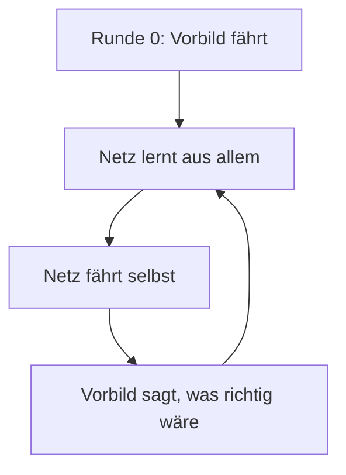
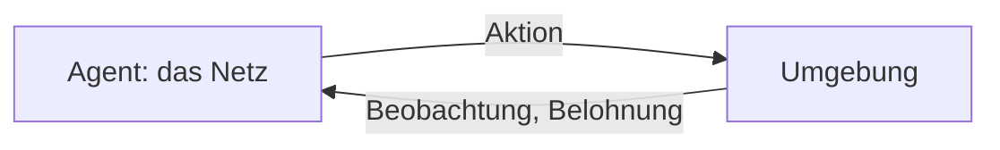
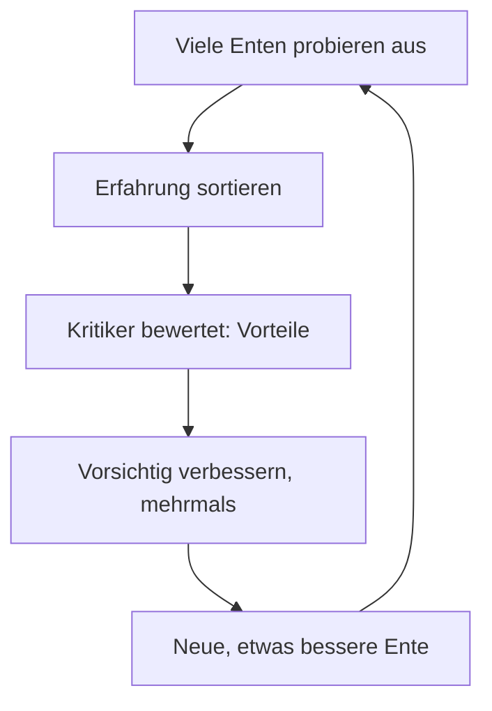
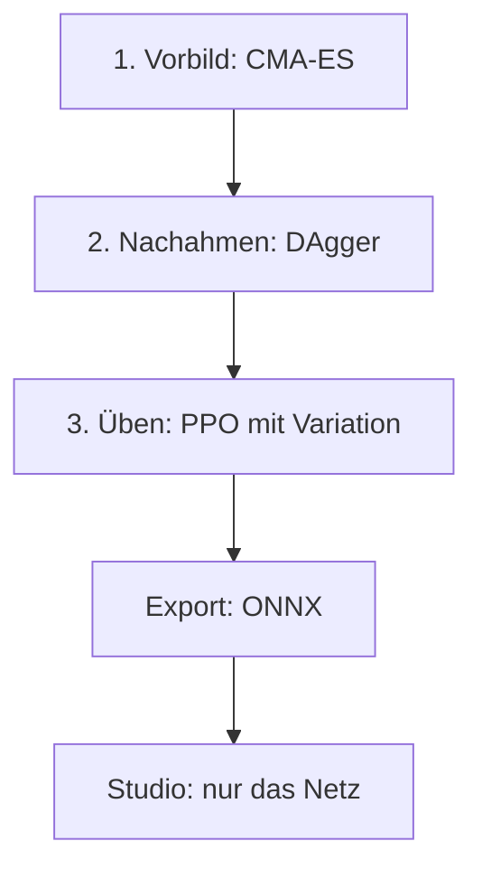

# Anhang A – Wie Maschinen lernen: Netze, Nachahmen, Belohnung

> **Dein Level:** Das Bonus-Level für alle, die es genau wissen wollen. Du rechnest ein künstliches
> Neuron selbst aus, wanderst im Nebel einen Berg hinab und trainierst in Gedanken einen Hund. Danach
> verstehst du, wie aus Zufallszahlen eine springende Ente wird – mit Mathe aus der Schule.

> **Wörter, die du brauchst:**
> - **Simulation** – die Ente als Nachbau im Computer, berechnet nach den Regeln der Physik
> - **Servo** – ein kleiner Motor, der ein Gelenk der Ente auf einen bestimmten Winkel dreht
> - **Sensor** – ein Bauteil, das etwas misst, etwa wie ein Gelenk steht oder wo unten ist
> - **Takt** – ein kurzer Zeitschritt; die Ente bekommt 50 Befehle pro Sekunde
> - **Episode** – ein Durchgang von Anfang bis Ende, etwa ein einzelner Sprung
> - **Mittelwert** – alle Werte zusammenzählen und durch ihre Anzahl teilen
> - **Steigung** – um wie viel sich ein Ergebnis ändert, wenn man die Eingabe ein kleines Stück ändert

Dieser Anhang erklärt das Handwerkszeug des Lehrers, also des Trainingssystems von Kern. Du kannst ihn
gut **vor** [Kapitel 14](14-lehrer.md) lesen, denn dort wird alles benutzt, was hier erklärt wird. Die
Bedienung steht in [Kapitel 15](15-eigene-modelle.md).

## A.1 Was ein neuronales Netz ist

### Eine Rechenmaschine mit vielen Reglern

Ein neuronales Netz ist eine Rechenmaschine: Zahlen rein, Zahlen raus. Bei der Micro Duck gehen
**61 Zahlen** hinein (Lage des Rumpfs, Gelenkwinkel und -tempo, letzte Aktion, Befehle) und **14**
kommen heraus: die Ziele ihrer Servos. Dazwischen sitzen sehr viele Regler, die **Parameter**. Niemand
stellt sie von Hand ein. Sie werden **gelernt**: so lange verändert, bis die Maschine tut, was wir
wollen.

> **So kannst du es dir vorstellen:** ein Mischpult mit Hunderttausenden Reglern. Am Anfang kommt Krach
> heraus. Lernen heißt, jeden Regler ein kleines Stück in die richtige Richtung zu drehen – immer wieder.

### Das Neuron – einmal selbst gerechnet

Ein künstliches **Neuron** nimmt jeden Eingang mal ein **Gewicht** (wie wichtig ist er, auch negativ),
addiert alles, zählt einen **Bias** dazu (eine Grundeinstellung) und schickt das Ergebnis z durch eine
**Aktivierung**.


Ein ausgedachtes Beispiel: Ein Neuron mit **drei Eingängen** soll entscheiden, wie stark ein Knie
nachgibt. x1 = 0,5 ist die Neigung des Rumpfs, x2 = 2 sein Tempo nach vorn, x3 = 0 seine Drehung
(gerade keine). Die Gewichte sind w1 = 0,8, w2 = −0,5 und w3 = 0,3, der Bias b = 0,1.

| Schritt | Rechnung | Ergebnis |
|---|---|---|
| Eingang 1 gewichtet | 0,8 · 0,5 | 0,4 |
| Eingang 2 gewichtet | −0,5 · 2 | −1,0 |
| Eingang 3 gewichtet | 0,3 · 0 | 0 |
| Summe plus Bias z | 0,4 − 1,0 + 0 + 0,1 | −0,5 |
| Aktivierung h | ELU(−0,5) | −0,39 |

Mit x2 = 0,2 ergibt sich z = 0,4 − 0,1 + 0 + 0,1 = 0,4 und h = 0,4. Warum einmal −0,39 und einmal genau z?
Das liegt an der Aktivierung.

### Die Aktivierung ELU

Die Aktivierung ist ein **Knick** nach jedem Neuron. Kern nutzt **ELU**, wie Pollen Robotics beim
Training der Ente. Die Regel:

- Ist z positiv oder 0, bleibt es, wie es ist.
- Ist z negativ, wird es **zusammengedrückt**: Je negativer z, desto näher rückt das Ergebnis an −1,
  aber es fällt **nie unter −1**.

Du musst die Rechnung für den negativen Teil nicht können. Lies einfach in der Tabelle ab:

| z | ELU(z) |
|---|---|
| 2 | 2 |
| 1 | 1 |
| 0 | 0 |
| −0,5 | −0,39 |
| −1 | −0,63 |
| −2 | −0,86 |
| −4 | −0,98 |


Warum der Knick? Ohne ihn wären viele Schichten nicht besser als eine: Mal 2 und dann mal 3 ist
dasselbe wie mal 6. Erst ein Knick erlaubt Regeln, die nicht einfach „immer doppelt so viel“ sind,
etwa: „Knie stärker beugen, je schneller sie kippt – aber nur bis zum Anschlag.“

> **Für Profis:** Für negative z rechnet ELU e^z − 1 mit der Zahl e ≈ 2,718 (Taschenrechner-Taste
> e^x). Andere Knicke heißen tanh (an beiden Enden flach) und ReLU (alles unter 0 wird 0). ELU ist
> glatt und hat kein „totes“ Gebiet, in dem sich nichts mehr bewegt.

### Schichten und das MLP

Viele Neuronen mit denselben Eingängen bilden eine **Schicht**, mehrere Schichten hintereinander ein
**mehrschichtiges Perzeptron (MLP)**. Die letzte Schicht hat keinen Knick: Servoziele dürfen jede
Zahl sein.


Die erste Schicht allein hat schon 61 · 512 = 31 232 Gewichte plus 512 Biases, zusammen über
31 000 Regler. Alle vier Schichten zusammen haben fast **200 000 Regler**.

> **Für Profis:** Genau sind es 31 744 + 131 328 + 32 896 + 1 806 = 197 774 Parameter. Die anderen
> Schichten rechnest du wie die erste: Eingänge mal Neuronen plus ein Bias je Neuron. Das Spielnetz
> ist kleiner: 23 → 256 → 128 → 9.

### Der Start: Zufall, aber klein

Wären alle Gewichte am Anfang 0, würden alle Neuronen einer Schicht dasselbe rechnen und dasselbe
lernen – für immer Zwillinge. Darum werden sie **zufällig** und klein gewählt, bei 61 Eingängen etwa
zwischen −0,13 und +0,13. So wachsen die Summen nicht von Schicht zu Schicht.

> **Für Profis:** Die Grenze ist 1 geteilt durch die **Wurzel** der Zahl der Eingänge. Die Wurzel ist
> die Zahl, die mit sich selbst malgenommen die Ausgangszahl ergibt: √64 = 8, weil 8 · 8 = 64. √61 ist
> also knapp 8 (etwa 7,8), und 1 / 7,8 ≈ 0,13.

## A.2 Die Vorwärtsrechnung

**Vorwärts** heißt: die Eingaben Schicht für Schicht durchrechnen, wie beim Neuron oben. Meist rechnet
das Netz viele Eingaben auf einmal, einen **Batch** (englisch für Stapel). Fürs Lernen merkt sich das
Netz alle Zwischenergebnisse, damit es später rückwärts rechnen kann (A.5).

Kern rechnet dabei schnell, aber **ohne die Reihenfolge der Additionen zu ändern**. Der Computer
könnte noch schneller sein, wenn er Summen umsortieren dürfte – doch dann käme an der letzten Stelle
etwas anderes heraus, wie beim Drei-Ziffern-Taschenrechner in [Kapitel 14](14-lehrer.md). Kern
legt die Zahlen darum so im Speicher ab, dass das schnelle Rechnen ohne Umsortieren klappt. So bleibt
das Netz auf jedem Gerät bis zur letzten Stelle gleich.

## A.3 Der Verlust: Wie schlecht bin ich gerade?

Der **Verlust** ist eine Zahl dafür, wie falsch das Netz liegt. Am häufigsten ist der **mittlere
quadratische Fehler**: Abstände zum richtigen Wert quadrieren und mitteln. Sagt das Netz 0,7 und 1,4,
richtig wären 1,0 und 1,0, sind die Fehler −0,3 und 0,4, die Quadrate 0,09 und 0,16, der Mittelwert
**0,125**. Quadrieren macht alles positiv, und große Fehler zählen besonders. Das Nachahmen und der
Kritiker (A.11) nutzen diesen Verlust.

> **So kannst du es dir vorstellen:** eine **Landschaft**. Jede Einstellung aller Regler ist ein Ort,
> der Verlust die Höhe dort. Das Netz ist eine Kugel irgendwo am Hang. Wir wollen ins tiefste Tal.

## A.4 Gradientenabstieg: im Nebel bergab

### Die Grundidee

Du stehst in dichtem **Nebel** auf einem Berg. Keine Karte, nur der Boden unter deinen Füßen. Du
tastest, wo es bergab geht, und machst einen Schritt. Dann wieder. So lernt ein Netz. Die Steigung für
alle Regler zusammen heißt **Gradient**, die Schrittlänge **Lernrate**.

Nimm einen einzigen Regler θ (griechischer Buchstabe, sprich „Theta“; er steht hier einfach für die
Stellung des Reglers) und die Landschaft *Verlust = θ · θ*. Das Tal liegt bei 0. Start ist θ = 1.

**Steigung ertasten:** Bei θ = 0,99 ist der Verlust 0,9801, bei 1,01 ist er 1,0201. Steigung =
(1,0201 − 0,9801) / 0,02 = **2**. Probier es an anderen Stellen aus: Die Steigung ist hier immer
doppelt so groß wie θ.

**Schritt:** neues θ = altes θ − Lernrate · Steigung. Das Minus sorgt dafür, dass du bergab gehst.
Mit Lernrate 0,1:

| θ vorher | Steigung | θ nachher |
|---|---|---|
| 1 | 2 | 1 − 0,1 · 2 = 0,8 |
| 0,8 | 1,6 | 0,8 − 0,16 = 0,64 |
| 0,64 | 1,28 | 0,64 − 0,128 = 0,512 |

Der Verlust fällt von 1 über 0,64 und 0,41 auf 0,26. Mit Lernrate 1,1 dagegen wird aus 1 der Wert
1 − 1,1 · 2 = −1,2, dann 1,44, dann −1,73: Du springst übers Tal und schaukelst dich auf.

> **Vorsicht, Falle:** Zu kleine Lernrate – du kommst kaum voran. Zu große – du fliegst aus dem Tal.
> Darum passt Kern die Lernrate unterwegs selbst an.

### Minibatches und Epochen

Die Steigung über **alle** Beispiele auszurechnen dauert zu lange. Man schätzt sie an einer zufälligen
Auswahl, einem **Minibatch**, und macht dafür viele kleine Schritte. Ein Durchgang durch alle Daten
heißt **Epoche**.

> **So kannst du es dir vorstellen:** eine Umfrage an deiner Schule. Statt alle 800 Schüler zu fragen,
> fragst du 30. Das Ergebnis ist ungefähr richtig, aber es wackelt ein bisschen: Fragst du andere 30,
> kommt etwas anderes heraus. Je kleiner die Auswahl, desto mehr wackelt es.

### Die Notbremse

Ein verrücktes Beispiel kann eine riesige Steigung erzeugen und das Netz mit einem einzigen Schritt
zerstören. Bei vielen Reglern ist der Gradient wie ein **Pfeil**, der in die Richtung zeigt, in der es
am steilsten bergauf geht. Ist dieser Pfeil länger als 1, kürzt Kern ihn auf Länge 1. Die Richtung
bleibt gleich, nur der Schritt wird kürzer.

> **So kannst du es dir vorstellen:** Im Nebel gilt die Regel: Kein Schritt ist länger als einen
> Meter, egal wie steil es aussieht.

## A.5 Backpropagation: Wer ist schuld?

### Die Idee

Fast 200 000 Regler einzeln anzutippen wäre viel zu langsam. **Backpropagation** rechnet alle
Steigungen auf einmal aus, rückwärts vom Fehler zum Eingang. Man fragt: Wie viel ist jeder Regler am
Fehler schuld? Die Regel dafür heißt **Kettenregel**.

> **So kannst du es dir vorstellen:** ein Getriebe. Dreht sich Zahnrad 1 einmal, dreht sich Zahnrad 2
> 3-mal; dreht sich Zahnrad 2 einmal, dreht sich Zahnrad 3 2-mal. Zahnrad 3 dreht sich also 3 · 2 = 6-mal.
> Genauso **multiplizieren** sich Steigungen entlang des Netzes.

### Einmal von Hand durchgerechnet

Ein Mini-Netz mit einem Neuron in der Mitte: z = w1 · x + b1, h = ELU(z), y = w2 · h + b2,
Fehler = (y − Ziel) · (y − Ziel). Start: x = 1, Ziel = 1, w1 = 0,5, b1 = −1, w2 = 2, b2 = 0,5.

**Vorwärts:** z = 0,5 − 1 = −0,5, aus der Tabelle h = −0,393, y = 2 · (−0,393) + 0,5 = −0,287.
Fehler = (−1,287) · (−1,287) = **1,656**.

**Rückwärts:** Jedes Zahnrad hat eine Steigung: Um wie viel ändert sich das Nächste, wenn man ein
winziges Stück dreht? Jede kannst du durch **Tasten** wie in A.4 nachprüfen. Fangen wir hinten an.

**Der Weg von w2 – zwei Zahnräder:**

```
w2 ──(−0,393)──► y ──(−2,574)──► Fehler
```

- **y → Fehler:** −2,574. Getastet: y + 0,01 senkt den Fehler um etwa 0,026, also Steigung ≈ −2,6.
- **w2 → y:** −0,393. Dreht man w2 um 0,01, ändert sich y um 0,01 · h, und h ist −0,393.
- Multipliziert: w2 → Fehler = (−0,393) · (−2,574) = **1,013**.

**Der Weg von w1 – vier Zahnräder:**

```
w1 ──(1)──► z ──(0,607)──► h ──(2)──► y ──(−2,574)──► Fehler
```

- **w1 → z:** 1, denn z = w1 · x, und x ist 1.
- **z → h:** 0,607, getastet in der ELU-Tabelle: z + 0,01 ändert h um etwa 0,006.
- **h → y:** 2, denn y = w2 · h, und w2 ist 2.
- **y → Fehler:** −2,574 wie oben.
- Multipliziert: w1 → Fehler = 1 · 0,607 · 2 · (−2,574) = **−3,122**.

Die beiden Biases b1 und b2 rechnest du genauso; ihre Steigungen sind −3,122 und −2,574.

**Ein Schritt** mit Lernrate 0,1, jeweils neuer Wert = alter Wert − 0,1 · Steigung:

- w2 = 2 − 0,1 · 1,013 = 1,899
- b2 = 0,5 − 0,1 · (−2,574) = 0,757
- w1 = 0,5 − 0,1 · (−3,122) = 0,812
- b1 = −1 − 0,1 · (−3,122) = −0,688

**Wieder vorwärts:** z = 0,812 − 0,688 = 0,124 (jetzt positiv, also h = 0,124),
y = 1,899 · 0,124 + 0,757 ≈ **0,99**. Das Ziel war 1: Der Fehler ist fast verschwunden! Echte Netze
mit vielen, sich widersprechenden Beispielen kommen nur in winzigen Schritten voran.

In Kern rechnet das Netz genau so, Schicht für Schicht, und ein Test vergleicht das Ergebnis mit dem
langsamen Tasten.

> **Für Profis:** Ein Bias wirkt wie ein zusätzlicher Eingang, der immer 1 ist. Darum hat b2 dieselbe
> Steigung wie der Weg y → Fehler (−2,574) und b1 dieselbe wie w1 (−3,122), denn x ist hier auch 1.

## A.6 Adam: der kluge Wanderer

Einfacher Gradientenabstieg macht für alle Regler gleich große Schritte im Verhältnis zu ihrer
Steigung. Manche Steigungen sind aber riesig, andere winzig, und manche Schätzungen wackeln stark.
**Adam** ist ein klügeres Verfahren.

> **So kannst du es dir vorstellen:** Ein Wanderer im Nebel merkt sich, in welche Richtung es zuletzt
> meistens bergab ging, und behält diesen **Schwung** bei, wie eine rollende Kugel. Außerdem merkt er
> sich, wie steil es zuletzt typischerweise war. An steilen, wackeligen Stellen tritt er vorsichtiger
> auf, an flachen mutiger.

Für jeden Regler gilt ungefähr: Schritt = Lernrate × Richtung ÷ typische Größe der Steigung. Am
Anfang sind Richtung und typische Größe gleich groß. Darum bewegt sich im ersten Schritt jeder Regler
um genau die Lernrate:

- Steigung 1000: 1000 ÷ 1000 = 1, also Schritt = Lernrate.
- Steigung 0,000001: 0,000001 ÷ 0,000001 = 1, also auch Schritt = Lernrate.

So kommen Regler mit winzigen Steigungen genauso voran wie solche mit riesigen.

> **Für Profis:** Adams beide Gedächtnisse starten bei 0 und wären anfangs zu klein; Adam rechnet das
> mit einer Korrektur heraus. Actor, Kritiker und Nachahmen haben in Kern je einen eigenen Adam. Sein
> Gedächtnis wird mit dem Zwischenstand gespeichert, damit ein fortgesetzter Lauf genau dieselben
> Schritte macht wie ein ununterbrochener.

## A.7 Normalisierung: alle auf Augenhöhe

Die Eingaben des Netzes sind sehr verschieden groß: Gelenkwinkel liegen bei Zehnteln, das Gelenktempo
kann zweistellig sein. Große Zahlen würden die Summen beherrschen und kleine übertönen. Der
**Normalisierer** rechnet darum jeden Eingang auf ähnliche Größe um.

> **So kannst du es dir vorstellen:** Du willst Strecken vergleichen, aber eine steht in Zentimetern,
> eine in Kilometern. Erst rechnest du alles in dieselbe Einheit um, dann vergleichst du.

Dafür braucht man zwei Zahlen je Eingang: den **Mittelwert** und die **Streuung**. Die Streuung sagt,
wie weit die Werte typischerweise vom Mittelwert weg liegen. Beispiel: Die Werte 1 und 5 haben den
Mittelwert 3, und beide liegen 2 davon weg – die Streuung ist 2. Die Werte 2,9 und 3,1 haben auch den
Mittelwert 3, aber die Streuung ist nur 0,1.

Die Umrechnung: neu = (Wert − Mittelwert) / (Streuung + 0,01).

**Beispiel:** Mittelwert 2, Streuung 3, Wert 8: (8 − 2) / 3,01 ≈ 1,99. Das heißt: Dieser Wert liegt
etwa zwei Streuungen über dem Mittel. Die 0,01 verhindert das Teilen durch 0, falls ein Eingang sich
nie ändert.

Mittelwert und Streuung werden während des Trainings laufend nachgeführt. Warum? Eine bessere Ente
erlebt andere Lagen: Wer springen lernt, dreht sich schneller und hebt ab, was eine stehende Ente nie
tut. Die Werte wandern also, und der Umrechner muss mitwandern – wie eine Waage, die man neu
einstellt, wenn plötzlich schwerere Dinge darauf landen. Der Normalisierer **gehört
zum Netz**: Ohne genau diese Umrechnung ist es wertlos, darum steht er in der Netz-Datei mit drin.

> **Für Profis:** Beim **Warmstart** beginnt das Training mit einem fertigen Netz. Dann übernimmt Kern
> dessen Normalisierer und lässt ihn unverändert, denn das fertige Netz ist genau an diese Umrechnung
> gewöhnt. Die genauen Rechenwege stehen im blauen Buch, Anhang A.

## A.8 Auswendiglernen gegen Verstehen

Ein großes Netz kann wenige Daten **auswendig lernen**: perfekt bei bekannten Beispielen, schlecht bei
neuen. Das heißt **Überanpassung**.

> **So kannst du es dir vorstellen:** Du lernst nur die Lösungen der Übungsaufgaben auswendig. In der
> Arbeit stehen andere Zahlen – und du bist aufgeschmissen.

Gegenmittel: mehr und vielfältigere Daten, Prüfen mit Daten, die nie zum Lernen dienten, das beste Netz
nach der Prüfung statt des letzten, kleinere Netze. Beim Roboter heißt Überanpassung: Das Netz kennt
nur **diese eine** Simulation. Darum prüft Kern sauber **und** mit Variation (A.12).

## A.9 Lernen durch Nachmachen

### Überwachtes Lernen und Verhaltensklonen

Beim **überwachten Lernen** gibt es zu jeder Eingabe die richtige Antwort, wie im Lösungsheft. Bei
Robotern ist das die Aktion eines Experten: Man zeichnet auf, was er in jeder Lage tut, und trainiert
das Netz darauf. Das heißt **Verhaltensklonen**. In Kern heißt der Experte **Vorbild**.

### Die Falle: Verteilungsverschiebung

Das Netz kennt nur Lagen, in die das Vorbild kommt. Ein kleiner Fehler führt in eine unbekannte Lage,
dort folgt ein größerer Fehler – und so weiter. Die Fehler können mit der Länge der Episode sogar
**quadratisch** wachsen: doppelt so lang, viermal so viel Fehler.


> **So kannst du es dir vorstellen:** Radfahren nur durch Zuschauen. Die Profi-Fahrerin wackelt nie.
> Wackelst du selbst, weißt du nicht, was zu tun ist – das hast du bei ihr nie gesehen.

### DAgger: Der Schüler fährt, das Vorbild kommentiert



Bei **DAgger** fährt der Schüler, und das Vorbild sagt in jeder Lage, was **es** getan hätte. So
entstehen Daten genau dort, wohin der Schüler gerät. Kern gibt etwas Zusatzrauschen dazu, damit auch
Lagen knapp neben der Spur vorkommen.

Das Vorbild muss überall eine Antwort haben. Und es darf nichts wissen, was das Netz nicht sieht –
sonst verlangt es Antworten, die das Netz aus seinen Sensoren gar nicht herausfinden kann. Beim Sprung
sind es 8 Runden; ab Runde 7 springt das Netz zum ersten Mal echt. Das Spielnetz lernt genauso.

## A.10 Lernen durch Belohnung

Ohne Vorbild – oder um besser zu werden als das Vorbild – lernt das Netz durch **Belohnung**:
**Reinforcement Learning** (englisch für „Lernen durch Verstärkung“).

> **So kannst du es dir vorstellen:** Du bringst einem Hund „Sitz“ bei. Setzt er sich, gibt es sofort
> ein Leckerli, und mit der Zeit setzt er sich öfter. Gezeigt hast du ihm nie, **wie** man sitzt – nur
> belohnt, **wenn** es klappt. Im Sport genauso: Punkte für einen guten Aufschlag, keine Anleitung für
> jeden Muskel.

### Der Kreislauf



Der **Agent** handelt, die **Umgebung** antwortet. In Kern ist das eine Ente in ihrer eigenen Welt, ein
Schritt dauert 20 ms (Tausendstelsekunden). Wichtig: Was als Nächstes passiert, hängt nur davon ab, wie
es **jetzt** aussieht – wie beim Schach, wo nur die Stellung auf dem Brett zählt, nicht wie sie
entstanden ist. Fachleute nennen das einen **Markov-Prozess**.

### Zustand und Beobachtung

Der **Zustand** ist alles: jede Lage, jedes Tempo. Die Ente bekommt nur eine **Beobachtung** – was ihre
Sensoren liefern, mit Rauschen und Verzögerung. Ihre wahre Höhe kennt sie zum Beispiel nicht.

Ihre letzte Aktion bekommt sie als Teil der Beobachtung mit. Das ist ein **Mini-Gedächtnis**: So weiß
sie, was sie gerade selbst befohlen hat, auch wenn die Sensoren das noch nicht zeigen.

### Belohnung und Return

Die **Belohnung** ist eine Zahl pro Schritt und die **einzige** Stelle, an der man sagt, was gewollt
ist. Der Agent nimmt sie wörtlich: Früh lernte die Ente, auf dem Schwanz zu sitzen, weil die Belohnung
das zuließ.

Der **Return** (die Rückgabe) ist die Summe aller künftigen Belohnungen. Dabei zählt Späteres weniger:
Jeder Schritt in die Zukunft wird mit dem **Zukunftsfaktor** γ = 0,99 malgenommen (γ ist der
griechische Buchstabe „Gamma“). Zwei Schritte voraus also 0,99 · 0,99 = 0,98, drei Schritte voraus
0,98 · 0,99 ≈ 0,97 und so weiter.

| Schritte voraus | zählt noch |
|---|---|
| 1 | 99 % |
| 10 | etwa 90 % |
| 50 | etwa 60 % |
| 100 | etwa 37 % |
| 300 | etwa 5 % |

Eine Belohnung in 100 Takten zählt also nur noch gut ein Drittel, danach wird sie schnell unwichtig.
Die Ente plant darum etwa **100 Takte** voraus – 2 Sekunden, so lang wie ein Sprung.

Warum wertet man überhaupt ab? Ohne Abwertung würde die Summe bei langen Versuchen immer weiter
wachsen: Eine Ente, die 1000 Takte steht, hätte zehnmal so viel wie eine, die 100 Takte steht, und bei
noch längeren Versuchen gäbe es keine Grenze. Mit dem Zukunftsfaktor bleibt die Summe begrenzt, und
die nahen Folgen einer Bewegung zählen am meisten.

> **So kannst du es dir vorstellen:** Ein Leckerli jetzt ist dem Hund mehr wert als eins in einer
> Stunde. Trotzdem lohnt sich „Sitz“, wenn danach sicher etwas kommt.

### Policy, Wert und Vorteil

- Die **Policy** ist die Entscheidungsregel der Ente: Beobachtung hinein, Aktion heraus. Beim Lernen
  wackelt sie absichtlich etwas und probiert Verschiedenes aus; auf dem Roboter wackelt sie nicht.
- Der **Wert** einer Lage sagt, wie viel Return man von dort im Schnitt erwartet.
- Der **Vorteil** sagt: War eine Aktion **besser oder schlechter als erwartet**?

> **So kannst du es dir vorstellen:** Du erwartest in der Mathearbeit eine 3. Du bekommst eine 2 –
> besser als erwartet, der Vorteil ist positiv. Bekommst du eine 4, ist er negativ.

Eine einfache Schätzung des Vorteils ist die **Überraschung** eines Schritts (Fachwort: TD-Fehler): die
Belohnung jetzt plus der Wert danach (mal Zukunftsfaktor), minus dem Wert, den man vorher erwartet hat.
**Beispiel:** Erwartet waren 5. Du bekommst 1 Punkt und landest in einer Lage mit Wert 4. Dann ist die
Überraschung 1 + 0,99 · 4 − 5 = −0,04: knapp schlechter als erwartet.

### Sturz oder Zeitablauf?

Nach einem **Sturz** gibt es keine Zukunft, der Wert ist 0. Läuft nur die **Zeit** ab, hätte die Ente
weitermachen können. Wer beides gleich behandelt, lehrt das Netz, sich kurz vor Schluss nicht mehr
anzustrengen. Kern schätzt bei Zeitablauf darum den Wert, als ginge es weiter.

### Wie lernt die Policy?

Man kann nicht ausrechnen, wie sich ein einzelner Regler auf einen Sprung auswirkt: Dazwischen liegt
die ganze Physik mit Kontakten, Stürzen und Landungen. Also **probiert** man. Der Trick: Aktionen mit
**positivem Vorteil** werden **wahrscheinlicher** gemacht, Aktionen mit negativem
**unwahrscheinlicher**.

Dafür muss die Ente etwas Zufall in ihren Bewegungen haben. In Kern ist jede Aktion:
**Wunschziel + Wackelstärke · Zufallszahl**. Das Wunschziel heißt μ („My“) und kommt aus dem Netz. Die
Wackelstärke heißt σ („Sigma“) und wird mitgelernt.

**Beispiel:** Wunschziel 0,4, Wackelstärke 0,1, Zufallszahl −0,5: 0,4 + 0,1 · (−0,5) = 0,35.

### Entropie: Neugier am Leben halten

Die **Entropie** misst, wie unvorhersehbar die Policy ist; bei Kerns Netzen hängt sie nur von der
Wackelstärke σ ab. Schrumpft σ zu schnell, hört der Agent auf auszuprobieren und bleibt bei der ersten
halbwegs guten Lösung. Ein kleiner **Entropie-Bonus** hält ihn neugierig.

> **Mission:** Starte im Lehrer auf https://kernengine.de/ einen Lauf und beobachte „Aktionsrauschen
> (std)“. Das ist σ. Wird es kleiner, wird die Policy sicherer und probiert weniger aus.

## A.11 Actor, Kritiker und PPO

### Zwei Netze, eine Mannschaft

Den Wert schätzt ein zweites Netz, der **Kritiker**; das Policy-Netz heißt **Actor**. Der Kritiker
lernt, den Return vorherzusagen, der Actor lernt aus den Vorteilen, die der Kritiker ausrechnet – wie
Spielerin und Trainer.

Ist der Actor nach dem Nachahmen schon gut, lernt in Kern zuerst nur der Kritiker. Sonst würden seine
anfangs zufälligen Urteile den guten Actor verderben.

### GAE: den Vorteil gut schätzen

Ein Schritt kann für sich allein schlecht aussehen und trotzdem gut gewesen sein, weil er zu etwas
Gutem geführt hat. **GAE** ist der Rechenweg, der das berücksichtigt.

> **So kannst du es dir vorstellen:** Beim Fußball ist ein Pass selbst noch kein Tor. Fällt aber
> direkt danach ein Tor, war der Pass gut. Und der Pass davor auch, nur etwas weniger. Wer das Tor
> nachverfolgt, geht **rückwärts**: erst der Torschuss, dann der Pass davor, dann der davor.

Genau so rechnet GAE: Man beginnt beim letzten Schritt und geht nach vorne. Jeder Schritt bekommt seine
eigene Überraschung plus einen großen Teil (etwa 94 %) des Vorteils des Schritts danach.

**Zur Bestätigung in Zahlen:** drei Schritte, rückwärts gerechnet.

| Schritt | eigene Überraschung | Vorteil |
|---|---|---|
| 3 (letzter) | −1,03 | −1,03 |
| 2 | +1,94 | 1,94 − 0,97 = 0,97 |
| 1 (erster) | −0,04 | −0,04 + 0,91 = 0,87 |

Schritt 1 sah allein leicht schlecht aus (−0,04). Er führte aber zu Schritt 2, der viel besser lief als
erwartet. Darum ist sein Vorteil insgesamt positiv – wie der Pass vor dem Tor.

Mit dem Vorteil lernt auch der Kritiker: Was er erwartet hat, plus wie viel besser es kam, ist das, was
er hätte erwarten sollen. Genau darauf trainiert er.

> **Für Profis:** Die 94 % sind Zukunftsfaktor mal ein zweiter Faktor λ („Lambda“, 0,95), der sagt,
> wie stark man den späteren Schritten glaubt: 0,99 · 0,95 = 0,9405. λ ist eine Abwägung. Glaubt man
> nur dem nächsten Schritt (λ = 0), ist der Vorteil ruhig, hängt aber ganz davon ab, ob der Kritiker
> richtig schätzt. Zählt man alles bis zum Ende (λ = 1), ist er ehrlich, aber sehr zappelig.
> Danach normalisiert Kern alle Vorteile wie in A.7 auf Mittelwert 0 und Streuung 1. So hängt die
> Größe eines Lernschritts nicht davon ab, ob eine Aufgabe Zehntelpunkte oder Hunderte Punkte
> vergibt.

### Warum zu große Schritte gefährlich sind

Die gesammelten Daten stammen von der **alten** Ente. Ändert man das Netz auf einmal zu stark,
passen diese Daten nicht mehr zur neuen Ente. Eine gute Policy kann so in einem einzigen Schritt
kaputtgehen – und liefert danach nur noch schlechte Versuche, aus denen sie kaum wieder herauskommt.

Noch schlimmer wird es, wenn man **mehrmals** aus denselben Daten lernt. Genau das möchte man aber:
Erfahrung zu sammeln ist teuer, und mehrmals daraus zu lernen spart viel Rechenzeit. Mit jedem
Durchgang entfernt sich die Ente weiter von der, die die Daten gesammelt hat. Ohne Bremse geht das
schief. Die Bremse heißt PPO.

### PPO: verbessern mit Sicherheitsgurt

**PPO** ist das Lernverfahren des Lehrers. Es erlaubt pro Lernschritt nur eine kleine Änderung.

**Beispiel:** Die alte Ente hat eine bestimmte Bewegung in 10 von 100 Fällen gewählt. Hat diese
Bewegung einen positiven Vorteil, darf die neue Ente sie öfter wählen – aber höchstens in 12 von 100
Fällen, also 20 % mehr. Ist sie schlecht, darf die neue Ente sie seltener wählen – aber höchstens bis
8 von 100 herunter. Ist die Grenze erreicht, hört PPO auf, in diese Richtung weiterzuschieben.

| Vorteil | Änderung | Was passiert |
|---|---|---|
| positiv | bis 20 % öfter | gute Aktion wird häufiger |
| positiv | mehr als 20 % öfter | genug verstärkt: Stopp |
| negativ | bis 20 % seltener | schlechte Aktion wird seltener |
| negativ | mehr als 20 % seltener | genug abgeschwächt: Stopp |

Wichtig ist, was **nicht** in der Tabelle steht: Wird eine **schlechte** Aktion versehentlich häufiger
(zum Beispiel 30 % öfter), greift keine Bremse. Der Fehler wird sofort korrigiert. Verbesserungen
werden gedeckelt, Verschlechterungen nie.

> **So kannst du es dir vorstellen:** Die Trainerin sagt: „Ändere deine Wurftechnik pro Training nur ein
> bisschen. Aber was falsch ist, korrigierst du sofort.“

Das Verhältnis „neu geteilt durch alt“ heißt ρ („Rho“): 12 von 100 statt 10 von 100 ergibt
ρ = 12 / 10 = 1,2. Erlaubt ist ρ zwischen 0,8 und 1,2. Auch der Kritiker darf seine Schätzung pro
Lernschritt nur begrenzt ändern, nach derselben Regel mit 0,2.

> **Für Profis:** Zusätzlich misst Kern, wie verschieden alte und neue Policy insgesamt schon sind (die
> **KL-Divergenz**). Ändert sich zu viel, verkleinert Kern die Lernrate; ändert sich zu wenig,
> vergrößert es sie.

### Ein PPO-Update im Ganzen



Pro Runde lernt Kern mehrmals aus denselben Daten (fünf Epochen, jede in vier Minibatches). Das spart
Rechenzeit, und weil es die Ente jedes Mal ein Stück weiter von der sammelnden Ente wegschiebt,
braucht es genau den Sicherheitsgurt von oben.

Sammeln und Lernen sind getrennt: Die Sammler brauchen nur die Policy, der Lerner nur die Daten.
Darum können viele Helfer gleichzeitig sammeln, auf dem Computer als **Threads** (Rechenstränge) oder
im Browser als **Web Worker**. Weil Kern die Daten danach immer in dieselbe feste Reihenfolge bringt,
entsteht überall dasselbe Netz, egal wie viele Helfer sammeln. Warum die Reihenfolge so wichtig ist,
erklärt [Kapitel 14](14-lehrer.md) im Abschnitt 14.7; die Regel zum Nachprüfen steht in
[Kapitel 17](17-referenz.md), Abschnitt 17.3.

> **Mission:** Starte im Lehrer „Stehen (Schnelltest)“ und schau auf die Kurve (beim Sprung beginnt
> sie erst nach dem Nachahmen). Die grüne Linie ist die Episoden-Rückgabe, der Return. Steigt sie,
> sammeln die Enten mehr Belohnung – Reinforcement Learning live auf deinem Gerät.

## A.12 Von der Simulation in die Wirklichkeit

Der echte Roboter ist **anders** als die Simulation: Massen ungenau, Servos streuen, Reibung schwankt,
Sensoren rauschen. Diesen Unterschied nennen Fachleute **Sim-to-Real-Lücke**. Man schließt sie von zwei
Seiten: Die Simulation wird an Messungen angepasst ([Kapitel 16](16-kalibrierung.md)), und das Netz
wird unempfindlich gemacht.

Dafür sorgt die **Variation** (Domain Randomization): Jede Episode bekommt neue Werte für Masse,
Schwerpunkt, Reibung, Servos, Sensoren und Stöße. Ein Netz, das in allen diesen Welten klappt, hat
gelernt, was ihnen gemeinsam ist; die echte Welt ist nur eine weitere Variante. Was sich nicht messen
lässt, wird variiert.

> **So kannst du es dir vorstellen:** Wer Fußball nur auf perfektem Rasen übt, stolpert auf dem
> Bolzplatz. Wer auf Rasen, Asphalt und Matsch geübt hat, kommt überall klar.

Manches kommt per **Lehrplan** erst später dazu, etwa die Stöße. Zu viel Chaos am Anfang würde
verhindern, dass die Bewegung überhaupt entsteht.

Den Kritiker gibt es nur beim Lernen. Also darf er sehen, was der Roboter nicht misst, etwa seine wahre
Höhe: der **asymmetrische Kritiker**. Und beim **Warmstart** beginnt das Training nicht bei null,
sondern mit einem fertigen Netz – Kerns Sprung mit Pollens Laufnetz **velstand**, das schon
balancieren kann.

> **Mission:** Lade in Kern Studio auf https://kernengine.de/ das Level
> **Datei › Beispiel-Levels › Micro Duck** (File › Example Levels › Micro Duck) – läuft gerade
> **Spielen** (Play) oder **Simulieren**, erst mit Esc stoppen – und starte **Simulieren** (Simulate)
> (Alt+S). Zieh die Ente
> mit der Maus am Kopf zur Seite und lass los, bis sie umfällt. Sie steht von selbst wieder auf.
> velstand hat das gelernt, weil es im Training ständig geschubst wurde und mit vielen verschiedenen
> Enten geübt hat.

## A.13 Suchen wie die Evolution: CMA-ES

Manchmal gibt es keine Steigung: Das Sprung-Vorbild besteht aus 15 Zahlen, und ob sie gut sind, zeigt
erst eine ganze Simulation mit Flug, Landung oder Sturz. Ähnlich ist es beim Kalibrieren der Servos.
Dann hilft eine **Evolutionsstrategie**.

> **So kannst du es dir vorstellen:** wie in der Natur. Eine Generation hat viele leicht verschiedene
> Kinder. Die, die am besten zurechtkommen, werden Eltern der nächsten Generation. Über viele
> Generationen wird die Gruppe immer besser.

So läuft eine Runde: viele Kandidaten rund um einen Mittelpunkt ausdenken, alle ausprobieren, die
bessere Hälfte behalten und den Mittelpunkt zu ihr schieben. **CMA-ES** lernt dabei auch die **Form**
der Suchwolke:


Geht es lange in **dieselbe** Richtung, wird die Wolke größer und streckt sich in diese Richtung. Ist
man nah dran und die Schritte heben sich auf, wird sie kleiner.

> **So kannst du es dir vorstellen:** Topfschlagen mit vielen Mitspielern. Wer „heißer“ hört, zieht die
> Gruppe zu sich. Lange in eine Richtung – größere Schritte; nah dran – kleinere.

Bei einer wackeligen Bewertung ist die **Mitte** der Wolke besser als der beste Einzelkandidat, denn
der könnte nur Glück gehabt haben.

Damit der Vergleich fair ist, probiert Kern in einer Generation **alle Kandidaten an denselben**
zufälligen Robotern aus; jede neue Generation bekommt andere. Wie bei einer Klassenarbeit: Alle
bekommen dieselben Aufgaben, sonst kann man die Noten nicht vergleichen. Und weil die Aufgaben jede
Woche neue sind, gewinnt am Ende, wer es wirklich kann – nicht, wer zufällig die leichten erwischt
hat.

## A.14 ONNX: das Austauschformat

**ONNX** ist ein offenes Dateiformat für Netze, so etwas wie PDF für Texte: Rechenschritte und Regler
in einer Datei, die viele Programme lesen können – auf dem Roboter, im Browser, auf dem Server. Kern
schreibt diese Dateien mit einem eigenen, winzigen Schreiber.

Auf den Roboter kommt nur die Spielerin ohne Wackeln: das Wunschziel des Actors. Die Wackelstärke σ
und der Kritiker werden nur beim Lernen gebraucht und bleiben im Lehrer.

> **Für Profis:** Für ein MLP reichen in ONNX vier Arten von Rechenschritten: Abziehen und Teilen für
> den Normalisierer, eine Schicht und der ELU-Knick. Die genauen Namen stehen im blauen Buch, Anhang A.

## A.15 Wie alles zusammenkommt



| Idee | Abschnitt |
|---|---|
| Neuron, Schichten, Backpropagation | A.1–A.5 |
| Nachahmen | A.3, A.9 |
| Adam, Normalisierung | A.6, A.7 |
| Belohnung, PPO | A.10, A.11 |
| Variation | A.12 |
| CMA-ES, ONNX | A.13, A.14 |

Vorbild, Kritiker, Wackeln und Variation sind **Gerüst**: Es hilft beim Lernen und wird danach
abgebaut. Übrig bleiben eine Umrechnung der Eingänge und ein paar Schichten mit ELU – mehr braucht die
Ente zum Springen nicht.

## Level geschafft!

- Du rechnest ein Neuron mit drei Eingängen von Hand.
- Du weißt, wie Gradientenabstieg im Nebel bergab führt und was die Lernrate tut.
- Du verstehst Backpropagation als Getriebe aus multiplizierten Steigungen.
- Du unterscheidest Nachahmen und Lernen durch Belohnung.
- Du weißt, warum DAgger den Schüler fahren lässt.
- Du kennst Return, Vorteil und den PPO-Sicherheitsgurt.
- Du verstehst, warum Variation ein Netz fit für die echte Welt macht.

## Rätsel-Ecke

1. Ein Neuron hat x1 = 1, x2 = 3, w1 = 0,5, w2 = 0,5, b = −1. Was kommt heraus?
2. Verlust = θ · θ, θ = 2, Lernrate 0,1. Wo stehst du nach einem Schritt?
3. Warum darf man nicht alle Gewichte auf 0 setzen?
4. Mit dem Zukunftsfaktor 0,99: Wie viel zählt eine Belohnung in 100 Schritten noch?
5. **Boss-Rätsel:** Eine Bewegung hat einen negativen Vorteil (sie war schlechter als erwartet). Nach
   einem Lernschritt wählt die neue Ente sie aber 30 % **öfter** als die alte. Bremst PPO hier? Warum
   ist das klug?

### Lösungen

1. z = 0,5 + 1,5 − 1 = 1, positiv, also ELU(1) = **1**.
2. Steigung 2 · 2 = 4, neues θ = 2 − 0,1 · 4 = **1,6**. Der Verlust sinkt von 4 auf 2,56.
3. Dann rechnen alle Neuronen einer Schicht dasselbe, lernen dasselbe und bleiben gleich – als hätte die
   Schicht nur ein Neuron.
4. Etwa **37 %**, also gut ein Drittel.
5. **Nein.** Eine schlechte Aktion ist häufiger geworden, das wird sofort korrigiert. PPO deckelt nur
   Verbesserungen, nie Korrekturen – so bleibt Gutes heil, und Fehler verschwinden schnell.

---

© 2026 Christian Heinrich Hohlfeld · Alle Rechte vorbehalten · [Impressum und Rechte](00-impressum.md)
