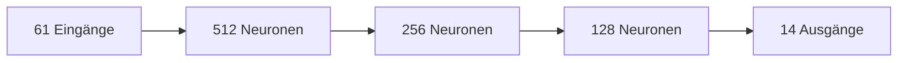
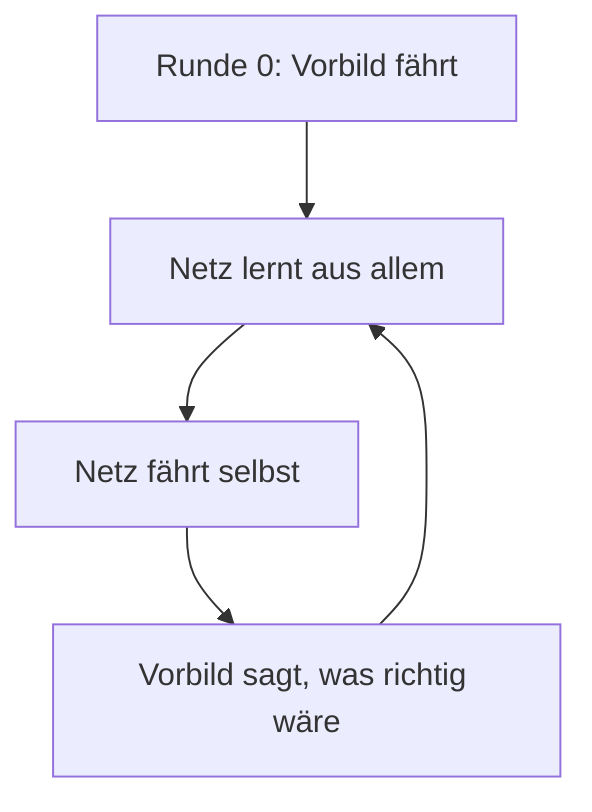
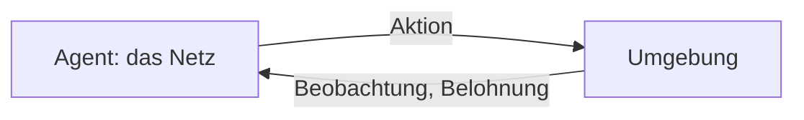
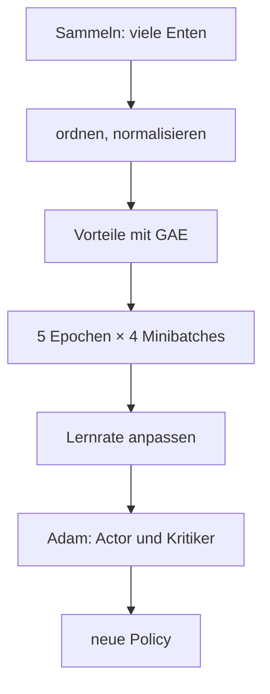
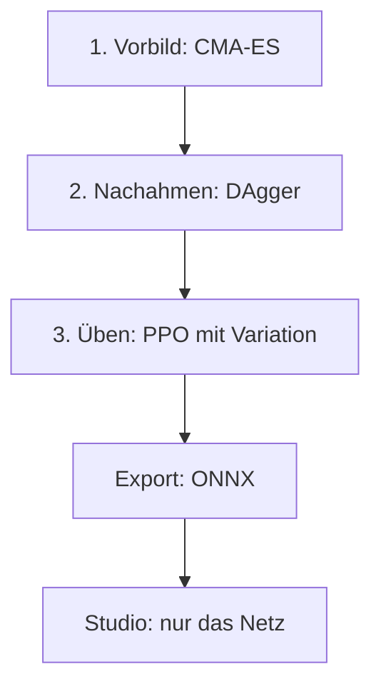

# Anhang A – Wie Maschinen lernen: Netze, Nachahmen, Belohnung

> **Dein Level:** Das Bonus-Level für alle, die es genau wissen wollen. Du rechnest ein künstliches
> Neuron selbst aus, wanderst im Nebel einen Berg hinab und trainierst in Gedanken einen Hund. Danach
> verstehst du, wie aus Zufallszahlen eine springende Ente wird – mit Mathe aus der Schule.

Dieser Anhang erklärt das Handwerkszeug des Lehrers. Wie Kern es umsetzt, steht in
[Kapitel 14](14-lehrer.md), die Bedienung in [Kapitel 15](15-eigene-modelle.md). Der Code liegt in
`src/lehrer/`: Netz und Adam in `nn.cpp`, Lernen in `ppo.cpp`, Umgebung in `env.h`, Vorbild und
CMA-ES in `vorbild.cpp` und `cmaes.cpp`, Spielschicht, Export und Rezepte in eigenen Dateien.

## A.1 Was ein neuronales Netz ist

### Eine Rechenmaschine mit vielen Reglern

Ein neuronales Netz ist eine **Funktion**: Zahlen rein, Zahlen raus. Bei der Micro Duck gehen
**61 Zahlen** hinein (Lage des Rumpfs, Gelenkwinkel und -tempo, letzte Aktion, Befehle) und **14** kommen
heraus: die Ziele ihrer Servos. Dazwischen sitzen sehr viele **Parameter**, die niemand von Hand
einstellt. Sie werden **gelernt** – so lange verändert, bis die Funktion tut, was wir wollen.

> **So kannst du es dir vorstellen:** ein Mischpult mit Hunderttausenden Reglern. Am Anfang kommt Krach
> heraus. Lernen heißt, jeden Regler ein kleines Stück in die richtige Richtung zu drehen – immer wieder.

### Das Neuron – einmal selbst gerechnet

Ein künstliches **Neuron** nimmt jeden Eingang mal ein **Gewicht** (wie wichtig ist er, auch negativ),
addiert alles, zählt einen **Bias** dazu (eine Grundeinstellung) und schickt das Ergebnis z durch eine
**Aktivierung**.

```
x1 ──w1──┐
          ├──► Summe + b ──► z ──► ELU ──► h
x2 ──w2──┘
```

Ein Neuron mit **zwei Eingängen** soll entscheiden, wie stark ein Knie nachgibt. x1 = 0,5 ist die
Neigung des Rumpfs, x2 = 2 sein Tempo nach vorn. Die Gewichte sind w1 = 0,8 und w2 = −0,5, der Bias
b = 0,1.

| Schritt | Rechnung | Ergebnis |
|---|---|---|
| Eingang 1 gewichtet | 0,8 · 0,5 | 0,4 |
| Eingang 2 gewichtet | −0,5 · 2 | −1,0 |
| Summe plus Bias z | 0,4 − 1,0 + 0,1 | −0,5 |
| Aktivierung h | ELU(−0,5) | −0,39 |

Mit x2 = 0,2 ergibt sich z = 0,4 − 0,1 + 0,1 = 0,4 und h = 0,4. Warum einmal −0,39 und einmal genau z?
Das liegt an der Aktivierung.

### Die Aktivierung ELU

Kern nutzt **ELU**, wie die Bibliothek rsl_rl, mit der Pollen Robotics die Netze der Ente trainiert.
Ist z positiv, bleibt es, wie es ist. Ist z negativ, rechnet ELU *e hoch z minus 1* mit e ≈ 2,718: Für
z = −0,5 ist 2,718⁻⁰'⁵ ≈ 0,607, also ELU(−0,5) ≈ −0,39. Nach unten nähert sich ELU der −1.

```
ELU(z)
  1 |              /
  0 |---------___/------- z
 -1 |___----
     -4    -2   0   2
```

Ohne so einen Knick wären viele Schichten nicht besser als eine: Mal 2 und dann mal 3 ist dasselbe wie
mal 6. Erst der Knick erlaubt Regeln wie „Knie stärker beugen, je schneller sie kippt – aber nur bis
zum Anschlag“. Anders als tanh oder ReLU ist ELU glatt und hat kein „totes“ Gebiet.

### Schichten und das MLP

Viele Neuronen mit denselben Eingängen bilden eine **Schicht**, mehrere Schichten hintereinander ein
**mehrschichtiges Perzeptron (MLP)**. Die letzte Schicht hat keine Aktivierung: Servoziele dürfen jede
Zahl sein.



Die erste Schicht hat 61 · 512 = 31 232 Gewichte plus 512 Biases. Alle vier Schichten zusammen ergeben
**197 774 Parameter**. Das Spielnetz ist kleiner: 23 → 256 → 128 → 9.

### Der Start: Zufall, aber klein

Wären alle Gewichte am Anfang 0, würden alle Neuronen einer Schicht dasselbe rechnen und lernen – für
immer Zwillinge. Darum werden sie **zufällig** und klein gezogen: zwischen −1/√n und +1/√n bei n
Eingängen, bei 61 Eingängen also etwa ±0,13. So wachsen die Summen nicht von Schicht zu Schicht.

## A.2 Die Vorwärtsrechnung

**Vorwärts** heißt: die Eingaben Schicht für Schicht durchrechnen, wie beim Neuron oben, meist für
viele Eingaben auf einmal (einen **Batch**). Kern rechnet vier Eingaben gleichzeitig und ordnet die
Gewichte so, dass der Computer schnell ist, ohne die Reihenfolge der Additionen zu ändern
([Kapitel 14](14-lehrer.md), Determinismus). Fürs Lernen merkt sich das Netz alle Zwischenergebnisse.

## A.3 Der Verlust: Wie schlecht bin ich gerade?

Der **Verlust** ist eine Zahl dafür, wie falsch das Netz liegt. Am häufigsten ist der **mittlere
quadratische Fehler**: Abstände zum richtigen Wert quadrieren und mitteln. Sagt das Netz 0,7 und 1,4,
richtig wären 1,0 und 1,0, sind die Fehler −0,3 und 0,4, die Quadrate 0,09 und 0,16, der Mittelwert
**0,125**. Quadrieren macht alles positiv, und große Fehler zählen besonders. Das Nachahmen und der
Kritiker (A.11) nutzen diesen Verlust.

Stell dir den Verlust als **Landschaft** vor: Jede Einstellung aller Regler ist ein Ort, der Verlust
die Höhe dort. Wir wollen ins tiefste Tal.

## A.4 Gradientenabstieg: im Nebel bergab

### Die Grundidee

Du stehst in dichtem **Nebel** auf einem Berg. Keine Karte, nur der Boden unter deinen Füßen. Du
tastest, wo es bergab geht, und machst einen Schritt. Dann wieder. So lernt ein Netz. Die Neigung heißt
**Gradient**, die Schrittlänge **Lernrate**.

Mit einem einzigen Regler θ (sprich „Theta“) und der Landschaft *Verlust = θ²* liegt das Tal bei 0.
Start ist θ = 1.

**Steigung ertasten:** Bei θ = 0,99 ist der Verlust 0,9801, bei 1,01 ist er 1,0201. Steigung =
(1,0201 − 0,9801) / 0,02 = **2**. Allgemein ist sie hier 2 · θ.

**Schritt:** neues θ = altes θ − Lernrate · Steigung. Mit Lernrate 0,1:

| θ vorher | Steigung | θ nachher |
|---|---|---|
| 1 | 2 | 1 − 0,1 · 2 = 0,8 |
| 0,8 | 1,6 | 0,8 − 0,16 = 0,64 |
| 0,64 | 1,28 | 0,64 − 0,128 = 0,512 |

Der Verlust fällt von 1 über 0,64 und 0,41 auf 0,26. Mit Lernrate 1,1 dagegen wird aus 1 der Wert
1 − 1,1 · 2 = −1,2, dann 1,44, dann −1,73: Du springst übers Tal und schaukelst dich auf. Hier muss die
Lernrate unter 1 bleiben.

> **Vorsicht, Falle:** Zu kleine Lernrate – du kommst kaum voran. Zu große – du fliegst aus dem Tal.
> Darum passt Kern die Lernrate unterwegs selbst an.

### Minibatches und Epochen

Die Steigung über **alle** Beispiele dauert zu lange. Man schätzt sie an einer zufälligen Auswahl, einem
**Minibatch**, und macht viele kleine Schritte (**stochastischer Gradientenabstieg**). Kleine
Minibatches wackeln mehr – bei wenigen Dutzend Enten spürbar. Ein Durchgang durch alle Daten heißt
**Epoche**.

### Die Notbremse

Ein verrücktes Beispiel kann eine riesige Steigung erzeugen und das Netz zerstören. Darum wird die
Länge des Gradienten begrenzt: Ist sie über 1,0, wird sie auf 1,0 gekürzt, die Richtung bleibt.

## A.5 Backpropagation: Wer ist schuld?

### Die Idee

197 774 Regler einzeln zu tasten wäre viel zu langsam. **Backpropagation** rechnet alle Steigungen auf
einmal aus, rückwärts vom Fehler zum Eingang, mit der **Kettenregel**.

> **So kannst du es dir vorstellen:** ein Getriebe. Dreht sich Zahnrad 1 einmal, dreht sich Zahnrad 2
> 3-mal; dreht sich Zahnrad 2 einmal, dreht sich Zahnrad 3 2-mal. Zahnrad 3 dreht sich also 3 · 2 = 6-mal.
> Genauso **multiplizieren** sich Steigungen entlang des Netzes.

### Einmal von Hand durchgerechnet

Ein Mini-Netz: z = w1 · x + b1, h = ELU(z), y = w2 · h + b2, Fehler = (y − Ziel)². Start: x = 1,
Ziel = 1, w1 = 0,5, b1 = −1, w2 = 2, b2 = 0,5.

**Vorwärts:** z = −0,5, h = −0,393, y = 2 · (−0,393) + 0,5 = −0,287, Fehler = (−1,287)² = **1,656**.

**Rückwärts:** Jede Steigung sagt, um wie viel sich das Nächste ändert, wenn man ein winziges Stück
dreht.

| Zahnrad | Steigung | Woher |
|---|---|---|
| y → Fehler | −2,574 | zweimal (y − Ziel) |
| w2 → y | −0,393 | so groß wie h |
| h → y | 2 | so groß wie w2 |
| z → h | 0,607 | ELU: h + 1 |
| w1 → z | 1 | so groß wie x |

Multipliziert: w2 → Fehler = −2,574 · (−0,393) = **1,013**; w1 → Fehler = −2,574 · 2 · 0,607 · 1 =
**−3,122**. Für b2 und b1 gelten −2,574 und −3,122.

**Ein Schritt** mit Lernrate 0,1: w2 = 1,899, b2 = 0,757, w1 = 0,812, b1 = −0,688. **Wieder vorwärts:**
z = 0,124 (jetzt positiv), y = 1,899 · 0,124 + 0,757 ≈ **0,994**. Der Fehler ist auf 0,00004
geschrumpft! Echte Netze mit vielen, sich widersprechenden Beispielen kommen nur in winzigen Schritten
voran.

In Kern macht `Mlp::backward` genau das, Schicht für Schicht, und ein Test vergleicht mit dem langsamen
Tasten. Für ELU genügt die gespeicherte Ausgabe plus 1: 0,607 = −0,393 + 1.

## A.6 Adam: der kluge Wanderer

Einfacher Gradientenabstieg macht für alle Regler gleich lange Schritte, obwohl manche Steigungen riesig
und andere winzig sind, und er reagiert nervös auf wackelige Schätzungen. **Adam** führt für jeden
Regler zwei gleitende Mittel: eins für die **Richtung** (wie Schwung beim Rollen) und eins für die
**Größe** der letzten Steigungen. Der Schritt ist etwa *Lernrate × Richtung ÷ typische Größe*. Im
ersten Schritt bewegt sich jeder Regler darum um genau die Lernrate – egal ob die Steigung 0,000001
oder 1000 ist.

> **Krass, aber wahr:** Beide Mittel starten bei 0 und wären anfangs viel zu klein. Adam rechnet das mit
> einer Korrektur heraus – sonst würde der kluge Wanderer kaum loslaufen.

Kern nutzt die Standardwerte von PyTorch. Actor, Kritiker und Nachahmen haben je einen eigenen Adam,
und sein Gedächtnis kommt in den Checkpoint.

## A.7 Normalisierung: alle auf Augenhöhe

Gelenkwinkel liegen bei Zehnteln, Gelenktempo kann zweistellig sein. Große Eingänge würden die Summen
beherrschen. Der **Normalisierer** rechnet jeden Eingang um:

```
neu = (x − Mittelwert) / (Streuung + 0,01)
```

Mittel 2, Streuung 3, Wert 8: (8 − 2) / 3,01 ≈ 1,99. Die 0,01 verhindert das Teilen durch 0. Mittel
und Streuung werden laufend nachgeführt (Chans Formel braucht dafür nur Mittel, Streuung und Anzahl und
ist exakt). Der Normalisierer **gehört zum Netz**: Ohne genau diese Umrechnung ist es wertlos, darum
steht er im Export mit drin.

## A.8 Auswendiglernen gegen Verstehen

Ein großes Netz kann wenige Daten **auswendig lernen**: perfekt bei bekannten Beispielen, schlecht bei
neuen. Das heißt **Überanpassung**.

> **So kannst du es dir vorstellen:** Du lernst nur die Lösungen der Übungsaufgaben auswendig. In der
> Arbeit stehen andere Zahlen – und du bist aufgeschmissen.

Gegenmittel: mehr und vielfältigere Daten, Prüfen mit Daten, die nie zum Lernen dienten, das beste Netz
nach der Prüfung statt des letzten, kleinere Netze. Beim Roboter heißt Überanpassung: Das Netz kennt
nur **diese eine** Simulation. Darum prüft Kern sauber **und** mit Variation (A.12).

## A.9 Lernen durch Nachmachen

### Überwachtes Lernen und Verhaltensklonen

Beim **überwachten Lernen** gibt es zu jeder Eingabe die richtige Antwort, wie im Lösungsheft. Bei
Robotern ist das die Aktion eines Experten: Man zeichnet auf, was er in jeder Lage tut, und trainiert
das Netz darauf. Das heißt **Verhaltensklonen**. In Kern heißt der Experte **Vorbild**.

### Die Falle: Verteilungsverschiebung

Das Netz kennt nur Lagen, in die das Vorbild kommt. Ein kleiner Fehler führt in eine unbekannte Lage,
dort folgt ein größerer Fehler – und so weiter. Die Fehler können mit der Episodenlänge sogar
**quadratisch** wachsen.

```
Vorbild: ●──●──●──●──●──●   (immer in der Spur)
Klon:    ●──●──●─╲
                  ●─╲       kleiner Fehler
                     ●─╲    größerer Fehler
                        ●   Sturz
```

> **So kannst du es dir vorstellen:** Radfahren nur durch Zuschauen. Die Profi-Fahrerin wackelt nie.
> Wackelst du selbst, weißt du nicht, was zu tun ist – das hast du bei ihr nie gesehen.

### DAgger: Der Schüler fährt, das Vorbild kommentiert



Bei **DAgger** fährt der Schüler, und das Vorbild sagt in jeder Lage, was **es** getan hätte. So
entstehen Daten genau dort, wohin der Schüler gerät. Kern gibt etwas Zusatzrauschen dazu, damit auch
Lagen knapp neben der Spur vorkommen. Das Vorbild muss überall eine Antwort haben und darf nichts
wissen, was das Netz nicht sieht.

## A.10 Lernen durch Belohnung

Ohne Vorbild – oder um besser zu werden als das Vorbild – lernt das Netz durch **Belohnung**:
**Reinforcement Learning**.

> **So kannst du es dir vorstellen:** Du bringst einem Hund „Sitz“ bei. Setzt er sich, gibt es sofort
> ein Leckerli, und mit der Zeit setzt er sich öfter. Gezeigt hast du ihm nie, **wie** man sitzt – nur
> belohnt, **wenn** es klappt. Im Sport genauso: Punkte für einen guten Aufschlag, keine Anleitung für
> jeden Muskel.

### Der Kreislauf



Der **Agent** handelt, die **Umgebung** antwortet. In Kern ist das eine Ente in ihrer eigenen Welt, ein
Schritt dauert 20 ms. Mathematisch ist das ein **Markov-Entscheidungsprozess**: Zustände, Aktionen,
Physik, Belohnung und ein Zukunftsfaktor. „Markov“ heißt: Was kommt, hängt nur vom **jetzigen** Zustand
ab – wie beim Schach nur die Stellung zählt.

### Zustand und Beobachtung

Der **Zustand** ist alles: jede Lage, jedes Tempo. Die Ente bekommt nur eine **Beobachtung** – was ihre
Sensoren liefern, mit Rauschen und Verzögerung. Ihre wahre Höhe kennt sie nicht. Die letzte Aktion ist
Teil der Beobachtung, ein Mini-Gedächtnis.

### Belohnung und Return

Die **Belohnung** ist eine Zahl pro Schritt und die **einzige** Stelle, an der man sagt, was gewollt
ist. Der Agent nimmt sie wörtlich: Früh lernte die Ente, auf dem Schwanz zu sitzen, weil die Belohnung
das zuließ.

Der **Return** ist die Summe der künftigen Belohnungen, wobei Späteres weniger zählt: Jeder Schritt in
die Zukunft wird mit γ = 0,99 malgenommen (**Diskontierung**).

| Schritte voraus | Faktor | zählt noch |
|---|---|---|
| 1 | 0,99 | 99 % |
| 100 | 0,99¹⁰⁰ | etwa 37 % |
| 300 | 0,99³⁰⁰ | etwa 5 % |

Die Ente schaut also rund **100 Takte** voraus – 2 Sekunden, so lang wie ein Sprung.

> **So kannst du es dir vorstellen:** Ein Leckerli jetzt ist dem Hund mehr wert als eins in einer
> Stunde. Trotzdem lohnt sich „Sitz“, wenn danach sicher etwas kommt.

### Policy, Wert und Vorteil

- Die **Policy** ist die Entscheidungsregel. Beim Lernen ist sie **zufällig** und probiert Verschiedenes
  aus; auf dem Roboter nimmt man ihren Mittelwert.
- Der **Wert** einer Lage ist der Return, den man von dort im Schnitt erwartet; der **Aktionswert** ist
  derselbe für eine bestimmte Aktion.
- Der **Vorteil** ist der Unterschied: War die Aktion **besser oder schlechter als üblich**?

Eine einfache Schätzung ist der **TD-Fehler**: *Belohnung + γ · Wert danach − Wert vorher*. Erwartet
waren 5, du bekommst 1 und landest bei Wert 4: 1 + 0,99 · 4 − 5 = −0,04, knapp schlechter als erwartet.

### Sturz oder Zeitablauf?

Nach einem **Sturz** gibt es keine Zukunft, der Wert ist 0. Läuft nur die **Zeit** ab, hätte die Ente
weitermachen können. Wer beides gleich behandelt, lehrt das Netz, sich kurz vor Schluss nicht mehr
anzustrengen. Kern schätzt bei Zeitablauf darum den Wert, als ginge es weiter.

### Wie lernt die Policy?

Die Physik lässt sich nicht nach den Reglern „ableiten“. Der Trick (**Policy-Gradient**): Aktionen mit
**positivem Vorteil wahrscheinlicher** machen, mit negativem **unwahrscheinlicher**. Dafür muss die
Policy zufällig sein. In Kern ist die Aktion *μ + σ · Zufallszahl*: μ ist das Wunschziel des Netzes,
σ ein gelernter Wert pro Aktion. Mit μ = 0,4, σ = 0,1 und Zufallszahl −0,5 wird die Aktion 0,35.

### Entropie: Neugier am Leben halten

Die **Entropie** misst, wie unvorhersehbar die Policy ist; bei Kerns Netzen hängt sie nur von σ ab.
Schrumpft σ zu schnell, hört der Agent auf auszuprobieren und bleibt bei der ersten halbwegs guten
Lösung. Ein kleiner **Entropie-Bonus** hält ihn neugierig.

> **Mission:** Starte im Lehrer auf https://kernengine.de/ einen Lauf und beobachte „Aktionsrauschen
> (std)“. Das ist σ. Wird es kleiner, wird die Policy sicherer und probiert weniger aus.

## A.11 Actor, Kritiker und PPO

### Zwei Netze, eine Mannschaft

Den Wert schätzt ein zweites Netz, der **Kritiker**; das Policy-Netz heißt **Actor**. Der Kritiker lernt,
den Return vorherzusagen, der Actor lernt aus den Vorteilen, die der Kritiker ausrechnet – wie
Spielerin und Trainer. Ist der Actor nach dem Nachahmen schon gut, lernt in Kern erst nur der Kritiker.

### GAE: den Vorteil gut schätzen

Der TD-Fehler eines Schritts ist ruhig, aber ungenau; alle Belohnungen bis zum Ende sind genau, aber
wackelig. **GAE** mischt beides mit λ = 0,95. Man rechnet **rückwärts**: Vorteil = TD-Fehler +
0,9405 · nächster Vorteil (0,99 · 0,95 = 0,9405). Drei Schritte, Belohnungen 1, 0, 2; Werte 5, 4, 6;
Wert danach 3:

| Schritt | TD-Fehler | Vorteil |
|---|---|---|
| 2 | 2 + 0,99 · 3 − 6 = −1,03 | −1,03 |
| 1 | 0 + 0,99 · 6 − 4 = 1,94 | 1,94 − 0,9687 = 0,97 |
| 0 | 1 + 0,99 · 4 − 5 = −0,04 | −0,04 + 0,9135 = 0,87 |

Schritt 0 sah allein leicht schlecht aus, führte aber dorthin, wo es besser lief als erwartet. Das Ziel
des Kritikers ist Vorteil + Wert, für Schritt 0 also 5,87. Danach bringt Kern alle Vorteile auf
Mittel 0 und Streuung 1.

### Warum zu große Schritte gefährlich sind

Die Daten stammen von der **alten** Policy. Nach einem großen Schritt passen die Vorteile nicht mehr,
eine gute Policy kann in einem Schritt kaputtgehen – und liefert dann schlechte Daten.

### PPO: verbessern mit Sicherheitsgurt

**PPO** vergleicht: Wie wahrscheinlich wählt die **neue** Policy eine Aktion im Vergleich zur **alten**?
Das Verhältnis heißt ρ (Rho); erlaubt sind höchstens 20 % Änderung, ρ zwischen 0,8 und 1,2.

| Vorteil | ρ | Was passiert |
|---|---|---|
| positiv | bis 1,2 | gute Aktion wird häufiger |
| positiv | über 1,2 | genug verstärkt: Stopp |
| negativ | ab 0,8 | schlechte Aktion wird seltener |
| negativ | unter 0,8 | genug abgeschwächt: Stopp |

Vorteil 1, ρ = 1,3: PPO rechnet nur mit 1,2, der Gradient ist 0 – kein weiterer Schritt in diese
Richtung. Wird aber eine **schlechte** Aktion versehentlich häufiger (Vorteil negativ, ρ = 1,3), greift
keine Bremse: Der Fehler wird sofort korrigiert. Verbesserungen werden gedeckelt, Verschlechterungen nie.

> **So kannst du es dir vorstellen:** Die Trainerin sagt: „Ändere deine Wurftechnik pro Training nur ein
> bisschen. Aber was falsch ist, korrigierst du sofort.“

Zusätzlich misst Kern, wie verschieden alte und neue Policy schon sind (die **KL-Divergenz**), und passt
die Lernrate an. Auch der Kritiker darf seine Schätzung pro Update nur begrenzt ändern
([Kapitel 14](14-lehrer.md)).

### Ein PPO-Update im Ganzen



Sammeln und Lernen sind getrennt: Sammler brauchen nur die Policy, der Lerner nur die Daten. Darum
können Sammler Threads oder Web Worker sein. Weil Kern alles in fester Reihenfolge rechnet, entsteht
überall dasselbe Netz.

> **Mission:** Starte im Lehrer einen Sprung-Lauf und schau auf die Kurve. Die grüne Linie ist die
> Episoden-Rückgabe, der Return. Steigt sie, sammeln die Enten mehr Belohnung – Reinforcement Learning
> live auf deinem Gerät.

## A.12 Von der Simulation in die Wirklichkeit

Der echte Roboter ist **anders** als die Simulation: Massen ungenau, Servos streuen, Reibung schwankt,
Sensoren rauschen. Diese **Sim-to-Real-Lücke** schließt man von zwei Seiten: Die Simulation wird an
Messungen angepasst ([Kapitel 16](16-kalibrierung.md)), und das Netz wird unempfindlich gemacht.

Bei der **Domain Randomization** (Variation) zieht jede Episode neue Werte für Masse, Schwerpunkt,
Reibung, Servos, Sensoren und Stöße. Ein Netz, das in allen diesen Welten klappt, hat gelernt, was
ihnen gemeinsam ist; die echte Welt ist nur eine weitere Variante. Manches kommt per **Lehrplan** erst
später, denn zu viel Chaos am Anfang verhindert, dass die Bewegung entsteht. Was sich nicht messen
lässt, wird variiert.

Den Kritiker gibt es nur beim Lernen, also darf er sehen, was der Roboter nicht misst, etwa seine wahre
Höhe: der **asymmetrische Kritiker**. Und beim **Warmstart** beginnt ein Netz bei einem fertigen –
Kerns Sprung als Pollens Laufnetz **velstand**, das schon balancieren kann.

> **Mission:** Lade in Kern Studio auf https://kernengine.de/ das Level File › Example Levels › Micro
> Duck und starte Play. Heb die Ente mit der Maus am Rumpf hoch und setz sie wieder ab: Sie pausiert und
> läuft danach weiter. Dass ein Netz solche Störungen wegsteckt, lernt es, indem es in vielen leicht
> verschiedenen Welten übt.

## A.13 Suchen wie die Evolution: CMA-ES

Manchmal gibt es keine Steigung: Das Sprung-Vorbild sind 15 Zahlen, bewertet durch eine ganze
Simulation mit Flug, Landung oder Sturz. Ähnlich beim Kalibrieren. Dann hilft eine
**Evolutionsstrategie**: viele Kandidaten um einen Mittelpunkt ziehen, ausprobieren, die bessere Hälfte
behalten und den Mittelpunkt zu ihr schieben. **CMA-ES** lernt dabei auch die **Form** der Suchwolke:

```
Generation 1     Generation 5      Generation 20
  ·  ·  ·          · ·                ·
 ·  ●  ·  ·       ·●··  ↗             ●:
  ·  ·  ·          ·  ·
 (rund, groß)    (gestreckt)       (schmal)
```

Gehen die Schritte länger in **dieselbe** Richtung, wird die Wolke größer; heben sie sich auf, kleiner.
Und sie streckt sich in die Richtung, in der es bergab geht.

> **So kannst du es dir vorstellen:** Topfschlagen mit vielen Mitspielern. Wer „heißer“ hört, zieht die
> Gruppe zu sich. Lange in eine Richtung – größere Schritte; nah dran – kleinere.

In Kern wird der Startpunkt zuerst bewertet, das Ergebnis ist also nie schlechter. Bei verrauschter
Bewertung ist die **Mitte** der Wolke besser als der beste Einzelkandidat, der nur Glück gehabt haben
könnte.

## A.14 ONNX: das Austauschformat

**ONNX** ist ein offenes Dateiformat für Netze, so etwas wie PDF für Rechengraphen: Rechenschritte und
Gewichte in einer Datei. ONNX Runtime führt es aus – auf dem Roboter, im Browser, auf dem Server. Für
ein MLP reichen `Sub` und `Div` (Normalisierung), `Gemm` (eine Schicht) und `Elu`. Kern schreibt die
Datei mit einem eigenen, winzigen Schreiber. Exportiert wird nur der **Mittelwert** des Actors; σ und
Kritiker bleiben im Lehrer.

## A.15 Wie alles zusammenkommt



| Idee | Abschnitt | Wo in Kern |
|---|---|---|
| Neuron, MLP, Backprop | A.1–A.5 | `Mlp` |
| Nachahmen | A.3, A.9 | `Ppo::imitate` |
| Adam, Normalisierung | A.6, A.7 | `Adam`, `Normalizer` |
| Belohnung, PPO | A.10, A.11 | `Task`, `Ppo` |
| Variation | A.12 | `Task::Noise` |
| CMA-ES, ONNX | A.13, A.14 | `cmaes_minimise`, `export_onnx` |

Vorbild, Kritiker, Rauschen, Variation sind **Gerüst**: Es hilft beim Lernen und wird danach abgebaut.
Übrig bleiben eine Umrechnung der Eingänge und ein paar Schichten mit ELU – mehr braucht die Ente zum
Springen nicht.

## Level geschafft!

- Du rechnest ein Neuron mit zwei Eingängen von Hand.
- Du weißt, wie Gradientenabstieg im Nebel bergab führt und was die Lernrate tut.
- Du verstehst Backpropagation als Getriebe aus multiplizierten Steigungen.
- Du unterscheidest Nachahmen und Lernen durch Belohnung.
- Du weißt, warum DAgger den Schüler fahren lässt.
- Du kennst Return, Vorteil und den PPO-Sicherheitsgurt.
- Du verstehst, warum Variation ein Netz fit für die echte Welt macht.

## Rätsel-Ecke

1. Ein Neuron hat x1 = 1, x2 = 3, w1 = 0,5, w2 = 0,5, b = −1. Was kommt heraus?
2. Verlust = θ², θ = 2, Lernrate 0,1. Wo stehst du nach einem Schritt?
3. Warum darf man nicht alle Gewichte auf 0 setzen?
4. Mit γ = 0,99: Wie viel zählt eine Belohnung in 100 Schritten noch?
5. **Boss-Rätsel:** Vorteil −2, ρ = 1,3. Bremst PPO hier? Warum ist das klug?

### Lösungen

1. z = 0,5 + 1,5 − 1 = 1, positiv, also ELU(1) = **1**.
2. Steigung 2 · 2 = 4, neues θ = 2 − 0,4 = **1,6**. Der Verlust sinkt von 4 auf 2,56.
3. Dann rechnen alle Neuronen einer Schicht dasselbe, lernen dasselbe und bleiben gleich – als hätte die
   Schicht nur ein Neuron.
4. Etwa **37 %**.
5. **Nein.** Eine schlechte Aktion ist häufiger geworden, das wird sofort korrigiert. PPO deckelt nur
   Verbesserungen, nie Korrekturen – so bleibt Gutes heil, und Fehler verschwinden schnell.

---

© 2026 Christian Heinrich Hohlfeld · Alle Rechte vorbehalten · [Impressum und Rechte](00-impressum.md)
