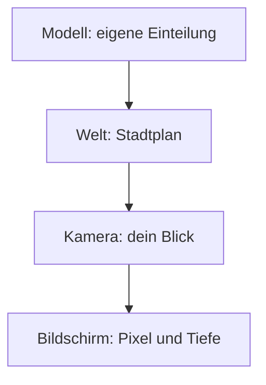
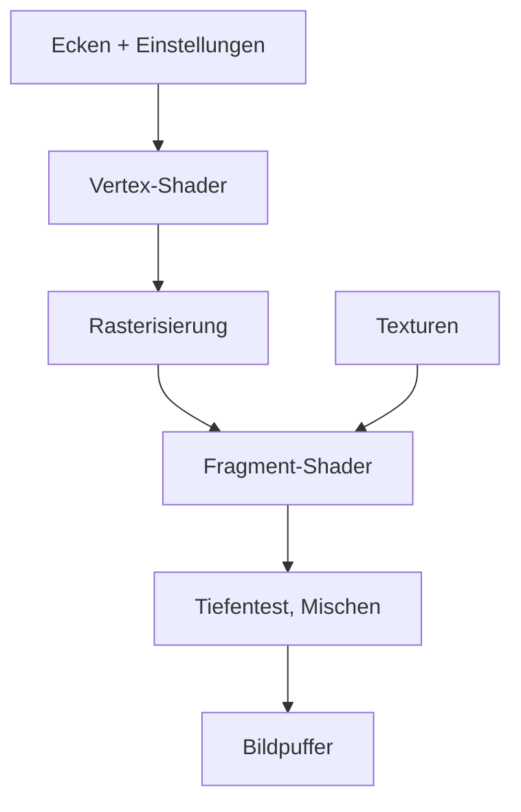
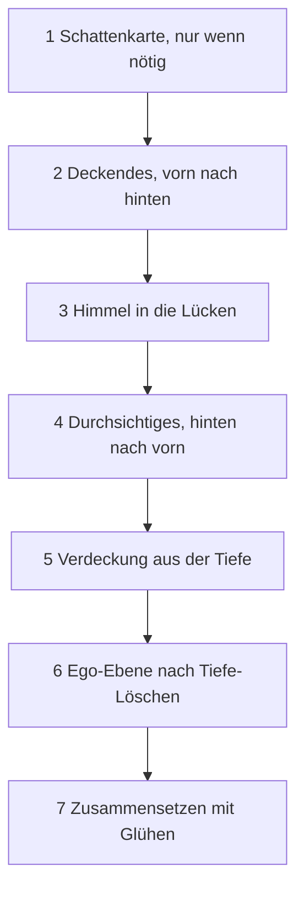

# Anhang B – Grundlagen: Wie aus Dreiecken Bilder werden

> **Dein Level:** Hier lernst du die Mathe und Physik hinter jedem 3D-Spiel – mit Bildern und Zahlen,
> die du mit dem Taschenrechner nachprüfen kannst. Fast alles geht mit Schulwissen; was darüber
> hinausgeht, steht in den Kästen „Für Profis“. Danach weißt du, wie eine Grafikkarte 60-mal pro
> Sekunde Licht, Schatten und Glanz ausrechnet.

> **Wörter, die du brauchst:**
>
> - **Grafikkarte** (GPU) – der Chip, der Bilder malt. Er rechnet tausende kleine Aufgaben
>   gleichzeitig.
> - **Mesh** – das Drahtgitter aus Dreiecken, aus dem ein 3D-Ding besteht.
> - **Ecke** (englisch *Vertex*) – ein Eckpunkt eines Dreiecks, mit seiner Lage im Raum.
> - **Instanz** – eine Kopie desselben Meshes an einer anderen Stelle, etwa der 50. Baum einer Allee.
> - **Pfeil** (Vektor) – eine Richtung mit Länge, geschrieben als Zahlen wie (3; 4).
> - **Textur** – ein Bild, das auf eine Form geklebt wird. Ihre Pixel heißen **Texel**.
> - **Bildpuffer** – ein unsichtbares Bild, in das die Grafikkarte malt, bevor etwas auf den
>   Bildschirm kommt.
> - **Bit** – eine einzelne Ja-Nein-Stelle. Mit 8 Bit kann man 2⁸ = 256 verschiedene Werte schreiben.

Hier stehen die **Ideen**; was Kern daraus macht, zeigen [Kapitel 4](04-grafik.md) und
[Kapitel 5](05-szene-und-geometrie.md).

## B.1 Koordinatenräume

### Warum es mehrere Räume gibt

Ein 3D-Ding wird einmal in seinem **eigenen** Koordinatensystem gebaut. Der Rumpf der Micro Duck
hat seinen Nullpunkt in der eigenen Mitte, egal wo die Ente gerade steht. Dann wird er in die Welt
gestellt, eine Kamera sieht ihn, und am Ende landet er auf Pixeln. Jeder Schritt wechselt das
Koordinatensystem.

> **So kannst du es dir vorstellen:** Dein Zimmer hat eine eigene Einteilung („Schreibtisch links
> vom Fenster“). Auf dem Stadtplan ist es ein Punkt in einer Straße. Von der Straße aus siehst du es
> als Fenster im dritten Stock. Auf einem Foto ist es ein paar Pixel groß. Immer dasselbe Zimmer,
> viermal anders beschrieben.

Zwischen „Kamera“ und „Bildschirm“ steckt die Perspektive; wie sie funktioniert, kommt gleich.

### Matrizen ohne Angst

Eine **Matrix** ist eine Zahlentabelle, die einen Punkt in einen anderen verwandelt. Gerechnet wird
**Zeile mal Punkt**: jede Zeile Zahl für Zahl mit dem Punkt malnehmen, dann addieren. Eine Drehung um
90° um die z-Achse, angewendet auf den Punkt (2; 1; 0):

| Zeile | Rechnung | Ergebnis |
|---|---|---|
| (0; −1; 0) | 0·2 − 1·1 + 0 | −1 |
| (1; 0; 0) | 1·2 + 0 + 0 | 2 |
| (0; 0; 1) | 0 + 0 + 0 | 0 |

Aus (2; 1; 0) wird (−1; 2; 0). Die dritte Zahl bleibt 0, also reichen fürs Heft x und y: Zeichne
die Pfeile (2; 1) und (−1; 2) ein – genau 90° gedreht.

### Der Trick mit der vierten Zahl

**Verschieben** („plus 10“) passt nicht in eine 3 × 3-Tabelle. Der Trick: eine vierte Zahl w. Ein
**Punkt** bekommt w = 1, eine **Richtung** w = 0, und die Verschiebung steht in der vierten Spalte:

| Zeile | Punkt (1; 2; 3; **1**) | Richtung (1; 2; 3; **0**) |
|---|---|---|
| (1; 0; 0; 10) | 1 + 10·1 = 11 | 1 + 10·0 = 1 |
| (0; 1; 0; 0) | 2 | 2 |
| (0; 0; 1; 0) | 3 | 3 |

Der Punkt wandert, die Richtung bleibt – ein Pfeil „nach vorn“ zeigt nach dem Verschieben immer noch
nach vorn. Jetzt sind alle Umwandlungen 4 × 4-Matrizen, die man hintereinanderschalten kann.

### Kerns Regeln

Alles in **Metern**, und **Z zeigt nach oben**. Die Achsen folgen der **rechten Hand**: Halte sie
mit der Handfläche nach oben. Dann zeigt der Daumen nach rechts (x), der Zeigefinger nach vorn (y),
und der Mittelfinger, den du nach oben knickst, zeigt nach oben (z).

**Die Reihenfolge zählt.** Kern macht es für jedes Objekt immer in dieser Reihenfolge: erst auf die
richtige Größe bringen, dann drehen, zuletzt an seinen Platz schieben.

> **Vorsicht, Falle:** Erst 10 cm verschieben, dann um 90° drehen landet ganz woanders als
> umgekehrt. Probier es mit einem Radiergummi auf dem Tisch.

Drehungen speichert Kern als **Quaternionen**: vier Zahlen, die „um diese Achse, um so viel“
beschreiben – wie ein Spieß durch einen Apfel, um den du ihn drehst. Mit diesen vier Zahlen lassen
sich Drehungen sauber hintereinanderschalten.

> **Für Profis:** Warum nicht einfach drei Winkel? Bei drei Winkeln nacheinander kann eine
> Drehrichtung verloren gehen: Kippt ein Flugzeug erst steil nach oben, bedeuten „nach links drehen“
> und „zur Seite rollen“ plötzlich dasselbe. Das heißt „Gimbal Lock“; Quaternionen kennen das Problem
> nicht.

### Ansicht und Perspektive

Die **Ansicht** verschiebt und dreht die ganze Welt so, dass die Kamera im Nullpunkt steht und
geradeaus schaut. Dafür muss Kern wissen, wo „rechts“ ist: Das ist die Richtung, die sowohl zur
Blickrichtung als auch zu „oben“ im rechten Winkel steht. Schaut die Kamera genau senkrecht nach
oben oder unten, liegen beide auf einer Linie – dann gibt es kein eindeutiges „rechts“, und Kern
malt lieber nichts.

**Perspektive** heißt: doppelt so weit weg, halb so groß. Man muss also durch die Entfernung
**teilen**. Eine Matrix kann nur malnehmen und addieren. Darum schreibt sie die Entfernung in die
vierte Zahl w, und die Grafikkarte teilt danach alles durch w.

Davor vergrößert die Matrix mit einem **Zoomfaktor**. Je enger der Blickwinkel der Kamera, desto
stärker der Zoom, wie beim Fernglas.

**Beispiel fürs Teilen:** Ein Punkt 1 m rechts der Blickrichtung. Steht er 10 m vor der Kamera, ist
w = 10, und nach dem Teilen bleibt 1 ÷ 10 = 0,1. Steht er 20 m weit weg, bleibt 1 ÷ 20 = 0,05 – halb
so weit von der Bildmitte entfernt. Doppelt so weit weg, halb so groß.

> **Für Profis:** Die ganze Rechnung bis zum Pixel. Bild 960 × 540, Kamera 60° (Zoomfaktor 1,732),
> Punkt 1 m rechts, 0,5 m hoch, 10 m vor der Kamera. Waagerecht wird zusätzlich durch das
> Seitenverhältnis 960 ÷ 540 = 1,778 geteilt. Vergrößern: x = 1,732 ÷ 1,778 = 0,974, y = 1,732 · 0,5
> = 0,866. Durch w = 10: 0,0974 und 0,0866. Der sichtbare Bereich geht jetzt von −1 bis +1; plus 1,
> durch 2, mal Bildgröße ergibt Pixel: 1,0974 ÷ 2 · 960 ≈ 527 und 1,0866 ÷ 2 · 540 ≈ 293, gezählt von
> unten links – knapp rechts oberhalb der Bildmitte (480; 270).

Ansichten von oben, vorn oder der Seite sind **orthografisch**: Sie teilen nicht, alles bleibt gleich
groß, egal wie weit weg.

> **Mission:** Öffne Kern Studio über https://kernengine.de/. Stell im Viewport-Menü **≡**, also
> **Viewport-Optionen** (Viewport options), das **Sichtfeld** (Field of View) auf 50° und dann auf
> 110° – bei 110° wirkt alles weiter weg und am Rand verzerrt. Wechsle dann mit Alt+J auf die Ansicht
> **Oben** (Top): orthografisch, nichts wird hinten kleiner.

### Werkzeug: Wie sehr zeigen zwei Pfeile in dieselbe Richtung?

Für Licht und Normalen braucht man immer wieder eine Frage: **Wie sehr zeigen zwei Pfeile in
dieselbe Richtung?** Die Antwort ist eine einzige Zahl, das **Skalarprodukt**. Für zwei Pfeile der
Länge 1 rechnet man: Zahlen paarweise malnehmen, dann addieren.

| Pfeile | Rechnung | Bedeutung |
|---|---|---|
| (1; 0) und (1; 0) | 1·1 + 0·0 = 1 | genau gleich |
| (1; 0) und (0,707; 0,707) | 0,707 + 0 = 0,707 | halb schräg (45°) |
| (1; 0) und (0; 1) | 0 + 0 = 0 | rechtwinklig |
| (1; 0) und (−1; 0) | −1 + 0 = −1 | genau entgegen |

Rechne nach: 0,707 · 0,707 ≈ 0,5, und 0,5 + 0,5 = 1. Darum hat der Pfeil (0,707; 0,707) die Länge
1; das zeigt der Satz des Pythagoras, den du bald lernst.

> **So kannst du es dir vorstellen:** Halte einen Stift über ein Lineal und leuchte mit einer Lampe
> senkrecht von oben. Der Schatten des Stifts auf dem Lineal ist das Skalarprodukt. Liegt der Stift
> parallel zum Lineal, ist sein Schatten voll lang (1). Steht er senkrecht, ist sein Schatten nur ein
> Punkt (0).

Merke: **1 = gleiche Richtung, 0 = rechtwinklig, negativ = voneinander weg.** Bei Pfeilen mit
anderer Länge ist die Zahl größer oder kleiner, aber 0 heißt immer noch rechtwinklig.

### Normalen brauchen eine Extrawurst

Eine **Normale** ist ein Pfeil, der senkrecht aus einer Fläche herausschaut. Mit dem Skalarprodukt
kann man das prüfen: Normale und Fläche müssen **0** ergeben.

Eine 45°-Rampe hat die Richtung (1; −1) und die Normale (1; 1). Probe: 1 − 1 = 0, rechtwinklig.
Jetzt wird das Objekt in x doppelt so breit gezogen. Die Rampe wird flacher, ihre Richtung ist jetzt
(2; −1). Was passiert mit der Normale?

| | wie die Rampe gezogen | richtig |
|---|---|---|
| Normale | (2; 1) | (0,5; 1) |
| Skalarprodukt mit (2; −1) | 4 − 1 = 3 ✗ | 1 − 1 = 0 ✓ |

Zeichne beide Rampen und die drei Pfeile ins Heft, jeweils vom selben Punkt aus: Nur (0,5; 1) steht
senkrecht auf der flachen Rampe, (2; 1) kippt viel zu weit zur Seite. Zieht man die Normale also
genauso in die Breite wie die Rampe, steht sie schief. Richtig ist es, das
Strecken **umzukehren**: durch 2 statt mal 2. Kern rechnet diese umgekehrte Matrix für jede Instanz
aus ([Kapitel 4](04-grafik.md)).

> **Für Profis:** Der Zoomfaktor ist 1 ÷ tan(halber Öffnungswinkel), mit dem Taschenrechner etwa
> 1 ÷ tan(30°) = 1,732; tan lernst du in Klasse 9 oder 10. Die Normalenmatrix heißt „inverse
> Transponierte“. Und Kern speichert seine 4 × 4-Matrizen Spalte für Spalte, weil WebGL das so
> erwartet. Die genauen Formeln stehen im blauen Buch, Anhang B.

## B.2 Rasterisierung und Tiefenpuffer

### Vom Dreieck zu Pixeln

Die **Rasterisierung** prüft, welche Pixelmittelpunkte in einem Dreieck liegen. Jedes davon wird ein
**Fragment** – ein Pixel-Kandidat, für den gleich die Farbe ausgerechnet wird.

Die Werte der drei Ecken (Farbe, Normale, Texturstelle) werden für jedes Fragment gemischt, mit drei
Anteilen, die zusammen 1 ergeben. Genau in der Mitte bekommt jede Ecke ein Drittel: Ecken rot, rot,
schwarz ergeben ⅔ rot. Je näher ein Pixel an einer Ecke liegt, desto größer ihr Anteil: Ganz nah an
der schwarzen Ecke ist das Pixel fast schwarz.

Weil hinten alles enger zusammenrückt, mischt die Grafikkarte dabei **perspektivisch richtig**: Die
hintere Hälfte eines Dreiecks ist auf dem Bildschirm kleiner, bekommt aber trotzdem ihren vollen
Anteil. Sonst würden Fliesen auf einem Boden, der nach hinten läuft, verbogen aussehen.

> **Mission:** Schalte in Kern Studio den **Ansichtsmodus** (View Mode) auf **Drahtgitter**
> (Wireframe) (Alt+2): Jetzt siehst du die Dreiecke, aus denen alles besteht. Zurück mit
> **Beleuchtet** (Lit) (Alt+4).

### Der Tiefenpuffer

Treffen mehrere Dreiecke dasselbe Pixel – welches ist vorn? Dafür gibt es den **Tiefenpuffer**:
ein unsichtbares Bild, in dem für jedes Pixel steht, wie weit das bisher vorderste Ding weg ist.
Gemalt wird nur, was näher oder gleich nah ist; dann wird die neue Tiefe notiert.

> **So kannst du es dir vorstellen:** Ein Maler mit einem Notizblock. Für jedes Pixel schreibt er
> auf: „Hier habe ich schon etwas in 12 m Entfernung gemalt.“ Kommt etwas in 20 m, malt er nicht
> drüber. Kommt etwas in 5 m, malt er und schreibt „5 m“.

Bei deckenden Dingen ist die Reihenfolge damit egal. Durchsichtiges dagegen prüft den Notizblock nur
und schreibt nichts hinein: Eine Glasscheibe darf nichts aussperren, was hinter ihr liegt und erst
danach gemalt wird. Kern nutzt das alles geschickt: Deckendes von vorn nach hinten, Durchsichtiges
von hinten nach vorn, der Himmel in die Lücken. Ganz zum Schluss löscht Kern den Notizblock und malt
die **Ego-Ebene**, etwa die Waffe in der Hand bei Ego-Sicht – so kann sie nie in einer Wand
verschwinden ([Kapitel 4](04-grafik.md)).

### Tiefe ist ungleich verteilt

Der Tiefenpuffer hat nur endlich viele Stufen: Bei Kern sind es 24 Bit, also 2²⁴, etwa 16 Millionen
Stufen. Und er speichert nicht die Entfernung selbst, sondern etwas, das sich verhält wie
**1 ÷ Entfernung**. Rechne nach:

| Nachbarn | 1 ÷ Entfernung | Unterschied |
|---|---|---|
| 10 m und 11 m | 0,1 und 0,0909 | 0,0091 |
| 100 m und 101 m | 0,01 und 0,0099 | 0,0001 |

Ein Meter Abstand macht bei 100 m nur noch ein Hundertstel des Unterschieds wie bei 10 m. Zehnmal so
weit, hundertmal weniger Unterschied: Weit weg teilen sich viel mehr Meter eine Stufe. Mit Kerns
Einstellungen ist die kleinste Stufe:

| Entfernung | kleinste unterscheidbare Tiefe |
|---|---|
| 10 m | etwa 0,1 mm |
| 100 m | etwa 1,2 cm |
| 1000 m | etwa 1,2 m |

> **So kannst du es dir vorstellen:** Ein Lineal, dessen Striche nach hinten immer weiter
> auseinanderliegen. Vorn misst du auf den Millimeter, hinten nur noch auf den Meter.

Am meisten hängt die Genauigkeit an der **nahen Grenze**. Die Kamera malt nichts, was näher als
5 cm ist; das ist der Nullpunkt des Lineals. Die Regel ist einfach: **Doppelte nahe Grenze heißt
doppelte Genauigkeit überall** – vorn wie hinten. Darum wählt man sie so groß, wie es geht. Zu groß
darf sie aber nicht sein, sonst wird abgeschnitten, was dicht vor der Kamera ist.

> **Für Profis:** Genauer gesagt speichert der Tiefenpuffer etwa 1 − nahe Grenze ÷ Entfernung; die
> nahe Grenze steht im Zähler. Zwischen 10 m und 11 m ergibt das mit 5 cm einen Unterschied von
> 0,05 ÷ 10 − 0,05 ÷ 11 ≈ 0,00045, mit 10 cm ≈ 0,00091 – doppelt so viel.

### Rückseiten

Bei geschlossenen Körpern sieht man die Dreiecke, die von dir wegzeigen, nie – davor liegen immer
andere. Die Grafikkarte wirft sie weg, ohne sie zu malen. Woran erkennt sie die? Am **Umlaufsinn**:
Jedes Dreieck hat seine Ecken in fester Reihenfolge 1, 2, 3. Von vorn gesehen laufen sie gegen den
Uhrzeigersinn, von hinten mit dem Uhrzeigersinn.

Probier es: Zeichne ein Dreieck auf Papier, nummeriere die Ecken gegen den Uhrzeigersinn und halte
das Blatt von hinten gegen das Licht. Jetzt laufen die Zahlen andersherum. Ein Spiegelbild dreht den
Umlaufsinn ebenfalls um – darum passt Kern die Regel bei gespiegelten Objekten an
([Kapitel 4](04-grafik.md)).

## B.3 Das Fließband der Grafikkarte und Shader

Ein **Shader** ist ein kleines Programm, das die Grafikkarte für jede Ecke oder jedes Pixel
gleichzeitig ausführt – wie tausend Schüler, die alle dieselbe Aufgabe mit anderen Zahlen rechnen.
Zwei Sorten gibt es:

- Der **Vertex-Shader** läuft für jede Ecke und rechnet aus, wo sie auf dem Bildschirm landet.
- Der **Fragment-Shader** läuft für jedes Fragment und rechnet seine Farbe aus.

Die Grafikkarte arbeitet wie ein **Fließband** (englisch *Pipeline*): Jede Station macht einen
Schritt und reicht weiter. „Mischen“ am Ende heißt: Durchsichtige Farben werden mit dem gemischt, was
schon dahinter gemalt ist.

Shader bekommen ihre Zutaten auf drei Wegen: manche für jede Ecke einzeln (etwa ihre Position),
manche für alle gleich (etwa die Richtung der Sonne) und Bilder zum Nachschlagen (etwa die
Schattenkarte).

> **Für Profis:** Die drei Wege heißen **Attribut** (je Ecke), **Uniform** (für alle gleich) und
> **Textur** (Bild zum Nachschlagen).

**Instanzen:** Hundert gleiche Bäume sind **ein** Malbefehl. Jeder Baum bekommt nur seine eigene
Matrix mit – sie gilt dann nicht pro Ecke, sondern pro Baum.

**Knochen (Skinning):** Eine Ecke einer Figur folgt bis zu vier Knochen, gewichtet wie eine
Zeugnisnote. Würde Knochen A sie auf Höhe 1 bringen und B auf Höhe 2, mit Gewichten 0,75 und 0,25:
0,75 · 1 + 0,25 · 2 = 1,25. Das rechnet auch das Malprogramm für die Schattenkarte: Die Sonne sieht
die bewegten Arme genauso, und der Schatten bewegt sich mit.

**Mehrere Ausgaben:** Ein Fragment-Shader kann in mehrere Bilder gleichzeitig schreiben. Kern
schreibt drei: die fertige Farbe, das helle Licht fürs Glühen (B.7) und das indirekte Licht für die
Umgebungsverdeckung (B.8). So muss es die Szene für diese beiden Effekte nicht noch einmal malen.

> **Für Profis:** Werte, die der Vertex-Shader ausrechnet und die dann zwischen den Ecken gemischt
> beim Fragment-Shader ankommen, heißen **Varyings** – etwa die Lage jedes Pixels in der Welt.

## B.4 Beleuchtung

### Direktes und indirektes Licht

Ein Pixel zeigt alles Licht, das auf die Fläche fällt, mal dem Anteil, den die Fläche in deine
Richtung zurückwirft – plus das, was sie selbst leuchtet. Licht kommt auf zwei Arten an:

- **Direkt:** Ein Sonnenstrahl oder eine Lampe trifft die Fläche auf geradem Weg.
- **Indirekt:** Licht, das vorher schon irgendwo abgeprallt ist – am blauen Himmel, an einer
  Hauswand, am Boden.

> **So kannst du es dir vorstellen:** Im Schatten eines Hauses ist es nicht stockdunkel. Die Sonne
> erreicht dich dort nicht, aber der ganze helle Himmel und die gegenüberliegende Wand leuchten dich
> an. Das ist indirektes Licht.

Alles Licht ganz genau auszurechnen, auch jedes Abprallen, wäre viel zu teuer. Spiele rechnen
darum das **direkte** Licht genau und das **indirekte** vereinfacht.

### Lambert: matte Flächen

Eine matte Fläche (Papier, Holz, Gummi) streut das Licht gleichmäßig in alle Richtungen. Hell ist sie,
wenn das Licht **steil** auftrifft.

> **So kannst du es dir vorstellen:** Leuchte mit einer Taschenlampe senkrecht auf ein Blatt: kleiner,
> heller Fleck. Halt sie schräg: Dasselbe Licht verteilt sich auf einen großen Fleck, und jede Stelle
> wird schwächer beleuchtet.

Wie steil, misst das Skalarprodukt aus B.1: Normale der Fläche und Richtung zum Licht. Senkrecht von
oben ergibt 1, schräg weniger, von hinten etwas Negatives – das wird zu 0, denn Licht von hinten
macht nichts hell. Die Regel:

> Helligkeit = Albedo × Licht × Skalarprodukt ÷ π

Die **Albedo** sagt, wie viel Licht die Farbe zurückwirft: weiß 1, mittelgrau 0,5, schwarz 0. Das
÷ π ist ein fester Umrechnungsfaktor. Er sorgt dafür, dass auch eine weiße Fläche nie mehr Licht
abgibt, als bei ihr ankommt. π kommt hinein, weil die Fläche ihr Licht in eine ganze Halbkugel
verteilt, und bei Kreisen und Kugeln ist immer π dabei.

Jede Farbe und jedes Licht besteht aus drei Zahlen: Rot, Grün und Blau. Kern rechnet alles dreimal,
für jeden Anteil einmal. Im Beispiel rechnen wir nur Rot.

**Durchgerechnet:** Boden, Normale (0; 0; 1). Die Sonne steht 45° hoch: Richtung (0; 0,707; 0,707).
Skalarprodukt: 0·0 + 0·0,707 + 1·0,707 = 0,707. Grauer Boden (Albedo 0,5), Kerns Sonne im roten
Anteil 2,8:

> 0,5 × 2,8 × 0,707 ÷ 3,1416 ≈ **0,315**

### Punktlichter

Eine Lampe wird mit dem Abstand schwächer, und zwar schnell: doppelter Abstand, ein Viertel des
Lichts.

> **So kannst du es dir vorstellen:** Eine Farbsprühdose. Aus doppelter Entfernung verteilt sich
> dieselbe Farbe auf eine doppelt so breite und doppelt so hohe, also vierfache Fläche. Jede Stelle
> bekommt nur noch ein Viertel.

In der Physik wird das Licht so zwar immer schwächer, aber nie ganz 0. Kern nimmt stattdessen eine
Kurve, die bei der **Reichweite** der Lampe genau 0 erreicht, und zwar sanft. So hat jede Lampe eine
klare Grenze, und ihr Licht hört weich auf statt mit einer harten Kante:

| Abstand bei Reichweite 10 m | Anteil des Lichts |
|---|---|
| 0 m | 100 % |
| 2 m | etwa 89 % |
| 5 m | etwa 45 % |
| 10 m | 0 % |

> **Für Profis:** Mit q = Abstand² ÷ Reichweite² ist der Anteil (1 − q)² ÷ (1 + q). Bei 5 m:
> q = 25 ÷ 100 = 0,25, also 0,75² ÷ 1,25 = 0,45.

Und ganz nah? Die Regel aus der Physik teilt durch den Abstand mal Abstand. Bei einem Abstand von
fast 0 gäbe das riesige Zahlen: Eine Lampe direkt an einer Wand würde unendlich hell. Kerns Kurve
teilt nicht durch den Abstand. Direkt an der Lampe ist der Faktor genau 1, ihre volle Stärke, und
nie mehr.

### Glanz: winzige Spiegel

Glänzende Dinge haben einen hellen Fleck, wo sich die Sonne spiegelt. Moderne Spiele erklären das
mit einer Idee: Jede Oberfläche besteht aus **winzigen Spiegelchen** (Mikrofacetten).

> **So kannst du es dir vorstellen:** Ein Stück glatte Alufolie spiegelt dein Gesicht. Zerknüll sie
> und streich sie wieder glatt: Sie glitzert nur noch breit und matt. Die Spiegelchen zeigen jetzt
> durcheinander in alle Richtungen.

Daraus folgen drei Regeln:

1. **Rauheit** heißt: Wie durcheinander stehen die Spiegelchen?
2. **Glatt** gibt einen kleinen, grellen Glanzpunkt; **rau** einen breiten, schwachen Schimmer.
3. **Flach draufschauen spiegelt mehr.** Diesen Effekt nennt man **Fresnel**. Metalle spiegeln
   dabei in ihrer eigenen Farbe – Gold glänzt golden.

Dazu kommt eine Kleinigkeit: Bei rauen Flächen stehen sich die Spiegelchen auch gegenseitig im
Licht und werfen sich winzige Schatten. Kern rechnet das nur vereinfacht.

> **Krass, aber wahr:** Eine spiegelglatte Fläche aus Nichtmetall spiegelt senkrecht nur 4 % des
> Lichts, ganz flach betrachtet aber fast alles. Darum glänzt eine nasse Straße, wenn du flach über
> sie schaust, und ein See spiegelt am Horizont den Himmel.

Diesen Ansatz nennt man **PBR** (*physically based rendering*, „physikalisch begründetes Malen“).
Kern rechnet ein **vereinfachtes PBR**: Lambert für das Matte, einen Glanzpunkt für die Sonne und
den Himmel als Spiegelung, die mit Fresnel am Rand stärker wird. Glatte Flächen spiegeln den Himmel
scharf, raue nur verschwommen – wie die zerknüllte Alufolie. Metall hat keinen matten Anteil.
Den Glanzpunkt sehr glatter Flächen begrenzt Kern, damit keine einzelnen Pixel grell flackern.

> **Für Profis:** Für die Spiegelchen nutzt Kern die Formel **GGX**, für Fresnel die Näherung von
> **Schlick**. Die ganze Rechnung beginnt bei der „Rendering-Gleichung“ von James Kajiya,
> die alles Licht über alle Richtungen aufsummiert. Formeln und Zahlentabellen stehen im blauen
> Buch, Anhang B.

### Indirektes Licht in Kern

Das indirekte Licht baut Kern aus wenigen Farben, ohne einen einzigen Lichtstrahl zu verfolgen:

- **Halbkugel-Licht:** Stell dir vor, du stehst unter einer riesigen Glaskuppel. Oben ist sie
  himmelblau, unten erdbraun. Eine Fläche, die nach oben zeigt, bekommt Himmelsfarbe, eine nach unten
  Bodenfarbe, eine Wand halb und halb.
- **Himmelsverlauf:** ein Verlauf aus drei Farben – Zenit (genau über dir), Horizont und Boden. Er
  hat also einen eigenen Horizont, und aus ihm kommt auch die Spiegelung des Himmels.

Beide sind Kuppeln, nur verschieden genau gerechnet. Im Spiel liefert der Himmelsverlauf das
Tageslicht; das einfachere Halbkugel-Licht hellt nur noch die Nacht etwas auf
([Kapitel 4](04-grafik.md)).

Dieses indirekte Licht führt Kern getrennt mit, damit die Verdeckung in Ecken (B.8) nur es
abdunkeln kann.

## B.5 Schattenkarten

### Die Idee

Man „fotografiert“ die Szene aus Sicht der Sonne und speichert für jedes Kästchen (Texel) nur, **wie
weit weg das Nächste ist** – das ist die **Schattenkarte**. Beim Malen fragt jeder Punkt: Bin ich
weiter weg von der Sonne als das, was sie an dieser Stelle gesehen hat? Dann liegt etwas davor, und
ich bin im Schatten.

Die Sonnenstrahlen sind parallel, also nimmt man eine orthografische Ansicht. Deckt eine Karte mit
512 Kästchen 240 m ab, ist ein Kästchen 240 ÷ 512 ≈ 47 cm groß – Schatten aus groben Klötzchen.

### Probleme und Gegenmittel

| Problem | Ursache | Gegenmittel |
|---|---|---|
| Akne (Streifen) | Fläche verdeckt sich selbst | kleiner Abstand |
| Peter Panning | zu viel Abstand | Abstand klein halten |
| Treppenkanten | ein Kästchen, viele Pixel | Nachbarn mitteln |
| Flimmern | Karte rutscht | auf Kästchen einrasten |
| unscharf nah | Karte zu groß | an die Sicht anpassen |

**Akne:** Ein Kästchen speichert nur **eine** Tiefe für ein ganzes Stück Fläche, wie eine
Treppenstufe. Liegt die echte Fläche schräg, ist sie mal über, mal unter der Stufe. Die Punkte
darunter halten sich für verdeckt – von sich selbst! Es entstehen Streifen.

Das Gegenmittel: beim Vergleichen ein kleines Stück **Abstand** dazugeben, also lieber knapp vor der
Fläche nachschauen. Nimmt man aber zu viel Abstand, beginnt der Schatten erst ein Stück neben dem
Gegenstand – er scheint sich zu lösen. Das heißt **Peter Panning**, nach Peter Pan, dessen Schatten
in der Geschichte davonläuft und von Wendy wieder angenäht werden muss.

**Treppenkanten:** Ein Kästchen ist größer als ein Pixel, also sieht die Schattenkante eckig aus.
Das Gegenmittel heißt **PCF** (*percentage-closer filtering*, etwa „Prozent-Filter“): Kern fragt
mehrere Nachbarkästchen und nimmt den hellen Anteil. Sind 3 von 4 hell, ist der Punkt zu 75 % hell,
und die Kante wird weich. Einrasten, Schattendistanz und Wiederverwenden zeigt
[Kapitel 4](04-grafik.md) mit Zahlen.

> **Für Profis:** Kern nimmt drei kleine Abstände: einen, der mit der Schräge wächst, einen festen
> und einen „Normal Offset“ – nachgeschaut wird etwa ein Kästchen vor der Fläche, entlang ihrer
> Normale. Grafikkarten vergleichen 4 Kästchen in einem Zug; daraus setzt Kern Filter bis 5 × 5
> zusammen.

## B.6 HDR, Tonemapping und Gamma

### HDR und Tonemapping

Kerns Sonne hat die Stärke 2,8, ein Bildschirm zeigt aber nur 0 bis 1. Man rechnet deshalb mit
beliebig hellen Werten (**HDR**, *high dynamic range*, „großer Helligkeitsumfang“) und quetscht erst
ganz am Ende alles auf 0 bis 1. Das heißt **Tonemapping**. Eine gute Kurve ist in der Mitte fast
gerade und drückt nur das sehr Helle sanft zusammen. So sieht man in einer hellen Wolke noch Formen,
statt dass sie einfach weiß wird.

Kern nimmt dafür eine Kurve aus der Filmindustrie (sie heißt ACES), davor die **Belichtung** wie bei
einer Kamera, danach eine Farbstimmung.

### Gamma und sRGB

Ein Bildschirm hat pro Farbe 256 Stufen (8 Bit). Bilder verteilen diese Stufen in **sRGB** so, dass
dunkle Töne mehr davon bekommen, denn das Auge unterscheidet dort feiner.

> **So kannst du es dir vorstellen:** Lautstärke. Von 1 auf 2 Lautsprecher hörst du deutlich, von 10
> auf 11 kaum. Auch beim Licht merkt das Auge Unterschiede im Dunkeln stärker.

Licht addiert sich aber **linear**: doppelt so viel Licht heißt doppelt so große Zahl, zwei Lampen
zusammen sind die Summe. Darum: Farben erst linear machen, dann rechnen, am Ende zurück nach sRGB.
Diese Umrechnung zwischen „so viel Licht“ und „so wie das Auge es sieht“ nennt man **Gamma**.

Ein Beispiel zeigt, wie groß der Unterschied ist: Lineares Mittelgrau 0,18 – also 18 % des Lichts –
wird in sRGB zu **0,46**, fast der halben Skala. Die dunkelsten 18 % des Lichts bekommen also fast
die Hälfte aller Stufen. Was für dein Auge halb hell aussieht, ist in Wirklichkeit weniger als ein
Fünftel des Lichts.

> **Für Profis:** Die Umrechnung ist 1,055 · 0,18^(1 ÷ 2,4) − 0,055 ≈ 0,461 – eine Hochzahl, die ein
> Bruch ist. Für ganz dunkle Werte gilt ein gerades Stück. Beide Formeln stehen im blauen Buch,
> Anhang B.

### Nebel

Nebel wird mit der Entfernung stärker – aber nicht gleichmäßig: In Kerns Rechnung wird die
Entfernung **quadriert**. Dadurch bleibt die Nähe ganz klar, und die Ferne verschwindet schnell.
Mit Kerns Standard-Nebel ist bei 100 m kaum Nebel zu sehen (0,7 %), bei 1000 m verschwindet schon
gut die Hälfte (51 %). Kerns Extras wie Höhennebel stehen in [Kapitel 4](04-grafik.md).

> **Mission:** Stell in den **Welteinstellungen** (World Settings) die **Belichtung** (Exposure) auf
> 0,5 und dann auf 2 – das ist die
> Belichtung vor dem Tonemapping. **Was du siehst:** Bei 0,5 wird alles dunkler, bei 2 heller. Doch
> auch bei 2 werden helle Stellen nicht einfach flach weiß, sondern nur langsam heller: Die Kurve
> drückt sie sanft zusammen. Dreh danach **Nebeldichte** (Fog density) hoch: Die Nähe bleibt klar, die Ferne
> verschwindet schnell.

## B.7 Bloom

Sehr Helles überstrahlt seine Umgebung, im Auge wie in einer Kamera – eine Straßenlaterne in der
Nacht hat einen Lichthof. Diesen Lichthof nennt man **Bloom**. Das Rezept: Helles ausschneiden,
weichzeichnen, zurück aufs Bild addieren.

**Weichzeichnen** heißt: Jedes Pixel nimmt den Durchschnitt aus sich und seinen Nachbarn. Eine Reihe
mit einem einzelnen hellen Pixel:

| | Pixelreihe |
|---|---|
| vorher | 0 · 0 · 9 · 0 · 0 |
| nachher (je 3 gemittelt) | 0 · 3 · 3 · 3 · 0 |

Das Licht hat sich auf die Nachbarn verteilt – der Anfang eines Lichthofs.

Drei Tricks machen das schnell. Erstens: Man verwischt auf einem **verkleinerten** Bild. Das ist
billiger, weil es weniger Pixel sind, und der Schein wird von selbst breiter, weil ein kleines Pixel
viele große abdeckt. Zweitens: Statt jedes Pixel mit allen 9 × 9 = 81 Nachbarn im Quadrat zu mischen,
mischt man erst 9 waagerecht, dann 9 senkrecht – 18 statt 81 Zugriffe. Das gibt dasselbe Ergebnis,
denn das Licht wandert erst zur Seite und dann nach oben und unten, und kommt so überall im Quadrat
an. Drittens: Liest man genau **zwischen** zwei Pixeln, liefert die Grafikkarte ihren Mittelwert
gratis mit. So reichen für 9 Pixel in einer Reihe 5 Zugriffe: einer für die Mitte, und links wie
rechts je zwei, die jeweils ein Pixelpaar auf einmal lesen.

Bei Kern setzt das Glühen sanft knapp unter Helligkeit 1 ein und ist ab gut 1,2 voll da – es trifft
also das, was heller ist, als der Bildschirm zeigen kann. Wie Kern das Glühen ins fertige Bild
bringt, ohne den Nebel zu verlieren, zeigt [Kapitel 4](04-grafik.md) (4.8.3): Es addiert nur den
Unterschied, den das Glühen macht. Pixel ohne Glühen bleiben genau, wie sie waren.

> **Für Profis:** Kerns Gewichte: Mitte 0,2270, bei ±1,3846 Pixeln je 0,3162, bei ±3,2308 je
> 0,0703. Probe: 0,2270 + 2 · 0,3162 + 2 · 0,0703 = 1 – die Helligkeit insgesamt bleibt gleich.

## B.8 Umgebungsverdeckung

In Ecken, Fugen und unter Dingen ist ein Teil des Himmels verdeckt, also kommt dort weniger
indirektes Licht an. Das heißt **Umgebungsverdeckung** (englisch *Ambient Occlusion*, kurz AO). Sie
lässt Bilder viel plastischer wirken.

> **So kannst du es dir vorstellen:** Stell dich mitten ins Zimmer und schau, wie viel Decke du
> siehst. Dann quetsch dich in eine Ecke: Zwei Wände verdecken einen großen Teil. Deshalb ist es in
> Zimmerecken immer etwas dunkler.

Wie viel Himmel sieht ein Punkt? Schau dir den Halbkreis über ihm an: 180° von einem Horizont zum
anderen. Freier Boden sieht alles, **100 %**. Steht auf einer Seite eine Mauer, deren Oberkante du
unter 45° siehst, fehlen 45° von 180°: **75 %**. In einer Rinne mit solchen Mauern auf beiden Seiten
fehlen zweimal 45°: **50 %**.

Strahlen durch die ganze Szene zu schießen, wäre zu teuer. Darum schaut man nur in den
**Tiefenpuffer**: Für jedes Pixel guckt man in ein paar Richtungen, wie hoch die Nachbarn ringsum
aufragen. Das Verfahren **GTAO** sucht so links und rechts den höchsten Punkt – den **Horizont** –
und rechnet aus, wie viel Himmel dazwischen frei ist. In unseren Beispielen kommt es auf genau
dieselben Werte. Bei anderen Winkeln zählt GTAO Himmel von schräg oben etwas mehr als Himmel ganz
flach am Rand, denn Licht von oben trifft eine Fläche steiler – wie bei Lambert.

Kern dunkelt mit dem Ergebnis **nur das indirekte Licht** ab. Die Sonne hat ja schon ihren eigenen
Schatten. Helle Flächen bekommen einen Bonus, weil sie Licht zwischen den Wänden hin und her werfen
(**Mehrfach-Abprall**, [Kapitel 4](04-grafik.md)).

> **Für Profis:** GTAO stammt von Jorge Jimenez und anderen (2016). Für jede Seite gibt es eine
> fertige Formel mit dem Kosinus; bei flachem Boden ist sie (1 − cos(2h)) ÷ 4, wobei h der Winkel
> zwischen Normale und Horizont ist. Das ältere, gröbere Verfahren heißt SSAO.

## B.9 Himmel und Atmosphäre

Der Himmel ist blau, weil die Luft blaues Licht viel stärker herumstreut als rotes. Licht ist eine
Welle; blaues hat kurze, rotes lange Wellen. Und kürzere Wellen werden von den winzigen Luftteilchen
viel öfter abgelenkt (**Rayleigh-Streuung**). Dieses gestreute Blau kommt aus allen Richtungen zu
dir – der ganze Himmel leuchtet blau.

Am Horizont und abends ist der Weg des Lichts durch die Luft viel länger. Am Horizont wird das Licht
darum öfter gestreut, und der Himmel ist dort heller als oben. Steht die Sonne tief, wird unterwegs
fast alles Blau herausgestreut, übrig bleibt Rot und Orange: Abendrot. Größere Teilchen wie Staub
oder winzige Tröpfchen streuen vor allem nach vorn und machen den hellen Hof um die Sonne
(**Mie-Streuung**).

Echte Himmelsmodelle rechnen für jeden Blick hunderte Schritte durch die Luft. Kern rechnet das
**nicht** aus, sondern malt ein schnelles Modell, das so aussieht – und zwar ganz hinten und nur in
die Lücken, wo noch nichts anderes ist ([Kapitel 4](04-grafik.md)).

> **Für Profis:** Halbe Wellenlänge heißt 2 · 2 · 2 · 2 = 16-mal so viel Streuung. Die Streuung
> hängt also an der vierten Potenz der Wellenlänge.

## B.10 Culling und Szenenstrukturen

### Die Sichtpyramide

Was nicht im Bild ist, malt man nicht – das Aussortieren heißt **Culling**. Sichtbar ist ein
Pyramidenstumpf (*Frustum*) aus sechs Wänden: links, rechts, oben, unten, nah und fern. Jedes Objekt
bekommt eine **Hüllkugel**, die es ganz umschließt. Liegt der Mittelpunkt der Kugel mehr als ihren
Radius **hinter** einer dieser Wände, ist das Objekt sicher unsichtbar.

Kugel mit 2 m Radius, Mittelpunkt 3 m hinter der Wand: weg. Nur 1,5 m dahinter: Sie ragt noch ins
Bild. Der Test wirft **nie** Sichtbares weg, lässt an den Ecken der Pyramide aber manchmal
Unsichtbares durch. Lieber einmal zu viel malen als einmal zu wenig.

Bei Instanzen umschließt **eine** Kugel alle Kopien zusammen. Ein Wald als ein Mesh wird darum nur
ganz oder gar nicht aussortiert: Ist auch nur ein Baum im Bild, wird der ganze Wald gemalt. Er ist ja
ohnehin nur ein Malbefehl.

### Hüllkörper-Bäume (BVH)

Wenn du klickst, schießt Kern einen unsichtbaren Strahl von der Kamera durch die Maus in die Szene.
Welches Dreieck trifft er zuerst? Alle Dreiecke einzeln zu prüfen, dauert bei Millionen zu lange.
Darum sortiert man sie in einen Baum aus Kisten in Kisten, eine **BVH** (*Bounding Volume
Hierarchy*, „Hüllkörper-Baum“). Verfehlt der Strahl eine Kiste, fällt alles darin auf einmal weg.

> **So kannst du es dir vorstellen:** „Wer bin ich?“ mit Ja-Nein-Fragen. Jede Frage halbiert die
> Möglichkeiten. Mit 20 Fragen findest du eine Person unter einer Million.

Bei einer Million Dreiecken reichen etwa 20 Stufen, denn 2²⁰ ≈ 1 000 000. Kern nutzt die BVH zum
**Anklicken** großer, ruhiger Objekte, nicht zum Malen ([Kapitel 5](05-szene-und-geometrie.md)); die
Physik hat ihre eigene ([Anhang C](C-grundlagen-physik.md)). Bewegte Dinge prüft Kern Dreieck für
Dreieck. Ein Baum aus Kisten lohnt sich nur, wenn man ihn einmal baut und oft benutzt – bei etwas,
das sich ständig bewegt, müsste man ihn immer wieder neu bauen.

> **Mission:** Leg mit **Datei › Neues Level...** (File › New Level...) › **Basis** (Basic) ein
> Level an und setz über **Hinzufügen** (Add) › **Formen** (Shapes) ein paar Formen, etwa **Würfel**
> (Cube), **Kugel** (Sphere) und **Zylinder** (Cylinder). Schalte dann im Viewport über **Anzeigen**
> (Show) die **Begrenzungen** (Bounds) ein. (Hüllen gibt es als Kugel oder als Kiste; Studio zeigt dir die
> Kiste.) **Was du siehst:** Um jedes Objekt erscheint eine gelbe Kiste aus Linien, deren Kanten
> genau an den Achsen ausgerichtet sind – das ist seine Hülle, die oberste Kiste. Lichter und leere
> Actors bekommen ein kleines Würfelchen. Dreh jetzt den Würfel mit dem Werkzeug **Drehen (E)**
> (Rotate (E)) um
> 45°: Die gelbe Kiste dreht sich **nicht** mit, sondern wird größer, damit der schräge Würfel
> weiter ganz hineinpasst. **Was du lernst:** Eine Hülle muss nicht genau passen – sie muss nur
> sicher alles umschließen, damit Tests schnell und trotzdem richtig sind.

## B.11 Zeichenbefehle und Zustandswechsel

Jeder **Malbefehl** kostet den Prozessor Zeit: Bevor die Grafikkarte etwas malt, prüft der Treiber
(das Steuerprogramm der Grafikkarte) den Befehl und bereitet alles vor. Im Browser kommt noch der Weg
über JavaScript dazu. Tausende kleine Befehle dauern oft länger als das Malen selbst. Auch jeder
**Wechsel** – ein anderes Malprogramm, eine andere Textur – kostet.

> **So kannst du es dir vorstellen:** Einkaufen. 100-mal zum Laden laufen und jedes Mal ein Teil
> holen dauert ewig. Einmal mit Liste und großem Korb geht schnell – auch wenn du dasselbe kaufst.

Kern hält dagegen: ein Malprogramm für alles, ein Befehl pro Mesh (mit allen Instanzen),
Einstellungen und Texturen nur bei Änderung, Schatten nur wenn nötig und Unsichtbares vorher
aussortieren. So läuft ein Bild ab (Details in [Kapitel 4](04-grafik.md)):

## B.12 Warum WebAssembly und WebGL2 so verbunden sind

**C++** und **JavaScript** sind zwei Programmiersprachen. Kern ist in C++ geschrieben, der Browser
bietet Grafik aber nur für JavaScript an. **WebAssembly** ist wie ein Übersetzer-Koffer: Kerns C++
wird hineingepackt, und der Browser kann den Koffer öffnen und schnell ausführen. Dazu übersetzt er
ihn in **Maschinensprache**, die Sprache, die der Prozessor direkt versteht. Im Koffer hat Kern
einen großen Speicherblock für sich. Nach draußen darf es nur durch eine Klappe rufen: Es darf nur
die Befehle benutzen, die man ihm beim Laden hineinreicht (**Importe**), und durch die Klappe passen
nur Zahlen. **WebGL2** ist die Grafik des Browsers. Wie die Brücke zwischen beiden genau aussieht –
Nummern statt Dinge, Daten ohne Abschreiben –, zeigt [Kapitel 4](04-grafik.md).

Warum hat Kern das so gebaut?

| Warum … | Weil … |
|---|---|
| alles in C++? | derselbe Code im Browser, in Tests und im Lehrer gleich rechnet – der Lehrer übt genau deine Welt. |
| so wenig JavaScript? | man alles dort doppelt pflegen müsste. |
| Nummern statt Grafikobjekten? | WebAssembly nur Zahlen festhalten kann. |
| eigene Kopien von allem? | der Browser die Grafikkarte jederzeit wegnehmen kann (Kontextverlust, [Kapitel 4](04-grafik.md)). |
| so wenige Malbefehle? | jeder über die Grenze zu JavaScript muss. |
| geht es ohne Grafik? | die Kopien reichen – so rechnet der Lehrer dieselbe Welt, ohne zu malen. |

> **Für Profis:** WebGL2 entspricht weitgehend OpenGL ES 3.0, der Grafik in Handys. In einem
> Kern-Modul läuft nur ein einziger Rechenstrang; wer mehrere Prozessorkerne nutzen will (der
> Lehrer), startet mehrere Module nebeneinander. Die genauen Namen stehen im blauen Buch, Anhang B.

## B.13 Zusammenfassung

Matrizen und Perspektive, Tiefe, Shader, Licht, Schatten, Farbe, Glühen, Verdeckung, Himmel,
Culling und die Brücke zum Browser: Das sind die Bausteine jedes 3D-Spiels. Wie Kern sie einsetzt,
zeigen [Kapitel 4](04-grafik.md) und [Kapitel 5](05-szene-und-geometrie.md).

## Level geschafft!

- Du wendest eine Matrix „Zeile mal Punkt“ an und weißt, warum Punkte w = 1 und Richtungen w = 0
  haben.
- Du weißt, wie Perspektive funktioniert: durch die Entfernung teilen.
- Du misst mit dem Skalarprodukt, wie sehr zwei Pfeile in dieselbe Richtung zeigen – und rechnest
  damit aus, wie hell eine matte Fläche ist.
- Du weißt, warum der Tiefenpuffer in der Ferne grob wird.
- Du kennst direktes und indirektes Licht, die winzigen Spiegel hinter dem Glanz und den
  Nasse-Straße-Effekt.
- Du kennst die Tricks gegen Schattenakne und Treppenkanten.
- Du verstehst, warum man linear rechnet und in sRGB speichert.

## Rätsel-Ecke

1. Was macht eine Verschiebung um (5; 5; 5) mit der Richtung (0; 1; 0; 0)?
2. Die Sonne steht senkrecht über einer weißen Fläche (Albedo 1), Licht 3,1416. Wie hell ist sie?
3. Der Tiefenpuffer speichert etwas wie 1 ÷ Entfernung. Rechne 1 ÷ 10 − 1 ÷ 11 und
   1 ÷ 100 − 1 ÷ 101. Was sagt das über die Genauigkeit in der Ferne – und was hilft am meisten?
4. **Boss-Rätsel:** Mittag. Ein Punkt liegt am Boden einer Rinne, deren Mauern er links und rechts
   unter 45° sieht. Die Sonne scheint senkrecht hinein. Ohne Verdeckung bekommt er 2,0 direktes Licht
   von der Sonne und 1,0 indirektes Licht vom Himmel. Wie viel Licht bleibt nach der Verdeckung? Und
   warum wäre es falsch, auch das Sonnenlicht abzudunkeln?

### Lösungen

1. Nichts: w = 0, die Verschiebung wird mit 0 malgenommen. Eine Richtung hat keinen Ort.
2. Normale und Richtung zur Sonne zeigen genau gleich, das Skalarprodukt ist 1. Also
   1 × 3,1416 × 1 ÷ 3,1416 = **1** – genau so viel, wie ankommt.
3. 0,1 − 0,0909 ≈ 0,0091 und 0,01 − 0,0099 ≈ 0,0001: In 100 m Entfernung macht ein Meter fast
   hundertmal weniger Unterschied als in 10 m. Weit weg teilen sich also viel mehr Meter eine Stufe
   des Tiefenpuffers – zehnmal so weit, hundertmal gröber. Am meisten hilft es, die nahe Grenze
   weiter weg zu legen: Doppelte nahe Grenze heißt doppelte Genauigkeit überall.
4. Die Mauern verdecken zweimal 45° von 180°, der Punkt sieht nur den halben Himmel: Sichtbarkeit
   0,5. Abgedunkelt wird nur das indirekte Licht: 1,0 × 0,5 = 0,5. Die Sonne bleibt bei 2,0.
   Zusammen **2,5** statt 3,0. Das Sonnenlicht abzudunkeln wäre falsch, weil die Sonne den Punkt ja
   wirklich erreicht – ob sie verdeckt ist, sagt schon die Schattenkarte. Die Verdeckung misst nur,
   wie viel **Himmel** der Punkt sieht.

---

© 2026 Christian Heinrich Hohlfeld · Alle Rechte vorbehalten · [Impressum und Rechte](00-impressum.md)
