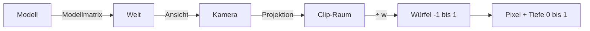
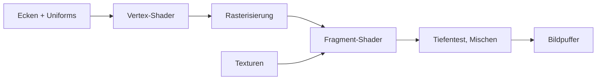
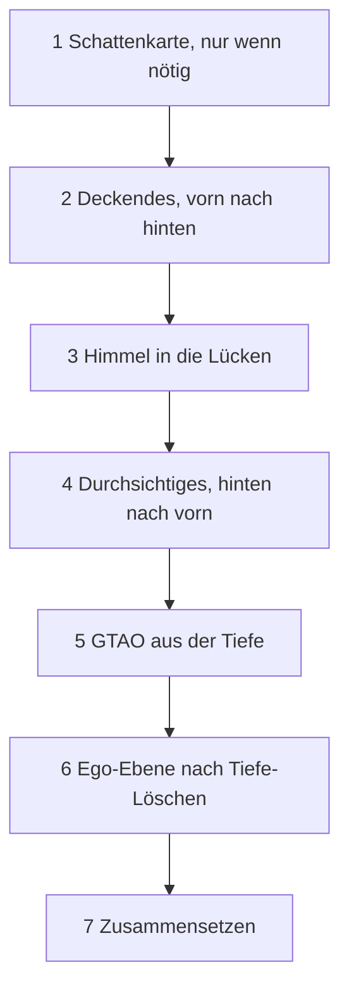

# Anhang B – Grundlagen: Wie aus Dreiecken Bilder werden

> **Dein Level:** Hier lernst du die Mathe und Physik hinter jedem 3D-Spiel – mit Schulwissen,
> Bildern und Zahlen, die du mit dem Taschenrechner nachprüfen kannst. Danach weißt du, wie eine
> Grafikkarte 60-mal pro Sekunde Licht, Schatten und Glanz ausrechnet.

Hier stehen die **Ideen**; was Kern daraus macht, zeigen [Kapitel 4](04-grafik.md) und
[Kapitel 5](05-szene-und-geometrie.md).

## B.1 Koordinatenräume

### Warum es mehrere Räume gibt

Der Rumpf der Micro Duck wird einmal in seinem eigenen Koordinatensystem gebaut. Dann steht er
irgendwo in der Welt, eine Kamera sieht ihn, und am Ende landet er auf Pixeln. Jeder Schritt wechselt
das Koordinatensystem:



### Matrizen ohne Angst

Eine **Matrix** ist eine Zahlentabelle, die einen Punkt in einen anderen verwandelt. Gerechnet wird
**Zeile mal Spalte**: jede Zeile Zahl für Zahl mit dem Punkt malnehmen, dann addieren. Eine Drehung um
90° um die z-Achse, angewendet auf den Punkt (2; 1; 0):

| Zeile | Rechnung | Ergebnis |
|---|---|---|
| (0; −1; 0) | 0·2 − 1·1 + 0 | −1 |
| (1; 0; 0) | 1·2 + 0 + 0 | 2 |
| (0; 0; 1) | 0 + 0 + 0 | 0 |

Aus (2; 1) wird (−1; 2). Zeichne beide Pfeile ins Heft: genau 90° gedreht.

### Der Trick mit der vierten Zahl

**Verschieben** („plus 10“) passt nicht in eine 3 × 3-Tabelle. Der Trick: eine vierte Zahl w. Ein
**Punkt** bekommt w = 1, eine **Richtung** w = 0, und die Verschiebung steht in der vierten Spalte:

| Zeile | Punkt (1; 2; 3; **1**) | Richtung (1; 2; 3; **0**) |
|---|---|---|
| (1; 0; 0; 10) | 1 + 10·1 = 11 | 1 + 10·0 = 1 |
| (0; 1; 0; 0) | 2 | 2 |
| (0; 0; 1; 0) | 3 | 3 |

Der Punkt wandert, die Richtung bleibt – ein Pfeil „nach vorn“ zeigt nach dem Verschieben immer noch
nach vorn. Jetzt sind alle Umwandlungen 4 × 4-Matrizen, die man hintereinanderschalten kann.

### Kerns Regeln

Alles in **Metern**, **Z zeigt nach oben**, rechtshändig. Matrizen sind **spaltenweise** gespeichert, wie WebGL es will. Bei „A mal B“
wirkt zuerst B: Eine Objektmatrix „Verschieben · Drehen · Skalieren“ skaliert erst, dreht dann und
verschiebt zuletzt. Drehungen speichert Kern als **Quaternionen**, vier Zahlen ohne Kippfehler.

> **Vorsicht, Falle:** Die Reihenfolge zählt! Erst 10 m verschieben, dann um 90° drehen landet ganz
> woanders als umgekehrt. Probier es mit einem Radiergummi auf dem Tisch.

### Ansicht und Perspektive

Die **Ansichtsmatrix** rückt die Welt so, dass die Kamera im Ursprung steht und entlang −z schaut.
Zeigen Blick und „oben“ gleich, fehlt die Seitwärts-Achse, und Kern malt nicht.

**Perspektive** heißt: doppelt so weit weg, halb so groß. Teilen kann eine Matrix nicht, aber sie
schreibt die Entfernung in w, und die Grafikkarte teilt danach durch w. Die Vergrößerung ist
f = 1 ÷ tan(halber Öffnungswinkel); Kerns Standardkamera nimmt 60°, also f ≈ 1,732 (die
Editor-Viewports in Studio starten mit 70°). Für die Breite wird noch durch das
Seitenverhältnis geteilt. Kern schneidet bei 0,05 m und 1800 m ab.

**Durchgerechnet:** Bild 960 × 540, Punkt 1 m rechts, 0,5 m hoch, 10 m vor der Kamera.

| Schritt | Rechnung | Ergebnis |
|---|---|---|
| vergrößern | 1,732 ÷ 1,778 · 1; 1,732 · 0,5 | 0,974; 0,866 |
| durch w = 10 | ÷ 10 | 0,0974; 0,0866 |
| in Pixel | (Wert + 1) ÷ 2 · (960; 540) | 526,8; 293,4 |

Knapp rechts oberhalb der Bildmitte (480; 270) – passt. Ansichten von oben, vorn oder der Seite sind
**orthografisch**: ohne Teilen, alles bleibt gleich groß.

> **Mission:** Öffne Kern Studio über https://kernengine.de/. Stell im Viewport-Menü **≡** das
> **Field of View** auf 50° und dann auf 110° – bei 110° wirkt alles weiter weg und am Rand verzerrt.
> Wechsle dann mit Alt+J auf die Ansicht **Top**: orthografisch, nichts wird hinten kleiner.

### Tiefe ist ungleich verteilt

Der Tiefenwert hängt von **1 ÷ Entfernung** ab, ferne Werte drängen sich an 1. Mit Kerns Grenzen und
24 Bit:

| Entfernung | Tiefenwert | kleinster Unterschied |
|---|---|---|
| 10 m | 0,995028 | ≈ 0,1 mm |
| 100 m | 0,999528 | ≈ 1,2 cm |
| 1000 m | 0,999978 | ≈ 1,2 m |

Zehnmal so weit, hundertmal ungenauer: **quadratisch**. Die nahe Grenze zu verdoppeln, verdoppelt
die Genauigkeit überall. Kerns GTAO rechnet aus dem Tiefenwert wieder Meter zurück.

### Normalen brauchen eine Extrawurst

Eine **Normale** steht senkrecht auf einer Fläche. Eine 45°-Rampe hat die Richtung (1; −1) und die
Normale (1; 1). Jetzt wird das Objekt in x doppelt so breit:

| | wie ein Punkt | richtig |
|---|---|---|
| Normale | (2; 1) | (0,5; 1) |
| mal Rampe (2; −1) | 4 − 1 = 3 ✗ | 1 − 1 = 0 ✓ |

Senkrecht heißt Skalarprodukt 0. Richtig ist es, das Strecken **umzukehren** (durch 2 statt mal 2) –
die „inverse Transponierte“, bei Kern pro Instanz berechnet ([Kapitel 4](04-grafik.md)).

## B.2 Rasterisierung und Tiefenpuffer

### Vom Dreieck zu Pixeln

Die **Rasterisierung** prüft, welche Pixelmittelpunkte in einem Dreieck liegen. Jedes wird ein
**Fragment**.

```
     v2
     /\
    / ■\       ■ = Pixelmitte im Dreieck
   / ■■ \
  / ■■■■ \
 /________\
v0        v1
```

Die Werte der Ecken werden mit drei Gewichten (Summe 1) gemischt, **perspektivisch korrekt**. In der
Mitte bekommt jede Ecke ein Drittel: Ecken rot, rot, schwarz ergeben ⅔ rot.

### Der Tiefenpuffer

Treffen mehrere Dreiecke dasselbe Pixel, merkt sich der **Tiefenpuffer** die kleinste Tiefe bisher.
Gemalt wird nur, was näher oder gleich nah ist. Bei deckenden Dingen ist die Reihenfolge so egal.
Kern nutzt das geschickt: Deckendes vorn nach hinten, Durchsichtiges hinten nach vorn, Himmel in die
Lücken, Ego-Ebene nach dem Löschen ([Kapitel 4](04-grafik.md)).

### Rückseiten

Dreiecke, die von dir wegzeigen, erkennt die Grafikkarte am **Umlaufsinn** ihrer Ecken auf dem
Schirm und wirft sie weg (*Backface Culling*). Ein Spiegelbild dreht den Umlaufsinn um.

> **Mission:** Schalte in Kern Studio den **View Mode** auf **Wireframe** (Alt+2): Jetzt siehst du die
> Dreiecke. Zurück mit **Lit** (Alt+4).

## B.3 Die GPU-Pipeline und Shader



Der **Vertex-Shader** läuft für jede Ecke und liefert ihre Bildschirmposition, der **Fragment-Shader**
für jedes Fragment und rechnet die Farbe. Ihre Zutaten:

| Begriff | ändert sich | Beispiel |
|---|---|---|
| Attribut | pro Ecke / Instanz | Position, Normale |
| Uniform | pro Zeichenbefehl | Sonnenrichtung |
| Varying | gemischt pro Fragment | Weltposition |
| Textur | Bild zum Nachschlagen | Schattenkarte |

**Instancing:** Hundert gleiche Bäume sind **ein** Befehl; Attribute wie die Matrix rücken pro Instanz
statt pro Ecke weiter. **Skinning:** Eine Ecke folgt bis zu vier Knochen, gewichtet wie eine
Zeugnisnote. Würde Knochen A sie auf Höhe 1 bringen und B auf Höhe 2, mit Gewichten 0,75 und 0,25:
0,75 · 1 + 0,25 · 2 = 1,25. **Mehrere Ausgaben:** Ein Fragment-Shader kann in mehrere Bilder
gleichzeitig schreiben – Kern schreibt drei und spart so einen zweiten Durchgang.

## B.4 Beleuchtung

### Was ein Pixel hell macht

Ein Pixel zeigt alles einfallende Licht, jeweils mal dem Anteil, den die Fläche zu dir zurückwirft
(die **BRDF**), plus Eigenleuchten. Diese Rendering-Gleichung (Kajiya) ist zu teuer; Spiele rechnen
**direktes** Licht genau und **indirektes** vereinfacht.

### Lambert: matte Flächen

Eine matte Fläche streut gleichmäßig. Hell ist sie, wenn Licht **steil** auftrifft; das misst das
Skalarprodukt von Normale n und Lichtrichtung l:

> Helligkeit = Albedo × Licht × max(0; n · l) ÷ π

**Durchgerechnet:** Boden n = (0; 0; 1), Sonne unter 45°: l = (0; 0,707; 0,707) (Pythagoras: 0,707² +
0,707² = 1). n · l = 0,707. Grau (Albedo 0,5), Kerns Sonne im Rotkanal 2,8:
0,5 × 2,8 × 0,707 ÷ 3,1416 ≈ **0,315**. Liegt die Sonne hinter der Fläche, ist n · l negativ – das max
macht 0 daraus. Das ÷ π sorgt dafür, dass eine weiße Fläche nicht mehr abgibt, als sie bekommt.

### Punktlichter

Physikalisch fällt Lampenlicht mit 1 ÷ Abstand², wird aber nie 0. Kern nimmt eine Kurve, die an der
Reichweite r **genau** 0 ist: mit q = Abstand² ÷ r² ist der Faktor (1 − q)² ÷ (1 + q).

| Abstand bei r = 10 m | q | Faktor |
|---|---|---|
| 2 m | 0,04 | 0,96² ÷ 1,04 ≈ 0,89 |
| 5 m | 0,25 | 0,75² ÷ 1,25 = 0,45 |
| 10 m | 1 | 0 |

Der Abstand² zählt mindestens als 0,04, sonst würde eine Lampe auf einer Fläche unendlich hell.

### Glanz: von Blinn-Phong zu Mikrofacetten

Der **Halbvektor** h liegt genau zwischen Licht- und Blickrichtung. Zeigt h wie die Normale, siehst du
den Glanzpunkt; **Blinn-Phong** nimmt dafür (n · h) hoch einer Glanzzahl. **PBR** (*physically based
rendering*) sagt genauer: Eine raue Fläche besteht aus winzigen Spiegeln (**Mikrofacetten**).
Gefragt wird: Wie viele zeigen zu h (**D**)? Wie viel wird gespiegelt (**F**, Fresnel)? Wie viel
verdecken sie sich (**G**)?

**D nach GGX**, mit a2 = Rauheit⁴:

| Rauheit | genau im Glanz (n · h = 1) | daneben (0,9) |
|---|---|---|
| 1 | 0,32 | 0,32 |
| 0,5 | 5,1 | 0,34 |
| 0,2 | 199 | fast 0 |

Raue Flächen verteilen den Glanz, glatte bündeln ihn zu einem winzigen, gleißenden Punkt – deshalb
begrenzt Kern D auf 40.

**Fresnel nach Schlick:** Senkrecht spiegelt ein Nichtmetall den Anteil F0 = 0,04 (Metalle: ihre
Farbe). Ganz flach spiegelt es den Anteil F90; bei Kern ist F90 = 1 − Rauheit (mindestens F0), raue
Flächen glänzen also auch am Rand weniger. Dazwischen entscheidet (1 − cos Blickwinkel) hoch 5.
Beispiel für die glatteste Fläche, die Kern kennt (Rauheit 0,04, also F90 = 0,96):

| Blick | cos | F |
|---|---|---|
| senkrecht | 1 | 0,04 |
| schräg | 0,5 | ≈ 0,07 |
| flach | 0,2 | ≈ 0,34 |

> **Krass, aber wahr:** Eine spiegelglatte Nichtmetall-Fläche spiegelt senkrecht nur 4 %, flach
> betrachtet über ein Drittel. Darum glänzt eine nasse Straße, wenn du flach über sie schaust.

**Kern** nutzt Rauheit und Metall: Lambert für Mattes, GGX und Schlick für den Sonnen-Glanz, den
Himmel als Fresnel-Spiegelung. Den G-Term spart es; mit einer einfachen Annahme kürzt er sich bis auf
den Faktor ¼. Ein **vereinfachtes PBR-Modell** ([Kapitel 4](04-grafik.md)).

### Indirektes Licht

Himmels- und Bodenlicht entsteht aus wenigen Farben: **Halbkugel-Licht** (oben Himmel, unten Boden)
und ein **Verlauf** aus Zenit, Horizont und Boden – getrennt geführt, damit B.8 nur es abdunkelt.

## B.5 Schattenkarten

### Die Idee

Man „fotografiert“ die Szene aus Sicht der Sonne und speichert pro Texel nur, **wie weit weg das
Nächste ist** – die **Schattenkarte**. Beim Malen fragt jeder Punkt: Bin ich weiter weg als das, was
die Sonne sah? Dann liegt etwas davor.

```
   Sonne ═══╗  (parallele Strahlen)
            ║  ↓   ↓   ↓   ↓
            ║     ███          gespeichert: Dach
            ║  ↓  ███  ↓   ↓
            ║  ── ─── ─────    Boden dahinter → Schatten
```

Die Strahlen der Sonne sind parallel, also nimmt man eine orthografische Projektion. Deckt eine Karte
mit 512 Texeln 240 m ab, ist ein Texel 240 ÷ 512 ≈ 47 cm – Schatten wie aus Minecraft-Blöcken.

### Probleme und Gegenmittel

| Problem | Ursache | Gegenmittel |
|---|---|---|
| Akne (Streifen) | Fläche verdeckt sich selbst | kleiner Versatz |
| Peter Panning | zu viel Versatz | Versatz klein halten |
| Treppenkanten | ein Texel, viele Pixel | Filtern (PCF) |
| Flimmern | Karte rutscht | auf Texel einrasten |
| unscharf nah | Karte zu groß | an die Sicht anpassen |

**Akne:** Ein Texel speichert eine Tiefe für ein ganzes Flächenstück; auf schrägen Flächen liegt die
Hälfte der Punkte knapp „dahinter“. Kern nimmt
drei kleine Versätze: einen je nach Schräge, einen festen (0,0012) und einen **Normal Offset**
(Holbert 2011) – nachgeschaut wird etwa einen Texel vor der Fläche, entlang der Normale.

**PCF** vergleicht mehrere Nachbar-Texel und nimmt den beleuchteten Anteil: Sind 3 von 4 hell, ist der
Punkt zu 75 % hell, die Kante wird weich. Grafikkarten schaffen 4 Texel in einem Zug; Kern setzt daraus
bis zu 5 × 5 große Filter zusammen. Einrasten, Schattendistanz und Wiederverwenden mit Zahlen:
[Kapitel 4](04-grafik.md).

## B.6 HDR, Tonemapping und Gamma

### HDR und Tonemapping

Kerns Sonne hat die Stärke 2,8, der Bildschirm zeigt nur 0 bis 1. Man rechnet in **HDR** (*high
dynamic range*) und quetscht am Ende mit dem **Tonemapping**: in der Mitte fast gerade, oben sanft.

```
 Ausgabe
  1 |            ____________
    |        _--
    |    /
  0 |/________________________ Eingabe
    0    1    2    3    4
```

Kern nimmt die ACES-Filmkurve (Fassung von three.js), davor die Belichtung, danach eine Farbkorrektur.

### Gamma und sRGB

Bilder speichern Farben in **sRGB**: Dunkle Töne bekommen mehr der 256 Stufen, weil das Auge dort
feiner unterscheidet. Licht addiert sich aber **linear**. Also: Farben linear machen, rechnen, zurück
nach sRGB. Lineares Mittelgrau 0,18 wird zu 1,055 · 0,18^(1/2,4) − 0,055 ≈ **0,461** – fast die halbe
Skala, obwohl es nur 18 % Licht sind.

> **So kannst du es dir vorstellen:** Lautstärke. Von 1 auf 2 Lautsprecher hörst du deutlich, von 10
> auf 11 kaum. Auch beim Licht merkt das Auge Unterschiede im Dunkeln stärker.

### Nebel

Kern nimmt die Nebelkurve von three.js, in der Dichte mal Abstand **quadriert** wird. Mit Kerns
Dichte 0,00085 gibt es bei 100 m 0,7 % Nebel, bei 1000 m 51 % – die Nähe bleibt klar, die Ferne
versinkt. Kerns Extras stehen in [Kapitel 4](04-grafik.md).

> **Mission:** Stell in **World Settings** die **Exposure** auf 0,5 und dann auf 2 – das ist die
> Belichtung vor dem Tonemapping. Dreh danach **Fog density** hoch und sieh die Ferne verschwinden.

## B.7 Bloom

Sehr Helles überstrahlt seine Umgebung; diesen Lichthof nennt man **Bloom**. Man schneidet Helles aus,
zeichnet es weich und addiert es zurück.

Ein **Gauß-Filter** mischt jedes Pixel mit seinen Nachbarn. Statt 9 × 9 = 81 Zugriffen nimmt man erst
9 waagerecht, dann 9 senkrecht: 18. Und wer genau **zwischen** zwei Pixeln liest, bekommt beide
gemischt geschenkt – 5 Zugriffe ersetzen 9 Gewichte. Kerns Gewichte: Mitte 0,2270, bei ±1,3846 Pixeln
je 0,3162, bei ±3,2308 je 0,0703. Probe: 0,2270 + 2 · 0,3162 + 2 · 0,0703 = 1 – die Helligkeit bleibt.

Kerns weiche Schwelle: Helligkeit 1,0 gibt etwa 27 % Glühen, 1,1 etwa 69 %, ab 1,23 alles
([Kapitel 4](04-grafik.md)).

## B.8 Umgebungsverdeckung: SSAO und GTAO

In Ecken und Fugen ist ein Teil des Himmels verdeckt. Die **Umgebungsverdeckung** (*Ambient
Occlusion*, AO) misst den sichtbaren Himmelsanteil, Richtungen nahe der Normale zählen mehr.

**SSAO** (*Screen Space*) nutzt statt teurer Strahlen nur den Tiefenpuffer und zählt Stichproben in
einer Kugel – grob. **GTAO** (Jimenez und andere, 2016) sucht in einigen Richtungen links und rechts
den **Horizont**: wie weit der Himmel frei ist, gemessen als Winkel h von der Normale aus (90° heißt:
frei bis zum Boden). Für den freien Bogen dazwischen gibt es eine fertige Formel; bei flachem Boden
liefert jede Seite (1 − cos(2h)) ÷ 4.

```
            Horizont h1
                ╲   │n   ╱  Horizont h0
                 ╲  │   ╱
   ████████       ╲ │  ╱      ████
   ████████████────●────────████████
```

| Lage | Horizonte | Sichtbarkeit |
|---|---|---|
| freier Boden | 90° und 90° | (1 + 1) ÷ 4 + (1 + 1) ÷ 4 = 1 |
| Wand auf einer Seite | 90° und 45° | 0,5 + (1 − 0) ÷ 4 = 0,75 |

(cos 180° = −1, cos 90° = 0.) Neben der Wand fehlt ein Viertel des Himmels.

Kern folgt Intels XeGTAO, mit Radius in Metern, einem Bonus für helle Flächen (**Mehrfach-Abprall**)
und nur aufs indirekte Licht angewendet ([Kapitel 4](04-grafik.md)).

## B.9 Himmel und Atmosphäre

Der Himmel ist blau, weil Luft kurzwelliges Licht viel stärker streut (**Rayleigh-Streuung**): Halbe
Wellenlänge heißt 2⁴ = 16-mal so viel. Am Horizont ist der Weg durch die Luft länger; bei tiefer Sonne
bleibt Rot übrig. Größere Teilchen streuen nach vorn und machen den Hof um die Sonne
(**Mie-Streuung**). Echte Modelle rechnen das entlang jedes Sichtstrahls aus.

Kern rechnet **kein** solches Integral, sondern ein schnelles Modell, das so aussieht – gemalt auf
Tiefe 1, nur in die Lücken ([Kapitel 4](04-grafik.md)).

## B.10 Culling und Szenenstrukturen

### Die Sichtpyramide

Was nicht im Bild ist, malt man nicht. Sichtbar ist ein Pyramidenstumpf (*Frustum*) aus sechs Ebenen,
die man laut Gribb und Hartmann direkt aus der Kamera-Matrix ablesen kann. Jedes Objekt bekommt eine
**Hüllkugel**. Sie ist sicher unsichtbar, wenn ihr Mittelpunkt mehr als ihren Radius **hinter** einer
Ebene liegt.

```
       \         /
        \  ●    /     ● sichtbar
   ○     \     /      ○ weg: mehr als r hinter der Ebene
          \   /
          Kamera
```

Kugel mit 2 m Radius, Mittelpunkt 3 m hinter der Ebene: weg. Nur 1,5 m dahinter: Sie ragt noch ins
Bild. Der Test wirft **nie** Sichtbares weg, lässt an den Ecken aber manchmal Unsichtbares durch.

### Hüllkörper-Bäume (BVH)

Eine **BVH** (*Bounding Volume Hierarchy*) ordnet viele Dreiecke in einen Baum aus Kisten. Verfehlt
ein Strahl eine Kiste, fällt der ganze Ast weg.

```
          [ alle ]
         /        \
    [links]      [rechts]
    /    \        /    \
 [△△]  [△△]   [△△]  [△△]
```

Bei einer Million Dreiecken reichen etwa 20 Ebenen, denn 2²⁰ ≈ 1 000 000. Kern nutzt die BVH zum **Anklicken** (ab 36 Dreiecken), nicht zum Malen
([Kapitel 5](05-szene-und-geometrie.md)); die Physik hat eine eigene ([Anhang C](C-grundlagen-physik.md)).

> **Mission:** Schalte im Viewport über **Show** die **Bounds** ein und sieh dir die Hüllkörper an.

## B.11 Zeichenbefehle und Zustandswechsel

Jeder **Zeichenbefehl** kostet Prozessorzeit: Der Treiber prüft, bindet Puffer, lädt Uniforms – im
Browser kommt der Weg über JavaScript dazu. Tausende kleine Befehle dauern oft länger als das Malen.
Auch **Wechsel** (anderes Programm, andere Textur) kosten.

Kern hält dagegen: ein Programm, ein Befehl pro Mesh, Uniforms und Texturen nur bei Änderung,
Schatten nur wenn nötig, Culling vor dem Malen. So läuft ein Bild ab (Details in
[Kapitel 4](04-grafik.md)):



## B.12 Warum WebAssembly und WebGL2 so verbunden sind

Kern ist C++, der Browser bietet Grafik aber nur für JavaScript. **WebAssembly** ist ein kompaktes
Format, das der Browser in Maschinencode übersetzt; ein Modul hat einen großen Speicherblock und darf
nur Funktionen rufen, die man ihm beim Laden gibt (**Importe**). **WebGL2** ist die Browser-Grafik,
fast wie OpenGL ES 3.0. Kern übersetzt mit wasi-sdk für `wasm32-wasip1`. Wie die Brücke
funktioniert – Nummern statt Objekte, Daten ohne Kopie –, zeigt [Kapitel 4](04-grafik.md).

**Warum so?** C++ überall: ein Code für Browser, Tests und Lehrer, Physik rechnet überall gleich
([Anhang C](C-grundlagen-physik.md)). JavaScript dünn: Logik dort wäre doppelt. Nummern: WebAssembly
hält nur Zahlen. Eigene Kopien: Der Browser kann die Grafik wegnehmen. Wenige Befehle: Jeder muss über
die Grenze. Ohne Grafik rechnet der Lehrer dieselbe Welt; Parallelität kommt über Web Worker, im Modul
läuft ein Thread.

## B.13 Zusammenfassung

Matrizen, Tiefe, Shader, Licht, Schatten, Farbe, Glühen, Verdeckung, Himmel, Culling und die
Brücke zum Browser: Wie Kern sie einsetzt, zeigen [Kapitel 4](04-grafik.md) und
[Kapitel 5](05-szene-und-geometrie.md).

## Level geschafft!

- Du wendest eine Matrix „Zeile mal Spalte“ an und weißt, warum Punkte w = 1 haben.
- Du rechnest matte Helligkeit mit dem Skalarprodukt aus.
- Du weißt, was Fresnel, GGX und PBR bedeuten.
- Du kennst die Tricks gegen Schattenakne und Treppenkanten.
- Du verstehst, warum man linear rechnet und in sRGB speichert.

## Rätsel-Ecke

1. Was macht eine Verschiebung um (5; 5; 5) mit der Richtung (0; 1; 0; 0)?
2. Sonne senkrecht über einer weißen Fläche (Albedo 1), Licht 3,1416. Wie hell ist sie?
3. Warum wird die Tiefe in der Ferne ungenau – und was hilft am meisten?
4. **Boss-Rätsel:** Ein Punkt in einer Rinne hat links und rechts einen Horizont von 45°. Wie groß
   ist seine Sichtbarkeit nach GTAO?

### Lösungen

1. Nichts: w = 0, die Verschiebung wird mit 0 malgenommen.
2. 1 × 3,1416 × 1 ÷ 3,1416 = **1** – genau so viel, wie ankommt.
3. Die Genauigkeit sinkt quadratisch (1 ÷ Entfernung). Am meisten hilft eine größere nahe Grenze.
4. Jede Seite: (1 − cos 90°) ÷ 4 = 0,25. Zusammen **0,5** – der halbe Himmel ist verdeckt.

---

© 2026 Christian Heinrich Hohlfeld · Alle Rechte vorbehalten · [Impressum und Rechte](00-impressum.md)
