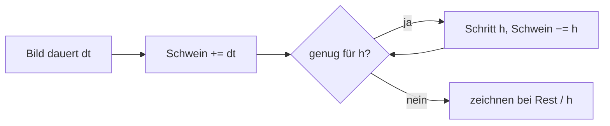
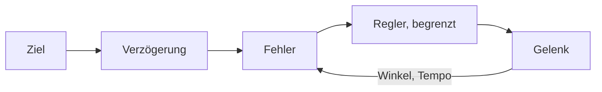

# Anhang C – Grundlagen: Wie eine Physiksimulation denkt

> **Dein Level:** Ein Bonuslevel unter der Haube: wie ein Computer Bewegung Schritt für Schritt
> vorausrechnet, Zusammenstöße findet, mit Reibung rechnet, einen Servo regelt – und warum alles auf
> jedem Gerät bis aufs letzte Bit gleich herauskommt.

Wie Kern **Box3D** benutzt, steht in [Kapitel 6](06-physik.md); hier geht es um die Ideen dahinter.
Du brauchst nur Kraft, Masse, Geschwindigkeit und Reibung – den Rest zeigen Bilder und Zahlen.

## C.1 Starrkörper und ihr Zustand

Ein **Starrkörper** verformt sich nie. Echte Dinge geben etwas nach, aber für Roboterglieder, Kisten
und Autos passt das sehr gut – und wenige Zahlen beschreiben die ganze Bewegung: **Position** (des
Schwerpunkts), **Drehung** (als Quaternion, vier Zahlen, siehe [Anhang B](B-grundlagen-rendering.md)),
**Geschwindigkeit** und **Drehgeschwindigkeit**. Fest bleiben **Masse**, **Schwerpunkt** und
**Trägheit gegen Drehung**.

> **So kannst du es dir vorstellen:** Dreh dich auf dem Bürostuhl und zieh die Arme an – du wirst
> schneller. Wie die Masse verteilt ist, bestimmt, wie leicht sich etwas dreht. Eine Stange dreht
> sich längs leicht, quer schwer; darum braucht die Trägheit sechs Zahlen statt einer.

Es gilt Newton: **Kraft = Masse · Beschleunigung** – 10 N machen einen 2-kg-Ball pro Sekunde 5 m/s
schneller. Drehungen folgen Drehmoment und Trägheit, plus einem **Kreiseleffekt**, der lange, dünne
Körper taumeln lässt.

## C.2 Integration: das Daumenkino

Ein Computer rechnet Bewegung wie ein **Daumenkino**: vom Bild jetzt zum Bild eine Schrittlänge h
später. Das heißt **Integration**. Weil Kräfte sich *während* des Schritts ändern, muss jedes
Verfahren raten. Ein fallender Ball, h = 0,1 s, g ≈ 10 m/s²:

- **explizit:** mit dem *alten* Tempo weiterbewegen, dann schneller werden;
- **semi-implizit:** erst schneller werden, dann mit dem *neuen* Tempo weiterbewegen.

Nach 0,3 s ist der Ball explizit 0,3 m gefallen, semi-implizit 0,6 m, in Wirklichkeit 0,45 m. Beide
liegen daneben – bei **Federn** aber entscheidet das über alles. Eine Feder mit 2 Hz bei 60 Hz Takt:

| Verfahren | pro Schritt | nach 1 Sekunde |
|---|---|---|
| explizit | +2,2 % | 3,6-mal so weit |
| semi-implizit | bleibt | bleibt |
| implizit (Kraft am Schrittende) | −2,1 % | nur noch 28 % |

Explizit schaukelt sich die Feder auf. Implizit bremst sie künstlich, ist aber **immer stabil**.
Semi-implizit hält den Schwung – bei 60 Hz bis etwa 19 Hz Federfrequenz.

> **Krass, aber wahr:** Eine 30-Hz-Feder bei 60 Hz Takt wächst explizit pro Schritt um das 3,3-Fache.
> Nach zehn Schritten – einer Sechstelsekunde – ist sie **150 000-mal** so groß.

**Box3D** rechnet semi-implizit: in jedem Sub-Step erst die Tempi, dann der **Solver** (C.6), dann die
Positionen mit dem neuen Tempo. Die Dämpfung teilt das Tempo pro Schritt durch (1 + h · c): bei
c = 2/s und 60 Hz durch 1,033, also 3,2 % weniger – sie kann nie kippen. Auch den Kreiseleffekt
rechnet Box3D implizit. Tempolimits: 400 m/s und eine Achteldrehung (45°) pro Schritt.

> **Vorsicht, Falle:** Warum verbietet Kern eine selbst gebaute Bremskraft „Kraft = −c · Tempo“? Ein
> Beispiel: 10-g-Glied, c = 10, 60 Hz: Pro Schritt ändert sich das Tempo um 10 ÷ 0,01 ÷ 60 ≈ 16,7-mal das
> Tempo selbst. Aus 1 m/s vorwärts werden −15,7 m/s rückwärts. Die „Bremse“ katapultiert.

### Fester Zeitschritt

Rechnete man mit der schwankenden Bildzeit, hieße ein langsames Bild ein großer, instabiler Schritt –
und jeder Rechner käme woanders an. Glenn Fiedlers **Akkumulator** ist ein Zeit-Sparschwein:



Ein Beispiel mit h = 16,7 ms: Ein Bild dauert 25 ms – ein Schritt, 8,3 ms Rest, gezeichnet bei 50 %
zwischen altem und neuem Zustand. Das nächste Bild dauert wieder 25 ms: Im Schwein sind jetzt
33,3 ms, also zwei Schritte, Rest 0. Kerns Grenzen: [Kapitel 6](06-physik.md), 6.13.

**Sub-Steps** teilen jeden Schritt weiter: bei der Micro Duck 100 Hz × 16 = 1600 pro Sekunde, je
0,625 ms. Kleinere Schritte machen Gelenkketten steifer.

## C.3 Kollisionserkennung

Bei n Körpern gibt es n · (n − 1) ÷ 2 Paare, bei 1000 also 499 500. Darum zwei Phasen:

**Broad Phase:** Jede Form steckt in einer achsenparallelen Kiste; nur überlappende Kisten (sechs
Vergleiche) kommen weiter. Die Kisten liegen in einem Baum wie die BVH aus
[Kapitel 5](05-szene-und-geometrie.md), etwas zu groß (bis 50 mm), damit der Baum nicht ständig
umgebaut wird. Feste Körper haben einen eigenen Baum.

**Narrow Phase:** Hier zählt **konvex**: Die Linie zwischen zwei Punkten der Form liegt ganz in ihr.
Kugel, Kapsel, Quader und konvexe Hüllen sind konvex, ein L nicht.

- **GJK:** Zieh jeden Punkt von B von jedem Punkt von A ab – heraus kommt die
  **Minkowski-Differenz**. Enthält sie den Ursprung, berühren sich A und B. GJK tastet sich mit
  Punkt, Strecke, Dreieck und Tetraeder heran und fragt jede Form nur: „Dein äußerster Punkt in
  Richtung d?“
- **SAT:** Leuchte mit einer Taschenlampe auf zwei Formen. Gibt es eine Richtung, in der die
  Schatten nicht überlappen, sind sie getrennt. Probiert werden Flächennormalen und
  Kantenkombinationen; Box3D merkt sich die letzte Trennachse.

Ergebnis ist ein **Manifold**: Normale und Kontaktpunkte mit Abstand. **Konvexe Hüllen** spannen
sich um Punkte wie ein Gummiband um Nägel, in 3D (bis 128 Ecken, nicht flach). Nicht Konvexes baut
man aus mehreren Hüllen; Dreiecksnetze gibt es nur für feste Körper.

**Tunneling:** Eine Kugel mit 300 m/s fliegt bei 60 Hz 5 m pro Schritt – durch eine 10-cm-Wand
glatt hindurch. Box3D erzeugt Kontakte deshalb schon **vor** der Berührung, ab 20 mm Abstand (der
spekulativen Distanz, viermal die erlaubte Überlappung von 5 mm), und erlaubt nur so viel Annäherung,
wie Abstand da ist. Für sehr Schnelles gibt es **Continuous Collision**. Weil diese Toleranzen in
Metern feststehen, simuliert Kern die kleine Micro Duck vierfach groß ([Kapitel 6](06-physik.md)).

## C.4 Kontakte, Reibung, Sprungkraft

**Die Kontaktregel:** Körper dürfen sich nicht durchdringen; ein Kontakt kann nur **drücken**, nie
ziehen; und er drückt nur, wenn sie sich berühren. Solche Entweder-oder-Regeln heißen
**Komplementaritätsbedingungen**. Der Solver erfüllt sie sehr gut, aber nicht perfekt.

**Reibung nach Coulomb:** Sie ist höchstens **Reibwert μ mal Druckkraft**. Eine 300-kg-Kiste drückt
mit rund 2943 N; bei μ = 0,6 hält sie bis 1766 N. Schiebst du mit 1000 N, **haftet** sie, mit 2000 N
**rutscht** sie. Auf einer Rampe bleibt sie liegen, solange die **Steigung** nicht größer als μ ist –
μ = 0,6 heißt bis 60 % (etwa 31°). Alle erlaubten Kräfte bilden einen **Reibungskegel**:

```
     ╲    │ n  ╱   Kraft innen  → Haften
      ╲   │   ╱    Kraft am Rand → Rutschen
   ──────●──────   Kontaktfläche
```

Eigentlich ist Haftreibung stärker als Gleitreibung; Box3D kennt nur einen Wert. Es rechnet die
Reibung einmal in der **Mitte** des Manifolds und hält den Kegel **rund**: Gebraucht werden (3 | 4),
nach Pythagoras 5, erlaubt sind (als Beispiel) 2,5 – dann wird der Pfeil auf (1,5 | 2) halbiert, statt jede Zahl
auf 2,5 zu kappen. Dazu kommt **Drehreibung** um die Normale.

> **Mission:** Setz über **+ Add › Shapes** eine **Ramp** (6 m lang, 1,5 m hoch: 25 % Steigung) und
> über **+ Add › Physics** einen **Physics Cube**; schieb ihn auf die Schräge. In Simulate bleibt er
> liegen (beide haben Reibung 0,6). Stopp mit Esc, stell in Details › Static Mesh › Physics seine
> **Friction** auf 0,02 und starte Simulate neu: Er rutscht, denn √(0,02 · 0,6) ≈ 0,11 ist kleiner
> als 0,25.

**Zwei Reibwerte, ein Kontakt:** Box3D nimmt √(μA · μB). Bei 0,6 und 1,0 sind das 0,775 (Mittelwert
0,8), bei Eis 0,05 und Gummi 1,0 nur 0,224 (Mittelwert 0,525), und bei 0 und 1,0 genau 0. Was
reibungsfrei ist, bleibt es also. Trotzdem nur eine Faustregel – darum kennt Kern gemessene
**Paarwerte** ([Kapitel 6](06-physik.md), 6.6). Die Micro Duck hebt eine Socke mit dem Schnabel auf:
Das Polster muss auf der Socke **greifen**, die Socke auf dem Boden **rutschen**. Ein Wert pro Form
kann nicht beides.

**Sprungkraft (Restitution):** Mit e = 0,5 springt ein Ball, der mit 4 m/s aufschlägt, mit 2 m/s
zurück; e = 0 bleibt liegen, e = 1 prallt perfekt. Box3D nimmt das **Größere** beider Formen – ein
Gummiball springt auch auf Beton. Unter 1 m/s prallt nichts ab, sonst würde Ruhendes ewig zittern.
Angewendet wird die Sprungkraft **nach** dem Lösen, mit dem Tempo von vor dem Stoß.

> **Mission:** Setz eine **Physics Sphere** in die Szene, stell in Details › Static Mesh › Physics
> die **Restitution** auf 0,9, heb sie in Simulate hoch und lass sie fallen. Stopp mit Esc, stell 0
> ein und probier es noch einmal: Jetzt bleibt sie liegen.

**Rollwiderstand:** Eine perfekte Kugel rollt ewig. Echte Bälle und Böden geben nach – das bremst
mit **Rollwiderstand mal Druckkraft**, bei 0,03 also 3 % des Gewichts. Box3D nimmt den größeren Wert
mal Radius. Kerns Notizen: „Der Ball rollte ewig“ – bis er Rollwiderstand bekam.

## C.5 Gelenke als Regeln

Ein **Gelenk** ist eine Regel, etwa: „Punkt A und Punkt B bleiben aufeinander“ – also müssen beide
gleich schnell sein. Weicht das ab, sucht der Solver einen reparierenden **Stoß**. Wie stark der
wirkt, hängt von der **effektiven Masse** ab:

Im einfachsten Fall – zwei Kugeln, die sich nur geradeaus ziehen oder schieben, ohne sich zu drehen –
gilt:

**effektive Masse = 1 ÷ (1/mA + 1/mB)**

Zwei 2-kg-Kugeln: 1 ÷ (0,5 + 0,5) = 1 kg. Eine 2-kg-Kugel an einer festen Wand (1/m = 0): 2 kg. Beim
Scharnier gilt dasselbe mit der Trägheit um die Achse – genau so übersetzt Kern Servo-Federn
([Kapitel 6](06-physik.md), 6.8, dort auch alle neun Gelenkarten). Gebaut wird immer in der
**Ruhepose**: Dort liegt der Winkel 0.

## C.6 Der Solver

Ein Roboter hat 15 Gelenke und dutzende Kontakte. Echtzeit-Engines lösen sie **nacheinander**,
immer wieder (**Gauß-Seidel**, in Spielen **Sequential Impulses**).

> **So kannst du es dir vorstellen:** Vier Leute halten ein Bild an die Wand. Jeder korrigiert seine
> Ecke und verschiebt dabei die anderen ein wenig. Nach ein paar Runden hängt es gerade.

„Nur drücken“ prüft der Solver an der **Summe** aller Stöße: Runde 1 drückt 5, Runde 2 nimmt 2
zurück – Summe 3, erlaubt. Wollte sie 6 zurücknehmen, wäre die Summe −1; dann wird auf 0 gekappt.
**Warmstart:** Ein ruhender Stapel braucht jeden Schritt fast dieselben Stöße, also startet der
Solver mit den letzten.

**Weiche Regeln:** Harte Regeln korrigieren sofort und machen Zittern. Box3D behandelt **jede** Regel
als steife, gedämpfte Feder, implizit gerechnet (stabil, siehe C.2). Mit Kerns Kontaktwerten (30 Hz,
Dämpfung 10) bei 1600 Sub-Steps pro Sekunde werden 1 mm Überlappung zwischen bewegten Körpern mit nur
etwa **6,6 mm/s** abgebaut – sanft statt ruckartig. Kontakte mit festen Körpern rechnet Box3D mit
60 Hz und Dämpfung 5: etwa 26 mm/s. Höchstens geht es mit der Ausdrückgeschwindigkeit (Kern: 3 m/s).

Ein fester Schritt bei Box3D heißt **Soft Step**: Regeln vorbereiten; dann pro Sub-Step Tempi
rechnen, Warmstart, lösen mit Fehlerabbau, Positionen rechnen und **Relax** (lösen ohne Fehlerabbau –
das nimmt den Extra-Schwung der Korrektur wieder heraus); am Ende Sprungkraft und Stöße für den
nächsten Warmstart merken.

**Grenzen:** Eine Feder muss langsamer schwingen, als die Sub-Steps „hinschauen“. Box3D begrenzt
Gelenke auf ein Viertel, Kontakte auf ein Achtel der Sub-Step-Rate – bei 1600 also 400 und 200 Hz;
Kerns Servogelenke nutzen 240 Hz. **Massenverhältnisse:** Hängt Schweres an Leichtem (5 kg an 10 g
sind 500 : 1), dehnen sich Gelenke, bis der Solver die Stöße durchgereicht hat. Faustregel:
höchstens etwa 10 : 1.

## C.7 Servos als Regelkreis

Ein Servo wie der Dynamixel XL330 der Micro Duck bekommt einen **Zielwinkel**, misst, vergleicht und
steuert gegen – immer wieder:



**PD-Regler:** Moment = K · Fehler − D · Drehtempo. K wirkt wie eine Drehfeder, D wie ein
Stoßdämpfer. Ein Newtonmeter ist 1 N (etwa das Gewicht von 100 g) an 1 m Hebel. Beim XL330
(K = 0,554, D = 0,053) drückt der Servo bei 0,5 rad (knapp 29°) Fehler mit 0,554 · 0,5 ≈ 0,28 N·m;
dreht er gerade mit 2 rad/s, bremst die Dämpfung 0,11 N·m davon ab.

Mit seiner Rotorträgheit schwingt er etwa **2,8-mal pro Sekunde**, mit Dämpfungsgrad **0,84**. Unter
1 schwingt ein Regler über das Ziel (ausgeleierter Stoßdämpfer), genau 1 kommt ohne Überschwingen an
(guter Türschließer), über 1 kriecht er (Tür in Honig). 0,84 ist also weich und gut gedämpft.

**Sättigung:** Mehr als T = 0,963 N·m schafft der Motor nicht – erreicht bei 0,963 ÷ 0,554 ≈ 1,74 rad,
rund 100°. Darum muss das Netz Ziele weit hinter den Gelenkgrenzen setzen. **Reibung** im Getriebe:
0,0048 N·m Gegenmoment. **Verzögerung:** etwa 20 ms. Eine Schwingung mit 2,8 Hz dauert 357 ms; 20 ms
davon sind 5,6 %, und 5,6 % von 360° sind **rund 20°**, um die der Regler hinterherhinkt. Das kann
einen stabilen Regler ins Schwingen bringen.

> **Vorsicht, Falle:** Ein Netz, das nie mit Verzögerung trainiert hat, versagt am echten Roboter.
> Kern simuliert sie deshalb mit, als Warteschlange von 4 Weltschritten.

**In Kern** ist der PD-Regler die Feder des Scharniers (implizit, also stabil), die Sättigung ein
begrenztes Ziel, die Reibung ein Motor mit Tempo 0 und die Rotorträgheit eine Scheibe auf der Achse,
alles in einem **Geräteprofil** ([Kapitel 6](06-physik.md), 6.17; [Kapitel 16](16-kalibrierung.md)).

## C.8 Was man nicht tun sollte

Dauerlasten jeden Schritt als **Kraft** (Kräfte werden gelöscht). Sprünge als **Impuls** = Masse ·
Tempoänderung: 30 kg, die 5 m/s schneller werden sollen, brauchen 150 N·s. **Kein Tempo setzen** an
Körpern mit Gelenken oder Kontakten – ein „Kreisel“ auf Tempo-Ebene ließ die Ente springen. **Keine
Hilfskräfte** für Roboter, die gibt es in echt auch nicht. Alle Regeln: [Kapitel 6](06-physik.md),
6.15.

## C.9 Determinismus

**Deterministisch** heißt: gleicher Anfang, gleiche Eingaben, **bitgleiches** Ergebnis. Dann ergibt
ein Training überall dasselbe Netz, Fehler lassen sich nachstellen, Roboterlogs laufen überall
gleich. Physik ist aber **chaotisch**; in Kerns Notizen steht: „Ein Bit wird in einer
Robotersimulation in Sekunden zu einem anderen Gang.“

Computer runden nach jeder Rechnung, und die **Reihenfolge** zählt:

```
(0.1 + 0.2) + 0.3  =  0.6000000000000001
0.1 + (0.2 + 0.3)  =  0.6
```

Die Fallen und Kerns Gegenmittel:

- **Umsortieren durch den Compiler** (`-ffast-math`): verboten.
- **Parallele Summen** hängen von der Thread-Zahl ab: Kern summiert in fester Reihenfolge
  ([Anhang A](A-grundlagen-neuronale-netze.md)); Box3D läuft auf einem Thread.
- **FMA** rechnet a · b + c mit einer Rundung statt zwei – beides korrekt, aber verschieden, und
  WebAssembly macht es nicht. Kern übersetzt alles mit `-ffp-contract=off`, Box3D ohne Vektorbefehle.
- **sin, cos, exp, log, pow, atan2** runden auf Linux, Apple, Android und im Browser verschieden. Kern
  bringt eigene mit (aus **musl**, MIT-Lizenz) unter `kern::dm::`. `sqrt`, `fabs` und `floor` sind
  überall exakt.
- **Schwankende Zeit, Zufall, Uhrzeit:** fester Takt, eigener Zufallsgenerator mit festen Seeds,
  Simulationszeit als Schrittzähler.

**Prüfen:** Pollens Netz steuert die Ente 400 Regeltakte; nach jedem wird der genaue Zustand zu einer
Prüfnummer. Zwei Builds sind gleich, wenn alle 400 Nummern gleich sind – geprüft mit GCC auf x86,
WebAssembly in Node und Apple clang auf ARM.

> **Krass, aber wahr:** Ein hängendes Servo-Bein läuft in einfacher und vierfacher Größe **Bit für
> Bit gleich**. Bei S = 4 sind alle Faktoren Zweierpotenzen (2, 4, 64, 256 …). Eine Kommazahl mal
> einer Zweierpotenz verschiebt im Computer nur den Exponenten, die Ziffern bleiben gleich. Ist jede
> Größe passend mitskaliert, rundet darum jede Rechnung genau gleich. Am Boden klappt das nicht mehr:
> Box3Ds feste Toleranzen skalieren nicht mit.

> **Mission:** Stell im Physics Lab unter World Settings › Physics (Box3D) die **Sub-steps** von 4
> auf 1, starte Simulate und beobachte die Seilbrücke. Stopp mit Esc, stell 16 ein und vergleiche:
> Mit 1 Sub-Step hängt die Mitte rund einen Meter tiefer – lange Gelenkketten dehnen sich mit
> wenigen Sub-Steps mehr.

## C.10 Auf einen Blick

Wo du jedes Thema in [Kapitel 6](06-physik.md) wiederfindest: Zustand und Masse in 6.4, Takt und
Sub-Steps in 6.13, Formen und Hüllen in 6.5, Reibung und Sprungkraft in 6.6 und 6.7, Gelenke in 6.8,
Servos in 6.17, Determinismus in 6.14.

## Level geschafft!

- Du weißt, wie ein Computer Bewegung als Daumenkino rechnet und warum Box3D semi-implizit ist.
- Du kennst Broad und Narrow Phase und weißt, was konvex heißt.
- Du kannst mit μ rechnen und zwei Reibwerte kombinieren.
- Du verstehst, wie ein Solver weiche Regeln löst und warum Kern bitgleich bleibt.
- Du kannst einen PD-Servo mit Zahlen beschreiben.

## Rätsel-Ecke

1. Wie viele Paare gibt es bei 10 Körpern?
2. Ein Ball (Restitution 0,8) trifft mit 5 m/s auf einen Boden (Restitution 0). Wie schnell springt
   er zurück?
3. Kiste und Rampe haben μ = 0,5, die Rampe 40 % Steigung. Bleibt die Kiste liegen?
4. **Boss-Rätsel:** Ein Servo hat K = 2 N·m/rad und T = 1 N·m. Ab welchem Fehler ist er gesättigt?
   Wie viel Grad Nachlauf bringen 25 ms Verzögerung bei 2 Hz?

### Lösungen

1. 10 · 9 ÷ 2 = **45**.
2. Das Größere zählt: 0,8 · 5 = **4 m/s** (5 m/s liegt über der Schwelle von 1 m/s).
3. √(0,5 · 0,5) = 0,5, also hält sie bis 50 % – **sie bleibt liegen**.
4. Ab 1 ÷ 2 = **0,5 rad** (knapp 29°). Eine Schwingung dauert 500 ms, 25 ms sind 5 %, und 5 % von
   360° sind **18°**.

---

© 2026 Christian Heinrich Hohlfeld · Alle Rechte vorbehalten · [Impressum und Rechte](00-impressum.md)
