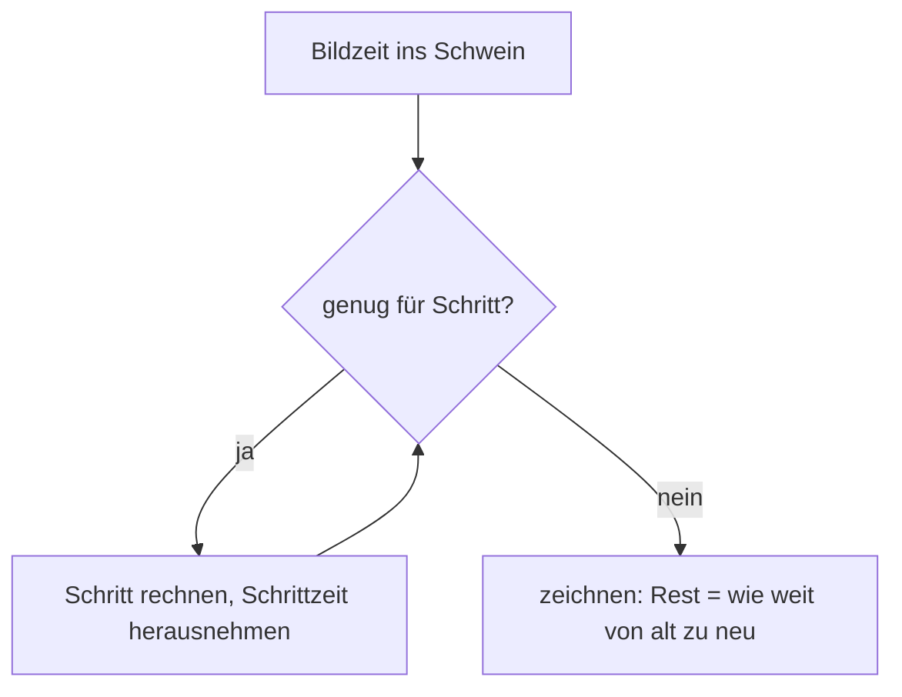
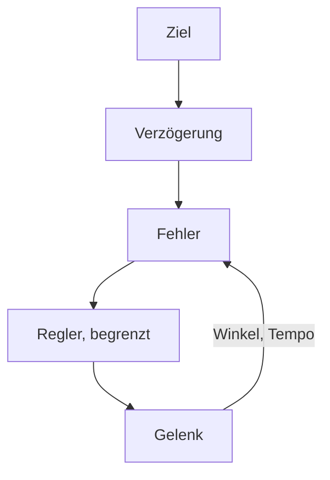

# Anhang C – Grundlagen: Wie eine Physiksimulation denkt

> **Dein Level:** Ein Bonuslevel unter der Haube: wie ein Computer Bewegung Schritt für Schritt
> vorausrechnet, Zusammenstöße findet, mit Reibung rechnet, einen Servo regelt – und warum alles auf
> jedem Gerät bis aufs letzte Bit gleich herauskommt.

> **Wörter, die du brauchst:**
>
> - **Newton (N)** und **Gewichtskraft** – Newton ist die Einheit der Kraft. Die Erde zieht an jedem
>   Kilogramm mit 9,81 N, also ist die Gewichtskraft **Masse · 9,81**. 100 g drücken mit knapp 1 N.
> - **Drehmoment** – Kraft mal Hebel, gemessen in Newtonmeter (N·m). 1 N am Ende eines 1 m langen
>   Schraubenschlüssels ist 1 N·m.
> - **Impuls** – ein einzelner kurzer Stoß, der das Tempo auf einen Schlag ändert: Masse mal
>   Tempoänderung, gemessen in N·s.
> - **Radiant (rad)** – ein Winkelmaß: 1 rad ist etwa 57°, ein ganzer Kreis gut 6,28 rad.
> - **Hertz (Hz)** – wie oft pro Sekunde. Eine Feder mit 2 Hz wippt zweimal pro Sekunde hin und her.
> - **Sub-Step** – ein Teilschritt: Jeder Rechenschritt der Physik wird noch einmal in mehrere
>   kleine Schritte geteilt.
> - **Solver** – der Teil der Physik-Engine, der alle Regeln (Kontakte, Gelenke) gleichzeitig
>   einzuhalten versucht.

Wie Kern **Box3D** benutzt, steht in [Kapitel 6](06-physik.md); hier geht es um die Ideen dahinter.
Du brauchst nur Kraft, Masse, Geschwindigkeit und Reibung. Den Rest zeigen Bilder und Zahlen.

## C.1 Starrkörper und ihr Zustand

Ein **Starrkörper** verformt sich nie. Echte Dinge geben etwas nach, aber für Roboterglieder, Kisten
und Autos passt das sehr gut. Der große Vorteil: Wenige Zahlen beschreiben die ganze Bewegung.

- **Was sich ändert:** wo der Körper ist (die **Position** seines Schwerpunkts), wie er gedreht ist
  (**Drehung**), wie schnell er fliegt (**Geschwindigkeit**) und wie schnell er sich dreht
  (**Drehgeschwindigkeit**).
- **Was gleich bleibt:** seine **Masse**, sein **Schwerpunkt** und seine **Trägheit gegen Drehung**.

Der **Schwerpunkt** ist der Punkt, an dem du ein Ding auf einer Fingerspitze balancieren könntest.
Bei einem Lineal liegt er in der Mitte, bei einem Hammer nahe am schweren Kopf.

> **So kannst du es dir vorstellen:** Dreh dich auf dem Bürostuhl und zieh die Arme an: Du wirst
> schneller. Wie die Masse verteilt ist, bestimmt, wie leicht sich etwas dreht. Ein Besenstiel dreht
> sich um seine Längsachse ganz leicht, quer dazu schwer. Darum braucht die Trägheit mehrere Zahlen,
> für jede Richtung eine eigene.

Für das Fliegen gilt Newton: **Kraft = Masse · Beschleunigung**. **Beschleunigung** heißt, wie
viel schneller etwas pro Sekunde wird. 10 N machen einen 2-kg-Ball pro Sekunde 5 m/s schneller,
denn 10 ÷ 2 = 5. Für das Drehen gilt dasselbe mit Drehmoment und Trägheit.

Dazu kommt ein **Kreiseleffekt**: Ein drehender Körper „will“ seine Drehachse behalten. Darum kippt
ein schnell drehender Kreisel nicht um. Ein langer, dünner Körper, der schräg zu seiner Längsachse
kreiselt, gerät dadurch ins **Taumeln**, wie ein geworfener Stift, der in der Luft eiert. Rechnet
ein Computer diesen Effekt unvorsichtig, pumpt er bei solchen Körpern Schwung hinein, der gar nicht
da ist, und sie drehen immer wilder. Box3D rechnet den Kreiseleffekt darum mit der stabilen,
„impliziten“ Rechenweise, die du in C.2 kennenlernst. So bleiben lange, dünne Glieder ruhig.

## C.2 Integration: das Daumenkino

Ein Computer rechnet Bewegung wie ein **Daumenkino**: vom Bild jetzt zum Bild eine Schrittlänge h
später. Das heißt **Integration**. Das Problem: Während des Schritts ändern sich Kräfte und Tempo,
der Computer kennt aber nur den Anfang. Jedes Verfahren muss also raten. Drei Möglichkeiten:

- **explizit:** erst mit dem *alten* Tempo weiterbewegen, dann schneller werden;
- **semi-implizit:** erst schneller werden, dann mit dem *neuen* Tempo weiterbewegen;
- **implizit:** die Kraft nehmen, die *am Ende* des Schritts wirken wird. Dafür muss der Computer
  das Ende schon vorher ausrechnen, das ist aufwendiger.

Für den fallenden Ball reicht der Vergleich der ersten beiden.

Ein fallender Ball, h = 0,1 s, die Schwerkraft macht ihn pro Schritt 1 m/s schneller (g ≈ 10 m/s²):

| Zeit | explizit: Tempo / gefallen | semi-implizit: Tempo / gefallen |
|---|---|---|
| 0,1 s | 1 m/s / 0 m | 1 m/s / 0,1 m |
| 0,2 s | 2 m/s / 0,1 m | 2 m/s / 0,3 m |
| 0,3 s | 3 m/s / 0,3 m | 3 m/s / 0,6 m |

Explizit bewegt sich der Ball im ersten Schritt gar nicht, weil sein altes Tempo 0 war. In
Wirklichkeit ist er nach 0,3 s 0,45 m gefallen. Beide liegen daneben, einer zu kurz, einer zu weit.

Beim Ball ist das egal, bei **Federn** entscheidet es über alles. Eine Feder mit 2 Hz bei 60
Rechenschritten pro Sekunde:

| Verfahren | pro Schritt | nach 1 Sekunde |
|---|---|---|
| explizit | +2,2 % | 3,6-mal so weit |
| semi-implizit | bleibt | bleibt |
| implizit (Kraft am Schrittende) | −2,1 % | nur noch 28 % |

Die Prozentzahlen kann man mit Oberstufen-Mathe genau ausrechnen; hier zeigen wir nur das
Ergebnis. Explizit schaukelt sich die Feder von selbst auf, wie eine Schaukel, die jemand heimlich
anschubst. Implizit bremst sie künstlich, ist aber **immer stabil**. Semi-implizit hält den Schwung,
aber **nur, solange die Feder nicht zu schnell für den Takt ist**. Schwingt sie zu schnell, wird
auch semi-implizit instabil.

> **Krass, aber wahr:** Eine 30-Hz-Feder bei 60 Hz Takt wächst explizit pro Schritt um das
> 3,3-Fache. Nach zehn Schritten, einer Sechstelsekunde, ist sie **150 000-mal** so weit
> ausgeschlagen. Und diese Feder ist so schnell, dass auch semi-implizit hier versagt. Darum
> begrenzt man, wie schnell Federn schwingen dürfen, und teilt Schritte in Sub-Steps (unten und
> [Kapitel 6](06-physik.md), 6.13).

**Box3D** rechnet semi-implizit: In jedem Sub-Step rechnet es erst die neuen Geschwindigkeiten, dann
sorgt der **Solver** (C.6) dafür, dass Kontakte und Gelenke eingehalten werden, dann bewegt es alles
mit dem neuen Tempo. Seine eingebaute **Dämpfung** (Bremse) ist so gebaut, dass sie das Tempo immer
nur kleiner macht, nie umdreht. Und Box3D begrenzt, wie schnell etwas fliegen und sich drehen darf.

> **Vorsicht, Falle:** Warum verbietet Kern eine selbst gebaute Bremskraft „je schneller, desto
> stärker bremsen“? Diese Bremse rechnet mit dem *alten* Tempo vom Anfang des Schritts und lässt
> diese Kraft den ganzen Schritt lang wirken, auch dann noch, wenn das Glied längst stehen müsste.
> Bei einem sehr leichten Glied (10 g) ist das in einem Schritt viel mehr Bremse, als nötig wäre,
> um es anzuhalten. Statt bei 0 zu stoppen, schießt es rückwärts, im Beispiel mit 15,7 m/s statt
> vorher 1 m/s vorwärts. Die „Bremse“ katapultiert. Box3Ds eingebaute Dämpfung kann das nicht.


### Fester Zeitschritt

Rechnete man mit der schwankenden Bildzeit, hieße ein langsames Bild ein großer, unsicherer Schritt,
und jeder Rechner käme woanders an. Die Lösung von Glenn Fiedler ist ein Zeit-Sparschwein (sein
Fachwort dafür ist *Akkumulator*, „Sammler“). Du kennst es schon aus
[Kapitel 6](06-physik.md), 6.13:



Ein Beispiel bei 60 Schritten pro Sekunde, also h = 1/60 s ≈ 16,7 ms: Ein Bild dauert 25 ms. Das
reicht für einen Schritt, 8,3 ms bleiben übrig. Gezeichnet wird bei 8,3 ÷ 16,7 ≈ 50 %, also auf
halbem Weg zwischen altem und neuem Zustand. Das nächste Bild dauert wieder 25 ms: Im Schwein sind
jetzt 33,3 ms, also zwei Schritte, Rest 0. Kerns Sicherungen dabei stehen in
[Kapitel 6](06-physik.md), 6.13.

### Sub-Steps

**Sub-Steps** teilen jeden Schritt weiter. Bei der Micro Duck sind es 100 Schritte pro Sekunde mit
je 16 Sub-Steps, also 100 · 16 = 1600 kleine Schritte pro Sekunde, jeder nur 1/1600 s lang.

Warum hilft das? Hängen viele Glieder in einer **Kette** (eine Brücke aus Planken, ein Roboterbein),
korrigiert der Solver jedes Gelenk ein bisschen, und die Korrektur muss sich durch die ganze Kette
weitersprechen, wie bei „Stille Post“. Bei vielen kleinen Schritten kommt sie öfter durch, und die
Kette hängt straffer zusammen.

> **Mission:** Stell im Physics Lab unter **Welteinstellungen** (World Settings) › **Physik (Box3D)**
> (Physics (Box3D)) die **Teilschritte** (Sub-steps) von 4 auf 1, starte **Simulieren** (Simulate)
> und schau von der Seite auf die Mitte der Seilbrücke. Stopp mit Esc, stell
> 16 ein und vergleiche: Mit 1 Sub-Step hängt die Mitte rund einen Meter tiefer. Tipp: Mach von
> beiden ein Bildschirmfoto, dann siehst du den Unterschied direkt nebeneinander. Lange
> Gelenkketten dehnen sich mit wenigen Sub-Steps mehr.

## C.3 Kollisionserkennung

Welche Dinge berühren sich? Bei n Körpern gibt es n · (n − 1) ÷ 2 Paare. Warum? Denk an n Leute,
die sich alle die Hand geben. Jeder schüttelt n − 1 anderen die Hand, das sind n · (n − 1) Hände.
Aber jeder Handschlag wurde dabei doppelt gezählt, einmal von jeder Seite, also teilt man durch 2.
Bei 4 Leuten: 4 · 3 ÷ 2 = 6 Handschläge. Bei 1000 Körpern sind es schon 499 500 Paare. Jedes Paar
genau zu prüfen, wäre viel zu langsam. Darum arbeitet die Physik in zwei Phasen:
erst grob, dann genau.

**Grobe Phase (Broad Phase):** Jede Form steckt in einer unsichtbaren Kiste, deren Kanten genau
entlang der x-, y- und z-Achse laufen. Ob sich zwei solche Kisten überlappen, ist schnell
geprüft: Für jede der drei Achsen schaut man, ob sich die Bereiche überlappen, das sind je zwei
Vergleiche, zusammen sechs. Nur Paare mit überlappenden Kisten kommen in die genaue Phase.


Die Kisten liegen in einem Baum wie die BVH aus [Kapitel 5](05-szene-und-geometrie.md). Sie sind
etwas größer als nötig, damit der Baum nicht bei jeder kleinen Bewegung umgebaut werden muss. Feste
Körper haben einen eigenen Baum.

**Genaue Phase (Narrow Phase):** Hier zählt, ob eine Form **konvex** ist: Die Verbindungslinie
zwischen zwei beliebigen Punkten der Form liegt ganz in ihr. Kugel, Kapsel, Quader und Hüllen sind
konvex, ein L nicht. Für konvexe Formen gibt es schnelle, zuverlässige Tests. Einer davon geht so:

> **So kannst du es dir vorstellen:** Leuchte mit einer Taschenlampe von der Seite auf zwei Formen
> und schau dir ihre Schatten an der Wand an. Findest du eine Richtung, in der die Schatten nicht
> überlappen, berühren sich die Formen sicher nicht (Bild unten). Bei konvexen Formen reicht es,
> eine Handvoll Richtungen auszuprobieren.


Das Ergebnis ist ein Kontaktbericht, der **Manifold**: in welche Richtung die Berührung zeigt und an
welchen Punkten, jeweils mit Abstand.

Eine **konvexe Hülle** spannt sich um Punkte wie ein Gummiband um Nägel, nur in 3D. Nicht Konvexes
baut man aus mehreren Hüllen. Beliebige Dreiecksnetze gibt es nur für feste Körper.

> **Für Profis:** Der zweite Test heißt GJK. Er zieht gedanklich jeden Punkt der einen Form von
> jedem Punkt der anderen ab und prüft, ob dabei der Nullpunkt herauskommt. Das blaue Buch erklärt
> ihn in Anhang C.

**Tunneling:** Eine Kugel mit 300 m/s fliegt bei 60 Schritten pro Sekunde 300 ÷ 60 = 5 m pro
Schritt. Vor einer 10 cm dicken Wand ist sie in einem Schritt noch davor, im nächsten schon
dahinter, und hat die Wand nie berührt. Box3D meldet Kontakte deshalb schon **kurz vor** der
Berührung und erlaubt nur so viel Annäherung, wie noch Abstand da ist. Für sehr Schnelles gibt es
zusätzlich eine besonders sorgfältige Prüfung entlang des ganzen Wegs (**Continuous Collision**).

Dieses „kurz vorher“ ist ein fester Abstand von ein paar Zentimetern, genau wie die Millimeter, die
Box3D an Überlappung duldet. Für eine Kiste ist das winzig, für ein 2-cm-Bein riesig. Darum
simuliert Kern die kleine Micro Duck vierfach groß ([Kapitel 6](06-physik.md), 6.2).

## C.4 Kontakte, Reibung, Sprungkraft

**Die Kontaktregel:** Körper dürfen sich nicht durchdringen. Ein Kontakt kann nur **drücken**, nie
ziehen, und er drückt nur, solange sich die Körper berühren. Der Solver hält diese Regel sehr gut
ein, aber nicht perfekt.

### Reibung

Reibung ist höchstens **Reibwert μ mal Druckkraft** (μ spricht man „mü“). Ein Beispiel: Eine
300-kg-Kiste liegt auf dem Boden. Ihre Gewichtskraft ist 300 · 9,81 ≈ 2943 N, und mit genau dieser
Kraft drückt sie auf den Boden. Bei μ = 0,6 hält die Reibung bis 0,6 · 2943 ≈ 1766 N. Schiebst du
mit 1000 N, **haftet** die Kiste. Mit 2000 N **rutscht** sie.

Auf einer Rampe gilt eine **Faustregel**: Ein Ding bleibt liegen, solange die **Steigung** nicht
größer als μ ist. Steigung heißt: Höhe geteilt durch Länge, wie bei einer Geraden im
Koordinatensystem. μ = 0,6 hält also bis 60 % Steigung. Beweisen kann man diese Regel mit
Physik aus der Oberstufe; hier darfst du sie einfach benutzen.

Alle Kräfte, bei denen etwas haftet, bilden zusammen einen **Reibungskegel**. Stell dir eine
Eistüte vor, die mit der Spitze auf dem Berührpunkt steht. Das Bild zeigt einen Schnitt durch sie:


n ist die Richtung, in der der Boden drückt. Eine Kraft, die steil von oben kommt, liegt in der
Tüte: Haften. Eine Kraft, die flach schiebt, liegt außerhalb: Rutschen. Eigentlich haftet ein
ruhendes Ding etwas stärker, als ein rutschendes gebremst wird. Box3D kennt aber nur einen Reibwert
für beides.

> **Für Profis:** Box3D rechnet die Reibung einmal für die Mitte der ganzen Kontaktfläche, nicht für
> jeden Punkt einzeln, und dazu eine Drehreibung, die das Kreiseln auf der Stelle bremst.

> **Mission:** Hol aus **Actors platzieren** (Place Actors), Gruppe **Formen** (Shapes), eine
> **Rampe** (Ramp). Sie ist schon 6 m lang, 3 m breit und 1,5 m hoch, das siehst du in
> **Details › Statisches Mesh › Größe** (Details › Static Mesh › Size). Ihre Steigung ist
> 1,5 ÷ 6 = 0,25, also 25 %. Andere Maße kannst du dort eintippen. Hol dann aus der Gruppe
> **Physik** (Physics) einen **Physik-Würfel** (Physics Cube) und gib ihm in
> **Details › Transformation › Position** (Details › Transform › Location) dieselben X- und Y-Werte
> wie der Rampe und ein Z, das 2 m höher ist. Beim **Simulieren** (Simulate) fällt er auf die Schräge
> und bleibt liegen (beide haben Reibung 0,6). Stopp mit Esc, stell beim Würfel in
> **Details › Statisches Mesh › Physik › Reibung** (Details › Static Mesh › Physics › Friction) den
> Wert auf 0,02 und starte **Simulieren** neu: Jetzt rutscht er, denn
> √(0,02 · 0,6) ≈ 0,11 ist kleiner als 0,25. (Die Wurzel aus 0,012 rechnest du am besten mit dem
> Taschenrechner aus; wie Box3D zwei Reibwerte mischt, steht gleich darunter.)

### Zwei Reibwerte, ein Kontakt

Box3D nimmt die Wurzel aus dem Produkt, √(μA · μB). Ein paar Beispiele im Vergleich mit dem
gewöhnlichen Mittelwert:

| Paar | √(μA · μB) | Mittelwert |
|---|---|---|
| 0,6 und 1,0 | 0,775 | 0,8 |
| Eis 0,05 und Gummi 1,0 | 0,224 | 0,525 |
| 0 und 1,0 | 0 | 0,5 |

Der Vorteil: Was reibungsfrei ist, bleibt es, egal womit es sich paart. Eis bleibt auch unter einem
Gummistiefel ziemlich glatt. Trotzdem ist das nur eine Faustregel. Für echte Materialpaare wie
Schnabel auf Socke kennt Kern darum gemessene **Paarwerte** ([Kapitel 6](06-physik.md), 6.6).

### Sprungkraft

Die **Sprungkraft** (Restitution) e sagt, welcher Anteil des Tempos nach dem Aufprall bleibt. Mit
e = 0,5 springt ein Ball, der mit 4 m/s aufschlägt, mit 0,5 · 4 = 2 m/s zurück. e = 0 bleibt
liegen, e = 1 prallt perfekt. Box3D nimmt das **Größere** beider Formen (warum, steht in
[Kapitel 6](06-physik.md), 6.7). Unter 1 m/s prallt nichts ab. Angewendet wird die Sprungkraft
erst, **nachdem** die Physik alle Regeln eingehalten hat (das macht der Solver, C.6), und zwar mit
dem Tempo von vor dem Aufprall.

> **Mission:** Hol aus **Actors platzieren** (Place Actors), Gruppe **Physik** (Physics), eine
> **Physik-Kugel** (Physics Sphere), stell in
> **Details › Statisches Mesh › Physik › Rückprall (Elastizität)** (Details › Static Mesh › Physics ›
> Restitution (bounce)) den Wert auf 0,9, heb sie beim **Simulieren** (Simulate) hoch und lass sie
> fallen.
> Stopp mit Esc, stell 0 ein und probier es noch einmal: Jetzt bleibt sie liegen.

### Rollwiderstand

Eine perfekte Kugel rollt ewig. Echte Bälle und Böden geben ein wenig nach, und das bremst mit
**Rollwiderstand mal Druckkraft**, bei 0,03 also 3 % der Gewichtskraft. Box3D nimmt den größeren
Wert der beiden Formen. In Kerns Notizen steht: „Der Ball rollte ewig“, bis er Rollwiderstand bekam.

Diese Bremskraft greift unten am Berührpunkt an, also am Hebel „Radius“. Darum wächst die
Bremswirkung auf das Drehen mit dem **Radius**: Drehmoment = Rollwiderstand · Radius · Druckkraft.
Ein großer Ball bekommt bei gleichem Beiwert und gleichem Gewicht ein größeres Bremsdrehmoment als
ein kleiner.

## C.5 Gelenke als Regeln

Ein **Gelenk** ist für die Physik eine **Regel**, etwa: „Punkt A und Punkt B bleiben aufeinander.“
Dann müssen sich beide Punkte auch gleich schnell bewegen. Driften sie auseinander, gibt der Solver
beiden einen kleinen **Korrekturstoß**, der sie wieder zusammenbringt.

Wie stark dieser Stoß sein muss, hängt davon ab, wie schwer sich das Paar „anfühlt“. Das heißt
**effektive Masse**. Im einfachsten Fall, zwei Kugeln, die sich nur geradeaus ziehen oder schieben,
gilt:

**effektive Masse = 1 ÷ (1/mA + 1/mB)**

- Zwei 2-kg-Kugeln: 1 ÷ (0,5 + 0,5) = **1 kg**. Beide geben nach, also fühlt sich das Paar
  leichter an als jede einzelne Kugel.
- Eine 2-kg-Kugel an einer festen Wand: Die Wand gibt überhaupt nicht nach, sie ist wie unendlich
  schwer. 1 geteilt durch eine riesige Zahl ist fast 0, darum zählt für sie 1/m = 0.
  Also 1 ÷ (0,5 + 0) = **2 kg**. Es zählt nur die Kugel.

Bei einem Scharnier gilt dasselbe für das Drehen, mit der Trägheit um die Achse
([Kapitel 6](06-physik.md), 6.8, dort auch alle neun Gelenkarten). Gebaut wird ein Gelenk immer in
der **Ruhelage**: Dort liegt der Winkel 0, und Grenzen und Federn zählen von dieser 0 aus. Ein halb
offen eingebautes Scharnier hielte „halb offen“ für zu.

Die effektive Masse eines Scharniers hängt davon ab, wie die Glieder gerade stehen: Ein
ausgestrecktes Bein dreht sich schwerer als ein angewinkeltes, wie du auf dem Bürostuhl mit
ausgestreckten Armen. Das brauchst du gleich bei den Servos (C.7).

## C.6 Der Solver

Ein Roboter hat 15 Gelenke und dutzende Kontakte, und alle Regeln sollen gleichzeitig gelten. Jeder
Korrekturstoß an einer Stelle verschiebt aber die anderen. Echtzeit-Engines lösen das, indem sie die
Regeln **nacheinander** korrigieren, und das mehrmals hintereinander.

> **So kannst du es dir vorstellen:** Vier Leute halten ein Bild an die Wand. Jeder korrigiert seine
> Ecke und verschiebt dabei die anderen ein wenig. Nach ein paar Runden hängt es gerade.

„Kontakte dürfen nur drücken“ prüft der Solver an der **Summe** aller Stöße, nicht an jedem
einzeln: Runde 1 drückt 5, Runde 2 nimmt 2 zurück. Die Summe ist 3, also erlaubt. Wollte Runde 2
aber 6 zurücknehmen, wäre die Summe −1, also ein Ziehen. Dann setzt der Solver die Summe auf 0.

**Warmstart:** Ein ruhender Kistenstapel braucht jeden Schritt fast dieselben Stöße. Also beginnt
der Solver mit den Stößen vom letzten Mal, statt bei null, und ist viel schneller fertig.

**Weiche Regeln:** Eine harte Regel korrigiert jeden Fehler sofort und ganz, mit einem Ruck. Das
macht Zittern. Box3D behandelt darum **jede** Regel wie eine sehr steife, gut gedämpfte **Feder**:
Eine kleine Überlappung wird sanft herausgeschoben statt mit einem Ruck. Diese Federn rechnet Box3D
so, dass sie nie aufschaukeln (C.2). Kontakte mit **festen** Körpern, zum Beispiel Füße auf dem
Boden, macht Box3D dabei steifer als Kontakte zwischen zwei bewegten Körpern: Eine Überlappung mit
dem Boden wird etwa viermal so schnell herausgeschoben. So steht ein Roboter fester auf dem Boden.

> **Für Profis:** Einen festen Schritt nennt Box3D **Soft Step**: Regeln vorbereiten, dann in jedem
> Sub-Step Geschwindigkeiten rechnen, mit Warmstart lösen, Fehler abbauen, Positionen rechnen und
> zum Schluss noch einmal ohne Fehlerabbau lösen („Relax“). Der letzte Durchgang nimmt den
> Extra-Schwung der Korrektur wieder heraus. Die Formeln stehen im blauen Buch, Anhang C.

Eine Feder lässt sich nur rechnen, wenn sie langsamer schwingt, als die Sub-Steps hinschauen. Darum
setzen Box3D und Kern Grenzen dafür, wie steif Federn sein dürfen ([Kapitel 6](06-physik.md),
6.13). Wer steifere Gelenke braucht, braucht mehr Sub-Steps.

**Massenverhältnisse:** Hängt etwas Schweres an etwas Leichtem, etwa 5 kg an 10 g (500 : 1),
braucht der Solver sehr viele Runden, bis die Stöße durchgereicht sind, wie bei der Stillen Post
aus C.2. Das leichte Teil gibt jeder Korrektur sofort nach und reicht kaum etwas weiter. In der
Zwischenzeit dehnen sich die Gelenke. Faustregel: Nachbarn höchstens etwa **10 : 1**. Die
Gegenmittel: Sehr leichte Glieder bekommen eine **Mindestmasse** (die 5-g-Hüftbügel der Ente
wiegen in Kern mindestens 20 g), und ein starres Teil ist **ein** Körper mit mehreren Formen statt
mehrerer zusammengeschweißter Körper ([Kapitel 6](06-physik.md), 6.15).

## C.7 Servos als Regelkreis

Ein Servo wie der in der Micro Duck (ein Dynamixel XL330) bekommt einen **Zielwinkel**, misst den
tatsächlichen Winkel, vergleicht und steuert gegen, immer wieder. Das ist ein **Regelkreis**:



**PD-Regler:** Der Regler im Servo heißt nach seinen zwei Teilen. **P** steht für
*proportional*: Er zieht im Verhältnis zum Abstand, doppelt so weit weg heißt doppelt so stark.
**D** steht für *differential*, also für die Änderung des Winkels: Dieser Teil bremst, je
schneller das Gelenk dreht, wie eine Dämpfung. Zusammen:

**Drehmoment = K · Fehler − D · Drehtempo**

Der **Fehler** ist, wie weit das Gelenk vom Ziel weg ist. K wirkt wie eine Drehfeder: je weiter weg,
desto stärker. D wirkt wie ein Stoßdämpfer: je schneller es dreht, desto mehr bremst er. Beim Servo
der Ente ist K = 0,554 und D = 0,053. Bei 0,5 rad Fehler (knapp 29°) drückt er mit 0,554 · 0,5 ≈
0,28 N·m. Dreht das Gelenk dabei gerade mit 2 rad pro Sekunde, bremst die Dämpfung 0,053 · 2 ≈ 0,11
N·m davon ab.

Zusammen mit der Trägheit des kleinen Motors im Servo ergibt das einen gedämpften Schwinger. Rechnet
man es mit den Werten des Servos aus, schwingt er etwa **2,8-mal pro Sekunde**, mit einem
**Dämpfungsgrad** von **0,84**. Diese Rechnung braucht Wurzeln und Mathe aus der Oberstufe, darum
nehmen wir hier nur das Ergebnis (die Formeln stehen im blauen Buch, Anhang C). Was diese Zahl
bedeutet, zeigt eine Tür:

- **unter 1:** Die Tür schwingt über ihr Ziel hinaus (ausgeleierter Türschließer);
- **genau 1:** Sie kommt so schnell wie möglich an, ohne überzuschwingen (guter Türschließer);
- **über 1:** Sie kriecht ins Ziel (Tür in Honig).

0,84 ist also weich und gut gedämpft.

**Sättigung:** Mehr als T = 0,963 N·m schafft der Motor nicht. Diese Grenze ist erreicht bei einem
Fehler von 0,963 ÷ 0,554 ≈ 1,74 rad, rund 100°. Darüber zieht er nicht stärker. Das hat eine
überraschende Folge: Volle Kraft gibt es erst, wenn das Ziel rund 100° vom jetzigen Winkel entfernt
ist. So weit kann sich manches Gelenk gar nicht drehen. Will das Netz kräftig ziehen, muss es sein
Ziel darum weit **hinter** die Gelenkgrenze setzen, wie wenn du am Gummiband weit über den Punkt
hinausziehst, an dem das Bein anstößt. Dazu kommt **Reibung** im Getriebe: ein kleines
Gegendrehmoment, das das Gelenk festhält, bis genug Kraft anliegt.

**Verzögerung:** Ein Befehl kommt erst etwa 20 ms nach dem Senden an. Das klingt wenig, kann aber
einen Regler ins Schwingen bringen.

> **So kannst du es dir vorstellen:** Wer eine Schaukel im richtigen Moment anschubst, macht sie
> schneller. Wer immer ein Stück zu spät schubst, schiebt irgendwann gegen die Bewegung, und die
> Schaukel gerät aus dem Takt.

Wie spät ist „zu spät“? Ein Schwung hin und zurück dauert bei 2,8 Schwüngen pro Sekunde
1000 ÷ 2,8 ≈ 357 ms. Man zählt einen ganzen Schwung wie eine Runde im Kreis, also als 360°. 20 ms
sind 20 ÷ 357 ≈ 5,6 % davon, und 5,6 % von 360° sind **rund 20°**. Um so viel hinkt der Regler
hinterher.

> **Vorsicht, Falle:** Ein Netz, das nie mit Verzögerung geübt hat, versagt am echten Roboter. Kern
> simuliert sie deshalb mit, als Warteschlange von 4 Schritten in der Welt.

**In Kern** besteht der Servo nur aus Box3Ds eigenen Teilen:

- **PD-Regler** = die Feder des Scharniers. Box3D rechnet sie stabil, sie schaukelt sich nie auf.
- **Höchstkraft** = ein begrenztes Ziel: Das Ziel liegt nie weiter weg, als der Motor ziehen kann.
- **Reibung** = ein Gelenkmotor, der stillstehen will, aber nur wenig Kraft hat.
- **Trägheit des Motors** = eine echte dünne Scheibe auf der Gelenkachse, die sich mitdreht.

Box3D will die Federstärke nicht in N·m pro Radiant, sondern als „wie oft pro Sekunde schwingt
sie“. Wie oft eine Feder schwingt, hängt aber davon ab, wie schwer das Glied an ihr ist, also von
der effektiven Masse aus C.5. Und die ändert sich, sobald sich das Bein bewegt. Darum rechnet Kern
die Feder **jeden Schritt neu** um. Dieselbe Rechnung benutzen Kern Studio, das Training und der
Prüfstand: ein Gesetz für alle drei. Alle Werte stehen in einem **Profil**
([Kapitel 6](06-physik.md), 6.17; [Kapitel 16](16-kalibrierung.md)).

## C.8 Was man nicht tun sollte

- **Dauerlasten jeden Schritt neu als Kraft geben.** Eine Kraft gilt nur einen Schritt lang, danach
  ist sie weg.
- **Sprünge als einen Impuls geben:** Masse mal Tempoänderung. 30 kg, die auf einen Schlag 5 m/s
  schneller werden sollen, brauchen 30 · 5 = 150 N·s. Das ist so viel wie 150 N, eine Sekunde lang.
- **Kein Tempo direkt setzen** bei Körpern mit Gelenken oder Kontakten. Das übergeht den Solver und
  kämpft gegen die Gelenke. Einmal sollte ein „Kreisel“ die Ente aufrecht halten, indem er ihr
  Drehtempo direkt setzte. Das pumpte Schwung hinein, und der Rumpf sprang.
- **Keine Hilfskräfte** für Roboter. Die gibt es in echt auch nicht, und was ein Netz mit ihnen
  lernt, klappt am echten Roboter nicht.

Alle Regeln: [Kapitel 6](06-physik.md), 6.15.

## C.9 Determinismus

**Deterministisch** heißt: gleicher Anfang, gleiche Eingaben, **bitgleiches** Ergebnis. Dann ergibt
ein Training überall dasselbe Netz, Fehler lassen sich nachstellen, und Roboterlogs laufen überall
gleich ab. Physik ist aber **chaotisch**. In Kerns Notizen steht: „Ein Bit wird in einer
Robotersimulation in Sekunden zu einem anderen Gang.“

Computer runden nach jeder Rechnung, und die **Reihenfolge** zählt:

```
(0,1 + 0,2) + 0,3  =  0,6000000000000001
0,1 + (0,2 + 0,3)  =  0,6
```

Darum legt Kern alles fest, was die Reihenfolge oder die Rundung ändern könnte:

- **Reihenfolge festlegen:** Kern ist als Text geschrieben, und bevor ein Computer es ausführen
  kann, wird der Text in Computerbefehle **übersetzt**. Dabei darf nichts umsortiert werden. Und
  Summen werden immer in derselben Reihenfolge gebildet, egal wie viele **Rechenkerne** (Teile des
  Prozessors, die gleichzeitig rechnen können) mithelfen
  ([Anhang A](A-grundlagen-neuronale-netze.md)). Box3D läuft auf einem einzigen.
- **Eigene Rechenregeln:** Sinus, Kosinus und Co. sind Rechenarten für Winkel, die du später in
  Mathe lernst. Jedes Betriebssystem rechnet sie im letzten Bit etwas anders. Kern bringt eigene
  mit, die überall gleich rechnen.
- **Fester Takt:** gleich lange Schritte, die Spielzeit zählt Schritte.
- **Fester Zufall:** ein eigener Zufallsgenerator mit festen Startzahlen, genau wie der Seed der
  Stadt in [Kapitel 5](05-szene-und-geometrie.md): gleiche Startzahl, gleiche „Zufälle“.

**Prüfen:** Das Netz von Pollen Robotics steuert die Ente 400 Regeltakte lang. Nach jedem Takt wird
der ganze Zustand der Ente zu einer langen **Prüfnummer** verrechnet. Ändert sich auch nur ein Bit,
ändert sich die Nummer. Zwei Fassungen von Kern rechnen gleich, wenn alle 400 Nummern gleich sind.
Sind sie es nicht, verrät die **erste** abweichende Nummer, in welchem Takt die beiden
auseinanderlaufen. So weiß man, wo man mit der Fehlersuche anfangen muss.
Geprüft wird das auf einem PC, auf einem Mac und als WebAssembly, der Form, in der Kern auch im
Browser läuft.

> **Krass, aber wahr:** Ein hängendes Servo-Bein läuft in einfacher und vierfacher Größe **Bit für
> Bit gleich**. Bei S = 4 sind alle Umrechnungsfaktoren Zweierpotenzen (2, 4, 64, 256 …), und mit
> Zweierpotenzen rundet der Computer genau gleich. Der Grund: Er rechnet im Zweiersystem. Mal 2
> heißt dort nur, die Ziffern um eine Stelle zu verschieben, wie mal 10 bei uns. Dabei ändern sich
> die Ziffern selbst nicht, also wird auch nicht anders gerundet. Am Boden klappt das nicht mehr,
> weil Box3Ds feste Toleranzen nicht mitwachsen.

> **Für Profis:** Die Fallen haben Namen: Compiler-Optionen wie „fast math“ sortieren um, und FMA
> rechnet a · b + c mit einer Rundung statt zwei. Wie Kern das abschaltet und woher seine eigenen
> Mathe-Funktionen kommen, steht im blauen Buch, Anhang C.

## C.10 Auf einen Blick

Wo du jedes Thema in [Kapitel 6](06-physik.md) wiederfindest: Zustand und Masse in 6.4, Takt und
Sub-Steps in 6.13, Formen und Hüllen in 6.5, Reibung und Sprungkraft in 6.6 und 6.7, Gelenke in 6.8,
Servos in 6.17, Determinismus in 6.14.

## Level geschafft!

- Du weißt, wie ein Computer Bewegung als Daumenkino rechnet und warum Box3D semi-implizit ist.
- Du weißt, warum Sub-Steps Gelenkketten straffer machen.
- Du kennst grobe und genaue Phase und weißt, was konvex heißt.
- Du kannst mit μ rechnen und zwei Reibwerte kombinieren.
- Du verstehst, wie ein Solver weiche Regeln löst und warum Kern bitgleich bleibt.
- Du kannst erklären, wie ein Servo zieht, wo er an seine Grenze kommt und warum Verzögerung stört.

## Rätsel-Ecke

1. Wie viele Paare gibt es bei 10 Körpern?
2. Ein Ball (Restitution 0,8) trifft mit 5 m/s auf einen Boden (Restitution 0). Wie schnell springt
   er zurück?
3. Kiste und Rampe haben μ = 0,5, die Rampe 40 % Steigung. Bleibt die Kiste liegen?
4. **Boss-Rätsel:** Ein Servo hat K = 2 N·m/rad und schafft höchstens T = 1 N·m. Ab welchem Fehler
   zieht er nicht mehr stärker? Und um wie viel Grad hinkt er hinterher, wenn ein Befehl 25 ms
   unterwegs ist und er 2-mal pro Sekunde schwingt?

### Lösungen

1. 10 · 9 ÷ 2 = **45**.
2. Das Größere zählt: 0,8 · 5 = **4 m/s** (5 m/s liegt über der Schwelle von 1 m/s).
3. √(0,5 · 0,5) = 0,5, also hält sie bis 50 % Steigung, und 40 % ist weniger: **Sie bleibt
   liegen.**
4. Ab 1 ÷ 2 = **0,5 rad** (knapp 29°). Ein Schwung dauert 1000 ÷ 2 = 500 ms, 25 ms sind 5 % davon,
   und 5 % von 360° sind **18°**.

---

© 2026 Christian Heinrich Hohlfeld · Alle Rechte vorbehalten · [Impressum und Rechte](00-impressum.md)
