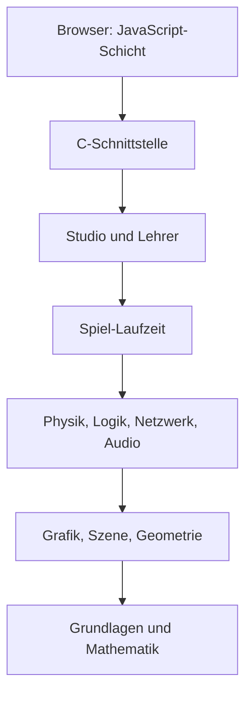

# 1 Willkommen bei Kern!

> **Kurz gesagt:** Kern ist eine 3D-Engine, die komplett im Browser läuft: Sie zeichnet Welten,
> rechnet Physik, spielt Klänge, lässt Spiele laufen und bringt sogar einem kleinen Roboter das Gehen
> bei. Hier lernst du Kern kennen, seine Regeln, seinen Aufbau – und wie du dieses Buch liest.

Schön, dass du da bist! Stell dir eine Werkstatt mit Leinwand, Werkbank, Mischpult und Bühne vor –
und in der Ecke lernt eine Roboterente laufen. Diese Werkstatt heißt **Kern** und steht offen auf
https://kernengine.de/ – mit **Kern Studio**, dem Editor, in dem du Welten baust und sofort spielst,
mit **dem Lehrer**, der Roboter-Gehirnen das Laufen beibringt, mit spielbaren Levels wie **Orb Run**
und **Physics Lab** und den C++-Beispielspielen `hello` und `orbrun`.

## 1.1 Was Kern ist

Eine **Engine** ist der Motor unter der Haube eines Spiels: Sie zeichnet, rechnet Stöße, spielt Töne,
liest Eingaben. Das Spiel sagt nur noch: „Hier steht ein Auto, und bei W fährt es.“

Kern ist in **C++20** geschrieben und wird nach **WebAssembly** übersetzt, einer Art
Maschinensprache für Browser. Gezeichnet wird mit **WebGL2**, der Grafikschnittstelle des Browsers.
Entstanden ist Kern aus dem Spiel **SpawnCity**, doch die Engine kennt SpawnCity nicht: Spiele
sprechen nur mit der Engine, nie umgekehrt.

Im selben Modul stecken Grundlagen und Mathematik, ein **Renderer** (Licht, Schatten, Himmel,
Partikel), Geometrie für Häuser, Straßen und Gelände, die **Physik** Box3D, ein eigener
**Audio**-Mixer, die **Spiel-Laufzeit** mit Mehrspieler, **Logik**-Bausteine, **Netzwerk**,
**Kern Studio** und **der Lehrer** – plus eine dünne JavaScript-Schicht zum Browser.

Und dann ist da die **Micro Duck**: ein zweibeiniger Roboter von Pollen Robotics. In Kern läuft sie
mit ihren echten, trainierten neuronalen Netzen (Kern ist mit Pollen Robotics nicht verbunden).

## 1.2 Die Regeln, nach denen Kern gebaut ist

### Alles selbst gemacht

Kern benutzt weder die Grafikbibliothek three.js noch den Übersetzer Emscripten. Der Renderer ist
eigener C++-Code, der WebGL2 direkt aufruft; übersetzt wird mit **wasi-sdk**, einem schlanken
Werkzeugkasten rund um den Compiler clang. Das Modul ist ein **Reactor**: Statt eines
Hauptprogramms ruft der Browser einmal eine Startfunktion und danach, was er gerade braucht. Weil Kern nur die ältesten WebAssembly-Fähigkeiten nutzt, läuft es auf jedem
WebGL2-Browser, sogar auf Safari ab Version 15.

### Keine Engine-Logik in JavaScript

Manches kann im Browser nur JavaScript: Grafikkarte, Maus und Tastatur, Ton, Dateien. Genau das –
und **nur** das – erledigt die Plattformschicht in `kern/web/`. Auch das Studio hält sich daran: Selbst
der Logik-Editor hält keinen eigenen Graphen; jede Änderung ist ein Befehl an die Engine.

> **Stell dir vor …** Die JavaScript-Schicht ist ein Kellner. Sie nimmt deine Bestellung auf und
> bringt das Essen an den Tisch. Gekocht wird aber ausschließlich in der Küche – in C++.

Der Gewinn: Was ein Spiel tut, steht an einer Stelle, ist ohne Browser testbar und verhält sich im
exportierten Spiel wie im Editor.

### Überall dasselbe Ergebnis

**Determinismus** heißt: gleiche Eingabe, gleiches Ergebnis – **Bit für Bit**, ob auf einem
Linux-PC, einem Mac mit ARM-Chip oder im Browser. Doch Computer runden manche Rechnungen minimal
unterschiedlich. Kern verhindert das: Der Compiler darf
Multiplikation und Addition nicht zu einem Schritt verschmelzen, Box3D rechnet ohne
Prozessor-Spezialbefehle, Kern bringt eigene Winkelfunktionen mit, und beim Training ist die
Reihenfolge aller Summen fest – egal, wie viele Helfer mitrechnen.

Bewiesen wird das mit einem **Fingerabdruck**: Die Ente läuft ein paar hundert Schritte, ihr
Zustand wird nach jedem zu einer Prüfsumme – und die Liste muss überall übereinstimmen ([Kapitel 2](02-bauen-und-testen.md), [Kapitel 3](03-grundlagen.md)).

> **Wusstest du?** Läuft die simulierte Ente anders als die echte, liegt das dank Determinismus
> wirklich am Modell und nicht an Rechenrauschen ([Kapitel 16](16-kalibrierung.md)).

### Noch ein paar Hausregeln

- **Keine Ausnahmen.** Eine Funktion meldet „hat nicht geklappt“ und hinterlegt eine lesbare
  Meldung ([Kapitel 3](03-grundlagen.md)).
- **Eingaben werden geprüft,** bevor sich etwas ändert; kaputte Daten zerstören nichts.
- **Kein neuer Speicher pro Bild** auf der JavaScript-Seite.
- **Die Physik wird nicht beschummelt.** Die Micro Duck steht nur durch ihre Motoren und Füße –
  keine unsichtbare Hand ([Kapitel 6](06-physik.md), [Kapitel 13](13-micro-duck.md)).
- **Eine Umsetzung für alle Orte.** Editor, Spiel und Lehrer teilen Spielwelt und Physik.
- **Robust:** Geht der Grafikkontext verloren, pausiert Kern und baut danach alles neu auf
  ([Kapitel 4](04-grafik.md)).

## 1.3 Ein Haus aus Stockwerken

Kern ist in Schichten gebaut. Jede benutzt die darunter, nie die darüber:

Nicht jedes Programm braucht alles. Grafik, Audio, Logik, Netzwerk und Grundlagen sind immer dabei;
fünf **Schalter** beim Bauen fügen mehr hinzu ([Kapitel 2](02-bauen-und-testen.md)): `--app` für
reine C++-Spiele, `--physics` für Box3D, `--game` für die Spiel-Laufzeit (samt Physik), `--studio`
und `--lehrer` (beide samt Spiel und Physik).

C++ und JavaScript tauschen sich nur über den **Speicher** des Moduls aus, einen großen, gemeinsamen
Zahlenblock. JavaScript schreibt Daten hinein und sagt der Engine, wo sie liegen; Texte gehen als
Paar aus Startstelle und Länge, Antworten des Studios kommen als JSON-Text zurück. Umgekehrt ruft die
Engine Funktionen des Browsers auf: WebGL2, Uhrzeit, Konsole und ein paar mehr.

> **Stell dir vor …** Zwei Nachbarn ohne gemeinsame Sprache teilen sich einen Briefkasten. Einer
> legt Zettel hinein, der andere holt sie ab. Mehr Kontakt gibt es nicht.

Alle Funktionen an dieser Grenze listet [Kapitel 17](17-referenz.md).

## 1.4 Vier Wege, Kern zu benutzen

**Ein Spiel ganz in C++.** Du schreibst eine Klasse, die von `kern::App` erbt. In `start()` legst du
die Welt an – im kleinsten Beispiel `hello` etwa einen graugrünen Boden, den du dem Renderer mit
`upsert` („einfügen oder ersetzen“) übergibst. Danach ruft der Browser in jedem Bild `update()` auf,
und Kern zeichnet ([Kapitel 12](12-eigene-spiele.md)). Das große Geschwister `orbrun` ist ein ganzes
Spiel mit Stadt, Fahrphysik, Verkehr, Tag und Nacht.

**Nur der Renderer, aus JavaScript** – so nutzt SpawnCity Kern ([Kapitel 4](04-grafik.md)).

**Kern Studio und exportierte Spiele.** Das Studio steckt in **einer** HTML-Datei, die offline
läuft. Du baust ein Level aus Actors (Dingen in der Welt) und spielst es mit
**Play** oder **Simulate** direkt im Fenster. **File → Package Game** macht daraus ein eigenständiges
Spiel, wieder eine einzige HTML-Datei, mit denselben C++-Klassen wie im Editor
([Kapitel 8](08-spiel-laufzeit.md), [Kapitel 11](11-studio.md)).

> **Probier's aus!** Öffne Kern Studio auf https://kernengine.de/. Beim ersten Start ist Orb Run geladen
> (sonst: **File → Example Levels → Orb Run**). Drück **Play** (Alt+P), fahr mit dem Hovercar los
> und sammle ein paar Orbs. Dann **Stop** – Glückwunsch, du hast gerade C++ im Browser gespielt.

**Der Lehrer.** Er trainiert Netze für die Micro Duck – auf deinem Rechner als Programm
`kern_lehrer` (auch ohne Bildschirm auf einem Server) oder im Browser auf der Seite `/lehrer/`, wo
mehrere Web Worker (Hintergrund-Helfer) Erfahrungen sammeln und einer daraus lernt. Gleicher
Startwert, gleich viele Enten: **dasselbe Netz**, hier wie dort. Gespeichert wird im Format ONNX,
wie Pollens Netze ([Kapitel 14](14-lehrer.md)).

An der Ente greift alles ineinander: Modell von Pollen Robotics, Glieder als Physikkörper mit
Gelenken, Servos (Motoren) mit Gerätemodell, Netze, die Kern selbst rechnet, Stimme aus dem Mixer,
Logik-Bausteine der Kategorie *Robots* – und im Studio ist sie einfach ein Actor.

> **Probier's aus!** Wähle **File → New Level** und dort eine der sechs Vorlagen – zum Beispiel
> **Micro Duck**. Drück Play und schau zu, wie die Ente auf ihrem Netz losläuft.

## 1.5 Wo was liegt

Der Quelltext liegt offen auf https://github.com/ChristianHohlfeld/kernengine.de. Die Engine wohnt
in `kern/`: Header in `include`, Umsetzung in `src`, die JavaScript-Schicht in `web`, Tests in
`tests`, die Beispielspiele in `examples`, Kerns eigene Netze in `policies`, Box3D, musl und die
Micro Duck in `third_party`, dieses Buch in `docs`. Daneben liegen `tools` (Bauskripte), `site`
(Startseite) und `generated` (Bauergebnisse).

Kern steht unter der **Apache License 2.0**. Die Einzeldokumente in `kern/docs/` sind die Quellen dieses Buchs; für Physik und Micro
Duck sind `physics.md` und `walker.md` verbindlich.

> **Achtung, Falle!** `kern/README.md` nennt ein paar SpawnCity-Dateien. Die suchst du hier
> vergeblich – sie liegen im SpawnCity-Repository.

## 1.6 Wie du dieses Buch liest

Du liest das **grüne Buch**. Sein großer Bruder, das **blaue Buch**, hat Kapitel für Kapitel
denselben Inhalt, aber technisch bis in jede Option. Packt dich ein Thema, schlag dort nach.

Unterwegs begegnen dir immer dieselben Kästen:

- **Kurz gesagt:** – unter jeder Kapitelüberschrift, worum es geht.
- **Stell dir vor …** – Technik, verglichen mit dem Alltag.
- **Probier's aus!** – eine Aufgabe in Kern Studio.
- **Wusstest du?** – eine verblüffende Tatsache.
- **Achtung, Falle!** – ein typischer Fehler und wie du ihn vermeidest.

Am Kapitelende stehen **Das nimmst du mit** und die **Knobelecke** mit Fragen zum Nachdenken, die
Lösungen direkt darunter. Nicht spicken! (Na gut, ein bisschen.)

Das Buch ist von unten nach oben gebaut, wie Kern selbst: erst Bauen und Grundlagen, dann Grafik,
Physik, Ton, Spiel, Logik und Netzwerk, dann Studio, Micro Duck und Lehrer, zum Schluss die
[Referenz](17-referenz.md). Anhänge erklären neuronale Netze ([A](A-grundlagen-neuronale-netze.md)),
Echtzeit-Grafik ([B](B-grundlagen-rendering.md)) und Physik ([C](C-grundlagen-physik.md)).

Wo fängst du an? Wer Kern verändern will: Kapitel 2 und 3 (vor Physik oder Roboter auch 6 und 13).
Wer ein Spiel baut: 11 oder 12, dazu 8 und 9. Wer die Ente liebt: 13, 14, 16. Wer Kern in eine
Webseite einbaut: 4 und 17.

Codebeispiele stammen aus dem echten Quelltext; Pfade beziehen sich auf `kern/`.

## Das nimmst du mit

- Kern ist eine 3D-Engine in C++20, die als WebAssembly im Browser läuft und mit WebGL2 zeichnet.
- Physik, Ton, Spiel, Logik, Netzwerk, Editor und Lehrer stecken im selben Modul.
- JavaScript ist nur der Kellner: keine Engine-Logik.
- Kern rechnet überall Bit für Bit gleich – ein Fingerabdruck beweist es.
- Aus demselben Code entstehen C++-Spiele, Renderer, Studio und Lehrer.
- Das grüne Buch erklärt einfach, das blaue geht in die Tiefe.

## Knobelecke

1. Warum ist es praktisch, dass keine Engine-Logik in JavaScript steckt?
2. Ein Netz wurde im Browser trainiert. Warum läuft es im Studio genauso?
3. Du baust mit `--studio`. Was kommt automatisch mit?

### Lösungen

1. Alles, was ein Spiel tut, steht an einer Stelle in C++: ohne Browser testbar und im exportierten
   Spiel genauso wie im Editor.
2. Lehrer und Studio teilen Spielwelt, Servos und Physik, und Kern rechnet überall gleich.
3. Die Spiel-Laufzeit und die Physik; die Grundteile sind immer dabei.

---

© 2026 Christian Heinrich Hohlfeld · Alle Rechte vorbehalten · [Impressum und Rechte](00-impressum.md)
