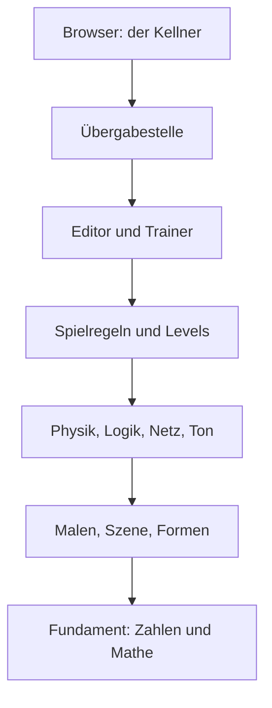

# 1 Willkommen bei Kern!

> **Kurz gesagt:** Kern ist ein Spiele-Motor, der direkt im Browser läuft – ohne Installation. Er
> malt 3D-Welten, rechnet, wie Dinge fallen und zusammenstoßen, spielt Klänge, lässt Spiele laufen
> und bringt sogar einem kleinen Roboter das Gehen bei. Hier lernst du Kern kennen, seine Regeln,
> seinen Aufbau – und wie du dieses Buch liest.

> **Begriffe vorab:**
> - **Programmiersprache** – eine genau festgelegte Schreibweise für Anweisungen an den Computer,
>   so wie ein Strickmuster eine Schreibweise für Maschen ist.
> - **C++ und JavaScript** – zwei Programmiersprachen. C++ ist sehr schnell und wird für große
>   Programme wie Spiele benutzt; JavaScript versteht jeder Browser von Haus aus.
> - **Übersetzer** (Fachwort: **Compiler**) – ein Programm, das Text in einer Programmiersprache in
>   Befehle verwandelt, die eine Maschine direkt ausführen kann.
> - **WebAssembly** – eine Befehlssprache, die alle modernen Browser ausführen können. Kern wird aus
>   C++ in sie übersetzt.
> - **Modul** – das fertig übersetzte Paket, eine einzige Datei, die der Browser lädt und startet.
> - **Schnittstelle** – die vereinbarte Übergabestelle zwischen zwei Programmteilen, wie der Tresen
>   zwischen Küche und Gastraum.
> - **Neuronales Netz** – ein Rechenmodell, das durch Übung lernt; hier lernt es, wie die
>   Roboterente ihre Motoren bewegen soll (mehr in [Anhang A](A-grundlagen-neuronale-netze.md)).
> - **Bit** – die kleinste Einheit im Computer: ein Kästchen, in dem 0 oder 1 steht. Alle Zahlen
>   bestehen aus vielen solchen Kästchen.

Schön, dass du da bist! Stell dir eine Werkstatt vor: Auf der **Leinwand** entstehen Bilder (die
Grafik), an der **Werkbank** wird gestoßen, gezogen und fallen gelassen (die Physik), am
**Mischpult** entstehen Klänge (der Ton), und auf der **Bühne** läuft das Spiel. In der Ecke lernt
eine Roboterente laufen. Diese Werkstatt heißt **Kern** und steht offen auf https://kernengine.de/ –
mit **Kern Studio**, dem Editor, in dem du Welten baust und sofort spielst, mit **dem Lehrer**, der
Roboter-Gehirnen das Laufen beibringt, und mit spielbaren Beispiel-Levels.

## 1.1 Was Kern ist

Eine **Engine** ist der Motor unter der Haube eines Spiels: Sie malt, rechnet Stöße, spielt Töne
und liest Maus und Tastatur. Das Spiel sagt nur noch: „Hier steht ein Auto, und bei W fährt es.“

> **Stell dir vor …** Ein Theater. Die Engine ist die Bühnentechnik: Licht, Vorhang, Ton. Das Spiel
> ist das Stück. Dieselbe Technik trägt viele verschiedene Stücke.

Kern ist in **C++** geschrieben, weil C++ schnell ist. Der Browser versteht C++ aber nicht direkt.
Darum wird Kern vorher in **WebAssembly** übersetzt. Heraus kommt ein **Modul**, das der
Browser lädt wie ein Bild. Zum Malen benutzt Kern die **Grafikschnittstelle** des Browsers – die
Übergabestelle, über die eine Webseite der Grafikkarte sagen darf, was sie zeichnen soll.

Im selben Modul stecken alle Teile der Werkstatt:

- die **Grundlagen**: Zahlen, Fehlermeldungen, ein Datenformat und die Mathematik für den 3D-Raum
  ([Kapitel 3](03-grundlagen.md));
- das **Malen** von Licht, Schatten, Himmel, Glühen und Funken, dazu das Aussortieren von
  Unsichtbarem und das Erkennen, worauf du klickst;
- Bausteine für **Häuser, Straßen und Gelände**;
- die **Physik**: wie Dinge fallen, rollen, zusammenstoßen und durch Gelenke verbunden sind;
- der **Ton**: Klänge im Raum und ein kleiner Synthesizer;
- die **Spielregeln**: Levels, Dinge in der Welt, Mehrspieler und Logik zum Zusammenklicken als
  Kästchen und Pfeile;
- **Kern Studio**, ein Baukasten-Editor nach dem Vorbild großer Spiele-Werkzeuge;
- **der Lehrer**, ein Trainer für Roboter-Gehirne, der die Simulation auch mit dem echten Roboter
  abgleicht.

Und dann ist da die **Micro Duck**: ein zweibeiniger Roboter von Pollen Robotics. In Kern läuft sie
mit ihren echten, trainierten neuronalen Netzen (Kern ist mit Pollen Robotics nicht verbunden).

Kern ist aus dem Spiel SpawnCity entstanden. Trotzdem kennt die Engine kein einziges Spiel: Spiele
sprechen mit der Engine, nie umgekehrt. Darum bleibt sie für jedes Spiel brauchbar, so wie die
Bühnentechnik nicht für ein einziges Stück gebaut ist.

Die genauen Namen und Werte stehen im blauen Buch, Kapitel 1.

## 1.2 Die Regeln, nach denen Kern gebaut ist

### Selbst gekocht

Kern setzt auf keine fremde Grafik-Engine und keine fremde Hülle, die im Browser mitläuft. Das Malen
ist eigener Code, der direkt mit der Grafikschnittstelle spricht, und zum Übersetzen reicht ein
schlanker Standard-Werkzeugkasten. Die wenigen fremden Bausteine, etwa die Physik, werden unverändert
mit hineingebaut. Der Gewinn: Man weiß genau, was passiert.

> **Stell dir vor …** Ein Koch, der jede Soße selbst rührt, statt Fertigsoße zu nehmen. Das ist
> mehr Arbeit – dafür weiß er bei jedem Teller, was drin ist.

Kern benutzt außerdem nur die ältesten, einfachsten Fähigkeiten von WebAssembly. Das ist wie ein
Brief in einfacher Sprache: Ihn versteht jeder. So läuft Kern auf jedem Browser, der 3D-Grafik
kann, auch auf älteren Safari-Versionen.

### Keine Engine-Logik in JavaScript

Was ein Spiel tut, steht an **einer** Stelle: im C++-Teil. Manches kann im Browser aber nur
JavaScript – an die Grafikkarte kommen, Maus und Tastatur lesen, Ton ausgeben, Dateien öffnen.
Genau das, und **nur** das, erledigt eine dünne JavaScript-Schicht. Auch Kern Studio hält sich
daran: Jeder Klick im Editor wird ein Befehl an die Engine.

> **Stell dir vor …** Die JavaScript-Schicht ist ein Kellner. Er nimmt deine Bestellung auf und
> bringt das Essen an den Tisch. Gekocht wird aber ausschließlich in der Küche – in C++.

Der Gewinn: Ein Spiel verhält sich im Editor genauso wie als fertiges Spiel, und man kann es auch
ohne Browser prüfen.

### Überall dasselbe Ergebnis

**Determinismus** heißt: gleiche Eingabe, gleiches Ergebnis – **Bit für Bit**, ob auf einem PC,
einem Mac oder im Browser. Das klingt selbstverständlich. Ist es aber nicht, denn Computer
**runden**.

Ein Computer speichert jede Kommazahl mit einer festen Zahl von Stellen. Was nicht hineinpasst, wird
gerundet, nach jedem einzelnen Rechenschritt. Darum ist beim Computer sogar die Reihenfolge beim
Zusammenzählen nicht egal. Ein Beispiel mit einem Taschenrechner, der nur vier Stellen hat:

- (1000 + 0,4) + 0,4: Erst gibt es 1000,4, gerundet 1000. Dann wieder 1000,4, gerundet **1000**.
- 1000 + (0,4 + 0,4): Erst gibt es 0,8. Dann 1000,8, gerundet **1001**.

Echte Computer haben viel mehr Stellen, aber das Prinzip ist dasselbe. Und manche Rechnungen, etwa
mit Winkeln, rundet jeder Rechner im letzten Bit ein winziges bisschen anders.

So ein Unterschied in der letzten Stelle wäre egal – wenn er klein bliebe. In einer **Simulation**,
einer nachgerechneten Welt, rechnet aber jeder Schritt mit dem Ergebnis des vorigen weiter. Der
Fehler wird mitgeschleppt und wächst. Bei einer laufenden Roboterente setzt dann nach ein paar
Sekunden ein Fuß anders auf.

> **Stell dir vor …** Zwei Kinder würfeln eine Wanderroute aus, an jeder Kreuzung ein Wurf. Weicht
> nur der erste Wurf ab, landen sie abends in verschiedenen Dörfern.

Darum hält Kern drei Regeln ein:

- Der Übersetzer darf keine Rechen-Abkürzungen nehmen, die auf verschiedenen Prozessoren
  verschieden runden.
- Für Winkelrechnungen bringt Kern **eigene Formeln** mit, die überall gleich runden
  ([Kapitel 3](03-grundlagen.md)).
- Beim Lernen wird immer in **derselben Reihenfolge** zusammengezählt, egal wie viele Helfer
  mitrechnen.

Bewiesen wird das mit einem **Fingerabdruck**: Die Ente läuft ein Stück, und nach jedem Schritt
wird ihr Zustand zu einer Prüfzahl verdichtet. Diese Liste muss auf allen Rechnern exakt gleich sein
([Kapitel 2](02-bauen-und-testen.md)).

> **Wusstest du?** Dank Determinismus ist ein Fehler der Simulation ein fester, wiederholbarer
> Fehler statt Zufallsrauschen. Läuft die simulierte Ente anders als die echte, liegt das wirklich
> am Modell und nicht am Rechner ([Kapitel 16](16-kalibrierung.md)).

### Noch ein paar Hausregeln

- **Kaputte Daten werden abgewiesen, bevor sie Schaden anrichten.** Jede Eingabe wird erst geprüft,
  dann übernommen. Ist sie kaputt, bleibt alles, wie es war.
- **Fehler werden höflich gemeldet.** Eine Aufgabe, die nicht klappt, antwortet „Nein“ und hinterlässt
  einen Zettel mit dem Grund; das Programm läuft weiter ([Kapitel 3](03-grundlagen.md)).
- **Die Physik wird nicht geschönt.** Die Micro Duck steht nur durch ihre eigenen Motoren und Füße –
  keine unsichtbare Hand hält sie fest ([Kapitel 6](06-physik.md), [Kapitel 13](13-micro-duck.md)).
- **Eine Umsetzung für alle Orte.** Editor, fertiges Spiel und Lehrer teilen dieselbe Spielwelt und
  dieselbe Physik. Darum läuft ein Netz, das im Lehrer gelernt hat, unverändert im Studio.
- **Kein Wegwerf-Speicher pro Bild.** Die Browser-Seite benutzt für jedes Bild denselben
  Ablageplatz wieder. Das spart Aufräumarbeit.
- **Robust:** Nimmt der Browser Kern die Grafikkarte weg, wartet Kern und baut danach alles wieder
  auf ([Kapitel 4](04-grafik.md)).

## 1.3 Ein Haus aus Stockwerken

Kern ist in Schichten gebaut wie ein Haus. Jedes Stockwerk benutzt die darunter, nie die darüber.
Der Vorteil: Man kann oben umbauen, ohne dass unten etwas einstürzt, und jedes Stockwerk lässt sich
für sich prüfen.

Nicht jedes Programm braucht das ganze Haus. Malen, Ton, Logik, Netzwerk und das Fundament sind
immer dabei. Beim Bauen wählt man, welche Stockwerke mitkommen: Physik, Spielregeln, Editor oder
Trainer ([Kapitel 2](02-bauen-und-testen.md)).

C++ und JavaScript reden nur über einen gemeinsamen Speicherbereich miteinander. JavaScript legt
dort Daten an vereinbarte Stellen und sagt der Engine, wo sie liegen. Die Engine antwortet auf
demselben Weg. Braucht sie umgekehrt etwas vom Browser – die Grafikkarte, die Uhrzeit, eine
Zufallszahl –, ruft sie ihn über eine kleine Liste vereinbarter Anfragen.

> **Stell dir vor …** Zwei Nachbarn ohne gemeinsame Sprache teilen sich einen Briefkasten. Einer
> legt Zettel hinein, der andere holt sie ab. Mehr Kontakt gibt es nicht.

Die genauen Namen und Werte stehen im blauen Buch, Kapitel 1; alle Funktionen an dieser Grenze
listet [Kapitel 17](17-referenz.md).

## 1.4 Vier Wege, Kern zu benutzen

Alle vier Wege bestehen aus demselben C++-Code, nur verschieden zusammengestellt.

**Ein Spiel ganz in C++.** Für Programmiererinnen und Programmierer: Man schreibt ein kleines
C++-Programm, das beim Start die Welt anlegt und danach in jedem Bild sagt, was sich bewegt; Kern
malt. Das kleinste Beispiel stellt ein Feld sich drehender Kisten auf einen Boden. Das große
Beispiel ist ein ganzes Spiel mit Stadt, Fahrphysik, Verkehr, Tag und Nacht
([Kapitel 12](12-eigene-spiele.md)).

**Nur das Malen, für eine Webseite.** Wer schon ein Spiel in JavaScript hat, kann Kern nur zum
Zeichnen benutzen. So macht es SpawnCity ([Kapitel 4](04-grafik.md)).

**Kern Studio und fertige Spiele.** Für alle, die lieber klicken als tippen. Das ganze Studio ist
**eine** Datei, die sogar ohne Internet per Doppelklick läuft. Du baust ein Level aus **Actors**
(Dingen in der Welt) und spielst es mit **Play** oder **Simulate** direkt im Fenster.
**File → Package Game** macht daraus ein eigenständiges Spiel, wieder eine einzige Datei, die du
verschicken kannst. Sie läuft mit derselben Engine wie der Editor und verhält sich darum genauso
([Kapitel 8](08-spiel-laufzeit.md), [Kapitel 11](11-studio.md)).

> **Probier's aus!** Öffne Kern Studio auf https://kernengine.de/. Beim ersten Start ist Orb Run
> geladen (sonst: **File → Example Levels → Orb Run**). Drück **Play** (Alt+P), fahr mit dem
> Hovercar los und sammle ein paar Orbs. Dann **Stop** (Esc). Alles, was du gerade gesehen und
> gehört hast – Licht, Fahrphysik, Ton –, hat die Engine im Browser gerechnet.

> **Achtung, Falle!** Auf einem deutschen System zeigt Kern Studio seine Menüs auf Deutsch („Datei“
> statt „File“, „Welteinstellungen“ statt „World Settings“). Dieses Buch nennt die englischen Namen.
> Damit du alles wiederfindest, klick unten rechts in der Statusleiste auf **DE | EN** – Studio
> merkt sich die Wahl. Oder öffne es gleich mit `?lang=en` am Ende der Adresse.

Ganz unten im Studio liegt die **Statusleiste**. Darin steht ein Eingabefeld mit der Aufschrift
**Cmd** (kurz für „command“, Befehl): die **Konsole**. Hier tippst du Befehle an Studio und schickst
sie mit Enter ab; `help` zeigt alle Befehle. Die Antworten erscheinen im **Output Log**, das du über
den gleichnamigen Knopf in der Statusleiste aufklappst. Mit der Cmd-Taste des Mac hat das Feld nichts
zu tun. In den nächsten Kapiteln benutzt du es öfter.

**Der Lehrer.** Er trainiert Netze für die Micro Duck: auf deinem Rechner als eigenes Programm oder
im Browser auf der Lehrer-Seite. Dort sammeln mehrere Hintergrund-Helfer gleichzeitig Erfahrungen
mit simulierten Enten, und einer lernt daraus. Beide Fassungen benutzen dieselben Trainingsrezepte
und dieselbe Spielwelt. Am Anfang des Lernens steht ein **Startwert** für den Zufall – wie ein
Kartenspiel, das jedes Mal auf genau dieselbe Weise gemischt wird. Gleicher Startwert, gleich viele
Enten: **dasselbe Netz**, hier wie dort ([Kapitel 14](14-lehrer.md)).

An der Ente greift alles ineinander: Ihr Körper ist ein Stapel Physik-Teile mit Gelenken, ihre
Motoren sind genau nachgebildet, ihr Gehirn ist ein Netz, das Kern selbst rechnet, ihre Stimme kommt
aus dem Ton-Mischer, Logik-Bausteine können sie steuern – und im Studio ist sie einfach ein Actor.

> **Probier's aus!** Wähle **File → New Level** und dort eine der sechs Vorlagen, zum Beispiel
> **Micro Duck**. Drück **Play** und schau zu, wie die Ente losläuft, gesteuert von ihrem gelernten
> Gehirn. Niemand hat ihr die Schritte vorgeschrieben: Das Netz entscheidet in jedem Augenblick neu,
> wie sich die Motoren bewegen.

## 1.5 Wo was liegt

Der gesamte Bauplan von Kern ist öffentlich einsehbar:
https://github.com/ChristianHohlfeld/kernengine.de. Kern steht unter der **Apache License 2.0**,
einer Lizenz, die freie Nutzung erlaubt; die Bestandteile anderer Leute sind mit ihren eigenen
Lizenzen aufgeführt.

Die genaue Ordnerkarte steht im blauen Buch, Kapitel 1.

## 1.6 Wie du dieses Buch liest

Du liest das **grüne Buch**. Sein großer Bruder, das **blaue Buch**, hat Kapitel für Kapitel
denselben Inhalt, aber technisch bis in jede Einstellung. Packt dich ein Thema, schlag dort nach.

Unterwegs begegnen dir immer dieselben Kästen: **Kurz gesagt**, **Begriffe vorab** (die Wörter,
die das Kapitel braucht), **Stell dir vor …** (ein Alltagsvergleich), **Probier's aus!** (eine
Aufgabe in Kern Studio), **Wusstest du?**, **Achtung, Falle!** (ein typischer Fehler) und **Für
Neugierige** (ein technisches Detail zum Überspringen). Am Kapitelende stehen **Das nimmst du mit**
und die **Knobelecke**, die Lösungen direkt darunter. Nicht spicken! (Na gut, ein bisschen.)

Das Buch ist von unten nach oben gebaut, wie Kern selbst: erst Bauen und Grundlagen, dann Grafik,
Physik, Ton, Spiel, Logik und Netzwerk, dann Studio, Micro Duck und Lehrer, zum Schluss die
[Referenz](17-referenz.md). Anhänge erklären neuronale Netze ([A](A-grundlagen-neuronale-netze.md)),
Echtzeit-Grafik ([B](B-grundlagen-rendering.md)) und Physik ([C](C-grundlagen-physik.md)).

Wo fängst du an?

- **Du willst einfach verstehen, wie Spiele und lernende Roboter funktionieren, ganz ohne
  Technikvorwissen?** Dann lies nach diesem Kapitel [Anhang B](B-grundlagen-rendering.md) und
  [Kapitel 4](04-grafik.md) (wie Bilder entstehen), dann [Anhang C](C-grundlagen-physik.md) und
  [Kapitel 6](06-physik.md) (wie Dinge fallen und stoßen), dann
  [Anhang A](A-grundlagen-neuronale-netze.md), [Kapitel 13](13-micro-duck.md) und
  [Kapitel 14](14-lehrer.md) (wie die Ente laufen lernt). Zwischendurch lohnt
  [Kapitel 11](11-studio.md), damit du im Studio alles selbst ausprobieren kannst. Kapitel 2 und 3
  kannst du überfliegen und bei Bedarf nachschlagen.
- **Du willst ein Spiel bauen?** Kapitel 11 (Studio) oder 12 (C++), dazu 8 und 9.
- **Du liebst die Ente?** Kapitel 13, 14 und 16.
- **Du willst Kern verändern?** Kapitel 2 und 3, vor Physik oder Roboter auch 6 und 13.
- **Du willst Kern in eine Webseite einbauen?** Kapitel 4 und 17.

## Das nimmst du mit

- Kern ist ein Spiele-Motor, der direkt im Browser läuft – ohne Installation.
- Kern ist in C++ geschrieben und wird für den Browser in WebAssembly übersetzt.
- Malen, Physik, Ton, Spielregeln, Editor und Lehrer stecken im selben Modul.
- JavaScript ist nur der Kellner: Gekocht wird in C++.
- Computer runden; kleine Unterschiede schaukeln sich auf. Darum rechnet Kern überall Bit für Bit
  gleich – ein Fingerabdruck beweist es.
- Aus demselben Code entstehen C++-Spiele, das Malen für Webseiten, Studio und Lehrer.
- Das grüne Buch erklärt einfach, das blaue geht in die Tiefe.

## Knobelecke

1. Warum ist es praktisch, dass keine Engine-Logik in JavaScript steckt?
2. Ein Netz wurde im Browser trainiert. Warum läuft es im Studio genauso?
3. Rechne mit dem Vier-Stellen-Taschenrechner: Ergibt (1000 + 0,3) + 0,3 dasselbe wie
   1000 + (0,3 + 0,3)? Was sagt dir das über Simulationen?
4. Was passiert, wenn der Browser Kern mitten im Spiel die Grafikkarte wegnimmt?

### Lösungen

1. Alles, was ein Spiel tut, steht an einer Stelle in C++: ohne Browser prüfbar und im fertigen
   Spiel genauso wie im Editor.
2. Lehrer und Studio teilen Spielwelt, Motoren und Physik, und Kern rechnet überall gleich.
3. Nein: links kommt 1000 heraus (1000,3 wird zweimal zu 1000 gerundet), rechts 1001 (0,6 dazu
   ergibt 1000,6, gerundet 1001). Beim Computer zählt die Reihenfolge – in einer Simulation wächst so
   ein Unterschied mit jedem Schritt.
4. Kern wartet, bis die Grafikkarte zurück ist, und baut dann alles wieder auf.

---

© 2026 Christian Heinrich Hohlfeld · Alle Rechte vorbehalten · [Impressum und Rechte](00-impressum.md)
