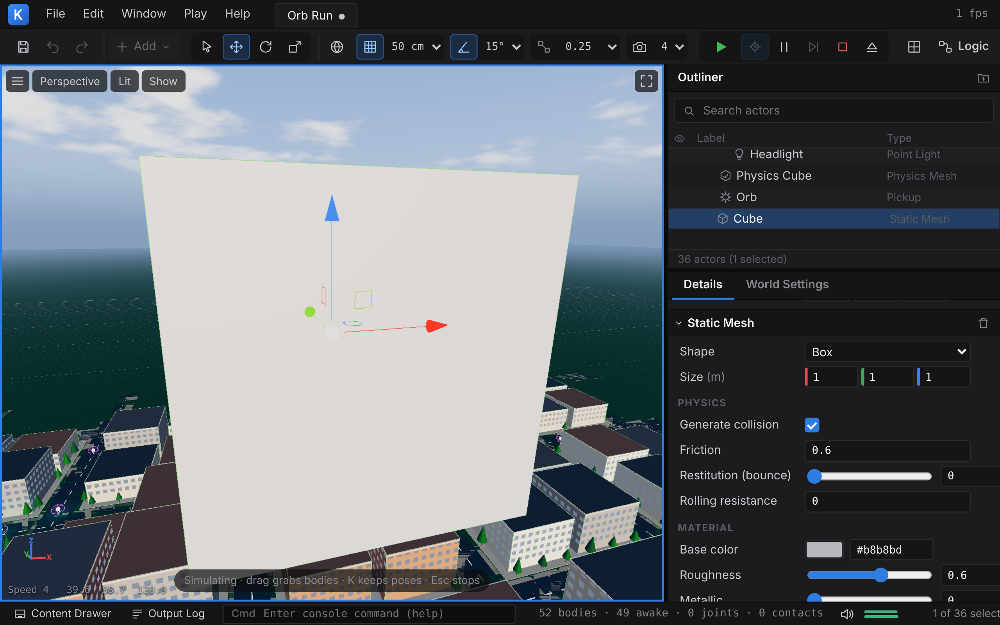
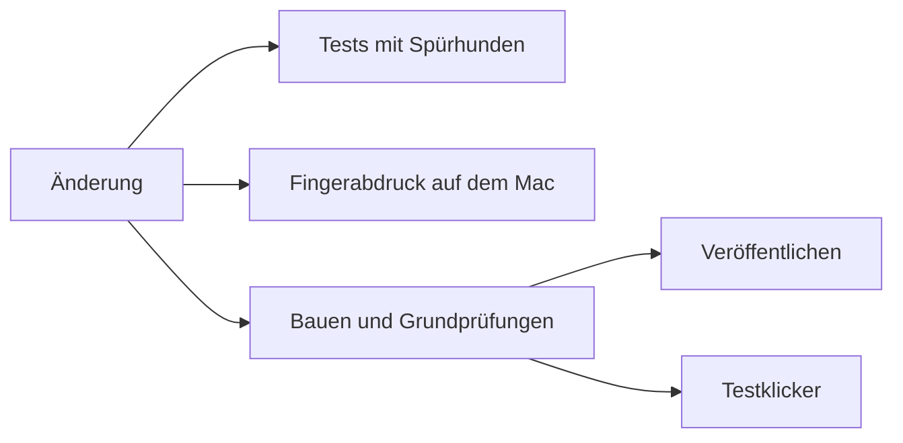

# 2 Bauen und Testen: die Werkstatt hinter Kern

> **Kurz gesagt:** Hinter Kern stehen drei Prinzipien. Erstens: Der Code wird **übersetzt**, bevor
> er im Browser laufen kann. Zweitens: Hunderte **automatische Prüfungen** bewachen jede Änderung.
> Drittens: Ein **Fingerabdruck** beweist, dass Kern überall exakt gleich rechnet. Ein Fließband
> erledigt alle drei bei jeder Änderung von selbst.

> **Begriffe vorab:**
> - **Quelltext** – der Text eines Programms, so wie Menschen ihn schreiben, hier in C++.
> - **Header** – eine gemeinsame Absprache-Datei im Quelltext, die viele Programmteile mitlesen,
>   wie eine Hausordnung, die in jeder Wohnung hängt.
> - **Prozessor** – das Rechenwerk im Computer, das die Befehle tatsächlich ausführt.
> - **Speicher** – der Arbeitsplatz eines Programms im Rechner, eine lange Reihe nummerierter Fächer
>   für Zahlen.
> - **Simulation** – eine nachgerechnete Welt: Der Computer berechnet Schritt für Schritt, wie sich
>   Dinge bewegen.
> - **Takt** – ein einzelner Rechenschritt der Simulation. Die Ente entscheidet in jedem Takt neu,
>   wie sie ihre Motoren bewegt.
> - **Server** – ein Computer im Internet, der Aufgaben für andere erledigt.
> - **GitHub** – eine Webseite, auf der der Quelltext von Kern liegt und jede Änderung aufgezeichnet
>   wird.

Stell dir eine Werkstatt mit drei Stationen vor: An der ersten wird gekocht (übersetzt), an der
zweiten wird abgeschmeckt (geprüft), an der dritten wird das Ergebnis mit einem Muster verglichen
(Fingerabdruck). Am Ende steht die Auslieferung: die Webseite https://kernengine.de/. Dieses Kapitel
geht die Stationen der Reihe nach durch.

## 2.1 Übersetzen: vom Rezept zum Gericht

Ein Programm wird in einer Sprache für Menschen geschrieben. Bevor ein Browser es ausführen kann,
muss es in dessen Befehle übersetzt werden. Bei Kern heißt das: Aus dem C++-Quelltext wird ein
WebAssembly-**Modul**, eine einzige Datei, die der Browser lädt.

> **Stell dir vor …** Der Quelltext ist das Rezept, das **Bauskript** ist der Koch, das Modul ist
> das fertige Gericht. Beim Bestellen sagst du, welche Gänge du willst: nur die Grundausstattung
> (Malen, Ton, Logik, Netzwerk), oder dazu Physik, Spielregeln, den Editor oder den Trainer.

Der Koch hat zwei feste Hausregeln. Erstens: **keine Rechen-Abkürzungen.** Manche Prozessoren
können zwei Rechenschritte zu einem verschmelzen und runden dabei anders als andere. Das ist
verboten, damit Kern überall gleich rechnet ([Kapitel 1](01-einfuehrung.md)). Zweitens: **nur
servieren, was bestellt ist.** Der Koch legt nichts auf den Teller, was keiner isst – so bleibt das
Modul klein und lädt schneller.

### Der Vorratsschrank

Kern besteht aus vielen Dutzend Quelltext-Stücken. Jedes wird einzeln übersetzt, viele
gleichzeitig, und am Ende zu einem Modul zusammengefügt. Damit nicht bei jedem Bauen alles neu gekocht wird, kommt
jedes übersetzte Stück in einen **Vorratsschrank**. Es trägt ein Etikett, eine Art Fingerabdruck
seines Rezepts und **aller** Header: Ändert sich darin auch nur ein Zeichen, sieht das Etikett völlig
anders aus (wie so ein Fingerabdruck entsteht, zeigt [Kapitel 3](03-grundlagen.md)). Passt das
Etikett noch, wird das Stück aus dem Schrank genommen statt neu gekocht. Studio und Beispielspiele
teilen sich den Schrank, und das Fließband aus Abschnitt 2.4 hebt ihn von Lauf zu Lauf auf.

> **Wusstest du?** Ändert jemand ein einziges Komma in einem Header, wird **alles** neu übersetzt –
> mit Absicht. Jedes Stück liest die Header mit, wie jede Wohnung die Hausordnung. Herauszufinden,
> welche Stücke eine Änderung wirklich betrifft, wäre mühsam und fehleranfällig; ein übersehenes
> Stück bliebe veraltet im Schrank. Also kocht Kern lieber alles neu. Das kostet Zeit, ist aber
> einfach und sicher.

### Studio im Koffer

Ein zweites Skript packt Kern Studio in **eine einzige** HTML-Datei – die Art Datei, aus der
Webseiten bestehen und die ein Browser per Doppelklick öffnet. Hinein kommen das Modul, die
JavaScript-Schicht und das Aussehen der Seite, alles in einem Koffer. So eine Webseiten-Datei
besteht nur aus Buchstaben und Zeichen, das Modul aber aus rohen Zahlen. Darum wird es als lange
Buchstabenfolge verkleidet, ähnlich wie Morsezeichen Buchstaben als Punkte und Striche verkleiden.
Deshalb läuft das Studio per Doppelklick, ohne Internet und ohne Installation.

Im Koffer liegen außerdem die Bauteile für fertige Spiele: die Browser-Teile, die ein Spiel zum
Laufen braucht, noch einmal extra verpackt. Zusammen mit dem Modul, das ohnehin im Koffer steckt,
kann **Datei › Spiel verpacken (HTML)...** (File › Package Game (HTML)...) darum auch ohne Internet ein eigenständiges Spiel packen.

### Der Lehrer ohne Bildschirm

Den Lehrer kann man auch als eigenes, schnelles Programm für den eigenen Rechner bauen. Er braucht
keinen Bildschirm, denn Training muss nichts malen. Darum läuft er sogar auf einem Server ohne
Monitor. Wie man ihn bedient, zeigt [Kapitel 14](14-lehrer.md).

Für den eigenen Rechner darf der Übersetzer dabei die schnellsten Befehle wählen, die genau dieser
Prozessor kennt. Das klingt nach einem Widerspruch zur Gleichheit, ist aber keiner: Er wählt nur
andere Werkzeuge für dieselbe Rechnung. Die Rechen-Abkürzungen bleiben verboten, und so kommt Bit für
Bit dasselbe heraus – nur schneller.

Die genauen Namen und Werte stehen im blauen Buch, Kapitel 2.

## 2.2 Automatisch prüfen: hunderte kleine Kontrollen

Ein **Test** ist ein kleines Programm, das ein Stück Kern ausprobiert und nachsieht, ob das
Richtige herauskommt. Kern hat weit über hundert davon, jeder mit vielen einzelnen Prüfungen, und
sie laufen bei jeder Änderung. Wer etwas kaputt macht, merkt es sofort – nicht erst, wenn ein
Spieler es findet.

So klingen Prüfungen in Alltagssprache:

- Startet das Studio mit Orb Run?
- Macht **Rückgängig** (Undo) eine Änderung exakt rückgängig?
- Rechnet Kern das Netz der Ente genauso wie die Vorlage von Pollen Robotics?
- Steht die Ente, läuft sie und dreht sie sich, wenn ihr Netz sie steuert?

Jede Prüfung meldet „ok“ oder „FAIL“. Ein einziges FAIL genügt, und der ganze Lauf gilt als
gescheitert.

### Spürhunde

Beim Prüfen wird Kerns eigener Code mit eingebauten **Spürhunden** übersetzt. Einer bellt, wenn ein
Programmteil in ein Speicherfach greift, das ihm nicht gehört. Der andere bellt, wenn der Code etwas
tut, was die Regeln von C++ verbieten – etwa eine Rechnung, deren Ergebnis zu groß für ihr
Zahlenkästchen wird. Beide brechen sofort ab und nennen die Stelle.

Fremder Code, etwa die Physik-Bibliothek, läuft ohne Spürhunde. Der Grund: Kern verändert fremden
Code nicht, sondern baut ihn ein, wie er ist ([Kapitel 1](01-einfuehrung.md)). Was die Spürhunde
dort fänden, könnte Kern also gar nicht selbst beheben. Gesucht wird dort, wo Kern auch reparieren
kann: im eigenen Code.

Außerdem sind die Tests strenger als der normale Bau. Normalerweise ist eine **Warnung** des
Übersetzers nur ein Hinweis: „Hier ist etwas verdächtig, ich übersetze aber trotzdem.“ Beim Prüfen
gilt schon jede Warnung als Fehler.

### Die Attrappe

Auf dem Prüfrechner gibt es keine Grafikkarte, die ein Browser ansteuern könnte. Darum ersetzt eine
**Attrappe** die Grafikschnittstelle: Sie malt nichts, schreibt aber genau auf, was Kern von ihr
wollte.

> **Stell dir vor …** Ein Pilot übt im Flugsimulator. Kein Flugzeug hebt ab, aber jeder Knopfdruck
> wird aufgezeichnet. Hinterher sieht man genau: Kam das Fahrwerk rechtzeitig rein?

So prüfen die Tests ohne Grafikkarte, ob das Malen kaputte Eingaben abweist, einmal Berechnetes
wiederverwendet und den Verlust der Grafikkarte übersteht.

### Spielregeln: drei Wege, ein Ergebnis

Spielregeln, die man im Studio als Kästchen und Pfeile zusammenklickt ([Kapitel 9](09-logik.md)),
kann Kern auf drei Arten ausführen. Alle drei müssen exakt dasselbe Ergebnis liefern, und
gemeinsame Testfälle prüfen genau das.

> **Stell dir vor …** Eine Geschichte kann man Satz für Satz vom Zettel vorlesen (langsam, aber
> sofort bereit). Man kann sie kurz vor dem Auftritt in die eigene Sprache übertragen und dann
> flüssig vortragen (schnell, sobald es losgeht). Oder man lässt sie als fertiges Buch drucken. Wer
> zuhört, muss jedes Mal dieselbe Geschichte hören.

In Kern heißt das:

- **Vorlesen:** Kern geht die Kästchen eins nach dem anderen durch und tut, was darin steht.
- **Übertragen:** Beim Start von **Spielen** (Play) oder **Simulieren** (Simulate) übersetzt Kern
  die Kästchen in schnelle Maschinenbefehle, die der Browser direkt ausführt. Der Test macht das genau so wie im Browser.
- **Drucken:** Kern schreibt aus den Kästchen fertigen C++-Quelltext, der fest in ein Programm
  eingebaut werden kann.

Der schnelle Weg im Spiel ist das Übertragen. Klappt es einmal nicht, liest Kern einfach Kästchen
für Kästchen vor – langsamer, aber nichts geht kaputt.

> **Wusstest du?** Am Ende dieses Tests läuft ein Wettrennen: Spielregeln mit einer Million
> Wiederholungen, einmal vorgelesen, einmal übertragen. Ausgegeben wird, wie viel schneller das
> Übertragen ist.

### Der Testklicker

Die letzte Prüfung ist die größte: Ein ferngesteuerter Browser bedient das Studio wie ein
unermüdlicher Mensch. Er öffnet Menüs, verschiebt Dinge, drückt **Spielen**, packt ein Spiel und spielt
es, er tut sogar so, als wäre er ein Telefon. Eine echte Grafikkarte bekommt er nicht, sondern eine
nachgebildete, die die Stadt von Orb Run mit nur etwa **einem Bild pro Sekunde** schafft. Darum
wartet jede Prüfung, bis ihre Wirkung sichtbar ist, statt eine feste Zeit lang zu warten.

Ob überhaupt etwas gemalt wurde, verrät ein einfacher Trick: Der Testklicker zählt, wie viele
**verschiedene Farben** im Bild vorkommen. Ein leeres Bild hat kaum Farben, ein gemaltes viele. Er
muss dafür nicht wissen, wie das Bild genau aussehen soll – die Frage „Wurde überhaupt gemalt?“
beantwortet die Farbzahl allein, schnell und auch mit der langsamen Ersatz-Grafik. Nebenbei kann er
Bildschirmfotos machen – viele Bilder dieses Buchs stammen daher.

> **Probier's aus!** Mach, was der Testklicker macht. Wähle **Datei › Neues Level...** (File › New Level...)
> und dort **Physics Lab**. Halte die rechte Maustaste gedrückt und drück W: Jetzt fliegt deine
> **Kamera** nach vorn, die Dinge in der Welt bleiben stehen. Dann **Simulieren** (Alt+S), also zuschauen statt mitspielen: Die
> Physik rechnet, das Pendel schwingt, der Drehteller dreht sich, der Rover fährt los. Stell dir
> vor, du müsstest das nach jeder Änderung hundertmal tun und jedes Mal genau hinsehen – genau das
> nimmt dir der Testklicker ab, ohne müde zu werden.

Die genauen Namen und Werte stehen im blauen Buch, Kapitel 2.

## 2.3 Der Fingerabdruck: überall dasselbe Ergebnis

Wie beweist man, dass Kern auf jedem Rechner **exakt** gleich rechnet? Man lässt alle Rechner
dasselbe tun und vergleicht – aber nicht nur das Endergebnis, sondern jeden einzelnen Schritt.

Dafür braucht man eine **Prüfsumme**: eine Zahl, die aus vielen Daten errechnet wird und sich völlig
ändert, sobald sich auch nur eine Kleinigkeit ändert – wie ein Fingerabdruck. Dieselben Daten
ergeben immer dieselbe Zahl.

Der Test geht so: Die Micro Duck läuft in der Physik des Studios ein Stück geradeaus und dreht sich
dann auf der Stelle, gesteuert von einem Netz von Pollen Robotics. Nach **jedem** Takt wird ihr
ganzer Zustand – wo sie steht, wie sie gedreht ist, wie schnell sie sich bewegt, wie jedes Gelenk
steht – zu einer Prüfsumme. 400 Takte ergeben eine Liste von 400 Prüfsummen. Diese Liste muss auf
einem Linux-PC, auf einem Mac mit Apple-Chip und im WebAssembly-Modul, das auch der Browser benutzt,
**Zeile für Zeile** mit einer gespeicherten Vorlage übereinstimmen.

> **Stell dir vor …** Du fotografierst die Ente 400-mal und vergleichst jedes Foto mit einem
> Referenzalbum. Verrutscht eine Feder um ein Haar, weißt du sogar, auf welchem Foto.

Weicht ein Foto ab, gibt es nur zwei Erklärungen: Entweder wurde die Simulation absichtlich
geändert – dann muss die Vorlage neu erzeugt und die Änderung begründet werden. Oder irgendwo rechnet
Code auf verschiedenen Rechnern verschieden, etwa weil er für einen Winkel die Rechenformeln benutzt,
die der jeweilige Computer von Haus aus mitbringt, statt Kerns eigener ([Kapitel 3](03-grundlagen.md)).

Ein zweiter Test prüft das Lernen: Er trainiert ein Netz mit einem, zwei und vier Helfern, die
zusammen immer acht Enten betreuen. Alle drei Netze müssen bis aufs letzte Bit gleich sein. Das ist
schwerer, als es klingt: Vier Helfer werden in anderer Reihenfolge fertig als zwei. Würde man ihre
Ergebnisse in der Reihenfolge zusammenzählen, in der sie eintreffen, käme – wie beim
Vier-Stellen-Taschenrechner aus [Kapitel 1](01-einfuehrung.md) – etwas anderes heraus. Darum zählt
Kern immer in derselben, fest vereinbarten Reihenfolge zusammen.

> **Für Neugierige:** Die Prüfsumme heißt FNV-1a und ist 16 Zeichen lang. Wer den Lehrer auf dem
> eigenen Rechner baut, kann den Fingerabdruck selbst erzeugen und mit der Vorlage vergleichen –
> wie, steht im blauen Buch, Kapitel 2.

## 2.4 Das Fließband: die automatische Prüfstraße

Niemand muss daran denken, die Prüfungen zu starten. Bei jeder Änderung auf GitHub springt ein
**Fließband** an, auf Englisch **CI** (*Continuous Integration*, „ständiges Zusammenführen“). Server
von GitHub erledigen dann alles von selbst: übersetzen, prüfen, Fingerabdruck vergleichen,
veröffentlichen.

Die Stationen:

- **Tests mit Spürhunden:** alle Prüfungen aus Abschnitt 2.2 auf einem Linux-Rechner.
- **Fingerabdruck auf dem Mac:** Der Lehrer wird auf einem Mac mit Apple-Chip gebaut und muss die
  Ente exakt wie die anderen bewegen.
- **Bauen und Grundprüfungen:** baut Studio, Beispielspiele und Lehrer, macht die wichtigsten
  Pflichtprüfungen und stellt die fertige Webseite zusammen.
- **Veröffentlichen:** stellt die Webseite auf https://kernengine.de/.
- **Testklicker:** bedient das Studio mit genau den Dateien, die veröffentlicht werden.

Wichtig ist, was **wartet** und was nicht. Veröffentlicht wird, sobald die Station „Bauen und
Grundprüfungen“ fertig ist. Scheitert dort eine Prüfung, geht nichts online. Die drei anderen
Prüfstationen laufen dagegen **nebenher**: Die Veröffentlichung wartet nicht auf sie. Fällt eine
von ihnen durch, ist die neue
Fassung vielleicht schon online – aber auf GitHub leuchtet sofort eine rote Markierung, und die
nächste Änderung muss den Fehler beheben.

> **Stell dir vor …** Eine Bäckerei. Bevor ein Brot in den Laden kommt, muss es durchgebacken sein –
> das ist die Pflicht an der Backstation. Die Verkostung durch die Meisterin läuft parallel zum
> Verkauf. Schmeckt ihr etwas nicht, wird sofort nachgebessert, aber das Brot im Regal bleibt dort.

Der Vorteil: Jede Änderung ist schnell online. Der Preis: Ein Fehler, den nur die nebenher
laufenden Tests finden, kann kurz sichtbar sein.

Auf der Hauptlinie, aus der die Webseite entsteht, läuft jede Änderung bis zum Ende durch – auch
wenn schon die nächste kommt. So wird jeder geprüfte Stand auch veröffentlicht. Änderungsvorschläge,
die erst noch begutachtet werden, laufen ebenfalls über das Fließband, werden aber nie
veröffentlicht; kommt eine neuere Fassung des Vorschlags, wird der ältere Lauf abgebrochen.

> **Probier's aus!** Im Studio steht in der Statusleiste ganz unten die **Version**, etwa „v 1af26d8“:
> das Kürzel der Änderung, aus der das Fließband genau diese Fassung gebaut hat. Lädst du die Seite
> ein paar Tage später neu, steht dort vielleicht schon ein anderes Kürzel – dann ist inzwischen eine
> neue Änderung durch das Fließband gelaufen und online gegangen.

> **Wusstest du?** Kern Studio lässt sich wie eine App auf dem Rechner installieren. Diese Fassung
> merkt selbst, wenn das Fließband eine neue Version veröffentlicht hat: Neben jeder Fassung liegt
> eine kleine Datei mit ihrer Kennung, und sie vergleicht.

Wie man das ganze Fließband zu Hause nachstellt und was typische Fehlermeldungen bedeuten, steht im
blauen Buch, Kapitel 2.

## Das nimmst du mit

- Code wird übersetzt, bevor er im Browser läuft; der Bau wählt, welche Teile mitkommen.
- Ein Vorratsschrank mit Etiketten spart Zeit; nach einer Header-Änderung wird bewusst alles neu
  übersetzt.
- Weit über hundert Tests prüfen jede Änderung. Spürhunde finden verbotene Speicherzugriffe, eine Attrappe
  ersetzt die Grafikkarte, ein Testklicker bedient das Studio wie ein Mensch.
- Spielregeln müssen auf allen drei Wegen dasselbe ergeben.
- Der Fingerabdruck vergleicht 400 Takte der Ente auf PC, Mac und im Browser-Modul.
- Das Fließband prüft jede Änderung und veröffentlicht; nur die Bau-Station hält die
  Veröffentlichung an, die übrigen Tests laufen nebenher.

## Knobelecke

1. Warum laufen die Spürhunde nur über Kerns eigenen Code, nicht über übernommenen fremden Code?
2. Du änderst einen Header. Was passiert beim nächsten Bauen, und warum?
3. Warum genügt dem Testklicker die Zahl der Farben, um zu prüfen, ob gemalt wurde?
4. Der Fingerabdruck stimmt bis Takt 211 und weicht ab Takt 212 ab. Was sagt dir das?
5. Die Tests mit Spürhunden schlagen fehl. Ist die Webseite trotzdem aktualisiert worden?

### Lösungen

1. Kern verändert fremden Code nicht. Was die Spürhunde dort fänden, könnte Kern nicht selbst
   beheben – also sucht man dort, wo Kern auch reparieren kann.
2. Alles wird neu übersetzt. Jedes Stück liest die Header mit, darum steckt ihr Inhalt in jedem
   Etikett. Statt mühsam herauszufinden, welches Stück betroffen ist, kocht Kern alles neu – so bleibt
   kein veraltetes Vorratsstück übrig.
3. Ein leeres Bild hat kaum Farben, ein gemaltes viele. Dafür muss der Testklicker nicht wissen, wie
   das Bild genau aussehen soll, und es klappt auch mit der langsamen Ersatz-Grafik.
4. Bei Takt 212 kommt zum ersten Mal etwas anderes heraus. Dort setzt die Fehlersuche an, etwa bei
   einer Winkelrechnung, die nicht Kerns eigene Formel benutzt.
5. Ja, wenn die Bau-Station geklappt hat: Diese Tests laufen nebenher und halten die
   Veröffentlichung nicht auf. Die rote Markierung zeigt aber sofort, dass etwas zu reparieren ist.

---

© 2026 Christian Heinrich Hohlfeld · Alle Rechte vorbehalten · [Impressum und Rechte](00-impressum.md)
