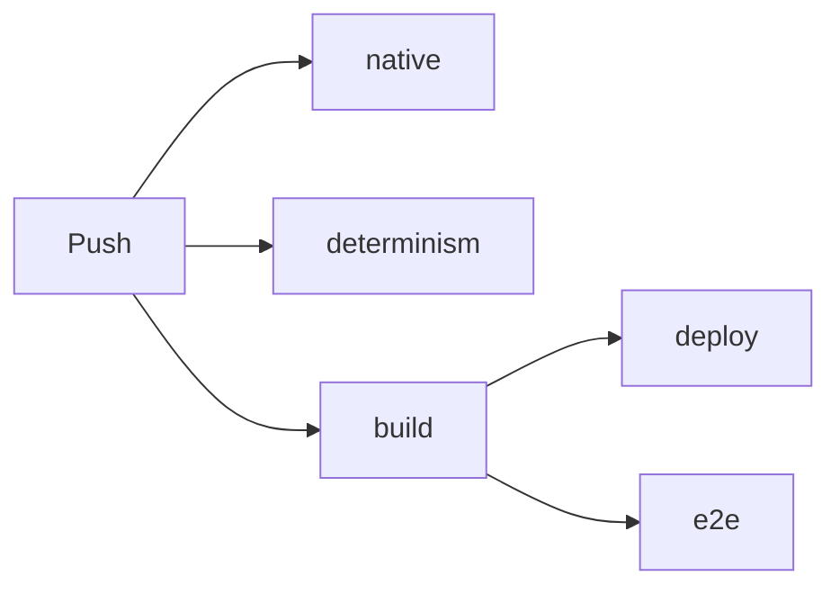

# 2 Bauen und Testen: die Werkstatt hinter Kern

> **Kurz gesagt:** Bevor Kern im Browser läuft, muss der C++-Code übersetzt werden – und bevor eine
> Änderung online geht, muss sie hunderte Prüfungen bestehen. Hier lernst du die Bauwerkzeuge, die
> Tests, den Fingerabdruck für Determinismus und die automatische Prüfstraße kennen.

## 2.1 Der Überblick

| Werkzeug | Macht daraus |
|---|---|
| `kern/build.sh` | ein WebAssembly-Modul |
| `tools/build_studio.sh` | Kern Studio als eine HTML-Datei |
| `kern/tools/lehrer.sh` | den Lehrer für deinen Rechner |
| `kern/tests/run.sh` | alle Unit-Tests |
| Logik- und Lehrer-Tests | Prüfungen im WebAssembly-Modul |
| `kern/tests/e2e/studio_e2e.mjs` | einen echten Browser-Test |

Der kürzeste Weg zu Studio und grünen Tests:

```sh
export WASI_SDK=/opt/wasi-sdk-25.0-x86_64-linux
tools/build_studio.sh
CXX=g++ CC=gcc kern/tests/run.sh
```

Zeile 1 sagt, wo der Übersetzer liegt, Zeile 2 baut `generated/studio.html`, Zeile 3 baut und
startet alle Tests mit GCC. Beispielspiele und den Browser-Lehrer baust du so:

```sh
kern/build.sh --app kern/examples/hello/hello.wasm \
  kern/examples/hello/hello.cpp
kern/build.sh --lehrer generated/kern_lehrer.wasm
```

(`orbrun` genauso wie `hello`.) Die fertige `studio.html` läuft per Doppelklick, ohne Internet. Zum
Entwickeln lieferst du die Repository-Wurzel über einen Webserver aus und öffnest
`kern/web/studio/index.html`; sie lädt `generated/kern_studio.wasm`. `play.html?level=orbRun`
im selben Ordner spielt ein Level ohne Editor (auch `physicsLab`, `shootingRange`, `microDuck`,
`basic`).

## 2.2 Der Übersetzer: wasi-sdk 25

Kern braucht **wasi-sdk 25**: den Compiler clang, einen Linker (der die Teile zusammenklebt) und die
Standardbibliotheken für C und C++, alles für das Ziel WebAssembly. Emscripten braucht Kern nicht.
Die Variable `WASI_SDK` zeigt auf den Ordner (sonst gilt `/opt/wasi-sdk`). Für Tests und den Lehrer
auf deinem Rechner reicht ein normaler Compiler (GCC oder clang, auf dem Mac Apple clang); dazu
kommen Python 3, Node (die CI nutzt Version 22) und für den Browser-Test Playwright mit Chromium.

## 2.3 `kern/build.sh`: der Koch

```
kern/build.sh [--app] [--physics] [--game] [--studio] [--lehrer]
              <out.wasm> [Optionen / Spielquellen ...]
```

Ohne Schalter übersetzt das Skript den Grundstock – Grafik, Audio, Grundlagen, Geometrie, Logik,
Netzwerk, Szene und die eigene Mathematik aus musl. Die Schalter kennst du aus
[Kapitel 1](01-einfuehrung.md). Weitere Argumente, die auf `.cpp` oder `.cc` enden, werden als
Spielquellen mitübersetzt; alles andere geht als Option an den Compiler.

Vier Umgebungsvariablen steuern den Bau: `WASI_SDK` (wo), `KERN_BUILD` (`release`: voll optimiert,
`-O3` mit ThinLTO; `debug`: weniger optimiert, `-O1 -g` ohne ThinLTO), `KERN_JOBS` (wie viele
Übersetzer parallel, Standard: alle Kerne) und
`KERN_OBJ_CACHE` (wo Zwischenergebnisse liegen). Kleiner Haken: Auch im Debug-Modus landen keine
Debug-Informationen im Modul, weil der letzte Schritt sie immer entfernt.

### Die wichtigsten Optionen

- **`-ffp-contract=off`** überall, auch für Box3D und musl. Sonst dürfte der Compiler `a*b+c` zu einem
  Rechenschritt verschmelzen – der rundet anders, je nach Prozessor ([Kapitel 3](03-grundlagen.md)).
- **Box3D im „Skalar-Pfad“**: ohne Spezialbefehle, die mehrere Zahlen auf einmal rechnen – wie in
  WebAssembly.
- **Keine Ausnahmen, keine Laufzeit-Typinformation** (`-fno-exceptions -fno-rtti`).
- **Nur Markiertes ist von außen sichtbar,** und jede Funktion bekommt ein eigenes Fach, damit der
  Linker Ungenutztes wegwerfen kann.

Beim Linken entsteht ein **Reactor** mit 1 MiB Stack und einem Speicher, der mit 32 MiB startet und
bis 2 GiB wachsen darf. Die Funktionstabelle ist wachsbar – dort legt der Logik-JIT
([Kapitel 9](09-logik.md)) Graphen ab, die er während des Spiels in WebAssembly übersetzt. Zum
Schluss meldet das Skript stolz `built <out> (<n> bytes)`.

### Der Vorratsschrank

Jede Quelle wird einzeln und parallel übersetzt, und ThinLTO, ein Optimierer, verbindet sie. Damit
ein Neubau nicht alles neu kocht, gibt es einen **Objekt-Cache**, den sich Studio und Beispielspiele
teilen und den die CI von Lauf zu Lauf aufhebt. Jedes C++-Stück trägt ein Etikett aus dem Inhalt
seiner Quelle, ihrem Pfad und dem Inhalt **aller** Header. Box3D und musl haben eigene Fächer;
dort wird neu übersetzt, was fehlt oder älter als seine Quelle oder der neueste Header ist. Auch
ThinLTO hat ein eigenes Fach.

> **Achtung, Falle!** Du änderst ein Komma in einer Header-Datei – und **alles** wird neu übersetzt?
> Absicht! Weil alle Header ins Etikett eingehen, passt kein Vorratsstück mehr. Einfach und sicher:
> Nie bleibt ein veraltetes Teil übrig.

## 2.4 Kern Studio als eine einzige Datei

`tools/build_studio.sh` baut das Modul mit `--studio` und packt alles in **eine** HTML-Datei: das
Stylesheet direkt hinein, das Modul als base64-Text (binäre Daten als Buchstaben verkleidet), die
JavaScript-Dateien aneinandergehängt zu einem Skript, ohne ihre `import`- und `export`-Zeilen. So
läuft die Seite auch unter strengen Sicherheitsregeln. Zwei Skripte liegen zusätzlich als reiner
Text bei – aus ihnen schreibt das Studio exportierte Spiele. Ein Startblock wirft den Motor an; geht
das schief, erscheint eine Meldung. Mit `--skip-wasm` wird das vorhandene Modul wiederverwendet.

> **Wusstest du?** Enthält eine JavaScript-Quelle die Zeichenfolge `</script`, bricht der Bau ab.
> Der Browser hielte sie für das Ende des eingebetteten Skripts und zeigte den Rest als Kauderwelsch.

## 2.5 Der Lehrer für deinen Rechner

`kern/tools/lehrer.sh` baut `kern_lehrer` für Linux und macOS, auf x86 und ARM, voll optimiert und
auf allen Kernen. Drin ist fast die ganze Engine, nur Studio und App-Laufzeit fehlen; statt WebGL
steckt eine Attrappe darin, denn der Lehrer zeichnet nicht. Das Ergebnis landet in `kern/build/`
(oder einem Ordner deiner Wahl). Mit `KERN_NATIVE=1` (Standard) erlaubt das Skript die besten
Befehle deines Prozessors – Ergebnisse ändert das nicht, weil `-ffp-contract=off` gilt. Bedienung:
[Kapitel 14](14-lehrer.md) und [Kapitel 17](17-referenz.md).

## 2.6 Die Unit-Tests

```sh
CXX=g++ CC=gcc kern/tests/run.sh     # alle Tests
kern/tests/run.sh micro_duck          # nur Tests mit "micro_duck"
```

Ein **Unit-Test** prüft ein kleines Stück Code. Kerns Code wird dafür mit zwei **Sanitizern**
übersetzt, eingebauten Spürhunden: Der *AddressSanitizer* bellt, wenn Code in fremden Speicher
greift, der *UndefinedBehaviorSanitizer*, wenn er etwas tut, was C++ verbietet. Beide brechen sofort
ab. Box3D und musl, fremder Code, laufen ohne Spürhunde. Außerdem gilt `-Werror`: **Jede** Warnung
wird zum Fehler – das Bauskript ist nachsichtiger, die Tests nicht.

Kern hat ein winziges eigenes Testgerüst: `TEST(name)` meldet einen Test an, `CHECK(bedingung)` prüft,
`CHECK_NEAR(a, b, eps)` vergleicht Zahlen mit Toleranz. Je Test erscheint `ok` oder `FAIL` (mit
Datei, Zeile, Ausdruck und `last_error()`), am Ende `<n> checks, <m> failures`; bei einem Fehler
endet das Programm mit 1. Die Tests decken die ganze Engine ab: Matrizen und Kamera, Geometrie, Renderer, Physik, JSON, Spiel,
Logik, Audio, Netzwerk, Studio (startet es mit Orb Run? ist Undo exakt?), Micro Duck (rechnet Kern
ihr Netz wie die Referenz? steht, läuft und dreht sie sich?), Lehrer und Determinismus. Ohne Filter
folgt zum Schluss der Logik-Export-Test.

Auf deinem Rechner gibt es kein WebGL. Darum ersetzt eine **Attrappe** (`gl_stub.cpp`) die
Grafikschnittstelle: Sie zeichnet nichts, schreibt aber auf, was der Renderer von ihr wollte.

> **Stell dir vor …** Ein Pilot übt im Flugsimulator. Kein Flugzeug hebt ab, aber jeder Knopfdruck
> wird protokolliert. Hinterher sieht man genau: Kam das Fahrwerk rechtzeitig rein?

So prüfen die Tests ohne Grafikkarte, ob der Renderer Eingaben prüft, Schatten wiederverwendet oder
einen Kontextverlust übersteht.

## 2.7 Logik: drei Wege, ein Ergebnis

Ein Logik-Graph ([Kapitel 9](09-logik.md)) läuft im **Interpreter** (Knoten für Knoten), als
**JIT** (zur Laufzeit in WebAssembly übersetzt) oder als **exportiertes C++**. Alle drei müssen Bit
für Bit dasselbe liefern. Gemeinsame Testfälle wie `math_loops` prüfen das: den Interpreter ein
Unit-Test, das exportierte C++ ein zweiter Schritt von `run.sh` (`kern_tests --emit-logic` schreibt
den Quelltext, der dann übersetzt und verglichen wird), den JIT ein eigenes Modul unter Node – genau
wie im Browser. Dabei muss jeder Graph wirklich in seiner Stufe laufen, etwa
`compiled (WebAssembly)`.

> **Wusstest du?** Zum Schluss des JIT-Tests läuft ein Wettrennen: eine Million
> Schleifendurchläufe, interpretiert und übersetzt. Ausgegeben wird, wie viel schneller der JIT ist.

## 2.8 Der Browser-Test

```sh
python3 -m http.server 8771 &
node kern/tests/e2e/studio_e2e.mjs   # Standard: Port 8771
```

Zeile 1 liefert die Repository-Wurzel aus (`generated/` muss gebaut sein), Zeile 2 startet den
**e2e**-Test („End to End“): einen echten Chromium, ferngesteuert mit Playwright, der das Studio
bedient wie ein Mensch. Eine Grafikkarte bekommt er nicht, sondern die
Software-Nachbildung SwiftShader – die schafft die Stadt mit etwa **einem Bild pro Sekunde**. Darum
wartet jede Prüfung auf ihre Wirkung statt eine feste Zeit. Ob überhaupt gezeichnet wurde, verrät
die Zahl verschiedener Farben im Bild.

Geprüft wird fast alles: Menüs, Fly Mode, Auswählen und Verschieben, Undo, Play, Simulate, vier
Viewports, Vorlagen, Logik-Editor, Micro Duck mit Kopfkamera, Mehrspieler über zwei Tabs, Spiel
packen und spielen, Wiederherstellen nach dem Neuladen, Einstellungen, schmale Fenster, Telefone,
die Android-Dateiauswahl, dazu die Fassung des Studios aus Einzeldateien. Am Ende steht
`<n> checks, <m> failures`; bei Fehlern endet der Test mit 1, auf GitHub zusätzlich als
Fehlermarkierung. Screenshots entstehen nur, wenn `KERN_E2E_SHOTS` einen Ordner nennt – viele Bilder dieses Buchs
stammen daher.

> **Probier's aus!** Mach, was der Test-Roboter macht: **File → New Level → Physics Lab**. Halte die
> rechte Maustaste gedrückt und flieg mit W nach vorn. Dann **Simulate** (Alt+S) – und sieh den
> Gelenken bei der Arbeit zu.

## 2.9 Der Fingerabdruck

Wie beweist man, dass Kern überall **exakt** gleich rechnet? Die Micro Duck läuft mit Pollens Netz
`velstand` in der Studio-Physik: 150 Takte vorwärts (Kommando 0,15), dann Drehen auf der Stelle
(0,8). Nach **jedem** Takt wird ihr ganzer Zustand – Position, Drehung, Geschwindigkeiten,
Gelenkwinkel – mit dem Verfahren **FNV-1a** zu einer 16-stelligen Prüfsumme:

```
0 7588b1a57dfadf95
1 46e1d239a7ed5cfe
```

> **Stell dir vor …** Du fotografierst die Ente 400-mal und vergleichst jedes Foto mit einem
> Referenzalbum. Verrutscht eine Feder um ein Haar, weißt du sogar, auf welchem Foto.

Die Referenz für 400 Takte liegt in `kern/tests/determinism_fingerprint.txt`. Geprüft wird mit GCC
auf x86 (der Test nennt den ersten abweichenden Takt), in WebAssembly unter Node und mit Apple clang
auf ARM. Von Hand:

```sh
kern/tools/lehrer.sh
kern/build/kern_lehrer --fingerprint 400 \
  | diff - kern/tests/determinism_fingerprint.txt
```

Der Lehrer wird gebaut, druckt 400 Prüfsummen, `diff` vergleicht. Keine Ausgabe heißt: alles gleich.
Ein Unterschied bedeutet: Entweder wurde die Simulation absichtlich geändert (dann Referenz neu
erzeugen und begründen), oder irgendwo rechnet Code plattformabhängig.

> **Achtung, Falle!** Der Klassiker ist ein `std::sin` statt `kern::dm::sin` in Code, der die
> Simulation speist. Auf deinem Rechner läuft alles prima, auf dem Mac weicht plötzlich ein Takt ab.
> Weitere Verdächtige: eine fehlende `-ffp-contract=off`-Option oder eine Summe, deren Reihenfolge
> von der Zahl der Threads abhängt ([Kapitel 3](03-grundlagen.md)).

Ein weiterer Test lernt mit 1, 2 und 4 Workern (immer 8 Enten) – die Netze müssen Byte für Byte
gleich sein.

## 2.10 Die automatische Prüfstraße

**CI** (*Continuous Integration*) heißt: Bei jeder Änderung prüft ein Server alles durch. Kerns
Pipeline auf GitHub läuft bei jedem Push auf `main`, bei Pull Requests und auf Knopfdruck:



- **native**: Unit-Tests mit Spürhunden, dann Logik-Export.
- **determinism**: baut den Lehrer auf einem Mac mit ARM und vergleicht den Fingerabdruck.
- **build**: holt wasi-sdk und den Vorrat vom letzten Lauf, baut Studio, Beispielspiele und Lehrer,
  prüft die Syntax aller JavaScript-Dateien, testet Lehrer (zwei Enten sammeln, einer lernt den Sprung
  `jump` – je ein kleines Stück jedes Lernverfahrens aus [Kapitel 14](14-lehrer.md): Nachahmung,
  DAgger, PPO –, dazu ONNX-Export und Fingerabdruck) und JIT und
  stellt die Webseite zusammen: Startseite, Editor, Lehrer-Seite, Netze der Ente, Beispielspiele,
  Lizenzen. Das Ergebnis hebt GitHub 7 Tage als Paket (Artefakt) `site` auf.
- **deploy**: nur für `main`; legt ein frisches Git-Repository an und schiebt es mit Gewalt (`-f`)
  in den Zweig `gh-pages`, und die Seite erscheint auf https://kernengine.de/. (Die `README.md`
  nennt noch eine eigene `pages.yml` – im Repository gibt es aber nur `ci.yml`.)
- **e2e**: der Browser-Test mit Playwright 1.56.0, mit genau den Dateien, die veröffentlicht
  werden. Er lädt einen Screenshot-Ordner hoch, setzt `KERN_E2E_SHOTS` aber nicht.

Tests halten die Veröffentlichung nicht auf. Auf `main` läuft jeder Push bis zum Ende, damit jeder
grüne Stand online geht – etwa 17 Minuten pro Lauf. Bei Pull Requests ersetzt ein neuer Lauf den
alten.

> **Wusstest du?** Der installierbare Editor merkt selbst, wenn es eine neue Version gibt: Die CI
> legt eine Datei `build.json` mit der Versionskennung daneben, und er vergleicht.

## 2.11 Zu Hause wie die CI

Alles lässt sich lokal nachstellen, in derselben Reihenfolge: Unit-Tests, Fingerabdruck, Module,
dann diese beiden Modul-Tests, zuletzt der Browser-Test:

```sh
node kern/tests/lehrer_wasm_test.mjs generated/kern_lehrer.wasm
kern/build.sh /tmp/logic_test.wasm \
  kern/tests/logic_wasm_test.cpp -Ikern/tests
node kern/tests/logic_wasm_test.mjs /tmp/logic_test.wasm
```

Die Seiten laden ihre Dateien relativ, die Netze der Ente etwa je nach Fassung (Entwicklung,
eine einzige Datei, veröffentlicht) aus einem anderen Ordner. Die Lehrer-Seite ist auf den Aufbau der
veröffentlichten Seite zugeschnitten und läuft lokal erst, wenn du sie wie die CI zusammenstellst.

## 2.12 Wenn's klemmt

| Symptom | Was tun? |
|---|---|
| `wasi-sdk clang++ not found` | `WASI_SDK` richtig setzen |
| `missing …/kern_studio.wasm` | ohne `--skip-wasm` bauen |
| `source contains '</script'` | Zeichenfolge aufteilen |
| Testbau bricht an Warnung ab | Warnung beheben (`-Werror`) |
| `runtime error`, `AddressSanitizer` | Datei, Zeile lesen; Test einzeln |
| Fingerabdruck weicht ab | Abschnitt 2.9 |
| Logik läuft im `interpreter` | JIT-Ausgabe prüfen |
| Browser-Test hängt (wartet bis 90 s) | Server starten, Studio bauen |
| Playwright fehlt | installieren, `NODE_PATH` setzen |

Fällt der JIT aus, rechnet Kern im Interpreter weiter (`logic JIT failed …`) – langsamer, aber
nichts geht kaputt.

> **Probier's aus!** Im Studio steht ganz unten in der Statusleiste die laufende Version. Tippe in
> die Konsole (**Cmd**) `stat` – dann landen Bilder pro Sekunde und Zählerstände im Log.

## Das nimmst du mit

- `kern/build.sh` übersetzt mit wasi-sdk 25 nach WebAssembly; Schalter wählen die Teile.
- `-ffp-contract=off` überall ist der Grundstein für gleiche Ergebnisse.
- Der Objekt-Cache spart Zeit; Header-Änderungen bauen bewusst alles neu.
- Unit-Tests laufen mit Sanitizern und `-Werror`; eine Attrappe ersetzt WebGL.
- Logik muss im Interpreter, als JIT und als C++ gleich rechnen.
- Der Fingerabdruck vergleicht 400 Takte der Ente auf drei Plattformen.
- Die CI prüft jede Änderung und veröffentlicht auf kernengine.de.

## Knobelecke

1. Warum laufen Box3D und musl ohne Sanitizer, Kerns Code aber mit?
2. Du änderst einen Kommentar in einem Header. Was passiert beim nächsten Bauen?
3. Warum zählt der Browser-Test Farben, statt Fotos zu vergleichen?
4. Der Fingerabdruck stimmt bis Takt 211 und weicht ab 212 ab. Was sagt dir das?

### Lösungen

1. Sie sind fremder, unverändert übernommener Code; geprüft werden soll Kerns eigener.
2. Alles wird neu übersetzt, denn der Inhalt aller Header steckt in jedem Etikett.
3. Software-Grafik ist langsam; die Farbzahl verrät einfach und robust, ob überhaupt gezeichnet wurde.
4. Bei Takt 212 kommt erstmals ein anderes Bit heraus – dort setzt die Fehlersuche an, etwa bei
   einem `std::sin` statt `kern::dm::sin`.

---

© 2026 Christian Heinrich Hohlfeld · Alle Rechte vorbehalten · [Impressum und Rechte](00-impressum.md)
