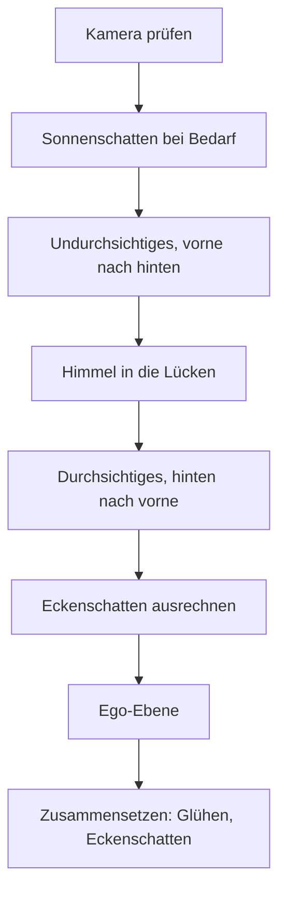

# 4 Grafik – wie Kern Bilder malt

> **Kurz gesagt:** Hier schaust du Kerns Maler über die Schulter: wie Kern die Grafikkarte
> erreicht, woraus Formen und Materialien bestehen, was das eine große Malprogramm für jeden
> Bildpunkt rechnet und in welcher Reihenfolge ein Bild entsteht – mit Sonnenschatten, Himmel,
> Glühen und weichen Eckenschatten. Zum Schluss bringen wir die Fenster einer Nachtstadt zum Leuchten.

> **Begriffe vorab:**
> - **Grafikkarte** (auch GPU) – der Spezialchip, der Millionen Bildpunkte gleichzeitig ausmalt.
> - **Mesh** – das Drahtgitter aus Dreiecken, aus dem ein 3D-Ding besteht.
> - **Shader** – ein kleines Malprogramm, das auf der Grafikkarte läuft.
> - **Normale** – ein gedachter Pfeil, der senkrecht aus einer Fläche zeigt: wohin die Fläche „schaut“.
> - **Tiefenpuffer** – ein unsichtbares zweites Bild, das sich für jeden Bildpunkt merkt, wie weit das
>   dort Gemalte entfernt ist.
> - **Malauftrag** – ein einzelnes „Male das!“ an die Grafikkarte. Jeder kostet Zeit, bevor überhaupt
>   gemalt wird; darum lieber wenige große als viele kleine.

Weitere Wörter – etwa wie Kern mit Licht und Farbe rechnet – erklären wir dort, wo sie gebraucht
werden. Wer das Handwerk dahinter in Ruhe kennenlernen will – wie aus Dreiecken Bildpunkte werden, wie
Licht und Farbe funktionieren –, liest am besten **zuerst [Anhang B](B-grundlagen-rendering.md)**;
nötig ist es aber nicht. Hier geht es darum, was **Kern** daraus macht. Die genauen Namen und Werte
stehen im blauen Buch, Kapitel 4.

## 4.1 Überblick

Kerns **Renderer** ist der Teil, der Bilder erzeugt. Er malt die Dinge der Welt und legt in eigenen
Malgängen Sonnenschatten, Himmel, **Bloom** (das Glühen um helle Stellen) und **Ambient Occlusion**
(die weichen Eckenschatten) dazu. Wichtig für alles Weitere: Die Grafikkarte hat ihren **eigenen
Speicher**, getrennt vom Arbeitsspeicher des Rechners. Was dort liegt, kann der Browser jederzeit
löschen. Drei Grundsätze prägen alles:

1. **Ein Malprogramm für alles.** Jedes Ding wird mit demselben **Standard-Shader** gemalt. Spiele,
   die anders aussehen wollen, stecken kleine **Erweiterungen** in dieses eine Programm, statt eigene
   zu schreiben.
2. **Einmal hochladen, danach nur Bewegung.** Eine Form wandert einmal in den Speicher der
   Grafikkarte, danach ändert sich nur, *wo* sie steht. Die Arbeit pro Bild folgt dem, was sich
   bewegt, nicht der Größe der Welt.
3. **Die Kopie im Arbeitsspeicher ist die Wahrheit.** Weil der Speicher der Grafikkarte verloren
   gehen kann, behält Kern jede Form zusätzlich im Arbeitsspeicher des Rechners. Daraus rechnet er,
   was sichtbar ist und was du anklickst – und er baut damit alles neu auf, wenn der Browser den
   Speicher der Grafikkarte räumt (4.11).

> **Stell dir vor …** … ein Theater. Die Kulissen werden einmal auf die Bühne getragen; in jeder
> Vorstellung bewegen sich nur die Schauspieler. Und von jeder Kulisse liegt ein Bauplan in der
> Schublade – brennt die Bühne ab, steht morgen alles wieder genauso da.

## 4.2 Die Brücke zur Grafikkarte

Kern ist nicht die Webseite selbst, sondern ein eigenes, schnelles Programm, das **in** der Webseite
läuft – in einem Format namens **WebAssembly**, das Browser fast so schnell ausführen wie ein normales
Programm ([Anhang B](B-grundlagen-rendering.md), B.12). So ein Programm darf nur Zahlen austauschen
und nur benutzen, was ihm die Webseite in die Hand gibt. Die Grafikkarte ansprechen darf im Browser
allein die Webseite, über **WebGL2**, die Malschnittstelle des Browsers. Also reicht Kern jeden
Malbefehl über eine schmale Brücke an die Webseite weiter, und die gibt ihn an die Grafikkarte.

> **Stell dir vor …** … Kern wohnt als Untermieter in der Webseite. Nur die Hauptmieterin, die Seite,
> hat den Schlüssel zum Keller, in dem die Grafikkarte steht. Kern schreibt seine Wünsche auf Zettel
> und reicht sie durch die Tür – und auf den Zetteln stehen nur Zahlen.

Über diese Brücke gehen **nur Zahlen**:

- **Grafik-Dinge sind Nummern.** Die Webseite verwahrt das echte Ding und gibt Kern eine Platznummer.
  Wie an der Garderobe: Du bekommst eine Marke, nicht den Mantel.
- **Daten sind „Adresse plus Länge“.** Kerns Speicher ist wie ein langes Regal mit nummerierten
  Fächern; in jedes Fach passt eine kleine Zahl (ein **Byte**). Statt einen großen Datenberg zu
  kopieren, sagt Kern nur: „Ab Fach 5000, die nächsten 300 Fächer.“ Die Webseite schaut direkt in
  dieses Regal und reicht die Daten weiter – ohne Kopie.

Die Brücke ist bewusst dünn: Die Webseite lädt Kern, verwaltet die Nummern und den Fall, dass die
Grafikkarte verloren geht – mehr nicht. Alles, was das Bild ausmacht, steht in Kern. Ob ein fertiges
Spiel, eine Webseite oder Kern Studio malen lässt: Innen arbeitet immer derselbe Renderer.

## 4.3 Malprogramme und der Merkzettel

Ein **Malprogramm** hat zwei Teile: Der **Vertex-Shader** rechnet jede Ecke einer Form aus – wo sie
auf dem Bildschirm landet. Der **Fragment-Shader** rechnet danach jeden Bildpunkt aus – welche Farbe
er bekommt. Zwei Teile, weil es zwei sehr verschiedene Mengen sind: ein paar Tausend Ecken, aber
Millionen Bildpunkte.

Viele Angaben gelten für einen ganzen Malauftrag gleich: die Farbe eines Materials, die Richtung der
Sonne. Solche **Einstellwerte** merkt sich die Grafikkarte, bis man etwas Neues sagt. Kern führt dazu
einen **Merkzettel**: Bevor er einen Wert schickt, schaut er nach, ob genau dieser Wert schon dort
steht. Wenn ja, schickt er nichts.

> **Stell dir vor …** … jeder Satz an die Grafikkarte kostet Porto. Sagst du zehnmal „Die Farbe ist
> Blau“, zahlst du zehnmal. Der Merkzettel ist der Kollege, der sagt: „Hast du schon gesagt, steht
> noch da.“

Das lohnt sich, weil jeder Befehl über die Brücke aus 4.2 wandert und der Browser ihn unterwegs noch
einmal prüft. Bei Hunderten Formen mit gleichem Material fällt so der größte Teil der Post weg.

> **Für Neugierige:** Lange Werte wie ganze Matrizen vergleicht der Merkzettel nicht Zahl für Zahl,
> sondern über einen Fingerabdruck. Nur die Knochen animierter Figuren gehen ohne Merkzettel durch –
> sie ändern sich ohnehin in jedem Bild. Und benutzt ein Malprogramm einen Einstellwert gar nicht,
> überhört Kern ihn still: Er kostet nichts und löst keinen Fehler aus.

## 4.4 Form, Material und Kopien

### Ecken und Instanzen

Jede Form besteht aus Dreiecken, und jede Ecke trägt einen kleinen **Steckbrief**: ihre Position,
ihre Normale, ihre Farbe und ihre **Texturkoordinate** (welcher Punkt eines aufgeklebten Bildes hier
liegt). Bei Figuren mit Skelett steht dazu, an welchen Knochen die Ecke hängt.

Andere Angaben gelten **pro Instanz**. Eine Instanz ist eine Kopie der Form an anderer Stelle – wie
hundert Bäume aus einer Vorlage. Pro Instanz merkt sich Kern Ort, Drehung und Größe sowie einen
Farbton. Alle Kopien einer Form malt Kern mit **einem einzigen Malauftrag** – hundert Bäume kosten
also nicht hundert „Male das!“, sondern eines. Und **jede Form wird als solches Instanz-Paket
gemalt**, auch wenn es nur eine Kopie gibt. Warum? So gibt es nur einen einzigen Weg zum Malen,
ohne Sonderfälle für „ein Ding“ und „viele Dinge“ – weniger, was schiefgehen kann.

> **Stell dir vor …** … einen Stempel. Die Form ist der Stempel, die Instanzen sind die Abdrücke auf
> dem Papier. Hundert Abdrücke brauchen keinen hundertfachen Stempel.

### Das Material

Das **Material** sagt, wie eine Oberfläche aussieht:

| Eigenschaft | Was sie bewirkt | Beispiel |
|---|---|---|
| Farbe | Grundfarbe und Deckkraft | rotes Auto |
| Durchsichtigkeit | ganz, ausgestanzt oder halb | Wand, Zaun, Glas |
| Rauheit und Metall | matt oder glänzend, Metall oder nicht | Gummi, Chrom |
| Eigenleuchten | strahlt selbst, auch heller als Weiß | Neonröhre |

Dazu kommen Schalter: **unbeleuchtet** (nur Farbe, kein Licht), **zweiseitig** (auch von hinten
sichtbar), **wirft Schatten** und **darf weggelassen werden, wenn außer Sicht**. Einige verdienen
einen zweiten Blick:

- **Farben kommen in der Sprache des Bildschirms**, so wie Farbwähler und Bilddateien sie liefern.
  Vor dem Rechnen übersetzt Kern sie in die Sprache des echten Lichts (warum, steht in 4.5).
- **Nur ganz Undurchsichtiges wirft Schatten** – Glas und ausgestanzte Zäune nicht. Die
  Schattenkarte (4.8.1) merkt sich pro Punkt nur eine Entfernung, keine Farbe und keine Löcher; eine
  Glasscheibe würde dort einen tiefschwarzen Schatten werfen. Kern vereinfacht lieber.
- **Die Ego-Ebene** ist für Dinge in deiner Hand: Sie kommen ganz zum Schluss, nachdem Kern den
  Tiefenpuffer geleert hat. So schneidet eine Wand vor dir die Waffe in deiner Hand nicht ab. Studio
  malt dort auch seine Anfasser zum Verschieben und Drehen.
- **Linien** statt Dreiecken gibt es für Hilfsdarstellungen. Sie sind immer unbeleuchtet, werfen
  keinen Schatten und lassen sich nicht anklicken.

> **Für Neugierige:** Die Grafikkarte lässt die Rückseiten von Dreiecken normalerweise weg – bei
> geschlossenen Dingen sieht man sie ohnehin nie, und das spart die Hälfte der Arbeit. Eine
> Spiegelung vertauscht aber vorn und hinten, wie ein umgestülpter Handschuh. Sind **alle** Kopien
> eines Pakets gespiegelt, lässt Kern deshalb die Vorderseiten weg statt der Rückseiten. Sind nur
> manche gespiegelt, passt keine Regel für alle; dann zeigt Kern einfach beide Seiten.

### Anlegen: erst prüfen, dann tauschen

Eine neue Form übergibt man Kern als Paket. Pflicht sind nur die Positionen der Ecken. Fehlen
Normalen, rechnet Kern einfache aus; fehlen Farben, ist alles weiß; fehlt die Angabe der Kopien, gibt
es genau eine.

Das Wichtigste: Kern legt eine Form **ganz oder gar nicht** an. Erst prüft er alles – sind alle Zahlen
gültig, passen die Längen zusammen, ergeben die Knochenanteile zusammen 100 %? Erst dann tauscht er
die alte Form gegen die neue. Scheitert die Prüfung, **bleibt die alte Form sichtbar**.

> **Stell dir vor …** … Tapezieren. Die neue Bahn wird erst ganz zugeschnitten und geprüft, dann
> ausgetauscht – nie halb abgerissen.

Für einen Editor ist das Gold wert: Ein halbfertiger Zwischenstand löscht nichts. Unbewegte, größere
Formen der Welt bekommen beim Hochladen zusätzlich ein Inhaltsverzeichnis, das Mausklicks schnell
macht ([Kapitel 5](05-szene-und-geometrie.md)).

### Bewegen: nur das Nötige

Alles, was sich bewegt, ändert nur die Angaben der Instanzen, und das sparsam: Ändert sich nur der
Farbton, wird nur der Farbton hochgeladen. Sind die neuen Daten genau gleich den alten, **passiert gar
nichts**. Ebenso lassen sich Knochen, Sichtbarkeit und Material einzeln ändern.

Werden es mehr Kopien, als Platz reserviert ist, holt Kern großzügig neuen Platz – mindestens doppelt
so viel wie bisher. Schwankt die Zahl der Kopien von Bild zu Bild, muss er so nicht bei jeder
Schwankung neu Platz anfordern. Wie ein Umzug in eine Wohnung mit Reservezimmer: lieber
einmal größer als jedes Jahr umziehen.

Jede Form hat außerdem eine **Ebenenmaske**, die wie eine Reihe Lichtschalter wirkt. Für jedes Bild
sagt man, welche Schalter an sind; nur diese Formen werden gemalt, werfen Schatten und lassen sich
anklicken. Studio trennt so zum Beispiel das Bodenraster und Hilfssymbole von der eigentlichen
Spielwelt.

### Texturen

Eine **Textur** ist ein Bild, das auf eine Form geklebt wird, wie ein Aufkleber. Jede Form hat
höchstens eine Farbtextur. Kern legt Texturen selbst an und behält ihre Bildpunkte als Kopie; auf
Wunsch mit **Mipmaps**, verkleinerten Fassungen für die Ferne – wie Briefmarken-Versionen eines
Posters. Warum? In der Ferne ist das Muster feiner als ein Bildpunkt. Ohne kleine Fassung trifft jeder
Bildpunkt zufällig mal einen hellen, mal einen dunklen Fleck des Musters, und bei der kleinsten
Bewegung flimmert es (dieselbe Falle wie bei den Fenstern in 4.13). Die Briefmarke hat das Muster
schon vorher sauber gemittelt.

> **Probier's aus!** Öffne https://kernengine.de/ und lege mit **File › New Level…** die Vorlage
> **Basic** an. Klappe unten in der Statusleiste den **Content Drawer** auf, die Bausteinleiste, und
> zieh aus der Gruppe *Shapes* einen **Cube** hinein. Spiele rechts in **Details** unter *Material*
> mit **Roughness** (Rauheit), **Metallic** (Metall) und **Emissive** (Eigenleuchten). Schalte dann
> **Unlit** ein – schon ist der Würfel ein flacher Farbklecks ohne Licht und Schatten. So siehst du,
> dass jede Zeile der Material-Tabelle oben eine sichtbare Wirkung hat.

## 4.5 Der Standard-Shader

Kern baut sein eines Malprogramm beim Start aus festen Bausteinen zusammen und fügt an verabredeten
Stellen die Schnipsel der Erweiterungen ein. Heraus kommt genau **ein** Programm.

Der **Vertex-Shader** nimmt jede Ecke, setzt sie an den Ort ihrer Instanz und berechnet, wo sie auf
dem Bildschirm landet. Bei Figuren biegt er vorher die Haut nach dem Skelett: Jede Ecke folgt bis zu
vier Knochen, jeder mit einem Anteil.

> **Stell dir vor …** … eine Ecke an deinem Ellbogen hängt zu 60 % am Oberarm und zu 40 % am
> Unterarm. Beugst du den Arm, landet sie dazwischen – die Haut knickt nicht, sie biegt sich weich.

Der **Fragment-Shader** rechnet dann jeden Bildpunkt aus, in dieser Reihenfolge:

1. Aufgeklebtes Bild nachschlagen, Deckkraft bestimmen.
2. Bei ausgestanzten Materialien (etwa einem Zaun) durchsichtige Stellen ganz weglassen.
3. Die Farbe aus der Sprache des Bildschirms in die Sprache des Lichts übersetzen.
4. Beleuchten: Sonne, Himmel, Lampen, Glanz, Eigenleuchten.
5. **Tonemapping:** zu helles Licht sanft auf das zusammenpressen, was der Bildschirm zeigen kann.
6. Nebel dazumischen.

Schritt 3 braucht eine Erklärung. Bildschirm und Bilddateien speichern Helligkeit so, wie unser Auge
sie **empfindet** (Fachwort **sRGB**): Der Wert „halbe Helligkeit“ sieht für uns wie mittleres Grau
aus, enthält aber nur gut ein Fünftel des Lichts von Weiß. Licht dagegen **addiert** sich ehrlich: Zwei
gleiche Lampen geben doppelt so viel Licht. Rechnet man mit den Augen-Zahlen, wird alles falsch –
zu dunkle Übergänge, falsche Glanzpunkte. Also übersetzt Kern die Farben zuerst in echte Lichtmengen
(Fachwort **linear**), rechnet damit und übersetzt erst ganz am Ende zurück. Das Eigenleuchten wird
schon in Lichtmengen angegeben. (Mehr, mit dem Bild von Schuhgrößen, in Anhang B.)

Dabei schreibt der Shader **drei Bilder gleichzeitig**, jedes mit einem eigenen Zweck:

| Bild | Wozu |
|---|---|
| **fertiges Foto** | zum Anschauen |
| **Lichtmesser-Bild** (echte Lichtmenge vor dem Tonemapping) | fürs Glühen (4.8.3) |
| **Notizzettel** | für die Eckenschatten (4.8.4) |

Warum gleichzeitig? Sonst müsste Kern die ganze Welt zweimal oder dreimal malen. So fällt alles in
einem Rutsch ab.

### Licht und Material

Kerns Lichtmodell ist **physikalisch basiert**, aber vereinfacht: Es ahmt nach, wie echtes Licht sich
verhält. Das Licht eines Bildpunkts hat mehrere Zutaten:

| Zutat | Alltagsbild |
|---|---|
| Sonne, mit Schatten | Taschenlampe in sehr weiter Ferne |
| Umgebungslicht von Himmel und Boden | blauer Himmel oben, brauner Acker unten |
| bis zu 6 Lampen | Glühbirnen mit Reichweite |
| Glanz und Spiegelung | Lichtpunkt auf einem Apfel |
| Eigenleuchten | Neonröhre |

**Sonne:** Je direkter sie auf eine Fläche scheint, desto heller – wie eine Taschenlampe, deren
Lichtfleck schräg gehalten größer und blasser wird (Anhang B) – und gar nicht, wo der Schatten liegt.
**Umgebungslicht** nennen wir alles Licht, das nicht direkt von Sonne oder Lampe kommt, sondern von
ringsum: Flächen, deren Normale nach oben zeigt, bekommen Himmelsfarbe, nach unten zeigende
Bodenfarbe. Kern hat dafür eine einfache Fassung mit nur zwei Farben (oben, unten) und eine feinere
Himmelskuppel, die vom Horizont bis über dir verläuft und auch in Spiegelungen auftaucht. **Lampen**
werden mit der Entfernung schwächer und gehen an ihrer Reichweite **weich auf null**.

Das Umgebungslicht führt Kern getrennt mit. Warum? Später dunkelt er in Ecken und Ritzen **nur dieses**
Licht ab (die Eckenschatten, 4.8.4); Sonne und Lampen haben ja ihre eigenen Schatten. Metalle haben
übrigens kein mattes Licht – also nicht das gleichmäßige Licht aus dem Taschenlampen-Bild, das eine
Fläche in alle Richtungen zurückwirft. Ihre Farbe steckt ganz im Glanz.

**Glanz** gibt es bei Metall und bei allem, was nicht ganz rau ist: eine Spiegelung des Himmels und ein
Glanzpunkt der Sonne. Glatte Flächen haben einen kleinen, scharfen Glanzpunkt, raue einen breiten
Schimmer. Und bei flachem Blick spiegelt alles stärker – denk an einen See, der schräg betrachtet den
Himmel zeigt.

> **Wusstest du?** Sehr glatte Flächen können rechnerisch absurd helle Glanzpunkte erzeugen – einzelne
> Bildpunkte, die im Glühen als flackernde Sterne aufblitzen. Kern begrenzt den Glanz deshalb nach oben.

**Glas:** Erklärt eine Erweiterung eine Fläche zu Glas, spiegelt sie den Himmel, stärker bei flachem
Blick. So wirken Scheiben hell statt schwarz. **Eigenleuchten** kommt zuletzt dazu, **ohne
Obergrenze** – alles über Weiß wird später zum Glühen.

> **Für Neugierige:** Kerns Lichtmodell lehnt sich bewusst an das Standardmaterial der verbreiteten
> Grafikbibliothek three.js an – bis hin zum Nebel, der wie dort erst nach der Rückübersetzung in
> Bildschirmfarben dazukommt. So sehen Szenen aus, wie man es von dort kennt. Die Fachnamen der
> Glanz-Rechnung sind „GGX“ (wie viele winzige Spiegelchen ins Auge zeigen) und „Fresnel nach Schlick“
> (wie viel bei welchem Blickwinkel gespiegelt wird); Anhang B erklärt beide mit Bildern.

### Vom Licht zum Bildpunkt – und Nebel

Echtes Licht kann viel heller sein, als ein Bildschirm zeigen kann: Kerns Sonne ist in der Rechnung
fast dreimal so hell wie das hellste Bildschirm-Weiß. Also sichert Kern zuerst die echte Lichtmenge im
Lichtmesser-Bild und presst sie dann mit einer **Filmkurve** sanft auf den Bildschirmbereich – wie ein
Fotofilm, der Helles weich abrundet, statt es hart abzuschneiden (Skizze in Anhang B). Danach kann ein
**Farbgrading** folgen, wie bei einem Kinofilm: kräftigere Farben, wärmere Lichter, kühlere Schatten.
Zuletzt rechnet Kern die Farbe in sRGB zurück, die Sprache des Bildschirms.

Der **Nebel** kommt danach, mit der Entfernung: Bei 100 m ist er kaum zu sehen, bei einem Kilometer
schon gut zur Hälfte. Die Nähe bleibt also lange klar, dann zieht der Dunst rasch zu. Drei Extras
machen ihn lebendig: **Bodennebel** (dicht am Boden, klar über den Dächern), **Sonnenschein im Nebel**
(in Richtung Sonne leuchtet er sonnenfarben) und **Horizontnebel** (der Himmel verschwimmt am
Horizont im Dunst der Szene).

## 4.6 Shader-Erweiterungen

Ein Spiel braucht leuchtende Fenster oder eine schimmernde Kraftfeld-Kuppel? Dann schreibt es eine
**Shader-Erweiterung**: kleine Schnipsel in der Shader-Sprache, die Kern an fest verabredeten Stellen
in sein Malprogramm einsetzt. Die Engine selbst bleibt unverändert.

> **Stell dir vor …** … ein fertiges Malen-nach-Zahlen-Bild mit sechs Feldern „Hier darfst du
> ergänzen“. Deine Erweiterung füllt genau diese Felder – sie kann das Bild verschönern, aber den Rest
> nicht kaputtmachen.

Vor allem bestimmt eine Erweiterung, welche Farbe, welchen Glanz und welches Leuchten eine Stelle
bekommt. Dafür darf sie jeder Form eigene Angaben mitgeben; fehlt einer Form eine solche Angabe, tut
die Erweiterung dort einfach nichts. Das Spiel reicht seine Erweiterungen beim Start herein. Wie das
im Ganzen aussieht, zeigt das Beispiel in 4.13. Die genaue Liste der Einfügestellen steht im blauen
Buch, Kapitel 4.

## 4.7 Der Ablauf eines Bildes

Ein Bild (englisch **Frame**) ist ein Blatt im Daumenkino. Bei 60 Bildern pro Sekunde hat Kern gut 16
Tausendstelsekunden dafür, und die Reihenfolge der Malgänge ist sorgfältig gewählt:



Zuerst **prüft** Kern Kamera und Bildausschnitt, bevor er die Grafikkarte überhaupt anfasst. Die
**Schattenkarte** wird nur neu gemalt, wenn sich etwas geändert hat (4.8.1). Dann **sortiert** Kern
aus: Unsichtbares fliegt raus, ebenso alles, was außerhalb der **Sichtpyramide** liegt – des Bereichs,
den die Kamera überhaupt sieht, wie der Lichtkegel einer Taschenlampe, nur eckig
([Anhang B](B-grundlagen-rendering.md), B.10). Geprüft wird dabei nicht jedes Dreieck, sondern eine gedachte
**Hülle**, die die ganze Form umschließt, wie ein Karton um ein Geschenk. Nur Figuren mit Skelett
prüft Kern nicht so: Wenn sie Arme und Beine ausstrecken, ragen diese aus ihrem Karton heraus.

**Undurchsichtiges** malt Kern **von vorne nach hinten**. Warum? Nahe Flächen tragen sich zuerst in
den Tiefenpuffer ein. Kommt danach etwas, das dahinter liegt, merkt die Grafikkarte das sofort und
spart sich das teure Ausmalen. **Durchsichtiges** kommt **von hinten nach vorne**, wie Folien auf
einem Overheadprojektor – sonst stimmt die Mischung nicht. Dazwischen malt Kern den **Himmel** in die
Lücken. Pro Form gibt es einen Malauftrag; Einstellungen, die gleich bleiben, schickt Kern nicht neu.

Danach rechnet Kern die **Eckenschatten** aus, und zwar *vor* der Ego-Ebene: Die leert ja den
Tiefenpuffer, und den braucht die Eckenschatten-Rechnung noch. Zum Schluss **setzt** Kern alles
**zusammen** (Glühen und Eckenschatten ins fertige Foto) und führt eine **Statistik**, wie viele
Malaufträge und Dreiecke das Bild gekostet hat.

Glühen und Eckenschatten brauchen die drei Bilder aus 4.5 als eigene Zwischenbilder. Die sind immer so
groß wie das ganze Fenster: ein Blatt für das ganze Bild, das am Ende als Ganzes zusammengesetzt wird.
Für eine **Teilansicht**, die nur ein Stück des Fensters bemalt, gibt es kein passendes Blatt. Kern
malt sie deshalb direkt auf den Bildschirm, nur in ihr Rechteck – **ohne Glühen und ohne
Eckenschatten**.

Aus demselben Grund schaltet Kern die eingebaute **Kantenglättung** des Browsers ab, die Treppchen an
schrägen Kanten weichzeichnet: Sie wirkt nur auf dem Bildschirm selbst, nicht in Kerns
Zwischenbildern, und würde dort nichts bewirken. Kern Studio und exportierte Spiele schalten sie für
ihre eigene Malfläche dagegen ein.


> **Probier's aus!** Stelle in Kern Studio über **Window › Viewport Layout** vier Ansichtsfenster
> (Viewports) ein. Jedes ist nur ein Teil des Fensters – darum glühen die Lichter nicht mehr, und Ecken
> wirken flacher. Zurück auf einen Viewport: Glühen und weiche Eckenschatten sind wieder da. Dein Gerät
> war also nicht zu langsam – es liegt an der Bauweise. Am deutlichsten siehst du das Glühen nachts in
> **Orb Run** (**File › Example Levels › Orb Run**, dann die Tageszeit wie in 4.13 auf `tod 0.95`
> stellen); im leeren Basic-Level glüht nichts.

## 4.8 Die Zusatz-Malgänge im Detail

Ein **Pass** ist ein eigener Malgang mit eigenem Shader, der etwas Besonderes beisteuert. Kern hat
vier: Sonnenschatten, Himmel, Glühen und Eckenschatten.

### 4.8.1 Sonnenschatten

Ein Punkt liegt im Schatten, wenn zwischen ihm und der Sonne etwas steht. Also malt Kern die Welt
einmal **aus Sicht der Sonne** und merkt sich für jeden Punkt dieser Karte nur, wie weit das erste
getroffene Ding entfernt ist – die **Schattenkarte**. Beim normalen Malen fragt dann jede Stelle: „Bin
ich weiter von der Sonne weg als das, was auf der Karte steht? Dann liegt etwas davor – Schatten.“
(Skizze in [Anhang B](B-grundlagen-rendering.md).)

**Die Karte hat nur begrenzt viele Punkte.** Ein Beispiel: Spannt man 512 Kartenpunkte über eine
240 m breite Fläche, ist jeder Punkt fast einen halben Meter breit. Für eine Ente, die selbst kaum so
groß ist, viel zu grob – ihr Schatten wäre ein Klecks. Darum gibt es die **Schattendistanz**: Die Karte
deckt nur ab, was du bis zu dieser Entfernung siehst. Weniger Fläche, gleiche Punktzahl – schärfere
Schatten. In Levels stellst du sie in den World Settings ein; das Micro-Duck-Level nimmt nur 10 m.

Genauer legt Kern eine **Kugel** um den Bereich, den die Kamera bis zur Schattendistanz sieht, und
deckt diese Kugel ab. Warum eine Kugel und kein genau passender Kasten? Die Karte liegt fest zur Sonne
ausgerichtet. Dreht sich die Kamera, dreht sich ihr Sichtkegel unter der Karte – und ein Kasten, der
ihn genau umschließt, wird mal schmal, mal breit. Die Kugel passt in jeder Richtung gleich:

```
  Kasten, Blick geradeaus   Kasten, Blick schräg     Kugel
  +---------+               +-----------+            .-"""""-.
  | \     / |               |    /    _.|           /\       /\
  |  \   /  |               |   /  _.-' |          |  \     /  |
  |   \ /   |               |  / .-'    |          |   \   /   |
  |    K    |               | K'        |           \   \ /   /
  +---------+               +-----------+            '-._K_.-'
  schmal                    breit                    immer gleich
```

Mit dem Kasten wüchsen und schrumpften die Kartenpunkte bei jeder Kopfdrehung, und die
Schattenkanten zitterten. Mit der Kugel bleiben die Kartenpunkte gleich groß.

**Einrasten.** Wandert die Karte mit der Kamera um Bruchteile eines Punkts mit, fallen Schattenkanten
jedes Mal anders aufs Raster und flimmern. Kern verschiebt die Karte deshalb nur um **ganze
Kartenpunkte**.

> **Stell dir vor …** … du malst eine schräge Linie auf Fliesen. Verschiebst du das Fliesenmuster ein
> bisschen, sieht die Treppchenkante jedes Mal anders aus. Verschiebst du nur um ganze Fliesen, bleiben
> die Treppchen dieselben – und fallen kaum auf.

**Wiederverwenden.** Kern malt die Karte nur neu, wenn sich etwas Wichtiges geändert hat: die Sonne,
die Lage der Karte oder ein Ding, das Schatten wirft. Über einer unbewegten Stadt kostet der Schatten
bei stehender Kamera **keinen einzigen Malauftrag**.

**Schattenakne vermeiden.** Weil ein Kartenpunkt ein kleines Stück Fläche abdeckt, kann sich eine
Fläche selbst beschatten: Es entstehen feine Streifen, die **Schattenakne** – ähnlich den Streifen auf
einem Foto von einem Bildschirm. Kern hilft auf zwei Arten: mit einem kleinen **Sicherheitsabstand**
beim Vergleichen, und mit einem **Schritt zur Seite**: Bevor eine Stelle auf der Karte nachschaut,
rückt sie ein Stückchen in die Richtung, in die ihre Fläche zeigt – bei schräg einfallendem Licht
etwas weiter. Wie ein Tritt von der Wand weg, bevor man nachmisst: So misst die Fläche nicht mehr
gegen sich selbst. Die Akne bleibt weg, ohne dass sich der Schatten sichtbar vom Ding löst.

**Weiche Kanten.** Statt nur einen Kartenpunkt zu fragen, mischt Kern mehrere Nachbarn. So bekommt die
Schattenkante einen weichen Übergang statt harter Treppchen. Am Computer mischt Kern mehr Nachbarn als
auf dem Telefon.

Am Rand der Schattendistanz blendet der Schatten sanft aus, statt abzureißen.

> **Für Neugierige:** Beim Mischen der Nachbarn nutzt Kern einen Trick aus dem Spiel „The Witness“:
> Er fragt geschickt *zwischen* den Kartenpunkten, sodass die Grafikkarte die Nachbarn gratis mit den
> richtigen Anteilen mischt. So wirken neun Abfragen wie ein weicher Filter über 25 Kartenpunkte.

> **Probier's aus!** Lade **File › Example Levels › Micro Duck**, öffne rechts den Tab **World
> Settings** und stelle die **Shadow distance** (Schattendistanz) von 10 auf 200 m: Die Schatten von
> Ente und Ball werden matschig, denn dieselben Kartenpunkte verteilen sich jetzt auf viel mehr
> Fläche. Zurück auf 10 – gestochen scharf. Kleiner heißt schärfer, reicht aber weniger weit.

### 4.8.2 Himmel

Der Himmel ist ein einziges riesiges Dreieck, das den ganzen Bildschirm bedeckt und **ganz hinten**
liegt. Wie ein Dreieck ein Rechteck bedecken kann? Es ist so groß, dass es über den Rand hinausragt;
was übersteht, schneidet die Grafikkarte einfach weg:

```
  |`.
  |  `.
  |    `.
  +------+.
  | Bild-| `.
  |schirm|   `.
  +------+-----`.
```

Kern malt es *nach* dem Undurchsichtigen. Dank Tiefenpuffer kommt es nur dort durch, wo noch nichts
gemalt ist. Der aufwendige Himmels-Shader läuft also nur dort, wo wirklich Himmel zu sehen ist.

Für jeden Bildpunkt mischt er: einen **Verlauf** vom Horizont zum Himmel über dir (nachts
dunkelblau), die **goldene Stunde** (je tiefer die Sonne, desto oranger der Horizont und violetter der
Himmel darüber), eine **Sonne** mit weichem Hof und scharfer Scheibe, nachts **Mond und funkelnde
Sterne**, **Wolken** und auf Wunsch **Horizontnebel**, in dem der Horizont in die Nebelfarbe der Szene
übergeht – je dünner der Nebel der Szene, desto dünner auch dieser Dunst.

Die Wolken entstehen aus **Rauschmustern**: Zufallsmustern, die trotzdem immer gleich aussehen, wie
die Maserung in Marmor. Fünf davon, fein und grob übereinandergelegt, ergeben Wolken; der Wind
verschiebt sie, und eine Explosion drückt sie weg wie eine Schockwelle. Sinkt die Sonne unter den
Horizont, verschwinden Scheibe und Hof.

### 4.8.3 Glühen (Bloom) und Zusammensetzen

**Bloom** ist das Glühen um sehr helle Stellen, wie Gegenlicht im Auge. Kern macht es in drei
Schritten: Aus dem Lichtmesser-Bild **schneidet** er alles sehr Helle **aus**, **verwischt** es auf
verkleinerten Bildern (das ist billiger und ergibt einen breiteren Schein) und **legt** es über das
fertige Foto. Kann ein Gerät die dafür nötigen Zwischenbilder nicht, malt Kern ohne Glühen.

Beim Zusammensetzen entwickelt Kern das Foto nicht neu. Er rechnet nur aus, **um wie viel** Glühen
und Eckenschatten das Bild verändern, und legt genau diesen Unterschied darüber. Warum so umständlich?
Das fertige Foto enthält schon den Nebel, das Lichtmesser-Bild nicht – es wurde ja in 4.5 vor dem
Nebel abgezweigt. Neu entwickeln hieße: Nebel weg.
Bildpunkte ohne Glühen und ohne Eckenschatten übernimmt Kern einfach unverändert.

> **Stell dir vor …** … ein fertig gerahmtes Foto. Statt es neu zu entwickeln, legst du eine dünne
> Folie mit dem Glühen darüber. Der Rahmen – der Nebel – bleibt, wie er ist.

**Der Wächter.** Stockt ein Gerät über mehrere Sekunden, schaltet ein Wächter das Glühen
für den Rest der Sitzung ab. Das Zusammensetzen läuft weiter, denn es bringt auch die Eckenschatten ins
Bild. Ist die Seite gerade versteckt, etwa in einem Hintergrund-Tab, setzt Kern den Wächter zurück –
der Browser bremst solche Seiten absichtlich, und das soll das Glühen nicht abschalten.

### 4.8.4 Eckenschatten (Ambient Occlusion)

**Ambient Occlusion** – auf Deutsch Umgebungsverdeckung, hier kurz Eckenschatten – sind die weichen
dunklen Stellen in Ecken, Ritzen und unter Dingen. Dort kommt weniger Umgebungslicht hin, weil die
Nachbarschaft einen Teil des Himmels verdeckt.

> **Stell dir vor …** … du liegst in einer Mulde im Gras und schaust nach oben. Je tiefer die Mulde,
> desto kleiner dein Stück Himmel – und desto dunkler ist es bei dir, auch ohne Sonnenschatten.

Kern nutzt dafür ein bewährtes Verfahren namens GTAO, das Anhang B erklärt. Kerns Besonderheit: Er
braucht **keinen zusätzlichen Malgang** über alle Formen.

1. Beim normalen Malen schreibt der Shader nebenbei den Notizzettel aus 4.5: wie viel vom Licht jedes
   Bildpunkts Umgebungslicht ist und wie hell seine Grundfarbe ist.
2. Aus dem fertigen Tiefenpuffer rechnet Kern, wie stark jede Stelle von ihrer Umgebung verdeckt ist:
   Er schaut in einige Richtungen und sucht, wie hoch die Nachbarschaft den Himmel verdeckt.
3. Beim Zusammensetzen dunkelt er **genau das Umgebungslicht** ab. Sonne und Lampen bleiben
   unberührt.

So sitzen die Eckenschatten physikalisch an der richtigen Stelle. Dazu kommt eine Korrektur für Licht,
das zwischen hellen Wänden hin- und herspringt – dafür steht die Grundfarbe auf dem Notizzettel: Eine
weiße Zimmerecke wird weniger dunkel als eine schwarze. Durchsichtiges und die Ego-Ebene bekommen
keine Eckenschatten.

**Die Richtung der Flächen aus der Tiefe.** Für die Rechnung muss Kern wissen, wohin jede Fläche
schaut – ein eigenes Bild mit Normalen malt er aber nicht. Er liest die Richtung aus dem Tiefenbild
ab: Wie sich die Entfernung zum Nachbarpunkt links, rechts, oben und unten ändert, verrät die Neigung.
So wie man an den Stufenhöhen sieht, wie steil eine Treppe ist.

**Wenig rechnen, dann klug glätten.** Pro Bildpunkt schaut Kern nur in wenige Richtungen, und jeder
Nachbarpunkt bekommt etwas gedrehte – ein festes Muster, in dem jede kleine Gruppe von Bildpunkten
zusammen alle Richtungen abdeckt. Danach glättet Kern über genau diese Gruppen. Dabei mischt er nur
Nachbarn mit ähnlicher Entfernung: Ein Bildpunkt auf einer nahen Kiste und einer auf der fernen Wand
dahinter bleiben getrennt. Wie ein Maler, der an der Kante abklebt – so verläuft der Schatten nicht
über Kanten.

> **Für Neugierige:** Ein verbreiteter Weg wäre, vorab einen eigenen Durchgang nur für die Tiefe zu
> malen. Kern spart ihn sich mit gutem Grund: Die Grafikchips von Apple-Geräten und manchen Android-Handys
> werfen verdeckte Flächen ohnehin selbst weg, bevor sie sie ausmalen. Der Vorab-Durchgang brächte
> dort kaum etwas und kostete einen ganzen Malgang.

Die Rechnung ist nicht billig. Darum stellt Kern die Qualität nach dem Gerät ein – auf dem Telefon
gröber, am Computer feiner –, und ein Wächter stuft sie herunter, wenn es ruckelt. Den **Radius**, also
wie weit Kern nach Verdeckern sucht, legt dagegen die Szene fest: Er steht in den World Settings, und
0 schaltet die Eckenschatten für diese Szene ab. Eckenschatten gibt es nur, wenn Kern das ganze Fenster
mit Perspektive bemalt (4.7).

> **Probier's aus!** Stelle in **World Settings** den **Ambient occlusion radius** auf 0: Ecken und
> Fugen wirken flach, Dinge scheinen zu schweben. Dann 1,6 (der Standard) und probeweise 4 – siehst
> du, wie die Dinge am Boden „festwachsen“?

## 4.9 Funken und Lampen

Funken, Rauch, Mündungsfeuer: Kerns **Partikel** sind kleine Quadrate, die sich immer zur Kamera
drehen. Alle zusammen sind **eine** Form mit vielen Kopien (4.4), rein optisch, ohne Physik – sie
prallen nirgends ab. Jedes Partikel hat eine Farbe, eine Lebensdauer und eine Größe, auf Wunsch
Schwerkraft, Wachsen und schnelleres Verblassen. In jedem Bild bewegt Kern sie weiter, sortiert sie
von hinten nach vorne (sie sind ja durchsichtig) und lässt sie über ihr Leben hinweg verblassen. Für
Partikel hält Kern eine feste Zahl von Plätzen bereit, wie Stühle in einem Saal. Sind alle besetzt,
wird ein neues Partikel abgelehnt, bis ein altes verlischt.

Der Shader kennt nur **sechs Lampen** auf einmal. Hat ein Spiel zwanzig, wählt Kern in jedem Bild die
sechs wichtigsten aus. Wichtig heißt: hell und nah. Die Regel in Worten: Kern zählt, **wie viele
Reichweiten** die Lampe von der Kamera entfernt ist, und teilt ihre Helligkeit durch **1 plus diese
Zahl**.

**Beispiel:** Lampe A hat Helligkeit 10, 10 m Reichweite und ist 30 m entfernt – dreimal ihre
Reichweite. Kern teilt durch 1 + 3 = 4 und kommt auf 2,5. Lampe B hat Helligkeit 4, dieselbe
Reichweite und ist nur 5 m entfernt – eine halbe Reichweite. Kern teilt durch 1,5 und kommt auf gut
2,7. Die schwächere, aber nähere Lampe gewinnt. Orb Run meldet so einen Scheinwerfer vor dem Auto und
ein Licht pro Orb an.

## 4.10 Einstellungen

Fast alles in diesem Kapitel lässt sich einstellen: Bildgröße, Schatten, Glühen, Eckenschatten,
Farbgrading, Lichtfarben, Nebel, Himmel und Kamera – die vollständige Liste steht im blauen Buch,
Kapitel 4, und in [Kapitel 17](17-referenz.md). In Levels musst du davon nichts von Hand setzen: Kern
errechnet Sonne, Umgebungslicht, Nebel und Himmel aus der **Tageszeit**
([Kapitel 8](08-spiel-laufzeit.md)). Dabei achtet er darauf, dass die Lichtmengen zueinander passen
wie draußen: Die Sonne liefert etwa fünfmal so viel Licht wie der ganze Himmel zusammen, und das Licht
vom Boden leitet Kern daraus ab, wie viel eine graue Straße von diesem Licht zurückwirft.

## 4.11 Wenn der Browser die Grafikkarte wegnimmt

Ein Browser darf einer Seite die Grafikkarte jederzeit wegnehmen – bei Speichermangel, wenn der
Grafiktreiber neu startet, oder auf dem Handy, wenn die Seite im Hintergrund liegt. Das nennt man
**Kontextverlust**. Viele Webseiten zeigen dann nur noch Schwarz. Kern nicht:

1. **Verlust:** Die Seite sagt dem Browser „Ich will das zurück!“ (sonst gäbe es keine
   Wiederherstellung). Kern vergisst alle Garderobenmarken der Grafikkarte und malt vorerst nicht.
   Formen und Texturen bleiben als Kopie erhalten, und man kann sogar weiter neue anlegen.
2. **Wiederherstellung:** Erst füllt die Seite ihre eigenen Texturen neu, dann baut Kern Malprogramme,
   Zusatz-Malgänge und Erweiterungen neu und lädt alles aus seinen Kopien wieder hoch.
3. **Gescheitert?** Kern räumt auf und kann es später sauber erneut versuchen.

Derselbe Mechanismus erlaubt auch das Arbeiten ganz **ohne Bildschirm** („headless“), etwa im
Lehrer, der Roboter trainiert und dabei nichts malen muss ([Kapitel 14](14-lehrer.md)).

> **Wusstest du?** Genau dafür hält Kern die Kopie im Arbeitsspeicher (Grundsatz 3 aus 4.1). Was nach
> verschwendetem Speicher aussieht, ist eine Versicherung.

## 4.12 So bleibt ein Spiel flüssig

Jeder Malauftrag kostet Zeit, egal wie klein er ist. Ein Spiel bleibt flüssig, wenn es Kern wenige,
große Aufträge gibt und nichts unnötig neu schickt.

> **Stell dir vor …** … du gehst einkaufen. Hundertmal für je eine Zutat in den Laden zu laufen dauert
> viel länger als einmal mit vollem Korb – obwohl am Ende dasselbe im Kühlschrank steht.

- **Kopien statt Duplikate:** Viele gleiche Dinge sind eine Form mit vielen Instanzen. Die Stadt der
  Spiel-Laufzeit malt alle Baumstämme als eine Form, alle Kronen als eine zweite.
- **Kleines zusammenfassen:** Gebäude- und Straßenbauer packen viele kleine Teile in wenige große
  Formen – weniger Aufträge, weniger Sortierarbeit.
- **Nur hochladen, was sich ändert:** Gleiche Daten kosten nichts, reine Farbwechsel wenig.
- **Schatten schonen:** Jede Bewegung eines Dings, das Schatten wirft, malt die ganze Schattenkarte
  neu. Was keinen sichtbaren Schatten braucht, bekommt keinen – Orb Run schaltet ihn für Straßen und
  Boden ab.
- **Messen statt raten:** Die Statistik zeigt Malaufträge, wiederverwendete Schatten, Dreiecke und
  Zeiten. Glühen und Eckenschatten passen sich ohnehin selbst an.

## 4.13 Beispiel: Fenster, die nachts leuchten (Orb Run)

In Orb Run leuchten nachts die Fenster der Stadt – aber die Gebäude **haben gar keine Fenster**. Es
sind glatte Kästen! Die Fenster malt erst der Shader, mit einer Erweiterung namens „Nachtfenster“
(NightWindows).

Der Gebäudebauer ([Kapitel 5](05-szene-und-geometrie.md)) gibt jeder Ecke einer Wand einen kleinen
**Wand-Datensatz** mit: wie lang und hoch die Wand ist, wie hoch ein Stockwerk ist und eine
Zufallszahl pro Gebäude. Außerdem weiß jeder Punkt der Wand, wie viele Meter er vom Wandanfang und vom
Boden entfernt ist. Damit legt der Shader ein **unsichtbares Raster** über die Wand: 3 m breite Spalten
und eine Zeile pro Stockwerk.

```
  +-------+-------+-------+-------+   ← Dachkante
  |  [#]  |  [ ]  |  [#]  |  [#]  |   3. Stock
  +-------+-------+-------+-------+
  |  [ ]  |  [#]  |  [ ]  |  [#]  |   2. Stock
  +-------+-------+-------+-------+
  |  [#]  |  [#]  |  [ ]  |  [ ]  |   1. Stock
  +-------+-------+-------+-------+
  |       |       |       |       |   Erdgeschoss: keine Fenster
  +-------+-------+-------+-------+
    3 m     3 m     3 m     3 m       [#] leuchtet   [ ] dunkles Glas
```

Für jeden Bildpunkt einer Wand fragt der Shader:

1. In welcher Spalte und in welchem Stockwerk bin ich?
2. Liege ich im Mittelteil meiner Zelle? Dann bin ich ein Fenster. (Nicht im Erdgeschoss und nicht
   direkt unter dem Dach.)
3. Ist dieses Fenster an? Das entscheidet ein „Würfel“ aus Spalte, Stockwerk und Zufallszahl des
   Gebäudes – gut die Hälfte der Fenster ist an.
4. Jede Fensterfläche bekommt eine dunkle Glasfarbe und spiegelt den Himmel – tagsüber alle Fenster,
   nachts nur die ausgeschalteten. Eingeschaltete Fenster bekommen nachts stattdessen warmes
   Eigenleuchten und glühen dank Bloom.

> **Stell dir vor …** … ein Würfel, der für dasselbe Fenster **immer dieselbe Zahl** würfelt. Genau
> das ist der Würfel hier (Fachwort: Hash): Fenster 7 im 12. Stock ist jede Nacht hell, und niemand
> musste es sich merken.

**Gegen Flimmern:** In der Ferne würde das Raster feiner als ein Bildpunkt; die Fenster sprängen wild
an und aus (**Aliasing**). Der Shader merkt, wie schnell sich das Raster von Bildpunkt zu Bildpunkt
ändert, und ersetzt die Fenster in der Ferne durch ein gleichmäßiges, mittleres Glühen der Fassade.

So braucht die Stadt keine einzige zusätzliche Ecke und keinen Speicher für Tausende Fenster, und
jedes Gebäude bekommt Fenster, ganz gleich, wie groß es ist.

> **Für Neugierige:** Normalerweise mischt die Grafikkarte die Werte der Ecken über das Dreieck, wie
> einen Farbverlauf (Fachwort **Interpolation**). Den Wand-Datensatz reicht Kern dagegen unverändert an
> jeden Bildpunkt weiter – er ist ja für die ganze Wand gleich. Schon winzige Rundungsfehler beim
> Mischen könnten den Würfel ein anderes Ergebnis werfen lassen, und Fenster flackerten an und aus.

Wie dunkel es ist, sagt dem Shader ein einziger Einstellwert für die Nacht, den die Erweiterung einmal
pro Bild aus dem Tag-Nacht-Zyklus setzt – über den Merkzettel. Straßen und Bodenplatten bekommen keinen
Wand-Datensatz; dort liest der Shader null, und die Erweiterung tut nichts. Kern Studio und exportierte
Spiele haben dieselbe Erweiterung immer an Bord; ob eine **Procedural City** (eine automatisch
erzeugte Stadt) ihre Gebäude damit ausstattet, entscheidet ihr Schalter **Lit windows at night**.

> **Probier's aus!** Lade **File › Example Levels › Orb Run**. Klicke unten in der Statusleiste auf
> **Cmd**: Das öffnet die Konsole, ein Eingabefeld für Befehle. Tippe `tod 0.75` und Enter – `tod`
> steht für *time of day* und setzt die Tageszeit von 0 bis 1 (0,25 Sonnenaufgang, 0,5 Mittag, 0,75
> Sonnenuntergang). Die goldene Stunde färbt den Himmel. Dann `tod 0.95` für die späte Nacht: dunkle
> Glasfenster, warm leuchtende Fenster, in der Ferne ein weicher Schimmer. Wähle nun die Stadt aus:
> Klicke rechts oben im **Outliner** auf den Eintrag, dessen Type **Procedural City** heißt. Schalte
> dann rechts in **Details** **Lit windows at night** aus – dann bekommen ihre Gebäude keine
> leuchtenden Fenster mehr. Du siehst: Die Fenster gibt es nur im Malprogramm.

## Das nimmst du mit

- Kern malt **alles mit einem Malprogramm**; Spiele ergänzen es an verabredeten Stellen.
- Formen werden **einmal hochgeladen**, danach ändern sich nur ihre Kopien; gleiche Daten kosten
  nichts.
- Ein **Merkzettel** spart jeden Befehl an die Grafikkarte, der nichts Neues sagt.
- Jeder Bildpunkt landet in **drei Bildern**: fertiges Foto, echtes Licht fürs Glühen, Notizen für die
  Eckenschatten.
- Die Schattenkarte deckt eine **Kugel** um die Sicht ab, rastet auf ganze Punkte ein und wird nur bei
  Bedarf neu gemalt.
- Eckenschatten dunkeln **nur das Umgebungslicht** ab und brauchen keinen zweiten Malgang.
- Kern übersteht den **Verlust der Grafikkarte** dank seiner Kopien im Arbeitsspeicher.
- Teil-Ansichten haben weder Glühen noch Eckenschatten.

## Knobelecke

1. Warum malt Kern Undurchsichtiges von vorne nach hinten, Durchsichtiges aber andersherum?
2. Ein Spiel bewegt in jedem Bild einen kleinen Ball, der Schatten wirft. Was kostet das, und wie
   spart man?
3. Warum ist die Schattenkarte mit Schattendistanz eine Kugel und kein genau passender Kasten?
4. In der Vier-Viewport-Ansicht glüht nichts. Ist dein Gerät zu langsam?
5. Die Fenster in Orb Run gibt es gar nicht als Form. Warum ist es trotzdem schlau, sie erst im
   Malprogramm entstehen zu lassen?

### Lösungen

1. Vorne zuerst: Verdecktes fällt sofort am Tiefenpuffer durch und kostet kein Ausmalen. Bei
   Durchsichtigem zählt die Reihenfolge der Schichten wie bei Folien – also hinten zuerst.
2. Jede Bewegung malt die ganze Schattenkarte neu. Braucht der Ball keinen sichtbaren Schatten,
   schaltet man ihn für den Ball ab.
3. Die Karte liegt fest zur Sonne. Ein genau passender Kasten um den Sichtkegel wird beim Drehen mal
   schmal, mal breit, und mit ihm die Kartenpunkte. Eine Kugel passt in jeder Richtung gleich – die
   Kartenpunkte bleiben gleich groß, die Kanten zittern nicht.
4. Nein: Teil-Ansichten malen direkt auf den Bildschirm, ohne die Zwischenbilder für Glühen und
   Eckenschatten.
5. Es braucht keine zusätzlichen Dreiecke und keinen Speicher für Tausende Fenster; jedes Gebäude
   bekommt Fenster, ganz gleich, wie groß es ist; ein einziger Wert schaltet zwischen Tag und Nacht;
   und weil der Würfel immer gleich fällt, muss sich niemand merken, welches Fenster an ist.

---

© 2026 Christian Heinrich Hohlfeld · Alle Rechte vorbehalten · [Impressum und Rechte](00-impressum.md)
