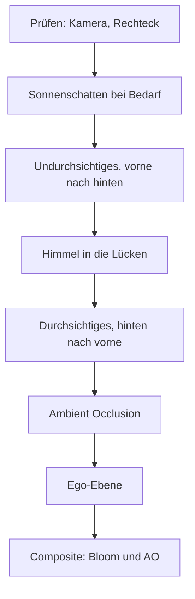

# 4 Grafik – wie Kern Bilder malt

> **Kurz gesagt:** Hier schaust du Kerns Maler über die Schulter: wie der C++-Code im Browser an die
> Grafikkarte kommt, woraus Meshes und Materialien bestehen, was der eine große Standard-Shader in
> jedem Pixel rechnet und in welcher Reihenfolge ein Bild entsteht – mit Sonnenschatten, Himmel,
> Glühen und weichen Eckenschatten. Zum Schluss bringen wir die Fenster einer Nachtstadt zum Leuchten.

Die allgemeinen Grundlagen – wie aus Dreiecken Pixel werden, was Matrizen tun, wie Licht und Farbe
funktionieren – stehen in [Anhang B](B-grundlagen-rendering.md). Kommt dir hier ein Begriff spanisch
vor, blättere ruhig dorthin. In diesem Kapitel geht es darum, was **Kern** daraus macht.

## 4.1 Überblick

Kerns **Renderer** – der Teil, der Bilder erzeugt – ist erstaunlich klein: eine Brücke zu WebGL2,
ein Shader-Baukasten, Meshes und Materialien, der Renderer selbst, vier Zusatz-Malgänge (Schatten,
Himmel, Bloom, Ambient Occlusion) sowie Partikel und Lichter. Drei Grundsätze prägen alles:

1. **Ein Programm für alles.** Jedes Objekt wird mit demselben **Standard-Shader** gemalt (ein Shader
   ist ein kleines Programm auf der Grafikkarte). Spiele, die anders aussehen wollen, stecken kleine
   **Erweiterungen** in diesen einen Shader, statt eigene zu schreiben.
2. **Einmal hochladen, danach nur Bewegung.** Eine Form wandert einmal auf die Grafikkarte, danach
   ändert sich nur, *wo* sie steht. Die Arbeit pro Bild folgt dem, was sich bewegt, nicht der Größe
   der Welt.
3. **Die Kopie im Hauptspeicher ist die Wahrheit.** Kern behält jede Form zusätzlich im
   Arbeitsspeicher. Daraus rechnet er, was sichtbar ist und was du anklickst – und er baut damit alles
   neu auf, wenn der Browser ihm die Grafikkarte wegnimmt (4.11).

> **Stell dir vor …** … ein Theater. Die Kulissen werden einmal auf die Bühne getragen; in jeder
> Vorstellung bewegen sich nur die Schauspieler. Und von jeder Kulisse liegt ein Bauplan in der
> Schublade – brennt die Bühne ab, steht morgen alles wieder genauso da.

## 4.2 Die WebGL2-Anbindung

Kern wird mit wasi-sdk nach **WebAssembly** übersetzt, einem kompakten Format, das der Browser fast so
schnell wie Maschinencode ausführt – ohne Emscripten und ohne automatisch erzeugten
JavaScript-„Klebstoff“. Die Grafikbefehle sind schlichte **Importe**: Das Modul sagt beim Laden „Ich
brauche `drawElementsInstanced` aus dem Paket `kern_gl`“, und die Webseite reicht die Funktion herein.
Die Liste in `gl.h` ist laut Kommentar „genau das, was die Engine benutzt“; ein neuer Befehl kommt dort
und in `web/kern.mjs` dazu.

Über die Grenze zwischen WebAssembly und JavaScript gehen **nur Zahlen**:

- **Grafikobjekte sind Nummern.** JavaScript legt das echte Objekt in eine Tabelle und gibt Kern die
  Platznummer, `0` heißt „nichts“. Wie an der Garderobe: Du bekommst eine Marke, nicht den Mantel.
- **Daten sind „Adresse plus Länge“.** JavaScript schaut durch ein Fenster direkt in Kerns Speicher und
  reicht die Bytes an WebGL weiter, **ohne zu kopieren**. Wächst Kerns Speicher, erneuert `refresh()`
  diese Fenster.

Außerhalb des Browsers, in den nativen Tests, bleiben die Importe leer; dort hängt eine Attrappe
(`tests/gl_stub.cpp`) dran, die die GL-Aufrufe nur mitschreibt.

`web/kern.mjs` tut laut Kopfkommentar genau drei Dinge und enthält **keine Engine-Logik**: das Modul
mit seinen Importen laden (dazu ein winziges WASI für Konsole, Zufall und Uhr – die Engine fasst keine
Dateien an), die Nummern-Tabellen und den Kontextverlust verwalten und `KernRenderer` anbieten, eine
bequeme Fassade für JavaScript. Ein zweites Importpaket, `kern_env`, liefert der Engine unter anderem
die Uhrzeit, die Geländehöhe der Seite, Mauszeiger-Sperre, Statusmeldungen und den Weg, auf dem
in WebAssembly übersetzte Logik-Graphen ins Modul kommen ([Kapitel 9](09-logik.md)).

Den WebGL2-Zugang (den **Kontext**) legt die Webseite an. Die Engine-Seite verzichtet dabei auf die
eingebaute Kantenglättung, weil Kern ohnehin in eigene Zwischenbilder malt (4.7); Kern Studio und
exportierte Spiele erzeugen ihren Kontext selbst und schalten sie ein.

Benutzen lässt sich der Renderer auf zwei Wegen: **C++-Spiele** schreiben eine `kern::App`, in der
jedes Bild erst das Spiel (`update`) und dann das Malen (`render`) läuft – so arbeiten das Beispiel
„hello“ und Orb Run ([Kapitel 12](12-eigene-spiele.md)). **JavaScript-Programme** wie SpawnCity
nehmen `KernRenderer`, genau einen pro Modul. Kern Studio hat eine dritte, eigene Schnittstelle
([Kapitel 11](11-studio.md)); innen arbeitet derselbe Renderer.

## 4.3 Programme und der Uniform-Cache

Ein **Programm** besteht aus Vertex-Shader (rechnet jede Ecke) und Fragment-Shader (rechnet jedes
Pixel). Kern übersetzt beide und meldet Fehler mit einem Namensschild davor, etwa „standard fragment
shader: …“. Fragt er nach einem Einstellwert, den der Übersetzer wegoptimiert hat, bekommt er die
Nummer `0` – und alle Setzbefehle ignorieren `0`. Ein unbenutzter Wert kostet nichts. Beim Wegräumen
unterscheidet Kern zwei Fälle: Lebt die Grafikkarte noch, löscht er das Programm; nach einem
Kontextverlust ist es schon tot, und er vergisst nur die Nummer.

**Uniforms** sind Werte, die für einen ganzen Zeichenaufruf gleich bleiben: Farbe, Rauheit,
Sonnenrichtung. Die Grafikkarte merkt sie sich. Der **Uniform-Cache** nutzt das und schickt nur, was
sich wirklich geändert hat:

```cpp
void UniformCache::set_float(u32 location, f32 v) {
  if (!location) return;
  Entry& e = entry(location);
  if (e.kind == 2 && e.count == 1 && e.f[0] == v) return;
  e.kind = 2; e.count = 1; e.f[0] = v;
  gl::uniform1f(location, v);
}
```

Zeile für Zeile: Nummer 0? Sofort zurück. Merkzettel für diese Nummer holen. Steht dort schon genau
dieser Wert, zurück. Sonst Zettel aktualisieren und erst dann wirklich senden. Große Werte wie Matrizen
vergleicht der Cache über einen **Fingerabdruck** (Hash) statt Zahl für Zahl. Nur die Knochen
animierter Figuren gehen ungecacht durch – die ändern sich ohnehin jedes Bild.

> **Stell dir vor …** … jeder Satz an die Grafikkarte kostet Porto. Sagst du zehnmal „Die Farbe ist
> Blau“, zahlst du zehnmal. Der Cache ist der Kollege, der sagt: „Hast du schon gesagt, steht noch da.“

Das lohnt sich, weil jeder Befehl von WebAssembly über JavaScript in WebGL wandert, das ihn noch einmal
prüft.

## 4.4 Mesh, Material und MeshInput

### Ecken und Instanzen

Ein **Mesh** ist eine Form aus Dreiecken. Jede Ecke (**Vertex**) trägt Position, **Normale** (wohin
die Fläche zeigt), Farbe und **Texturkoordinate** (welcher Bildpunkt hier klebt); Figuren mit Skelett
dazu je vier Knochennummern und Gewichte. Zwei Plätze sind frei für Erweiterungen.

Andere Angaben gelten **pro Instanz**. Eine Instanz ist eine Kopie des Meshes an anderer Stelle – wie
hundert Bäume aus einer Vorlage. Pro Instanz gibt es die Modellmatrix (Ort, Drehung, Größe), einen
Farbton (**Tint**) und die Normalenmatrix (damit Normalen nach dem Strecken stimmen, Anhang B). Der
Clou: **Jedes Mesh ist instanziert**, auch mit nur einer Instanz, und wird mit genau einem
Zeichenaufruf gemalt. Die Normalenmatrix rechnet Kern pro Instanz auf der CPU aus. Kaputte Matrizen
(etwa auf Größe null gestaucht) lehnt Kern ab.

Grenzen, die du kennen solltest: **32 Knochen**, **6 Punktlichter**, **2 Zusatzströme** und **8
Zahlen-Parameter** für Erweiterungen.

### Das Material

| Feld | Was es tut |
|---|---|
| `color` | Grundfarbe mit Deckkraft |
| `alpha` | undurchsichtig, ausgestanzt (Schwelle 0,5) oder durchscheinend |
| `roughness`, `metalness` | rau oder glatt, Metall oder nicht |
| `emissive` | Eigenleuchten, darf über 1 liegen |

Dazu Schalter wie `unlit` (nur Farbe, kein Licht), `double_sided`, `cast_shadow` und `frustum_culled`
(darf weggelassen werden, wenn außer Sicht). Einige verdienen einen zweiten Blick:

- **Farben sind sRGB**, der übliche Farbraum von Bildern und Farbwählern. Kern multipliziert
  Eckenfarbe, Tint, Materialfarbe und Texturpixel und rechnet das in lineares Licht um (warum: Anhang
  B). Mit `linear_colors` entfällt das; `emissive` ist schon linear.
- **Nur Undurchsichtiges wirft Schatten.**
- **`viewmodel`** ist die Ego-Ebene: Diese Meshes kommen ganz zum Schluss, nach dem Löschen der Tiefe.
  Eine Wand vor dir schneidet die Waffe in deiner Hand nicht ab. Studio malt dort seine Gizmos.
- **`lines`** macht Linien daraus – automatisch unbeleuchtet, ohne Schatten, nicht anklickbar.

Rückseiten von Dreiecken verwirft die Grafikkarte normalerweise. Kern lässt sie stehen bei
zweiseitigen Materialien, Linien und gemischt gespiegelten Instanzen; sind *alle* Instanzen gespiegelt,
verwirft er stattdessen die Vorderseiten.

> **Wusstest du?** Ein gespiegeltes Objekt ist für die Grafikkarte „von innen nach außen gestülpt“,
> weil sich der Umlaufsinn der Ecken umdreht. Gespiegelte und normale Kopien in einem einzigen
> Zeichenaufruf lassen sich deshalb nicht korrekt behandeln – Kern zeigt dann einfach beide Seiten.

### Anlegen mit `upsert`

Neue Meshes übergibst du als **MeshInput**. Pflicht sind nur die Positionen; fehlen Normalen, rechnet
Kern bei losen Dreiecken flache aus (sonst zeigen sie nach oben), fehlen Farben, ist alles weiß, fehlen Instanzen, gibt es eine. `upsert` (aus *update*
und *insert*) legt ein Mesh an oder ersetzt es – **atomar**: erst alles prüfen (endliche Zahlen,
gültige Indizes, passende Längen, Knochengewichte mit Summe 1, keine kaputten Matrizen), dann tauschen.
Schlägt die Prüfung fehl, bleibt **das alte Mesh sichtbar**. Für einen Editor ist das Gold wert: Ein
halbfertiger Zwischenstand löscht nichts. Die Mesh-Nummern vergibt der Renderer selbst, damit sich nie
zwei Besitzer einen Platz teilen.

Beim Hochladen legt Kern feste Puffer für die Eckendaten an, drei veränderliche für die Instanzen und
einen für die Eckennummern. Bei **höchstens 65 536 Ecken** speichert er diese Nummern mit 16 statt 32
Bit – halber Platz im häufigsten Fall. Unbewegte Weltobjekte ab 36 Dreiecken (genau eine Instanz,
nicht verschoben, gedreht oder gestreckt, ohne Skelett, keine Linien) bekommen zusätzlich eine **BVH**, ein Inhaltsverzeichnis für
schnelle Mausklicks ([Kapitel 5](05-szene-und-geometrie.md)). `remove` gibt ein Mesh und seine Nummer
wieder frei.

### Bewegen mit `update_instances`

Alles Bewegte geht über `update_instances`, sparsam bis ins Mark: Neue Farbtöne allein laden nur den
Farbton-Puffer hoch. Byte-gleiche Daten bewirken **gar nichts**. Reicht der Platz nicht, wird der
Puffer mindestens verdoppelt, damit schwankende Instanzzahlen nicht ständig neuen Speicher brauchen.
Fehlen passende Farbtöne (nicht genau vier Zahlen pro Instanz), sind alle Instanzen weiß. Weitere
Stellschrauben: Knochen neu setzen (gleiche Knochenzahl wie beim Anlegen), Sichtbarkeit, Material
(aus Linien werden dabei keine Dreiecke und umgekehrt) und Ebenen. Was einen Schattenwerfer betrifft,
merkt sich Kern für die Schattenkarte (4.8.1).

Jedes Mesh hat außerdem eine **Ebenenmaske**, deren Bits wie Lichtschalter wirken. Pro Bild bestimmt
die Maske, was gemalt wird und was Schatten wirft; beim Anklicken filtert sie genauso. Studio trennt so
etwa Raster, Icons, Gizmos pro Viewport, Collider-Darstellung und die Welten mehrerer Netzwerkspieler.

**Texturen** (aufgeklebte Bilder) legt Kern selbst an – mit Optionen für Mipmaps (verkleinerte
Vorstufen für die Ferne), Wiederholen und pixeligen Look – und behält ihre Pixel als Kopie. Oder die
Webseite meldet eine eigene Textur an und hinterlegt, wie sie nach einem Kontextverlust neu gefüllt
wird. Jedes Mesh hat höchstens eine Farbtextur (Einheit 0; die Schattenkarte liegt auf Einheit 1).

> **Probier's aus!** Öffne https://kernengine.de/, lege mit **File › New Level…** die Vorlage
> **Basic** an und zieh aus dem Content Drawer (Gruppe *Shapes*) einen **Cube** hinein. Spiele in
> **Details** unter *Material* mit **Roughness**, **Metallic** und **Emissive**. Schalte dann **Unlit**
> ein – schon ist der Würfel ein flacher Farbklecks ohne Licht und Schatten.

## 4.5 Der Standard-Shader

Kern setzt seinen einen Shader beim Start aus festen Bausteinen zusammen und fügt an verabredeten
Stellen die Schnipsel der Erweiterungen ein. Heraus kommt genau **ein** Programm.

Der **Vertex-Shader** baut pro Ecke die Modellmatrix aus den Instanzdaten, wendet bei Figuren das
Skelett an und rechnet Weltposition, Normale und Bildschirmposition. Das **Skinning** (Haut folgt
Knochen) ist das klassische „Linear Blend Skinning“: Jede Ecke folgt bis zu vier Knochen nach Gewicht.

> **Stell dir vor …** … eine Ecke an deinem Ellbogen hängt zu 60 % am Oberarm und zu 40 % am
> Unterarm. Beugst du den Arm, landet sie dazwischen – die Haut knickt nicht, sie biegt sich weich.

Der **Fragment-Shader** rechnet pro Pixel und schreibt **drei Bilder gleichzeitig**: `outColor`, das
fertige Bild, wie du es siehst; `outHdr`, die echte Lichtmenge vor dem Tonemapping (für das Glühen);
und `outAo`, einen Datensatz für die Ambient Occlusion. Dazwischen: Textur lesen, Deckkraft
ausrechnen (Instanz-Deckkraft mal Material mal Texel), bei ausgestanzten Materialien alles unter der
Schwelle wegwerfen, Farbe linearisieren, beleuchten, tonemappen, Nebel.

### Licht und Material

Das Modell lehnt sich an das Standardmaterial von three.js an – ein vereinfachtes **PBR**
(physikalisch basiertes Rendern, Anhang B). Das Licht eines Pixels hat mehrere Zutaten:

| Zutat | Alltagsbild |
|---|---|
| Sonne, mit Schatten | Taschenlampe in sehr weiter Ferne |
| Hemisphärenlicht | blauer Himmel oben, brauner Acker unten |
| Himmels-Irradianz | Licht einer bunten Kuppel |
| bis zu 6 Punktlichter | Glühbirnen mit Reichweite |
| Glanz und Spiegelung | Lichtpunkt auf einem Apfel |
| Eigenleuchten | Neonröhre |

**Sonne:** Je direkter sie auf eine Fläche scheint, desto heller (Lambert, Anhang B), mal dem
Schattenfaktor (1 = beleuchtet, 0 = Schatten). **Hemisphärenlicht:** Nach oben zeigende Flächen
bekommen Himmelsfarbe, nach unten zeigende Bodenfarbe (Z ist oben). **Punktlichter** fallen bis zur
Reichweite **weich auf null** ab.

Himmels- und Bodenlicht führt Kern in einer eigenen Variable `indirect` mit. Warum? Die Ambient
Occlusion soll später **nur dieses** Licht abdunkeln; Sonne und Lampen haben ihre eigenen Schatten.
Metalle haben übrigens kein diffuses Licht – ihre Farbe steckt ganz im Glanz.

**Glanz** gibt es nur bei Metall oder Rauheit unter 0,95: eine Himmelsspiegelung und ein
Sonnen-Glanzpunkt. Darin stecken **Fresnel** nach Schlick (bei flachem Blick spiegelt alles stärker –
denk an einen See) und die **GGX-Verteilung** (Größe und Schärfe des Glanzpunkts). Nichtmetalle
spiegeln senkrecht nur 4 %, Metalle in ihrer Grundfarbe.

> **Wusstest du?** Sehr glatte Flächen können rechnerisch absurd helle Glanzpunkte erzeugen – einzelne
> Pixel, die im Bloom als flackernde Sterne aufblitzen. Kern deckelt den GGX-Wert deshalb bei 40.

**Glas:** Erklärt eine Erweiterung eine Fläche zu Glas (`surfaceGlass`), spiegelt sie den Himmel,
stärker bei flachem Blick. So wirken Scheiben hell statt schwarz. **Eigenleuchten** (`emissive`) kommt
zuletzt dazu, linear und **ohne Obergrenze** – Werte über 1 werden später zum Glühen.

### Vom Licht zum Pixel – und Nebel

Kerns Lichtwerte liegen oft über 1 (die Sonne um 2,8), ein Bildschirm kann nur 0 bis 1. Also: echtes
Licht in `outHdr` sichern, dann mit der **ACES-Filmkurve** (Fassung von three.js, inklusive Belichtung)
sanft in 0 bis 1 pressen – wie ein Fotofilm, der Helles weich abrundet. Optional folgt Kerns
**Farbgrading**: Sättigung ×1,14, sanfte S-Kurve, wärmere Lichter, kühlere Schatten (abschaltbar
über die Renderer- und die Bloom-Einstellungen). Dann sRGB.

Der **Nebel** kommt wie bei three.js **nach** der sRGB-Umwandlung, als „FogExp2“. Mit der
Standarddichte 0,00085 ist er nach 100 m kaum da (0,7 %), nach 1000 m schon gut zur Hälfte (51 %).
Drei Extras machen ihn lebendig: **Höhenabfall** (Dunst am Boden, klar über den Dächern),
**Sonnenstreuung** (in Sonnenrichtung leuchtet er sonnenfarben) und **Horizontnebel** (4.8.2). Sind
alle aus, sieht er aus wie in three.js.

Der **AO-Datensatz** schließlich enthält pro Pixel, welcher Anteil des Lichts indirekt ist (pro
Farbkanal, schon um den Nebel verringert), und die Helligkeit der Grundfarbe. Durchsichtiges und die
Ego-Ebene gelten als unverdeckt.

## 4.6 Shader-Erweiterungen

Dein Spiel braucht leuchtende Fenster oder eine Kraftfeld-Kuppel? Dann schreibst du eine
**ShaderExtension**: GLSL-Schnipsel (GLSL ist die Shader-Sprache) für feste Einfügestellen. Die Engine
bleibt unverändert.

> **Stell dir vor …** … ein fertiges Malen-nach-Zahlen-Bild mit sechs Feldern „Hier darfst du
> ergänzen“. Deine Erweiterung füllt genau diese Felder – sie kann das Bild verschönern, aber den Rest
> nicht kaputtmachen.

| Stelle | Was du dort darfst |
|---|---|
| `vertex_declarations` | eigene Werte im Vertex-Shader anmelden |
| `vertex` | Farbe, Deckkraft, UV einer Ecke ändern |
| `fragment_declarations` | eigene Werte und Funktionen anmelden |
| `fragment_discard` | Pixel früh wegwerfen |
| `fragment_input` | Farben als linear behandeln |
| `fragment_surface` | Grundfarbe, Glas, Leuchten vor dem Licht ändern |

Das Spiel reicht seine Erweiterungen beim Start des Renderers herein (in einer `App` über
`App::extensions()`). Jeder Schnipsel bekommt eine Kommentarzeile mit dem Namen der Erweiterung, damit
Übersetzerfehler sofort den Schuldigen zeigen. Außerdem kann eine Erweiterung:

- **eigene Ecken-Daten** mitbringen: höchstens zwei Ströme insgesamt (Plätze 14 und 15), je 1–4
  Zahlen. C++ liefert sie im `MeshInput`, JavaScript als benanntes Feld in `KernRenderer.upsert`.
  Fehlt der Strom, liest der Shader (0, 0, 0, 1);
- **ganzzahlige Materialparameter** benennen (höchstens 8) und daraus pro Zeichenaufruf eigene
  Uniforms setzen;
- **eigene Uniforms** einmal pro Bild setzen – am besten über den Uniform-Cache, dann spart sie mit.
  Ihre Nummern sucht sie nach jedem Bauen des Programms, auch nach einem Kontextverlust.

Ein Beispiel folgt in 4.13.

## 4.7 Der Ablauf eines Frames

Ein **Frame** ist ein Bild – ein Blatt im Daumenkino. Bei 60 Bildern pro Sekunde hat Kern gut 16
Millisekunden dafür:



Zuerst **prüft** Kern Kamera und Bildrechteck, bevor er die Grafikkarte anfasst. Wenn der Browser es
kann, misst eine **Stoppuhr** die GPU-Zeit; das Ergebnis kommt erst einige Bilder später (bis dahin
meldet die Statistik −1). Die **Schattenkarte** wird nur bei Bedarf neu gemalt.

Dann wählt Kern das **Ziel**: normalerweise ein eigenes Szenen-Ziel, sofern Bloom an und vom Gerät
unterstützt ist, sonst direkt den Bildschirm. Malt er nur in einen Teil des Fensters, etwa einen von vier Viewports, geht es direkt auf den Bildschirm – dann **ohne Bloom und ohne
Ambient Occlusion**.

Beim **Einsortieren** fliegt Unsichtbares raus, ebenso alles außerhalb der Sichtpyramide – außer
Figuren mit Skelett, deren Pose aus ihrer Ruhehülle ragen kann. Undurchsichtiges wird **von vorne nach
hinten** gemalt: Nahe Flächen füllen den Tiefenpuffer, alles dahinter scheitert am Tiefentest, bevor
der teure Shader läuft. Durchsichtiges **von hinten nach vorne**, wie Folien auf einem
Overheadprojektor. Kamera und Licht setzt Kern einmal pro Bild; pro Mesh gibt es einen Zeichenaufruf,
und Texturen oder Rückseiten-Einstellungen werden nur bei einem Wechsel umgeschaltet.

Danach folgen Himmel, Durchsichtiges, Ambient Occlusion (vor der Ego-Ebene, denn deren Tiefen-Löschen
würde die Welttiefe vernichten), Ego-Ebene, **Composite** und eine **Statistik** mit Zeichenaufrufen,
Dreiecken, Instanzen und Zeiten.

Das Szenen-Ziel hat drei Farbschichten: fertiges Bild (4 Byte pro Pixel), echtes Licht als
16-Bit-Kommazahlen (8 Byte) und AO-Datensatz (4 Byte). Zusammen **16 Byte** – laut Code-Kommentar
genau das Budget, das kachelbasierte Handy-Grafikchips pro Pixel in ihrem schnellen Speicher halten.
Deshalb ist der AO-Datensatz bewusst nur 8 Bit pro Kanal.

> **Achtung, Falle!** WebGL verlangt, dass jeder Zeichenaufruf in **alle** angeschlossenen
> Farbschichten schreibt. Deshalb liefert sogar der Himmel einen leeren AO-Datensatz. Wer eigene
> Malgänge baut und das vergisst, bekommt Fehler.


Stellst du in Kern Studio über **Window › Viewport Layout** vier Viewports ein, glühen die Lichter
deshalb nicht mehr, und Ecken wirken flacher. Mit einem Viewport sind Glühen und weiche Eckenschatten
wieder da.

## 4.8 Die Passes im Detail

Ein **Pass** ist ein eigener Malgang mit eigenem Shader. Kern hat vier.

### 4.8.1 Sonnenschatten

Kern malt die Szene einmal **aus Sicht der Sonne** und merkt sich pro Kartenpunkt nur die Entfernung
zum nächsten Objekt – die **Schattenkarte** (Grundprinzip in [Anhang B](B-grundlagen-rendering.md)).
Standard: 512 × 512 Punkte über ±120 m, ein kleiner Sicherheitsabstand (Bias 0,0012) und ein Filter
mit 1, 4 oder 9 Abtastungen. Erlaubt sind 128 bis 4096 Punkte (Zweierpotenzen), ±10 bis ±2000 m und
ein Bias unter 0,04. Studio nimmt auf Telefonen 4 Abtastungen, am Desktop 9; `?shadowFilter=1`, `4`
oder `9` in der Adresse überschreibt das.

**Schattendistanz.** 512 Punkte über 240 m – fast ein halber Meter pro Punkt! Für eine Ente viel zu
grob. Mit der **Schattendistanz** deckt die Karte nur ab, was du bis zu dieser Entfernung siehst. In
Levels: **World Settings › Shadow distance** (Standard 80 m, im Micro-Duck-Level 10 m). Genauer
umschließt die Karte eine **Kugel** um den sichtbaren Kegel der Kamera (nach Valient, 2008). Eine Kugel
bleibt gleich groß, wie auch immer du dich drehst – also auch die Kartenpunkte. Ohne Schattendistanz
(im Renderer Standard 0) oder bei orthografischer Kamera gilt das feste Quadrat um das Kameraziel.

**Einrasten.** Wandert die Karte um Bruchteile eines Punkts mit, fallen Schattenkanten jedes Mal anders
aufs Raster und flimmern. Kern rundet ihre Position auf **ganze Kartenpunkte**.

> **Stell dir vor …** … du malst eine schräge Linie auf Fliesen. Verschiebst du das Fliesenmuster ein
> bisschen, sieht die Treppchenkante jedes Mal anders aus. Verschiebst du nur um ganze Fliesen, bleiben
> die Treppchen dieselben – und fallen kaum auf.

**Wiederverwenden.** Aus Kartenposition, Sonnenrichtung, Ausdehnung, einer Zählnummer für
Schattenwerfer (sie steigt, wenn einer erscheint, verschwindet, sich bewegt oder das Material wechselt)
und den aktiven Ebenen bildet Kern einen Schlüssel. Nur wenn er sich ändert, wird neu gemalt. Über einer
unbewegten Stadt kostet der Schatten bei stehender Kamera **keinen einzigen Zeichenaufruf**.

**Malen und abtasten.** Gemalt wird nur Tiefe – nur Schattenwerfer der aktiven Ebenen, die in der
Sichtpyramide der Sonne liegen –, mit einem schlanken Shader und einem kleinen Polygon-Offset gegen
**Schattenakne** (Streifen, mit denen sich eine Fläche selbst beschattet). Beim Nachschlagen kann die Grafikkarte Tiefen direkt vergleichen und vier Nachbarn mischen – Stufe 1. Die
Stufen 4 und 9 setzen daraus einen größeren, weichen Filter zusammen (nach Castaño, 2013, aus dem Spiel
„The Witness“): Jede Abtastung sitzt so geschickt **zwischen** den Punkten, dass die eingebaute Mischung
genau die richtigen Gewichte liefert. Dazu kommt der **Normal Offset** (nach Holbert, 2011): Kern schaut
ein Stückchen von der Fläche weg nach, entlang der Normale, mehr bei streifendem Licht. Das verhindert
Akne, ohne dass ein großer Bias den Schatten vom Objekt löst.

Außerhalb der Karte gilt alles als beleuchtet; Flächen, die von der Sonne wegzeigen, schauen gar nicht
nach. Mit Schattendistanz blendet der Schatten über das letzte Zehntel sanft aus.

**Faustregel:** Ausdehnung und Auflösung bestimmen zusammen die Punktgröße. Orb Run nutzt 2048 Punkte
auf ±110 m, also 220 m / 2048 ≈ **gut 10 cm pro Punkt**; „hello“ 1024 Punkte auf ±40 m. Studio legt die
Karte mit 2048 Punkten an und nutzt in Levels die Schattendistanz.

> **Probier's aus!** Lade **File › Example Levels › Micro Duck** und stelle in **World Settings** die
> **Shadow distance** von 10 auf 200 m: Die Schatten von Ente und Ball werden matschig. Zurück auf 10 –
> gestochen scharf. Kleiner heißt schärfer, reicht aber weniger weit.

### 4.8.2 Himmel

Der Himmel ist ein einziges bildschirmfüllendes Dreieck **ganz hinten**. Kern malt es *nach* dem
Undurchsichtigen, mit Tiefentest – nur Pixel, auf denen noch nichts liegt, bestehen. Der aufwendige
Himmelsshader läuft also nur dort, wo wirklich Himmel zu sehen ist.

Pro Pixel mischt er: einen **Verlauf** von Horizont- zu Zenitfarbe (nachts dunkelblau), die **goldene
Stunde** (je tiefer die Sonne, desto oranger der Horizont und violetter der Zenit), eine **Sonne** mit
weichem Hof und scharfer Scheibe, nachts **Mond und funkelnde Sterne**, **Wolken** aus fünf
übereinandergelegten Rauschmustern (vom Wind verschoben, von Explosionen wie von einer Schockwelle
weggedrückt) und auf Wunsch **Horizontnebel**, in dem sich der Horizont in die Nebelfarbe der Szene
auflöst – je dünner der Nebel der Szene, desto dünner auch dieser Dunst. Sinkt die Sonne ein Stück unter den
Horizont, verschwinden Scheibe und Hof; unterhalb des Horizonts geht der Himmel in die Horizontfarbe
über. Orthografische Kameras haben keinen Himmel; dort bleibt die Löschfarbe stehen, die Grundfarbe, mit der
jedes Bild beginnt.

### 4.8.3 Bloom und Composite

**Bloom** ist das Glühen um sehr helle Stellen. Es braucht Zwischenbilder mit Kommazahlen; kann das
Gerät das nicht, meldet Kern „unsupported“ und malt direkt. Ablauf: **Helles ausschneiden** (auf einem
Viertel der Größe, weicher Übergang ab etwa 0,88), **weichzeichnen** – waagerecht, dann senkrecht, neun
Gewichte mit nur fünf Lesezugriffen (Trick in Anhang B) –, **noch einmal** auf einem Achtel der Größe
für den breiten Schein, dann **Composite**.

Der Composite ist schlauer, als er aussieht: Er nimmt das fertige Bild und addiert nur den
**Unterschied** zwischen „Licht mit Glühen und AO, durch die Filmkurve“ und „Licht ohne, durch dieselbe
Kurve“. Warum so umständlich? Das fertige Bild enthält schon den Nebel, der in der Lichtkopie fehlt.
Neu entwickeln hieße: Nebel weg. Pixel ohne Glühen und Verdeckung kopiert er einfach.

> **Stell dir vor …** … ein fertig gerahmtes Foto. Statt es neu zu entwickeln, legst du eine dünne
> Folie mit dem Glühen darüber. Der Rahmen – der Nebel – bleibt, wie er ist.

**Der Wächter.** Liegt die gemittelte Bildzeit länger als 3,5 Sekunden über 27 Millisekunden (also
unter etwa 37 Bildern pro Sekunde), schaltet sich das Glühen für die Sitzung ab, außer es ist erzwungen.
Der Composite läuft weiter, denn er bringt auch die AO ins Bild. Ist die Seite verborgen, setzt Kern
den Wächter zurück – sonst würden gedrosselte Hintergrundbilder das Glühen abschalten.

### 4.8.4 Ambient Occlusion (GTAO)

**Ambient Occlusion** (Umgebungsverdeckung, AO) sind die weichen Schatten in Ecken, Ritzen und unter
Dingen, wo weniger Himmelslicht hinkommt. Kern nutzt **GTAO** (nach Jimenez und Kollegen, 2016) in der
Form von Intels XeGTAO; das Verfahren erklärt Anhang B. Kerns Besonderheit: **kein zusätzlicher
Malgang** für die Geometrie.

1. Beim normalen Malen schreibt der Shader nebenbei den indirekten Lichtanteil auf (4.5).
2. GTAO rechnet aus der fertigen Tiefe, wie stark jeder Punkt verdeckt ist.
3. Der Composite dunkelt **genau den indirekten Anteil** ab. Sonne und Lampen bleiben unberührt.

So sitzt die AO physikalisch an der richtigen Stelle. Einen Vor-Malgang spart Kern sich auch, weil
Apple- und Mali-Grafikchips verdeckte Pixel ohnehin in der Hardware verwerfen.

Vereinfacht macht der Hauptpass dies: Er rechnet aus dem Tiefenwert die Position zurück, gewinnt die
Normale ebenfalls aus der Tiefe (pro Richtung zählt der Nachbar mit dem kleineren Tiefensprung), rechnet
den **Radius** (Standard 1,6 m) in Pixel um und sucht in einigen Richtungen links und rechts den
**höchsten Horizont**. Die Richtungen drehen sich nach einem 4×4-Muster, das ein kantenbewusster Filter
wieder wegmittelt. Beim Einrechnen hilft der **Multi-Bounce**: Helle Flächen bekommen Licht zurück, das
zwischen den Wänden hin- und herspringt – eine weiße Zimmerecke wird weniger dunkel als eine schwarze.

**Qualität** (Richtungen × Schritte pro Seite): low 1 × 2, medium 2 × 2, high 3 × 3, ultra 9 × 3.
Standard ist medium in halber Auflösung; ein Wächter senkt auf langsamen Geräten erst die Qualität und
schaltet dann auf halbe Auflösung. Studio und exportierte Spiele nehmen auf Telefonen medium/halb,
sonst high/voll; `?ao=off|low|medium|high|ultra` und `?aoRes=half|full` überschreiben das. Eine
Stärke (`power`, Standard 2,2) macht die Verdeckung kräftiger. Der Radius gehört zur Szene, nicht zum
Gerät: Levels setzen ihn in den World Settings, 0 schaltet AO für diese Szene ab. AO läuft nur
mit Szenen-Ziel (nicht in Teil-Viewports, nicht ohne Bloom-Unterstützung) und perspektivischer Kamera.

> **Probier's aus!** Stelle in **World Settings** den **Ambient occlusion radius** auf 0: Ecken und
> Fugen wirken flach, Objekte schweben. Dann 1,6 (Standard) und probeweise 4 – siehst du, wie die Dinge
> am Boden „festwachsen“?

## 4.9 Partikel und Punktlichter

Funken, Rauch, Mündungsfeuer: Kerns **Partikel** sind kleine Quadrate, die sich zur Kamera drehen –
alle zusammen **ein** instanziertes, durchsichtiges Mesh, rein optisch, ohne Physik. Jedes hat
eine Farbe, eine Lebensdauer (16 bis 10 000 ms, Standard 350), eine Größe (Standard 35 cm), auf Wunsch
Schwerkraft, Wachsen und schnelleres Verblassen. Ein System fasst 1 bis 4096 Partikel; ist es voll, wird
ein neues abgelehnt und gezählt. Jedes Bild bewegt Kern sie (Startpunkt plus Geschwindigkeit mal Zeit,
minus Fallen), sortiert sie **von hinten nach vorne** und blendet sie über die Lebenszeit aus. Das
Partikel-Mesh ist unbeleuchtet, zweiseitig, wirft keinen Schatten, wird nie weggecullt und ist
unsichtbar, solange kein Partikel lebt. Die Spiel-Laufzeit nutzt 512 Partikel; JavaScript erreicht
dieselbe Klasse über `kern_fx_*`.

> **Achtung, Falle!** Die Partikel-Uhr läuft nie rückwärts. Das ist Absicht: Sonst tauchten längst
> verblasste Funken nach einer Pause wieder auf wie Gespenster.

Der Shader kennt nur sechs Punktlichter. Hat ein Spiel zwanzig Lampen, wählt der **LightPool** jedes
Bild die sechs wichtigsten: Helligkeit geteilt durch (1 + Entfernung / Reichweite), wobei die
Reichweite mindestens als 4 m zählt; bei Gleichstand gewinnt, wer zuerst fragte. Helligkeit über 100
und Reichweite über 1000 m kappt er. Beispiel: Lampe A, Helligkeit 10, Reichweite 10 m, 30 m entfernt: 10 / (1 + 3) = 2,5. Lampe B, Helligkeit 4, gleiche
Reichweite, 5 m entfernt: 4 / 1,5 ≈ 2,7 – die schwächere, aber nähere gewinnt. Orb Run meldet so einen
Scheinwerfer vor dem Auto und ein Licht pro Orb an.

## 4.10 Einstellungen

Die vollständigen Listen stehen im blauen Buch und in [Kapitel 17](17-referenz.md); hier das Wichtigste.
Grundeinstellungen sind Bildgröße (Standard 960 × 540), Sonnenschatten (Standard aus), Bloom, AO und
Farbgrading (an). Schatten, Schattendistanz, Filter, AO, AO-Radius und Punktlichter lassen sich zur
Laufzeit ändern; `invalidate` erzwingt ein Neumalen, auf Wunsch samt Schattenkarte.

Jedem Bild gibst du **RenderParams** mit: die Löschfarbe (dunkles Blau, sichtbar, wo kein Himmel ist),
optional ein Teilrechteck (dann ohne Bloom und AO), ob die Seite verborgen ist (setzt die Wächter
aus), die Ebenenmaske und ob der Himmel gemalt wird.

Alle Lichtfarben stehen linear und schon mal Stärke im Renderer; die Vorgaben heißen im Code
„production day“: Sonne schräg von oben aus Richtung (−0,45; −0,52; 0,72), Sonnenfarbe (2,8; 2,47;
2,11), Nebeldichte 0,00085, Belichtung 1, Umgebungsstärke 0,9. Den Himmel steuern Sonnen- und
Mondrichtung, Nacht (0 bis 1), Wolken, Wind und Explosionen. In Levels musst du nichts davon von Hand
setzen: Die Spiel-Laufzeit rechnet alles aus der **Tageszeit**, mit Sonne zu Himmelslicht etwa 5 : 1,
dem Hemisphärenlicht nur noch als Nachtaufhellung, einer Bodenfarbe der Umgebungskuppel aus dem Licht,
das eine Straße zurückwirft, und eingeschaltetem Höhennebel, Sonnenstreuung und Horizontnebel
([Kapitel 8](08-spiel-laufzeit.md)).

Die **Kamera** hat Augpunkt, Ziel, Oben-Richtung (Z), 60° Öffnung (die Editor-Viewports in Studio nehmen 70°), nahe
Ebene 0,05 m und ferne 1800 m, wahlweise orthografisch. Die Welt ist **Z-oben, in Metern**.

## 4.11 Kontextverlust

Ein Browser darf dir die Grafikkarte jederzeit wegnehmen – bei Speichermangel, Treiber-Neustart oder
auf dem Handy im Hintergrund. Viele Webseiten zeigen dann nur noch Schwarz. Kern nicht:

1. **Verlust:** Die Seite sagt dem Browser „Ich will das zurück!“ (sonst gäbe es keine
   Wiederherstellung). Kern vergisst alle Grafiknummern; `render()` lehnt höflich ab mit „GL context
   lost; waiting for restoration“. Meshes und Texturen bleiben als Kopie, `upsert` geht weiter.
2. **Wiederherstellung:** Erst füllt die Seite ihre eigenen Texturen, dann baut Kern Programme, Passes
   und Erweiterungen neu und lädt alles aus den Kopien hoch.
3. **Gescheitert?** Kern räumt auf und kann es später sauber erneut versuchen.

Derselbe Mechanismus erlaubt den **Headless-Modus** ganz ohne Grafikkarte, etwa im Lehrer
([Kapitel 14](14-lehrer.md)).

> **Wusstest du?** Genau dafür hält Kern die Kopie im Hauptspeicher (Grundsatz 3). Was nach
> verschwendetem Speicher aussieht, ist eine Versicherung.

## 4.12 Performance-Hinweise

- **Instanzieren statt kopieren:** Die Stadt der Laufzeit malt alle Baumstämme als ein Mesh, alle
  Kronen als ein zweites.
- **Statisches zusammenfassen:** Gebäude- und Straßenbauer packen viele kleine Teile in wenige große
  Meshes – weniger Zeichenaufrufe, weniger Sortierarbeit.
- **Nur hochladen, was sich ändert;** gleiche Daten kosten nichts, reine Farbwechsel wenig.
- **Schatten schonen:** Jede Bewegung eines Schattenwerfers malt die ganze Karte neu. Was keinen
  sichtbaren Schatten braucht, bekommt `cast_shadow = false` – Orb Run tut das für Straßen und Boden.
  Mit Schattendistanz wird außerdem neu gemalt, sobald sich die Kamera um einen Kartenpunkt bewegt.
- **16-Bit-Indizes** kommen automatisch; `weld` ([Kapitel 5](05-szene-und-geometrie.md)) macht aus losen
  Dreiecken sparsame indizierte Meshes.
- **Frustum-Culling anlassen:** Abschalten (`frustum_culled = false`) nur für Dinge, deren Hülle nicht
  stimmt, etwa Partikel.
- **Messen statt raten:** Die Statistik zeigt Zeichenaufrufe, Schatten-Wiederverwendung, Dreiecke und
  Zeiten; in JavaScript gibt `KernRenderer.render()` sie als Objekt zurück. AO und Bloom passen sich
  ohnehin selbst an.

## 4.13 Beispiel: Fenster, die nachts leuchten (Orb Run)

In Orb Run leuchten nachts die Fenster der Stadt – aber die Gebäude **haben gar keine Fenster**. Es
sind glatte Kästen! Die Fenster malt erst der Shader, mit einer Erweiterung namens `NightWindows`.

Der Gebäudebauer ([Kapitel 5](05-szene-und-geometrie.md)) gibt jeder Ecke einen **Wand-Datensatz** mit
vier Zahlen mit: Wandlänge (−1 fürs Dach, −2 fürs Gesims), Wandhöhe, einen Zufalls-Seed pro Gebäude und
die Stockwerkshöhe. Die Texturkoordinaten sind Meter entlang der Wand (u) und über dem Boden (v). Über
jede Wand legt der Shader ein unsichtbares Raster aus 3 m breiten Spalten und Stockwerkszeilen. Ein
Ausschnitt aus `fragment_surface`:

```glsl
float column = floor(u / 3.0), floorIndex = floor(z / storey);
vec2 cell = vec2(fract(u / 3.0), fract(z / storey));
base = mix(base, vec3(0.05, 0.06, 0.08), win * 0.85);
surfaceGlass = max(surfaceGlass, win * (1.0 - lit * uNight) * 0.7);
```

- Zeile 1: In welcher Spalte, welchem Stockwerk bin ich? (`floor` rundet ab.)
- Zeile 2: Wo in der Zelle, von 0 bis 1? (`fract` nimmt die Nachkommastellen.) Liegt der Punkt im
  Mittelteil, ist hier Fenster (`win`).
- Zeile 3: Fensterflächen werden fast schwarz.
- Zeile 4: Unbeleuchtete Fenster werden Glas und spiegeln den Himmel – tagsüber alle, nachts nur die
  dunklen.

Der Rest in Worten: Der Schnipsel wirkt nur auf ungefähr senkrechten Wänden, ab dem ersten Stock bis
1 m unter der Dachkante. Ob ein Fenster leuchtet, entscheidet ein **Hash** aus Spalte, Stockwerk und
Seed – etwa **58 %** sind an. Beleuchtete Fenster bekommen warmes `emissive` mal `uNight` und glühen
dank Bloom. In der Ferne würde das Raster feiner als ein Pixel und wild flimmern (**Aliasing**);
`fwidth` misst das, und Kern ersetzt die Fenster dann durch ein mittleres Glühen der Fassade. Den
Wand-Datensatz reicht der Vertex-Shader **`flat`** weiter, also ohne Interpolation: Er ist pro Wand
konstant, und winzige Rundungsfehler würden den Hash verwürfeln – Fenster flackerten an und aus. Das
Uniform `uNight` setzt die Erweiterung einmal pro Bild über den Cache, aus dem Tag-Nacht-Zyklus.

> **Stell dir vor …** … ein Würfel, der für dasselbe Fenster **immer dieselbe Zahl** würfelt. Genau
> das ist der Hash: Fenster 7 im 12. Stock ist jede Nacht hell, und niemand musste es sich merken.

Eingebunden wird die Erweiterung über `App::extensions()`. Gebäude-Chunks bekommen den Wand-Strom in
Platz 0, Straßen und Bodenplatten keinen – dort liest der Shader Wandlänge 0, und der Schnipsel tut
nichts. Die Spiel-Laufzeit hat eine Klasse `kern::game::NightWindows` mit identischem Shader-Code, die
Studio und exportierte Spiele immer anmelden; ob eine **Procedural City** den Strom liefert, entscheidet
ihr Schalter **Lit windows at night**.

> **Probier's aus!** Lade **File › Example Levels › Orb Run** und tippe unten in die Konsole (**Cmd**)
> erst `tod 0.75` – die goldene Stunde färbt den Himmel – und dann `tod 0.95` für die Nacht. Dunkle
> Glasfenster, warm leuchtende Fenster, in der Ferne ein weicher Schimmer. Wähle die Stadt aus
> und schalte in **Details** **Lit windows at night** aus – dann bekommen ihre Gebäude keine
> leuchtenden Fenster mehr.

## Das nimmst du mit

- Kern malt **alles mit einem Standard-Shader**; Spiele erweitern ihn über sechs Einfügestellen.
- Formen werden **einmal hochgeladen**, danach ändern sich nur Instanzen; gleiche Daten kosten nichts.
- Der Uniform-Cache spart jeden Aufruf, der nichts Neues sagt.
- Jedes Pixel landet in **drei Bildern**: fertiges Bild, echtes Licht, AO-Datensatz.
- Die Schattenkarte deckt eine **Kugel** um die Sicht ab, rastet ein und wird nur bei Bedarf neu gemalt.
- AO dunkelt **nur indirektes Licht** ab und braucht keinen zweiten Geometrie-Malgang.
- Kern übersteht einen **Kontextverlust** dank der Kopien im Speicher.
- Teil-Viewports haben weder Bloom noch AO.

## Knobelecke

1. Warum sortiert Kern Undurchsichtiges von vorne nach hinten, Durchsichtiges aber andersherum?
2. Ein Spiel bewegt jedes Bild einen kleinen Ball, der Schatten wirft. Was kostet das, wie spart man?
3. Warum ist die Schattenkarte mit Schattendistanz eine Kugel und kein genau passender Kasten?
4. In der Vier-Viewport-Ansicht glüht nichts. Ist dein Gerät zu langsam?
5. Warum wird der Wand-Datensatz der Nachtfenster `flat` weitergereicht?

### Lösungen

1. Verdecktes scheitert so früh am Tiefentest und spart Shaderzeit. Bei Durchsichtigem zählt die
   Reihenfolge der Schichten – also hinten zuerst.
2. Jede Bewegung malt die ganze Schattenkarte neu. Braucht der Ball keinen sichtbaren Schatten:
   `cast_shadow = false`.
3. Eine Kugel bleibt beim Drehen gleich groß, also auch die Kartenpunkte – die Kanten flimmern nicht.
4. Nein: Teil-Viewports malen mit Rechteck direkt auf den Bildschirm, ohne Bloom und AO.
5. Er ist pro Wand konstant; Interpolation brächte nur Rundungsrauschen, das den Fenster-Hash verwürfelt.

---

© 2026 Christian Heinrich Hohlfeld · Alle Rechte vorbehalten · [Impressum und Rechte](00-impressum.md)
