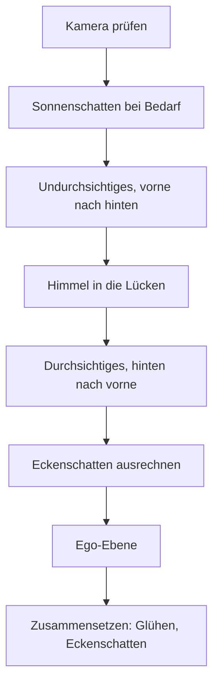

# 4 Grafik – wie Kern Bilder malt

> **Kurz gesagt:** Hier schaust du Kerns Maler über die Schulter: wie Kern die Grafikkarte
> erreicht, woraus Formen und Materialien bestehen, was das eine große Malprogramm für jeden
> Bildpunkt rechnet und in welcher Reihenfolge ein Bild entsteht – mit Sonnenschatten, Himmel,
> Glühen und weichen Eckenschatten. Zum Schluss bringen wir die Fenster einer Nachtstadt zum Leuchten.

> **Begriffe vorab:**
> - **Grafikkarte** (auch GPU) – der Spezialchip, der Millionen Bildpunkte gleichzeitig ausmalt.
> - **Mesh** – das Drahtgitter aus Dreiecken, aus dem ein 3D-Ding besteht.
> - **Shader** – ein kleines Malprogramm, das auf der Grafikkarte läuft.
> - **Normale** – ein gedachter Pfeil, der senkrecht aus einer Fläche zeigt: wohin die Fläche „schaut“.
> - **Interpolation** – das Mischen von Werten zwischen den Ecken, wie ein Farbverlauf von einer Ecke
>   zur anderen.
> - **Tiefenpuffer** – ein unsichtbares zweites Bild, das sich für jeden Bildpunkt merkt, wie weit das
>   dort Gemalte entfernt ist.
> - **sRGB und linear** – zwei Arten, Helligkeit als Zahl zu schreiben: sRGB passt zu Bildschirm und
>   Auge, linear zum echten Licht, mit dem man rechnen kann.
> - **Tonemapping** – das sanfte Zusammenpressen von zu hellem Licht auf das, was ein Bildschirm zeigen
>   kann, wie bei einem Fotofilm.

Wer die Grundlagen dahinter in Ruhe nachlesen möchte – wie aus Dreiecken Bildpunkte werden, wie Licht
und Farbe funktionieren –, findet sie in [Anhang B](B-grundlagen-rendering.md). Hier geht es darum,
was **Kern** daraus macht. Die genauen Namen und Werte stehen im blauen Buch, Kapitel 4.

## 4.1 Überblick

Kerns **Renderer** ist der Teil, der Bilder erzeugt. Er ist erstaunlich klein: eine Brücke zur
Grafikkarte, ein Shader-Baukasten, Formen und Materialien, der Renderer selbst, vier Zusatz-Malgänge
(Schatten, Himmel, **Bloom** – das Glühen um helle Stellen – und **Ambient Occlusion** – die weichen
Eckenschatten) sowie Funken und Lampen. Drei Grundsätze prägen alles:

1. **Ein Malprogramm für alles.** Jedes Ding wird mit demselben **Standard-Shader** gemalt. Spiele,
   die anders aussehen wollen, stecken kleine **Erweiterungen** in dieses eine Programm, statt eigene
   zu schreiben.
2. **Einmal hochladen, danach nur Bewegung.** Eine Form wandert einmal auf die Grafikkarte, danach
   ändert sich nur, *wo* sie steht. Die Arbeit pro Bild folgt dem, was sich bewegt, nicht der Größe
   der Welt.
3. **Die Kopie im Arbeitsspeicher ist die Wahrheit.** Kern behält jede Form zusätzlich im
   Arbeitsspeicher des Rechners. Daraus rechnet er, was sichtbar ist und was du anklickst – und er baut
   damit alles neu auf, wenn der Browser ihm die Grafikkarte wegnimmt (4.11).

> **Stell dir vor …** … ein Theater. Die Kulissen werden einmal auf die Bühne getragen; in jeder
> Vorstellung bewegen sich nur die Schauspieler. Und von jeder Kulisse liegt ein Bauplan in der
> Schublade – brennt die Bühne ab, steht morgen alles wieder genauso da.

## 4.2 Die Brücke zur Grafikkarte

Kern selbst kann die Grafikkarte nicht direkt ansprechen. Das darf im Browser nur die Webseite, über
**WebGL2**, die Malschnittstelle des Browsers. Also reicht Kern jeden Malbefehl über eine schmale
Brücke an die Webseite weiter, und die gibt ihn an die Grafikkarte.

Über diese Brücke gehen **nur Zahlen**:

- **Grafik-Dinge sind Nummern.** Die Webseite verwahrt das echte Ding und gibt Kern eine Platznummer.
  Wie an der Garderobe: Du bekommst eine Marke, nicht den Mantel.
- **Daten sind „Adresse plus Länge“.** Statt einen großen Datenberg zu kopieren, sagt Kern nur: „Ab
  hier, so viele Bytes.“ Die Webseite schaut direkt in Kerns Speicher und reicht die Daten weiter –
  ohne Kopie.

Die Brücke ist bewusst dünn: Die Webseite lädt Kern, verwaltet die Nummern und den Fall, dass die
Grafikkarte verloren geht – mehr nicht. Alles, was das Bild ausmacht, steht in Kern. Außerhalb des
Browsers, in den automatischen Tests, hängt statt der Grafikkarte eine **Attrappe** an der Brücke,
die jeden Malbefehl nur mitschreibt.

Benutzen kann man den Renderer auf zwei Wegen: aus einem Spiel, das selbst in C++ geschrieben ist
(wie Orb Run, [Kapitel 12](12-eigene-spiele.md)), oder aus einer Webseite in JavaScript. Kern Studio
hat einen eigenen Zugang ([Kapitel 11](11-studio.md)); innen arbeitet immer derselbe Renderer.

## 4.3 Malprogramme und der Merkzettel

Ein **Malprogramm** hat zwei Teile: Der **Vertex-Shader** rechnet jede Ecke einer Form aus – wo sie
auf dem Bildschirm landet. Der **Fragment-Shader** rechnet danach jeden Bildpunkt aus – welche Farbe
er bekommt. Zwei Teile, weil es zwei sehr verschiedene Mengen sind: ein paar Tausend Ecken, aber
Millionen Bildpunkte. Findet der Übersetzer der Grafikkarte einen Fehler, hängt Kern ein Namensschild
davor, damit man sofort sieht, welches Programm klemmt.

Viele Angaben gelten für einen ganzen Malauftrag gleich: die Farbe eines Materials, die Richtung der
Sonne. Solche Werte heißen **Uniforms**, und die Grafikkarte merkt sie sich, bis man etwas Neues sagt.
Kern führt dazu einen **Merkzettel** (den Uniform-Cache): Bevor er einen Wert schickt, schaut er nach,
ob genau dieser Wert schon dort steht. Wenn ja, schickt er nichts.

> **Stell dir vor …** … jeder Satz an die Grafikkarte kostet Porto. Sagst du zehnmal „Die Farbe ist
> Blau“, zahlst du zehnmal. Der Merkzettel ist der Kollege, der sagt: „Hast du schon gesagt, steht
> noch da.“

Das lohnt sich, weil jeder Befehl über die Brücke aus 4.2 wandert und der Browser ihn unterwegs noch
einmal prüft. Bei Hunderten Formen mit gleichem Material fällt so der größte Teil der Post weg.

> **Für Neugierige:** Lange Werte wie ganze Matrizen vergleicht der Merkzettel nicht Zahl für Zahl,
> sondern über einen Fingerabdruck. Nur die Knochen animierter Figuren gehen ohne Merkzettel durch –
> sie ändern sich ohnehin in jedem Bild.

## 4.4 Form, Material und Kopien

### Ecken und Instanzen

Jede Form besteht aus Dreiecken, und jede Ecke trägt einen kleinen **Steckbrief**: ihre Position,
ihre Normale, ihre Farbe und ihre **Texturkoordinate** (welcher Punkt eines aufgeklebten Bildes hier
liegt). Bei Figuren mit Skelett steht dazu, an welchen Knochen die Ecke hängt.

Andere Angaben gelten **pro Instanz**. Eine Instanz ist eine Kopie der Form an anderer Stelle – wie
hundert Bäume aus einer Vorlage. Pro Instanz merkt sich Kern Ort, Drehung und Größe sowie einen
Farbton. Der Clou: **Jede Form wird als Instanz-Paket gemalt**, auch wenn es nur eine Kopie gibt, und
zwar mit genau einem Malauftrag für alle Kopien.

> **Stell dir vor …** … einen Stempel. Die Form ist der Stempel, die Instanzen sind die Abdrücke auf
> dem Papier. Hundert Abdrücke brauchen keinen hundertfachen Stempel.

Kaputte Angaben, etwa eine Kopie, die auf Größe null gestaucht ist, lehnt Kern ab.

### Das Material

Das **Material** sagt, wie eine Oberfläche aussieht:

| Eigenschaft | Was sie bewirkt | Beispiel |
|---|---|---|
| Farbe | Grundfarbe und Deckkraft | rotes Auto |
| Durchsichtigkeit | ganz, ausgestanzt oder halb | Wand, Zaun, Glas |
| Rauheit und Metall | matt oder glänzend, Metall oder nicht | Gummi, Chrom |
| Eigenleuchten | strahlt selbst, auch heller als Weiß | Neonröhre |

Dazu kommen Schalter: **unbeleuchtet** (nur Farbe, kein Licht), **zweiseitig** (auch von hinten
sichtbar), **wirft Schatten** und **darf weggelassen werden, wenn außer Sicht**. Einige verdienen
einen zweiten Blick:

- **Farben kommen in sRGB**, so wie Farbwähler und Bilddateien sie liefern. Kern rechnet sie vor dem
  Beleuchten in lineares Licht um, denn nur damit lässt sich richtig rechnen (Anhang B erklärt,
  warum). Das Eigenleuchten ist schon linear.
- **Nur Undurchsichtiges wirft Schatten.**
- **Die Ego-Ebene** ist für Dinge in deiner Hand: Sie kommen ganz zum Schluss, nachdem Kern den
  Tiefenpuffer geleert hat. So schneidet eine Wand vor dir die Waffe in deiner Hand nicht ab. Studio
  malt dort auch seine Anfasser zum Verschieben und Drehen.
- **Linien** statt Dreiecken gibt es für Hilfsdarstellungen. Sie sind immer unbeleuchtet, werfen
  keinen Schatten und lassen sich nicht anklicken.

> **Für Neugierige:** Die Grafikkarte lässt Rückseiten von Dreiecken normalerweise weg. Ein
> gespiegeltes Objekt ist für sie aber „von innen nach außen gestülpt“. Sind in einem Paket manche
> Kopien gespiegelt und manche nicht, zeigt Kern einfach beide Seiten.

### Anlegen: erst prüfen, dann tauschen

Eine neue Form übergibt man Kern als Paket. Pflicht sind nur die Positionen der Ecken. Fehlen
Normalen, rechnet Kern einfache aus; fehlen Farben, ist alles weiß; fehlt die Angabe der Kopien, gibt
es genau eine.

Das Wichtigste: Kern legt eine Form **ganz oder gar nicht** an. Erst prüft er alles – sind alle Zahlen
gültig, passen die Längen zusammen, ergeben die Knochenanteile zusammen 100 %? Erst dann tauscht er
die alte Form gegen die neue. Scheitert die Prüfung, **bleibt die alte Form sichtbar**.

> **Stell dir vor …** … Tapezieren. Die neue Bahn wird erst ganz zugeschnitten und geprüft, dann
> ausgetauscht – nie halb abgerissen.

Für einen Editor ist das Gold wert: Ein halbfertiger Zwischenstand löscht nichts. Die Nummern der
Formen vergibt der Renderer selbst, damit sich nie zwei Besitzer einen Platz teilen. Unbewegte, größere
Formen der Welt bekommen beim Hochladen zusätzlich ein Inhaltsverzeichnis, das Mausklicks schnell
macht ([Kapitel 5](05-szene-und-geometrie.md)).

### Bewegen: nur das Nötige

Alles, was sich bewegt, ändert nur die Angaben der Instanzen, und das sparsam: Ändert sich nur der
Farbton, wird nur der Farbton hochgeladen. Sind die neuen Daten genau gleich den alten, **passiert gar
nichts**. Ebenso lassen sich Knochen, Sichtbarkeit und Material einzeln ändern.

Jede Form hat außerdem eine **Ebenenmaske**, die wie eine Reihe Lichtschalter wirkt. Für jedes Bild
sagt man, welche Schalter an sind; nur diese Formen werden gemalt, werfen Schatten und lassen sich
anklicken. Studio trennt so zum Beispiel das Bodenraster, Hilfssymbole und die Welten mehrerer
Netzwerkspieler.

### Texturen

Eine **Textur** ist ein Bild, das auf eine Form geklebt wird, wie ein Aufkleber. Jede Form hat
höchstens eine Farbtextur. Kern legt Texturen selbst an und behält ihre Bildpunkte als Kopie; auf
Wunsch mit **Mipmaps**, verkleinerten Fassungen für die Ferne – wie Briefmarken-Versionen eines
Posters, damit ein weit entferntes Muster nicht flimmert. Eine Webseite kann auch eine eigene Textur
anmelden; dann hinterlegt sie, wie die Textur nach einem Verlust der Grafikkarte neu gefüllt wird.

> **Probier's aus!** Öffne https://kernengine.de/ und lege mit **File › New Level…** die Vorlage
> **Basic** an. Klappe unten in der Statusleiste den **Content Drawer** auf, die Bausteinleiste, und
> zieh aus der Gruppe *Shapes* einen **Cube** hinein. Spiele rechts in **Details** unter *Material*
> mit **Roughness** (Rauheit), **Metallic** (Metall) und **Emissive** (Eigenleuchten). Schalte dann
> **Unlit** ein – schon ist der Würfel ein flacher Farbklecks ohne Licht und Schatten. So siehst du,
> dass jede Zeile der Material-Tabelle oben eine sichtbare Wirkung hat.

## 4.5 Der Standard-Shader

Kern baut sein eines Malprogramm beim Start aus festen Bausteinen zusammen und fügt an verabredeten
Stellen die Schnipsel der Erweiterungen ein. Heraus kommt genau **ein** Programm.

Der **Vertex-Shader** nimmt jede Ecke, setzt sie an den Ort ihrer Instanz und berechnet, wo sie auf
dem Bildschirm landet. Bei Figuren biegt er vorher die Haut nach dem Skelett: Jede Ecke folgt bis zu
vier Knochen, jeder mit einem Anteil.

> **Stell dir vor …** … eine Ecke an deinem Ellbogen hängt zu 60 % am Oberarm und zu 40 % am
> Unterarm. Beugst du den Arm, landet sie dazwischen – die Haut knickt nicht, sie biegt sich weich.

Der **Fragment-Shader** rechnet dann jeden Bildpunkt aus, in dieser Reihenfolge:

1. Aufgeklebtes Bild nachschlagen, Deckkraft bestimmen.
2. Bei ausgestanzten Materialien (etwa einem Zaun) durchsichtige Stellen ganz weglassen.
3. Die Farbe in lineares Licht umrechnen.
4. Beleuchten: Sonne, Himmel, Lampen, Glanz, Eigenleuchten.
5. Tonemapping: zu helles Licht sanft zusammenpressen.
6. Nebel dazumischen.

Dabei schreibt er **drei Bilder gleichzeitig**: das **fertige Foto**, wie du es siehst; ein
**Lichtmesser-Bild** mit der echten Lichtmenge vor dem Tonemapping, aus dem später das Glühen entsteht;
und einen **Notizzettel für die Eckenschatten**, auf dem steht, wie viel des Lichts aus der Umgebung
kommt.

### Licht und Material

Kerns Lichtmodell lehnt sich an das bekannte Standardmaterial der Grafikbibliothek three.js an – ein
vereinfachtes **physikalisch basiertes** Modell: Es ahmt nach, wie echtes Licht sich verhält. Das
Licht eines Bildpunkts hat mehrere Zutaten:

| Zutat | Alltagsbild |
|---|---|
| Sonne, mit Schatten | Taschenlampe in sehr weiter Ferne |
| Himmel und Boden | blauer Himmel oben, brauner Acker unten |
| Himmelskuppel | Licht einer bunten Kuppel ringsum |
| bis zu 6 Lampen | Glühbirnen mit Reichweite |
| Glanz und Spiegelung | Lichtpunkt auf einem Apfel |
| Eigenleuchten | Neonröhre |

**Sonne:** Je direkter sie auf eine Fläche scheint, desto heller (Anhang B, Taschenlampen-Bild) – und
gar nicht, wo der Schatten liegt. **Himmel und Boden:** Flächen, deren Normale nach oben zeigt,
bekommen Himmelsfarbe, nach unten zeigende Bodenfarbe. **Lampen** werden mit der Entfernung schwächer
und gehen an ihrer Reichweite **weich auf null**.

Das Licht von Himmel und Boden führt Kern getrennt mit. Warum? Die Eckenschatten sollen später **nur
dieses** Licht abdunkeln; Sonne und Lampen haben ihre eigenen Schatten. Metalle haben übrigens kein
mattes Licht – ihre Farbe steckt ganz im Glanz.

**Glanz** gibt es bei Metall und bei allem, was nicht ganz rau ist: eine Spiegelung des Himmels und ein
Glanzpunkt der Sonne. Glatte Flächen haben einen kleinen, scharfen Glanzpunkt, raue einen breiten
Schimmer. Und bei flachem Blick spiegelt alles stärker – denk an einen See, der schräg betrachtet den
Himmel zeigt.

> **Wusstest du?** Sehr glatte Flächen können rechnerisch absurd helle Glanzpunkte erzeugen – einzelne
> Bildpunkte, die im Glühen als flackernde Sterne aufblitzen. Kern begrenzt den Glanz deshalb nach oben.

**Glas:** Erklärt eine Erweiterung eine Fläche zu Glas, spiegelt sie den Himmel, stärker bei flachem
Blick. So wirken Scheiben hell statt schwarz. **Eigenleuchten** kommt zuletzt dazu, **ohne
Obergrenze** – alles über Weiß wird später zum Glühen.

> **Für Neugierige:** Die Fachnamen der Glanz-Rechnung sind „GGX“ (wie viele winzige Spiegelchen ins
> Auge zeigen) und „Fresnel nach Schlick“ (wie viel bei welchem Blickwinkel gespiegelt wird). Anhang B
> erklärt beide mit Bildern.

### Vom Licht zum Bildpunkt – und Nebel

Echtes Licht kann viel heller sein, als ein Bildschirm zeigen kann: Kerns Sonne ist in der Rechnung
fast dreimal so hell wie das hellste Bildschirm-Weiß. Also sichert Kern zuerst die echte Lichtmenge im
Lichtmesser-Bild und presst sie dann mit einer **Filmkurve** sanft auf den Bildschirmbereich – wie ein
Fotofilm, der Helles weich abrundet, statt es hart abzuschneiden (Skizze in Anhang B). Danach kann ein
**Farbgrading** folgen, wie bei einem Kinofilm: kräftigere Farben, wärmere Lichter, kühlere Schatten.
Zuletzt rechnet Kern die Farbe in sRGB zurück, die Sprache des Bildschirms.

Der **Nebel** kommt danach, mit der Entfernung: Bei 100 m ist er kaum zu sehen, bei einem Kilometer
schon gut zur Hälfte. Die Nähe bleibt also lange klar, dann zieht der Dunst rasch zu. Drei Extras
machen ihn lebendig: **Bodennebel** (dicht am Boden, klar über den Dächern), **Sonnenschein im Nebel**
(in Richtung Sonne leuchtet er sonnenfarben) und **Horizontnebel** (4.8.2).

Auf den **Notizzettel für die Eckenschatten** schreibt der Shader für jeden Bildpunkt, wie viel seines
Lichts aus der Umgebung stammt und wie hell die Grundfarbe ist. Durchsichtiges und die Ego-Ebene
bekommen keine Eckenschatten.

## 4.6 Shader-Erweiterungen

Ein Spiel braucht leuchtende Fenster oder eine schimmernde Kraftfeld-Kuppel? Dann schreibt es eine
**Shader-Erweiterung**: kleine Schnipsel in der Shader-Sprache, die Kern an fest verabredeten Stellen
in sein Malprogramm einsetzt. Die Engine selbst bleibt unverändert.

> **Stell dir vor …** … ein fertiges Malen-nach-Zahlen-Bild mit sechs Feldern „Hier darfst du
> ergänzen“. Deine Erweiterung füllt genau diese Felder – sie kann das Bild verschönern, aber den Rest
> nicht kaputtmachen.

An diesen Stellen darf eine Erweiterung zum Beispiel die Farbe einer Ecke ändern, Bildpunkte früh
weglassen, Farben als schon linear kennzeichnen oder – die wichtigste Stelle – kurz vor der
Beleuchtung Grundfarbe, Glas und Eigenleuchten einer Fläche umstellen. Außerdem darf sie eigene
**Zusatzangaben pro Ecke** mitbringen (höchstens zwei) und eigene Einstellwerte setzen, am besten über
Kerns Merkzettel, dann spart sie mit. Fehlt einer Form die Zusatzangabe, liest der Shader dort einfach
null – die Erweiterung tut dann nichts.

Das Spiel reicht seine Erweiterungen beim Start herein. Jeder Schnipsel bekommt ein Namensschild, damit
bei einem Fehler sofort klar ist, welche Erweiterung schuld ist. Ein Beispiel folgt in 4.13.

## 4.7 Der Ablauf eines Bildes

Ein Bild (englisch **Frame**) ist ein Blatt im Daumenkino. Bei 60 Bildern pro Sekunde hat Kern gut 16
Tausendstelsekunden dafür, und die Reihenfolge der Malgänge ist sorgfältig gewählt:



Zuerst **prüft** Kern Kamera und Bildausschnitt, bevor er die Grafikkarte überhaupt anfasst. Die
**Schattenkarte** wird nur neu gemalt, wenn sich etwas geändert hat (4.8.1). Dann **sortiert** Kern
aus: Unsichtbares fliegt raus, ebenso alles, was außerhalb der Sichtpyramide der Kamera liegt –
außer Figuren mit Skelett, deren Arme und Beine aus ihrer gedachten Hülle ragen können.

**Undurchsichtiges** malt Kern **von vorne nach hinten**. Warum? Nahe Flächen tragen sich zuerst in
den Tiefenpuffer ein. Kommt danach etwas, das dahinter liegt, merkt die Grafikkarte das sofort und
spart sich das teure Ausmalen. **Durchsichtiges** kommt **von hinten nach vorne**, wie Folien auf
einem Overheadprojektor – sonst stimmt die Mischung nicht. Dazwischen malt Kern den **Himmel** in die
Lücken. Pro Form gibt es einen Malauftrag; Einstellungen, die gleich bleiben, schickt Kern nicht neu.

Danach rechnet Kern die **Eckenschatten** aus, und zwar *vor* der Ego-Ebene: Die leert ja den
Tiefenpuffer, und den braucht die Eckenschatten-Rechnung noch. Zum Schluss **setzt** Kern alles
**zusammen** (Glühen und Eckenschatten ins fertige Foto) und führt eine **Statistik**, wie viele
Malaufträge und Dreiecke das Bild gekostet hat.

Glühen und Eckenschatten brauchen eigene Zwischenbilder. Die gibt es nur, wenn Kern das ganze Fenster
bemalt. Malt er nur einen Teil des Fensters, geht es direkt auf den Bildschirm – **ohne Glühen und
ohne Eckenschatten**.

> **Für Neugierige:** Die drei Bilder, die der Shader gleichzeitig schreibt, sind zusammen genau so
> groß, wie Handy-Grafikchips pro Bildpunkt in ihrem schnellen Zwischenspeicher halten können. Deshalb
> ist der Notizzettel für die Eckenschatten bewusst knapp gehalten.


> **Probier's aus!** Stelle in Kern Studio über **Window › Viewport Layout** vier Ansichtsfenster
> (Viewports) ein. Jedes ist nur ein Teil des Fensters – darum glühen die Lichter nicht mehr, und Ecken
> wirken flacher. Zurück auf einen Viewport: Glühen und weiche Eckenschatten sind wieder da. Dein Gerät
> war also nicht zu langsam – es liegt an der Bauweise.

## 4.8 Die Zusatz-Malgänge im Detail

Ein **Pass** ist ein eigener Malgang mit eigenem Shader, der etwas Besonderes beisteuert. Kern hat
vier: Sonnenschatten, Himmel, Glühen und Eckenschatten.

### 4.8.1 Sonnenschatten

Ein Punkt liegt im Schatten, wenn zwischen ihm und der Sonne etwas steht. Also malt Kern die Welt
einmal **aus Sicht der Sonne** und merkt sich für jeden Punkt dieser Karte nur, wie weit das erste
getroffene Ding entfernt ist – die **Schattenkarte**. Beim normalen Malen fragt dann jede Stelle: „Bin
ich weiter von der Sonne weg als das, was auf der Karte steht? Dann liegt etwas davor – Schatten.“
(Skizze in [Anhang B](B-grundlagen-rendering.md).)

**Die Karte hat nur begrenzt viele Punkte.** Ein Beispiel: Spannt man 512 Kartenpunkte über eine
240 m breite Fläche, ist jeder Punkt fast einen halben Meter breit. Für eine Ente, die selbst kaum so
groß ist, viel zu grob – ihr Schatten wäre ein Klecks. Darum gibt es die **Schattendistanz**: Die Karte
deckt nur ab, was du bis zu dieser Entfernung siehst. Weniger Fläche, gleiche Punktzahl – schärfere
Schatten. In Levels stellst du sie in den World Settings ein; das Micro-Duck-Level nimmt nur 10 m.

Genauer legt Kern eine **Kugel** um den Bereich, den die Kamera bis zur Schattendistanz sieht, und
deckt diese Kugel ab. Warum eine Kugel und kein genau passender Kasten? Eine Kugel bleibt gleich groß,
wie auch immer du dich drehst – also bleiben auch die Kartenpunkte gleich groß.

**Einrasten.** Wandert die Karte mit der Kamera um Bruchteile eines Punkts mit, fallen Schattenkanten
jedes Mal anders aufs Raster und flimmern. Kern verschiebt die Karte deshalb nur um **ganze
Kartenpunkte**.

> **Stell dir vor …** … du malst eine schräge Linie auf Fliesen. Verschiebst du das Fliesenmuster ein
> bisschen, sieht die Treppchenkante jedes Mal anders aus. Verschiebst du nur um ganze Fliesen, bleiben
> die Treppchen dieselben – und fallen kaum auf.

**Wiederverwenden.** Kern malt die Karte nur neu, wenn sich etwas Wichtiges geändert hat: die Sonne,
die Lage der Karte oder ein Ding, das Schatten wirft. Über einer unbewegten Stadt kostet der Schatten
bei stehender Kamera **keinen einzigen Malauftrag**.

**Schattenakne vermeiden.** Weil ein Kartenpunkt ein kleines Stück Fläche abdeckt, kann sich eine
Fläche selbst beschatten: Es entstehen feine Streifen, die **Schattenakne** – ähnlich den Streifen auf
einem Foto von einem Bildschirm. Kern hilft mit einem kleinen **Sicherheitsabstand** und schaut zudem
ein Stückchen von der Fläche weg nach, bei schräg einfallendem Licht etwas mehr. So bleibt die Akne
weg, ohne dass sich der Schatten sichtbar vom Ding löst.

**Weiche Kanten.** Statt nur einen Kartenpunkt zu fragen, mischt Kern mehrere Nachbarn. So bekommt die
Schattenkante einen weichen Übergang statt harter Treppchen. Am Computer mischt Kern mehr Nachbarn als
auf dem Telefon.

Außerhalb der Karte gilt alles als beleuchtet; Flächen, die von der Sonne wegzeigen, fragen gar nicht
erst nach. Am Rand der Schattendistanz blendet der Schatten sanft aus, statt abzureißen.

> **Für Neugierige:** Beim Mischen der Nachbarn nutzt Kern einen Trick aus dem Spiel „The Witness“:
> Er fragt geschickt *zwischen* den Kartenpunkten, sodass die Grafikkarte die Nachbarn gratis mit den
> richtigen Anteilen mischt. So wirken neun Abfragen wie ein weicher Filter über 25 Kartenpunkte.

> **Probier's aus!** Lade **File › Example Levels › Micro Duck**, öffne rechts den Tab **World
> Settings** und stelle die **Shadow distance** (Schattendistanz) von 10 auf 200 m: Die Schatten von
> Ente und Ball werden matschig, denn dieselben Kartenpunkte verteilen sich jetzt auf viel mehr
> Fläche. Zurück auf 10 – gestochen scharf. Kleiner heißt schärfer, reicht aber weniger weit.

### 4.8.2 Himmel

Der Himmel ist ein einziges riesiges Dreieck, das den ganzen Bildschirm bedeckt und **ganz hinten**
liegt. Kern malt es *nach* dem Undurchsichtigen. Dank Tiefenpuffer kommt es nur dort durch, wo noch
nichts gemalt ist. Der aufwendige Himmels-Shader läuft also nur dort, wo wirklich Himmel zu sehen ist.

Für jeden Bildpunkt mischt er: einen **Verlauf** vom Horizont zum Himmel über dir (nachts
dunkelblau), die **goldene Stunde** (je tiefer die Sonne, desto oranger der Horizont und violetter der
Himmel darüber), eine **Sonne** mit weichem Hof und scharfer Scheibe, nachts **Mond und funkelnde
Sterne**, **Wolken** und auf Wunsch **Horizontnebel**, in dem der Horizont in die Nebelfarbe der Szene
übergeht – je dünner der Nebel der Szene, desto dünner auch dieser Dunst.

Die Wolken entstehen aus **Rauschmustern**: Zufallsmustern, die trotzdem immer gleich aussehen, wie
die Maserung in Marmor. Fünf davon, fein und grob übereinandergelegt, ergeben Wolken; der Wind
verschiebt sie, und eine Explosion drückt sie weg wie eine Schockwelle. Sinkt die Sonne unter den
Horizont, verschwinden Scheibe und Hof. Kameras ohne Perspektive (wie die Draufsicht im Editor) haben
keinen Himmel; dort bleibt die Grundfarbe stehen, mit der jedes Bild beginnt.

### 4.8.3 Glühen (Bloom) und Zusammensetzen

**Bloom** ist das Glühen um sehr helle Stellen, wie Gegenlicht im Auge. Kern macht es in drei
Schritten: Aus dem Lichtmesser-Bild **schneidet** er alles sehr Helle **aus**, **verwischt** es auf
verkleinerten Bildern (das ist billiger und ergibt einen breiteren Schein) und **legt** es über das
fertige Foto. Kann ein Gerät die dafür nötigen Zwischenbilder nicht, malt Kern ohne Glühen.

Das Verwischen geht übrigens in zwei Durchgängen – erst waagerecht, dann senkrecht –, und jeder
Lesezugriff holt dabei gleich zwei Nachbarpunkte auf einmal. Wie das genau geht, steht in Anhang B.

Beim Zusammensetzen entwickelt Kern das Foto nicht neu. Er rechnet nur aus, **um wie viel** Glühen
und Eckenschatten das Bild verändern, und legt genau diesen Unterschied darüber. Warum so umständlich?
Das fertige Foto enthält schon den Nebel, das Lichtmesser-Bild nicht. Neu entwickeln hieße: Nebel weg.
Bildpunkte ohne Glühen und ohne Eckenschatten übernimmt Kern einfach unverändert.

> **Stell dir vor …** … ein fertig gerahmtes Foto. Statt es neu zu entwickeln, legst du eine dünne
> Folie mit dem Glühen darüber. Der Rahmen – der Nebel – bleibt, wie er ist.

**Der Wächter.** Stockt ein Gerät über mehrere Sekunden, schaltet ein Wächter das Glühen
für den Rest der Sitzung ab. Das Zusammensetzen läuft weiter, denn es bringt auch die Eckenschatten ins
Bild. Ist die Seite gerade versteckt, etwa in einem Hintergrund-Tab, setzt Kern den Wächter zurück –
der Browser bremst solche Seiten absichtlich, und das soll das Glühen nicht abschalten.

### 4.8.4 Eckenschatten (Ambient Occlusion)

**Ambient Occlusion** – auf Deutsch Umgebungsverdeckung, hier kurz Eckenschatten – sind die weichen
dunklen Stellen in Ecken, Ritzen und unter Dingen. Dort kommt weniger Himmelslicht hin, weil die
Umgebung einen Teil des Himmels verdeckt.

> **Stell dir vor …** … du liegst in einer Mulde im Gras und schaust nach oben. Je tiefer die Mulde,
> desto kleiner dein Stück Himmel – und desto dunkler ist es bei dir, auch ohne Sonnenschatten.

Kern nutzt dafür ein bewährtes Verfahren namens GTAO, das Anhang B erklärt. Kerns Besonderheit: Er
braucht **keinen zusätzlichen Malgang** über alle Formen.

1. Beim normalen Malen schreibt der Shader nebenbei den Notizzettel: wie viel Licht aus der Umgebung
   kommt (4.5).
2. Aus dem fertigen Tiefenpuffer rechnet Kern, wie stark jede Stelle von ihrer Umgebung verdeckt ist:
   Er schaut in einige Richtungen und sucht, wie hoch die Nachbarschaft den Himmel verdeckt.
3. Beim Zusammensetzen dunkelt er **genau das Umgebungslicht** ab. Sonne und Lampen bleiben
   unberührt.

So sitzen die Eckenschatten physikalisch an der richtigen Stelle. Dazu kommt eine Korrektur für Licht,
das zwischen hellen Wänden hin- und herspringt: Eine weiße Zimmerecke wird weniger dunkel als eine
schwarze.

Die Rechnung ist nicht billig. Darum stellt Kern die Qualität nach dem Gerät ein – auf dem Telefon
gröber, am Computer feiner –, und ein Wächter stuft sie herunter, wenn es ruckelt. Den **Radius**, also
wie weit Kern nach Verdeckern sucht, legt dagegen die Szene fest: Er steht in den World Settings, und
0 schaltet die Eckenschatten für diese Szene ab. Eckenschatten gibt es nur, wenn Kern das ganze Fenster
mit Perspektive bemalt (4.7).

> **Probier's aus!** Stelle in **World Settings** den **Ambient occlusion radius** auf 0: Ecken und
> Fugen wirken flach, Dinge scheinen zu schweben. Dann 1,6 (der Standard) und probeweise 4 – siehst
> du, wie die Dinge am Boden „festwachsen“?

## 4.9 Funken und Lampen

Funken, Rauch, Mündungsfeuer: Kerns **Partikel** sind kleine Quadrate, die sich immer zur Kamera
drehen. Alle zusammen sind **eine** Form mit vielen Kopien (4.4), rein optisch, ohne Physik – sie
prallen nirgends ab. Jedes Partikel hat eine Farbe, eine Lebensdauer und eine Größe, auf Wunsch
Schwerkraft, Wachsen und schnelleres Verblassen. In jedem Bild bewegt Kern sie weiter, sortiert sie
von hinten nach vorne (sie sind ja durchsichtig) und lässt sie über ihr Leben hinweg verblassen. Ist
das Budget voll, wird ein neues Partikel abgelehnt.

> **Achtung, Falle!** Die Partikel-Uhr läuft nie rückwärts. Meldet ein Spiel nach einer Pause oder
> einem Zurückspulen eine frühere Zeit, bleibt Kern bei der späteren. Sonst tauchten längst verblasste
> Funken wieder auf wie Gespenster.

Der Shader kennt nur **sechs Lampen** auf einmal. Hat ein Spiel zwanzig, wählt Kern in jedem Bild die
sechs wichtigsten aus. Wichtig heißt: hell und nah. Kern nimmt die Helligkeit und teilt sie umso
stärker, je weiter die Lampe im Verhältnis zu ihrer Reichweite entfernt ist.

**Beispiel:** Lampe A hat Helligkeit 10, 10 m Reichweite und ist 30 m entfernt – dreimal ihre
Reichweite. Kern teilt durch 1 + 3 = 4 und kommt auf 2,5. Lampe B hat Helligkeit 4, dieselbe
Reichweite und ist nur 5 m entfernt – eine halbe Reichweite. Kern teilt durch 1,5 und kommt auf gut
2,7. Die schwächere, aber nähere Lampe gewinnt. Orb Run meldet so einen Scheinwerfer vor dem Auto und
ein Licht pro Orb an.

## 4.10 Einstellungen

Fast alles in diesem Kapitel lässt sich einstellen: Bildgröße, Schatten, Glühen, Eckenschatten,
Farbgrading, Lichtfarben, Nebel, Himmel und Kamera – die vollständige Liste steht im blauen Buch,
Kapitel 4, und in [Kapitel 17](17-referenz.md). In Levels musst du davon nichts von Hand setzen: Kern
errechnet Sonne, Himmelslicht, Nebel und Himmel aus der **Tageszeit**
([Kapitel 8](08-spiel-laufzeit.md)).

## 4.11 Wenn der Browser die Grafikkarte wegnimmt

Ein Browser darf einer Seite die Grafikkarte jederzeit wegnehmen – bei Speichermangel, wenn der
Grafiktreiber neu startet, oder auf dem Handy, wenn die Seite im Hintergrund liegt. Das nennt man
**Kontextverlust**. Viele Webseiten zeigen dann nur noch Schwarz. Kern nicht:

1. **Verlust:** Die Seite sagt dem Browser „Ich will das zurück!“ (sonst gäbe es keine
   Wiederherstellung). Kern vergisst alle Garderobenmarken der Grafikkarte und malt vorerst nicht.
   Formen und Texturen bleiben als Kopie erhalten, und man kann sogar weiter neue anlegen.
2. **Wiederherstellung:** Erst füllt die Seite ihre eigenen Texturen neu, dann baut Kern Malprogramme,
   Zusatz-Malgänge und Erweiterungen neu und lädt alles aus seinen Kopien wieder hoch.
3. **Gescheitert?** Kern räumt auf und kann es später sauber erneut versuchen.

Derselbe Mechanismus erlaubt auch das Arbeiten ganz **ohne Bildschirm** („headless“), etwa im
Lehrer, der Roboter trainiert und dabei nichts malen muss ([Kapitel 14](14-lehrer.md)).

> **Wusstest du?** Genau dafür hält Kern die Kopie im Arbeitsspeicher (Grundsatz 3 aus 4.1). Was nach
> verschwendetem Speicher aussieht, ist eine Versicherung.

## 4.12 So bleibt ein Spiel flüssig

Jeder Malauftrag kostet Zeit, egal wie klein er ist. Ein Spiel bleibt flüssig, wenn es Kern wenige,
große Aufträge gibt und nichts unnötig neu schickt.

> **Stell dir vor …** … du gehst einkaufen. Hundertmal für je eine Zutat in den Laden zu laufen dauert
> viel länger als einmal mit vollem Korb – obwohl am Ende dasselbe im Kühlschrank steht.

- **Kopien statt Duplikate:** Viele gleiche Dinge sind eine Form mit vielen Instanzen. Die Stadt der
  Spiel-Laufzeit malt alle Baumstämme als eine Form, alle Kronen als eine zweite.
- **Kleines zusammenfassen:** Gebäude- und Straßenbauer packen viele kleine Teile in wenige große
  Formen – weniger Aufträge, weniger Sortierarbeit.
- **Nur hochladen, was sich ändert:** Gleiche Daten kosten nichts, reine Farbwechsel wenig.
- **Schatten schonen:** Jede Bewegung eines Dings, das Schatten wirft, malt die ganze Schattenkarte
  neu. Was keinen sichtbaren Schatten braucht, bekommt keinen – Orb Run schaltet ihn für Straßen und
  Boden ab.
- **Platz sparen:** Bei kleineren Formen speichert Kern die Eckennummern automatisch in halber Größe;
  Werkzeuge aus [Kapitel 5](05-szene-und-geometrie.md) fassen doppelte Ecken zusammen.
- **Unsichtbares weglassen lassen:** Den Schalter „darf weggelassen werden, wenn außer Sicht“ schaltet
  man nur bei Dingen ab, deren gedachte Hülle nicht stimmt, etwa bei Partikeln.
- **Messen statt raten:** Die Statistik zeigt Malaufträge, wiederverwendete Schatten, Dreiecke und
  Zeiten. Glühen und Eckenschatten passen sich ohnehin selbst an.

## 4.13 Beispiel: Fenster, die nachts leuchten (Orb Run)

In Orb Run leuchten nachts die Fenster der Stadt – aber die Gebäude **haben gar keine Fenster**. Es
sind glatte Kästen! Die Fenster malt erst der Shader, mit einer Erweiterung namens „Nachtfenster“
(NightWindows).

Der Gebäudebauer ([Kapitel 5](05-szene-und-geometrie.md)) gibt jeder Ecke einer Wand einen kleinen
**Wand-Datensatz** mit: wie lang und hoch die Wand ist, wie hoch ein Stockwerk ist und eine
Zufallszahl pro Gebäude. Außerdem weiß jeder Punkt der Wand, wie viele Meter er vom Wandanfang und vom
Boden entfernt ist. Damit legt der Shader ein **unsichtbares Raster** über die Wand: 3 m breite Spalten
und eine Zeile pro Stockwerk.

```
  +-------+-------+-------+-------+   ← Dachkante
  |  [#]  |  [ ]  |  [#]  |  [#]  |   3. Stock
  +-------+-------+-------+-------+
  |  [ ]  |  [#]  |  [ ]  |  [#]  |   2. Stock
  +-------+-------+-------+-------+
  |  [#]  |  [#]  |  [ ]  |  [ ]  |   1. Stock
  +-------+-------+-------+-------+
  |       |       |       |       |   Erdgeschoss: keine Fenster
  +-------+-------+-------+-------+
    3 m     3 m     3 m     3 m       [#] leuchtet   [ ] dunkles Glas
```

Für jeden Bildpunkt einer Wand fragt der Shader:

1. In welcher Spalte und in welchem Stockwerk bin ich?
2. Liege ich im Mittelteil meiner Zelle? Dann bin ich ein Fenster. (Nicht im Erdgeschoss und nicht
   direkt unter dem Dach.)
3. Ist dieses Fenster an? Das entscheidet ein „Würfel“ aus Spalte, Stockwerk und Zufallszahl des
   Gebäudes – gut die Hälfte der Fenster ist an.
4. Fensterflächen werden dunkel. Dunkle Fenster werden zu Glas und spiegeln den Himmel – tagsüber alle,
   nachts nur die ausgeschalteten. Eingeschaltete bekommen nachts warmes Eigenleuchten und glühen dank
   Bloom.

> **Stell dir vor …** … ein Würfel, der für dasselbe Fenster **immer dieselbe Zahl** würfelt. Genau
> das ist der Würfel hier (Fachwort: Hash): Fenster 7 im 12. Stock ist jede Nacht hell, und niemand
> musste es sich merken.

**Gegen Flimmern:** In der Ferne würde das Raster feiner als ein Bildpunkt; die Fenster sprängen wild
an und aus (**Aliasing**). Der Shader merkt, wie schnell sich das Raster von Bildpunkt zu Bildpunkt
ändert, und ersetzt die Fenster in der Ferne durch ein gleichmäßiges, mittleres Glühen der Fassade.

**Gegen Flackern:** Normalerweise mischt die Grafikkarte die Werte der Ecken über das Dreieck
(Interpolation). Den Wand-Datensatz reicht Kern dagegen unverändert an jeden Bildpunkt weiter – er ist
für die ganze Wand gleich. Schon winzige Rundungsfehler beim Mischen könnten den Würfel ein anderes
Ergebnis werfen lassen, und Fenster flackerten an und aus.

Wie dunkel es ist, sagt dem Shader ein einziger Einstellwert für die Nacht, den die Erweiterung einmal
pro Bild aus dem Tag-Nacht-Zyklus setzt – über den Merkzettel. Straßen und Bodenplatten bekommen keinen
Wand-Datensatz; dort liest der Shader null, und die Erweiterung tut nichts. Kern Studio und exportierte
Spiele haben dieselbe Erweiterung immer an Bord; ob eine **Procedural City** (eine automatisch
erzeugte Stadt) ihre Gebäude damit ausstattet, entscheidet ihr Schalter **Lit windows at night**.

> **Probier's aus!** Lade **File › Example Levels › Orb Run**. Klicke unten in der Statusleiste auf
> **Cmd**: Das öffnet die Konsole, ein Eingabefeld für Befehle. Tippe `tod 0.75` und Enter – `tod`
> steht für *time of day* und setzt die Tageszeit von 0 bis 1 (0,25 Sonnenaufgang, 0,5 Mittag, 0,75
> Sonnenuntergang). Die goldene Stunde färbt den Himmel. Dann `tod 0.95` für die späte Nacht: dunkle
> Glasfenster, warm leuchtende Fenster, in der Ferne ein weicher Schimmer. Wähle die Stadt aus und
> schalte rechts in **Details** **Lit windows at night** aus – dann bekommen ihre Gebäude keine
> leuchtenden Fenster mehr. Du siehst: Die Fenster gibt es nur im Malprogramm.

## Das nimmst du mit

- Kern malt **alles mit einem Malprogramm**; Spiele ergänzen es an verabredeten Stellen.
- Formen werden **einmal hochgeladen**, danach ändern sich nur ihre Kopien; gleiche Daten kosten
  nichts.
- Ein **Merkzettel** spart jeden Befehl an die Grafikkarte, der nichts Neues sagt.
- Jeder Bildpunkt landet in **drei Bildern**: fertiges Foto, echtes Licht fürs Glühen, Notizen für die
  Eckenschatten.
- Die Schattenkarte deckt eine **Kugel** um die Sicht ab, rastet auf ganze Punkte ein und wird nur bei
  Bedarf neu gemalt.
- Eckenschatten dunkeln **nur das Umgebungslicht** ab und brauchen keinen zweiten Malgang.
- Kern übersteht den **Verlust der Grafikkarte** dank seiner Kopien im Arbeitsspeicher.
- Teil-Ansichten haben weder Glühen noch Eckenschatten.

## Knobelecke

1. Warum malt Kern Undurchsichtiges von vorne nach hinten, Durchsichtiges aber andersherum?
2. Ein Spiel bewegt in jedem Bild einen kleinen Ball, der Schatten wirft. Was kostet das, und wie
   spart man?
3. Warum ist die Schattenkarte mit Schattendistanz eine Kugel und kein genau passender Kasten?
4. In der Vier-Viewport-Ansicht glüht nichts. Ist dein Gerät zu langsam?
5. Die Fenster in Orb Run gibt es gar nicht als Form. Warum ist es trotzdem schlau, sie erst im
   Malprogramm entstehen zu lassen?

### Lösungen

1. Vorne zuerst: Verdecktes fällt sofort am Tiefenpuffer durch und kostet kein Ausmalen. Bei
   Durchsichtigem zählt die Reihenfolge der Schichten wie bei Folien – also hinten zuerst.
2. Jede Bewegung malt die ganze Schattenkarte neu. Braucht der Ball keinen sichtbaren Schatten,
   schaltet man ihn für den Ball ab.
3. Eine Kugel bleibt beim Drehen gleich groß, also auch die Kartenpunkte – die Kanten flimmern nicht.
4. Nein: Teil-Ansichten malen direkt auf den Bildschirm, ohne die Zwischenbilder für Glühen und
   Eckenschatten.
5. Es braucht keine zusätzlichen Dreiecke und keinen Speicher für Tausende Fenster; jedes Gebäude
   bekommt Fenster, ganz gleich, wie groß es ist; ein einziger Wert schaltet zwischen Tag und Nacht;
   und weil der Würfel immer gleich fällt, muss sich niemand merken, welches Fenster an ist.

---

© 2026 Christian Heinrich Hohlfeld · Alle Rechte vorbehalten · [Impressum und Rechte](00-impressum.md)
