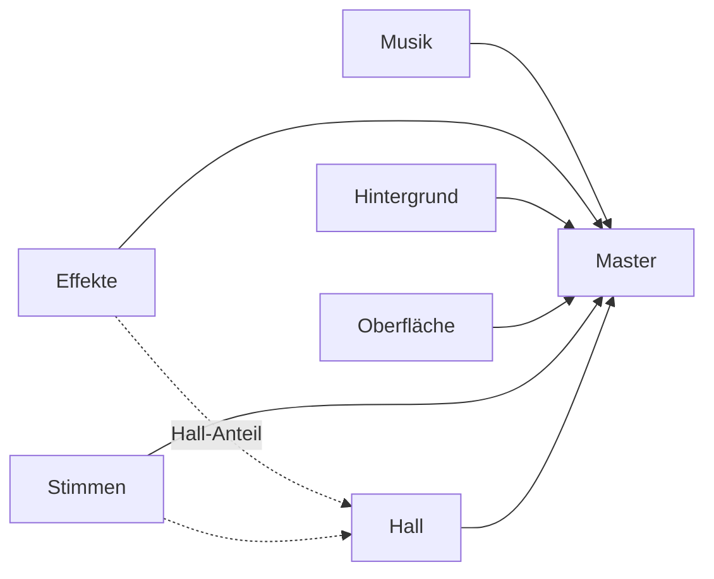

# 7 Audio – wie Kern zum Klingen kommt

> **Kurz gesagt:** Kern hat sein eigenes Tonstudio eingebaut. Ein Mischpult rechnet jeden Ton selbst
> aus, setzt ihn in den 3D-Raum, legt Hall darüber und passt auf, dass nichts übersteuert. Alle
> eingebauten Geräusche – vom Münz-Pling bis zur Musik – entstehen aus reiner Rechnerei, ganz ohne
> Sound-Dateien. Der Browser ist am Ende nur noch der Lautsprecher.

> **Begriffe vorab:**
> - **Hertz (Hz)** – „wie oft pro Sekunde“. 440 Hz heißt: 440 Schwingungen in jeder Sekunde.
> - **Millisekunde (ms)** – ein Tausendstel einer Sekunde. Ein Wimpernschlag dauert etwa 100 ms.
> - **Level** – eine fertig gebaute Spielwelt, so wie ein Spielbrett mit allen Figuren darauf.
> - **Actor** – ein Ding im Level: eine Kiste, ein Auto, ein Radio, die Spielfigur.
> - **Komponente** – ein Steckbaustein, der einem Actor eine Fähigkeit gibt, etwa „kann klingen“.
> - **Rigid Body und Collider** – Körper und Form eines Dings für die Physik ([Kapitel 6](06-physik.md)).
> - **Bild** – ein einzelnes gezeichnetes Bild auf dem Bildschirm; ein Spiel zeigt meist 60 davon
>   pro Sekunde, wie ein Daumenkino.
> - **Deterministisch** – „immer gleich“: Dieselben Eingaben ergeben auf jedem Gerät exakt dasselbe.

Stell dir ein Spiel ohne Ton vor: Ein Auto rast lautlos vorbei, eine Kiste kracht stumm auf den
Boden. Ein Stummfilm! Ton ist die halbe Miete – und dieses Kapitel zeigt, wie Kern ihn macht.

## 7.1 Schall, Samples und ein eigener Mixer

Ton ist für den Computer eine lange Reihe von Zahlen. Kern rechnet diese Zahlen selbst aus und mischt
sie selbst, statt das dem Browser zu überlassen – damit es überall gleich klingt und nie knackt.

Schall ist zitternde Luft. Schnelles Zittern hören wir als hohen Ton, langsames als tiefen. Ein
Computer misst diese Welle in winzigen Abständen und schreibt jedes Mal eine Zahl auf. Das heißt
**Abtastung** (*Sampling*), jede Zahl ist ein **Sample**, und wie oft gemessen wird, ist die
**Abtastrate**. Bei 48 000 Hz sind das 48 000 Zahlen pro Sekunde und Ohr.

> **Stell dir vor …** ein Daumenkino für die Ohren. Jedes Blatt ist ein Sample. Blätterst du 48 000
> Blätter pro Sekunde durch, hörst du keinen Ruckel mehr, sondern einen glatten Ton.

Browser haben eine eigene Tonmaschine. Kern nutzt sie nur als Lautsprecherausgang und zum Entpacken
importierter Dateien. Gemischt wird in Kerns eigener Sound-Engine, im selben Programm wie Grafik und
Physik. Das bringt drei Vorteile:

- **Immer gleich:** Dieselben Ereignisse ergeben auf jedem Gerät exakt dieselben Samples.
- **Ein Programm für alles:** Studio, exportierte Spiele und Tests klingen gleich, weil sie dasselbe
  Mischpult benutzen.
- **Volle Kontrolle:** kein Knacken beim Stoppen, kein Übersteuern. Jede Zahl, die zum Lautsprecher
  geht, bleibt zwischen −1 und +1. Das ist der Ausschlag, den die Lautsprechermembran höchstens
  machen kann; alles darüber würde sie „anschlagen“ lassen, und es klirrt.

## 7.2 Der Mixer – Kerns Mischpult

Der **Mixer** nimmt alle Töne, die gerade spielen, und rechnet sie zu einem einzigen Stereo-Ton
zusammen. Er hat nur eine feste Zahl von Plätzen; wird es zu voll, fliegt der unwichtigste Ton
heraus, und nichts wird je hart abgeschnitten.

> **Stell dir vor …** ein Mischpult im Tonstudio. Jede Spur hat einen eigenen Regler, alles läuft in
> Gruppen zusammen und am Ende in einen Hauptregler zu den Boxen. Kerns Mixer ist genau das, nur in
> Software.

Jeder gerade laufende Ton belegt eine **Stimme** – einen Platz am Mischpult. Studio hat 64 solche
Plätze. Die Tonaufnahmen selbst heißen **Clips**. Wurde ein Clip mit einem anderen Messtempo
aufgenommen als der Lautsprecher braucht, rechnet der Mixer ihn **einmal beim Laden** sorgfältig um.
Das ist aufwendig, aber danach kostet das Abspielen kaum noch etwas.

Wer einen Ton startet, sagt dazu, wie er klingen soll: wie laut, wie hoch, ob links oder rechts, ob er
sich wiederholt, wie wichtig er ist und – bei 3D-Tönen – wo er im Raum steht. Unsinnige Werte rückt der
Mixer in den erlaubten Bereich, statt den Ton abzulehnen. Zurück bekommt man eine Nummer, mit der man
den Ton später stoppen, leiser machen oder verschieben kann.

> **Für Neugierige:** Die Nummer funktioniert wie eine Garderobenmarke mit Datum. Ist der Platz
> längst an einen neuen Ton vergeben, passt die alte Marke nicht mehr, und ein verspäteter Befehl
> verstellt nicht aus Versehen einen fremden Ton. Das Umrechnen beim Laden heißt im blauen Buch
> „Windowed-Sinc-Resampling“; es ist so gebaut, dass dabei keine falschen Zusatztöne entstehen.

**Wenn alle Plätze voll sind**, wirft der Mixer die unwichtigste Stimme hinaus – zuerst die mit der
niedrigsten Wichtigkeit (*Priorität*), dann die leiseste, dann die älteste. Das heißt *Voice
Stealing*, „Stimmenklau“. Stimmen, die wichtiger sind als der Neuankömmling, werden nie gestohlen.

> **Achtung, Falle!** Ein hart abgeschnittener Ton macht ein hässliches „Klick“, weil die Membran
> mitten in der Bewegung stehen bleiben müsste. Deshalb blendet Kern beim Stoppen immer kurz aus, und
> auch Lautstärkeänderungen gleiten, statt zu springen.

### So wird gemischt

Der Mixer arbeitet nicht Zahl für Zahl auf Zuruf, sondern in kleinen Häppchen von je 128
Messzeitpunkten (bei 48 000 pro Sekunde sind das knapp 3 ms). Tontechniker nennen einen solchen
Messzeitpunkt – links und rechts zusammen – übrigens einen „Frame“. Das hat **nichts** mit einem Bild
auf dem Bildschirm zu tun; in diesem Buch sagen wir darum „Messwert“ oder „Sample“.

Pro Häppchen rechnet der Mixer für jede Stimme aus, wie laut sie links und rechts sein soll, und lässt
die Lautstärke innerhalb des Häppchens **gleiten**. Fährt ein Auto vorbei, springt der Pegel nicht
stufig, sondern fließt – ohne kratzendes „Zipper“-Geräusch, wie es ein ruckelnder Regler machen würde.

Dann liest er den Clip. Spielt ein Ton etwas höher als aufgenommen, liest der Mixer schneller und
landet oft **zwischen** zwei gespeicherten Samples. Dann schätzt er den Zwischenwert mit einer
weichen Kurve durch die Nachbarpunkte – so, wie du mit dem Bleistift eine glatte Linie durch ein paar
Punkte ziehst, statt sie eckig zu verbinden. Zum Schluss dämpft er die Höhen je nach Entfernung (7.3)
und legt alles auf die richtige Gruppe (7.4).

**Virtuelle Stimmen:** Ist ein 3D-Ton praktisch unhörbar weit weg, wird er nicht gemischt – das spart
Zeit. Seine Position läuft aber heimlich weiter. Kommst du zur brummenden Maschine zurück, brummt sie
an der richtigen Stelle weiter statt von vorn.

## 7.3 3D-Klang – Ton mit Ort

Ein 3D-Ton hat einen Ort in der Spielwelt, und Kern lässt ihn so klingen, wie er von dort aus bei dir
ankäme: leiser mit Abstand, von links oder rechts, dumpfer von hinten, und beim Vorbeifahren erst
höher, dann tiefer.

Der Mixer kennt dafür einen **Hörer** – das sind deine Ohren in der Spielwelt; im Spiel sitzen sie an
der Kamera. Für jede 3D-Stimme rechnet Kern vier Dinge aus.

**Entfernung.** Bis zu einem Mindestabstand ist ein Ton voll laut, danach fällt er ab. Bei der
üblichen Kurve heißt das: doppelter Abstand, halbe Lautstärke. Mit 1 m Mindestabstand ist ein Ton bei
2 m halb so laut, bei 4 m ein Viertel. Weil so eine Kurve nie ganz null erreicht, blendet Kern kurz vor
dem Höchstabstand zusätzlich aus. Dahinter ist wirklich Ruhe – und der Ton wird virtuell (7.2).

**Links oder rechts.** Kern verteilt den Ton auf beide Lautsprecher, je nachdem, wie weit die Quelle
seitlich liegt. Sehr nahe und „breite“ Quellen werden weniger stark verteilt, damit eine Biene am
Kopf nicht hart von Ohr zu Ohr springt.

> **Stell dir vor …** zwei Taschenlampen, die auf dieselbe Wand leuchten. Wie hell es wirkt, hängt
> nicht einfach von der Summe der Regler ab: Ein Regler auf „halb“ liefert nur ein **Viertel** der
> Kraft (halb mal halb). Stellt man in der Mitte beide auf „halb“, kommt zusammen nur die Hälfte an –
> ein Loch. Beim Ton ist es genauso: Unser Ohr hört die Kraft, nicht die Reglerstellung.

Darum nutzt Kern **Equal-Power-Panning** („gleiche Kraft beim Verteilen“): Steht eine Quelle in der
Mitte, bekommt jede Seite nicht die Hälfte dessen, was sie ganz außen bekäme, sondern etwa sieben
Zehntel. Sieben Zehntel mal sieben Zehntel ist rund die Hälfte der Kraft, und zweimal die Hälfte
ergibt wieder die volle Kraft. So wird ein Auto, das von links nach rechts fährt, in der Mitte nicht
leiser.

**Vorn oder hinten.** Hohe Töne verlieren sich in der Luft schneller als tiefe – darum klingt fernes
Donnern dumpf. Kern nimmt mit der Entfernung Höhen weg, und hinter dir noch mehr. Dein Ohr erkennt
daran „vorn“ und „hinten“.

**Doppler.**

> **Wusstest du?** Ein Krankenwagen klingt beim Heranfahren höher und nach dem Vorbeifahren tiefer,
> weil seine Schallwellen vorn zusammengedrückt und hinten gedehnt werden. Kern rechnet diesen
> **Doppler-Effekt** mit der echten Schallgeschwindigkeit von 343 m/s aus.

Damit nichts verrückt spielt, ändert sich die Tonhöhe höchstens auf die Hälfte oder das Doppelte,
und zwar geglättet. Jede Stimme kann Doppler auch abschalten.

> **Für Neugierige:** Kern kennt drei Abfallkurven (umgekehrt, gerade, steil) und eine Grenze, wie
> dumpf es direkt hinter dir wird. Die Formeln stehen im blauen Buch, Kapitel 7.

## 7.4 Busse, Hall und der Aufpasser am Ende

Töne laufen in Gruppen zusammen – Musik, Effekte, Hintergrund, Oberfläche, Stimmen –, und jede Gruppe
hat ihren eigenen Regler. Ein Teil der Töne bekommt Hall, damit sie wie in einem Raum klingen. Ganz
am Ende sorgt ein Aufpasser dafür, dass es nie zu laut wird.

So eine Gruppe heißt **Bus** – wie ein Bus, der viele Fahrgäste zum selben Ziel bringt. Kern hat
fünf: Musik, Effekte, Hintergrund (*Ambience*), Oberfläche (Klicks im Menü) und Stimmen. Alle fahren
zum Hauptregler (*Master*).

Jeder Bus hat Lautstärke, Stummschalter, einen **Hall-Anteil** und auf Wunsch einen **Tiefpass** –
einen Filter, der nur die tiefen Töne durchlässt, so als hörtest du Musik durch eine Wand. Auch hier
gleitet alles, sodass selbst Stummschalten nicht klickt. Ab Werk ist die Musik etwas leiser als die
Effekte, und Hall bekommen nur Effekte und Stimmen – bis ein Level es anders einstellt (7.9).

> **Stell dir vor …** du klatschst in einem leeren Treppenhaus. Der Knall prallt hundertfach von den
> Wänden zurück, immer leiser, bis nur ein Rauschen bleibt. Das ist **Hall**.

Kerns Hall heißt **Freeverb**, ein bekanntes Verfahren von Jezar at Dreampoint. Es tut genau das aus
dem Treppenhaus: Es erzeugt viele Echos von **verschieden langen** Wegen, jedes leiser als das
vorige, und die hohen Töne klingen schneller ab – wie in einem Raum mit Teppich. Weil die Wege
verschieden lang sind, fallen die Echos nie im Gleichtakt zusammen, sondern ergeben eine dichte
Wolke. Danach wird diese Wolke noch einmal „verwischt“, damit man keine einzelnen Echos mehr
heraushört, und links klingt minimal anders als rechts, damit der Hall breit wirkt. Drei Knöpfe
steuern ihn: Raumgröße (längeres Nachklingen), Dämpfung (wie schnell die Höhen verschwinden) und
Nass-Anteil (wie viel Hall dazukommt).

Ganz am Ende wacht der **Limiter**, der Begrenzer. Kommt eine Spitze dem Höchstwert zu nahe, dreht er
sofort leiser und lässt danach langsam wieder los – wie ein Tontechniker mit schneller Hand. Ein
weiches „Abrunden“ fängt jeden Rest ab, sogar fehlerhafte Zahlen. Nebenbei misst der Mixer die Pegel;
daraus zeichnet die Statusleiste im Studio ihre Pegelanzeige, deren Spitze wie eine echte Nadel
langsam abfällt.

> **Für Neugierige:** Freeverb besteht aus acht „Kammfiltern“ (Echo-Schleifen mit leicht
> verschiedenen Längen) und vier „Allpässen“ (Verwischern) pro Seite. Längen, Schwelle und
> Loslass-Zeit des Limiters stehen im blauen Buch, Kapitel 7.

## 7.5 Der Synthesizer – die Geräuschfabrik

Kern bringt keine einzige Tonaufnahme mit. Jedes eingebaute Geräusch wird nach einem **Rezept** aus
wenigen Zahlen ausgerechnet: welche Grundschwingung, wie schnell sie anschwillt und verklingt, wie
hoch sie ist und welche Effekte dazukommen.

> **Wusstest du?** Jeder eingebaute Sound – Sprung, Explosion, Wind, sogar zwei Musikstücke – wird
> beim Laden aus ein paar Zahlen ausgerechnet, mit festen Startwerten und deshalb überall gleich.

Der Synthesizer steht in der Tradition von *sfxr*, einem beliebten Werkzeug für Retro-Spielsounds. Ein
Rezept heißt **Patch** und hat vier Zutaten:

1. **Die Grundschwingung** – glatt und weich (wie eine Flöte), eckig und schnarrend (wie alte
   Spielkonsolen) oder **Rauschen**, ein Zufallsgezischel wie bei einem Wasserfall.
2. **Die Hüllkurve** – wie schnell der Ton anschwillt, wie lange er hält und wie er verklingt. Ein
   Klavierton ist sofort da und verklingt langsam; ein Windstoß schwillt langsam an.
3. **Die Tonhöhe** – fest, rutschend (ein fallender „Piu“-Laser) oder mit einem Sprung.
4. **Effekte** – Zittern, Filter, Wiederholung oder absichtliches „Kaputtmachen“ für Retro-Klang.

Ein Beispiel als Rezeptkarte – so entsteht das Münzgeräusch:

> **Rezept „Pickup“:** Nimm eine schnarrende Schwingung mit 988 Hz und eine sehr kurze Hüllkurve.
> Spring nach 65 ms um das 1,5-Fache nach oben – das ist eine Quinte, das typische „Pling-PLING“.
> Lege zum Schluss noch einen leisen Glockenton darüber. Fertig.

Für Aufprälle kleiner, fester Dinge gibt es einen zweiten Weg, die **Modalsynthese**. Jeder Gegenstand
hat ein paar Eigentöne, wie ein Weinglas, das beim Anschlagen immer gleich singt. Kern spielt ein paar
solcher Töne, lässt sie abklingen und setzt einen winzigen Rauschstoß für den Moment der Berührung
davor. Der Code begründet das schön: Ein massives Kunststoffteil klingt weder tief noch lang, sonst
wirkt es wie eine hohle Kiste. Darum klingt das Plastik-Geräusch hoch und ist nach Millisekunden
vorbei.

Die zwei **Musikstücke** sind echte, ausgerechnete Partituren: ein treibendes Stück zum Fahren und ein
ruhiges mit Flächen und Glockenmelodie. Beide laufen nahtlos im Kreis. Weil ihr Ausrechnen einige
hundert Millisekunden dauert, verteilt Kern die Arbeit in kleine Zeitscheiben – so ruckelt ein Level
beim Laden nicht.

Insgesamt gibt es 38 eingebaute Sounds in acht Gruppen: Spielgeschehen (Münze, Sprung, Ziel), Kampf,
Physik (Explosion, Aufprall), Fahrzeuge (Motor, Schweben), Hintergrund (Wind, Stadt), Roboter,
Oberfläche und Musik. Manche laufen als Schleife (Motor, Wind), die meisten spielen einmal. Die genauen
Namen und Rezepte stehen im blauen Buch, Kapitel 7.

> **Probier's aus!** Öffne Kern Studio auf https://kernengine.de/ und klick einmal irgendwo hin –
> vorher bleibt der Browser stumm. Öffne unten den Content Drawer (Ctrl+Space) und dort den Tab
> **Sounds**: Jeder Klick auf einen Sound spielt ihn ab. Hör dir `pickup`, `explosion` und
> `music_calm` an. Kaum zu glauben, dass das nur Rechnerei ist!

## 7.6 Die Stimme der Micro Duck

Die Micro Duck bekommt aus einer einzigen Zahl ihre eigene, immer gleiche Stimme. Danach wird der
Klang absichtlich verschlechtert, damit er so klingt wie aus dem winzigen Lautsprecher des echten
Roboters.

Die Micro Duck – der kleine Laufroboter aus [Kapitel 13](13-micro-duck.md) – quakt, zwitschert und
gurrt, ebenfalls ohne Aufnahmen. Kern hat dafür einen eigenen kleinen Synthesizer, nachgebaut nach dem
Original aus dem Microduck-Projekt von Pollen Robotics, die den echten Roboter gebaut haben.

Eine einzige Zahl, der **Seed** („Samenkorn“), legt die Persönlichkeit einer Ente fest: Tonlage,
Helligkeit, Näseln, Zittern, Atem, „Quakigkeit“, Triller, Tempo. Zwei Seeds klingen wie zwei
verschiedene Tiere, derselbe Seed immer gleich. Der echte Roboter bildet seinen Seed aus der
Seriennummer, Kern aus Name und Nummer der Ente im Level – mit derselben Rechnung.

> **Stell dir vor …** einen Würfel, der durch deinen Namen „gezinkt“ ist: Jedes Mal kommt für dich
> dieselbe Zahlenreihe heraus. So bekommt jede Ente ihre eigene, immer gleiche Stimme.

Ein Laut besteht aus einem Grundton mit Obertönen, einer Tonhöhenkurve mit Zittern, einem schnellen
Lautstärke-Wackeln (das ist das Quaken) und etwas Atemrauschen. Es gibt sieben Lautarten – Alarm,
Gruß, Frage, Picken, Zwitschern, Gurren und ein langes „Wiiieee“ – mit je mehreren Varianten. Gespielt
wird eine zufällige, damit die Ente nicht wie eine hängende Schallplatte klingt. Das „Wiiieee“ hat
Anfang, Mitte und Ende und kann so lange dauern wie eine Rutschpartie.

> **Wusstest du?** Kerns Entenstimme ist **Sample für Sample identisch** mit dem Original: Ein
> Vergleich aller 328 Laute ergibt eine Abweichung von genau null. Dafür muss sogar der Zufall in
> exakt derselben Reihenfolge gewürfelt werden wie im Original.

Danach macht Kern den Klang absichtlich „schlechter“: so grob gespeichert wie auf dem Roboter, und
alle tiefen Töne weggefiltert, weil der winzige echte Lautsprecher sie kaum wiedergibt. Die Laute
kommen aus dem **Kopf** der Ente, wo ihr Lautsprecher sitzt. Ein neuer Laut schneidet den alten ab,
wie bei einem einzigen Lautsprecher. Weil das Ausrechnen auf Telefonen spürbar dauert, bereitet Kern
die Laute jeder Ente vorab vor, einen pro Bild. Wann die Ente welchen Laut ruft, erklärt
[Kapitel 13](13-micro-duck.md).

> **Für Neugierige:** Das Original ist in der Programmiersprache Rust geschrieben, der Seed entsteht
> mit einem SHA-256-Fingerabdruck (einer Rechnung, die aus jedem Text eine feste, scheinbar zufällige
> Zahl macht). Das Namensschema der Entenlaute steht im blauen Buch, Kapitel 7.

## 7.7 Klang im Spiel: SoundBank und GameAudio

Im laufenden Spiel arbeiten zwei Helfer zusammen: eine **Plattensammlung**, die alle Töne bereithält,
und ein **Tontechniker**, der sie zur rechten Zeit abspielt. Ihr wichtigster Grundsatz: Ein zu spätes
Geräusch ist schlimmer als gar keins.

Wo ein Level einen Sound nennt, steht ein kurzer Verweis: auf einen eingebauten Sound, auf eine
eigene, importierte Datei (sie wird direkt im Level gespeichert), auf Stille oder auf „automatisch
passend“.

Die **SoundBank** ist die Plattensammlung. Eingebaute Sounds rechnet sie in Zeitscheiben aus,
importierte lässt sie vom Browser entpacken. Vor dem Start bestellt sie alles, was das Level brauchen
könnte – Musik, Motor, Aufprälle, Waffen, Münzen. So beginnt das Spiel mit allem an seinem Platz.
Kann eine Datei nicht entpackt werden, meldet die Bank das, und Töne mit dieser Datei fallen weg,
statt ewig zu warten.

**GameAudio** ist der Tontechniker. Er überträgt die Ton-Einstellungen des Levels aufs Mischpult und
kümmert sich bei jedem Bild um vier Dinge:

1. **Die Ohren folgen der Kamera.** Springt die Kamera bei einem Schnitt an einen ganz anderen Ort,
   zählt das nicht als Bewegung – sonst gäbe es einen absurden Doppler-Jauler.
2. **Musik und Hintergrund zuerst.** Sie starten sanft eingeblendet und sind am wichtigsten, damit
   eine Explosion sie nie verdrängt.
3. **Töne fahren mit ihren Dingen mit.** Der Motor des Spielers wird lauter und höher mit Tempo und
   Gas, Schallquellen im Level wandern mit ihrem Actor. Verschwindet der Actor, wird sein Ton
   ausgeblendet. Bei der Micro Duck surren statt eines Motors die Servos.
4. **Zu späte Töne fallen weg.** Die Simulation meldet Geräusche (7.8). Ist der Ton noch nicht fertig
   ausgerechnet, wartet GameAudio einen Augenblick – und lässt ihn dann lieber ganz aus.

Der Motor des Spielers klingt übrigens ohne Doppler: Die Kamera fährt ja mit, Ohren und Motor bewegen
sich gemeinsam. Beim Beenden blendet GameAudio alles aus, und der Stummschalter des Editors bleibt
über mehrere Spielrunden hinweg erhalten.

> **Für Neugierige:** Musik hat die höchste Priorität, Dauerklänge im Level eine mittlere, kurze
> Effekte die niedrigste. Welche Fahrzeuge welchen Motorsound bekommen, welche Standard-Sounds
> Sprung, Schuss oder Münze haben und alle Wartezeiten stehen im blauen Buch, Kapitel 7.

## 7.8 Cues und Aufprallgeräusche

Die Simulation spielt nie selbst einen Ton ab. Sie schreibt nur Zettel („Sprung hier!“), und der
Tontechniker arbeitet sie ab. Wie ein Aufprall klingt, richtet sich danach, wie hart und wie schwer
etwas ist.

> **Stell dir vor …** ein Theaterstück. Die Schauspieler rufen nicht selbst „Donner!“, sondern geben
> dem Tontechniker hinter der Bühne ein Zeichen – einen Cue.

Genauso schreibt die Simulation während ihrer Physikschritte kleine Zettel, **Cues** („spiel den
Sprung-Sound hier, so laut“), und GameAudio sammelt sie bei jedem Bild ein. Weil die Physik in festen
Schritten rechnet, entstehen die Zettel auf jedem Gerät gleich. Hört niemand zu (etwa beim Training
im Lehrer), bleiben nur die neuesten liegen. Im Netzwerkspiel dürfen Tonzettel unterwegs auch mal
verloren gehen – fehlt ein Klick, ist es egal. Wichtige Ereignisse wie eine eingesammelte Münze kommen
dagegen sicher an ([Kapitel 10](10-netzwerk.md)).

Jeder Rigid Body hat einen Aufprall-Sound und eine **Schwelle**: Erst ab einem gewissen Tempo klingt
ein Stoß. Jeder Collider kann einen eigenen Sound tragen – die Sohle der Ente klingt nach Schritt,
ihr Gehäuse nach Plastik. Dazu ein paar Regeln:

- Unter der Schwelle bleibt es still, und pro Physikschritt klingen nur wenige Aufprälle – mehr würde
  das Mischpult ohnehin wegwerfen.
- **Entprellen:** Eine Sohle rollt ab und hüpft dabei winzig. Ohne Bremse klänge ein Schritt wie
  ein Trommelwirbel. Darum darf ein Schritt nur alle halbe Sekunde klingen.
- Härtere Aufprälle sind **lauter**; ganz leichte spielen einen sanfteren Sound.
- **Schwere Dinge klingen tiefer**, leichte nur wenig höher – sonst klänge es nach Glas.

Die Micro Duck setzt ihre Schwelle sehr niedrig, damit man schon zarte Berührungen hört. Brechende
Gelenke spielen ein Knack-Geräusch. Die genauen Schwellen stehen im blauen Buch, Kapitel 7.

> **Probier's aus!** Öffne über File › Example Levels das **Physics Lab** und starte **Simulate**
> (Alt+S). Wirf mit der Maus Kisten herum. Knallen harte Würfe lauter als sanfte Stupser? Klingen
> große Kisten tiefer als kleine?

## 7.9 Ton im Level einstellen

Jedes Level hat eigene Ton-Einstellungen, und jedes Ding im Level kann zur Schallquelle werden –
mit Lautstärke, Reichweite und auf Wunsch mit 3D-Klang.

In den **World Settings** (den Einstellungen fürs ganze Level) gibt es einen Bereich *Audio*:
Gesamtlautstärke, Musikstück und Hintergrundklang mit je eigener Lautstärke, Hall und Doppler-Stärke.
Je mehr Hall, desto mehr bekommen Effekte, Stimmen und Hintergrund ab; Musik und Oberfläche bleiben
trocken.

Die Komponente **Audio Source** macht jeden Actor zur Schallquelle. Am einfachsten nimmst du eine
fertige Variante aus dem Katalog:

- **Audio Source** – ein Maschinenbrummen an einem Ort,
- **Ambient Wind** – Wind, der überall gleich laut ist,
- **City Ambience** – Stadtgeräusche, die mit Abstand leiser werden,
- **Radio** – spielt die ruhige Musik als 3D-Ton.

Im Wesentlichen stellst du dann drei Dinge ein: **welcher Sound** (und ob er sich wiederholt), **wie
weit er reicht** (innen voll laut, außen still) und **ob er 3D ist** – sonst klingt er überall gleich.
Eine nette Extra-Einstellung lässt die Tonhöhe mit dem Tempo des Actors steigen. Alle Felder stehen
im blauen Buch, Kapitel 7; die Bedienung im Editor in [Kapitel 11](11-studio.md).

> **Probier's aus!** Studio startet mit **Orb Run**, einem Level, in dem du ein Schwebeauto steuerst.
> Öffne den Content Drawer (Ctrl+Space), Tab **Place Actors**, Gruppe **Audio**, und klick auf
> **Radio** – es erscheint dort, wohin die Kamera blickt. Dreh in den World Settings unter *Audio* die
> Musik leiser, damit du das Radio gut hörst. Starte Play (Alt+P) und fahr heran, weit weg und einmal
> drumherum. Hörst du, wie die Musik leiser wird, von links nach rechts wandert und hinter dir dumpfer
> klingt? Das sind die drei 3D-Effekte aus 7.3.

## 7.10 Die Brücke zum Browser

Der Browser erlaubt Ton erst nach dem ersten Klick. Und weil das Mischpult und der Lautsprecher nicht
im selben Takt arbeiten, hält Kern immer einen kleinen Vorrat fertigen Tons bereit, damit nichts
stockt.

Browser erlauben Ton erst **nach einer Nutzergeste** – der erste Klick, Tipp oder Tastendruck weckt
ihn. Auf iPhones sorgt Kern außerdem dafür, dass der Stummschalter des Telefons das Spiel nicht stumm
macht. Ein Zeitgeber füllt den Ton regelmäßig nach – auch dann, wenn die Bilder gerade langsam kommen
oder der Tab im Hintergrund liegt. Der Mixer rechnet gleich im Messtempo des Geräts, damit der
Browser nichts mehr umrechnen muss.

Abgespielt wird am liebsten über einen kleinen Browser-Helfer, der **nebenher** läuft, unabhängig vom
Rest der Seite. Selbst wenn das Hauptprogramm kurz beschäftigt ist, spielt der Helfer weiter ab, was
er schon bekommen hat.

> **Stell dir vor …** ein Förderband an der Kasse. Liegen immer ein paar Waren drauf, muss die
> Kassiererin nie warten. Kern hält das Band etwa 70 ms voraus gefüllt.

Läuft das Band doch einmal leer, legt Kern beim nächsten Mal etwas mehr Vorrat drauf; bleibt es
länger ruhig, wird der Vorrat wieder kleiner. Bei einer Lücke gleitet der Ton ganz kurz auf null,
statt zu knacken, und wird danach wieder eingeblendet. **Importierte Sounds** entpackt der Browser
mit seinem eigenen Werkzeug und reicht die Samples an Kerns Mischpult weiter.

> **Für Neugierige:** Der Helfer heißt *AudioWorklet* und läuft in einem eigenen „Faden“ (Thread),
> also wie ein zweiter Arbeiter, der parallel arbeitet. Wo es ihn nicht gibt, nimmt Kern einen älteren
> Weg. Alle Zeiten und Puffergrößen stehen im blauen Buch, Kapitel 7.

## 7.11 Tipps für eigene Spiele

- **Eingebaute Sounds zuerst** – sie kosten keinen Download. Eigene Dateien lohnen sich für Musik und
  besondere Geräusche.
- **Busse richtig nutzen**, dann wirken Regler und Hall wie erwartet.
- **Reichweite ehrlich setzen** – was dahinter liegt, wird virtuell und kostet nichts.
- **Wichtigkeit verteilen:** Dauerklänge hoch, kurze Effekte niedrig.
- **Aufprall-Schwellen nicht zu niedrig**, sonst klopfen ruhende Körper ständig.

> **Achtung, Falle!** „Mein Spiel hat keinen Ton!“ – Hast du schon geklickt oder eine Taste
> gedrückt? Vorher bleibt jeder Browser stumm. Das ist seine Regel, kein Fehler von Kern.

Wer eine eigene App baut ([Kapitel 12](12-eigene-spiele.md)), kann Mischpult und Synthesizer direkt
benutzen, muss die Verbindung zum Browser dann aber selbst bauen.

## Das nimmst du mit

- Ton ist eine Reihe von Zahlen: 48 000 Samples pro Sekunde und Ohr.
- Kern mischt alles selbst und immer gleich; der Browser ist nur Lautsprecher.
- 3D-Klang: leiser mit Abstand, links/rechts verteilt, dumpfer hinter dir, Doppler beim Vorbeifahren.
- Busse sind Gruppen am Mischpult; Hall entsteht aus vielen verschieden langen Echos, der Begrenzer
  verhindert Übersteuern.
- Alle eingebauten Sounds und die Musik werden aus Rezepten ausgerechnet.
- Jede Ente hat aus ihrem Seed eine eigene Stimme, genau wie im Original.
- Die Simulation schreibt nur Cues, der Tontechniker GameAudio spielt sie ab – lieber gar nicht als
  zu spät.

## Knobelecke

1. Warum wird ein Auto, das von links nach rechts fährt, in der Mitte nicht leiser?
2. Du gehst weit weg von einer brummenden Maschine und kommst zurück. Warum brummt sie nicht von vorn?
3. Bei einer großen Explosion wollen 70 Sounds gleichzeitig spielen. Warum verstummt die Musik nicht?
4. Warum ist der Motorsound des Spielers ohne Doppler?

### Lösungen

1. Kern verteilt mit „gleicher Kraft“: In der Mitte bekommt jede Seite etwa sieben Zehntel statt
   der Hälfte. Zusammen ergibt das wieder die volle Kraft – kein Loch.
2. Ihre Stimme war virtuell: nicht gemischt, aber die Position lief weiter.
3. Musik ist am wichtigsten; Effekte dürfen nur Stimmen klauen, die höchstens so wichtig sind wie sie.
4. Die Kamera folgt dem Spieler, Ohren und Motor bewegen sich gemeinsam – Doppler wäre falsch.

---

© 2026 Christian Heinrich Hohlfeld · Alle Rechte vorbehalten · [Impressum und Rechte](00-impressum.md)
