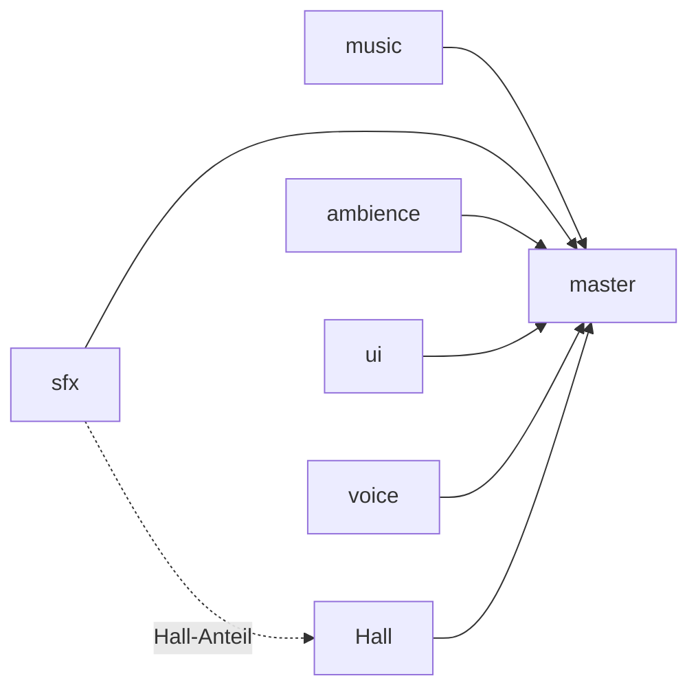

# 7 Audio – wie Kern zum Klingen kommt

> **Kurz gesagt:** Kern hat sein eigenes Tonstudio eingebaut. Ein Mischpult in C++ rechnet jeden
> Ton selbst aus, setzt ihn in den 3D-Raum, legt Hall darüber und passt auf, dass nichts
> übersteuert. Alle eingebauten Geräusche – vom Münz-Pling bis zur Musik – entstehen aus reiner
> Rechnerei, ganz ohne Sound-Dateien. Der Browser ist am Ende nur noch der Lautsprecher.

Stell dir ein Spiel ohne Ton vor: Ein Auto rast lautlos vorbei, eine Kiste kracht stumm auf den
Boden. Ein Stummfilm! Ton ist die halbe Miete – und dieses Kapitel zeigt, wie Kern ihn macht.

## 7.1 Schall, Samples und ein eigener Mixer

Schall ist zitternde Luft. Schnelles Zittern hören wir als hohen Ton, langsames als tiefen. Ein
Computer misst diese Welle in winzigen Abständen und schreibt jedes Mal eine Zahl auf. Das heißt
**Abtastung** (*Sampling*), jede Zahl ist ein **Sample**, und wie oft gemessen wird, ist die
**Abtastrate**. Bei 48 000 Hz sind das 48 000 Zahlen pro Sekunde und Ohr. So eine Zahlenreihe nennt
man **PCM**.

> **Stell dir vor …** ein Daumenkino für die Ohren. Jedes Blatt ist ein Sample. Blätterst du 48 000
> Blätter pro Sekunde durch, hörst du keinen Ruckel mehr, sondern einen glatten Ton.

Browser haben eine eigene Tonmaschine, Web Audio. Kern nutzt sie nur als Lautsprecherausgang und zum
Entpacken importierter Dateien. Gemischt wird in Kerns eigener Sound-Engine, die im selben
WebAssembly-Programm läuft wie Grafik und Physik. Das bringt drei Vorteile:

- **Immer gleich (deterministisch):** Dieselben Ereignisse ergeben auf jedem Gerät exakt dieselben
  Samples.
- **Ein Code für alles:** Studio, exportierte Spiele und Tests nutzen denselben C++-Code.
- **Volle Kontrolle:** kein Knacken beim Stoppen, kein Übersteuern – die Ausgabe bleibt immer
  zwischen −1 und +1.

## 7.2 Der Mixer – Kerns Mischpult

> **Stell dir vor …** ein Mischpult im Tonstudio. Jede Spur hat einen eigenen Regler, alles läuft in
> Gruppen zusammen und am Ende in einen Hauptregler zu den Boxen. Kerns Mixer ist genau das, nur in
> Software.

Beim Start bekommt der Mixer die Abtastrate des Lautsprechers und einen festen Vorrat an
**Stimmen** – gerade laufenden Tönen. Studio nimmt 64, höchstens gehen 128. Ausgegeben wird Stereo.

**Clips** sind die Tonaufnahmen, mono oder stereo. Hat ein Clip eine andere Abtastrate, rechnet der
Mixer ihn **einmal** beim Laden sorgfältig um (mit einem hochwertigen *Windowed-Sinc-Filter*, der
keine falschen Spiegeltöne erzeugt). Das ist aufwendig, aber danach genügt beim Abspielen eine
billige Zwischenrechnung.

Wer einen Clip abspielt, gibt Einstellungen mit: Lautstärke, Tonhöhe (*Pitch*), Stereoposition
(*Pan*), Schleife, Einblenden, Bus, Priorität und für 3D-Töne Ort, Geschwindigkeit, Abstände und
Doppler. Unsinnige Werte werden in den erlaubten Bereich geschoben statt abgelehnt. Zurück kommt eine
Stimmen-Nummer mit eingebauter „Generation“: Ist der Platz längst neu belegt, passt die alte Nummer
nicht mehr, und ein verspäteter Befehl verstellt nicht aus Versehen einen fremden Ton.

**Wenn alle Plätze voll sind**, wirft der Mixer die unwichtigste Stimme hinaus – zuerst die mit der
niedrigsten Priorität, dann die leiseste, dann die älteste. Das heißt *Voice Stealing*. Wichtigere
Stimmen als der Neuankömmling werden nie gestohlen.

> **Achtung, Falle!** Ein hart abgeschnittener Ton macht ein hässliches „Klick“. Deshalb blendet
> Kern beim Stoppen immer aus, mindestens 5 Millisekunden lang, und auch Lautstärkeänderungen
> gleiten (normalerweise über 30 ms).

### So wird gemischt

Der Mixer arbeitet in Häppchen zu 128 Frames. Pro Häppchen rechnet er für jede Stimme aus, wie laut
sie links und rechts sein soll, und lässt die Lautstärke innerhalb des Häppchens **gleiten**. Fährt
ein Auto vorbei, springt der Pegel nicht stufig, sondern fließt – ohne kratzendes „Zipper“-Geräusch.
Dann liest er Sample für Sample den Clip. Liegt die Leseposition zwischen zwei Samples, schätzt er
den Wert aus vier Nachbarn mit einer weichen Kurve (Hermite-Interpolation), dämpft die Höhen nach
Entfernung und addiert alles in den Bus.

**Virtuelle Stimmen:** Ist ein 3D-Ton praktisch unhörbar weit weg, wird er nicht gemischt – das spart
Zeit. Seine Position läuft aber heimlich weiter. Kommst du zur brummenden Maschine zurück, brummt sie
an der richtigen Stelle weiter statt von vorn.

## 7.3 3D-Klang – Ton mit Ort

Der Mixer kennt einen **Hörer**; im Spiel sitzt er an der Kamera. Für jede 3D-Stimme rechnet Kern
vier Dinge aus.

**Entfernung.** Bis zum Mindestabstand ist ein Ton voll laut, danach fällt er ab – nach der Kurve
*inverse* (Standard), *linear* oder *exponential*. Beispiel *inverse* mit 1 m Mindestabstand: bei 2 m
halb so laut, bei 4 m ein Viertel. Weil solche Kurven nie ganz null erreichen, blendet Kern über die
letzten 20 % vor dem Höchstabstand zusätzlich aus. Dahinter ist wirklich Ruhe.

**Links oder rechts.** Kern verteilt den Ton danach, wie weit die Quelle seitlich liegt. Sehr nahe
und „breite“ Quellen werden weniger stark verteilt, damit eine Biene am Kopf nicht hart von Ohr zu
Ohr springt. Und Kern nutzt **Equal-Power-Panning**: Die Gesamtenergie bleibt gleich, egal wo der Ton
steht. Einfaches Überblenden würde in der Mitte ein „Loch“ erzeugen.

**Vorn oder hinten.** Hohe Töne verlieren sich in der Luft schneller als tiefe – darum klingt fernes
Donnern dumpf. Kern nimmt mit der Entfernung Höhen weg, und hinter dir noch mehr: direkt hinten
bleiben 40 % der Grenzfrequenz. So erkennt dein Ohr „vorn“ und „hinten“.

**Doppler.**

> **Wusstest du?** Ein Krankenwagen klingt beim Heranfahren höher und nach dem Vorbeifahren tiefer,
> weil seine Schallwellen vorn zusammengedrückt und hinten gedehnt werden. Kern rechnet diesen
> **Doppler-Effekt** mit der echten Schallgeschwindigkeit von 343 m/s aus.

Damit nichts verrückt spielt, ändert sich die Tonhöhe höchstens auf die Hälfte oder das Doppelte,
und zwar geglättet. Jede Stimme kann Doppler auch abschalten.

## 7.4 Busse, Hall und der Aufpasser am Ende

Jede Stimme spielt auf einem **Bus**, einer Gruppe am Mischpult: `music`, `sfx` (Effekte),
`ambience` (Hintergrund), `ui` (Oberfläche) oder `voice` (Stimmen). Alle münden in `master`.



Jeder Bus hat Lautstärke, Stummschalter, einen optionalen Tiefpass und einen **Hall-Anteil**. Auch
hier gleitet alles, sodass selbst Stummschalten nicht klickt.

> **Stell dir vor …** du klatschst in einem leeren Treppenhaus. Der Knall prallt hundertfach von den
> Wänden zurück, immer leiser, bis nur ein Rauschen bleibt. Das ist **Hall**.

Kerns Hall ist **Freeverb**, ein bekanntes Verfahren von Jezar at Dreampoint. Acht **Kammfilter** pro
Kanal wirken wie Bälle, die zwischen zwei Wänden springen: ein Echo nach dem anderen, jedes leiser,
und die Höhen klingen schneller ab – wie in einem Raum mit Teppich. Die acht haben leicht
verschiedene Längen und ergeben zusammen eine dichte Echo-Wolke. Vier **Allpässe** verwischen den
Rest, und der rechte Kanal hat etwas längere Leitungen, damit der Hall breit klingt.

Ganz am Ende wacht der **Limiter**. Würde eine Spitze die Schwelle 0,92 überschreiten, dreht er
sofort leiser und lässt danach langsam los (etwa 120 ms). Ein weiches „Abrunden“ (Soft-Clip) fängt
jeden Rest ab, sogar ungültige Zahlen. Nebenbei misst der Mixer Pegel und Stimmen; daraus zeichnet
die Statusleiste im Studio ihre Pegelanzeige, deren Spitze wie eine echte Nadel langsam abfällt.

## 7.5 Der Synthesizer – die Geräuschfabrik

> **Wusstest du?** Kern bringt **keine einzige Sound-Datei** mit. Jeder eingebaute Sound – Sprung,
> Explosion, Wind, sogar zwei Musikstücke – wird beim Laden aus ein paar Zahlen ausgerechnet, mit
> festen Startwerten und deshalb überall gleich.

Der Synthesizer steht in der Tradition von *sfxr*, einem beliebten Werkzeug für Retro-Spielsounds,
erweitert um Filter, Rauschfarben, FM und Schichtung. Ein Sound ist ein **Patch**, eine Art Rezept:
Wellenform (Rechteck, Säge, Sinus, Dreieck, Puls, weißes oder rosa Rauschen), Hüllkurve (anschwellen,
halten, verklingen, dazu ein „Punch“ am Anfang), Tonhöhe mit Rutschen, Vibrato und Sprung, Filter
sowie Effekte wie Tremolo, Wiederholung und „Bitcrush“. Langsame Änderungen wie Vibrato rechnet Kern
nur alle 16 Samples neu – das spart viel Zeit und ist nicht hörbar.

Das Rezept für den Pickup-Sound, direkt aus dem Code:

```cpp
} else if (name == "pickup") {
  SynthPatch a = patch(Wave::pulse, 988, 0.002f, 0.05f, 0.28f, 0.42f);
  a.duty = 0.35f;
  a.arp_ratio = 1.5f;          // nach 65 ms eine Quinte höher
  a.arp_time = 0.065f;
  out = synthesize(a, rate);
  add(out, bell(rate, 100, 0.35f), 0.35f);
```

Zeile für Zeile: Nimm eine Pulswelle mit 988 Hz und kurzer Hüllkurve. Mach den Puls etwas schmaler.
Spring nach 65 ms um das 1,5-Fache nach oben – eine Quinte, das typische „Pling-PLING“. Rechne es aus
und lege noch einen leisen Glockenton darüber. Fertig ist das Münzgeräusch.

Für Aufprälle kleiner, fester Dinge gibt es **Modalsynthese**: ein paar abklingende Sinustöne (die
Eigentöne des Körpers) plus ein winziger Rauschstoß für den Kontakt. Der Code begründet das schön:
Ein massives Kunststoffteil klingt weder tief noch lang, sonst wirkt es wie eine hohle Kiste. Darum
liegen die Töne von `plastic` bei 760, 1650 und 3100 Hz und verklingen in Millisekunden.

Die zwei **Musikstücke** sind echte Partituren: `music_drive` (120 Schläge pro Minute, Am–F–C–G,
treibende Bassdrum) und `music_calm` (80 Schläge pro Minute, Flächen und eine Glockenmelodie). Beide
laufen nahtlos im Kreis. Weil ihr Ausrechnen einige hundert Millisekunden dauert, verteilt Kern es
in kleine Zeitscheiben – so ruckelt ein Level beim Laden nicht.

Angesprochen werden Sounds mit `builtin:<name>`. Es gibt 38 in acht Gruppen: Gameplay
(`pickup`, `jump`, `goal` …), Combat (`gunshot`, `reload` …), Physics (`explosion`, `impact`,
`plastic` …), Vehicle (`engine`, `hover`, `boost`), Ambience (`wind`, `city`, `hum`), Robot
(`servo`, `quack`, `beep`), UI (`click`, `confirm`, `error`) und Music. Die vollständige Liste steht
im blauen Buch.

> **Probier's aus!** Öffne Kern Studio auf https://kernengine.de/ und klick einmal irgendwo hin –
> vorher bleibt der Browser stumm. Im Content Drawer unten spielt der Tab **Sounds** jeden Sound per
> Klick an. Hör dir `pickup`, `explosion` und `music_calm` an. Kaum zu glauben, dass das nur
> Rechnerei ist!

## 7.6 Die Stimme der Micro Duck

Die Micro Duck – der kleine Laufroboter aus [Kapitel 13](13-micro-duck.md) – quakt, zwitschert und
gurrt, ebenfalls ohne Aufnahmen. Kern hat dafür einen eigenen kleinen Synthesizer, eine Übertragung
des Rust-Pakets `sounds` aus dem Microduck-Projekt von Pollen Robotics, die den echten Roboter gebaut
haben.

Eine einzige Zahl, der **Seed**, legt die Persönlichkeit einer Ente fest: Tonlage, Helligkeit,
Nasalität, Vibrato, Atem, „Quakigkeit“, Triller, Tempo. Zwei Seeds klingen wie zwei verschiedene
Tiere, derselbe Seed immer gleich. Der echte Roboter bildet seinen Seed aus der Seriennummer, Kern aus
Name und Nummer der Ente im Level – mit derselben Rechnung (einem SHA-256-Fingerabdruck).

> **Stell dir vor …** einen Würfel, der durch deinen Namen „gezinkt“ ist: Jedes Mal kommt für dich
> dieselbe Zahlenreihe heraus. So bekommt jede Ente ihre eigene, immer gleiche Stimme.

Ein Laut besteht aus sieben Obertönen, einer Tonhöhenkurve mit Vibrato und Zittern, einem schnellen
Lautstärke-Wackeln (dem Quaken) und etwas Atemrauschen. Es gibt sieben Lautarten – `alarm`, `greet`,
`inquire`, `peck`, `chirp`, `coo`, `wheee` – mit je 6 bis 12 Varianten. Gespielt wird eine zufällige,
damit die Ente nicht wie eine hängende Schallplatte klingt. `wheee` hat Start, Schleife und Ende und
kann so lange dauern wie eine Rutschpartie.

> **Wusstest du?** Kerns Entenstimme ist **Sample für Sample identisch** mit dem Rust-Original: Ein
> Vergleich aller 328 Laute ergibt eine Abweichung von genau null. Dafür stimmen Zufallsgenerator,
> Reihenfolge der Zufallszüge und Zahlentypen exakt überein, und sogar eine Prozessor-Abkürzung, die
> minimal anders rundet, ist abgeschaltet.

Danach macht Kern den Klang absichtlich „schlechter“: 16 Bit wie auf dem Roboter, und alles unter
300 Hz weggefiltert, weil der winzige echte Lautsprecher tiefe Töne kaum wiedergibt. Die Laute
spielen auf dem Bus `voice` am **Kopf** der Ente, wo ihr Lautsprecher sitzt. Ein neuer Laut schneidet
den alten ab, wie bei einem einzigen Lautsprecher. Weil das Ausrechnen auf Telefonen spürbar dauert,
bereitet Kern die Laute jeder Ente vorab vor, einen pro Bild.

## 7.7 Klang im Spiel: SoundBank und GameAudio

Wo ein Level einen Sound nennt, steht ein kurzer Text: `builtin:<name>` für einen eingebauten Sound,
die Kennung eines importierten Sounds (eine WAV-, MP3-, OGG-, M4A- oder FLAC-Datei, direkt im Level
gespeichert), `""` oder `none` für Stille und `auto` für den passenden Standard.

Die **SoundBank** ist die Plattensammlung: Sie verwandelt solche Referenzen in Clips. Eingebaute
Sounds rechnet sie in Zeitscheiben aus, importierte lässt sie vom Browser entpacken. Vor dem Start
fordert sie alles an, was das Level brauchen könnte – Musik, Motor, Aufprälle, Waffen, Pickups,
Jingles. Play beginnt dann mit allem an seinem Platz.

**GameAudio** ist der Tontechniker. Es überträgt die Ton-Einstellungen des Levels aufs Mischpult und
erledigt jedes Bild:

1. **Pause** übernehmen.
2. Den **Hörer** an die Kamera setzen. Springt die Kamera schneller als 200 m/s (ein Schnitt), zählt
   ihre Geschwindigkeit als null – sonst gäbe es einen absurden Doppler-Jauler.
3. **Musik und Hintergrund** starten, sobald sie bereit sind.
4. Den **Motor des Spielers** führen: Lautstärke und Tonhöhe steigen mit Tempo und Gas. Ohne Doppler,
   denn die Kamera fährt ja mit. Bei der Micro Duck surren stattdessen die Servos.
5. **Audio Sources** an ihren Actors mitführen.
6. Die **Cues** der Simulation abspielen. Ist ein Clip noch nicht fertig, wartet der Cue höchstens
   0,25 s und fällt dann weg – ein zu spätes Geräusch ist schlimmer als keins.

Prioritäten sorgen für Ordnung: Musik und Motor sind wichtig, kurze Effekte nicht. Eine Explosion
verdrängt also nie die Musik. Den Motorsound wählt Kern bei `auto` nach Bewegungsart: `hover` für
Hover Car und Flyer, `engine` für das Vehicle, `servo` für die Micro Duck; Kugel, Figur und Soldat
haben keinen.

## 7.8 Cues und Aufprallgeräusche

> **Stell dir vor …** ein Theaterstück. Die Schauspieler rufen nicht selbst „Donner!“, sondern geben
> dem Tontechniker hinter der Bühne ein Zeichen – einen Cue.

Genauso spielt die Simulation selbst nie einen Ton ab. Sie schreibt während der Physikschritte kleine
Zettel, **Cues** („spiel `builtin:jump` hier, so laut, auf diesem Bus“), und GameAudio sammelt sie
jedes Bild ein. Weil Cues in festen Schritten entstehen, sind sie deterministisch. Hört niemand zu,
bleiben nur die neuesten 64 liegen.

Jeder Rigid Body hat einen Aufprall-Sound (Standard `builtin:impact`) und eine **Schwelle** von
2,5 m/s. Jeder Collider kann einen eigenen Sound tragen – die Sohle der Ente klingt nach
`plastic_step`, ihr Gehäuse nach `plastic`. Dazu ein paar Regeln:

- Höchstens **6 Aufprallgeräusche pro Physikschritt**; unter der Schwelle bleibt es still.
- **Entprellen:** Eine Sohle rollt ab und hüpft dabei winzig. Ein Schritt klingt deshalb höchstens
  alle 0,5 s pro Actor, ein Klopfen alle 0,09 s.
- Härtere Aufprälle sind **lauter**; ganz leichte spielen das sanftere `impact_light`.
- **Schwere Dinge klingen tiefer**, leichte nur wenig höher – sonst klänge es nach Glas.

Die Micro Duck setzt ihre Schwelle auf 0,12 m/s, damit man schon zarte Berührungen hört. Brechende
Gelenke spielen `builtin:break`.

> **Probier's aus!** Öffne über File › Example Levels das **Physics Lab** und starte **Simulate**
> (Alt+S). Wirf mit der Maus Kisten herum. Knallen harte Würfe lauter als sanfte Stupser?

## 7.9 Ton im Level einstellen

In den **World Settings** gibt es einen Bereich *Audio*: Gesamtlautstärke, Musikstück und
Hintergrundklang mit je eigener Lautstärke, Hall (Standard 0,25) und Doppler-Stärke. Je mehr Hall,
desto mehr bekommen Effekte, Stimmen und Hintergrund ab; Musik und Oberfläche bleiben trocken.

Die Komponente **Audio Source** macht jeden Actor zur Schallquelle. Sie hat Sound (Standard
`builtin:hum`), Lautstärke, Tonhöhe, Schleife, Start beim Spielbeginn mit optionaler Verzögerung,
3D an/aus, Innen- und Abfallradius (2 m und 40 m), Doppler und **Pitch by speed** – die Tonhöhe
steigt mit dem Tempo des Actors. Im Katalog liegen fertige Varianten: Audio Source
(Maschinenbrummen), Ambient Wind, City Ambience und Radio.

> **Probier's aus!** Zieh im Studio ein **Radio** aus dem Katalog in die Szene und starte Play
> (Alt+P). Fahr heran, weit weg und einmal drumherum. Hörst du, wie die Musik leiser wird, von links
> nach rechts wandert und hinter dir dumpfer klingt?

## 7.10 Die Brücke zum Browser

Der Mixer rechnet, der Browser spielt ab; die Verbindung heißt `KernAudio`. Browser erlauben Ton erst
**nach einer Nutzergeste** – der erste Klick, Tipp oder Tastendruck weckt ihn. Auf iOS sorgt Kern
außerdem dafür, dass der Stummschalter des Telefons das Spiel nicht stumm macht. Alle 20 ms füllt ein
Zeitgeber den Ton nach, so fließt er auch bei langsamen Bildern oder im Hintergrund-Tab.

Am liebsten nutzt Kern ein **AudioWorklet**, einen Browser-Helfer in einem eigenen Faden. Das
Hauptprogramm schickt ihm fertige Tonstücke, das Worklet spielt sie ab.

> **Stell dir vor …** ein Förderband an der Kasse. Liegen immer ein paar Waren drauf, muss die
> Kassiererin nie warten. Kern hält das Band etwa 70 ms voraus gefüllt.

Läuft das Band leer, legt Kern 30 ms Vorrat drauf, bis höchstens 200 ms; nach 15 ruhigen Sekunden
schrumpft er wieder. Bei einer Lücke gleitet der Ton in etwa 2 ms auf null statt zu knacken. Ohne
AudioWorklet nimmt Kern einen älteren Weg, den `ScriptProcessor`.

## 7.11 Tipps für eigene Spiele

- **Eingebaute Sounds zuerst** – sie kosten keinen Download. Eigene Dateien lohnen sich für Musik und
  besondere Geräusche.
- **Busse richtig nutzen**, dann wirken Regler und Hall wie erwartet.
- **Höchstabstand ehrlich setzen** – was dahinter liegt, wird virtuell und kostet nichts.
- **Prioritäten verteilen:** Dauerklänge hoch, kurze Effekte niedrig.
- **Aufprall-Schwellen nicht zu niedrig**, sonst klopfen ruhende Körper ständig.

> **Achtung, Falle!** „Mein Spiel hat keinen Ton!“ – Hast du schon geklickt oder eine Taste
> gedrückt? Vorher bleibt jeder Browser stumm. Das ist seine Regel, kein Fehler von Kern.

Wer in einer eigenen App ([Kapitel 12](12-eigene-spiele.md)) Ton möchte, kann Mixer und Synthesizer
direkt benutzen, muss die Verbindung zum Browser dann aber selbst bauen.

## Das nimmst du mit

- Ton ist eine Reihe von Zahlen: bei 48 kHz 48 000 Samples pro Sekunde und Kanal.
- Kern mischt alles selbst in C++, deterministisch; der Browser ist nur Lautsprecher.
- 3D-Klang: leiser mit Abstand, links/rechts verteilt, dumpfer hinter dir, Doppler beim Vorbeifahren.
- Busse sind Gruppen am Mischpult; Freeverb macht Hall, der Limiter verhindert Übersteuern.
- Alle eingebauten Sounds und die Musik werden aus Rezepten ausgerechnet.
- Die Entenstimme ist eine bitgenaue Kopie des Originals; ihre Persönlichkeit steckt im Seed.
- Die Simulation schreibt nur Cues, GameAudio spielt sie ab.

## Knobelecke

1. Warum wird eine Quelle mit Equal-Power-Panning in der Mitte nicht leiser?
2. Du gehst weit weg von einer brummenden Maschine und kommst zurück. Warum brummt sie nicht von vorn?
3. Bei einer großen Explosion wollen 70 Sounds gleichzeitig spielen. Warum verstummt die Musik nicht?
4. Warum ist der Motorsound des Spielers ohne Doppler?

### Lösungen

1. Die Gesamtenergie beider Kanäle bleibt an jeder Position gleich; einfaches Überblenden hätte in
   der Mitte ein Loch.
2. Ihre Stimme war virtuell: nicht gemischt, aber die Position lief weiter.
3. Musik hat hohe Priorität; Effekte dürfen nur Stimmen mit höchstens gleicher Priorität stehlen.
4. Die Kamera folgt dem Spieler, Hörer und Quelle bewegen sich gemeinsam – Doppler wäre falsch.

---

© 2026 Christian Heinrich Hohlfeld · Alle Rechte vorbehalten · [Impressum und Rechte](00-impressum.md)
