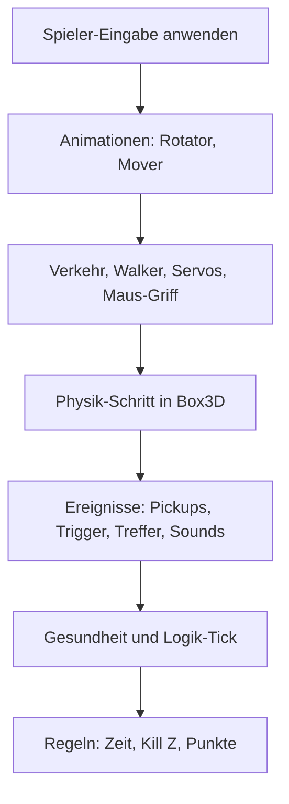

# 8 Die Spiel-Laufzeit – wie aus einem Level ein Spiel wird

> **Kurz gesagt:** Ein Level ist ein Bauplan aus Actors, und jeder Actor ist mit Komponenten
> bestückt wie ein Steckbaustein. Die **GameWorld** erweckt diesen Bauplan zum Leben: Sie baut daraus
> eine Physikwelt, lässt sie in festen Schritten laufen, steuert den Spieler, prüft die Spielregeln
> und schickt Bild und Ton hinaus. Studio und exportierte Spiele benutzen genau denselben Code.

Bisher hast du die Werkzeuge kennengelernt: Grafik, Physik, Ton. Jetzt kommt der Dirigent, der alle
zusammen spielen lässt. Dieser Teil von Kern heißt `kern::game`, und er macht aus Kern eine echte
Game Engine.

## 8.1 Das Leben einer Spielwelt in fünf Zeilen

Die ganze Benutzung passt in fünf Zeilen, die direkt aus dem Code stammen:

```cpp
GameWorld world(renderer, &night_windows);
world.sync(level);                  // Meshes für die Editor-Ansicht
world.start(level, SimMode::play);  // Box3D-Welt, Controller, Regeln
// jeden Frame:
world.step(dt, input); world.update_camera(cam, dt, input);
world.present(now_ms, eye);
world.stop();                       // zurück zum bearbeiteten Level
```

In Worten:

- **`sync`** zeigt das Level im Editor an. Es lädt nur das neu hoch, was sich geändert hat.
- **`start`** macht eine Kopie des Levels, baut die Physikwelt und startet Simulate oder Play.
- **Jedes Bild** geht die Welt einen Schritt weiter (`step`), die Kamera folgt (`update_camera`), und
  alles wird an den Renderer übergeben (`present`).
- **`stop`** reißt alles ab und zeigt wieder das Level, wie es vorher war.

> **Achtung, Falle!** Was während einer Simulation passiert – umgefallene Kisten, verschobene
> Kugeln –, landet **nicht** im Level. Nach Stop steht alles wieder an seinem Platz. Willst du eine
> simulierte Pose behalten, nimm im Studio **Keep Simulation Changes** (Taste K).

## 8.2 Die Spielregeln der Zahlen

Damit alle Teile dieselbe Sprache sprechen, gelten feste Abmachungen:

- Gemessen wird in **Metern, Sekunden und Kilogramm**.
- **Z zeigt nach oben** (nicht Y, wie in manchen anderen Programmen).
- Drehungen stehen als **Winkel in Grad** da: Rollen, Nicken, Gieren – genau wie im Editor.
- Farben sind **sRGB-Werte von 0 bis 1**, in der Datei als `#rrggbb`.
- Die Lage eines Actors ist immer **relativ zu seinem Eltern-Actor**. Hängst du ein Rad an ein Auto,
  fährt das Rad mit.
- Kind-Actors ohne eigenen Körper werden beim Simulieren in den Körper ihres nächsten Vorfahren
  „eingeschweißt“. Die Kabine eines Autos wird so ein Teil des Autos.

## 8.3 Level und Actor

Ein **Level** ist das Dokument, das Kern Studio bearbeitet und als `.klevel` speichert. Es enthält:

- einen Namen und die **World Settings** (8.5),
- die Liste der **Actors**,
- importierte **Texturen** und **Sounds** (direkt in der Datei gespeichert),
- einen **Level-Graphen** für Logik ([Kapitel 9](09-logik.md)),
- die Position der Editor-Kamera und die nächste freie Nummer für neue Actors.

Ein **Actor** ist ein Ding in der Welt: ein Würfel, eine Lampe, ein Auto, eine Ente. Jeder Actor hat
eine eindeutige Nummer, einen Namen, einen Eltern-Actor, einen Ordner im Outliner, die Schalter
„versteckt“ und „gesperrt“, eine Transform (Position, Drehung, Größe) und freie **Tags** –
Schlagworte, über die Logik ihn wiederfinden kann. Und dann kommen die Komponenten.

> **Stell dir vor …** einen Steckbaustein mit Noppen. Ein nackter Actor ist nur der Grundstein: Er
> hat einen Ort, sonst nichts. Steck ein **Mesh** drauf, und man sieht ihn. Steck einen **Rigid Body**
> drauf, und er fällt runter. Steck einen **Player Controller** drauf, und du kannst ihn fahren. So
> baust du aus wenigen Teilen alles Mögliche.

Von den meisten Komponenten darf ein Actor höchstens eine haben (ein Mesh, ein Licht, einen Body …).
**Collider** und **Gelenke** dürfen es beliebig viele sein. Dazu kann jeder Actor einen eigenen
Logik-Graphen tragen.


## 8.4 Die Komponenten – der Steckbaukasten

Hier ist der ganze Baukasten im Überblick. Alle Felder mit Standardwerten listet das blaue Buch.

**Static Mesh** – die sichtbare Form. Zur Wahl stehen Box, Kugel, Zylinder, Kegel, Kapsel, Ebene,
Torus, Rampe oder ein eingebautes Modell (etwa ein Servo der Micro Duck). Dazu ein **Material**:
Farbe, Rauheit, Metall, Leuchten, Durchsichtigkeit, Textur. Spannend: Auch **Reibung** und
**Sprungkraft** (*Restitution*) stehen beim Mesh, unter Mesh › Physics. Denn sie sind die Physik des
Objekts. Ein Mesh mit eingeschalteter Kollision bekommt automatisch einen passenden Collider.

**Point Light** – eine farbige Lampe mit Helligkeit und Reichweite (Standard 12 m).

**Rigid Body** – macht den Actor zu einem physikalischen Körper. Er kann **static** (rührt sich nie),
**kinematic** (bewegt sich nach Plan, lässt sich aber nicht schubsen) oder **dynamic** (fällt, rollt,
prallt ab) sein. Masse 0 heißt: aus der Dichte der Collider berechnen. Weiter gibt es Dämpfung,
Schwerkraft-Faktor, Startgeschwindigkeit, Achsensperren und einen Aufprall-Sound mit Schwelle
([Kapitel 7](07-audio.md)). Importierte Roboter können ihre exakte Massenverteilung mitbringen.

**Collider** – die unsichtbare Form, mit der die Physik rechnet: automatisch ans Mesh angepasst,
Box, Kugel, Kapsel oder konvexe Hülle. Mit Dichte (Standard 1000 kg/m³, wie Wasser), Reibung und
Oberfläche. Ein Collider kann **Sensor** sein: Er stößt nichts weg, merkt aber, wenn etwas
hineinkommt – perfekt für Ziellinien und Münzen. Über Kanäle und Gruppen legst du fest, wer mit wem
zusammenstößt.

**Constraint** – ein Gelenk zu einem anderen Actor oder zur Welt. Neun Arten: Scharnier (*hinge*),
Schiene (*slider*), Kugelgelenk, fest, Seil (*distance*), Rad, Motor, parallel und „keine Kollision“.
Gelenke können Grenzen, Motoren und Federn haben und bei zu viel Kraft **brechen**. Ein Scharnier kann
außerdem ein **Servo** sein – ein kleiner Motor, der einen Zielwinkel ansteuert, wie bei einem
echten Roboter. Die Regel ist anschaulich: Je weiter der Winkel vom Ziel weg ist, desto stärker
drückt der Servo zurück, gebremst durch Dämpfung und begrenzt durch ein Höchstmoment
([Kapitel 6](06-physik.md)).

**Player Controller** – macht den Actor steuerbar. Sieben Bewegungsarten: Hover Car, rollende Kugel,
Figur (*Character*), Flieger, Fahrzeug, Soldat und Walker (die Micro Duck). Dazu Tempo,
Beschleunigung, Sprung, Boost, Kamera-Art und Sounds. Soldat und Walker haben eigene Zusatzfelder,
etwa Augenhöhe oder die Wahl des Laufnetzes ([Kapitel 13](13-micro-duck.md)).

**Weapon** – eine Waffe für Soldaten: Gewehr, Pistole, Schrotflinte oder Scharfschützengewehr. Jeder
Typ hat eigene Werte. Ein paar Beispiele:

| Waffe | Schaden | Magazin | Reichweite |
|---|---|---|---|
| Gewehr | 24 | 30 | 300 m |
| Pistole | 30 | 12 | 120 m |
| Schrotflinte | 11 × 8 | 6 | 45 m |
| Scharfschütze | 90 | 5 | 1000 m |

Dazu Feuerrate, Streuung, Rückstoß, Nachladezeit und ein Kopftreffer-Faktor.

**Health** – Lebenspunkte (Standard 100), Rüstung, Regeneration, Wiederauferstehen (*Respawn*),
Punkte für den Sieger und auf Wunsch eine Explosion beim Zerstören.

**Pickup** – etwas zum Einsammeln: Punkte, Partikelfarbe, Sound, optional Heilung oder Munition, und
eine Zeit, nach der es wiederkommt.

**Trigger** – eine Zone, die etwas auslöst: Ziel, Gefahr, Checkpoint, Meldung, Sprungschanze,
Teleporter, Schaden oder nur ein Logik-Ereignis (8.12).

**Audio Source** – eine Schallquelle am Actor ([Kapitel 7](07-audio.md)).

**Rotator, Mover, City** – drei Helfer. Der **Rotator** dreht dauernd (Standard 60 °/s um die
Hochachse). Der **Mover** schiebt hin und her – sanft wie ein Pendel, gleichmäßig hin und zurück
oder immer wieder von vorn. Und die **City** baut eine ganze prozedurale Stadt mit Blöcken, Straßen,
Bäumen, Verkehr und Fenstern, die nachts leuchten.

> **Probier's aus!** Platziere im Studio einen **Cube** aus dem Katalog, heb ihn mit dem Gizmo ein
> Stück an und starte Simulate (Alt+S): Er bleibt in der Luft hängen. Stopp, füg ihm in Details über **+ Add** einen **Rigid Body** hinzu
> (Standard: dynamic) und starte erneut. Jetzt fällt er! Eine Komponente mehr – und schon gilt die Schwerkraft.

## 8.5 World Settings – die Einstellungen fürs ganze Level

Die World Settings gelten für das ganze Level. Sie fallen in vier Gruppen:

- **Physik:** Schwerkraft (Standard 9,80665 m/s² nach unten), Schrittrate (Standard 60 pro Sekunde,
  erlaubt 15 bis 480), Unterschritte (1 bis 16), Bodenreibung, Weichheit der Kontakte.
- **Himmel und Licht:** Tageszeit (0,25 Sonnenaufgang, 0,5 Mittag, 0,75 Untergang), Tageslänge
  (0 = eingefroren), Sonnenrichtung, Nebel, Belichtung, Schattenreichweite, Wolken, endloser Boden.
- **Spiel:** Titel, Spieler, Siegbedingung, Zeitlimit, Zielpunktzahl, **Kill Z** (wer tiefer als −50 m
  fällt, wird zurückgesetzt) und die **Observer-Kamera**, mit der Play als freier Zuschauer beginnt.
- **Ton:** Lautstärken, Musik, Hintergrund, Hall, Doppler.

## 8.6 Die Leveldatei

Eine `.klevel`-Datei ist ein **JSON-Dokument** – reiner Text, den du sogar mit einem Texteditor
lesen kannst. Oben stehen `"format": "kern-level"` und eine Versionsnummer, dann Name, Welt,
Kamera, Actors, Texturen, Sounds und Logik. Ein Actor sieht etwa so aus (gekürzt):

```json
{
  "id": 12, "name": "Door", "parent": 3,
  "transform": {"position": [5.2, -12, 1.5],
                "rotation": [0, 0, 0], "scale": [1, 1, 1]},
  "tags": ["door"],
  "components": { "mesh": {...}, "body": {...} }
}
```

Eine Tür mit Nummer 12, die an Actor 3 hängt, an einer bestimmten Position steht, das Tag „door“
trägt und ein Mesh und einen Body hat. Einträge, die dem Standard entsprechen, werden gar nicht erst
geschrieben – das hält die Datei schlank. Zahlen werden auf sechs Nachkommastellen gerundet.

### Nachsichtig und streng zugleich

Beim Lesen folgt Kern einem klugen Motto: **nachsichtig bei Fehlendem, streng bei Falschem.**

- Unbekannte Einträge werden ignoriert, fehlende bekommen Standardwerte. So laden alte Dateien auch
  in neuen Versionen.
- Falsche Typen sind Fehler mit klarer Meldung, etwa „friction must be a number“.
- Zahlen außerhalb ihres Bereichs werden hineingeschoben (Reibung etwa auf 0 bis 10).
- Fehlende oder doppelte Nummern werden neu vergeben. Zeigt ein Actor auf einen Eltern-Actor, den es
  nicht gibt, hängt er danach oben. Und falls sich Actors im Kreis als Eltern haben, wird der Kreis
  aufgebrochen.
- Eine Datei aus einer **neueren** Kern-Version wird abgelehnt.

### Die Prüfung vor dem Start

Vor Play prüft Kern das Level (`validate`). **Fehler** verhindern Play, etwa eine fehlende Nummer,
eine Größe von null, ein Gelenk, das einen Actor mit sich selbst verbindet, oder ein Controller ohne
Body. **Warnungen** landen nur im Output Log, etwa ein Sound, den es nicht gibt (bleibt dann still),
oder ein Pickup, dessen Collider kein Sensor ist.

## 8.7 Vom Bauplan zur Physik

Bevor die Physik-Engine Box3D loslegen kann, muss Kern ihr sagen, welche Körper es gibt. Das macht
`plan_bodies`. Das Schöne: Studio benutzt denselben Plan, um die Collider im Editor zu zeichnen.
Was du siehst, ist also genau das, was simuliert wird.

Die Regeln in Kurzform:

1. Jeder Actor mit **Rigid Body** wird ein Körper. Ein statischer Körper mit Rotator oder Mover wird
   kinematisch – er bewegt sich ja.
2. Actors mit Collidern, Meshes mit Kollision, Pickups und Trigger **ohne** Body darüber bekommen
   einen **unsichtbaren eigenen Körper** – statisch oder, wenn animiert, kinematisch.
3. Jeder Actor gibt seine Formen an seinen Körper ab: eigene Collider oder einen automatisch
   angepassten. Pickups und Trigger ohne Form bekommen eine Sensor-Kugel mit 1 m Radius.
4. Eine Stadt wird ein statischer Körper mit einer Box je Gebäude.
5. Der **endlose Boden** ist in Wahrheit eine riesige Platte: 20 000 × 20 000 m, Oberkante bei z = 0.

> **Wusstest du?** Der „endlose“ Boden ist gar nicht endlos – er ist nur 20 Kilometer breit. Das
> reicht für jedes Spiel, ohne dass es jemand merkt.

## 8.8 Die Welt starten

`start` geht eine feste Liste durch. Hier die wichtigsten Schritte:

1. Level **prüfen** – ein Fehler bricht ab.
2. Eine **Kopie** des Levels anlegen, das Original merken.
3. Die **Box3D-Welt** bauen, mit Schwerkraft und Kontakt-Einstellungen.
4. Actors so ordnen, dass Eltern vor Kindern kommen.
5. **Körper**, dann **Gelenke**, dann **Walker** anlegen.
6. Den **Stadtverkehr** starten.
7. Den **Spieler** übernehmen (nur in Play).
8. **Regeln** zurücksetzen: Punkte, Zeit, Status. In Play erscheint der Titel als Meldung.
9. Gesundheit und Munition füllen, dann die **Logik** starten.

Beim Anlegen der Körper gibt es kleine Feinheiten. Spielerfahrzeuge werden als „Bullets“ behandelt,
damit sie bei hohem Tempo nicht durch Wände tunneln, und **Spieler schlafen nie**. Fahrzeuge, Figuren
und Flieger dürfen nicht umkippen: Kern sperrt ihr Rollen und Nicken (nur die rollende Kugel und der
Walker dürfen das). Ereignisse wie Treffer meldet die Physik nur dort, wo sie jemand liest – das spart
Arbeit.

Bei den Gelenken gilt eine Merkregel: Der Actor bewegt sich **relativ zu seinem Ziel**. Ein positiver
Motor dreht also den Actor, nicht das Ziel. Federn werden so begrenzt, dass sie zum Physiktakt passen
und nicht wild schwingen.

### Vier Modi

| Modus | Was passiert |
|---|---|
| none | Editor, keine Simulation |
| simulate | Physik und Logik laufen, niemand wird gesteuert; Körper lassen sich greifen |
| play | wie Simulate, dazu Spieler, Regeln und HUD |
| replica | Kopie eines Server-Spiels im Netz ([Kapitel 10](10-netzwerk.md)) |

Mit **F8** wechselst du mitten im Lauf zwischen Simulate und Play („Eject“ und „Possess“), ohne
dass der Spieler seinen Zustand verliert. Pausieren geht auch, und im Pausenzustand macht die
Taste **.** (Punkt) genau einen Schritt.


> **Probier's aus!** Öffne das **Physics Lab** (File › Example Levels), starte Play (Alt+P), drück
> nach ein paar Sekunden **F8** und schau dir die Szene von außen an. Pausiere und tippe immer wieder
> auf **.** – du gehst Bild für Bild durch die Physik wie durch ein Daumenkino.

## 8.9 Ein Frame – das Herz der Spielschleife

> **Stell dir vor …** ein Daumenkino. Jedes Blatt zeigt die Welt einen winzigen Moment später.
> Blätterst du schnell, sieht es aus wie Bewegung. Ein Spiel ist ein Daumenkino, das sich selbst
> zeichnet: Für jedes Blatt rechnet es aus, wo alles jetzt sein muss.

### Feste Schritte, egal wie schnell der Bildschirm ist

Bildschirme zeigen unterschiedlich viele Bilder pro Sekunde: 60, 120, manchmal ruckelt es. Würde
die Physik einfach „so viel Zeit wie seit dem letzten Bild“ rechnen, käme auf jedem Gerät etwas
anderes heraus. Deshalb rechnet Kern immer in **festen Schritten**, normalerweise 1/60 Sekunde.

Das funktioniert wie ein Sparschwein: Jedes Bild wirft die vergangene Zeit hinein. Solange genug für
einen ganzen Schritt drin ist, nimmt Kern einen Schritt heraus und rechnet ihn. Was übrig bleibt,
wartet aufs nächste Bild. Damit ein langer Hänger nicht alles durcheinanderbringt, ist das
Sparschwein begrenzt (auf höchstens 0,1 s Simulation pro Bild). Mehr dazu in
[Kapitel 6](06-physik.md).

Und weil ein Bild meist zwischen zwei Schritten liegt, schiebt Kern die Körper für die Anzeige
geschmeidig zwischen der alten und der neuen Pose hin und her (*Interpolation*). So sieht alles
flüssig aus, obwohl die Physik in festen Häppchen rechnet.

### Was in einem festen Schritt passiert



1. **Spieler:** Die Eingabe jedes Spielers wird angewendet – je nach Art fährt, läuft oder fliegt er.
2. **Animation:** Rotatoren und Mover bekommen ihre Zielpose.
3. **Verkehr** (Autos halten vor dem Spieler), **Walker**, **Servos** und ein eventueller
   **Maus-Griff**.
4. **Physik:** Box3D rechnet einen Schritt mit seinen Unterschritten.
5. **Ereignisse:** eingesammelte Pickups, berührte Trigger, Überlappungen und Treffer für die Logik,
   Kamerawackeln, Aufprall-Sounds, brechende Gelenke.
6. **Gesundheit** (Heilen, Wiederauferstehen) und der **Logik-Tick**.
7. **Regeln:** Zeitlimit prüfen, wer unter Kill Z fiel, zurücksetzen, Punktziel erreicht?

Danach läuft die Tageszeit weiter, die Kamera folgt, und `present` gibt dem Renderer die Posen.
Versteckte Actors, eingesammelte Pickups und benutzte Trigger sind dabei unsichtbar.

Im Studio kommen pro Bild noch ein paar Aufgaben dazu: Kameras und Touch aktualisieren, beim Spielen
Eingaben sammeln und Logik-Haltepunkte prüfen, beim Editieren das Level synchronisieren, und am Ende
Ton und alle sichtbaren Viewports zeichnen.

## 8.10 Controller – fahren, rollen, laufen, fliegen

Jedes Bild bekommt der Spieler-Actor eine **Eingabe**: Bewegung vor/zurück und links/rechts, hoch,
Springen, Boost, Kameradrehung, Zoom, beim Soldaten Schießen, Zielen, Nachladen, Ducken und
Benutzen, bei der Micro Duck ihre Spezialbewegungen. Was daraus wird, hängt vom Controller ab:

- **Hover Car:** Gas schiebt das Auto nach vorn, eine unsichtbare **Schwebefeder** hält es in der
  Luft über dem Boden. Damit es nicht wie auf Eis rutscht, drückt eine Seitenkraft dagegen. Das
  Wippen und Neigen, das du siehst, ist nur Darstellung.
- **Vehicle:** wie das Hover Car, aber ohne Schweben – angetrieben wird nur mit Bodenkontakt.
- **Rolling Ball:** Kraft in Laufrichtung, Sprung als Stoß nach oben, nur am Boden.
- **Character:** Box3Ds **Character Mover**, wie in klassischen Ego-Shootern. Treppenstufen bis 22 %
  der Körpergröße schafft die Figur automatisch, und die Schwerkraft ist 1,5-fach für knackige Sprünge.
- **Flyer:** fliegt in alle Richtungen, die Schwerkraft wird aufgehoben.
- **Soldier:** eine Ego-Shooter-Figur (8.13).
- **Walker:** Die Eingabe geht an das trainierte Netz der Micro Duck, das ihre Servos steuert.

Bei Kugel, Figur und Flieger ist „vorwärts“ immer **dort, wo die Kamera hinschaut**. Gemeinsam haben
alle: Der Boost ist ein Vorrat, der sich beim Boosten leert und danach langsam auffüllt. Wer schneller
als 3,5 m/s landet, hört ein `land`.

### Pawns – die Spielfiguren

> **Stell dir vor …** ein Brettspiel. Das Brett ist das Level, und jeder Mitspieler hat seine
> **Spielfigur**. In Kern heißt die Spielfigur **Pawn** (englisch für Bauer im Schach).

Ein Pawn speichert alles, was zu einem Spieler gehört: welchen Actor er steuert, seine letzte
Eingabe, Blickrichtung, Startpunkt, Boost und Soldatenzustand. Kommt im Netzwerkspiel ein weiterer
Spieler dazu, kopiert Kern den Spieler-Actor samt Kindern, Körpern, Gelenken und Logik und stellt die
Kopie auf einen Ring um den ursprünglichen Start – jede neue Figur ein Stück weiter, damit niemand
auf jemandem landet.

## 8.11 Die Kamera

Die Kamera folgt der **geglätteten** Pose des Spielers. Es gibt drei Arten:

- **Chase:** Bei Fahrzeugen hinter der Fahrtrichtung, mit wachsendem Abstand bei hohem Tempo. Sonst
  kreist sie mit Maus oder Stick um den Spieler. Ein unsichtbarer Strahl verhindert, dass sie in
  Wände rutscht.
- **First Person:** die Augen des Spielers.
- **Top Down:** von oben.

Über 30 m/s weitet sich das Sichtfeld – so fühlt sich Tempo schneller an. Harte Treffer lassen die
Kamera wackeln. Soldaten haben eine eigene Kamera.

## 8.12 Regeln, HUD und Trigger

Das **HUD** ist die Anzeige über dem Spiel: Status (spielt, gewonnen, verloren), Titel, Meldung,
Punkte, gesammelte Pickups, Zeit, Tempo, Boost, Bestzeit – beim Soldaten auch Gesundheit, Munition
und Trefferanzeige.

Die **Siegbedingung** stellst du in den World Settings ein:

| Ziel | Gewonnen, wenn … |
|---|---|
| none | nie – Sandkasten |
| collectAll | alle Pickups gesammelt (und danach das Ziel erreicht, falls es eins gibt) |
| reachGoal | ein Ziel-Trigger erreicht ist |
| survive | das Zeitlimit überstanden ist |
| score | die Zielpunktzahl erreicht ist |

Mit Zeitlimit verliert man bei null – außer bei *survive*. Ein Gefahren-Trigger verliert immer.

**Trigger** können viel: *goal* gewinnt, *hazard* verliert, *checkpoint* setzt den Startpunkt um,
*message* zeigt einen Text, *launch* schleudert den Spieler hoch (Sprungschanze), *teleport* beamt
ihn zu einem anderen Actor (mit einer Sekunde Sperre gegen sofortiges Zurückbeamen), *damage* zieht
Lebenspunkte ab und *event* meldet sich nur bei der Logik. Jeder Trigger hat einen passenden
Standard-Sound. Und vor jeder Aktion sagt er der Logik Bescheid.

**Pickups** werden beim Berühren eingesammelt: Punkte, Sound, Funken, Heilung oder Munition. Ein
reines Heilpaket bleibt übrigens liegen, solange du volle Gesundheit hast – clever, oder?

## 8.13 Soldaten

Der **Soldat** ist ein Ego-Shooter-Spieler, übernommen aus SpawnCity, dem Spiel, aus dem Kern
entstanden ist. Alles wird in den festen Schritten berechnet. Einige Feinheiten, die das Spielgefühl ausmachen:

- **Ducken** macht die Figur auf 60 % kleiner; aufstehen geht nur, wenn über dem Kopf Platz ist.
  **Sprinten** geht nur vorwärts und nicht beim Zielen.
- **Sprungpuffer und Coyote-Zeit:** Drückst du Springen bis 0,14 s *vor* der Landung, zählt es
  trotzdem. Und bis 0,12 s *nachdem* du über eine Kante gelaufen bist, darfst du noch springen – wie
  der Kojote im Zeichentrick, der kurz in der Luft steht.
- **Fallschaden** ab 7,7 m/s Landegeschwindigkeit, tödlich ab 15 m/s.
- **Schüsse** sind unsichtbare Strahlen aus dem Auge. Die Streuung wirkt zufällig, ist aber
  **deterministisch** berechnet – auf jedem Rechner fliegt die Kugel gleich.
- **Lag-Kompensation:** Im Netz prüft der Server, wo die anderen Spieler standen, als du geschossen
  hast – bis zu 0,5 s zurück. Ein Treffer am oberen Ende der Figur oder an einem Teil mit Tag `head`
  ist ein Kopftreffer.
- **Schaden:** Rüstung fängt bis zu zwei Drittel ab; frisch wiederbelebte Spieler sind 2,5 s
  geschützt.

Die Figuren, Waffen, Mündungsfeuer, Einschusslöcher und Hülsen sind reine Darstellung – sie ändern
die Simulation nicht. Die Waffenmodelle sind aus Grundformen gebaut.


## 8.14 Walker

Ein **Walker** ist ein gelenkiger Roboter, der auf seinen eigenen Servos läuft – die Micro Duck mit
dem trainierten Netz von Pollen Robotics. Die GameWorld legt für jeden Walker einen Steuerzustand an
und treibt ihn jeden Schritt: Sensoren lesen, Verhalten wählen, alle vier Physikschritte das Netz
fragen, Servos bewegen. Das ist ein Thema für sich, nachzulesen in [Kapitel 13](13-micro-duck.md).

## 8.15 Der Ton

Die Simulation spielt selbst keinen Ton ab. Sie legt **Sound-Cues** ab – kleine Zettel wie „Sprung
hier“ – für Sprünge, Boost, Landungen, Schritte, Pickups, Trigger, Sieg und Niederlage, Treffer,
Schüsse, Explosionen, brechende Gelenke und Aufpralle. Höchstens 64 liegen gleichzeitig bereit.
**GameAudio** holt sie jedes Bild ab und spielt sie auf Kerns Mixer, zusammen mit Musik, Hintergrund
und dem Motorsound des Spielers. Wie das genau klingt, steht in [Kapitel 7](07-audio.md).

## 8.16 Touch, Maus und Gamepad

Kern läuft auch auf dem Telefon. Dafür hat es ein Touch-System, ebenfalls aus SpawnCity übernommen.

Ein **Schiedsrichter** (`InputArbiter`) entscheidet, welches Gerät du gerade benutzt. Das zuletzt
benutzte gewinnt, mit ein paar klugen Regeln: Ein Finger schaltet auf Touch. Jede echte Taste
schaltet auf Tastatur, auch am Handy. Eine Maus macht ein Telefon aber nicht zum Desktop.

Die **Touch-Steuerung** legt zwei virtuelle Sticks in die unteren Ecken – links zum Bewegen, rechts
zum Schauen – und Knöpfe passend zum Controller:

| Spielfigur | Knöpfe |
|---|---|
| Soldat | JUMP, RELOAD, AIM, CROUCH, USE |
| Micro Duck | QUACK, PICK, SIT, KICK L/R, ROLL, BEAK, WHEEE, HOP |
| Kugel | JUMP, BOOST |
| Flieger | UP, DOWN, BOOST |
| Fahrzeuge | BOOST, HOP, USE |

Ein paar Kniffe: Den linken Stick ganz nach vorn drücken heißt Sprinten. Schnelle Wischer auf dem
rechten Stick drehen stärker („Flick“). Und ziehst du den Stick über den Rand hinaus, dreht die
Kamera einfach weiter (*Edge Turn*). Gamepads funktionieren ebenfalls.


## 8.17 Logik in der Welt

Jeder Actor und das Level können einen **Logik-Graphen** tragen. Die GameWorld startet sie in Play
und Simulate und schickt ihnen Ereignisse: Überlappung, Treffer, Pickup, Trigger, Schaden, Tod,
Interact, Tasten, Spielende, neuer Spieler. Die Graphen können umgekehrt die Welt verändern – Actors
verschieben, erzeugen, anschubsen, Gelenkmotoren schalten, Punkte vergeben. Was sie ändern, wird
fürs Netzwerk mitgeschrieben. Mehr in [Kapitel 9](09-logik.md).

## 8.18 Die Beispiel-Levels

Unter File › Example Levels (und File › New Level) warten sechs fertige Welten:

- **Orb Run:** eine prozedurale Stadt mit Verkehr. Du fährst ein Hover Car (1200 kg, mit Kabine,
  Spoiler und leuchtenden Düsen als eingeschweißten Kindern) und sammelst 24 Energie-Orbs. Der Lauf
  beginnt am späten Nachmittag und endet in der Nacht – ein ganzer Tag dauert hier 480 s. Studio
  startet mit diesem Level.
- **Physics Lab:** alle Gelenkarten auf einem Spielplatz – Kistenpyramide, Pendel, Tür mit Feder,
  Seilbrücke aus 12 Planken (die mittleren Gelenke brechen bei 60 000 N), Drehteller, Lift und ein
  selbstfahrender Rover. Du bist eine rollende Kugel und musst ins Ziel.
- **Shooting Range:** ein Schießstand mit acht Zielpuppen in 10 bis 60 m, Deckung und Turm; Ziel sind
  150 Punkte, auch im Mehrspieler.
- **Micro Duck:** ein Zimmer im Maßstab des Roboters – echt 2,5 × 2,5 m, in der Welt 10 × 10 m – mit
  Holzboden, Büchern, Ball und Socken. Die Ente läuft selbstständig, die Physik rechnet mit 100 Hz
  und 16 Unterschritten, und ein Logik-Graph lässt sie zwitschern, wenn sie den Ball sieht.
- **Basic:** Boden und ein Würfel. **Empty:** gar nichts.


> **Probier's aus!** Starte im Studio Orb Run mit Play (Alt+P) und sammle ein paar Orbs. Dann öffne
> die World Settings und stell die **Tageszeit** auf 0,75. Starte erneut – jetzt fährst du in den
> Sonnenuntergang.

## 8.19 Was die GameWorld sonst noch kann

Die GameWorld hat noch viele weitere Schalter – für Darstellung, Zustand, Kampf, Netzwerk, Logik und
das Greifen von Körpern mit der Maus. Eine davon ist besonders hübsch zum Verstehen: die
**Debug-Ansicht**. Sie zeichnet die Collider farbig nach Art – statisch grün, kinematisch blau,
dynamisch orange, Sensor violett, schlafend grau – dazu Kontaktpunkte und Gelenkachsen. Die volle
Liste steht im blauen Buch.

Natürlich ist all das durch Tests abgesichert: Datei hin und zurück, Körperplanung, Stadtgenerator,
Orb Run und Physics Lab durchspielen, Siegregeln, Soldat, Character Mover, Aufprall-Sounds und mehr.

## Das nimmst du mit

- Ein Level besteht aus Actors; Komponenten sind die Steckbausteine, die ihnen Fähigkeiten geben.
- Kern misst in Metern und Sekunden, Z zeigt nach oben, Drehungen in Grad.
- Die `.klevel`-Datei ist JSON: nachsichtig bei Fehlendem, streng bei Falschem.
- `plan_bodies` macht aus dem Bauplan Physikkörper – Editor und Simulation sehen dasselbe.
- Die Spielschleife rechnet in festen Schritten und interpoliert fürs Bild – wie ein Daumenkino.
- Simulate lässt die Welt laufen, Play gibt dir dazu einen Spieler, Regeln und HUD; F8 wechselt.
- Sieben Controller machen Fahren, Rollen, Laufen, Fliegen, Schießen und Watscheln möglich.
- Ton läuft über Cues, Logik über Ereignisse – beide deterministisch in den festen Schritten.

## Knobelecke

1. Du lässt in Simulate einen Turm einstürzen und drückst Stop. Wo liegen die Steine jetzt?
2. Warum rechnet Kern die Physik in festen Schritten statt mit der echten Zeit seit dem letzten Bild?
3. Ein Würfel ohne Rigid Body, aber mit Mover, soll eine Kugel anschubsen. Welchen Körper bekommt er?
4. Warum bleibt ein Heilpaket liegen, wenn du darüberläufst?
5. Was ist Coyote-Zeit, und warum macht sie ein Spiel angenehmer?

### Lösungen

1. Wieder an ihrem Platz. Die Simulation arbeitet mit einer Kopie; nur Keep Simulation Changes
   übernimmt Posen.
2. Damit auf jedem Gerät exakt dasselbe herauskommt – unabhängig davon, wie schnell der Bildschirm ist.
3. Einen eigenen unsichtbaren Körper, und weil er animiert ist, einen kinematischen.
4. Weil du volle Gesundheit hast – es wäre verschwendet.
5. Man darf kurz nach dem Verlassen einer Kante noch springen. Das verzeiht knappe Reaktionen und
   fühlt sich fairer an.

---

© 2026 Christian Heinrich Hohlfeld · Alle Rechte vorbehalten · [Impressum und Rechte](00-impressum.md)
