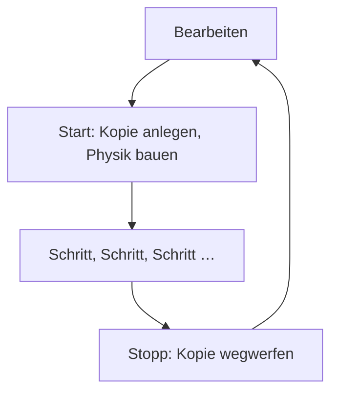
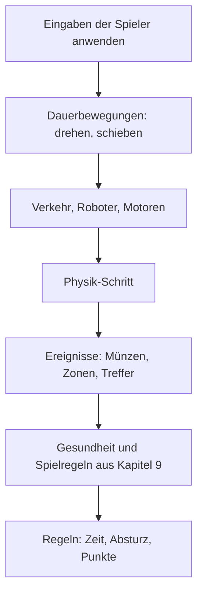

# 8 Die Spiel-Laufzeit – wie aus einem Level ein Spiel wird

> **Kurz gesagt:** Ein Level ist ein Bauplan aus Actors, und jeder Actor ist mit Komponenten
> bestückt wie ein Steckbaustein. Die **GameWorld** erweckt diesen Bauplan zum Leben: Sie baut daraus
> eine Physikwelt, lässt sie in festen Schritten laufen, steuert den Spieler, prüft die Spielregeln
> und schickt Bild und Ton hinaus. Studio und exportierte Spiele benutzen genau denselben Code.

> **Begriffe vorab:**
> - **Box3D** – das Physik-Rechenwerk in Kern, das Fallen, Stoßen und Rollen ausrechnet
>   ([Kapitel 6](06-physik.md)).
> - **Starrkörper** (Rigid Body) und **Kollider** (Collider) – der Körper eines Dings (Masse, Tempo) und seine unsichtbare Form,
>   mit der die Physik rechnet.
> - **statisch, kinematisch, dynamisch** – rührt sich nie wie eine Wand / bewegt sich nach Plan wie
>   ein Aufzug, lässt sich aber nicht schubsen / fällt, rollt und prallt frei ab.
> - **Sensor** – eine Form, die nichts wegstößt, aber merkt, wenn etwas hineinkommt, wie eine
>   Lichtschranke.
> - **HUD** – die Anzeige über dem Spielbild: Punkte, Zeit, Tempo, wie das Armaturenbrett im Auto.
> - **Server** – im Netzwerkspiel der eine Rechner, der das Sagen hat; die anderen zeigen Kopien.
> - **Lag** – die Verzögerung im Netz: Was du siehst, ist schon ein paar Hundertstel Sekunden alt.
> - **Netz (neuronales Netz)** – ein Programm, das durch Üben statt durch Programmieren entstanden
>   ist; so eins steuert die Micro Duck ([Kapitel 13](13-micro-duck.md)).

Bisher hast du die Werkzeuge kennengelernt: Grafik, Physik, Ton. Jetzt kommt der Dirigent, der alle
zusammen spielen lässt. Dieser Teil macht aus Kern eine echte Game Engine.

## 8.1 Das Leben einer Spielwelt

Eine Spielwelt hat einen einfachen Lebenslauf: Sie wird angezeigt, gestartet, läuft Schritt für
Schritt und wird wieder gestoppt. Gespielt wird dabei immer auf einer **Kopie** des Levels, darum ist
nach dem Stoppen alles wieder wie vorher.

> **Stell dir vor …** eine Probe im Theater. Das Bühnenbild steht. Bei der Probe wird umgerückt,
> umgeworfen, verschoben – und danach stellen die Bühnenarbeiter alles wieder an seinen Platz.



- **Bearbeiten:** Die GameWorld zeigt das Level im Editor an. Ändert sich etwas, lädt sie nur das
  Geänderte neu.
- **Start:** Sie macht eine Kopie des Levels, baut die Physikwelt und startet **Simulieren** (Simulate)
  oder **Spielen** (Play).
- **Jedes Bild:** Die Welt geht einen Schritt weiter, die Kamera folgt, und alles wird gezeichnet.
- **Stopp** (Stop): Alles wird abgerissen, und du siehst wieder das Level, wie es vorher war.

> **Achtung, Falle!** Was während einer Simulation passiert – umgefallene Kisten, verschobene
> Kugeln –, landet **nicht** im Level. Nach **Stopp** steht alles wieder an seinem Platz. Willst du
> eine simulierte Pose behalten, nimm im Studio
> **Spielen › Simulationsänderungen übernehmen** (Play › Keep Simulation Changes) oder die Taste K.

## 8.2 Die Spielregeln der Zahlen

Damit alle Teile von Kern dieselbe Sprache sprechen, gelten feste Abmachungen über Maße, Richtungen
und darüber, wer an wem hängt.

- Gemessen wird in **Metern, Sekunden und Kilogramm**.
- **Z zeigt nach oben** (nicht Y, wie in manchen anderen Programmen).
- Drehungen stehen als **Winkel in Grad** da: Rollen, Nicken, Gieren – genau wie im Editor. Die
  Wörter kommen aus der Fliegerei: **Rollen** heißt, die Flügel kippen zur Seite; **Nicken** heißt,
  die Nase geht hoch oder runter; **Gieren** heißt, die Nase schwenkt nach links oder rechts.
- Farben sind Werte von 0 (aus) bis 1 (voll) für Rot, Grün und Blau.
- Die Lage eines Actors ist immer **relativ zu seinem Eltern-Actor**. Hängst du ein Rad an ein Auto,
  fährt das Rad mit.
- Kind-Actors ohne eigenen Körper werden beim Simulieren in den Körper ihres nächsten Vorfahren
  „eingeschweißt“. Die Kabine eines Autos wird so ein Teil des Autos.

> **Für Neugierige:** Die drei Drehungen werden in einer festen Reihenfolge ausgeführt, denn zwei
> Drehungen nacheinander ergeben je nach Reihenfolge eine andere Lage – probier es mit einem Buch aus.
> Denk dir einen Piloten: Er giert zuerst, nickt dann um seine schon mitgedrehte Querachse und rollt
> zuletzt um seine mitgedrehte Längsachse. Als Rezept geschrieben steht das „Gieren · Nicken · Rollen“
> da; liest man die Formel wie in [Anhang B](B-grundlagen-rendering.md) von rechts, also um die festen
> Achsen der Welt, heißt dieselbe Drehung: erst Rollen, dann Nicken, dann Gieren. Beide Lesarten
> landen bei genau derselben Lage.

## 8.3 Level und Actor

Ein Level ist eine Liste von Dingen, den Actors, plus ein paar Einstellungen für die ganze Welt. Jeder
Actor hat Namen, Ort und Schlagworte und bekommt seine Fähigkeiten durch aufgesteckte Bausteine.

Ein **Level** ist das Dokument, das Kern Studio bearbeitet und als Datei speichert. Es enthält:

- einen Namen und die **Welteinstellungen** (World Settings), siehe 8.5,
- die Liste der **Actors**,
- importierte **Texturen** (Bilder für Oberflächen) und **Sounds**, direkt in der Datei gespeichert,
- einen **Level-Graphen** für Spielregeln ([Kapitel 9](09-logik.md)).

Welchen Actor du beim **Spielen** (Play) steuerst, steht in den **Welteinstellungen**. Ist dort keiner eingetragen, nimmt
Kern den ersten Actor, der sich steuern lässt.

Ein **Actor** ist ein Ding in der Welt: ein Würfel, eine Lampe, ein Auto, eine Ente.

> **Stell dir vor …** einen Steckbaustein mit Noppen. Ein nackter Actor ist nur der Grundstein: Er
> hat einen Ort, sonst nichts. Steck ein **Mesh** drauf, und man sieht ihn. Steck einen **Starrkörper**
> (Rigid Body) drauf, und er fällt runter. Steck eine **Spieler-Steuerung** (Player Controller)
> drauf, und du kannst ihn fahren. So
> baust du aus wenigen Teilen alles Mögliche.

Der Grundstein selbst trägt nur wenig: einen Namen, seinen Eltern-Actor, eine **Transformation** (Transform),
also Position, Drehung und Größe, und freie **Tags** – Schlagworte, über die Spielregeln ihn wiederfinden. Alles
andere steckt in den Bausteinen. Wie man Actors im Studio ordnet, versteckt oder sperrt, zeigt
[Kapitel 11](11-studio.md).

Von den meisten Komponenten darf ein Actor höchstens eine haben (ein Mesh, ein Licht, einen Starrkörper …).
**Kollider** (Collider) und **Gelenke** dürfen es beliebig viele sein. Dazu kann jeder Actor eigene Spielregeln
als Logik-Graphen tragen.

## 8.4 Die Komponenten – der Steckbaukasten

Jede Komponente gibt einem Actor **genau eine Fähigkeit**. Was ein Ding kann, ergibt sich allein
daraus, welche Bausteine draufstecken. Eine Münze ist nichts Besonderes: Sie ist ein Actor mit
„sichtbar“, „dreht sich“ und „kann eingesammelt werden“.

| Baustein | englisch | gibt dem Ding … | Beispiel |
|---|---|---|---|
| Statisches Mesh | Static Mesh | eine sichtbare Form und Oberfläche | eine rote Kiste |
| Punktlicht | Point Light | ein Licht mit Farbe und Reichweite | eine Straßenlaterne |
| Starrkörper | Rigid Body | einen Körper für die Physik | die Kiste fällt und kippt |
| Kollider | Collider | eine unsichtbare Form zum Anstoßen | die Kiste stößt an die Wand |
| Gelenk | Constraint (joint) | ein Gelenk zu einem anderen Ding | eine Tür im Scharnier |
| Spieler-Steuerung | Player Controller | eine Steuerung für den Spieler | das Schwebeauto |
| Waffe | Weapon | eine Waffe | das Gewehr des Soldaten |
| Gesundheit | Health | Lebenspunkte | eine Zielpuppe, die umfällt |
| Pickup | Pickup | „kann eingesammelt werden“ | eine Münze |
| Trigger | Trigger | eine Zone, die etwas auslöst | die Ziellinie |
| Audioquelle | Audio Source | einen Ton | ein Radio ([Kapitel 7](07-audio.md)) |
| Rotator, Beweger | Rotator, Mover | eine Dauerbewegung | eine drehende Münze, ein Lift |
| Prozedurale Stadt | Procedural City | eine ganze Stadt | die Stadt in Orb Run |

Ein paar Bausteine verdienen einen zweiten Blick, weil sie ein Prinzip zeigen:

**Die Physik steckt im Aussehen.** Reibung und Sprungkraft eines Dings stehen beim Mesh, unter
**Statisches Mesh › Physik** (Static Mesh › Physics), nicht beim Körper. Denn ob etwas glatt ist wie Eis oder griffig wie Gummi, gehört
zum Material – genau wie die Farbe. Schaltest du beim Mesh Kollision ein, bekommt es automatisch
einen passenden Kollider.

**Körper und Form sind getrennt.** Der Starrkörper sagt, *wie* sich ein Ding bewegt: statisch,
kinematisch oder dynamisch. Der Kollider sagt, *welche Form* dabei zählt – eine Box, eine Kugel, eine
**Kapsel** (wie eine Tablette: ein Zylinder mit runden Enden) oder eine Form, die sich ans Mesh
anschmiegt. Gibst du keine Masse an, rechnet Kern sie aus Größe und **Dichte** der Kollider aus. Ab
Werk ist die Dichte die von Wasser (1000 kg je Kubikmeter): Eine Kiste von 1 m × 1 m × 1 m wiegt also
eine Tonne. Aus den Formen ergibt sich auch, wo der **Schwerpunkt** liegt und wie schwer sich das Ding
drehen lässt. Importierte Roboter wie die Micro Duck bringen diese Angaben dagegen fertig mit, aus
dem Bauplan des echten Roboters – dann gelten die, und die Formen bestimmen nur noch, wo etwas
anstößt. Ein Kollider kann außerdem **Sensor** sein – perfekt für Ziellinien und Münzen –,
und du kannst festlegen, wer mit wem zusammenstoßen darf, etwa damit die Teile eines Roboters sich
nicht gegenseitig im Weg sind.

**Gelenke verbinden Dinge.** Es gibt neun Arten, vom Scharnier über die Schiene und das Seil bis zum
Rad. Gelenke können Grenzen, Motoren und Federn haben und bei zu viel Kraft **brechen** – so
entsteht eine Seilbrücke, die unter Last reißt. Ein Scharnier kann außerdem ein **Servo** sein: ein
kleiner Motor, der einen Zielwinkel ansteuert. Je weiter das Gelenk vom Ziel weg ist, desto stärker
drückt er zurück, wie ein Gummiband ([Kapitel 6](06-physik.md)). Ein Gelenk sitzt immer an dem Actor,
der sich bewegen soll, und zeigt auf sein **Ziel** – das andere Ding oder die Welt. Das Ziel ist der
feste Bezug: Positive Werte für Winkel, Weg oder Motortempo bewegen den Actor, nicht das Ziel. So
weißt du beim Einstellen immer, wer sich dreht – die Tür, nicht der Türrahmen.

**Spielfiguren sind auch nur Bausteine.** Die Spieler-Steuerung macht ein Ding steuerbar – als
Schwebeauto, rollende Kugel, Soldat, Micro Duck und mehr (8.10); Waffe und Lebenspunkte sind eigene
Bausteine (8.13).

**Bewegung ohne Physik.** Der Rotator dreht ein Ding dauernd, der Beweger schiebt es hin und her –
sanft wie ein Pendel oder gleichmäßig. Und die Prozedurale Stadt baut aus einer einzigen Zahl (einem *Seed*) eine
ganze Stadt mit Straßen, Bäumen, Verkehr und Fenstern, die nachts leuchten – jedes Mal dieselbe.

Alle Felder, Standardwerte und die Werte der einzelnen Waffen stehen im blauen Buch, Kapitel 8.

> **Probier's aus!** Öffne die **Inhaltsablage** (Content Drawer) mit Strg+Leertaste und klick bei
> **Actors platzieren** (Place Actors) auf **Würfel** (Cube). Heb den Würfel mit den Pfeilen (dem
> *Gizmo*) ein Stück an und starte **Simulieren** (Simulate) mit Alt+S: Er bleibt in der Luft hängen.
> Drück **Stopp** (Stop), füg ihm im Panel **Details** über den Knopf **Hinzufügen** (Add) einen
> **Starrkörper** (Rigid Body) hinzu und starte erneut. Jetzt fällt er! Ein Baustein mehr – und schon gilt die Schwerkraft.

## 8.5 Welteinstellungen – die Einstellungen fürs ganze Level

Manches gilt nicht für ein einzelnes Ding, sondern für die ganze Welt: die Schwerkraft, die
Tageszeit, die Spielregeln, die Musik. Das steht in den **Welteinstellungen** (World Settings),
sortiert in vier Gruppen.

- **Physik (Box3D)** (Physics (Box3D)): Schwerkraft, Bodenreibung und wie genau die Physik rechnet –
  sie rechnet nämlich in kleinen, festen Schritten, und wie viele davon pro Sekunde, stellst du hier
  ein (mehr dazu in 8.9).
- **Himmel und Licht** (Sky and light): Tageszeit (0,25 Sonnenaufgang, 0,5 Mittag, 0,75 Untergang),
  wie schnell die Zeit vergeht (0 = eingefroren), Sonnenrichtung, Nebel, Helligkeit, Schatten, Wolken
  und ein endloser Boden.
- **Spiel** (Game): Titel, Spieler, Siegbedingung, Zeitlimit, Zielpunktzahl, das Feld
  **Kill-Z (darunter Wiedereinstieg)** (Kill Z (respawn below)) – wer tiefer als −50 m fällt, wird
  zurückgesetzt – und die Beobachterkamera, eine freie Zuschauerkamera, mit der das Spielen beginnen
  kann. Ihr Feld heißt **Beobachterkamera (Spielen: fliegen, zuschauen, Körper ziehen)**
  (Observer camera (Play: fly, watch, drag bodies)).
- **Audio:** Lautstärken, Musik, Hintergrund, Hall, Doppler ([Kapitel 7](07-audio.md)).

## 8.6 Die Leveldatei

Ein Level wird als lesbarer Text gespeichert. Ein paar Angaben, etwa Elternteil, Ordner oder Tags,
stehen nur in der Datei, wenn sie gesetzt sind; die Bausteine schreiben dagegen alle ihre Felder aus.

Die Datei ist im Format **JSON** geschrieben – reiner Text mit Klammern, Namen und Werten, den du
sogar mit einem Texteditor lesen kannst. Ein Actor sieht etwa so aus (gekürzt):

```json
{
  "id": 12, "name": "Door", "parent": 3,
  "transform": {"position": [5.2, -12, 1.5],
                "rotation": [0, 0, 0], "scale": [1, 1, 1]},
  "tags": ["door"],
  "components": { "mesh": {...}, "body": {...} }
}
```

Zeile für Zeile: Eine Tür mit Nummer 12, die an Actor 3 hängt. Sie steht an einer bestimmten
Position, ist nicht gedreht und nicht vergrößert, trägt das Schlagwort „door“ und hat zwei
Bausteine: ein Mesh und einen Body.

### Nachsichtig und streng zugleich

Beim Lesen folgt Kern einem klugen Motto: **nachsichtig bei Fehlendem, streng bei Falschem.**

- Unbekannte Einträge werden ignoriert, fehlende bekommen Standardwerte. So laden alte Dateien auch
  in neuen Versionen.
- Falsche Typen sind Fehler mit klarer Meldung, etwa „friction must be a number“ (Reibung muss eine
  Zahl sein). Die Meldung nennt den betroffenen Actor.
- Zahlen außerhalb ihres Bereichs werden hineingeschoben, unmögliche Werte repariert.
- Fehlende oder doppelte Nummern werden neu vergeben, und hängen Actors im Kreis aneinander, wird der
  Kreis aufgebrochen.
- Eine Datei aus einer **neueren** Kern-Version wird abgelehnt.

### Die Prüfung vor dem Start

Vor dem **Spielen** (Play) prüft Kern das Level. **Fehler** verhindern den Start – zum Beispiel ein
Gelenk, das ein Ding mit sich selbst verbindet, oder eine Spielfigur ohne Körper. **Warnungen**
landen nur im **Ausgabeprotokoll** (Output Log), dem Protokoll unten im Studio – zum Beispiel ein Sound, den es nicht gibt (er bleibt dann
still), oder zwei Spielfiguren in einem Level. Die vollständige Liste steht im blauen Buch,
Kapitel 8.

## 8.7 Vom Bauplan zur Physik

Bevor die Physik loslegen kann, macht Kern aus dem Level einen **Plan**: welche Körper es gibt und
welche Formen zu welchem Körper gehören. Studio zeichnet die Kollider im Editor aus genau diesem
Plan. Was du siehst, ist also genau das, was simuliert wird.

Die Regeln in Kurzform:

1. Jeder Actor mit **Starrkörper** (Rigid Body) wird ein Körper.
2. Ein Ding, das anstoßen oder etwas bemerken soll, aber keinen Starrkörper hat, bekommt einen
   **unsichtbaren eigenen Körper**: statisch, oder kinematisch, wenn es sich bewegt.
3. Kinder ohne eigenen Starrkörper geben ihre Formen an den Körper ihres Eltern-Actors ab – sie werden
   eingeschweißt (8.2).
4. Eine ganze Stadt wird ein einziger fester Körper mit einer Box je Gebäudeteil und je Bodenplatte.
5. Der **endlose Boden** ist in Wahrheit eine riesige Platte.

Ein Beispiel: Eine leuchtende **Energie-Kugel** in Orb Run ist ein Pickup, dreht sich und bewegt
sich, hat aber keinen Starrkörper. Nach Regel 2 bekommt sie einen unsichtbaren Körper. Weil sie sich
bewegt, ist er kinematisch: Er folgt ihrer Bewegung, lässt sich aber nicht wegschubsen. Und weil sie
ein Pickup ist, ist ihre Form ein Sensor – du fährst durch sie hindurch, und Kern merkt es.

Fehlt einem Ding eine eigene Form, passt Kern eine an das Mesh an: eine Kiste wird eine Box, eine
Kugel eine Kugel, und alles Krumme wird in eine Art straff gespannte Haut gehüllt. Wie diese Formen
genau gebaut werden, erklärt [Kapitel 6](06-physik.md); alle Regeln stehen im blauen Buch, Kapitel 8.

> **Wusstest du?** Der „endlose“ Boden ist gar nicht endlos – er ist nur 20 Kilometer breit. Das
> reicht für jedes Spiel, ohne dass es jemand merkt.

## 8.8 Die Welt starten

Beim Start baut Kern alles in einer festen Reihenfolge auf – vom Prüfen bis zu den Spielregeln. Die
Reihenfolge ist wichtig: Ein Gelenk kann erst entstehen, wenn beide Körper da sind, und die
Spielregeln erst, wenn es etwas zu regeln gibt.

1. Level **prüfen** – ein Fehler bricht ab.
2. Eine **Kopie** des Levels anlegen, das Original merken.
3. Die **Physikwelt** mit Schwerkraft bauen.
4. Erst die **Körper**, dann die **Gelenke** dazwischen anlegen.
5. Den **Spieler** übernehmen (nur beim **Spielen** (Play)).
6. Punkte und Zeit auf null, dann die **Spielregeln aus Kapitel 9** starten.

Zwei Feinheiten merkt man beim Spielen: **Spieler schlafen nie** – ein ruhender Körper darf sonst
„einschlafen“, um Rechenzeit zu sparen, aber deine Figur soll sofort reagieren. Und Fahrzeuge,
Figuren und Flieger **kippen nicht um**: Kern hält sie aufrecht; nur die rollende Kugel und der
Läufer (Walker) dürfen sich frei drehen. Kann eine Form nicht gebaut werden, wird sie übersprungen und im Log
gemeldet. Ein unsichtbarer Hilfskörper, der am Ende gar keine Form hat, fällt einfach weg; ein echter
Starrkörper ohne Form rechnet dagegen als Punkt mit Masse weiter.

Beim Aufbau spart Kern auch gleich: Meldungen wie „etwas hat die Zone betreten“ oder „hier hat es
gekracht“ schaltet er nur dort ein, wo sie jemand liest – bei Sensoren, beim Spieler, bei Dingen mit
Klang und, wenn das Level Spielregeln hat, bei allem, was sich bewegt. Jede Meldung kostet
Rechenzeit, und eine, die niemand liest, ist verschwendet.

> **Für Neugierige:** Federn in Gelenken dürfen nicht härter schwingen, als die Physik rechnen kann:
> höchstens halb so oft pro Sekunde, wie sie Schritte (samt Unterschritten) macht. Eine Feder, die
> zwischen zwei Rechenschritten schon mehrmals hin- und herschwingen müsste, würde die Simulation
> aufschaukeln. Kern begrenzt sie deshalb von selbst.

### Vier Modi

Eine Spielwelt kann in vier Zuständen sein:

| Modus | Was passiert |
|---|---|
| keiner | Editor, keine Simulation |
| Simulieren (Simulate) | Physik und Logik laufen, niemand wird gesteuert; Körper lassen sich greifen |
| Spielen (Play) | wie Simulieren, dazu Spieler, Regeln und HUD |
| Replica | Kopie eines Server-Spiels im Netz ([Kapitel 10](10-netzwerk.md)) |

Mit **F8** wechselst du mitten im Lauf zwischen **Simulieren** (Simulate) und **Spielen**, ohne dass
der Spieler seinen Zustand verliert: Im Menü heißt das
**Spielen › Aus dem Spieler aussteigen** (Play › Eject from Player) und
**Spielen › Spieler übernehmen** (Play › Possess Player). Pausieren geht auch, und im Pausenzustand
macht die Taste **.** (Punkt) genau einen Schritt. Ein Neustart über
**Spielen › Spiel neu starten** (Play › Restart Game) lädt das ursprüngliche Level frisch.

> **Probier's aus!** Öffne das Level **Physics Lab** über
> **Datei › Beispiel-Levels** (File › Example Levels), starte **Spielen** mit Alt+P, drück nach ein paar Sekunden **F8** und schau dir die Szene
> von außen an. Pausiere mit dem Knopf **Pause** in der Werkzeugleiste (oder über das Menü
> **Spielen › Pause** (Play › Pause); danach heißt der Eintrag **Fortsetzen** (Resume)) und tippe
> dann immer wieder auf **.** –
> du gehst Schritt für Schritt durch die Physik wie durch ein Daumenkino.

## 8.9 Ein Frame – das Herz der Spielschleife

Ein Spiel rechnet immer wieder dasselbe: Eingaben lesen, Welt weiterrechnen, Bild zeichnen. Ein
Durchgang heißt **Frame** – hier im Sinn von „ein Bild“.

> **Stell dir vor …** ein Daumenkino. Jedes Blatt zeigt die Welt einen winzigen Moment später.
> Blätterst du schnell, sieht es aus wie Bewegung. Ein Spiel ist ein Daumenkino, das sich selbst
> zeichnet: Für jedes Blatt rechnet es aus, wo alles jetzt sein muss.

### Feste Schritte, egal wie schnell der Bildschirm ist

Bildschirme zeigen unterschiedlich viele Bilder pro Sekunde: 60, 120, manchmal ruckelt es. Würde
die Physik einfach „so viel Zeit wie seit dem letzten Bild“ rechnen, käme auf jedem Gerät etwas
anderes heraus. Deshalb rechnet Kern immer in **festen Schritten**, normalerweise 1/60 Sekunde.

Das funktioniert wie ein Sparschwein: Jedes Bild wirft die vergangene Zeit hinein. Solange genug für
einen ganzen Schritt drin ist, nimmt Kern einen Schritt heraus und rechnet ihn. Was übrig bleibt,
wartet aufs nächste Bild. Damit ein langer Hänger nicht alles durcheinanderbringt, ist das
Sparschwein begrenzt: Pro Bild rechnet Kern höchstens eine Zehntelsekunde Spielzeit. Hing der Rechner
ein paar Sekunden, holt Kern das nicht im Zeitraffer nach – das Spiel läuft danach einfach ruhig
weiter. Mehr dazu in [Kapitel 6](06-physik.md).

Und weil ein Bild meist zwischen zwei Schritten liegt, schiebt Kern die Körper für die Anzeige
geschmeidig zwischen der alten und der neuen Lage hin und her. So sieht alles flüssig aus, obwohl
die Physik in festen Häppchen rechnet.

Auch das Bild selbst hat in Studio eine feste Reihenfolge: erst die Eingaben einsammeln, dann die
Welt weiterrechnen, dann folgt die Kamera, dann der Ton, und zuletzt wird gemalt. So zeigt jedes
Bild genau den Stand, den die Welt gerade erreicht hat, und der Ton passt dazu.

### Was in einem festen Schritt passiert

Jeder Schritt läuft in **derselben Reihenfolge** ab – damit er auf jedem Gerät gleich ausgeht. Würde
einmal zuerst die Münze eingesammelt und einmal zuerst das Zeitlimit geprüft, könnte dasselbe Spiel
einmal gewonnen und einmal verloren sein.



Grob gesagt: Erst wird alles **bewegt**, was sich von selbst bewegen will – Spieler, Lifte, Autos,
Roboter. Dann rechnet die **Physik**. Dann wertet Kern aus, was dabei **passiert** ist, und zuletzt
prüfen die **Regeln**, ob jemand gewonnen oder verloren hat.

Danach läuft die Tageszeit weiter, die Kamera folgt, und die Welt übergibt alles zum Zeichnen.
Versteckte Dinge, eingesammelte Münzen und benutzte Zonen bleiben dabei unsichtbar. Zum Schluss sagt
die Welt dem Renderer, wie „nachtig“ es ist – davon hängt ab, wie stark die Stadtfenster leuchten.

## 8.10 Controller – fahren, rollen, laufen, fliegen

Alle Spielfiguren bekommen dieselbe Art von Eingabe: vor, zurück, links, rechts, springen, Boost.
Was daraus wird, entscheidet der Controller – dieselbe Taste lässt ein Auto Gas geben und eine Kugel
rollen.

> **Stell dir vor …** du gibst einem Reiter, einem Radfahrer und einem Schwimmer dasselbe Kommando:
> „Vorwärts!“ Jeder setzt es auf seine eigene Weise um.

Bei jedem Bild bekommt der Spieler-Actor eine **Eingabe**: Bewegung, hoch und runter, Springen,
Boost, Kameradrehung und Zoom. Der Soldat bekommt dazu Schießen, Zielen, Nachladen und Ducken, die
Micro Duck ihre Spezialbewegungen wie Sitzen, Kicken oder Zwitschern.

Zwei Beispiele zeigen, wie verschieden das aussehen kann:

**Hovercar** (Hover car), **das Schwebeauto.** Gas schiebt das Auto nach vorn, und eine unsichtbare **Schwebefeder**
hält es über dem Boden – wie ein Kissen aus Luft, das stärker drückt, je tiefer das Auto sinkt. Damit
es in Kurven nicht wie auf Eis rutscht, drückt eine Kraft seitlich dagegen. Im Stand lenkt es kaum; bis etwa
9 m/s wird die Lenkung kräftiger, danach bleibt sie gleich. Das Wippen und Neigen, das du siehst, ist nur Darstellung.

**Figur** (Character), **die Lauffigur.** Eine Figur, die sich am Boden bewegt wie in klassischen Ego-Shootern. Sie wird nicht von der Physik
herumgeschubst, sondern von einer **Laufhilfe** gelenkt – wie von einem unsichtbaren Spielleiter, der
die Figur Schritt für Schritt dorthin setzt, wo sie hindarf: an Wänden entlang, kleine Stufen von
allein hinauf, nie durch etwas hindurch. Gesprungen wird knackig.

Die übrigen folgen demselben Muster: Das **Fahrzeug** (Vehicle) fährt wie das Hovercar, aber auf dem
Boden; die **Rollende Kugel** (Rolling ball) wird angeschoben und hüpft; der **Flieger** (Flyer)
fliegt in alle Richtungen ohne Schwerkraft; der **Soldat** (Soldier) ist eine Ego-Shooter-Figur
(8.13); und beim **Läufer** (Walker) geht die Eingabe
an das Netz der Micro Duck, das ihre Motoren steuert (8.14).

> **Für Neugierige:** Die Seitenhaftung des Hovercars ist eine gleichmäßige Kraft, keine Folge
> kleiner Stöße. Stöße würden in jedem Schritt gegen den Teil der Physik arbeiten, der Berührungen
> auflöst.

Bei Kugel, Figur und Flieger ist „vorwärts“ immer **dort, wo die Kamera hinschaut**. Gemeinsam haben
alle: Der Boost ist ein Vorrat, der sich beim Boosten leert und danach langsam auffüllt. Wer hart
landet, hört ein Landegeräusch.

### Pawns – die Spielfiguren

> **Stell dir vor …** ein Brettspiel. Das Brett ist das Level, und jeder Mitspieler hat seine
> **Spielfigur**. In Kern heißt die Spielfigur **Pawn** (englisch für Bauer im Schach).

Ein Pawn merkt sich alles, was zu einem Spieler gehört: welchen Actor er steuert, seine letzte
Eingabe, Blickrichtung, Startpunkt und Boost. Kommt im Netzwerkspiel ein weiterer Spieler dazu,
kopiert Kern die Spielfigur samt allem, was an ihr hängt, und stellt die Kopie auf einen Ring um den
ursprünglichen Start – jede neue Figur ein Stück weiter, damit niemand auf jemandem landet. Geht ein
Spieler, verschwindet seine Kopie wieder.

## 8.11 Die Kamera

Die Kamera folgt der geglätteten Lage des Spielers – von hinten, aus seinen Augen oder von oben. Sie
achtet darauf, nicht in Wänden zu stecken, und lässt hohes Tempo schneller wirken.

- **Verfolger** (Chase): Bei Fahrzeugen hinter der Fahrtrichtung, bei hohem Tempo etwas weiter
  weg, weich gedämpft. Sonst kreist sie mit Maus oder Stick um den Spieler. Ein unsichtbarer Strahl
  prüft, ob eine Wand im Weg ist, und holt die Kamera dann näher heran.
- **Ego-Perspektive** (First person): die Augen des Spielers; Fahrzeuge blicken in Fahrtrichtung.
- **Von oben** (Top down): von oben.

Bei hohem Tempo weitet sich das Bild ein wenig – so fühlt sich Geschwindigkeit schneller an. Harte
Treffer lassen die Kamera wackeln. Soldaten haben eine eigene Kamera.

## 8.12 Regeln, HUD und Trigger

Ein Spiel braucht ein Ziel und eine Anzeige. Die **Siegbedingung** legt fest, wann man gewinnt, das
HUD zeigt den Stand, und Trigger-Zonen lösen Dinge aus: Ziel, Gefahr, Sprungschanze, Teleporter.

Das **HUD** zeigt Status (spielt, gewonnen, verloren), Titel, Meldungen, Punkte, gesammelte Münzen,
Zeit, Tempo, Boost und Bestzeit – beim Soldaten auch Gesundheit und Munition.

Die Siegbedingung stellst du in den **Welteinstellungen** (World Settings) im Feld
**Siegbedingung** (Win condition) ein:

| Auswahl im Studio | englisch | Gewonnen, wenn … |
|---|---|---|
| Keine (Sandkasten) | None (sandbox) | nie – ein Sandkasten zum Herumspielen |
| Alle Pickups sammeln | Collect all pickups | alles eingesammelt ist (und danach das Ziel erreicht, falls es eins gibt) |
| Ein Ziel erreichen | Reach a goal trigger | eine Ziel-Zone erreicht ist |
| Das Zeitlimit überleben | Survive the time limit | das Zeitlimit überstanden ist |
| Eine Punktzahl erreichen | Reach a target score | die Zielpunktzahl erreicht ist |

Mit Zeitlimit verliert man bei null – außer beim Überleben. Eine Gefahren-Zone verliert immer. Am Ende
spielt Kern eine kleine Melodie, merkt sich die Bestzeit und sagt den Spielregeln „Spiel vorbei“.

**Trigger** können viel: Ziel (gewinnt), Gefahr (verliert), Checkpoint (setzt den Startpunkt neu),
Meldung (zeigt einen Text), Sprungschanze (schleudert den Spieler hoch und nach vorn), Teleporter
(beamt ihn zu einem anderen Ding, mit kurzer Sperre gegen sofortiges Zurückbeamen), Schaden (zieht
Lebenspunkte ab) oder nur ein Signal an die Spielregeln. Jeder Trigger hat einen passenden Ton. Ein
einmaliger Trigger ist danach verbraucht – außer Ziel und Gefahr.

**Pickups** werden beim Berühren eingesammelt: Punkte, Ton, Funken, Heilung oder Munition. Ein reines
Heilpaket bleibt übrigens liegen, solange du volle Gesundheit hast – clever, oder? Mit einer
Wartezeit kommt ein Pickup später zurück.

## 8.13 Soldaten

Beim Soldaten machen viele kleine, unsichtbare Regeln das Spielgefühl aus: Man darf knapp nach der
Kante noch springen, Bewegung macht ungenauer, und im Netz wird geprüft, wo der Gegner *war*, als du
geschossen hast. Alles, was man nur sieht, ändert die Simulation nicht.

Der **Soldat** stammt aus SpawnCity, dem Spiel, aus dem Kern entstanden ist. Alles wird in den festen
Schritten berechnet. Einige Feinheiten:

- **Ducken** macht die Figur kleiner; aufstehen geht nur, wenn über dem Kopf Platz ist.
  **Sprinten** geht nur vorwärts, nicht beim Zielen oder Ducken.
- **Sprungpuffer und Coyote-Zeit:** Drückst du Springen kurz *vor* der Landung, zählt es trotzdem.
  Und kurz *nachdem* du über eine Kante gelaufen bist, darfst du noch springen – wie der Kojote im
  Zeichentrick, der kurz in der Luft steht.
- **Fallschaden** gibt es erst bei hartem Aufprall, ein sehr tiefer Sturz ist tödlich.
- **Streuung:** Schüsse werden ungenauer, wenn du dich bewegst, springst oder schnell hintereinander
  schießt, und genauer, wenn du dich duckst. Die Streuung wirkt zufällig, ist aber **deterministisch**
  berechnet, also nach festen Regeln – auf jedem Rechner fliegt die Kugel gleich.
- **Schüsse** sind unsichtbare Strahlen aus dem Auge. Getroffene Körper bekommen einen Stoß.
- **Lag-Kompensation:** Wegen des Lags siehst du deinen Gegner dort, wo er vor einem Moment war. Der
  Server dreht darum beim Prüfen die Zeit ein Stück zurück: Er schaut nach, wo die anderen standen,
  *als du geschossen hast*. So zählt der Treffer, den du gesehen hast.
- **Schaden:** Rüstung fängt einen Teil ab; frisch wiederbelebte Spieler sind kurz geschützt. Wer
  umfällt, kehrt nach einer Wartezeit am Start zurück. Ein explodierendes Ding stößt alles weg,
  verletzt mit dem Abstand schwächer, blitzt, knallt und schüttelt die Kamera.

Die Figuren, Waffen in der Hand, Mündungsfeuer, Leuchtspuren und Hülsen sind reine Darstellung – sie
ändern die Simulation nicht. Deshalb zeigen Server, Mitspieler und Editor dasselbe. Alle Zahlen
stehen im blauen Buch, Kapitel 8.

## 8.14 Läufer

Ein **Läufer** (Walker) ist ein Roboter mit Gelenken, der von einem gelernten Programm über seine eigenen
Motoren gesteuert wird – mit einer kleinen Verzögerung, genau wie in echt.

Gemeint ist die Micro Duck mit dem Netz von Pollen Robotics. Die GameWorld treibt jeden Läufer in
jedem Schritt: Sensoren lesen, ein Verhalten wählen,
regelmäßig das Netz fragen, welche Winkel die Gelenke jetzt haben sollen, und die Servos dann mit
kurzer Verzögerung bewegen – so, wie der echte Roboter es auch erlebt. Die Verzögerung ist Absicht:
Das Netz soll im Spiel genau die Welt erleben, die es auf dem echten Roboter vorfindet. Nur dann
funktioniert, was es in der Simulation kann oder dort gelernt hat, später auch in Wirklichkeit. Das
ist ein Thema für sich, nachzulesen in [Kapitel 13](13-micro-duck.md) und [Kapitel 14](14-lehrer.md).

## 8.15 Der Ton

Die Simulation spielt selbst keinen Ton ab. Sie legt **Sound-Cues** ab – kleine Zettel wie „Sprung
hier“ – für Sprünge, Landungen, Schritte, Münzen, Zonen, Sieg und Niederlage, Treffer, Schüsse,
Explosionen, brechende Gelenke und Aufpralle. **GameAudio** holt sie bei jedem Bild ab und spielt sie,
zusammen mit Musik, Hintergrund und dem Motorsound des Spielers. Wie das genau klingt, steht in
[Kapitel 7](07-audio.md).

## 8.16 Touch, Maus und Gamepad

Kern erkennt von selbst, ob du mit dem Finger, mit Maus und Tastatur oder mit einem Gamepad spielst.
Auf dem Telefon bekommst du zwei virtuelle Steuerknüppel und passende Knöpfe.

Ein **Schiedsrichter** entscheidet, welches Gerät du gerade benutzt. Das zuletzt benutzte gewinnt,
mit ein paar klugen Regeln: Ein Finger auf dem Bildschirm schaltet auf Touch, jede echte Taste auf
Tastatur – auch am Handy. Eine angesteckte Maus macht ein Telefon aber nicht zum Computer.

Die **Touch-Steuerung** legt zwei virtuelle Knüppel (*Sticks*) in die unteren Ecken – links zum
Bewegen, rechts zum Schauen. Dazu kommen Knöpfe passend zur Figur: Der Soldat bekommt etwa Springen,
Nachladen und Zielen, die Micro Duck Quaken, Sitzen und Kicken, die Kugel Springen und Boost.

Jeder Finger gehört genau einem Ding: Knöpfe gehen vor Sticks, Sticks vor dem freien Bildschirm. Ein
Finger auf dem freien Bildschirm schießt beim Soldaten, sonst schaut er. Ein paar Kniffe: Den linken
Stick ganz nach vorn drücken heißt Sprinten. Schnelle Wischer auf dem rechten Stick drehen stärker.
Und ziehst du den Stick über den Rand hinaus, dreht die Kamera einfach weiter. Gamepads funktionieren
ebenfalls; Kern glättet ihre Sticks, damit ein leicht zitternder Daumen die Figur nicht wackeln lässt.

> **Für Neugierige:** Mit Maus und Tastatur kann Kern den Mauszeiger „einfangen“, sodass er nicht
> aus dem Fenster rutscht. Größen der Sticks und die vollständige Knopftabelle stehen im blauen Buch,
> Kapitel 8.

## 8.17 Logik in der Welt

Jedes Ding und das Level selbst können eigene Spielregeln tragen. Sie hören auf Ereignisse in der
Welt und können sie verändern.

Diese Spielregeln heißen **Logik-Graphen** ([Kapitel 9](09-logik.md)). Die GameWorld startet sie beim
**Spielen** (Play) und **Simulieren** (Simulate) – aber nur auf dem Rechner, der das Sagen hat (allein oder als Server). Sie schickt
ihnen Ereignisse: etwas betritt eine Zone, etwas prallt auf, eine Münze wird eingesammelt, jemand
nimmt Schaden, eine Taste wird gedrückt, das Spiel ist vorbei, ein neuer Spieler kommt. Die Graphen
können umgekehrt die Welt verändern – Dinge verschieben, erzeugen, anschubsen, Motoren schalten,
Punkte vergeben, das Spiel beenden. Was sie ändern, wird an alle Mitspieler weitergegeben.

## 8.18 Die Beispiel-Levels

Sechs fertige Welten zeigen, was mit den Bausteinen geht. Du findest sie unter
**Datei › Beispiel-Levels** (File › Example Levels) und im Dialog
**Datei › Neues Level...** (File › New Level...).

- **Orb Run:** eine Stadt mit Verkehr. Du fährst ein Schwebeauto und sammelst 24 leuchtende
  Energie-Kugeln. Der Lauf beginnt am späten Nachmittag und endet in der Nacht. Studio startet mit
  diesem Level, dazu läuft treibende Musik und Stadtklang.
- **Physics Lab:** alle Gelenkarten auf einem Spielplatz – Kistenpyramide, Pendel, Tür mit Feder,
  eine Seilbrücke, deren mittlere Gelenke unter Last brechen, Drehteller, Lift und ein
  selbstfahrender Rover. Du bist eine rollende Kugel, sammelst fünf Sterne, weichst einem rotierenden
  Kehrer aus und musst ins Ziel.
- **Shooting Range:** Du bist ein Soldat mit Gewehr, in einem Schießstand mit Zielpuppen, Deckung und
  Turm – auch für mehrere Spieler.
- **Micro Duck:** ein Zimmer im Maßstab des Roboters mit Holzboden, Büchern, Ball und Socken.
  Die Ente läuft selbstständig, die Physik rechnet hier besonders fein, und ein Logik-Graph lässt
  sie zwitschern, wenn sie den Ball sieht.
- **Basis** (Basic): Boden und ein Würfel. **Leer** (Empty): gar nichts.

> **Probier's aus!** Starte im Studio Orb Run mit **Spielen** (Play), Alt+P, und sammle ein paar
> Kugeln. Dann stoppe mit Esc, öffne die **Welteinstellungen** (World Settings) und stell die
> **Tageszeit** (Time of day) auf 0,75. Starte erneut – jetzt
> fährst du in den Sonnenuntergang.

## 8.19 Was die GameWorld sonst noch kann

Die GameWorld hat noch viele weitere Schalter – für Darstellung, Kampf, Netzwerk, Logik und das
Greifen von Körpern mit der Maus. Eine davon ist besonders hübsch zum Verstehen: die
**Debug-Ansicht**. Sie zeichnet die unsichtbaren Physikformen farbig nach Art – statisch grün,
kinematisch blau, dynamisch orange, Sensor violett, schlafend grau –, dazu Berührungspunkte und
Gelenkachsen. Einschalten kannst du sie im Studio über
**Fenster › Anzeigen** (Window › Show): **Kollisionsformen** (Collision Shapes) zeigt die Formen,
**Gelenke** (Constraints) die Gelenke, **Kontaktpunkte** (Contact Points) die Berührungen. Die volle Liste steht im
blauen Buch, Kapitel 8.

Natürlich ist all das durch automatische Tests abgesichert: Kern lädt und speichert Dateien,
plant Körper, baut Städte und spielt Orb Run und Physics Lab selbst durch, um Fehler früh zu finden.

## Das nimmst du mit

- Ein Level besteht aus Actors; Komponenten sind die Steckbausteine, die ihnen Fähigkeiten geben.
- Kern misst in Metern und Sekunden, Z zeigt nach oben, Drehungen in Grad.
- Die Leveldatei ist lesbarer Text: nachsichtig bei Fehlendem, streng bei Falschem.
- Aus dem Bauplan wird ein Physik-Plan – Editor und Simulation sehen dasselbe.
- Die Spielschleife rechnet in festen Schritten und glättet fürs Bild – wie ein Daumenkino.
- **Simulieren** (Simulate) lässt die Welt laufen, **Spielen** (Play) gibt dir dazu einen Spieler,
  Regeln und HUD; F8 wechselt.
- Sieben Controller machen Fahren, Rollen, Laufen, Fliegen, Schießen und Watscheln möglich.
- Ton läuft über Cues, Spielregeln über Ereignisse – beide in den festen Schritten, überall gleich.

## Knobelecke

1. Du lässt beim **Simulieren** (Simulate) einen Turm einstürzen und drückst **Stopp** (Stop). Wo
   liegen die Steine jetzt?
2. Warum rechnet Kern die Physik in festen Schritten statt mit der echten Zeit seit dem letzten Bild?
3. Ein Würfel ohne **Starrkörper** (Rigid Body), aber mit **Beweger** (Mover), soll eine Kugel anschubsen. Welchen Körper bekommt er?
4. Warum bleibt ein Heilpaket liegen, wenn du darüberläufst?
5. Was ist Coyote-Zeit, und warum macht sie ein Spiel angenehmer?

### Lösungen

1. Wieder an ihrem Platz. Die Simulation arbeitet mit einer Kopie; nur
   **Simulationsänderungen übernehmen** (Keep Simulation Changes) übernimmt Posen.
2. Damit auf jedem Gerät exakt dasselbe herauskommt – unabhängig davon, wie schnell der Bildschirm ist.
3. Einen eigenen unsichtbaren Körper, und weil er sich bewegt, einen kinematischen – wie ein Aufzug,
   der nach Plan fährt und dabei die Kugel wegschiebt.
4. Weil du volle Gesundheit hast – es wäre verschwendet.
5. Man darf kurz nach dem Verlassen einer Kante noch springen. Das verzeiht knappe Reaktionen und
   fühlt sich fairer an.

---

© 2026 Christian Heinrich Hohlfeld · Alle Rechte vorbehalten · [Impressum und Rechte](00-impressum.md)
