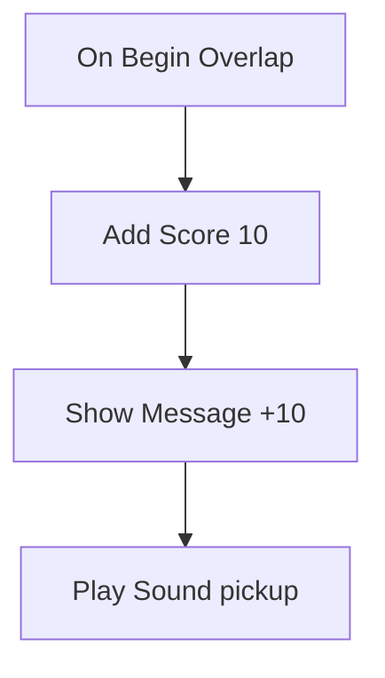

# 9 Logik-Graphen – Spielregeln zum Zusammenstecken

> **Kurz gesagt:** In Kern schreibst du Spielregeln nicht als Programmtext, sondern steckst sie aus
> Kästchen und Drähten zusammen. Ein Ereignis stößt eine Kette an, und die Kästchen fallen
> nacheinander wie Dominosteine. Kern kann so ein Bild vorlesen oder übersetzen, und alle Wege
> liefern exakt dasselbe Ergebnis.

> **Begriffe vorab:**
> - **Programm** – eine genaue Schritt-für-Schritt-Anleitung für den Computer.
> - **Maschinencode** – die Sprache, die der Prozessor direkt versteht: sehr schnell, aber für
>   Menschen unlesbar.
> - **C++** – die Programmiersprache, in der Kern geschrieben ist; lesbar für Programmierer.
> - **WebAssembly** – eine Programmform, die der Browser sehr schnell in Maschinencode verwandelt.
> - **Variable** – ein beschriftetes Kästchen, in dem sich ein Programm etwas merkt, etwa „Punkte: 30“.
> - **Autorität** – der Rechner, der das Sagen hat: im Einzelspiel deiner, im Netzwerkspiel der Server.
> - **Sensor und Trigger** – Zonen, die merken, wenn etwas hineinkommt ([Kapitel 8](08-spiel-laufzeit.md)).
> - **Deterministisch** – auf jedem Gerät exakt gleich gerechnet.

„Wenn der Spieler die Münze berührt, gib ihm 10 Punkte.“ So klingt Spiellogik. Kern hat dafür
**keine** Skriptsprache – du malst Logik als Bild, und dieses Bild ist ein vollwertiges Programm.

## 9.1 Das Modell: Knoten, Drähte, Dominosteine

Ein **Logik-Graph** besteht aus **Knoten** (Kästchen, die etwas tun) und **Drähten** (Verbindungen
zwischen ihnen). Weiße Drähte legen fest, **was als Nächstes passiert**; farbige Drähte liefern
**Werte** wie Zahlen oder Namen.

Der Graph selbst ist nur eine Beschreibung – eine Liste von Kästchen und Drähten, wie ein
Schaltplan auf Papier. Hinter jeder Kästchensorte steckt ein fertiges Stück Kern, das die eigentliche
Arbeit tut. Bevor ein Graph läuft, macht Kern aus dem Schaltplan eine **Nachschlagetabelle**: Für
jedes Kästchen steht dort, welches Stück Kern es ausführt und wohin jeder Ausgang führt. Beim Spielen
muss Kern dann nur noch nachschlagen, statt jedes Mal den ganzen Plan zu durchsuchen.

> **Stell dir vor …** eine Reihe Dominosteine. Du stupst den ersten an (ein Ereignis), er kippt den
> nächsten, der den nächsten … Die weißen Pfeil-Drähte im Graphen sind die Abstände zwischen den
> Steinen: Sie legen fest, **was als Nächstes passiert**.

Es gibt zwei Sorten Anschlüsse (*Pins*):

- **Ablauf-Pins** (*Exec*, weiße Pfeile): die Reihenfolge.
- **Daten-Pins** (farbig): Werte wie Zahlen, Text oder Dinge. Ein Eingang holt sich seinen Wert genau
  dann, wenn er gebraucht wird. Ist er nicht verbunden, gilt der Wert, den du direkt ins Kästchen
  getippt hast.

Nach ihrer Aufgabe gibt es vier Arten von Kästchen:

- **Ereignis-Knoten** stoßen eine Kette an („Spiel beginnt“, „etwas betritt die Zone“).
- **Aktionsknoten** tun etwas und geben den Ablauf weiter („gib 10 Punkte“).
- **Ablauf-Knoten** lenken den Ablauf: verzweigen, wiederholen oder warten.
- **Rechenknoten** liefern nur Werte und haben gar keinen weißen Draht.

Bei Rechen- und Aktionsknoten lohnt ein genauer Blick, denn sie liefern ihre Werte verschieden:

> **Stell dir vor …** ein **Thermometer** und einen **Kassenbon**. Das Thermometer zeigt dir immer den
> Wert von *jetzt*, jedes Mal, wenn du hinschaust. Der Kassenbon zeigt, was beim *letzten Einkauf*
> passiert ist – bis du das nächste Mal einkaufst.

**Rechenknoten** (Plus, Vergleichen, „wo steht der Spieler?“) sind Thermometer: Sie haben keinen
weißen Draht und rechnen jedes Mal frisch, wenn jemand ihren Wert liest. **Aktionsknoten** (Punkte
geben, ein Ding erzeugen) sind Kassenbons: Ihr Ergebnis bleibt stehen, bis sie das nächste Mal
laufen.

Wann macht das einen Unterschied? Nimm einen Würfel-Rechenknoten („Zufallszahl von 1 bis 6“) und
verbinde ihn mit zwei Kästchen. Jedes Kästchen schaut einzeln aufs Thermometer, also würfelt der
Knoten zweimal – und die beiden bekommen womöglich verschiedene Zahlen. Willst du dieselbe Zahl an
zwei Stellen, würfle einmal und leg das Ergebnis in eine Variable, wie einen Kassenbon, den du
aufhebst.

Dazu kommen:

- **Variablen** – das Gedächtnis eines Graphen, mit Sorte und Startwert.
- **State Machines** (Zustandsmaschinen) – Zustände mit Übergängen, wie bei einer Ampel (mehr in
  9.4).
- **Wartende Knoten** wie Delay (warten) oder Tween (sanft verändern) – sie halten die Kette an und
  machen später weiter.

Das **Level** hat einen eigenen Graphen, und jeder **Actor** kann einen tragen. Im Graphen eines
Actors heißt der Actor selbst „Self“.

### Welche Drähte passen?

Jeder Draht trägt eine bestimmte **Sorte** – wie Kabel mit verschiedenen Steckern. Nicht jeder
Stecker passt in jede Buchse. Es gibt sieben Sorten: Die Ablauf-Drähte sind eine eigene Sorte, die
übrigen sechs tragen Werte.

| Sorte | im Alltag | Beispiel |
|---|---|---|
| Exec | „jetzt du!“ – der Ablauf selbst | der weiße Pfeil |
| Bool | Ja oder Nein | „Ist die Tür offen?“ |
| Int | ganze Zahl | Anzahl Münzen: 7 |
| Float | Kommazahl | Tempo: 3,5 m/s |
| Vektor | drei Zahlen für Ort oder Richtung | „2 m vor, 1 m links, 3 m hoch“ |
| Text | Buchstaben | „Gewonnen!“ |
| Actor | ein Ding im Level | die Tür |

Erlaubt sind gleiche Sorten – Ablauf aber nur mit Ablauf –, Zahlen untereinander, und **alles nach
Text**, denn alles lässt sich ausdrucken. Ein paar weitere Umwandlungen sind fest geregelt, etwa
„Ding nach Ja/Nein“ (gibt es das Ding noch?).

> **Für Neugierige:** Ein Vektor als Zahl ist seine Länge, eine Kommazahl wird beim Wandeln in eine
> ganze Zahl abgeschnitten, und der Text „0“ oder „false“ gilt als Nein. Die vollständigen Regeln
> stehen im blauen Buch, Kapitel 9.

Gespeichert wird ein Graph als Text direkt in der Leveldatei ([Kapitel 8](08-spiel-laufzeit.md)) –
mit Kästchen, Drähten, Positionen und Kommentarrahmen. Die Kommentare wirken nicht, sie helfen nur
beim Lesen.

## 9.2 Knoten von innen

Hinter jedem Kästchen steckt ein kleines Stück Programm. Wenn es fertig ist, meldet es, **an welchem
Ausgang es weitergeht** – oder „Stopp, hier endet die Kette“, oder „Ich warte, weck mich später“.

Jedes Kästchen gibt nach getaner Arbeit genau eine von drei Antworten:

- **„Weiter bei Ausgang X“** – der nächste Dominostein fällt.
- **„Stopp“** – hier endet die Kette.
- **„Weck mich später“** – die Kette pausiert, etwa bei einer Eieruhr, und läuft nach der Wartezeit
  an derselben Stelle weiter.

Jede Kästchensorte hat dazu einen Steckbrief: ihre Art, ihre Anschlüsse und ihre Arbeit. So sieht der
Steckbrief des Kästchens **„Add Score“** (Punkte geben) aus, in Worten:

> **Steckbrief „Add Score“:** Art: Aktion. Ein Dateneingang „Points“, eine Zahl, vorbelegt mit 10.
> Arbeit: Lies den Eingang und gib der Spielwelt so viele Punkte. Antwort: „Weiter bei Ausgang
> ‚then‘.“

Den Ablauf-Eingang und den Ausgang „then“ bekommt jede Aktion automatisch dazu. Alle eingebauten
Kästchen zusammen bilden eine Art **Bausatz-Katalog**, aus dem das Menü im Editor seine Vorschläge
holt. Name im Menü, Hilfetext, Suchwörter und wie so ein Steckbrief als C++ aussieht, zeigt das
blaue Buch, Kapitel 9.

## 9.3 Prüfen, bevor es losgeht

Bevor ein Graph läuft, prüft Kern ihn – wie ein Elektriker, der vor dem Einschalten die Leitungen
durchmisst. Falsch verdrahtete Graphen werden abgeschaltet, Kästchen, die nie drankommen, werden
gemeldet.

**Fehler** sind zum Beispiel:

- ein Draht zwischen unpassenden Sorten, etwa ein Ablauf-Draht an einem Daten-Pin;
- zwei Drähte in denselben Dateneingang – welcher Wert soll dann gelten?
- Rechenknoten, die von sich selbst abhängen (ein Kreis, der nie fertig würde);
- Einstellungen, die auf fehlende Variablen oder Zustände zeigen;
- eine State Machine ohne genau einen Anfangszustand.

Eine **Warnung** gibt es für Kästchen, deren Ablauf-Eingang nirgends angeschlossen ist – sie laufen
nie.

Ein Graph mit Fehlern wird beim Start abgeschaltet und gemeldet. Im Studio zeigt **Compile** (F7)
das Ergebnis vorher an.

## 9.4 Wie ein Graph ausgeführt wird

Alle Graphen laufen im Takt der Spielschritte, und zwar nur auf dem Rechner, der das Sagen hat. Am
Anfang feuert „Begin Play“, danach in jedem Schritt „Tick“.

Gerechnet wird in den festen Schritten der Simulation ([Kapitel 8](08-spiel-laufzeit.md)), und nur
auf der **Autorität** – im Einzelspiel auf deinem Rechner, im Netzwerkspiel nur auf dem Server. Der
Grund: Es soll **eine einzige Wahrheit** geben. Würden zwei Rechner unabhängig voneinander
entscheiden, ob eine Münze eingesammelt ist, könnten sie verschiedener Meinung sein. Also entscheidet
einer, und alle anderen bekommen das Ergebnis.

Zu Beginn (**Begin Play**) gehen die State Machines in ihren Anfangszustand, und „Begin Play“ feuert.
In jedem Schritt (**Tick**) passiert dann dreierlei: Abgelaufene Wartezeiten machen weiter, das
Tick-Ereignis feuert, und die State Machines prüfen, ob sie den Zustand wechseln.

### Ereignisse und Ketten

Passiert etwas in der Welt, ist das ein **Ereignis** – etwa „etwas betritt den Sensor“, oft mit
Zusatzangaben wie „wer?“. Kern sucht alle passenden Ereignis-Knoten, gibt ihnen die Angaben mit und
lässt jede Kette laufen. Mit einem **Custom Event** (eigenes Ereignis) kannst du auch selbst ein
Ereignis mit einem Namen ausrufen – an alle Graphen oder an ein bestimmtes Ding.

Verzweigt sich eine Kette, etwa bei **Sequence** („erst das, dann das, dann das“), arbeitet Kern die
Zweige brav nacheinander ab und merkt sich dabei, welche noch offen sind – wie du mit einer Liste auf
dem Einkaufszettel.

Eine **Schleife** ist ein Kästchen, das ein Stück Kette wiederholt: „Wiederhole, solange …“ oder
„Wiederhole zehnmal“. Wie beim Kartoffelschälen: Schäl eine, schau in den Topf, und ist er noch nicht
voll, nimm die nächste. Kern führt den Inhalt der Schleife aus, kehrt zum Schleifenknoten zurück und
fragt erneut – bis die Bedingung nicht mehr stimmt.

> **Für Neugierige:** Die offenen Zweige liegen auf einem „Stapel“ von Merkzetteln: Der zuletzt
> hingelegte wird zuerst abgearbeitet. Wie tief Ketten und Rechnungen geschachtelt sein dürfen, steht
> im blauen Buch, Kapitel 9.

### Schutz vor Endlosschleifen

> **Achtung, Falle!** Eine While-Schleife („solange …, wiederhole“), deren Bedingung immer wahr
> bleibt, würde das Spiel einfrieren. Kern zählt deshalb mit: Laufen in einem Schritt mehr als
> **200 000 Kästchen**, wird der Graph abgeschaltet – mit der Meldung „infinite loop? The graph is
> stopped.“ Der Rest des Spiels läuft weiter.

Ebenso gibt es Grenzen dafür, wie oft Ereignisse neue Ereignisse auslösen dürfen. So kann ein
verdrahteter Kreis nie das ganze Spiel lahmlegen, sondern höchstens seinen eigenen Graphen.

### State Machines – wie eine Ampel

> **Stell dir vor …** eine Ampel. Sie ist immer in genau einem **Zustand**: Grün, Gelb oder Rot. Nach
> einer Zeit springt sie zum nächsten. Das ist eine **State Machine**.

Jede State Machine hat genau einen Anfangszustand. Ein **Übergang** zum nächsten Zustand kann
ausgelöst werden:

- durch ein **Ereignis** mit einem bestimmten Namen (ein Custom Event mit diesem Namen schaltet ihn),
- nach einer **Zeit** (so viele Sekunden im Zustand),
- sobald eine **Bedingung** (eine Ja/Nein-Variable) wahr ist,
- oder **automatisch** im nächsten Schritt.

Pro Schritt wechselt jede State Machine **höchstens einmal** den Zustand. Hängen mehrere
automatische Übergänge hintereinander, geht sie also einen Zustand pro Schritt weiter, nicht alle in
einem Rutsch – wie eine Ampel, die jede Farbe wenigstens kurz zeigt, statt von Grün direkt auf Rot zu
springen. So bekommt auch jeder Zwischenzustand seine Ereignisse beim Betreten und Verlassen.

Ein Übergang kann auch „aus jedem Zustand“ kommen, etwa ein Not-Aus. Betreten und Verlassen eines
Zustands lösen eigene Ereignisse aus, an die du Ketten hängen kannst. **Set State** springt direkt in
einen Zustand.

## 9.5 Die Grundknoten

Kern bringt **76 Grundknoten** mit: für Ereignisse, Ablauf, Gedächtnis und Rechnen. Du musst sie
nicht auswendig kennen – das Menü im Editor schlägt passende vor. Ein paar Beispiele zeigen, was in
dem Baukasten steckt:

- **Branch – die Weiche.** Ein Ja/Nein-Wert kommt herein, und der Ablauf fährt entweder auf das
  Gleis „True“ oder auf „False“. „Hat der Spieler genug Münzen? Dann öffne die Tür, sonst zeig eine
  Meldung.“
- **Delay – die Eieruhr.** Die Kette hält an und läuft nach der eingestellten Zeit weiter. Drückt
  jemand während des Wartens noch einmal, ignoriert die Eieruhr das; eine zweite Sorte fängt dann neu
  an zu zählen.
- **Gate – die Schranke.** Kommt der Ablauf an, geht er nur weiter, wenn die Schranke offen ist.
  Andere Drähte öffnen und schließen sie.
- **Flip Flop – der Lichtschalter.** Jedes Drücken schaltet um: einmal Ausgang A, dann B, dann
  wieder A. Perfekt für eine Tür, die auf- und zugeht.
- **Tween – der Dimmer.** Statt eine Lampe hart anzuknipsen, dreht er einen Wert über eine
  einstellbare Zeit sanft von 0 auf 1 und meldet in jedem Schritt, wie weit er ist.
- **Every N Seconds – der Wecker.** Feuert regelmäßig, etwa alle 3 Sekunden.

Dazu kommen Variablen lesen, setzen und hochzählen, Rechnen, Vergleichen, Zufall, Text und
**Print**, das einen Text ins Protokoll oder auf den Bildschirm schreibt. Alle 76 Knoten mit ihren
Feinheiten stehen im blauen Buch, Kapitel 9.

> **Wusstest du?** Auch der Zufall ist bei Kern nicht ganz zufällig. Er kommt aus einem Generator,
> dessen Startwert fest ist – pro Welt **deterministisch**. Deshalb stimmen Wiederholungen und
> Netzwerkspiele überein.

## 9.6 Die Spielknoten

Dazu kommen **71 Spielknoten**, die mit der Spielwelt sprechen. Sie **hören** auf das, was in der
Welt passiert, und sie können die Welt **verändern**. Hat ein Ding-Eingang keinen Draht, ist immer
das eigene Ding (Self) gemeint.

**Ereignisse** – die Anstupser der Dominoketten:

| Knoten | Feuert, wenn … |
|---|---|
| On Begin Overlap | etwas die Zone dieses Dings betritt |
| On Hit | es kracht |
| On Collected | ein Pickup eingesammelt wird |
| On Interact | der Spieler F (Gamepad: Y) drückt und das Ding ansieht oder danebensteht |

Dazu gibt es Ereignisse für Schaden, Tod, neue Spieler, Spielende und einzelne Tasten – die ganze
Liste steht im blauen Buch, Kapitel 9.

Eine Überlappung zählt übrigens den ganzen Besucher: Körper und Kopf eines Spielers sind *ein*
Besucher, nicht zwei.

Die **Aktionen** sind in Familien sortiert. Je ein Beispiel:

- **Dinge:** **Spawn Actor** erzeugt eine Kopie eines Dings – samt Kindern und Spielregeln. So
  entsteht ein Spawner, der alle paar Sekunden eine Kiste ausspuckt.
- **Physik:** **Launch** gibt einem Ding einen kräftigen Schwung, etwa nach oben wie ein
  Trampolin. Andere Knoten schubsen,
  bremsen oder schalten Gelenkmotoren – für Türen, Lifte und Winden.
- **Spiel und Kampf:** **Add Score** gibt Punkte, **Show Message** zeigt allen Spielern einen Text,
  andere lassen gewinnen, verlieren, heilen oder einen Ton spielen.
- **Roboter:** **Walk** lässt die Ente laufen wie mit dem Gamepad – nur so schnell, wie
  sie es im Training gelernt hat. Andere Knoten lassen sie sitzen, kicken oder zwitschern oder fragen
  ihren Abstandssensor und ihre Kopfkamera ab ([Kapitel 13](13-micro-duck.md)).

Alle 71 Spielknoten mit ihren Grenzen und Werten stehen im blauen Buch, Kapitel 9.

## 9.7 Logik in der Spielwelt

Die Spielwelt gibt den Graphen alles, was sie brauchen: die Spielzeit, einen planbaren Zufall und
die Ereignisse. Ein Ereignis geht an das betroffene Ding – oder an dessen nächstes „Elternteil“ mit
Graph. Was die Logik verändert, bekommen alle Mitspieler mit.

Die GameWorld startet die Graphen nur beim **Spielen** (Play) oder **Simulieren** (Simulate), nur
auf der Autorität (nicht auf
Netzwerk-Kopien) und nur, wenn es überhaupt Logik gibt. Sie liefert den Graphen:

- die **Spielzeit** – aus den Simulationsschritten gezählt, nicht von der Uhr an der Wand. Pausierst
  du das Spiel oder ruckelt ein langsamer Rechner, läuft die Spielzeit trotzdem genau gleich, und ein
  „nach 3 Sekunden“ bedeutet überall dasselbe;
- Ausgaben und Fehler ins **Ausgabeprotokoll** (Output Log), Print auf Wunsch als Meldung im HUD;
- einen **deterministischen Zufall**.

Erzeugte Dinge und neue Spieler bringen ihre Graphen gleich mit. Entsteht ein Ding sogar mitten in
einem Ereignis, hört es dieses Ereignis schon mit.

**Wohin gehen Ereignisse?** An den Graphen des betroffenen Dings – oder, wenn es keinen hat, an den
seines nächsten Vorfahren mit Graph. Das ist praktisch: Die unsichtbare Form, die in eine Tür
eingeschweißt ist, gehört zur Tür, und die Tür hört das Ereignis. Außerdem bekommt **immer** der
Level-Graph das Ereignis mit; Ereignisse ohne Ding (etwa Spielende) gehen an alle.

**Fürs Netzwerk** schreibt Kern mit, was die Logik an der Welt ändert: geänderte Werte, erzeugte
Dinge, versetzte Körper. Der Server schickt das an alle – auch an Spieler, die später dazukommen
([Kapitel 10](10-netzwerk.md)).

> **Für Neugierige:** Hat ein Level Logik, meldet die Physik mehr Berührungen als sonst, damit die
> Graphen etwas zu hören haben. Und die Logik rechnet am Ende jedes Schritts, nach der Physik. Die
> Einzelheiten stehen im blauen Buch, Kapitel 9.

## 9.8 Vom Bild zum Maschinencode

Ein Graph kann Schritt für Schritt „gedolmetscht“ oder einmal ganz übersetzt werden. Die Übersetzung
ist viel schneller und übernimmt sogar mitten im Spiel.

> **Stell dir vor …** du liest ein Buch in einer fremden Sprache. Ein **Dolmetscher** kann es dir
> Satz für Satz vorlesen – das klappt sofort, ist aber langsam. Oder jemand **übersetzt** das ganze
> Buch einmal, und danach liest du flüssig.

Kern hat einen Dolmetscher, den **Interpreter**, und zwei Übersetzer, die nach demselben Plan
arbeiten:

- **Die Übersetzung in letzter Sekunde** (*JIT*, „just in time“): Beim Start von **Spielen** (Play)
  oder **Simulieren** (Simulate) schreibt Kern jeden Graphen als kleines WebAssembly-Programm. Der Browser macht daraus
  Maschinencode, und Kern hängt ihn direkt in die Engine ein.
- **Der C++-Export:** Derselbe Graph als lesbarer C++-Programmtext. Wer will, baut ihn fest in sein
  Spiel ein; dann ersetzt er für diesen Graphen den Dolmetscher.

Einfache Dinge – Verzweigungen, Schleifen, Zahlen, Rechnen, Vergleichen – schreibt der Übersetzer
direkt hin. Alles andere, etwa Spielknoten, ruft einfach das fertige Stück Kern auf, das auch der
Dolmetscher benutzt. Und das geschieht ohne Umweg: Der übersetzte Graph spricht die Stücke von Kern
direkt an, ohne dass die Webseite dazwischen vermitteln muss. Darum ist er so schnell.

> **Für Neugierige:** Direkt hinschreiben kann der Übersetzer nur Zahlen und Ja/Nein-Werte, denn nur
> die liegen in den gemeinsamen Fächern (9.9). Text, Richtungen und Dinge liest auch der übersetzte
> Graph über die fertigen Stücke von Kern.

> **Wusstest du?** Laut Messung ist der übersetzte Graph etwa **55-mal schneller** als der
> Dolmetscher. Gemessen wird das mit einer Million Schleifendurchläufen.

Welcher Weg läuft? Es gibt eine feste Rangfolge:

1. Ist für einen Graphen ein passender **C++-Export** fest eingebaut, gewinnt der.
2. Sonst wird der Graph **übersetzt**. Weil das im Browser einen Moment dauert, startet er zunächst
   beim Dolmetscher; sobald der Maschinencode bereit ist, übernimmt dieser – mitten im Spiel.
3. Klappt das Übersetzen nicht, **dolmetscht** der Interpreter einfach weiter.

Ein exportierter C++-Text gehört genau zu einem Graphen. Erkannt wird das an einem **Fingerabdruck**:
einer Zahl, die Kern aus dem Inhalt des Graphen errechnet. Ändert sich der Inhalt, ändert sich die
Zahl. Positionen und Kommentare fließen **nicht** ein. Einen Knoten zu verschieben macht den Export
also nicht ungültig – jede inhaltliche Änderung aber schon. Dann muss neu exportiert werden.

> **Für Neugierige:** Das übersetzte Programm ist wie eine Schnitzeljagd mit nummerierten Stationen:
> ein Zähler sagt, an welcher Station (welchem Knoten) es gerade weitergeht. So funktioniert jede
> Verdrahtung, auch Kreise. Wie man einen exportierten Graphen ins Spiel baut, steht im blauen
> Buch, Kapitel 9.

## 9.9 Warum alle drei Wege gleich rechnen müssen

Dolmetscher und Übersetzung teilen sich dasselbe Gedächtnis. Nur darum kann mitten im Spiel
gewechselt werden, und nur darum kommt überall exakt dasselbe heraus.

> **Stell dir vor …** einen Staffellauf. Der erste Läufer übergibt den Stab, ohne stehen zu bleiben.
> Damit das klappt, müssen beide denselben Stab halten. In Kern ist der Stab der gemeinsame Speicher:
> Variablen, Schleifenzähler, Schranken und Lichtschalter liegen in festen Fächern (*Slots*), die
> Dolmetscher und Maschinencode gleichermaßen lesen und beschreiben. Beim Wechsel muss nichts
> umkopiert werden.

Warum ist das so wichtig?

- **Determinismus:** Kern rechnet überall gleich ([Kapitel 6](06-physik.md)). Würde ein Graph im
  Browser anders rechnen als anderswo, wären Wiederholungen, Training und Fehlersuche wertlos. Sogar
  der Schutz gegen Endlosschleifen zählt auf allen drei Wegen gleich.
- **Wartezeiten** wie Delay setzen ihre Kette auf jedem Weg gleich fort.
- **Fehlersuche:** Haltepunkte (Stellen, an denen das Spiel anhält, 9.10) und die Live-Anzeige
  laufender Knoten funktionieren auch im übersetzten Code.

Abgesichert wird das mit einem Satz gemeinsamer Testfälle – Rechen-Schleifen, Schranken,
verschachtelte Schleifen, State Machines, eine absichtliche Endlosschleife und mehr. Jeder Fall läuft
beim Dolmetscher, als JIT-Code und als exportiertes C++, und die Ergebnisse müssen **identisch** sein.

## 9.10 Logik bearbeiten im Studio

Im Logik-Editor ziehst du Drähte, bekommst passende Vorschläge, kannst alles rückgängig machen,
Haltepunkte setzen und beim Spielen zusehen, welche Kästchen gerade laufen.

Du öffnest ihn über **Logik** (Logic) in der Werkzeugleiste (Level-Graph) oder über
**Logik bearbeiten** (Edit Logic) bzw. **Logik hinzufügen (Blueprint)** (Add Logic (Blueprint)) im
Kontextmenü eines Actors.

Ein Grundsatz steckt dahinter: Der Editor selbst hat **keine eigene Logik**. Die Webseite zeichnet
nur, was die Engine ihr beschreibt – wie in [Kapitel 4](04-grafik.md), wo die Seite nur Malbefehle
weiterreicht. Jeder Handgriff ist ein Befehl an die Engine und damit ein Schritt, den du rückgängig
machen kannst. Was zusammengehört, zählt als **ein** Schritt: Nimmst du einen Draht auf und legst ihn
woanders ab, macht ein einziges **Rückgängig** (Undo) beides rückgängig.

Das Wichtigste beim Bearbeiten:

- Ziehst du einen Draht von einem Pin ins Leere, schlägt das **Aktionsmenü** nur Knoten vor, die
  dazu passen. Du tippst einen Suchbegriff, drückst Enter – der Knoten erscheint und ist schon
  verbunden.
- Jede Bearbeitung lässt sich mit **Rückgängig** (Strg+Z) zurücknehmen.
- Beim Spielen leuchten die gelaufenen Knoten auf, und Variablen zeigen ihre aktuellen Werte. Mit
  **F9** setzt du einen Haltepunkt: Läuft der Knoten, hält das Spiel an, und der Editor springt hin.

**Compile** (F7) zeigt Probleme, **C++** exportiert den Graphen. Alle weiteren Handgriffe beschreibt
[Kapitel 11](11-studio.md).

> **Probier's aus!** Öffne **Datei › Beispiel-Levels › Grundformen** (File › Example Levels › Basic).
> Das Level hat noch keine Spielfigur: Öffne die **Inhaltsablage** (Content Drawer) mit
> Strg+Leertaste, Reiter **Actors platzieren** (Place Actors), Gruppe **Spieler** (Players), und klick
> auf **Rollende Kugel** (Rolling Ball) – die Kugel wird dein Spieler. Klick dann in der
> Werkzeugleiste auf **Logik**. Der
> Graph ist noch leer und bietet dir Startknöpfe an; klick auf **Begin Play**, und der Knoten steht
> auf der Fläche. Zieh von seinem Ausgang „then“ einen Draht ins Leere, tippe
> „show message“, Enter, und schreib einen Text hinein. Zurück im Viewport startest du **Spielen**
> (Play) mit Alt+P: Dein Text erscheint im HUD. Ein Domino – und er ist gefallen!

## 9.11 Beispiele zum Nachbauen

Mit wenigen Kästchen entstehen echte Spielregeln. Alle Beispiele sind echte Graphen aus Kern; die
meisten gibt es im Logik-Editor unter **Templates**.

**Punktezone.** Wer den Sensor betritt, bekommt 10 Punkte, eine Meldung und einen Ton – vier
Dominosteine in einer Reihe:

**Tür.** Drückt der Spieler an der Tür F (das Ereignis Interact aus 9.6), führt das zu einem
Lichtschalter (Flip Flop): Beim ersten Mal öffnet ein Dimmer (Tween)
die Tür in 0,8 s, beim zweiten Mal schließt ein anderer sie wieder – jeden Schritt ein kleines Stück.
Dazu ein Bestätigungston.

**Spawner.** Alle 3 Sekunden: Sind es weniger als 10? Dann erzeuge einen Physik-Würfel und zähl mit.
Die Kopien sehen alle Mitspieler.

**Ampel.** Eine State Machine „Light“: Grün → (4 s) → Gelb → (1,5 s) → Rot → (4 s) → Grün. Bei
jedem neuen Zustand zeigt eine Meldung, welcher es ist.

**Hindernis ausweichen.** Die Micro Duck schaltet ihr eigenes Verhalten ab. Alle 0,25 s schaut sie
mit ihrem Abstandssensor: Ist etwas näher als 1,6 m, dreht sie sich auf der Stelle, sonst läuft sie
geradeaus.

**Die Ente zwitschert beim Ball.** Im Beispiel-Level Micro Duck fragt der Level-Graph alle 0,25 s:
Sieht die Kopfkamera den Ball **und** hat sie ihn vorher nicht gesehen? Dann zwitschert sie. Die
Variable „Ball Seen“ merkt sich, ob der Ball schon im Bild war – so zwitschert die Ente einmal,
wenn der Ball auftaucht, und nicht alle 0,25 s.

> **Probier's aus!** Öffne in einem Level den Logik-Editor, wähle **Templates…** und füge die
> Ampel ein, den Eintrag **Traffic light (state machine)**. Starte **Spielen** (Play) und schau zu, wie die Meldungen Grün, Gelb und Rot durchschalten. Dann
> ändere einen Timer auf 1 Sekunde und probier es noch einmal.

> **Achtung, Falle!** Der Zwitscher-Graph ist eine Demo der Roboter-Knoten – nicht etwas, das die
> echte Ente von selbst tut. Das steht sogar ausdrücklich in einem Kommentarrahmen im Graphen.

## Das nimmst du mit

- Kern hat keine Skriptsprache: Logik sind Graphen aus Kästchen und Drähten.
- Weiße Drähte bestimmen die Reihenfolge wie Dominosteine; Daten-Drähte liefern Werte auf Abruf.
- Rechenknoten sind Thermometer (immer frisch), Aktionsknoten Kassenbons (Wert vom letzten Lauf).
- Variablen sind das Gedächtnis, State Machines die Zustände, wartende Knoten machen später weiter.
- Graphen laufen in den festen Schritten und nur auf dem Rechner, der das Sagen hat; alle anderen
  bekommen die Änderungen geschickt.
- Ein Zähler stoppt Endlosschleifen, bevor sie das Spiel einfrieren.
- Dolmetscher, Übersetzung (etwa 55-mal schneller) und C++-Export liefern exakt dasselbe.
- Im Studio: Compile (F7), Haltepunkte (F9), Templates und C++-Export.

## Knobelecke

1. Du verschiebst nach dem C++-Export einen Knoten. Musst du neu exportieren? Und wenn du eine Zahl
   im Knoten änderst?
2. Warum läuft Logik im Netzwerkspiel nur auf dem Server?
3. Was würde ohne die Variable „Ball Seen“ passieren, solange der Ball im Bild ist?
4. Warum liegen die Schleifenzähler in gemeinsamen Fächern statt beim Dolmetscher?

### Lösungen

1. Beim Verschieben nicht, denn Positionen zählen nicht zum Fingerabdruck. Bei einer geänderten Zahl
   schon.
2. Damit es nur eine Wahrheit gibt. Der Server entscheidet, die anderen bekommen die Änderungen.
3. Die Ente würde alle 0,25 s zwitschern.
4. Damit die Übersetzung mitten im Spiel übernehmen kann, ohne etwas umzukopieren.

---

© 2026 Christian Heinrich Hohlfeld · Alle Rechte vorbehalten · [Impressum und Rechte](00-impressum.md)
