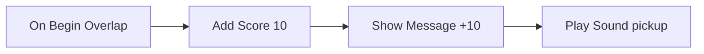

# 9 Logik-Graphen – Spielregeln zum Zusammenstecken

> **Kurz gesagt:** In Kern schreibst du Spiellogik nicht als Programmtext, sondern steckst sie aus
> Knoten und Drähten zusammen, wie die Blueprints der Unreal Engine. Ein Ereignis stößt eine Kette an,
> und die Knoten fallen nacheinander wie Dominosteine. Damit das schnell geht, übersetzt Kern jeden
> Graphen beim Start in Maschinencode – und auf Wunsch sogar in lesbares C++. Alle drei Wege liefern
> exakt dasselbe Ergebnis.

„Wenn der Spieler die Münze berührt, gib ihm 10 Punkte.“ So klingt Spiellogik. Kern hat dafür
**keine** Skriptsprache – du malst Logik als Bild, und dieses Bild ist ein vollwertiges Programm.

## 9.1 Das Modell: Knoten, Drähte, Dominosteine

Ein **Logik-Graph** besteht aus **Knoten** (Kästchen, die etwas tun) und **Drähten** (Verbindungen
zwischen ihnen). Er ist reines Datum – eine Liste von Knoten und Drähten –, und hinter jedem
Knotentyp steckt eine C++-Funktion der Engine.

> **Stell dir vor …** eine Reihe Dominosteine. Du stupst den ersten an (ein Ereignis), er kippt den
> nächsten, der den nächsten … Die weißen Pfeil-Drähte im Graphen sind die Abstände zwischen den
> Steinen: Sie legen fest, **was als Nächstes passiert**.

Es gibt zwei Sorten Anschlüsse (*Pins*):

- **Exec-Pins** (weiße Pfeile): der Ablauf. **Event-Knoten** starten eine Kette, **Aktionsknoten**
  setzen sie fort, **Flow-Knoten** verzweigen, wiederholen oder warten.
- **Daten-Pins**: Werte wie Zahlen, Text oder Actors. Eingänge **ziehen** sich ihre Werte: Wird ein
  Wert gebraucht, rechnet der verbundene Knoten ihn in diesem Moment aus. Reine Rechenknoten
  (*Pure*: Mathe, Abfragen) haben gar keinen Exec-Pin. Ist ein Eingang nicht verbunden, gilt der Wert,
  den du direkt in den Knoten getippt hast.

Dazu kommen:

- **Variablen** – das Gedächtnis eines Graphen, mit Typ und Startwert.
- **State Machines** – Zustände mit Übergängen (mehr in 9.4).
- **Latente Knoten** wie Delay oder Tween – sie halten die Kette an und machen später weiter.

Das **Level** hat einen eigenen Graphen, und jeder **Actor** kann einen tragen. Im Actor-Graphen ist
„Self“ der Actor selbst.

### Welche Drähte passen?

Es gibt sieben Typen: Exec, Bool, Int, Float, Vektor, Text und Actor. Nicht jeder Draht passt
überall – wie bei Steckern. Erlaubt ist:

- gleicher Typ immer, Exec aber nur mit Exec;
- **alles nach Text** („everything prints“ – alles lässt sich ausdrucken);
- Zahlen untereinander;
- Actor nach Bool („ist gültig?“);
- eine Zahl nach Vektor (in alle drei Richtungen).

Die Umrechnungen sind fest geregelt: Text „0“ oder „false“ ist falsch, ein Vektor als Zahl ist seine
Länge.

### Wie ein Graph gespeichert wird

Graphen stehen als JSON direkt im Level ([Kapitel 8](08-spiel-laufzeit.md)). Knoten haben eine
Nummer, einen Typ (etwa `game.add_score`) und eine Position; Drähte sind kurze Listen
`[von, Ausgang, nach, Eingang]`. Kommentarrahmen werden mitgespeichert, wirken aber nicht.

## 9.2 Knoten von innen

Jeder Knotentyp hat eine Beschreibung: Name, Kategorie, Hilfetext, Suchwörter, seine Pins, seine
Einstellungen (etwa ein Variablenname oder eine Taste) und seine **Art** – Event, Action, Pure oder
Flow. Dazu die eigentliche C++-Funktion.

Diese Funktion meldet zurück, **an welchem Exec-Ausgang es weitergeht**. Oder sie sagt „Stopp, hier
endet die Kette“ – oder „Ich warte, weck mich später“ (latente Knoten).

So sieht ein echter Spielknoten aus:

```cpp
lib.add(action("game.add_score", "Add Score", "Game",
    {data("points", "Points", PinType::number, 10.0)}, {},
    [](Context& c, GameWorld& w) {
      w.add_score(static_cast<f32>(c.in_number("points")));
    },
    "Adds points (wins at the target score ...).",
    "points reward"));
```

Zeile für Zeile:

- Ein neuer **Aktionsknoten** mit dem Typ `game.add_score`, dem Titel „Add Score“, Kategorie „Game“.
- Er hat einen Dateneingang „Points“, eine Zahl mit Standardwert 10.
- Seine Arbeit: den Eingang lesen und der Spielwelt so viele Punkte geben.
- Dann ein Hilfetext und Suchwörter für das Menü.

Den Exec-Eingang und den Ausgang „then“ baut `action` automatisch dazu. Knoten sehen die Welt über
einen **Context**: Eingänge lesen, Ausgänge schreiben, Einstellungen abfragen, warten.

Alle eingebauten Knoten liegen in einer **Library**: die Grundknoten plus die Spielknoten, die sich
beim Programmstart selbst anmelden.

## 9.3 Prüfen, bevor es losgeht

Bevor ein Graph läuft, prüft Kern ihn. **Fehler** sind zum Beispiel:

- ein unbekannter Knotentyp oder ein Draht zu einem Pin, den es nicht gibt;
- ein Draht zwischen unpassenden Typen, etwa Exec an einen Datenpin;
- zwei Drähte in denselben Dateneingang;
- Rechenknoten, die von sich selbst abhängen (ein Kreis);
- Einstellungen, die auf fehlende Variablen oder Zustände zeigen;
- eine State Machine ohne genau einen Anfangszustand.

Eine **Warnung** gibt es für Knoten, deren Exec-Eingang nirgends angeschlossen ist – sie laufen nie.

Ein Graph mit Fehlern wird beim Start abgeschaltet und gemeldet. Im Studio zeigt **Compile** (F7)
das Ergebnis vorher an.

## 9.4 Wie ein Graph ausgeführt wird

Alle Graphen einer Welt laufen in einer **Runtime**; jeder Graph wird dort eine **Instanz** für
seinen Besitzer (Actor oder Level). Gerechnet wird in den festen Simulationsschritten, und zwar nur
auf der **Autorität** – im Einzelspiel oder auf dem Netzwerk-Server.

In jedem Schritt (**Tick**) passiert dreierlei: Fällige Wartezeiten laufen weiter, das Tick-Ereignis
feuert, und die State Machines prüfen ihre Übergänge.

### Ereignisse und Ketten

Ein **Ereignis** hat einen Typ (etwa „etwas betritt den Sensor“), optional einen Ziel-Actor und
Zusatzwerte. Kern sucht alle passenden Event-Knoten, schreibt die Werte in deren Ausgänge und lässt
die Kette laufen.

Für Verzweigungen hat der Interpreter einen **Stapel** von Merkzetteln. Eine **Sequence** etwa führt
ihren ersten Ausgang sofort aus und legt Zettel für die übrigen auf den Stapel. Ist ein Zweig zu
Ende, nimmt Kern den nächsten Zettel. Schleifen funktionieren genauso: Körper ausführen, dann
mit einem Zettel zum Schleifenknoten zurück.

### Schutz vor Endlosschleifen

> **Achtung, Falle!** Eine While-Schleife, deren Bedingung immer wahr bleibt, würde das Spiel
> einfrieren. Kern zählt deshalb mit: Laufen in einem Schritt mehr als **200 000 Knoten**, wird der
> Graph abgeschaltet – mit der Meldung „infinite loop? The graph is stopped.“ Der Rest des Spiels
> läuft weiter.

Außerdem dürfen Ereignisse, die Ereignisse auslösen, höchstens 64 tief verschachtelt sein.

### State Machines – wie eine Ampel

> **Stell dir vor …** eine Ampel. Sie ist immer in genau einem **Zustand**: Grün, Gelb oder Rot. Nach
> einer Zeit springt sie zum nächsten. Das ist eine **State Machine**.

Jede State Machine hat genau einen Anfangszustand. Ein **Übergang** kann feuern:

- auf ein **Ereignis** mit einem bestimmten Namen,
- nach einem **Timer** (so viele Sekunden im Zustand),
- solange eine **Bedingung** (eine Bool-Variable) wahr ist,
- oder **automatisch** im nächsten Tick.

Ein Übergang kann auch „aus jedem Zustand“ kommen. Pro Maschine und Prüfung gibt es höchstens einen
Übergang. Betreten und Verlassen eines Zustands lösen eigene Ereignisse aus, an die du Ketten hängen
kannst.

## 9.5 Die Grundknoten

Kern bringt **76 Grundknoten** mit. Die Familien:

- **Events:** Begin Play, Event Tick, Every N Seconds, Custom Event.
- **State Machines:** On State Entered/Left, Set State, Current State, Is In State.
- **Flow:** Branch (wenn/sonst), Sequence, For Loop, While Loop, Do Once, Do N, Gate (Tor auf/zu),
  Flip Flop (abwechselnd A und B), Delay, Retriggerable Delay, Tween (sanft von 0 nach 1), Switch
  und Call Event.
- **Variablen:** Get, Set, Add.
- **Mathe und Logik:** Rechnen, Runden, Sinus, Zufall, Vergleichen, Und/Oder/Nicht, Select.
- **Werte, Vektoren, Text** und **Hilfen** wie Game Time und Print.

> **Wusstest du?** Auch der Zufall ist bei Kern nicht ganz zufällig. Er kommt aus einem Generator,
> dessen Startwert fest ist – pro Welt **deterministisch**. Deshalb stimmen Replays und Netzwerkspiele
> überein.

## 9.6 Die Spielknoten

Dazu kommen **71 Spielknoten**, die mit der Spielwelt sprechen. Ein Actor-Eingang ohne Draht
bedeutet immer **Self**.

**Ereignisse** – die Anstupser der Dominoketten:

| Knoten | Feuert, wenn … |
|---|---|
| On Begin / End Overlap | etwas einen Sensor betritt oder verlässt |
| On Hit | es kracht (ab 2 m/s) |
| On Collected, On Trigger | ein Pickup eingesammelt oder ein Trigger berührt wird |
| On Damaged, On Death, On Respawn | Schaden, Tod, Rückkehr |
| On Interact | der Spieler F (Gamepad: Y) drückt und den Actor ansieht |
| On Player Joined, On Game Over | ein Spieler kommt dazu, das Spiel endet |
| On Input Action, On Key | eine Aktion oder Taste gedrückt wird |

Eine Überlappung zählt übrigens den ganzen Besucher: Kapsel und Kopf eines Spielers sind *ein*
Besucher, nicht zwei.

Die übrigen Knoten in Familien:

- **Actors:** finden (nach Name oder Tag), Ort und Drehung lesen und setzen, verschieben,
  **Spawn Actor** (eine Kopie erzeugen) und zerstören, und **Set Property**, das jeden Wert einer
  Komponente über seinen Pfad ändern kann – etwa die Farbe.
- **Physik:** Geschwindigkeit setzen, Impuls und Kraft, Launch, Physik ein/aus, Gelenkmotoren
  (für Türen, Lifte, Winden), Explosionen und Strahltests (*Line Trace*).
- **Spiel und Kampf:** Punkte, Meldungen, gewinnen, verlieren, Schaden, Heilen, Munition, Licht,
  Farbe, Funken, Kamerawackeln, Sounds und „For Each Actor with Tag“.
- **Roboter:** die Micro Duck laufen und schauen lassen, Spezialbewegungen wie Sitzen, Kicken oder
  Purzelbaum, Schnabel, Zwitschern, Abstandssensor und Kopfkamera ([Kapitel 13](13-micro-duck.md)).

## 9.7 Logik in der Spielwelt

Die GameWorld startet die Graphen nur in Play oder Simulate, nur auf der Autorität (nicht auf
Netzwerk-Kopien) und nur, wenn es überhaupt Logik gibt.

Ihr **Host** liefert den Graphen die Grundlagen: die **Simulationszeit** (aus den Schritten
gezählt, nicht die Wanduhr), Ausgaben ins Output Log und einen **deterministischen Zufall**.

Wohin gehen Ereignisse? An den Graphen des betroffenen Actors – oder, wenn der keinen hat, an den
seines nächsten Vorfahren mit Graph. Das ist praktisch: Der eingeschweißte Collider einer Tür gehört
zur Tür. Außerdem bekommt **immer** der Level-Graph das Ereignis mit. Der Logik-Tick läuft am Ende
jedes festen Schritts, nach den Physik-Ereignissen.

**Fürs Netzwerk** schreibt Kern mit, was Logik an der Welt ändert: geänderte Werte, gespawnte Actors,
versetzte Körper. Der Server schickt das an alle – auch an Spieler, die später dazukommen
([Kapitel 10](10-netzwerk.md)).

## 9.8 Vom Bild zum Maschinencode

> **Stell dir vor …** du liest ein Buch in einer fremden Sprache. Ein **Dolmetscher** kann es dir
> Satz für Satz vorlesen – das klappt sofort, ist aber langsam. Oder jemand **übersetzt** das ganze
> Buch einmal, und danach liest du flüssig. Der Interpreter ist der Dolmetscher, der JIT ist der
> Übersetzer.

Kern hat zwei Übersetzer, die denselben Plan benutzen:

- **WebAssembly (JIT):** Beim Start von Play oder Simulate schreibt Kern für jeden Graphen ein
  kleines WebAssembly-Modul. Der Browser macht daraus Maschinencode, und Kern hängt es direkt in die
  Engine ein. Kein JavaScript dazwischen.
- **C++-Export:** Derselbe Graph als lesbarer C++-Quelltext. In ein Spiel gebaut, ersetzt er für
  diesen Graphen den Interpreter.

Einfache Dinge – Verzweigungen, Schleifen, Zahlen-Variablen, Rechnen, Vergleichen – erzeugt der
Übersetzer direkt. Alles andere (Spielknoten, Text, Vektoren, Wartezeiten) ruft einfach die
C++-Funktion des Knotens auf.

Das erzeugte Programm ist eine Schleife mit einem **Programmzähler**: ein Fall pro Knoten, wie
nummerierte Stationen einer Schnitzeljagd. So funktioniert jede Verdrahtung, auch Kreise. Auch hier
wird gezählt und bei einer Endlosschleife gestoppt.

Der exportierte C++-Code meldet sich mit einem **Fingerabdruck** des Graphen an. In diesen
Fingerabdruck fließen die Positionen und Kommentare **nicht** ein. Einen Knoten zu verschieben macht
den Export also nicht ungültig – jede inhaltliche Änderung aber schon. Dann muss neu exportiert
werden.

> **Wusstest du?** Laut Messung ist der JIT etwa **55-mal schneller** als der Interpreter. Gemessen
> wird das mit einer Million Schleifendurchläufen.

Weil das Übersetzen im Browser kurz dauert, startet jeder Graph zunächst im Interpreter
(Stufe „compiling“). Sobald der Maschinencode bereit ist, übernimmt er – mitten im Spiel. Klappt das
Übersetzen nicht, läuft der Graph einfach im Interpreter weiter.

## 9.9 Warum alle drei Wege gleich rechnen müssen

Interpreter, JIT und C++-Export sind **austauschbar**, sogar mitten im Spiel. Das geht nur, weil
sie sich ein Gedächtnis teilen.

> **Stell dir vor …** einen Staffellauf. Der erste Läufer übergibt den Stab, ohne stehen zu bleiben.
> Damit das klappt, müssen beide denselben Stab halten. In Kern ist der Stab der gemeinsame Speicher:
> Variablen, Schleifenzähler, Gates und Flip-Flops liegen in festen **Slots**, die Interpreter und
> Maschinencode gleichermaßen lesen und schreiben. Beim Wechsel muss nichts umkopiert werden.

Warum ist das so wichtig?

- **Determinismus:** Kern rechnet überall gleich ([Kapitel 6](06-physik.md)). Würde ein Graph im
  Browser anders rechnen als nativ, wären Replays, Training und Fehlersuche wertlos. Sogar der Schutz
  gegen Endlosschleifen zählt in allen Stufen gleich.
- **Wartezeiten** wie Delay setzen ihre Kette in jeder Stufe gleich fort.
- **Debuggen:** Haltepunkte und die Live-Anzeige laufender Knoten funktionieren auch im übersetzten
  Code.

Abgesichert wird das mit einem Satz gemeinsamer Testfälle – Mathe-Schleifen, Gates und Sequences,
verschachtelte Schleifen, State Machines, eine absichtliche Endlosschleife und mehr. Jeder Fall läuft
im Interpreter, als JIT-Code und als exportiertes C++, und die Ergebnisse müssen **identisch** sein.
Wer einen Knoten ändert, muss ihn deshalb an drei Stellen gleich ändern.

## 9.10 Logik bearbeiten im Studio

Der Logik-Editor im Studio folgt dem Blueprint-Editor von Unreal. Du öffnest ihn über **Logic** in
der Toolbar (Level-Graph) oder über **Edit Logic** / **Add Logic (Blueprint)** im Kontextmenü eines
Actors. Die Oberfläche beschreibt [Kapitel 11](11-studio.md); hier das Wichtigste:

- Jede Bearbeitung ist ein Befehl an die Engine und damit ein **Undo-Schritt**.
- Ziehst du einen Draht von einem Pin ins Leere, schlägt das **Aktionsmenü** nur Knoten vor, die
  dazu passen. Du tippst einen Suchbegriff, drückst Enter – der Knoten erscheint und ist schon
  verbunden.
- **Promote to Variable** macht aus einem Pin mit einem Klick eine neue Variable.
- Ein Doppelklick auf einen Draht fügt einen Umlenkknoten ein – für ordentliche Drähte.
- **Compile** (F7) zeigt Probleme, **C++** exportiert den Graphen.
- **F9** setzt einen Haltepunkt: Läuft der Knoten beim Spielen, hält das Spiel an, und der Editor
  springt hin.
- Beim Spielen leuchten die gelaufenen Knoten auf, und Variablen zeigen ihre Live-Werte.

> **Probier's aus!** Öffne das Basic-Level (File › Example Levels), klick auf **Logic** und dann auf
> **Begin Play**. Zieh vom Ausgang „then“ einen Draht ins Leere, tippe „show message“, Enter, und
> schreib einen Text hinein. Zurück zum **Viewport**, platziere einen Rolling Ball und starte
> **Play**: Dein Text erscheint im HUD!

## 9.11 Beispiele zum Nachbauen

Alle Beispiele sind echte Graphen aus Kern; die meisten gibt es im Logik-Editor unter **Templates**.

**Punktezone.** Wer den Sensor betritt, bekommt 10 Punkte, eine Meldung und einen Ton – vier
Dominosteine in einer Reihe:



**Tür.** Interact führt zu einem Flip Flop: Beim ersten Mal öffnet ein Tween die Tür in 0,8 s, beim
zweiten Mal schließt ein anderer sie wieder – jeden Schritt ein kleines Stück. Dazu ein Bestätigungston.

**Spawner.** Alle 3 Sekunden: Sind es weniger als 10? Dann erzeuge einen Physics Cube und zähl mit.
Die Kopien sehen alle Mitspieler.

**Ampel.** Eine State Machine „Light“: Grün → (4 s) → Gelb → (1,5 s) → Rot → (4 s) → Grün. Bei
jedem neuen Zustand zeigt eine Meldung, welcher es ist.

**Hindernis ausweichen.** Die Micro Duck schaltet ihr eigenes Verhalten ab. Alle 0,25 s schaut sie
mit ihrem Abstandssensor: Ist etwas näher als 1,6 m, dreht sie sich auf der Stelle, sonst läuft sie
geradeaus.

**Die Ente zwitschert beim Ball.** Im Beispiel-Level Micro Duck fragt der Level-Graph alle 0,25 s:
Sieht die Kopfkamera den Ball **und** hat sie ihn vorher nicht gesehen? Dann zwitschert sie. Die
Variable „Ball Seen“ merkt sich, ob der Ball schon im Bild war – so zwitschert die Ente einmal,
wenn der Ball auftaucht, und nicht alle 0,25 s.

> **Probier's aus!** Öffne in einem Level den Logik-Editor, wähle **Templates…** und füge die
> **Ampel** ein. Starte Play und schau zu, wie die Meldungen Grün, Gelb und Rot durchschalten. Dann
> ändere einen Timer auf 1 Sekunde und probier es noch einmal.

> **Achtung, Falle!** Der Zwitscher-Graph ist eine Demo der Roboter-Knoten – nicht etwas, das die
> echte Ente von selbst tut. Das steht sogar ausdrücklich in einem Kommentarrahmen im Graphen.

## Das nimmst du mit

- Kern hat keine Skriptsprache: Logik sind Graphen aus Knoten und Drähten.
- Exec-Drähte bestimmen die Reihenfolge wie Dominosteine; Daten-Drähte liefern Werte auf Abruf.
- Variablen sind das Gedächtnis, State Machines die Zustände, latente Knoten warten.
- Graphen laufen in den festen Schritten, nur auf der Autorität; ihre Änderungen werden repliziert.
- Ein Zähler (200 000 Knoten pro Schritt) stoppt Endlosschleifen.
- Interpreter, JIT (WebAssembly, etwa 55-mal schneller) und C++-Export liefern exakt dasselbe.
- Im Studio: Compile (F7), Haltepunkte (F9), Templates und C++-Export.

## Knobelecke

1. Du verschiebst nach dem C++-Export einen Knoten. Musst du neu exportieren? Und wenn du eine Zahl
   im Knoten änderst?
2. Warum läuft Logik im Netzwerkspiel nur auf dem Server?
3. Was würde ohne die Variable „Ball Seen“ passieren, solange der Ball im Bild ist?
4. Warum liegen die Schleifenzähler in gemeinsamen Slots statt im Interpreter?

### Lösungen

1. Beim Verschieben nicht, denn Positionen zählen nicht zum Fingerabdruck. Bei einer geänderten Zahl
   schon.
2. Damit es nur eine Wahrheit gibt. Der Server rechnet, die Clients bekommen die Änderungen.
3. Die Ente würde alle 0,25 s zwitschern.
4. Damit der JIT-Code mitten im Spiel übernehmen kann, ohne etwas umzukopieren.

---

© 2026 Christian Heinrich Hohlfeld · Alle Rechte vorbehalten · [Impressum und Rechte](00-impressum.md)
