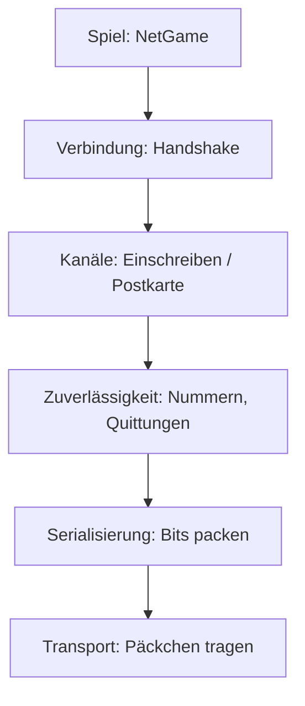

# 10 Mehrspieler: Wie Kern übers Netz spricht

> **Kurz gesagt:** Kern bringt seinen eigenen Netzwerk-Baukasten mit und macht damit aus **jedem**
> Level ein Mehrspieler-Spiel, ohne Vorbereitung. Ein Rechner ist der Chef (der Server), die anderen
> schicken ihm ihre Eingaben und zeigen, was er meldet. Hier erfährst du, wie das klappt, auch über
> wackelige Leitungen, und wie du es im Studio ausprobierst.

Der Netzwerkteil ist in C++ geschrieben und folgt den Artikeln von Glenn Fiedler („Gaffer On Games“)
und seinen Bibliotheken yojimbo, reliable.io und netcode.io. Darauf sitzt **NetGame**, das aus einem
Level ein Netzwerkspiel macht.

Von der Leitung darunter braucht Kern nur eins: kleine Päckchen (**Datagramme**) verschicken und
empfangen. Ob sie ankommen und in welcher Reihenfolge, regelt Kern selbst. Darum läuft es überall: im
Browser zwischen Tabs (über einen **BroadcastChannel**), zwischen Rechnern (über einen
**WebSocket-Relay**, eine Weiterleitungsstation) und in Tests und im Studio über ein Netz im selben
Programm.

---

## 10.1 Die Schichten

> **Stell dir vor …** du verschickst ein Möbelstück. Du zerlegst es und packst die Teile platzsparend
> (Serialisierung), klebst Nummern auf die Kartons, damit ein fehlender auffällt (Zuverlässigkeit),
> schickst manches per Einschreiben, anderes als Postkarte (Kanäle), klärst vorher am Telefon, wer du
> bist (Verbindung), und ein Bote trägt alles (Transport).



Jede Schicht hat nur eine Aufgabe. Das macht sie einfach zu verstehen und gut zu testen.

---

## 10.2 Serialisierung: jedes Bit zählt

**Serialisieren** heißt: Spieldaten in eine Bitfolge verwandeln und am anderen Ende zurück. Für jede
Nachrichtenart gibt es **eine einzige** Beschreibung, die zugleich zum Schreiben, Lesen und Messen dient.
Schreiber und Leser können so nie aus dem Takt geraten.

Ein paar Sparideen:

- **Zahlen mit bekanntem Bereich** bekommen nur so viele Bits, wie sie brauchen.
- **Kommazahlen werden gerundet (quantisiert):** Eine Position braucht nur 1 mm Genauigkeit.
- **Drehungen** reisen als „smallest three“: Eine Drehung besteht intern aus vier Zahlen; die größte
  lässt man weg und rechnet sie beim Empfänger aus den anderen drei zurück.

> **Wusstest du?** Der Leser prüft **alles**: Wertebereiche, Längen, abgeschnittene Daten. Ein kaputtes
> oder böswilliges Paket wird weggeworfen, statt das Spiel abstürzen zu lassen. Ein Test füttert ihn mit
> 2000 zufälligen Datenhaufen.

---

## 10.3 Zuverlässigkeit: Nummern und Quittungen

Im Internet können Päckchen verloren gehen, doppelt ankommen oder sich überholen. Kerns
Zuverlässigkeitsschicht (der **Endpoint**) klebt deshalb auf jedes Paket eine **laufende Nummer**, die
Nummer des zuletzt empfangenen Pakets der Gegenseite (das **Ack**, die Quittung) und **32 Bits** für die
32 Pakete davor: angekommen oder nicht.

> **Stell dir vor …** du schreibst auf jede Postkarte nicht nur „Karte Nr. 57“, sondern auch: „Von dir
> habe ich Nr. 41, und von den 32 davor alle außer Nr. 38.“ Dein Freund weiß sofort, was fehlt. Und geht
> eine Karte verloren, steht die Quittung auf der nächsten ja wieder.

Dieser Kopf ist zusammengepackt höchstens 9 Byte groß. Nebenbei misst der Endpoint die **Umlaufzeit**
(RTT: wie lange ein Paket hin und zurück braucht), den Paketverlust und die Bandbreite. **Senden wartet
nie**, und Pakete über 1 KB werden in **Fragmente** zerlegt und wieder zusammengesetzt.

---

## 10.4 Kanäle: Einschreiben oder Postkarte

Darüber liegt die **Connection** mit zwei Kanalarten:

| Kanal | Verhalten | Wofür |
|---|---|---|
| **reliable ordered** | genau einmal, in Reihenfolge | was nie fehlen darf |
| **unreliable unordered** | einmal mitgeschickt, fertig | was verspätet wertlos ist |

Im zuverlässigen Kanal schickt Kern eine Nachricht erneut, bis das Paket, das sie trug, quittiert ist
(frühestens nach 0,1 s bzw. dem 1,25-Fachen der Umlaufzeit). Große Nachrichten reisen als **Blöcke**,
Stück für Stück. Positionen und Eingaben gehen unzuverlässig: Die Position von vor einer halben Sekunde
will niemand nachgeliefert, die nächste ist schon unterwegs.

---

## 10.5 Verbindung: das Händeschütteln

Bevor Spieldaten fließen, stellen sich Client und Server vor. Dieser **Handshake** hat vier Schritte:

1. Der Client schickt Anfragen mit einer Zufallszahl, seinem **Salt**.
2. Der Server antwortet mit einer **Challenge**, die sein eigenes Salt trägt.
3. Der Client schickt beide Zahlen verknüpft (per XOR) zurück.
4. Der Server vergibt einen **Slot**; das XOR-Ergebnis ist ab jetzt die **Verbindungs-ID** auf jedem
   Paket.

Pakete von Fremden oder mit falscher ID werden ignoriert. Die Anfragen sind absichtlich auf volle Größe
aufgepolstert: So bringt ein Angreifer den Server nie dazu, mehr zurückzuschicken, als er bekam.

> **Wusstest du?** Jedes Päckchen beginnt mit einer Prüfsumme (CRC32) über den Inhalt **und** eine
> Protokoll-Kennung, die „KERN0001“ bedeutet. Verkehr eines anderen Spiels oder einer anderen
> Kern-Version fällt so heraus, bevor jemand ihn liest.

Standardwerte: bis zu 16 Clients, nach 6 s Stille gilt die Verbindung als abgebrochen, und mindestens
alle 0,1 s geht ein Lebenszeichen raus. Ist der Server voll, bekommt der Client „denied“.

---

## 10.6 Transporte: wer die Päckchen trägt

Ein Päckchen ist höchstens 1400 Byte groß, eine vorsichtige Grenze für jeden Weg. Kern kennt drei Träger:

- **LoopbackNetwork:** ein Netz in einem Programm, für Tests und für mehrere Spieler im Studio.
- **HostTransport:** zwei Warteschlangen, die die Browserseite füllt und leert (10.10).
- **Simulator:** in beide eingebaut. Er spielt schlechtes Internet nach: Verzögerung (Latenz),
  Schwankung (Jitter), Verlust, Duplikate. Mit festem Zufalls-Startwert ist das schlechte Netz sogar
  **wiederholbar**.

---

## 10.7 NetGame: ein Spiel, viele Spieler

**Der Server ist der Chef.** Nur er rechnet Box3D-Physik, Regeln, Pickups und Trigger. Jeder neue
Spieler bekommt einen **Pawn**, eine Kopie der Spielfigur des Levels. 30-mal pro Sekunde schickt der
Server jedem Client einen **Snapshot**: das HUD und die Lage aller beweglichen Dinge.

**Der Client spielt eine Replika.** Er lädt dasselbe Level, rechnet aber **keine eigene Physik**; seine
Dinge folgen nur den Meldungen. Jeden Takt schickt er seine Eingabe, die letzten vier gleich mit.

> **Stell dir vor …** ein Daumenkino, von dem du nur jedes dritte Bild bekommst, manche zu spät. Zeigst
> du jedes sofort, ruckelt es. Also wartest du ein wenig und zeichnest die Bilder **dazwischen** selbst.
> Genau so zeigt der Client die Welt etwa **100 ms in der Vergangenheit** und rechnet weiche Übergänge
> (Interpolation). Fehlt ein Snapshot, schätzt er die Bewegung bis zu 250 ms weiter und hält dann an.

### Damit nichts verloren geht

- **Wichtige Ereignisse** (Willkommen, Spieler kam oder ging, Pickup gesammelt, Logik-Änderungen) reisen
  zuverlässig, **Sounds und Schüsse** unzuverlässig.
- **Sprünge und Schüsse gehen nie verloren:** Der Server wertet sie, wenn sie in **irgendeiner** der
  mitgeschickten Eingaben stehen.
- **Lag-Kompensation:** Schießt der Client, dreht der Server die Zeit für den Treffertest so weit zurück,
  wie der Client hinterherhinkt (halbe Umlaufzeit plus 100 ms, höchstens 0,5 s). Was du beim Abdrücken
  im Visier hattest, triffst du ([Kapitel 8](08-spiel-laufzeit.md)).
- **Wer später kommt,** erhält Willkommen, vorhandene Spieler, alle bisherigen Logik-Änderungen und die
  schon eingesammelten Dinge.

### Der Prioritätstopf

Ein Snapshot muss in **ein** Paket passen (900 Byte für die Dinge im Level). Darum führt jeder Client
für jedes Ding einen Topf: Bewegt es sich, kommen 10 Punkte hinein, sonst 0,25. Gesendet wird, was am
vollsten ist, danach wird der Topf geleert. Die eigene Figur des Clients kommt immer zuerst. Was sich
bewegt, ist ständig dran; was ruht, selten, aber nie vergessen. Positionen reisen auf **1 mm** genau.

### Uhr und Prüfsumme

Jeder Snapshot verrät dem Client die Serverzeit. Kleine Verzögerungen übernimmt er schnell, große nur
langsam, denn die kleinste ist die ehrlichste: Dieses Paket hat unterwegs nicht getrödelt.

Beide Seiten brauchen **dasselbe Level**. Das Willkommen trägt eine Prüfsumme des Leveltexts (ohne die
Editor-Kamera). Passt sie nicht, meldet der Client „the server plays a different level“ und trennt.

> **Achtung, Falle!** Du hast beim Host noch schnell einen Würfel verschoben, dein Freund hat die alte
> Fassung offen? Dann klappt der Beitritt nicht. Speichere und gib allen genau diese Datei.

Standard bei NetGame: 30 Takte pro Sekunde (5 bis 120), 0,1 s Zeichenverzögerung, bis zu 8 Spieler
(einstellbar bis 64).

---

## 10.8 Mehrspieler im Studio

### Number of Players

Wie in der Unreal Engine testest du im Studio mit mehreren Spielern, ganz ohne zweiten Rechner: **Play ›
Number of Players**, 1 bis 4. Die Welt wird ein **Listen-Server** (ein Server, der selbst mitspielt),
jeder weitere Spieler ein echter Netzwerk-Client mit eigener Welt und eigenem Viewport.

- Das Studio schaltet auf **vier Viewports**: 1 ist der Server, 2 der erste Client usw.
- Nur der **aktive** Viewport bekommt deine Eingaben; die anderen stehen still.
- **Play › Network Emulation** macht die Leitung absichtlich schlecht: Perfect, LAN (5 ms), Average
  (50 ms, 1 % Verlust), Bad (150 ms, 5 %), Terrible (300 ms, 20 %).
- Die Statuszeile zeigt Rolle, Spieler, Umlaufzeit, Verlust und Bandbreite.

> **Probier's aus!** Öffne Kern Studio über https://kernengine.de/, lade **File › Example Levels ›
> Shooting Range**, wähle **Play › Number of Players › 2 Players** und drücke **Play**. Klicke
> abwechselnd in Viewport 1 und 2 und steuere mal den einen, mal den anderen Soldaten. Dann stell
> **Network Emulation** auf **Terrible**.

### Online: Host und Join

Für andere Tabs oder Rechner: **Play › Host Online Game…** und **Join Online Game…**. Der Dialog fragt
nach einem **Raum** (Standard „kern“) und optional nach einem Relay. Leer gelassen, finden sich nur Tabs
desselben Browsers. **Leave Online Game** beendet die Sitzung.

> **Probier's aus!** Öffne Studio in zwei Tabs mit demselben Beispiel-Level. Im ersten **Host Online
> Game…**, im zweiten **Join Online Game…**, Raum „kern“, Relay leer. Schon spielt ihr zu zweit.

---

## 10.9 Exportierte Spiele im Netz

Ein mit **File › Package Game** exportiertes Spiel ([Kapitel 11](11-studio.md)) liest seine Adresse:

| Anhang | Wirkung |
|---|---|
| `?host=raum` | bietet im Raum „raum“ ein Spiel an |
| `?join=raum` | tritt dem Raum bei |
| `&relay=…` | nutzt dieses Relay |

Ohne Raumnamen gilt „kern“. Klappt es nicht, erscheint „Online play failed: … – playing alone“, und du
spielst allein.

---

## 10.10 KernNet: der Bote im Browser

**KernNet** ist ein Stück JavaScript, das nur Bytes zwischen Browsern trägt, wie es das Protokoll UDP
täte. Quittungen, Kanäle und Handshake erledigt der C++-Teil.

- **Lokal** über einen BroadcastChannel: Der Host meldet sich alle 500 ms, ein Beitretender wartet bis zu
  4 s, sonst heißt es „no game is hosted in room …“.
- **Über Relay** per WebSocket; ohne Host kommt „nobody hosts room …“.

Etwa alle 8 ms (und jeden Frame) holt KernNet die ausgehenden Päckchen aus der Engine.

---

## 10.11 Der Relay

Browser können kein UDP senden. Für verschiedene Rechner leitet ein kleines Node-Programm Päckchen über
WebSockets weiter:

```sh
npm install ws
node tools/net_relay.mjs 8790
```

Die Adresse dieses Rechners samt Port (Standard 8790) trägst du im Dialog bzw. bei `&relay=` ein.

> **Stell dir vor …** ein Briefträger, der keine Briefe liest, sondern nur auf die Hausnummer schaut. So
> ist der Relay **absichtlich dumm**: Er sieht nur Bytes und eine 8-Byte-Empfängernummer.

Päckchen sind höchstens 1400 Byte groß, Raumnamen kürzer als 64 Zeichen. Geht der Host, ist der Raum für
Neue geschlossen. Ein normaler Browseraufruf des Ports bekommt „Kern relay“ zur Antwort. Die Sicherheit
kommt von Prüfsumme und Verbindungs-ID (10.5), nicht vom Relay.

---

## 10.12 Was wo läuft

| | Server (Host) | Client (Replika) |
|---|---|---|
| Physik, Regeln, Pickups | rechnet | folgt den Snapshots |
| Logik-Graphen | laufen | Änderungen kommen an |
| Schüsse und Schaden | lag-kompensiert | nur Darstellung |
| Sounds | erzeugt | spielt nach |
| Stadtverkehr | simuliert | fährt lokal (Deko) |
| Kamera, Eingabe | lokal | lokal, Eingabe an Server |

---

## 10.13 Tests

Kerns Tests nehmen das Netz hart ran: Der zuverlässige Kanal muss unter **25 % Verlust, 60 ± 30 ms
Verzögerung und 10 % Duplikaten** alles in Reihenfolge abliefern; der Verbindungsaufbau übersteht
**500 Müll-Päckchen**, Timeouts und Wiederverbinden. Weitere Tests prüfen Soldaten und Schüsse übers
Netz, Logik-Änderungen bei Clients und „Number of Players“ mit drei Spielern im Studio.

---

## Das nimmst du mit

- Kern macht aus **jedem** Level ein Mehrspieler-Spiel.
- Der Netzwerkteil ist ein Stapel: Bits packen, nummerieren und quittieren, Kanäle, Handshake, Transport.
- **Zuverlässige** Kanäle für Wichtiges, **unzuverlässige** für Dinge, die schnell veralten.
- Der **Server** rechnet, der **Client** zeigt eine Replika etwa 100 ms in der Vergangenheit.
- Ein **Prioritätstopf** sorgt dafür, dass jeder Snapshot in ein Paket passt.
- Alle brauchen **dasselbe Level**; eine Prüfsumme kontrolliert das.
- Im Studio: **Number of Players**, **Network Emulation**, **Host** und **Join**, zwischen Rechnern der
  **Relay**.

## Knobelecke

1. Warum reisen Positionen im unzuverlässigen Kanal?
2. Ein Paket mit Quittungen geht verloren. Warum ist das kein Drama?
3. Warum zeigt der Client die Welt absichtlich etwas „zu spät“?
4. 300 Kisten liegen still, eine rollt. Welche wird am häufigsten geschickt?
5. Warum braucht der Relay keine eigene Sicherheitsprüfung?

### Lösungen

1. Eine verspätete Position ist wertlos, die neuere ist schon unterwegs.
2. Jedes Paket quittiert die letzte Nummer **und** die 32 davor; das nächste wiederholt also alles.
3. So hat er immer zwei Snapshots, zwischen denen er weich interpolieren kann.
4. Die rollende: Sie bekommt pro Takt 10 Punkte in ihren Topf, die ruhenden nur 0,25.
5. Die Sicherheit steckt in den Päckchen: Prüfsumme mit Protokoll-Kennung und Verbindungs-ID.

---

© 2026 Christian Heinrich Hohlfeld · Alle Rechte vorbehalten · [Impressum und Rechte](00-impressum.md)
