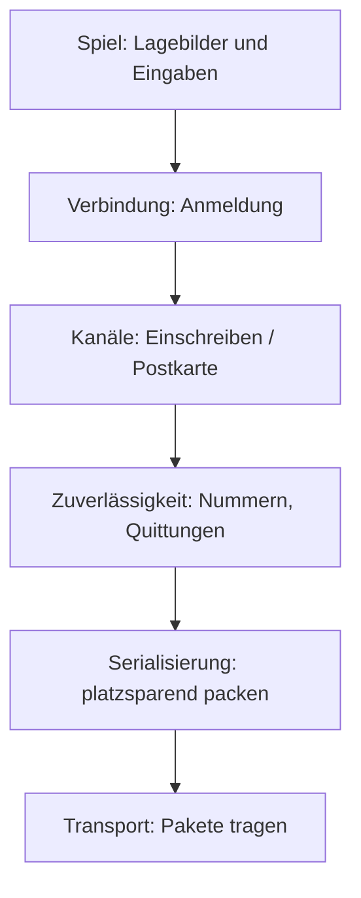

# 10 Mehrspieler: Wie Kern übers Netz spricht

> **Kurz gesagt:** Kern bringt seinen eigenen Netzwerk-Baukasten mit und macht damit aus **jedem**
> Level ein Mehrspieler-Spiel, ohne Vorbereitung. Ein Rechner ist der Chef (der Server), die anderen
> schicken ihm ihre Eingaben und zeigen, was er meldet. Hier erfährst du, wie das klappt, auch über
> wackelige Leitungen, und wie du es im Studio ausprobierst.

> **Begriffe vorab:**
> - **Server** oder Host (Gastgeber) – der Rechner, der das Spiel ausrichtet und als Einziger wirklich rechnet.
> - **Client** oder **Gast** – ein Mitspieler, der sich beim Server anmeldet und zeigt, was der meldet.
> - **Paket** (Päckchen) – ein kleines Bündel Daten, das als Ganzes übers Netz reist.
> - **Bit** – die kleinste Informationseinheit: ein Ja oder Nein, eine 1 oder 0. Acht Bits sind ein
>   **Byte**, genug für einen Buchstaben.
> - **Umlaufzeit** (auch Ping) – wie lange ein Paket hin und zurück braucht.
> - **Snapshot** – ein „Lagebild“ des Servers: wo gerade alles steht, wie ein Schnappschuss.
> - **HUD** – die Anzeige über dem Spielbild: Punkte, Zeit, Lebensenergie.
> - **Relay** – eine Weiterleitungsstation im Internet, eine Art Postamt für Spielpakete.

Stell dir ein Brettspiel per Telefon vor: Einer hat das Brett vor sich, die anderen sagen ihre Züge
durch und lassen sich erzählen, wie es steht. Genau so arbeitet Kern.

Von der Leitung darunter braucht Kern nur eins: Pakete verschicken und empfangen. Ob sie ankommen und in
welcher Reihenfolge, regelt Kern selbst. Darum ist es Kern egal, ob die Pakete zwischen zwei Tabs eines
Browsers, zwischen zwei Rechnern oder nur zum Test innerhalb eines Programms hin- und hergehen.

> **Für Neugierige:** Der Netzwerkteil ist in C++ geschrieben und folgt den bekannten Artikeln von
> Glenn Fiedler („Gaffer On Games“) und dem Aufbau seiner freien Netzwerk-Bibliotheken. Die genauen
> Namen und Werte stehen im blauen Buch, Kapitel 10.

---

## 10.1 Die Schichten

Das Verschicken ist in Stufen aufgeteilt, und jede Stufe hat nur eine Aufgabe. So kann man jede einzeln
verstehen und einzeln testen.

> **Stell dir vor …** du verschickst ein Möbelstück, Schritt für Schritt von oben nach unten wie in
> der Skizze: Du meldest dich vorher an, damit man weiß, wer du bist (Verbindung), entscheidest, was
> per Einschreiben und was als Postkarte geht (Kanäle), klebst Nummern auf die Kartons, damit ein
> fehlender auffällt (Zuverlässigkeit), packst die Teile platzsparend (Serialisierung), und ein Bote
> trägt alles (Transport).

Beim Senden geht ein Paket im Bild von oben (Spiel) nach unten (Bote), beim Empfangen zurück.

---

## 10.2 Serialisierung: jedes Bit zählt

**Serialisieren** heißt: Spieldaten in eine Reihe von Bits verwandeln, damit sie durch die Leitung
passen, und am anderen Ende zurück. Je weniger Bits, desto mehr passt in ein Paket.

> **Stell dir vor …** das Ratespiel „Ich denke an eine Zahl zwischen 1 und 1000“. Mit klugen
> Ja-Nein-Fragen („Ist sie größer als 500?“) brauchst du höchstens zehn Fragen. Zehn Ja-Nein-Antworten
> sind zehn Bits. Weiß Kern, dass eine Zahl nur zwischen 1 und 1000 liegen kann, schickt es deshalb
> genau zehn Bits, nicht mehr.

Außerdem **rundet** Kern, wo es niemand merkt: Statt „3,14159265 Meter“ reicht „3,142 Meter“, also
auf den Millimeter genau. Und es **lässt weg**, was der Empfänger selbst ausrechnen kann. Das ist wie
beim Wechselgeld: Wer weiß, dass drei Scheine zusammen 30 € ergeben, muss nur zwei davon genannt
bekommen, den dritten rechnet er selbst aus. Eine Drehung etwa besteht in Kern aus vier Zahlen, die
nach einer festen Regel zusammenpassen; drei genügen.

Wichtig ist, **wie** Kern das Format festlegt: Für jede Nachrichtenart gibt es nur **eine einzige**
Beschreibung, wie ein Formular mit festen Feldern. Der Absender füllt es aus, der Empfänger liest mit
genau demselben Formular, und Kern misst damit sogar vorab, wie viel Platz es braucht. Gäbe es zwei
getrennte Beschreibungen, ergänzte früher oder später jemand ein Feld nur in einer. Dann läse der
Empfänger alles um ein Feld verrutscht.

Der Empfänger prüft **alles**: Liegt eine Zahl im erlaubten Bereich? Ist das Paket vollständig? Ein
kaputtes oder böswillig gebasteltes Paket wird einfach weggeworfen, statt das Spiel abstürzen zu lassen.

---

## 10.3 Zuverlässigkeit: Nummern und Quittungen

Im Internet reist jedes Paket einzeln, auf dem Weg, der gerade frei ist. Darum kann eins verloren gehen,
doppelt ankommen oder ein anderes überholen. Kern merkt das, indem es jedes Paket **nummeriert** und
jedem Paket eine **Quittung** mitgibt: welche Pakete der Gegenseite schon angekommen sind.

> **Stell dir vor …** du schreibst einem Freund Postkarten und auf jede nicht nur „Karte Nr. 57“,
> sondern auch: „Von dir habe ich Nr. 41, und von den 32 davor alle außer Nr. 38.“ Dein Freund weiß
> sofort, was fehlt. Und geht eine Karte verloren, steht die Quittung auf der nächsten ja wieder.

Die „32 davor“ sind 32 Häkchen, also 32 Bits: angekommen ja oder nein. So kostet die ganze Quittung
nur ein paar Byte. Nebenbei misst Kern so, wie gut die Leitung ist: die **Umlaufzeit** (wann kam die
Quittung für Karte 57 zurück?), den Verlust und wie viele Daten fließen. Diese Werte siehst du später
in der Statusleiste von Studio.

Eins tut diese Stufe bewusst **nicht**: warten. Sie schickt jedes Paket sofort. Ob etwas Verlorenes
nachgeschickt wird, entscheidet die Stufe darüber, denn nur sie weiß, ob es wichtig war. Zu große
Pakete zerlegt sie in Stücke und setzt sie beim Empfänger wieder zusammen.

---

## 10.4 Kanäle: Einschreiben oder Postkarte

Nicht alles ist gleich wichtig. Darum hat Kern zwei Arten zu verschicken, zwei **Kanäle**:

| Kanal | Verhalten | Beispiel |
|---|---|---|
| **Einschreiben** (zuverlässig) | kommt genau einmal an, in Reihenfolge | „Anna ist beigetreten“, „Orb eingesammelt“ |
| **Postkarte** (unzuverlässig) | wird einmal mitgeschickt, fertig | Positionen, Eingaben, Geräusche |

Beim Einschreiben schickt Kern eine Nachricht so lange erneut, bis eine Quittung zeigt, dass sie
angekommen ist. Positionen dagegen gehen als Postkarte: Die Position von vor einer halben Sekunde will
niemand nachgeliefert bekommen, die nächste ist schon unterwegs. Würde Kern sie nachschicken, stünden
sie nur der neueren im Weg.

> **Für Neugierige:** Im Programm heißen die beiden Kanäle „reliable ordered“ (zuverlässig, geordnet)
> und „unreliable unordered“ (unzuverlässig, ungeordnet). Große Nachrichten reisen im zuverlässigen
> Kanal Stück für Stück. Die genauen Grenzwerte stehen im blauen Buch, Kapitel 10.

---

## 10.5 Verbindung: Anmeldung mit Rückfrage

Bevor Spieldaten fließen, meldet sich der Client beim Server an. Diese Anmeldung heißt **Handshake**
(Händeschütteln). Sie sorgt für zwei Dinge: Der Server weiß danach sicher, dass der Gast wirklich unter
seiner Absenderadresse erreichbar ist, und beide teilen sich eine **Erkennungsnummer**, die fortan auf
jedem Paket steht.

> **Stell dir vor …** du rufst bei einem Hotel an und willst ein Zimmer. Die Rezeption sagt nicht
> sofort Ja, sondern ruft dich unter deiner Nummer **zurück** und nennt dabei ein eigenes Kennwort. Erst
> wenn du dieses Kennwort zusammen mit deinem eigenen zurückmeldest, bekommst du ein Zimmer. Wer sich
> mit einer falschen Nummer meldet, hört den Rückruf nie und kann nicht antworten.

So läuft es bei Kern:

1. Der Gast fragt an und nennt eine Zufallszahl.
2. Der Server antwortet mit einer **Rückfrage**, die eine eigene Zufallszahl trägt.
3. Der Gast schickt beide Zahlen miteinander verrechnet zurück. Das kann nur, wer die Rückfrage auch
   wirklich bekommen hat.
4. Der Server gibt ihm einen freien **Platz**, wie einen Stuhl am Spieltisch. Die verrechnete Zahl ist
   ab jetzt die Erkennungsnummer der beiden.

Pakete von Fremden oder mit falscher Erkennungsnummer beachtet Kern nicht. Sind alle Plätze besetzt,
bekommt der Gast eine Absage. Hört eine Seite eine Weile nichts mehr von der anderen, gilt die
Verbindung als abgebrochen; damit das nicht aus Versehen passiert, schicken beide regelmäßig ein
Lebenszeichen, auch wenn sie gerade nichts zu sagen haben.

### Die Prüfsumme

Jedes Paket beginnt außerdem mit einer **Prüfsumme**. Das ist eine kleine Zahl, die der Absender aus dem
ganzen Inhalt des Pakets ausrechnet, ähnlich wie die Prüfziffer in einer Kontonummer. Der Empfänger
rechnet dieselbe Zahl noch einmal aus. Stimmt sie nicht, ist das Paket unterwegs beschädigt worden und
fliegt weg.

Kern rechnet in diese Prüfsumme heimlich noch eine Kennung mit ein, die so viel bedeutet wie „Kern,
Fassung 1“. Ein Paket eines anderen Spiels oder einer anderen Kern-Fassung ergibt deshalb nie die
passende Zahl und fällt heraus, bevor überhaupt jemand seinen Inhalt liest.

> **Für Neugierige:** Die Anfrage des Gastes ist absichtlich mit leeren Bytes auf volle Größe
> aufgefüllt. Ein Angreifer könnte sonst die Adresse eines Opfers als Absender angeben. Der Server
> würde dann dem Opfer antworten, und mit einer kleinen Anfrage brächte der Angreifer ihn dazu, dem
> Opfer mehr Daten zu schicken, als er selbst investiert hat. Die genauen Namen und Werte stehen im blauen
> Buch, Kapitel 10.

---

## 10.6 Transporte: wer die Pakete trägt

Ganz unten sitzt der **Bote**: Er trägt Pakete von A nach B und sonst nichts. Weil alle Stufen darüber
gleich bleiben, kann Kern den Boten austauschen, je nachdem, wo gespielt wird.

- **Der Probe-Bote im selben Programm:** Er trägt Pakete zwischen Server und Clients, die alle im selben
  Programm stecken. Den nutzen Kerns Tests und das Studio, wenn du dort mit mehreren Spielern testest.
- **Der Bote für den Browser:** Er reicht die Pakete an die Webseite weiter, und die bringt sie über
  den Briefkasten im Browser oder über das Postamt im Internet ans Ziel (10.10).
- **Der Störsender:** In beide Boten ist er eingebaut. Auf Wunsch spielt er schlechtes Internet nach:
  Pakete kommen verspätet an, mal schneller, mal langsamer (das nennt man **Jitter**), gehen verloren
  oder kommen doppelt.

Der Störsender würfelt, welche Pakete er verliert. Gibt man ihm aber denselben Startwert für seinen
Würfel, würfelt er jedes Mal genau gleich. So kann man einen Fehler, der nur bei schlechtem Netz
auftritt, immer wieder genau gleich nachstellen, bis er behoben ist.

---

## 10.7 Ein Spiel, viele Spieler

**Der Server ist der Chef.** Nur er rechnet die Physik, die Spielregeln, das Einsammeln und die Zonen.
Jeder neue Spieler bekommt eine eigene Spielfigur, eine Kopie der Spielerfigur aus dem Level (im
Programm heißt sie **Pawn**, Spielstein). 30-mal pro Sekunde schickt der Server jedem Gast ein
**Lagebild**: das HUD und wo alle beweglichen Dinge gerade stehen.

**Der Gast spielt eine Kopie, eine Replika.** Er lädt dasselbe Level, rechnet aber **keine eigene
Physik**. Seine Dinge stehen einfach dort, wo der Server sie meldet. Selbst schickt er nur, was sein
Spieler gerade drückt und wohin er schaut. Was die Logik-Graphen des Servers verändern
([Kapitel 9](09-logik.md)), etwa eine Tür, die aufgeht, übernimmt er.

> **Stell dir vor …** ein Daumenkino, von dem du nur jedes zweite Bild bekommst, und manche zu spät.
> Zeigst du jedes sofort, ruckelt es. Also wartest du ein wenig und zeichnest die Bilder
> **dazwischen** selbst.

Genau so zeigt der Gast die Welt absichtlich etwa **eine Zehntelsekunde in der Vergangenheit**. Dann
hat er fast immer zwei Lagebilder in der Hand und kann die Bewegung dazwischen weich ausrechnen; das
nennt man **Interpolation**. Fehlt einmal ein Lagebild, rechnet er die Bewegung kurz in dieselbe
Richtung weiter und hält dann an.

### Damit nichts verloren geht

- **Wichtiges** geht per Einschreiben: das Willkommen, „Spieler kam“ oder „ging“, ein eingesammelter
  Orb, alles, was die Logik verändert. **Geräusche und Schüsse** gehen als Postkarte.
- **Sprünge und Schüsse fallen nie unter den Tisch.** Jede Postkarte des Gastes enthält nicht nur
  seine neueste Eingabe, sondern auch bis zu drei davor. Geht eine Karte verloren, steht der Sprung auf der
  nächsten noch einmal, und der Server zählt ihn trotzdem.
- **Wer schießt, trifft, was er gesehen hat.** Der Gast sieht die Welt ja etwas verspätet, auch durch
  die Verzögerung der Leitung (englisch **Lag**). Schießt der Gast, dreht der Server für die
  Treffer-Prüfung die Zeit kurz zurück: Wo stand das Ziel in dem Moment, den der Gast
  auf dem Bildschirm hatte? Das heißt **Lag-Kompensation** ([Kapitel 8](08-spiel-laufzeit.md)).
- **Wer später kommt,** bekommt alles nachgereicht: die Spieler, die schon da sind, alles, was die
  Logik bisher verändert hat, und welche Dinge schon eingesammelt sind.

### Der Prioritätstopf

Pakete im Internet dürfen nicht beliebig groß sein; Kern bleibt vorsichtig bei etwa 1400 Byte,
ungefähr so viel wie eine Buchseite Text. Ein Lagebild muss in **ein einziges** Paket passen. Sonst
müsste der Gast auf mehrere Teile warten, und
fehlte eins, wäre das ganze Bild unbrauchbar. In einem großen Level passt aber nicht jedes Ding in jedes
Lagebild.

> **Stell dir vor …** jedes Ding im Level hat einen Topf. Jedes Mal, wenn der Server ein Lagebild
> packt, wirft er Punkte hinein: 10 Punkte, wenn sich das Ding bewegt hat, nur 0,25 Punkte, wenn es
> still lag. Eingepackt werden die Dinge mit den vollsten Töpfen, bis das Paket voll ist, und ihr Topf
> wird geleert.

Was sich bewegt, ist so ständig dran; was ruht, selten, aber nie vergessen. Die eigene Figur des Gastes
kommt immer zuerst mit. Und Dinge, die sich gar nicht bewegen können, etwa Wände, schickt Kern nie: Die
hat der Gast ja schon in seinem Level.

### Uhr und Level-Prüfsumme

Der Gast muss wissen, wie spät es beim Server ist, sonst kann er nicht „eine Zehntelsekunde zurück“
zeigen. Jedes Lagebild trägt deshalb die Uhrzeit des Servers.

> **Stell dir vor …** Briefe mit Datumsstempel. Vergleichst du den Stempel mit dem Tag, an dem der
> Brief ankommt, weißt du ungefähr, wie die Uhr beim Absender geht. Aber manche Briefe trödeln
> unterwegs. Also glaubst du nicht jedem einzelnen Brief blind, sondern bildest dir aus vielen eine
> Meinung und passt sie nach und nach an.

So macht es auch der Gast: Aus den Uhrzeiten vieler Lagebilder schätzt er, wie weit die Uhr des Servers
seiner eigenen voraus ist, und korrigiert diese Schätzung behutsam. Dabei zählen nicht alle Briefe
gleich: Der schnellste Brief verrät die Uhr am besten, denn er hat am wenigsten getrödelt. Einem
schnellen Lagebild folgt der Gast darum rasch, einem verspäteten nur ein kleines Stück.

Außerdem brauchen beide Seiten **genau dasselbe Level**. Das Willkommen des Servers trägt deshalb eine
Prüfsumme über die ganze Level-Datei (nur wo die Editor-Kamera gerade steht, zählt nicht). Passt sie
nicht zum Level des Gastes, lehnt der ab: „the server plays a different level“.

> **Achtung, Falle!** Du hast beim Host noch schnell einen Würfel verschoben, und dein Freund hat die
> alte Fassung offen? Dann klappt der Beitritt nicht. Speichere und gib allen genau diese Datei.

### Wie viele können mitspielen?

Der Host spielt selbst mit und hält für Gäste **acht Plätze** frei, zusammen also bis zu neun Spieler.
Im Studio testest du auf einem Rechner mit bis zu vier Spielern (10.8). Die genauen Namen und Werte
stehen im blauen Buch, Kapitel 10.

---

## 10.8 Mehrspieler im Studio

### Anzahl der Spieler

Im Studio testest du mit mehreren Spielern, ganz ohne zweiten Rechner:
**Spielen › Anzahl der Spieler** (Play › Number of Players), 1 bis 4. Die Welt wird ein **Listen-Server**, ein Server, der selbst mitspielt. Jeder weitere Spieler ist
ein echter Gast mit eigener Welt und eigenem Viewport, verbunden über den Probe-Boten aus 10.6.

- Das Studio schaltet auf **vier Viewports**: 1 ist der Server, 2 der erste Gast und so weiter.
- Nur der Viewport, in den du zuletzt geklickt hast, bekommt deine Eingaben; die anderen Spieler
  stehen still.
- **Spielen › Netzwerk-Emulation** (Play › Network Emulation) schaltet den Störsender ein, in Stufen
  von **Perfekt** (Perfect), der perfekten Leitung, über **LAN (5 ms)**, das Heimnetz, und
  **Mittel (50 ms, 1 % Verlust)** (Average (50 ms, 1% loss)) bis
  **Schlecht (150 ms, 5 % Verlust)** (Bad (150 ms, 5% loss)) und
  **Sehr schlecht (300 ms, 20 % Verlust)** (Terrible (300 ms, 20% loss)).
- Die Statuszeile zeigt, wer Server und wer Gast ist, wie viele spielen, die Umlaufzeit und den
  Verlust.

> **Probier's aus!** Öffne Kern Studio über https://kernengine.de/, lade
> **Datei › Beispiel-Levels › Shooting Range** (File › Example Levels › Shooting Range), wähle
> **Spielen › Anzahl der Spieler › 2 Spieler (Listen-Server)**
> (Play › Number of Players › 2 Players (listen server)) und drücke **Spielen** (Play). Klick in
> Viewport 2 und lauf mit dem Soldaten des Gastes los. Schau dabei in Viewport 1: Dort läuft er
> auch, denn der Server rechnet ihn. Dann stell **Netzwerk-Emulation** auf
> **Sehr schlecht (300 ms, 20 % Verlust)** und steuere
> wieder in Viewport 2. Was du siehst: Der Soldat reagiert spürbar später, denn jeder Tastendruck muss
> erst zum Server und das Ergebnis zurück. Bewegungen können ruckeln oder kurz stocken, wenn Lagebilder
> verloren gehen und die Zehntelsekunde Vorrat aus 10.7 nicht mehr reicht. Steuerst du dagegen in
> Viewport 1, reagiert der Soldat des Servers sofort: Er muss auf niemanden warten.

### Online: hosten und beitreten

Für andere Tabs oder Rechner: **Spielen › Online-Spiel hosten...** (Play › Host Online Game...) und
**Online-Spiel beitreten...** (Join Online Game...). Der Dialog fragt
nach einem **Raum** (Standard „kern“) und optional nach einem Relay (10.11). Leer gelassen, finden sich
nur Tabs desselben Browsers. **Online-Spiel verlassen** (Leave Online Game) beendet die Sitzung. Liegt der Tab des Hosts im
Hintergrund, rechnet er trotzdem weiter. Sonst hörten seine Gäste nichts mehr von ihm und flögen
nach einer Weile raus (10.5).

> **Probier's aus!** Öffne Studio in zwei Tabs mit demselben Beispiel-Level. Im ersten
> **Online-Spiel hosten...**, im zweiten **Online-Spiel beitreten...**, Raum „kern“, Relay leer. Schon spielt ihr zu zweit. Das
> Schöne daran: Die beiden Tabs sind zwei völlig getrennte Programme. Sie teilen nichts außer den
> Paketen, die sie sich durch den Briefkasten des Browsers zuschieben (10.10).

---

## 10.9 Exportierte Spiele im Netz

Auch ein mit **Datei › Spiel verpacken (HTML)...** (File › Package Game (HTML)...) exportiertes Spiel ([Kapitel 11](11-studio.md)) kann online
spielen. Was es tun soll, schreibst du **hinten an die Adresse** in der Adresszeile des Browsers:

| Anhang | Wirkung |
|---|---|
| `?host=raum` | bietet im Raum „raum“ ein Spiel an |
| `?join=raum` | tritt dem Raum bei |
| `&relay=…` | nutzt dieses Relay (zusätzlich, für verschiedene Rechner) |

Ein Beispiel: Heißt deine Datei `MeinSpiel.html`, öffnest du sie im Browser und ergänzt in der
Adresszeile hinten `?host=party`. In einem zweiten Tab desselben Browsers öffnest du
`MeinSpiel.html?join=party` und spielst gegen dich selbst. Für einen Freund an einem anderen Rechner
hängt ihr beide noch `&relay=` mit der Adresse eines Relays an (10.11). Ohne Raumnamen gilt „kern“. Klappt es nicht, meldet das Spiel „Online
play failed“ und du spielst allein weiter.

---

## 10.10 Briefkasten und Postamt

Die Webseite selbst ist nur ein Träger: Sie nimmt die fertigen Pakete von der Engine entgegen, bringt
sie ans Ziel und reicht ankommende zurück. Lesen tut sie sie nicht; Nummern, Quittungen, Kanäle und
Anmeldung erledigt alles Kern selbst. Für den Weg gibt es zwei Möglichkeiten.

> **Stell dir vor …** **Im selben Browser** teilen sich alle Tabs einen gemeinsamen **Briefkasten**,
> einen für jeden Raumnamen. Der Host wirft regelmäßig einen Zettel „Ich bin da“ hinein, ein Gast
> schaut nach und legt seine Pakete dazu. Dafür braucht man keinen Server im Internet. **Zwischen
> verschiedenen Rechnern** gibt es keinen gemeinsamen Briefkasten. Dann braucht es ein **Postamt** im
> Internet, das Relay: Jeder bekommt dort eine Postfachnummer, und das Postamt stellt jedes Paket an
> die Nummer zu, die draufsteht.

Findet ein Gast im Raum keinen Host, sagt ihm das Studio nach ein paar Sekunden Bescheid.

> **Für Neugierige:** Der Briefkasten ist eine Fähigkeit des Browsers, mit der sich Tabs derselben
> Seite Nachrichten zuschieben können. Die genauen Namen und Zeiten stehen im blauen Buch, Kapitel 10.

---

## 10.11 Das Relay

Warum braucht es zwischen Rechnern ein Postamt? Ein Browser kann keine losen Pakete direkt an einen
anderen Rechner schicken. Er kann nur eine feste Leitung zu einem Server aufbauen. Das Relay ist so ein
Server: Es nimmt die Pakete aller Spieler über ihre Leitungen an und reicht sie weiter.

> **Stell dir vor …** ein Briefträger, der keine Briefe liest, sondern nur auf die Postfachnummer
> schaut. So ist das Relay **absichtlich dumm**: Es sieht nur Bytes und eine Empfängernummer, ersetzt
> sie durch die Nummer des Absenders und stellt zu. Kaputte Sendungen und solche an unbekannte Nummern
> wirft es weg. Geht der Host, ist der Raum für Neue geschlossen.

Und die Sicherheit? Die steckt in den Paketen selbst: Prüfsumme und Erkennungsnummer aus 10.5 sortieren
fremde und beschädigte Pakete beim Empfänger aus. Das Relay muss dafür nichts verstehen.

Gestartet wird das Relay als kleines Programm auf einem Rechner, den alle Mitspieler erreichen. Dafür
braucht man etwas Technikwissen oder jemanden, der sich auskennt. Seine Adresse tragen dann alle im
Dialog bzw. hinter `&relay=` ein.

> **Für Neugierige:** Das Relay ist in JavaScript geschrieben und läuft mit Node, einem Programm, das
> JavaScript außerhalb des Browsers ausführt. Der genaue Befehl zum Starten steht im blauen Buch,
> Kapitel 10.

---

## 10.12 Was wo läuft

| | Server (Host) | Gast (Replika) |
|---|---|---|
| Physik, Regeln, Einsammeln | rechnet | folgt den Lagebildern |
| Logik-Graphen ([Kapitel 9](09-logik.md)) | laufen | bekommt die Änderungen |
| Schüsse und Schaden | prüft mit Zeit-Zurückdrehen | zeigt nur an |
| Geräusche | erzeugt | spielt nach |
| Stadtverkehr | rechnet | fährt bei jedem selbst (nur Deko) |
| Kamera, Eingabe | lokal | lokal, Eingabe geht an den Server |

---

## 10.13 Tests

Im echten Internet gehen Pakete verloren, kommen doppelt oder in falscher Reihenfolge. Darum prüfen
Kerns Tests das Netz genau unter solchen Bedingungen. Der Störsender aus 10.6 verliert dabei ein
Viertel aller Pakete, verzögert und verdoppelt manche, und trotzdem muss jedes Einschreiben genau
einmal und in Reihenfolge ankommen. Die Anmeldung muss Hunderte Müll-Pakete überstehen, das Packen
kaputte Daten. Weitere Tests spielen Soldaten, Schüsse und Logik übers Netz, auch mit drei Spielern im
Studio.

---

## Das nimmst du mit

- Kern macht aus **jedem** Level ein Mehrspieler-Spiel.
- Das Verschicken ist ein Stapel von Stufen: platzsparend packen, nummerieren und quittieren,
  Einschreiben oder Postkarte, Anmeldung, Bote.
- **Einschreiben** für Wichtiges, **Postkarte** für Dinge, die schnell veralten.
- Die **Anmeldung mit Rückfrage** stellt sicher, dass der Gast wirklich erreichbar ist; eine
  **Prüfsumme** sortiert beschädigte und fremde Pakete aus.
- Der **Server** rechnet, der **Gast** zeigt eine Kopie etwa eine Zehntelsekunde in der Vergangenheit.
- Ein **Prioritätstopf** sorgt dafür, dass jedes Lagebild in ein Paket passt.
- Alle brauchen **dasselbe Level**; eine Prüfsumme kontrolliert das.
- Im Studio: **Anzahl der Spieler** (Number of Players), **Netzwerk-Emulation** (Network Emulation),
  **Online-Spiel hosten...** (Host Online Game...) und
  **Online-Spiel beitreten...** (Join Online Game...); zwischen Rechnern das **Relay** als Postamt.

## Knobelecke

1. Warum reisen Positionen als Postkarte und nicht per Einschreiben?
2. Warum zeigt der Gast die Welt absichtlich etwas „zu spät“?
3. 300 Kisten liegen still, eine rollt. Welche wird am häufigsten geschickt?
4. Warum vergibt der Server bei der Anmeldung nicht sofort einen Platz, sondern schickt erst eine
   Rückfrage?
5. Warum braucht das Relay keine eigene Sicherheitsprüfung?

### Lösungen

1. Eine verspätete Position ist wertlos, die neuere ist schon unterwegs. Nachgeschickt stünde sie nur
   im Weg.
2. So hat er fast immer zwei Lagebilder und kann die Bewegung dazwischen weich ausrechnen.
3. Die rollende: Ihr Topf bekommt jedes Mal 10 Punkte, die der ruhenden nur 0,25.
4. Nur wer wirklich unter seiner Absenderadresse erreichbar ist, bekommt die Rückfrage und kann sie
   richtig beantworten. Wer einen falschen Absender angibt, kommt nicht weiter.
5. Die Sicherheit steckt in den Paketen: Die Prüfsumme (mit der Kennung „Kern, Fassung 1“) sortiert
   Beschädigtes und Fremdes aus, die Erkennungsnummer aus der Anmeldung alles von Unbekannten.

---

© 2026 Christian Heinrich Hohlfeld · Alle Rechte vorbehalten · [Impressum und Rechte](00-impressum.md)
