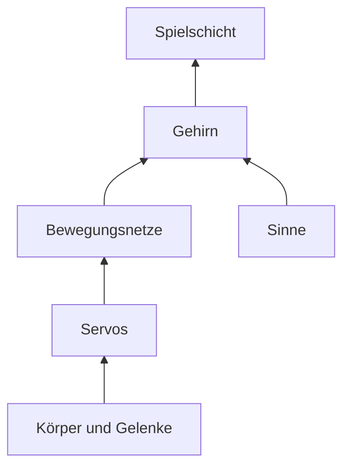
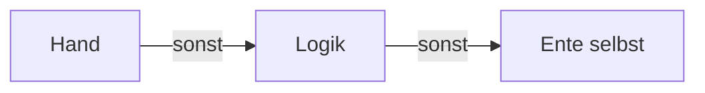

# 13 Die Micro Duck – unsere Heldin auf zwei Beinen

> **Kurz gesagt:** Die Micro Duck ist ein echter kleiner Laufroboter von Pollen Robotics. Kern
> baut sie so genau nach, dass sie mit denselben trainierten „Gehirnen“ läuft wie das Original. Dazu
> bringt Kern drei eigene Dinge mit: den Lehrer zum Trainieren, einen Sprung und eine Spielschicht,
> mit der die Ente selbst entscheidet, ob sie einen Ball kickt oder eine Socke holt.

> **Begriffe vorab:**
> - **Servo** – ein kleiner Motor, dem man einen Winkel sagt, und er dreht das Gelenk dorthin
> - **Neuronales Netz** – ein Rechenwerk wie ein riesiges Mischpult: Vorn gehen Messwerte hinein, hinten kommen Befehle heraus
> - **Training** – die Regler des Mischpults so lange verstellen, bis das Richtige herauskommt
> - **Policy** – ein fertig trainiertes Netz, das eine Bewegung steuert, etwa Laufen oder Kicken
> - **Simulation** – die Welt im Computer nachgerechnet, mit Schwerkraft, Stößen und Reibung
> - **Box3D** – die Physik-Engine, die in Kern diese Welt rechnet ([Kapitel 6](06-physik.md))
> - **Trägheit** – wie viel Mühe es kostet, etwas in Bewegung oder in Drehung zu bringen
> - **Takt** – der feste Rhythmus, in dem gerechnet und entschieden wird

Darf ich vorstellen: die Micro Duck. Etwa 25 cm groß, 0,74 kg schwer, mit 14 Servos in Beinen und
Hals und einem fünfzehnten für den Unterschnabel. Wie das Micro-Duck-Level im Studio aussieht, zeigt
das Bild in [Kapitel 1](01-einfuehrung.md).

Gebaut hat den Roboter Pollen Robotics. Laufen lernt die Ente dort nicht durch Regeln, die jemand
aufschreibt („erst linkes Knie, dann …“), sondern durch Training eines neuronalen Netzes in einer
Simulation. Die fertigen Netze kommen dann auf den echten Roboter.

> **Stell dir vor …** ein Mischpult mit rund zweihunderttausend Reglern. Vorn stecken 61 Kabel: wie
> sich der Körper gerade dreht, wo unten ist, wie jedes Gelenk steht. Hinten kommen 14 Kabel heraus:
> ein Befehl für jedes Gelenk. Am Anfang stehen die Regler wild durcheinander, und die Ente fällt um.
> Training heißt: die Regler wieder und wieder ein kleines bisschen verstellen, bis aus den Messwerten
> Befehle werden, mit denen sie läuft. Das fertige Mischpult ist die Policy.

Kern rechnet die Ente mit seiner eigenen Physik nach und lässt **genau diese Netze** laufen. Das Ziel
heißt **Treue**: derselbe Körper, dieselben Servos, derselbe Takt, dasselbe, was das Netz spürt und
tut. Obendrauf setzt Kern den **Lehrer** ([Kapitel 14](14-lehrer.md)), den **Sprung** und die
**Spielschicht**. Eigene Netze trainieren erklärt [Kapitel 15](15-eigene-modelle.md), den Abgleich mit
dem echten Roboter [Kapitel 16](16-kalibrierung.md).

> **Probier's aus!** Öffne Kern Studio auf https://kernengine.de/ und lade das Beispiel-Level
> (**Datei › Beispiel-Levels › Micro Duck** (File › Example Levels › Micro Duck)). Drück auf
> **Spielen** (Play) und schau zu: Die Ente spaziert los, schaut sich um – und
> wenn sie den Ball entdeckt, wird es spannend.

## 13.1 Die Ente im Überblick

Eine Ente in Kern besteht aus Schichten, wie ein Tier: ein **Körper** aus Gliedern und Gelenken, die
**Muskeln** (die Servos), **Bewegungen** (die Netze von Pollen: laufen, sitzen, kicken …), **Sinne**
(Abstand, Kamera, Gleichgewicht), ein **Gehirn**, das entscheidet, was sie als Nächstes tut, und
obendrauf Kerns **Spielschicht** für Ball und Socke. Dieses Kapitel geht von unten nach oben.

## 13.2 Die goldene Regel: nicht schummeln

Ein trainiertes Netz kann nur in der Welt, in der es geübt hat. Darum darf die Simulation der Ente
nirgends heimlich helfen.

> **Stell dir vor …** ein Tänzer hat monatelang auf einem bestimmten Parkett geübt. Stell ihn aufs
> Glatteis, und er fällt – nicht, weil er schlecht tanzt, sondern weil der Boden anders ist.

Darum gilt:

- **Keine Hilfen:** keine Stützkräfte, kein Festhalten des Rumpfs, kein Versetzen, kein weiches
  Überblenden von einer Bewegung zur nächsten. Auch Überblenden wäre eine Hilfe: Ein Gemisch aus zwei
  Netzen hat keines der beiden Netze im Training je erlebt. Darum kommt jeder Befehl ganz von einem
  Netz. Die Ente steht nur durch ihre Servos und ihre Füße.
- **Servos aus echten Physik-Bausteinen:** Ein Servo ist in Kern nur das, was die Physik ohnehin für
  Gelenke kennt, eine Feder und eine Bremse, mehr nicht (13.4).
- **Fester Takt:** Die Zeit wird in Schritten gezählt, nicht mit der Uhr. Gleiche Eingaben ergeben
  bis aufs Haar denselben Gang auf jedem Gerät. Das heißt **Determinismus** ([Kapitel 14](14-lehrer.md)).

> **Stell dir vor …** du bringst einem Kind Radfahren mit Stützrädern bei und schraubst sie dann
> heimlich ab. Genau das passiert, wenn die Simulation „hilft“: Das Netz verlässt sich auf etwas,
> das es in Wirklichkeit nicht gibt.

## 13.3 Das Modell

### Aus Pollens Bauplan

Pollen beschreibt den Roboter in einem Bauplan: welche Teile es gibt, wie sie verbunden sind, wie
schwer sie sind. Ein Werkzeug von Kern übersetzt diesen Bauplan automatisch in Kerns Sprache. Es ist
dabei pingelig: Stimmen Gelenknamen, Grundhaltung oder die Reihenfolge der Messwerte nicht genau mit
dem überein, was das Netz erwartet, bricht es ab. Lieber gar keine Ente als eine, die ein kleines
bisschen falsch ist, denn das Netz würde den Fehler nicht verzeihen.

### Glieder und Gelenke

Die Ente hat einen Rumpf, zwei Beine, einen Hals mit Kopf und einen Unterschnabel. Das Netz bewegt 14
Gelenke, immer in derselben Reihenfolge: linkes Bein, Hals, rechtes Bein.

- Jede **Hüfte** kann sich auf drei Arten drehen. Am einfachsten stellst du dir das an deinem Kopf vor:
  **gieren** ist Nein-Schütteln, **nicken** ist Ja-Nicken, **rollen** ist den Kopf zur Schulter neigen.
- Dazu kommen **Knie** und **Knöchel**.
- Der **Hals** kann nicken, und der **Kopf** kann nicken, gieren und rollen.

Jedes Gelenk hat harte Grenzen, wie dein Ellbogen, der nicht nach hinten knickt, und eine **Home-Pose**,
die bequeme Grundhaltung. Kern baut die Ente direkt in dieser Haltung auf.

> **Wusstest du?** Der Kopf der Ente kann sich um rund 170 Grad nach jeder Seite drehen. Damit schaut
> sie fast ganz nach hinten.

### Masse und die unsichtbare Scheibe

Wie schwer jedes Teil ist und wo sein Schwerpunkt liegt, steht im Bauplan. Die ganze Ente wiegt
0,74 kg, der Rumpf und der Kopf sind die schwersten Teile. Spannend wird es bei der **Trägheit**: wie
viel Mühe es kostet, ein Gelenk in Drehung zu bringen.

Im Servo steckt ein winziger Motor, und zwischen Motor und Gelenk sitzt ein Getriebe. Dreht sich das
Gelenk ein bisschen, muss sich der Motor dahinter sehr viel schneller mitdrehen, fast dreihundertmal so
schnell. Diesen schnellen kleinen Motor in Schwung zu bringen kostet Kraft. Darum fühlt sich jedes
Gelenk **träger an, als seine Teile wiegen**. Diese Zusatzträgheit heißt **Armatur**.

> **Stell dir vor …** ein Fahrrad im höchsten Gang. Das Rad ist leicht, und trotzdem kriegst du die
> Pedale beim Anfahren kaum herum, weil sich hinten alles viel schneller drehen muss als deine Füße.
> Das Gelenk der Ente ist die Pedale, der Motor im Servo das schnelle Hinterrad.

Kerns Physik kann so eine Getriebeträgheit nicht direkt eintragen. Darum bekommt jedes Glied eine
**unsichtbare Scheibe** auf seiner Gelenkachse mit. Sie macht genau das Drehen um diese Achse
schwerfälliger, wie der Motor hinter dem Getriebe. Wie Pollens Training das anders löst, steht im
blauen Buch, Kapitel 13.

Perfekt ist der Trick nicht, denn die Scheibe dreht sich mit dem Glied statt dreihundertmal so
schnell. Aber gemessen läuft die Ente damit deutlich näher am Training und zappelt viel weniger
(13.14).

### Was die Welt berührt

Für Zusammenstöße zählt nicht die feine Form jedes Teils, sondern eine vereinfachte Hülle, als hätte
man Frischhaltefolie straff um jedes Bauteil gespannt. Das macht Pollens Training genauso.

Wie stark etwas haftet, beschreibt die **Reibung**, eine Zahl meist zwischen 0 und 1: 0 heißt glatt
wie Eis, 1 heißt griffig wie Gummi. Die Sohlen der Ente greifen voll, die Servogehäuse sind glatt wie
im Training, und die Schalen von Rumpf und Kopf liegen dazwischen. So rutscht eine umgefallene Ente
nicht über den Boden wie auf Eis.

Neu in Kern: **Materialpaare**. Wie stark zwei Dinge aneinander haften, hängt von beiden ab.
Normalerweise schätzt eine Physik-Engine die Reibung zweier Stoffe einfach aus deren Einzelwerten, als
eine Art Mittelwert. Für manche Paare stimmt das nicht: Das weiche Schnabelpolster hält Baumwolle
besser fest, als dieser Mittelwert sagt. Für solche Paare trägt Kern einen eigenen Wert ein; für die
Socke ist das wichtig. Im Micro-Duck-Level ist der Boden aus Holz.

### Maßstab 4: die Ente als Riesin

Box3D rechnet am liebsten mit Dingen zwischen 10 cm und 10 m. Die Glieder der Ente sind nur 2 bis 4 cm
klein, und so kleine Teile machen Physik-Engines leicht wackelig. Also baut Kern die Ente **viermal so
groß** und rechnet alles passend um.

Wie viel schwerer wird sie dabei? Viermal so lang, viermal so breit und viermal so hoch heißt
4 · 4 · 4 = **64-mal so viel Material**, also 64-mal so schwer. Genauso einfach ist es nicht bei allem,
aber der Gedanke ist immer derselbe: Jede Größe wird so umgerechnet, dass die große Ente sich genau
wie die kleine bewegt, nur größer.

Und die **Zeit**? Große Dinge bewegen sich gemächlicher. Eine lange Schaukel schwingt langsamer als
eine kurze, und ein Stein fällt von einem hohen Turm länger als von einem niedrigen. Die Regel dahinter:
Ist etwas viermal so groß, dauert eine solche Bewegung **doppelt** so lange, bei neunmal so groß
dreimal so lange. Die Riesen-Ente
läuft also in Zeitlupe, halb so schnell wie die echte.

Das Netz merkt von alldem nichts. Kern rechnet alles in echte Robotermaße zurück, bevor das Netz es
sieht, und auch alle Werte, die du über Logik oder Sensoren bekommst, sind echte Meter und Sekunden.

> **Für Neugierige:** Diese Umrechnung folgt einer Regel aus dem Schiffsbau, mit der man Modelle im
> Wasserbecken testet. Die Faktoren für Trägheit, Kraft, Dämpfung und Drehtempo stehen im blauen Buch,
> Kapitel 13.

### Aussehen und Rollschuhe

Die 3D-Formen der Ente stammen aus Pollens eigenen Modellen. Die dürfen nur nicht kommerziell genutzt
werden, Kerns Programmtext dagegen frei. Darum zeigt dieses Buch die Ente in eigener Gestaltung.

Es gibt auch eine Variante **„Micro Duck (Rollers)“**: Statt Sohlen trägt sie Kufen mit frei drehenden
Rädchen ohne Antrieb, wie Rollschuhe. Fahren muss sie trotzdem selbst, mit einem eigenen Netz.

## 13.4 Das Servomodell

Ein Servo zieht das Gelenk zu seinem Ziel, **umso stärker, je weiter es noch weg ist**, aber nie stärker
als seine Höchstkraft. **Je schneller sich das Gelenk bewegt, desto mehr bremst er.** Und **etwas
Reibung** ist immer da. Das ist schon das ganze Gesetz.

> **Stell dir vor …** ein Gummiband zieht das Gelenk zum Ziel: Je weiter gedehnt, desto fester zieht
> es, bis es nicht mehr nachgibt. Dazu eine Hand, die bremst, wenn es zu schnell geht, und ein wenig
> Sand im Gelenk.

Ein Beispiel: Steht ein Gelenk 6 Grad neben seinem Ziel, zieht der Servo nur mit einem kleinen Teil
seiner Kraft. Die volle Kraft erreicht er erst bei fast 100 Grad Abstand. Die Servos der Ente sind also
**weich**, eher eine sanft schiebende Hand als ein Schraubstock. Genau so hat Pollen sie am echten
Servo vermessen.

Kern nennt so etwas ein **Gerätemodell**: ein kleines Gesetz in echten Einheiten. Seine Zahlen
(wie fest er zieht, wie stark er bremst, Reibung, Höchstkraft und wie lange ein Befehl unterwegs ist,
13.5) stehen in einem **Profil**, einer Art Datenblatt des Servos. Dasselbe Gesetz gilt überall
gleich, im Studio, im Lehrer und auf dem Prüfstand der Kalibrierung.

Und wenn das Ziel jenseits dessen liegt, was das Gelenk überhaupt kann? Dann zieht der Servo das Gelenk
bis an seine Grenze und drückt es dort gegen den Anschlag, wie deinen Ellbogen, wenn du ihn ganz
durchstreckst und noch weiter willst.

Beim Training lässt man diese Zahlen absichtlich ein wenig **streuen**: Jede Übungsente bekommt etwas
andere Servos, mal träger, mal reibender, mal mit mehr Verzögerung. So lernt das Netz, auch mit Servos
klarzukommen, die nicht ganz genau dem Datenblatt entsprechen, wie bei einem echten Roboter, bei dem
kein Servo dem anderen gleicht.

Ein Profil gilt für alle Servos einer Ente oder für ein einzelnes Gelenk, auch den Schnabel. Eigene
Profile misst man wie in [Kapitel 16](16-kalibrierung.md).

> **Wusstest du?** Der echte Servo kann sich selbst die Kraft begrenzen, damit er nicht zu warm wird.
> Mit dieser Grenze käme die Ente nicht mehr vom Rücken hoch! Pollen trainiert ausdrücklich ohne
> sie, und Kern auch.

Die genauen Werte und das Gesetz als Formel stehen im blauen Buch, Kapitel 13.

## 13.5 Der Takt

Zwei Uhren ticken in der Ente. Die **Physik** rechnet die Welt in sehr kleinen Schritten weiter. Das
**Netz** denkt seltener nach: nur bei jedem vierten Physikschritt, 50-mal pro Sekunde. Dazwischen
halten die Servos einfach ihr letztes Ziel.

> **Stell dir vor …** die Physik ist der Sekundenzeiger, der unermüdlich tickt. Das Netz ist jemand,
> der nur bei jedem vierten Tick auf die Uhr schaut und dann entscheidet, was als Nächstes kommt.

Genau so war es im Training, und genau so muss es in Kern sein. Hier hilft die Zeitlupe aus 13.3:
Weil die Riesen-Ente in Zeitlupe läuft, darf auch jeder Physikschritt doppelt so lang sein. In
Entenzeit gerechnet ist er genau gleich lang wie im Training. Kern rechnet das beim Start jeder Ente
selbst aus.

Ein Befehl kommt auch nicht sofort beim Servo an. Er braucht ein paar Hundertstelsekunden, wie ein
Brief, der unterwegs ist. Kern lässt jeden Befehl darum genau so lange warten wie am echten Roboter.

### Zwischenschritte

Wenn du eine Micro Duck in ein Level setzt, stellt Studio die Physik von selbst auf ihren Takt um
und teilt jeden Physikschritt zusätzlich in 16 **Zwischenschritte**. Warum so viele? Die Ente ist eine
lange Kette aus Gliedern: Rumpf, Hüfte, Oberschenkel, Knie, Knöchel, Fuß. Rechnet die Physik zu grob,
geben die Gelenke in so einer Kette ein wenig nach, und die Ente wird auseinandergezogen wie ein
Gummitier. Viele kleine Schritte halten die Kette fest zusammen.

> **Probier's aus!** Setz in einem leeren Level aus der **Inhaltsablage** (Content Drawer) eine
> **Micro Duck** ein und schau ins **Ausgabeprotokoll** (Output Log): Studio meldet, dass es die
> **Welteinstellungen** (World Settings) angepasst hat. Unter
> **Welteinstellungen › Physik (Box3D)** (World Settings › Physics (Box3D)) siehst du die neue
> **Schrittrate** (Step rate) und die **Teilschritte** (Sub-steps), also die Zwischenschritte. Einstellen musst du
> nichts: Die Botschaft ist, dass Studio die Physik für die Ente selbst feiner gestellt hat.

### Das Zeitkonto

Der Bildschirm liefert seine Bilder nicht im Takt der Physik. Mal kommt ein Bild früher, mal später.
Damit die Ente trotzdem in festen Schritten lebt, führt Kern ein **Zeitkonto**: Jedes Bild zahlt die
vergangene Zeit ein, die Simulation hebt sie nur in ganzen, gleich großen Schritten ab, und der Rest
wartet auf das nächste Bild. Gezeichnet wird ein weicher Übergang zwischen den letzten beiden
Schritten, damit nichts ruckelt ([Kapitel 8](08-spiel-laufzeit.md)).

> **Stell dir vor …** ein Sparschwein. Das Taschengeld kommt unregelmäßig, mal mehr, mal weniger. Aber
> ausgegeben wird nur in ganzen Euro. Was übrig bleibt, bleibt im Schwein bis zum nächsten Mal.

## 13.6 Die Netze der Ente

### Was die Ente kann

Für jede Bewegung gibt es ein eigenes Netz. Laufen läuft **dauernd**. Die anderen Bewegungen haben
einen Anfang und ein Ende: Ein Kick dauert eine halbe Sekunde, ein Sprung zwei, dann übernimmt wieder
das Laufnetz.

| Bewegung | Taste | Von wem? |
|---|---|---|
| Laufen und Stehen | W A S D | Pollen |
| Sitzen / Aufstehen | 1 | Pollen |
| Socke aufheben | 2 | Pollen |
| Kick links / rechts | 3 / 4 | Pollen |
| Rolle | 5 (halten) | Pollen |
| Rollschuh fahren / ducken | W A S D / 2 | Pollen |
| **Sprung** | 7 | Kern |
| Schnabel auf / zu | 6 | kein Netz, nur der Servo |

Fürs Laufen gibt es zwei Gangarten; du wählst sie im Details-Panel unter **Laufnetz** (Walking network).

### Wer gerade dran ist

Es läuft immer **nur eine** Bewegung. Wollen mehrere gleichzeitig, gilt eine feste Rangfolge:

1. eine Bewegung, die gerade läuft, etwa ein Kick,
2. Aufheben,
3. Sitzen oder Aufstehen,
4. Rollen,
5. zuletzt Stehen und Laufen.

Aus dem Sitzen heraus startet keine Bewegung. Klappt etwas nicht, sagt die Ente warum, etwa „the robot
is sitting - stand it up first“.

> **Achtung, Falle!** Fehlt das Netz einer Bewegung noch, springt kein anderes ein. Die Ente hält die
> Grundhaltung und sagt einmal, welches Netz fehlt. Bleibt sie stur stehen, schau in die Meldungen.

### Vom Befehl zum Servoziel

Das Netz sagt nicht „Knie auf 30 Grad“, sondern „Knie etwas weiter als in der Grundhaltung“. Das Ziel
für jeden Servo ist also **Grundhaltung plus Befehl des Netzes**. Kern gibt die Befehle genau so weiter,
wie das Netz sie im Training gegeben hat. Pollens Software auf dem echten Roboter dämpft und glättet sie
dagegen ein wenig, als Feinabstimmung für die echte Hardware. Im Details-Panel kannst du das
unter **Aktionen zu Servo-Zielen** (Actions to servo goals) umschalten:

- **Wie trainiert (Faktor 1, kein Filter)** (As trained (scale 1, no filter)) gibt die Befehle
  unverändert weiter;
- **Wie der Daemon des Roboters (Faktor 0,9, Tiefpass 0,5 / 0,7)**
  (As the robot's daemon (scale 0.9, low-pass 0.5 / 0.7)) macht es wie Pollens Software.

Gemessen: Laufen klappt mit beidem, die Kicks kippen mit der Robotereinstellung aber um.

### Wie die Netze in den Browser kommen

Das Laufnetz ist fest in Kern eingebaut. Alle anderen Netze sind eigene Dateien, und die lädt die Seite
erst nach, sobald ein Level eine Ente enthält. So muss niemand sie herunterladen, der nur ein Rennspiel
baut. Pollens Netze liegen in einem Ordner, Kerns eigene (Sprung und Spielschicht) in einem zweiten.

Das läuft wie ein Gespräch: Die Engine meldet, welche Netze ihr fehlen, die Seite holt sie, und die
Engine prüft jedes. Kern rechnet die Netze selbst und kennt nur Mischpulte, die so verdrahtet sind wie
Pollens; ein anders verdrahtetes lehnt es mit Begründung ab. Klappt das Laden nicht, versucht die
Seite es später noch einmal. So lange bleibt die Ente bei dieser Bewegung stehen und sagt warum.

> **Wusstest du?** Netze, die du selbst mit dem Kern Lehrer im Browser trainierst
> ([Kapitel 14](14-lehrer.md)), bleiben im Speicher desselben Browsers. Studio holt sie sich von dort,
> und ein offenes Studio übernimmt ein neues Netz sofort. Dein eigener Sprung ersetzt also den
> mitgelieferten, ohne dass du eine Datei kopierst.

## 13.7 Was das Netz sieht: 61 hinein, 14 heraus

Alle Bewegungsnetze bekommen dieselben 61 Zahlen, und jede hat ihren festen Platz, wie ein Kabel in
einer festen Buchse des Mischpults. Sie beschreiben nur, was ein Körper von innen spürt:

- **Gleichgewichtssinn:** wie schnell sich der Rumpf dreht und wo unten ist,
- **Gelenkgefühl:** wie jedes der 14 Gelenke steht und wie schnell es sich bewegt,
- **Rückblick:** was das Netz selbst eben befohlen hat (ein eigenes Gedächtnis hat das Netz nicht,
  darum bekommt es das mitgeliefert),
- **Auftrag:** wohin und wie schnell es laufen soll, wohin der Kopf schauen soll und welche
  Körperhaltung gewünscht ist.

Heraus kommen 14 Zahlen, eine pro Gelenk. Kerns Sprung benutzt zwei Buchsen, die bei Pollens Netzen
leer bleiben, als Uhr: So weiß das Sprungnetz, wie weit der Sprung schon ist.

> **Wusstest du?** Das Netz weiß nicht, wo es im Raum ist. Es kennt nur den eigenen Körper.
> Laufen ist für die Ente reines Körpergefühl, so wie du im Dunkeln gehen kannst, ohne etwas zu sehen.

Wie die 61 Zahlen genau angeordnet sind und wie groß das Mischpult innen ist, steht im blauen Buch,
Kapitel 13.

## 13.8 Sinne

Die Ente nimmt nur wahr, was der echte Roboter wahrnimmt, mit Sensoren an genau den Stellen des
Bauplans.

**Abstandssensor.** Im Kopf sitzt ein Sensor, der Entfernungen mit Licht misst (ToF, „Time of Flight“:
Er misst, wie lange Licht hin und zurück braucht). Er teilt sein Blickfeld in 8 × 8 Felder und meldet
für jedes, wie weit es bis zum nächsten Ding ist. Kern schickt dafür pro Feld einen unsichtbaren
Strahl los, der die eigenen Glieder überspringt. Jedes Feld meldet **Boden**, **zu nah** oder
**Hindernis**, und daraus weiß die Ente, ob links oder rechts frei ist.

> **Stell dir vor …** du tastest nachts mit 64 langen, unsichtbaren Fingern gleichzeitig nach
> vorn. Mehr „sieht“ der Abstandssensor nicht – aber es reicht, um den Schuhkarton nicht zu rammen.

**Kopfkamera.** Die Ente hat eine Kamera im Kopf, hochkant eingebaut. Wichtig: Kern wertet **kein Bild
aus**. Es erkennt keinen Ball an seiner Farbe oder Form. Kern prüft einfach geometrisch, ob die Mitte
eines Dings im Blickfeld der Kamera liegt und nichts davor steht. Das ist einfacher als echte
Bilderkennung und für jede Ente auf jedem Gerät genau gleich. Schaut die Ente ganz nach unten, sieht
die Kamera den Boden direkt vor ihren Füßen.

> **Probier's aus!** Starte **Spielen** (Play) im Micro-Duck-Level. Oben rechts im Viewport siehst
> du das Kamerabild der Ente und daneben das 8×8-Gitter des Abstandssensors (Schalter
> **Fenster › Anzeigen › Roboterkamera** (Window › Show › Robot Camera), standardmäßig an). Im Gitter heißt rot Hindernis (heller, je näher), grün Boden, gelb zu nah und
> dunkel nichts. Übernimm die Ente mit **F8**, lauf auf den Ball zu und schau, wie das Gitter rot wird.

**Gleichgewicht.** Ein Lagesensor wie im Handy meldet, wo unten ist. „Gefallen“ heißt wie im Original:
eine Weile deutlich schief. Kurzes Stolpern zählt nicht. Das Laufnetz steht von selbst wieder auf, und
eine Ente, die selbst entscheidet, zeigt dann „GetUp“ an (aufstehen).

**Schnabel als Fühler.** Soll der Schnabel zu sein, steht aber ein Stück offen, dann steckt etwas
darin. So merkt die Ente, dass sie eine Socke hält, ganz ohne eigenen Sensor dafür.

## 13.9 Wer steuert?

Die Ente hat mehrere mögliche Steuerleute, und es gibt eine klare Rangfolge: **Du** gehst vor, dann
die **Logik** deines Levels, und erst wenn keiner von beiden etwas will, entscheidet die **Ente
selbst**.

Bewegst du den Stick oder drückst eine Ententaste, hast du zwei Sekunden lang das Sagen, und die Ente
hält mit eigenen Ideen still. Sonst gelten Befehle aus Logik-Graphen wie **Walk** und **Look**. Sonst
entscheidet die Ente selbst, wenn **Autonom (Kamera, ToF)** (Autonomous (camera, ToF)) im Details-Panel an ist (13.10 und 13.11). Alle
Befehle werden zum Schluss sanft geglättet, damit nichts ruckt.

Steht die Ente still und hat eine Weile niemand ihren Kopf gesteuert, übernimmt der **Idle-Blick** aus
Pollens Software: weiche Blicke in die Runde, kleine Kopfrucke, langsames Driften, Dösen und ab und zu
ein Gähnen.

### Hochgehoben!

Eine hochgehobene Ente soll nicht in der Luft weiterstrampeln. Pollen hat dafür ein winziges
zusätzliches Netz trainiert, den **Pick-up-Detektor**. Er schaut sich das Körpergefühl der letzten
Sekunde an und schätzt: Wie wahrscheinlich ist es, dass mich gerade jemand festhält? Er urteilt
erst, wenn er eine ganze Sekunde beisammenhat. Ein halb gefülltes Stück hat er im Training nie
gesehen, und nach der goldenen Regel aus 13.2 gilt: nur, was geübt wurde.

Der Trick steckt im Umschalten. Pausiert wird erst, wenn die Schätzung **mehrmals hintereinander
sehr hoch** ist; weiter geht es erst, wenn sie **mehrmals hintereinander deutlich niedrig** ist.
Dazwischen bleibt alles, wie es ist. So flackert die Ente nicht zwischen „gehalten“ und „nicht
gehalten“ hin und her, nur weil ein einzelner Messwert mal wackelt.

> **Stell dir vor …** eine Heizung mit Thermostat. Sie springt nicht bei jeder kleinen Schwankung an
> und aus, sondern heizt erst, wenn es spürbar kalt ist, und hört erst auf, wenn es spürbar warm ist.

Ist sie gehalten, gleiten die Servos sanft in eine ruhige Standhaltung, und die Ente meldet „Held“.
Wird sie abgesetzt, starten die Netze frisch, und sie läuft weiter. Aufgepasst wird nur beim Laufen
und Stehen. Kern rechnet den Detektor selbst nach, und Tests prüfen, dass er genau wie Pollens Original
antwortet und die Ente nie grundlos pausiert.

> **Probier's aus!** Starte **Spielen** (Play) im Micro-Duck-Level. Es beginnt mit der
> Beobachterkamera: Du schaust zu und kannst Körper greifen. Zieh die Ente am Rumpf hoch (beim
> **Simulieren** (Simulate) geht es genauso).
> Der Griff hält sie aufrecht wie eine Hand, und bald hört sie auf zu strampeln. Setz sie ab – sie
> läuft weiter.

## 13.10 Das Gehirn: die Ente denkt selbst

Fährt niemand, entscheidet die Ente selbst. Das Gehirn ist eine Übertragung von Pollens eigenem
Programm für den echten Roboter, mit seinen Stimmungen, Dauern und Zahlen. Es gibt dieselben Befehle
wie ein Gamepad: laufen, Kopf bewegen, Haltung, Schnabel und Laute. Das ergibt eine kleine
Persönlichkeit:

| Zustand | Was die Ente tut |
|---|---|
| Chill, LookAround | steht ein paar Sekunden und schaut, legt den Kopf schief |
| Wander | läuft ein, zwei Meter in eine zufällige Richtung |
| TurnInPlace | dreht sich auf der Stelle, der Kopf voraus |
| Zoomies | volle Fahrt, ruckige Kurven, „Wheee“ (nur wenn viel Platz ist) |
| Stretch, Ruffle, Dance | streckt sich, schüttelt die Federn, groovt |
| Sneeze | niest und schaut benommen |
| GroundPick, Nap | hebt etwas auf; setzt sich und döst |
| Petted | wird gestreichelt |
| BallPlay, Kick | spielt mit dem Ball, kickt |

Dazu kommen:

- eine **Energie**, die mitbestimmt, ob als Nächstes eher Zoomies oder ein Nickerchen dran ist,
- **Neugier**: Beim Wandern bevorzugt sie Ecken, in denen sie lange nicht war,
- ein **Ausweichen**: Kommt ihr voraus etwas nah, bremst sie und weicht aus; ist es sehr nah, dreht sie
  weg und meidet die Stelle eine Weile,
- **Hören** und **Streicheln**: Das kommt über Logik oder Programm, denn Kern hat kein Mikrofon und
  keinen Berührungssensor.

Auch der Zufall des Gehirns ist **wiederholbar**. Das klingt wie ein Widerspruch, ist es aber nicht:
Die Zufallszahlen kommen aus einer festen Startzahl, wie ein gut gemischter Kartenstapel, den man
immer wieder genau gleich mischt. Für die Ente sieht es zufällig aus, aber gleiche Startzahl heißt
gleicher Ablauf (13.2). Während einer Bewegung, beim Hinsetzen und Aufstehen und nach einem Sturz hält
das Gehirn still.

### BallPlay

Pollens frühere Software hatte einen Zustand BallPlay: hinlaufen, ausrichten, kicken. Deren Programm
ist nicht öffentlich, aber die Beschreibung schon. Kern baut BallPlay danach mit eigenem Code und
Pollens echtem Kick-Netz nach. Es ist **von Anfang an eingeschaltet**. Die Geschichte geht so:

1. Die Ente **sieht** einen Ball am Boden (über den Sichttest der Kamera aus 13.8).
2. Sie **läuft hin**, mit gesenktem Kopf, damit sie ihn im Blick behält. Dabei nickt nur der Kopf,
   nicht der Nacken: Den Nacken zu beugen verlagert das Gewicht nach vorn, und der Gang leidet.
3. Sie **richtet sich aus**, in kleinen Schritten, bis der Ball genau dort vor ihrem linken Fuß liegt,
   wo er im Kick-Training lag.
4. Sie **wartet**, bis sie ganz ruhig steht, nimmt den Kopf in die Grundstellung, weil der Kick so
   trainiert wurde, und **kickt**.
5. Sie **freut sich** mit fröhlichem Quaken, und der Ball ist kurz uninteressant.

Verliert sie den Ball zu lange aus den Augen oder klappt der Kick ewig nicht, gibt sie auf und schaut
sich lieber um. Gekickt wird nur links, weil der rechte Kick die Ente in Kern manchmal umwirft.

Ist Kerns Spielschicht verfügbar (13.11), übernimmt die statt BallPlay.

## 13.11 Die Spielschicht

Pollens Netze sind die **Muskeln** der Ente: Sie können laufen, kicken und aufheben, aber keines davon
sieht etwas. Was die Ente mit Ball oder Socke **vorhat** – hinschauen, hingehen, kicken, aufheben,
wegtragen, ausspucken –, entscheidet Kerns eigenes, vom Lehrer trainiertes Netz, die **Spielschicht**.
Handgeschriebene Spielregeln gibt es darin nicht.

> **Stell dir vor …** ein Kind sitzt mit einem Gamepad vor dem Kamerabild der Ente und drückt
> Knöpfe: vor, drehen, Kopf runter, Schnabel auf, Kick, Aufheben. Die Bewegungen selbst macht die
> Ente mit Pollens Netzen. Das Kind ist die Spielschicht.

Die Spielschicht entscheidet noch seltener als die Bewegungsnetze: nur bei jedem zweiten Mal, wenn
diese denken (13.5). Damit sie mitspielt, schaltest du im Details-Panel
**Kern-Extras (Ballspiel, Socke holen, Schnabel beim Greifen)**
(Kern extras (ball play, sock fetching, beak in the pick)) und **Autonom (Kamera, ToF)** (Autonomous (camera, ToF)) ein (im
Beispiel-Level ist beides an). Dann greift sie ein, sobald sie Ball oder Socke kennt oder etwas im
Schnabel hat, und die Ente meldet „Play“. Du und die Logik gehen trotzdem vor.

Zwei Helfer liefern ihr die Welt:

- Der **Detektor** ist ihr Auge. Er meldet, wo der nächste Ball und die nächste Socke am Boden liegen.
  Wie der Servo ist er ein Gerätemodell: Im Training darf er absichtlich ungenau sein, umso mehr, je
  weiter etwas weg ist, und manchmal ein Bild verpassen, wie eine echte Kamera. Im Studio ist er perfekt.
- Der **Tracker** ist ihr Gedächtnis. Verschwindet etwas aus dem Bild, merkt er sich eine Weile, wo es
  zuletzt war: meist nur ein paar Sekunden, ein Ding ganz nah vor ihr aber zehnmal so lange. Das liegt
  dann unter der Kamera und bewegt sich nicht von selbst weg. Einen eben gekickten Ball und eine eben weggetragene Socke lässt er eine Zeit lang in
  Ruhe, damit die Ente nicht sofort wieder dasselbe tut.

**Was sie sieht:** alles aus Sicht der Ente, nie die wahren Positionen. Wo Ball und Socke ungefähr
liegen und wie alt diese Information ist, wo ihr linker Fuß steht, ob sie etwas im Schnabel hat, ob
sie gerade läuft, aufhebt oder kickt, und wie lange sie schon trägt, steht oder geht.

**Was sie tun kann:** vorwärts, seitwärts, drehen, Kopf drehen und nicken, Nacken beugen, Schnabel
öffnen, Kick links starten, Aufheben starten. Ganz kleine Laufbefehle zählen nicht, wie bei einem
Gamepad-Stick, der in der Mitte ein wenig Spiel hat. Während des Aufhebens gehört der Schnabel dem
Netz: Es hat selbst gelernt, wann es zubeißt.

**Die Pointe:** Ob die Ente still steht, misst die Spielschicht an den **Füßen**, nicht am Befehl. Auf
„ein klein wenig vorwärts“ setzt Pollens Gang nämlich manchmal gar nicht an; aus dem Stand braucht er
einen kräftigen Anstoß. Dann steht die Ente in Wahrheit, obwohl „laufen“ befohlen ist. Was die Beine
tun, ist die Wahrheit.

**Socke und Ball:** Die Socke ist ein kleiner Haufen aus sieben Stoffklümpchen, mit weichen Federn
verbunden. Sie gibt unter dem Schnabel nach, und was der Schnabel packt, zieht den Rest mit. Der Ball ist
ein kleiner Spielball. Beide haben etwas Rollwiderstand, sonst kröche die Socke über den Boden und der
Ball rollte ewig.

**Das Beispiel-Level** ist ein kleines Zimmer mit Holzboden, Schuhkarton, Bücherstapel, Kiste,
Blumentopf, einem Ball und zwei Socken. Ein kleiner Logik-Graph lässt die Ente zwitschern, wenn der
Ball ins Bild kommt. Das ist eine Vorführung der Logik-Knoten, kein Verhalten der Ente.

**Wie gut spielt sie?** Gemessen wird auf zwei Arten. Einmal mit dem **sauberen Roboter**, genau wie
im Bauplan. Und einmal mit **voller Variation**: Servos, Sensoren und Bau werden absichtlich zufällig
ein wenig verändert, so wie kein echter Roboter genau dem Bauplan gleicht. Das Ergebnis:

- **Kicken ist gelernt.** Von 32 Testrunden lag in 11 ein Ball als Ziel bereit, in 21 eine
  Socke. Auf dem sauberen Roboter kickt sie den Ball in 9 der 11 Ballrunden weg. Passt
  der Fuß nicht, geht sie zurück und setzt neu an.
- **Bei der Socke hapert es am Griff.** Die Ente geht hin, stellt sich hin, hebt auf und beißt zu.
  Aber der Biss hält selten, und beim Hochheben rutscht die Socke oft heraus. Das liegt nicht an der
  Entscheidung, sondern daran, dass das Greifen von Stoff in dieser Physik schwer ist.
- **Mit Variation fällt sie öfter.** Mit steiferen Servos und rutschigeren Sohlen kippt Pollens Gang
  vor allem beim Drehen auf der Stelle leichter um.

Zwei Tests prüfen im Studio, dass wirklich nur das Netz entscheidet: Ein Ball vor der Ente wird
gekickt, eine Socke vor ihr geholt und gebissen. Wie es weitergeht, steht in [Kapitel 14](14-lehrer.md).

## 13.12 Die Ente steuern

| Bewegung | Tastatur | Gamepad | Touch |
|---|---|---|---|
| Laufen / drehen | W S / A D | linker Stick | LAUFEN (MOVE) |
| Sitzen / Aufstehen | 1 | B | SITZ (SIT) |
| Aufheben | 2 | Y | GREIFEN (PICK) |
| Kick links / rechts | 3 / 4 | – | KICK L / KICK R |
| Rolle | 5 | X | ROLLEN (ROLL) |
| Schnabel | 6 | – | SCHNABEL (BEAK) |
| Sprung | 7 | – | HÜPFEN (HOP) |
| Quaken / „Wheee“ | Leertaste / V | RT / LT | QUAK / HUIII (QUACK / WHEEE) |

Im Micro-Duck-Level startet **Spielen** (Play) mit der Beobachterkamera ([Kapitel 11](11-studio.md)): Du fliegst
frei (W A S D, Q / E runter und hoch, am Telefon mit den Fingern), schaust zu und kannst Ball, Socke
oder Ente mit Maus oder Finger anheben. **F8** übernimmt die Ente, noch einmal F8 schaut wieder zu.

Die **Stimme** ist eine genaue Übertragung von Pollens Klangerzeuger, mit einer eigenen Stimme für jede
Ente ([Kapitel 7](07-audio.md)). Sie grüßt beim Aufwachen, fragt nach, wenn das Gamepad weg ist,
zwitschert beim Quaken, ruft „Wheee“, solange du V hältst, und pickt beim Hinsetzen.

**Der Sprung** (Taste 7, Touch-Knopf HÜPFEN oder der Logik-Knoten **Robot Move** mit „jump“) ist Kerns erste eigene
Bewegung, trainiert vom Lehrer. Er läuft wie ein Kick: zwei Sekunden Sprungnetz, dann zurück zum
Laufen. Im Studio hebt die Ente dabei wirklich ab, nur ein paar Millimeter, aber mit beiden Füßen in
der Luft, und steht danach sicher wieder.

> **Probier's aus!** Starte **Spielen** im Micro-Duck-Level, übernimm die Ente mit **F8** und drück die
> **7**: Sie springt! Dann steuer sie mit W, A und D nah an den Ball, so dass er knapp vor ihrem
> linken Fuß liegt, und drück die **3**. Zum Schluss die **1**: Sitz, Ente! Und jetzt probier im
> Sitzen die **2** – was passiert?

Im Logik-Editor gibt es eine eigene Kategorie **Robots** mit Knoten zum Laufen, Schauen, Bewegungen
starten, Quaken, Streicheln und zum Abfragen von Sensoren und Zustand ([Kapitel 9](09-logik.md)). Die
übrigen Einstellungen im Details-Panel stehen in [Kapitel 11](11-studio.md), die vollständige Liste
im blauen Buch, Kapitel 13.

## 13.13 Die Ente aus Programmen steuern

Wer in C++ programmiert, kann der Ente dieselben Befehle geben wie ein Logik-Graph: „Lauf drei
Sekunden lang langsam vorwärts“, „schau nach links“, „heb etwas auf“. Bittet man sie um eine Bewegung,
antwortet sie mit „mach ich“ oder mit dem Grund, warum es gerade nicht geht. Und man kann sie fragen:
Hast du etwas im Schnabel? Was siehst du? Was tust du gerade? Welches Netz fährt gerade? Für den
Lehrer gibt es zusätzliche Eingänge, über die ein lernendes Netz die Ente steuert
([Kapitel 14](14-lehrer.md)). Die Befehle stehen im blauen Buch, Kapitel 13.

## 13.14 Nachgemessen

Kern misst nach, wie nah die Ente dem Original kommt, und vergleicht mit Pollens eigener
Trainingssimulation:

| Befehl | Kern im Vergleich zu Pollen |
|---|---|
| stehen | beide stehen; Kerns Ente rührt sich 8 s lang kaum |
| volle Kraft voraus | etwa 80 % von Pollens Tempo |
| auf der Stelle drehen | knapp zwei Drittel von Pollens Drehtempo |
| auf Bauch oder Rücken | beide stehen wieder auf, Kerns Ente nach höchstens 12 s |

Wundere dich nicht: Auch das Original erreicht beim Laufen nicht ganz das befohlene Höchsttempo. Ein
Befehl ist ein Wunsch an das Netz, und wie schnell es daraus wirklich läuft, hat es im Training
gelernt. Entscheidend ist darum der Vergleich mit Pollen.

Die unsichtbare Scheibe aus 13.3 macht sich bezahlt: Ohne sie liefe die Ente langsamer, und Rumpf und
Kopf zappelten mehr als dreimal so stark. Alle Bewegungen gelingen, der linke Kick schießt den Ball
quer durchs Zimmer, nur der rechte kippt manchmal. Und auch ganz ohne die Kern-Extras sieht die Ente einen Ball, läuft an, richtet ihn aus und kickt, ohne zu
fallen.

## 13.15 Was noch fehlt

Kern sagt ehrlich, wo die Ente noch vom Original abweicht:

- **Getriebespiel:** Dreht man ein echtes Zahnradgetriebe hin und her, wackelt es ein kleines bisschen,
  bevor es fasst. Dieses Wackeln von etwa einem Grad fehlt in Kern. Die Netze stört das kaum, denn im
  Training wird es ohnehin zufällig verändert. Ein Fall für [Kapitel 16](16-kalibrierung.md).
- **Die Scheibe** ersetzt den echten, schnell drehenden Motor nur ungefähr (13.3).
- **Reibung zweier Flächen:** Kern und Pollens Simulation verrechnen die Reibung von Sohle und Boden
  etwas verschieden. Im Beispiel-Level macht das keinen Unterschied.
- **Kick rechts** kippt manchmal um; die Ursache ist noch offen.
- **BallPlay** ist ein Nachbau nach Beschreibung, und den Strom in den Servos misst Kern nicht.
- **Nur in Kern:** die Spielschicht, das Schnabel-Timing beim Aufheben (beide nur mit den Kern-Extras),
  der Sprung und, immer an, Geräusche wie Plastikklacken, Schritte und Servosurren.

Die vollständige Liste der Abweichungen steht im blauen Buch, Kapitel 13.

## Das nimmst du mit

- Die Micro Duck ist Pollens echter Laufroboter: 25 cm, 0,74 kg, 14 Servos plus Schnabel.
- Ein Netz ist ein Mischpult: Messwerte hinein, Befehle heraus; Training dreht an den Reglern.
- Kern lässt die echten Netze laufen und schummelt nie mit der Physik, sonst stimmt das Geübte nicht mehr.
- Die Ente wird viermal so groß gebaut: 64-mal so schwer, in halber Geschwindigkeit, und für das Netz
  sauber zurückgerechnet.
- Ein Servo ist ein Gerätemodell: zieht weich zum Ziel, bremst, hat Reibung, Verzögerung und die
  Trägheit seines Getriebes.
- Die Physik tickt fein, das Netz denkt bei jedem vierten Tick; Zwischenschritte halten die
  Gliederkette zusammen.
- Hand vor Logik vor eigenem Willen; das Gehirn gibt ihr Persönlichkeit, die Spielschicht Spieltrieb.
- Kern sagt ehrlich, wo es vom Original abweicht.

## Knobelecke

1. Warum wäre eine kleine unsichtbare Stützkraft gegen das Umfallen eine schlechte Idee?
2. Die Ente wird 4-mal so groß gebaut. Wie viel schwerer ist sie dann in der Simulation, und warum?
3. Ein Servo steht weit neben seinem Ziel, ein anderer nur knapp. Welcher zieht stärker? Und gibt es
   eine Grenze?
4. Du drückst die 2, aber die Ente sitzt. Was passiert?
5. Warum zählt „still stehen“ in der Spielschicht über die Füße und nicht über den Befehl?

### Lösungen

1. Das Netz würde sich auf die Stütze verlassen, die es am echten Roboter nicht gibt, wie ein Kind,
   dem man heimlich die Stützräder abschraubt.
2. 64-mal: viermal so lang, viermal so breit, viermal so hoch, also 4 · 4 · 4-mal so viel Material.
   Fürs Netz rechnet Kern in echte Maße zurück.
3. Der weiter entfernte zieht stärker, wie ein stärker gedehntes Gummiband. Aber nie stärker als seine
   Höchstkraft.
4. Nichts: Aus dem Sitzen startet keine Bewegung – erst mit der 1 aufstehen.
5. Weil Pollens Gang auf einen winzigen Laufbefehl manchmal gar nicht ansetzt. Dann steht die Ente
   in Wahrheit, und das verraten die Beine, nicht der Befehl.

---

© 2026 Christian Heinrich Hohlfeld · Alle Rechte vorbehalten · [Impressum und Rechte](00-impressum.md)
