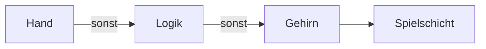

# 13 Die Micro Duck – unsere Heldin auf zwei Beinen

> **Kurz gesagt:** Die Micro Duck ist ein echter kleiner Laufroboter von Pollen Robotics. Kern
> baut sie so genau nach, dass sie mit denselben trainierten Netzen läuft wie das Original. Dazu
> bringt Kern drei eigene Dinge mit: den Lehrer zum Trainieren, einen Sprung und eine Spielschicht,
> mit der die Ente selbst entscheidet, ob sie einen Ball kickt oder eine Socke holt.

Darf ich vorstellen: die Micro Duck. Etwa 25 cm groß, 0,74 kg schwer, mit 14 kleinen Motoren in
Beinen und Hals und einem fünfzehnten für den Unterschnabel. Diese Motoren heißen **Servos**: Man
sagt ihnen einen Winkel, und sie fahren dorthin. Bei der Ente sind es Dynamixel XL330.

Gebaut hat den Roboter Pollen Robotics. Laufen lernt die Ente dort nicht durch handgeschriebene
Regeln, sondern als **neuronales Netz**, trainiert in der Physiksimulation MuJoCo (Repository
`microduck_rl`, Lernverfahren rsl_rl). Die fertigen Netze landen als ONNX-Dateien – einem
Austauschformat für Netze – auf dem echten Roboter.

Kern simuliert die Ente mit seiner eigenen Physik (Box3D) und lässt **genau diese Netze** laufen.
Das Ziel heißt **Treue**: dasselbe Modell, dieselben Servos, derselbe Takt, dasselbe, was das Netz
sieht und tut. Obendrauf setzt Kern den **Lehrer** ([Kapitel 14](14-lehrer.md)), den **Sprung**
(`jump.onnx`) und die **Spielschicht** (`play.onnx`). Eigene Netze trainieren erklärt
[Kapitel 15](15-eigene-modelle.md), den Abgleich mit dem echten Roboter [Kapitel 16](16-kalibrierung.md).

> **Probier's aus!** Öffne Kern Studio auf https://kernengine.de/ und wähle bei **New Level** die
> Vorlage **Micro Duck**. Drück auf Play und schau zu: Die Ente spaziert los, schaut sich um – und
> wenn sie den Ball entdeckt, wird es spannend.

## 13.1 Wo der Code wohnt

Die Ente lebt in wenigen Dateien unter `kern/src/game/`: `walker.cpp` baut sie auf, regelt und
liest die Sensoren, `walker_policy.cpp` rechnet die ONNX-Netze, `servo.cpp` enthält das
Servomodell, `walker_brain.cpp` das Gehirn und `walker_play.cpp` die Spielschicht. Pollens Netze,
Baupläne und Lizenzen liegen in `third_party/microduck/`, Kerns eigene Netze in `policies/`. Die
vollständige Liste steht im blauen Buch.

## 13.2 Die goldene Regel: nicht schummeln

Ein trainiertes Netz ist wie ein Tänzer, der auf einem bestimmten Parkett geübt hat. Stell ihn aufs
Glatteis, und er fällt – nicht, weil er schlecht tanzt, sondern weil der Boden anders ist. Darum gilt:

- **Keine Hilfen:** keine Stützkräfte, keine gesetzten Geschwindigkeiten, kein festgehaltener
  Rumpf, kein Teleport, kein Überblenden zwischen Netzen. Die Ente steht nur durch Servos und Füße.
- **Servos aus Physik-Bausteinen:** nur Box3Ds eigene Gelenkfeder und ein Motor als Reibungsbremse.
- **Fester Takt:** Die Zeit wird in Schritten gezählt, nicht mit der Uhr. Gleiche Eingaben ergeben
  Bit für Bit denselben Gang auf jedem Gerät – **Determinismus** ([Kapitel 14](14-lehrer.md)).

Die Physik selbst (Box3D, Kontakte, Gelenke) erklärt [Kapitel 6](06-physik.md).

> **Stell dir vor …** du bringst einem Kind Radfahren mit Stützrädern bei und schraubst sie dann
> heimlich ab. Genau das passiert, wenn die Simulation „hilft“: Das Netz verlässt sich auf etwas,
> das es in Wirklichkeit nicht gibt.

## 13.3 Das Modell

### Aus Pollens Bauplan

Pollen beschreibt den Roboter in einer MJCF-Datei, dem Bauplanformat von MuJoCo: 15 Körper, 14
Gelenke. Ein Python-Werkzeug (`tools/micro_duck_import.py`) macht daraus Code für Kern: Glieder,
vereinfachte 3D-Formen und Kollisionshüllen. Es ist pingelig – Gelenknamen, Grundhaltung,
Reihenfolge der Beobachtung, Aufbau des Netzes –, und passt etwas nicht, bricht es ab, statt eine
leicht falsche Ente zu bauen.

### Glieder und Gelenke

Die Ente hat **16 Glieder**: Rumpf, 14 Glieder, die das Netz bewegt, und den Unterschnabel. Die 14
Gelenke stehen immer in der Reihenfolge, die das Netz erwartet: linkes Bein (Hüfte gieren, rollen,
nicken, Knie, Knöchel), Hals (Nacken nicken, Kopf nicken, gieren, rollen), rechtes Bein. Jedes hat
harte Grenzen und eine **Home-Pose**, die bequeme Grundhaltung; der Schnabel öffnet bis 0,611 rad.
Kern baut die Ente direkt in dieser Haltung auf. In der Szene heißt der Rumpf „Micro Duck“, jedes
Glied trägt den Namen seines Gelenks. Alle Winkel stehen im blauen Buch.

> **Wusstest du?** Das Gelenk `head_yaw` reicht von −2,967 bis +2,967 rad, also rund ±170 Grad.
> Damit kann sie fast ganz nach hinten schauen.

### Masse und die unsichtbare Scheibe

Masse, Schwerpunkt und Trägheit kommen aus dem Bauplan: Rumpf 0,199 kg, Kopf 0,155 kg, zusammen
0,74 kg. Masse und Trägheit des Unterschnabels rechnet Kern aus seinen 3D-Formen und zieht sie vom
Kopf ab. Kniffelig wird es beim Motor im Servo: Er dreht über ein Getriebe 288-mal schneller als die
Achse, und das macht das Gelenk träger, als die Teile wiegen. Diese Zusatzträgheit heißt **Armatur**
(0,0018 kg·m² je Gelenk). MuJoCo rechnet sie direkt auf die Achse, Box3D kann das nicht. Kerns
Trick: Jedes Glied bekommt eine **dünne gedachte Scheibe** auf der Gelenkachse mit.

> **Stell dir vor …** du schwingst einen leeren Eimer. Klebst du innen eine schwere Münze an die
> Wand, wird der Schwung träger. Die Armatur ist so eine Münze, nur unsichtbar.

Warum eine Scheibe? Ein Körper, der nur um eine einzige Achse träge wäre, ist kein echter starrer
Körper, und Box3D würde damit Energie gewinnen. Perfekt ist die Scheibe nicht – sie dreht mit dem
Glied statt 288-mal schneller; dreht sich das Elternglied um dieselbe Achse, ist die Trägheit etwas
zu groß –, aber gemessen läuft die Ente damit näher am Training und zappelt deutlich weniger
(Abschnitt 13.14).

### Was die Welt berührt

Zusammenstoßen können **konvexe Hüllen**, als hätte man Frischhaltefolie straff um jedes Bauteil
gespannt. Sohlen und Schnabelpolster haben Reibung 1, die Servogehäuse 0 (wie im Training), die
Schalen von Rumpf und Kopf 0,5 – damit rutscht eine umgefallene Ente nicht wie auf Eis. Die Schalen
umschließen die Servos der Nachbarglieder und stoßen nie mit der Ente selbst zusammen. Setzt eine
Sohle auf, klingt es nach Plastik.

Neu: Die Physik kennt **Materialpaare**. Gummi auf Stoff greift nämlich anders als der Mittelwert
aus Gummi auf Gummi und Stoff auf Stoff:

| Paar | Reibung |
|---|---|
| Baumwolle auf Baumwolle | 0,5 |
| TPU-Schnabelpolster auf Baumwolle | 0,8 |
| Baumwolle auf Holzboden | 0,4 |

Alle anderen Paare mischt Box3D als geometrisches Mittel. Ein Material tragen Kollider, Meshes
oder der Boden der Welt (im Level `groundSurface`). Im Micro-Duck-Level ist der Boden Holz. Box3D
lässt Kontakte bis 5 mm einsinken; gemessen stehen die Sohlen nur 0,3–0,6 mm im Boden.

### Maßstab 4: die Ente als Riesin

Box3D mag Körper zwischen 10 cm und 10 m. Die Glieder der Ente sind 2 bis 4 cm klein. Also baut Kern
sie **viermal so groß** und rechnet an genau einer Stelle um, nach einer Regel aus dem Schiffsbau
(Froude-Ähnlichkeit): Längen ×4, Massen ×64, Trägheiten ×1024, Momente und Servosteifigkeit ×256,
Dämpfung ×512, Zeiten und Geschwindigkeiten ×2, Drehgeschwindigkeiten ×½. Das Netz merkt davon
nichts: Kern rechnet alles in echte Robotereinheiten zurück, und auch alle Werte, die du über Logik
oder Sensoren bekommst, sind echte Meter und Sekunden.

### Aussehen, Rollschuhe, Einbau

Die 3D-Formen stammen aus Pollens eigenen Modellen. Sie stehen unter CC BY-NC-SA 4.0 (nicht
kommerziell), Kerns Code unter Apache 2.0. Darum zeigt dieses Buch die Ente in eigener Gestaltung.
Es gibt auch eine Variante **„Micro Duck (Rollers)“** mit Kufen und je zwei frei drehenden Rädern
(ohne Antrieb) statt Sohlen; sie steht 23,5 mm höher. Und eine Zeile setzt eine Ente ins Level:

```cpp
const game::ActorId duck =
    game::add_micro_duck(level, {0, 0, 0});  // Rumpf auf z = 0
```

Sie hängt alle Glieder an, verbindet die Gelenke und stellt die Welt auf 100 Schritte pro Sekunde
mit 16 Unterschritten. Das Studio macht beim Einfügen dasselbe und meldet die geänderten World
Settings.

## 13.4 Das Servomodell

Ein echter Servo ist weich, träge, hat Reibung und reagiert verzögert. Pollen hat den XL330 bei
7,4 V genau vermessen (Modell „m6“). Kern macht daraus ein **Gerätemodell**: ein kleines Gesetz in
echten Einheiten, dessen Zahlen in einem **Profil** stehen.

| Was | XL330 | in Worten |
|---|---|---|
| Steifigkeit K | 0,554 N·m/rad | wie fest er zum Ziel zieht |
| Dämpfung D | 0,053 N·m·s/rad | wie stark er Tempo bremst |
| Reibung F | 0,0048 N·m | Widerstand im Gelenk |
| Höchstmoment T | 0,963 N·m | mehr Kraft gibt es nicht |
| Verzögerung | 20 ms | Laufzeit eines Befehls |

Dazu kommen die Armatur und fürs Training Streuungen (±10 % bei Armatur und Reibung, Verzögerung
15–30 ms). In Worten: **Je weiter vom Ziel, desto stärker zieht er – aber nie stärker als T. Je
schneller er sich bewegt, desto mehr bremst er. Etwas Reibung ist immer da.**

```
Moment = clamp(K · (Ziel − Winkel), −T, T) − D · Geschwindigkeit
         + Coulomb-Reibung F
```

Beispiel: 0,1 rad (knapp 6°) neben dem Ziel zieht er mit 0,554 · 0,1 ≈ 0,055 N·m. Das volle Moment
erreicht er erst bei 1,7 rad Abweichung. Die Servos sind also **weich** – eher eine sanft schiebende
Hand als ein Schraubstock.

Eine einzige Funktion (`game::servo_step`) setzt das in jedem Physikschritt um – im Studio, im
Lehrer und auf dem Prüfstand der Kalibrierung gleich. Den Zug übernimmt Box3Ds eingebaute
Gelenkfeder, die Box3D so rechnet, dass sie bei jeder Steifigkeit stabil bleibt. Die Reibung ist ein
Motor, der das Gelenk anhalten will (Sollgeschwindigkeit 0), aber höchstens mit der Kraft der
Reibung.

> **Wusstest du?** Die Firmware des echten Servos begrenzt den Strom auf 1,75 A, also 0,64 N·m.
> Damit käme die Ente nicht mehr vom Rücken hoch! Pollen trainiert ausdrücklich ohne diese Grenze,
> und Kern auch.

Ein Profil gilt für alle Servos einer Ente oder für ein einzelnes Gelenk (auch den Schnabel).
Eigene Profile misst man wie in [Kapitel 16](16-kalibrierung.md).

## 13.5 Der Takt

Die **Physik** rechnet in kleinen Schritten, das **Netz** denkt seltener nach; das Verhältnis heißt
**Decimation**. Im Training rechnet MuJoCo 5-ms-Schritte, und das Netz denkt alle 4 Schritte, also
50-mal pro Sekunde. Kern rechnet 10 ms Weltzeit pro Schritt – in der vierfach großen Welt läuft die
Zeit ja halb so schnell, also sind das genau 5 ms Roboterzeit – und lässt das Netz ebenfalls alle 4
Schritte denken. Beides rechnet Kern beim Start jeder Ente aus der Schrittrate der Welt. Passt sie
nicht, rundet Kern auf ganze Schritte und sagt Bescheid („set World Settings > Step Rate to 100“).

Die Befehlsverzögerung von 20 ms ist eine Warteschlange: Jeder Befehl wartet 4 Physikschritte, wie
ein Brief, der unterwegs ist. Die Spielschicht denkt noch seltener, 25-mal pro Sekunde.

Die Spielschleife folgt dem Rezept „Fix Your Timestep“: Jeder Frame liefert Zeit, die Simulation
verbraucht sie in festen Schritten, der Rest wartet auf einem Zeitkonto (dem Akkumulator) auf den
nächsten Frame. Gezeichnet wird zwischen den letzten beiden Zuständen, und die Zeit ist ein
Schrittzähler ([Kapitel 8](08-spiel-laufzeit.md)).

## 13.6 Die Netze der Ente

Das Laufnetz `velstand.onnx` ist fest eingebaut, alle anderen lädt das Studio nach. Kern liest ONNX
selbst und versteht genau die Form von rsl_rl: Eingang normalisieren, Schichten mit der Aktivierung
ELU, am Ende eine lineare Schicht. Alles andere lehnt es mit Begründung ab. Ein Test prüft Kerns
Rechnung bis auf zwei Hunderttausendstel gegen eine genaue Referenz.

Ein Netz ist wie ein Mischpult mit Hunderttausenden Reglern: Vorn gehen 61 Messwerte hinein,
hinten kommen 14 Servobefehle heraus, und Trainieren heißt, die Regler zu drehen, bis die Ente läuft.

### Was die Ente kann

| Bewegung | Netz | Taste |
|---|---|---|
| Laufen und Stehen | `velstand` (oder älter: `alpha`) | W A S D |
| Sitzen / Aufstehen | `alpha_sitstand` | 1 |
| Socke aufheben | `alpha_ground_pick` | 2 |
| Kick links / rechts | `ball_kick_left/right` | 3 / 4 |
| Rolle | `roulade` | 5 (halten) |
| Rollschuh fahren / ducken | `roller`, `roller_crouch` | W A S D / 2 |
| **Sprung** (Kern) | `jump` | 7 |
| Schnabel auf / zu | kein Netz | 6 |

Laufen geht **dauernd**, andere Netze laufen **episodisch** mit Anfang und Ende: der Kick 0,5 s, der
Sprung 2 s, Sitzen 2 s, Aufstehen 1 s, eine Rolle 1 s. Die ältere Gangart `alpha` schaltet unter
einem Laufbefehl von 0,05 auf ihr Stehnetz `alpha_stand`. Das Aufheben bekommt eine Uhr mit (4 s
pro Runde) und endet bei 70 % davon; die Rolle läuft weiter, solange du die Taste hältst. Die Gangart wählst du im
Details-Panel unter **Walking network**.

### Wer gerade dran ist

Der Regler arbeitet wie Pollens Roboter-Software robotd: erst abgelaufene Bewegungen beenden, dann
das Netz wählen (laufende Bewegung vor Aufheben vor Sitzen vor Rollen vor Stehen vor Laufen), jedem
Netz seine Befehle in der trainierten Form geben, rechnen, Uhr weiterstellen. Immer nur eine
Bewegung, aus dem Sitzen keine. Sonst kommt ein Grund zurück, etwa „the robot is sitting - stand
it up first“. Die Erinnerung an die letzte Aktion, die jedes Netz mitbekommt, teilen sich alle Netze.

> **Achtung, Falle!** Fehlt die Datei eines Netzes noch, springt kein anderes ein. Die Ente hält
> die Grundhaltung und sagt einmal, welche Datei fehlt. Bleibt sie stur stehen, schau in die
> Meldungen.

### Vom Befehl zum Servoziel

Das Netz sagt nicht „Knie auf 30°“, sondern „Knie etwas weiter als in der Grundhaltung“: Servoziel =
**Home-Pose + Aktion**. Kern fährt jedes Netz **wie trainiert**, ohne Abschwächung und Glättung (nur
Rollschuhfahren und Ducken mit Faktor 0,8). Pollens Software auf dem echten Roboter schwächt mit
0,9 ab und glättet (Kopf 0,5, Beine 0,7) – Feintuning für die Hardware. Unter **Actions to servo
goals** wählst du `training` (Standard) oder `robot`. Gemessen kippen die Kicks mit `robot` um; laufen klappt mit beidem.

Das Ziel darf bis ±π gehen, den ganzen Weg des Servos. Liegt es hinter der Gelenkgrenze, drückt das
Gelenk wie in MuJoCo gegen seinen harten Anschlag.

## 13.7 Was das Netz sieht: 61 hinein, 14 heraus

Alle Bewegungsnetze bekommen dieselben 61 Zahlen: wie schnell sich der Rumpf dreht, wo unten ist,
14 Gelenkwinkel (ab Grundhaltung), 14 Gelenkgeschwindigkeiten (einen Takt alt, wie im Training),
die letzte eigene Aktion, den Laufbefehl (bis 0,4 m/s vor, 0,3 m/s seitwärts, 1 rad/s drehen; wie
auf dem Roboter sanft geglättet), einen Kopfbefehl und die Körperhaltung. Kerns Sprung nutzt die
Plätze 55 und 56, die Pollens Netze nie anfassen, für seine Uhr. Heraus kommen 14 Zahlen, eine pro Gelenk. Das Laufnetz hat dazwischen drei
Schichten mit 512, 256 und 128 Neuronen.

> **Wusstest du?** Das Netz weiß nicht, wo es im Raum ist. Es kennt nur den eigenen Körper.
> Laufen ist für die Ente reines Körpergefühl.

## 13.8 Sinne

Die Ente sieht nur, was der echte Roboter sieht, mit Sensoren an genau den Stellen des Bauplans.

**Abstandssensor (ToF).** Ein ToF-Sensor (Time of Flight) misst Entfernungen mit Licht: 8 × 8 Zonen,
45° × 45°, bis 4 m, 15-mal pro Sekunde. Kern schickt pro Zone einen Strahl los, der die eigenen
Glieder überspringt. Jede Zone meldet **Boden** (ein Strahl nach unten, der mindestens 85 % der
Sensorhöhe hinabreicht), **zu nah** (unter 10 cm) oder **Hindernis**, dazu die nächste Entfernung,
ihre Richtung und ob links und rechts bis 1 m frei ist. Fürs Gehirn zählen Treffer bis 0,35 m Höhe
und 1,5 m Weite.

> **Stell dir vor …** du tastest nachts mit 64 langen, unsichtbaren Fingern gleichzeitig nach
> vorn. Mehr „sieht“ der ToF nicht – aber es reicht, um den Schuhkarton nicht zu rammen.

**Kopfkamera.** 62° Sichtfeld über die lange Seite, um eine Vierteldrehung gedreht eingebaut, also
hochkant: 62° hoch, 37,4° breit. Kern prüft, ob die Mitte eines Actors im Bild liegt und nicht
verdeckt ist. Mit ganz gesenktem Kopf schaut die Kamera 87° nach unten und sieht den Boden 6 bis
15 cm vor dem Rumpf.

> **Probier's aus!** Starte Play im Micro-Duck-Level. Oben rechts im Viewport siehst du das
> Kamerabild der Ente, daneben das ToF-Gitter (Show-Flag **Robot Camera**, standardmäßig an).
> Übernimm sie mit **F8** und lauf auf den Ball zu!

**Gleichgewicht.** Eine IMU (ein Lagesensor wie im Handy) meldet, wo unten ist. „Gefallen“ heißt
wie im Original: 200 ms lang deutlich schief. Stolpern zählt nicht. velstand steht von selbst auf;
eine autonome Ente meldet dann den Zustand „GetUp“.

**Schnabel als Fühler.** Ist der Mund-Servo auf „zu“ gestellt, steht aber mehr als 2° offen, hält
die Ente etwas. Leer ruht er bei 0°, eine Socke hält ihn 3,6 bis 7,8° offen. Der Mund fährt von
−5° (gegen die Polster gedrückt) bis 30°.

## 13.9 Wer steuert?



In jedem Regeltakt gilt: Bewegst du den Stick (über 5 %) oder drückst eine Robot-Taste, hast du
2 s lang das Sagen, und Gehirn und Spielschicht pausieren. Sonst gelten Logik-Befehle (**Walk**,
**Look**), für ihre Dauer oder bis zum nächsten Befehl. Sonst entscheidet die Ente selbst, wenn
**Autonomous** an ist. Laufbefehl und Kopf werden danach begrenzt und sanft geglättet. Steht sie
still und hat 2 s niemand ihren Kopf gesteuert, übernimmt der **Idle-Blick** aus Pollens Software:
weiche Blicke auf ruckfreien Kurven, kleine Sprünge, langsames Driften, Dösen und gelegentliches
Gähnen.

### Hochgehoben!

Eine hochgehobene Ente soll nicht in der Luft weiterstrampeln. Pollen hat dafür ein winziges Netz
trainiert, den **Pick-up-Detektor** (rund 8000 Parameter). Er betrachtet jeweils die letzte Sekunde
(50 Takte mit je 63 Werten: Drehung, Schwerkraft, Gelenke, letzte Sollwerte …) und schätzt, wie
wahrscheinlich die Ente gehalten wird. Kern rechnet es selbst nach, bis auf 10⁻⁵ genau wie die
Referenz, und erst, wenn eine volle Sekunde beisammen ist. Liegt die Schätzung 5 Takte hintereinander über 80 %, gleiten
die Servos in 300 ms in eine ruhige Standhaltung, und die Ente meldet „Held“. Sinkt sie 4 Takte lang
unter 35 % (frühestens nach 300 ms), starten die Netze frisch. Aufgepasst wird nur, solange Lauf-
oder Stehnetz fahren; eine Bewegung, Sitzen, Rollschuhe oder der Lehrer beenden die Pause.
Servoströme kennt Kern nicht – das ausgelieferte Netz liest sie aber auch nicht. Im Test läuft die
Ente 20 s ohne falsche Pause, bleibt 15 cm hochgehoben pausiert und läuft abgesetzt ohne Sturz weiter.

> **Probier's aus!** Starte Play im Micro-Duck-Level. Es beginnt mit der **Observer camera**: Du
> schaust zu und kannst Körper greifen. Zieh die Ente am Rumpf hoch (in **Simulate** geht es genauso).
> Der Griff hält sie aufrecht wie eine Hand, und bald hört sie auf zu strampeln. Setz sie ab – sie
> läuft weiter.

## 13.10 Das Gehirn: die Ente denkt selbst

Fährt niemand, entscheidet die Ente selbst. Das Gehirn ist eine Übertragung von Pollens Programm
`autod` (Apache 2.0, Stand 01.10.2026) mit seinen Zuständen, Dauern und Zahlen, und es gibt
dieselben Befehle wie ein Gamepad: Laufen, Kopf, Körperhaltung, Mund und Laute. Das
ergibt eine kleine Persönlichkeit:

| Zustand | Was die Ente tut |
|---|---|
| Chill, LookAround | steht und schaut (3–7 s), legt den Kopf schief |
| Wander | läuft 1–3 m in eine von 16 Richtungen |
| TurnInPlace | dreht sich, der Kopf voraus |
| Zoomies | volle Fahrt, ruckige Kurven, „Wheee“ (nur über 1,2 m frei) |
| Stretch, Ruffle, Dance | streckt sich, schüttelt sich, groovt |
| Sneeze | niest und schaut benommen |
| GroundPick, Nap | hebt etwas auf; setzt sich, döst 12–40 s |
| Petted | wird gestreichelt |
| BallPlay, Kick | spielt mit dem Ball, kickt |

Dazu kommen eine **Energie**, die den nächsten Zustand mitbestimmt, ein **Neuheitsraster** (beim
Wandern bevorzugt sie selten besuchte Richtungen), **Quak-Salven**, **Hören** und ein
**Hindernismodell** (ein 24 cm breiter Gang voraus, gemessen ab dem Schnabel): Unter 0,45 m bremst
sie und weicht aus, unter 0,15 m dreht sie weg und meidet die Stelle 5 Minuten. Wander endet am Ziel
oder wenn sie 8 s lang keine 10 cm vorankommt. Hören (eine Stimme bekommt Antwort, ein Geräusch weckt
sie) und Streicheln kommen über Logik oder Code, denn Kern hat kein Mikrofon und keinen
Berührungssensor. Auch der Zufall des Gehirns ist deterministisch. Während einer Bewegung, beim
Hinsetzen und Aufstehen und nach einem Sturz hält das Gehirn still.

### BallPlay

Pollens frühere Software hatte den Zustand BallPlay: „approach / line up / kick“. Kern baut ihn nach
dieser Beschreibung mit eigenem Code und Pollens Kick-Netz nach (deren Code ist nicht öffentlich);
er ist **standardmäßig an** und braucht keine Kern extras. Er läuft, wenn die Ente autonom ist, keine
Rollschuhe trägt, das Kick-Netz geladen ist und keine Spielschicht bereitsteht. Sieht die Ente einen
Ball am Boden (bei mehreren den nächsten), dreht sie sich erst zu ihm, falls er weit seitlich liegt,
und läuft mit gesenktem Kopf bis auf 35 cm an (nur der Kopf nickt, ein gebeugter Nacken verdürbe den
Gang). Dann richtet sie ihn in kleinen Schritten aus, bis er wie im Kick-Training 9 cm vor und 4,2 cm
neben dem linken Fuß liegt (±1,5 cm); verliert sie ihn dicht vor sich aus dem Bild, tritt sie zurück.
Sie steht mindestens 3 s still, bis sie langsamer als 1 cm/s ist, und kickt. Danach quakt sie
fröhlich, und der Ball ist kurz uninteressant. Sieht sie einen fernen Ball 6 s nicht, gibt sie auf
(einen nahen sucht sie an der letzten Stelle); schafft sie 45 s keinen Kick, lässt sie ihn 20 s in
Ruhe. Gekickt wird nur links, weil der rechte Kick die Ente in Kern manchmal umwirft. Den Ball
„sieht“ ein geometrischer Sichttest, kein Bilderkennungsnetz.

## 13.11 Die Spielschicht

Pollens Netze sind die **Muskeln** der Ente. Keines davon sieht. Was sie mit Ball oder Socke
**vorhat** – hinschauen, hingehen, kicken, aufheben, wegtragen, ausspucken –, entscheidet Kerns
eigenes, vom Lehrer trainiertes Netz `play.onnx`. Ist es da, ersetzt es BallPlay. Handgeschriebene
Spiellogik gibt es darin nicht, nur Wahrnehmung rund um das Netz.


> **Stell dir vor …** ein Kind sitzt mit einem Gamepad vor dem Kamerabild der Ente und drückt
> Knöpfe: vor, drehen, Kopf runter, Schnabel auf, Kick, Aufheben. Die Bewegungen selbst macht die
> Ente mit Pollens Netzen. Das Kind ist die Spielschicht.

Sie braucht **Kern extras** und **Autonomous** im Details-Panel, `play.onnx`, einen Mund-Servo und
keine Rollschuhe. Sie greift ein, solange sie Ball oder Socke kennt, etwas im Schnabel hat oder eine
eigene Bewegung läuft und niemand anderes steuert; dann meldet die Ente „Play“, und das Gehirn
startet weder Aufheben noch Sitzen.

**Detektor:** wie der Servo ein Gerätemodell. Er meldet das nächste sichtbare Objekt je Sorte (eine
Socke, sobald ein Teil von ihr zu sehen ist) und seine Position auf dem Boden (ein Ball über 8 cm,
eine Socke über 3 cm Höhe zählt nicht, etwa die im Schnabel). Fürs Training kann er rauschen – je
weiter weg, desto ungenauer – und aussetzen wie eine echte Kamera; im Studio ist er perfekt.

**Tracker:** das Gedächtnis. Verschwindet ein Objekt, merkt er sich die letzte Position 3 s lang
(direkt vor den Füßen 30 s). Einen gekickten Ball ignoriert er 15 s, eine weggetragene Socke 40 s;
weggetragen heißt mindestens 0,25 m, eine beim Hochheben verlorene Socke bleibt Ziel. Er zählt auch,
wie weit und wie lange die Ente etwas trägt.

Die Spielschicht sieht 23 Zahlen aus Sicht der Ente (x voraus, y links), nie wahre Positionen: was
sie über Ball und Socke weiß, wo ihr linker Fuß ist, ob sie etwas hält, ob sie läuft, aufhebt oder kickt, wie lange
sie trägt, still steht oder geht. „Still stehen“ zählt die Fußkontakte, nicht den Befehl – denn auf
„ein klein wenig vorwärts“ setzt Pollens Gang manchmal gar nicht an. Heraus kommen 9 Befehle:
vorwärts, seitwärts, drehen, Kopf drehen und nicken, Nacken beugen, Schnabel auf, Kick links,
Aufheben, mit höchstens 0,3 m/s vor, 0,2 m/s seitwärts und 1 rad/s drehen. Die Laufbefehle haben
eine **Totzone** wie ein Gamepad-Stick (unter 20 % bleibt sie stehen). Rückwärts fährt sie wie
Pollens `autod` erst 0,6 s mit 0,3 m/s, dann nie unter 0,15 m/s – langsamer setzt der Gang aus dem
Stand gar nicht an. Vorwärts hat das Netz selbst gelernt, kräftig anzuschieben. Eine Bewegung
startet nur, wenn keine läuft und der Schnabel leer ist. Während des Aufhebens gehört der Schnabel
dem Netz: Es hat gelernt, wann es zubeißt. Ohne Spielschicht öffnet Kern extras den Schnabel bei
Phase 0,16 des Aufhebens und beißt bei 0,24 zu.

**Socke und Ball:** Die Socke sind sieben Stoffklümpchen von 12,5 mm (vier unten, zwei darauf,
einer oben; 25 g, 3,4 cm hoch), mit weichen Federn verbunden. Sie gibt unter dem Schnabel nach, und
was er packt, zieht den Rest mit. Jedes Klümpchen hat Rollwiderstand, sonst kröche der Haufen über
den Boden. Der Ball im Beispiel-Level hat 12 cm, 50 g und etwas Rollwiderstand, sonst rollte er ewig.

**Das Beispiel-Level** ist ein 2,5 × 2,5 m großer Raum mit Holzboden, Schuhkarton, Bücherstapel,
Kiste, Blumentopf, einem Ball und zwei Socken. Die Ente ist autonom, Kern extras sind an. Ein
kleiner Blueprint lässt die Ente zwitschern (Knoten „Chirp“), wenn der Ball ins Bild kommt – eine Vorführung der
Logik-Knoten.

**Wie gut spielt sie?** Über 32 Durchgänge auf dem sauberen Roboter: Ball 9 von 11 Mal weggekickt
(im Mittel nach 17 s), Socke 4 von 21 Mal aufgehoben, 2 Stürze. Mit voller Variation (zufällig
veränderte Servos, Sensoren, Bau): 7 von 11, 13 von 21, aber 10 Stürze. Aufheben, wegtragen und
ausspucken in einem Rutsch gelang erst einmal, und nur wenige Griffe hielten (2 von 14 bzw. 1 von
15). Zwei Tests prüfen in Studio-Physik, dass nur das Netz entscheidet: Ein Ball 30 cm vor der Ente
wird gekickt, eine Socke 30 cm vor ihr geholt und gebissen.
Kicken klappt gut, beim Sockenholen ist Luft nach oben ([Kapitel 14](14-lehrer.md)).

## 13.12 Die Ente steuern

| Bewegung | Tastatur | Gamepad | Touch |
|---|---|---|---|
| Laufen / drehen | W S / A D | linker Stick | MOVE |
| Sitzen / Aufstehen | 1 | B | SIT |
| Aufheben | 2 | Y | PICK |
| Kick links / rechts | 3 / 4 | – | KICK L / R |
| Rolle | 5 | X | ROLL |
| Schnabel | 6 | – | BEAK |
| Sprung | 7 | – | HOP |
| Quaken / „Wheee“ | Leertaste / V | RT / LT | QUACK / WHEEE |

Laufen geht bis 0,4 m/s, drehen bis 1 rad/s. Am Gamepad gilt eine runde Totzone von 10 % mit einer
sanften Kurve; am Telefon liegen QUACK und PICK unten am Daumen.

Im Micro-Duck-Level startet Play mit der **Observer camera** ([Kapitel 11](11-studio.md)): Du
fliegst frei (W A S D, Q / E runter und hoch, am Telefon mit den Fingern), schaust zu und kannst Ball,
Socke oder Ente mit Maus oder Finger anheben. **F8** übernimmt die Ente, noch einmal F8 schaut
wieder zu.

Die **Stimme** ist eine bitgenaue Übertragung von Pollens Synthesizer, mit eigener Stimme je Ente
([Kapitel 7](07-audio.md)): „greet“ beim Erwachen und wenn das Gamepad zurückkommt, „inquire“,
wenn es weg ist, „chirp“ beim Quaken, „wheee“ solange gehalten, „peck“ beim Hinsetzen.

**Der Sprung** (Taste 7, HOP oder Logik-Knoten **Robot Move** mit „jump“) läuft wie ein Kick: 2 s
`jump.onnx`, dann zurück. Seine Uhr bekommt das Netz in den Plätzen 55 und 56. Im Studio: 3 von 3
echte Sprünge, 9 mm hoch, 120 ms in der Luft, 8° Neigung – danach steht und läuft die Ente wieder.

> **Probier's aus!** Starte Play im Micro-Duck-Level, übernimm die Ente mit **F8** und drück die
> **7**. Dann die **3**, wenn der Ball vor dem linken Fuß liegt. Und zum Schluss die **1**: Sitz,
> Ente!

**Netze laden:** Das Studio lädt fehlende Netze nach und versucht es bei Fehlern erneut (nach 5, 10,
20 s …, höchstens einmal pro Minute). Im Browser mit dem Lehrer trainierte Netze übernimmt es auf
demselben Gerät, offene Studio-Tabs sofort.

**Details-Panel:** **Autonomous**, **Walking network**, **Actions to servo goals** und **Kern
extras**; nur im Level-JSON stehen `rollers` (Rollschuhe) und `servoDelay` (Busverzögerung,
Standard 0,02 s). Im Logik-Editor gibt es die Kategorie **Robots** mit **Walk**, **Look**, **Set
Autonomous**, **Chirp**, **Robot Move**, **Robot Beak**, **Pet Robot**, **Robot Hears**, **Robot
ToF**, **Robot Camera Sees**, **Robot State** und **Robot Holds Something**
([Kapitel 9](09-logik.md), [Kapitel 11](11-studio.md)).

## 13.13 Die Ente aus C++ steuern

```cpp
const game::ActorId duck = w.walkers().front();
w.walker_command(duck, 0.2f, 0, 0, 3.0f);  // 0,2 m/s vor, 3 s
std::string why = w.walker_skill(duck, "pick");  // "" = los
bool holds = w.walker_holding(duck);
std::string state = w.walker_state(duck);  // "Wander", "Play" …
```

Zeile für Zeile: die erste Ente der Welt holen; sie 3 s lang mit 0,2 m/s nach vorn schicken; sie
bitten, etwas aufzuheben (leere Antwort heißt „mach ich“, sonst steht der Grund drin); fragen, ob sie
etwas im Schnabel hat; fragen, was sie gerade tut. Ebenso gibt es `walker_look` (Kopf),
`walker_sensors` (ToF, Schwerkraft, Sturz), `walker_sees` (Kamera) und `walker_driving` (welches Netz
gerade fährt, oder „held“). Für den Lehrer gibt es eigene Eingänge, mit denen ein lernendes Netz
steuert ([Kapitel 14](14-lehrer.md)).

## 13.14 Nachgemessen

| Befehl | Kern | Pollen (MuJoCo) |
|---|---|---|
| stehen | 8 s, Drift unter 2 mm | steht |
| 0,4 m/s vor | ≈ 0,135 m/s | ≈ 0,17 m/s |
| 1 rad/s drehen | ≈ 0,61 rad/s | ≈ 0,97 rad/s |

Ohne die Armatur-Scheibe wären es nur 0,105 m/s und 0,52 rad/s, und Rumpf und Kopf zappelten mehr
als dreimal so stark (Rumpf 3,6 statt 1,0 rad/s, Kopf 6,7 statt 1,9). Auf Bauch oder Rücken steht
die Ente nach höchstens 12 s wieder. Alle Bewegungen gelingen, der linke Kick schießt den Ball 4 m
weit; nur der rechte kippt manchmal. Kein Gelenk geht mehr als 0,004 rad über seine Grenze. Und auch
ganz ohne Kern extras sieht die Ente einen Ball, läuft an, richtet ihn aus und kickt, ohne zu fallen.

## 13.15 Was noch fehlt

- **Getriebespiel** (±1°) fehlt; die Netze sind dagegen robust. Ein Fall für
  [Kapitel 16](16-kalibrierung.md).
- **Armatur** ist eine mitdrehende Scheibe, kein echter Rotor.
- **Reibungsmischung:** Box3D mittelt zwei Flächen, MuJoCo nimmt die Sohle. Auf einem Boden mit 0,6
  ergäbe das 0,77, noch in der Trainingsvariation (0,7–1,3); im Beispiel-Level egal (beide 1,0).
- **Kick rechts** kippt manchmal; die Ursache ist offen (Spiel, Kontaktweichheit, Fußreibung).
- **BallPlay** ist ein Nachbau nach Beschreibung; **Servoströme** gibt es nicht.
- **Nur in Kern:** Spielschicht, Schnabel-Timing beim Aufheben (beide nur mit Kern extras), Sprung –
  und, immer an, Klänge wie Plastik-, Schritt- und Servogeräusche.

Die vollständige Liste der Abweichungen steht im blauen Buch.

## Das nimmst du mit

- Die Micro Duck ist Pollens echter Laufroboter: 25 cm, 0,74 kg, 14 Servos plus Schnabel.
- Kern lässt ihre echten Netze laufen und schummelt nie mit der Physik.
- Für Box3D wird sie 4-mal so groß gebaut und sauber umgerechnet.
- Jeder Servo ist ein Gerätemodell mit Profil: weich, gebremst, mit Reibung und Verzögerung.
- 61 Zahlen hinein, 14 Servobefehle heraus, 50-mal pro Sekunde.
- Hand vor Logik vor Autonomie; das Gehirn gibt ihr Persönlichkeit, die Spielschicht Spieltrieb.
- Kern sagt ehrlich, wo es vom Original abweicht.

## Knobelecke

1. Warum wäre eine kleine unsichtbare Stützkraft gegen das Umfallen eine schlechte Idee?
2. Die Ente wird 4-mal so groß gebaut. Wie viel schwerer ist sie dann in der Simulation?
3. Ein Servo steht 0,2 rad neben seinem Ziel. Wie stark zieht er ungefähr?
4. Du drückst die 2, aber die Ente sitzt. Was passiert?
5. Warum zählt „still stehen“ in der Spielschicht über die Fußkontakte?

### Lösungen

1. Das Netz würde sich auf die Stütze verlassen, die es am echten Roboter nicht gibt.
2. 4 · 4 · 4 = 64-mal. Fürs Netz rechnet Kern in echte Einheiten zurück.
3. 0,554 · 0,2 ≈ 0,11 N·m, weit unter dem Höchstmoment von 0,963 N·m.
4. Nichts: Aus dem Sitzen startet keine Bewegung – erst aufstehen.
5. Weil Pollens Gang auf einen winzigen Laufbefehl manchmal gar nicht ansetzt. Dann steht die Ente
   in Wahrheit, und das verraten die Beine, nicht der Befehl.

---

© 2026 Christian Heinrich Hohlfeld · Alle Rechte vorbehalten · [Impressum und Rechte](00-impressum.md)
