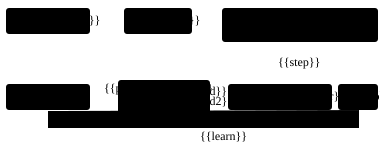
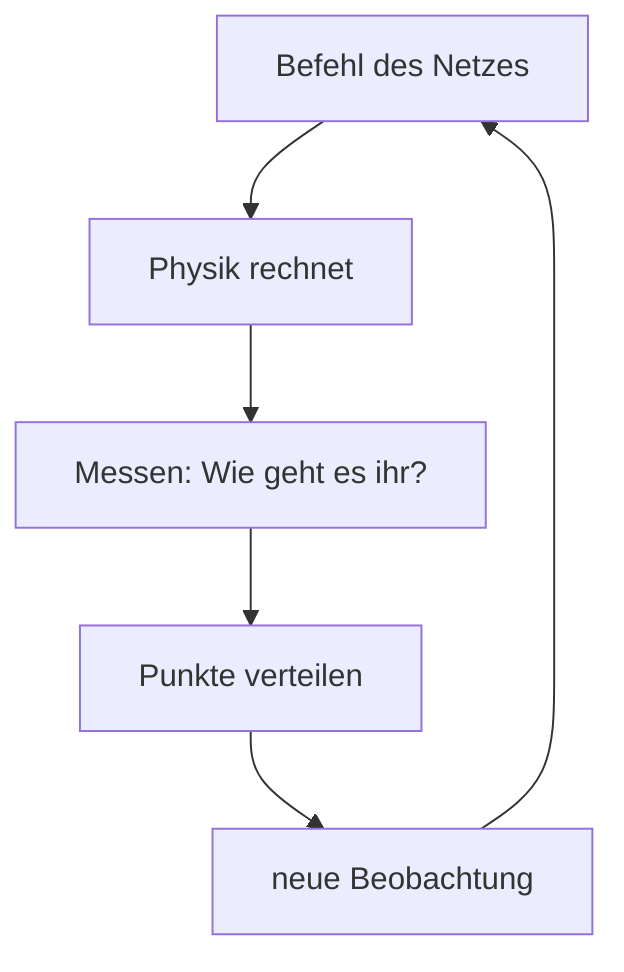
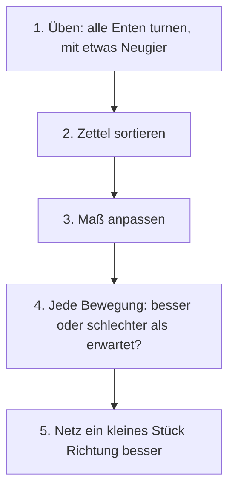

# 14 Der Lehrer – eine Schule für die Ente

> **Kurz gesagt:** Der Lehrer ist Kerns eigene Trainingsschule für die Micro Duck. Dutzende
> simulierte Enten üben gleichzeitig, bekommen erst ein Vorbild gezeigt und probieren dann selbst,
> bis aus zufällig eingestellten Reglern ein Netz geworden ist, das springen kann. Das Training läuft
> auf dem eigenen Rechner wie im Browser und kommt überall bis zur letzten Stelle gleich heraus.

## Was du dafür wissen musst

> **Begriffe vorab:**
> - **Neuronales Netz** – ein Mischpult mit sehr vielen Reglern: Messwerte gehen hinein, Befehle für
>   die Motoren kommen heraus. „Lernen“ heißt, die Regler nachzustellen.
> - **Servo** – der kleine Motor in jedem Gelenk der Ente. Er bekommt einen Zielwinkel und zieht dorthin.
> - **Beobachtung** – alles, was die Ente in einem Augenblick über sich weiß: wie sie geneigt ist, wie
>   ihre Gelenke stehen, was sie zuletzt befohlen hat.
> - **Aktion** – die Antwort des Netzes: für jedes der 14 Gelenke ein neuer Zielwinkel.
> - **Takt** – ein Entscheidungsmoment. Die Ente entscheidet 50-mal pro Sekunde.
> - **Episode** – ein Übungsdurchgang, vom Start bis zum Sturz oder bis die Zeit um ist.
> - **Belohnung** – Punkte, die die Ente in jedem Takt bekommt oder verliert. Mehr Punkte heißt besser.
> - **Übungsrunde** – alle Enten üben ein kurzes Stück, dann stellt der Trainer die Regler einmal
>   nach. Fachleute sagen **Iteration**. Tausende Runden ergeben einen Sprung.

Programmierwissen brauchst du nicht. Hilfreich ist, wenn du die Ente aus
[Kapitel 13](13-micro-duck.md) kennst: Sie läuft im Studio auf fertigen Netzen von Pollen Robotics
(der Firma, die den echten Roboter und seine Netze gebaut hat). Mit **F8** übernimmst du sie, mit
der Taste **7** springt sie.

Ein Netz kann auf zwei Arten lernen, und der Lehrer nutzt beide:

- **Nachahmen:** Ein Vorbild zeigt, was in jeder Lage zu tun ist, und das Netz lernt, es genauso zu
  machen – wie beim Abschreiben mit Lösungsheft.
- **Lernen durch Belohnung:** Niemand sagt die richtige Antwort. Die Ente probiert, bekommt Punkte
  und lernt, was sich lohnt – wie ein Hund, der für Kunststücke Leckerli bekommt. Fachleute nennen
  das **Reinforcement Learning**.

Beides erklärt [Anhang A](A-grundlagen-neuronale-netze.md) Schritt für Schritt. Für dieses Kapitel
reichen die Begriffe oben; alle weiteren erklärt der Text, wenn sie vorkommen.

Das Wichtigste vorweg: Die Ente im Lehrer ist **dieselbe** wie im Studio, mit denselben Motoren,
Sensoren und derselben Physik. Ein Netz, das hier lernt, läuft deshalb ohne Umbau im Studio. Auf dem
echten Roboter ist es nicht erprobt: Wer es auf Hardware lädt, tut das auf eigenes Risiko
([Kapitel 16](16-kalibrierung.md)). So sind Kerns eigene Netze entstanden: der Sprung und die
Spielschicht (das Netz, das entscheidet, ob die Ente mit Ball oder Socke spielt).

> **Für Neugierige:** Der Lehrer ist in C++ geschrieben, der Sprache, in der auch Kern selbst
> steckt. Die meisten KI-Forscher trainieren dagegen mit Python-Werkzeugen wie PyTorch. Dass Kern
> ohne sie auskommt, heißt: Es braucht nichts außer Kern, und das Training läuft auch im Browser.

## 14.1 Was steckt drin?

Der Lehrer kann heute: Enten ohne Bild simulieren, ein Netz trainieren und als Datei speichern, die
Enten unter wechselnden Bedingungen üben lassen, überall dasselbe Ergebnis liefern – und er hat der
Ente den Sprung beigebracht. Fertig ist auch das Werkzeug, mit dem man die simulierten Motoren an
echte anpasst (Kapitel 16), nur fehlen dafür noch echte Messdaten. Am Spielen mit Ball und Socke wird
noch gearbeitet.

Die genauen Namen der Bausteine und Dateien stehen im blauen Buch, Kapitel 14.

## 14.2 Wer macht was?

Ein Training besteht aus wenigen Rollen, die sauber getrennt sind. Dadurch kann jede Rolle dort
arbeiten, wo gerade Platz ist: auf mehreren **Rechenkernen** eines Computers (ein Rechenkern ist
eines der Rechenwerke in einem Prozessor; heutige Computer haben mehrere, die gleichzeitig arbeiten)
oder in mehreren **Hintergrund-Prozessen** eines Browsers (Helfern, die der Browser im Hintergrund
gleichzeitig arbeiten lässt).

> **Stell dir vor …** eine Sportschule. Der **Lehrplan** legt fest, was geübt wird. Die **Aufgabe**
> sagt, wofür es Punkte gibt. In jeder **Turnhalle** turnt eine Ente. **Helfer mit Klemmbrett**
> schreiben alles mit, was dort passiert. Der **Trainer** wertet die Zettel aus und gibt neue
> **Anweisungen** heraus. Wie viele Hallen gleichzeitig offen sind, hängt davon ab, wie viele
> Rechenkerne mitarbeiten.

Eine Übungsrunde geht so: Die Helfer lassen alle Enten mit den aktuellen Anweisungen turnen und
schreiben mit. Der Trainer sammelt alle Zettel ein, wertet sie aus und schreibt bessere Anweisungen.
Das ist **eine** Runde; Tausende ergeben einen Sprung. Vor jeder Runde schaut der Lehrplan außerdem,
ob es Zeit für strengere Regeln ist („ab jetzt kostet ein Sturz mehr“).

Rechner und Browser benutzen denselben Lehrplan, damit derselbe Lauf überall dasselbe Netz ergibt.

> **Für Neugierige:** Die Klassennamen der Rollen, die Trainingsschleife in C++ und wie die Zettel
> zwischen Rechenkernen verschickt werden, stehen im blauen Buch, Kapitel 14.2.

## 14.3 Die Turnhalle der Ente

### Eine Ente, eine Welt

Jede Ente übt in ihrer **eigenen kleinen Welt**, ganz ohne Bild: Es wird nur gerechnet, nichts
gezeichnet. Das spart Zeit, denn sehen muss beim Üben niemand etwas.

Ein Takt dauert für die Ente 1/50 Sekunde und läuft immer gleich ab:

Gemessen wird alles, was für die Punkte zählt: Neigung, Tempo, welche Sohle den Boden berührt, ob
ein anderer Körperteil den Boden berührt. Erst ganz am Ende bekommt die neue Beobachtung kleine
Messfehler, wie sie echte Sensoren haben (dazu gleich mehr).

### Die Aufgabe: Was gibt Punkte?

Eine **Aufgabe** legt fest, wofür es Punkte gibt, wie lange eine Episode dauert und wann sie vorbei
ist. Jeder Punkte-Posten hat einen Namen und ein Gewicht, also wie stark er zählt. So kann man später nachsehen, wofür die
Ente ihre Punkte bekommen hat – und ob sie geschummelt hat.

Eingebaut sind zwei Aufgaben. **Stehen** ist der Schnelltest: 4 Sekunden stehen. Punkte gibt es fürs
Aufrechtsein, für eine ordentliche Haltung von Beinen und Hals und die richtige Höhe; hektisches
Zappeln kostet ein wenig. Ein Sturz kostet viel und beendet die Episode. Die zweite Aufgabe ist der
**Sprung** (14.6).

### Der Kritiker sieht mehr

Beim Lernen arbeiten **zwei** Netze zusammen. Das **handelnde Netz** steuert die Ente. Es sieht nur,
was die Sensoren liefern, mit allen Fehlern – und nur dieses Netz kommt später in Studio und
Roboter. (Fachleute sagen „Actor“; mit den Actors, den Dingen im Studio-Level, hat das nichts zu
tun.) Das zweite Netz ist der **Kritiker**. Er handelt nicht, sondern schätzt nur: „Wie viele Punkte
sind aus dieser Lage noch zu holen?“ Er wird nur beim Lernen gebraucht und darf deshalb mehr sehen:
die fehlerfreie Beobachtung und Dinge, die kein Sensor misst, etwa wie hoch der Rumpf über dem Start
ist oder ob die Ente schon geflogen ist.

Weil die beiden unterschiedlich viel sehen, nennt man das einen **asymmetrischen** Kritiker
(asymmetrisch heißt ungleich).

> **Stell dir vor …** ein Fahrschüler mit beschlagener Brille und ein Fahrlehrer mit klarer Sicht.
> Fahren muss später der Schüler allein. Aber beim Üben sind die Rückmeldungen viel besser, weil der
> Lehrer mehr sieht.

### Variation: jede Ente ein bisschen anders

Übte die Ente immer in derselben perfekten Welt, lernte sie genau diese Welt auswendig – und
scheiterte an der kleinsten Abweichung. Deshalb würfelt der Lehrer in jeder Episode vieles neu. Das
heißt **Variation** (Fachleute sagen Domain Randomization):

- mal ein rutschigerer, mal ein griffigerer Boden, und die Ente startet in eine beliebige Richtung,
- mal ein etwas schwererer Körper, mal sitzt der Schwerpunkt ein paar Millimeter anders,
- jeder Motor ein bisschen anders: mal schwergängiger, mal träger, und Befehle kommen mal früher, mal
  später an,
- die Sensoren rauschen und liegen leicht daneben, manchmal kommt eine Meldung einen Takt zu spät,
- ab und zu ein Schubs von der Seite – aber erst, wenn die Ente schon einige Hundert Übungsrunden
  hinter sich hat, und zuerst nur sanft.

Die Sensorfehler bekommt nur das handelnde Netz zu spüren, der Kritiker sieht weiter klar.

> **Wusstest du?** Der Lehrer prüft jedes Netz **zweimal**: auf dem sauberen Roboter und mit voller
> Variation. Ein Netz, das nur mit genau einem Gewicht, einem Boden und einem Motor stehen kann, steht
> auf dem echten Roboter nicht.

Der Zufall ist trotzdem wiederholbar: Jede Ente bekommt eine eigene **Startzahl** für ihren Würfel
(Fachwort **Seed**), und dieselbe Startzahl liefert immer dieselben Würfe. Die Startzahl hängt nur
von der Nummer der Ente ab, nicht davon, welcher Rechenkern sie gerade rechnet. Das wird in 14.7
wichtig. Wie man die Streuung echter Motoren misst, erklärt [Kapitel 16](16-kalibrierung.md); die
genauen Bereiche stehen im blauen Buch, Kapitel 14.3.

## 14.4 Die Netze: mit Vorsprung starten

Das handelnde Netz der Ente ist ein Mischpult mit knapp **200 000 Reglern**: 61 Messwerte gehen
hinein, 14 Zielwinkel kommen heraus. Dazwischen liegen drei **Schichten**: drei Mischpulte
hintereinander, von denen jedes seine Ergebnisse an das nächste weitergibt (wie das gerechnet wird,
zeigt Anhang A.1).

**Alle Messwerte auf ein gemeinsames Maß.** Bevor die Messwerte ins Netz gehen, werden sie
umgerechnet, sodass jeder ungefähr gleich groß ist. Sonst würde ein Wert, der zufällig in großen
Zahlen gemessen wird, alle anderen übertönen – wie ein Musiker, der viel lauter spielt als die
übrigen. Der Lehrer führt dafür laufend Buch, welche Werte typisch sind (Anhang A.7).

**Warmstart: nicht bei null anfangen.** Das ist das wichtigste Prinzip dieses Abschnitts. Die Ente
beginnt den Sprung nicht mit zufälligen Reglern, sondern mit Pollens fertigem Steh- und Laufnetz
„velstand“. Sie kann also vom ersten Takt an stehen und muss nur das Springen dazulernen.

> **Stell dir vor …** du willst Rückwärtssalto lernen. Du fängst nicht als Baby an, das erst laufen
> lernen muss, sondern als jemand, der schon sicher steht. Die ganze Übungszeit geht ins Neue.

Dabei gibt es zwei Kniffe. Erstens übernimmt das Netz auch das gemeinsame Maß von velstand und hält
es fest. Die Regler von velstand wurden nämlich für genau diese Lautstärke der Musiker eingestellt.
Würde man die Lautstärken ändern, stimmte die Mischung nicht mehr. Zweitens bekommt der Sprung ein neues Signal,
das velstand nie gesehen hat (die Uhr des Sprungs, 14.6). Dieser neue Eingang startet abgeschaltet.
So handelt die Ente anfangs **genau** wie velstand und lernt dann nach und nach, das neue Signal zu
nutzen.

Verstellt werden die Regler mit einem bewährten Verfahren, das sich merkt, in welche Richtung es
zuletzt ging, und deshalb gleichmäßig vorankommt (Anhang A.6). Wie genau das alles rechnet, steht im
blauen Buch, Kapitel 14.4.

## 14.5 Üben mit PPO: kleine, vorsichtige Schritte

Beim Üben nach Punkten benutzt der Lehrer **PPO** – dasselbe Verfahren, mit dem Pollen die Netze der
Ente trainiert. Der Name ist englisch (Proximal Policy Optimization); die Idee lässt sich in einem
Satz sagen: **Verbessere das Netz in Richtung „besser als erwartet“, aber nie zu weit auf einmal.**
In Anhang A.11 heißt das „Verbessern mit Gurt“.

> **Stell dir vor …** du stellst ein Radio ein. Drehst du wild am Knopf, rauscht es nur. Drehst du
> ein kleines Stück, hörst hin und drehst dann weiter, findest du den Sender – und verlierst ihn nicht
> wieder.

Eine Übungsrunde in fünf Schritten:

1. **Üben.** Jede Ente turnt ein kurzes Stück. Zu jedem Befehl des Netzes kommt etwas Zufall dazu.
   Dieses **Rauschen** ist die Neugier: Ohne es würde die Ente nie etwas Neues ausprobieren.
2. **Sortieren.** Der Trainer legt alle Zettel in eine feste Reihenfolge, Takt für Takt und Ente für
   Ente. Wer welche Ente gerechnet hat, spielt danach keine Rolle mehr, damit auf jedem Gerät
   dasselbe herauskommt (14.7).
3. **Maß anpassen.** Das gemeinsame Maß aus 14.4 wird an die neuen Zettel angepasst.
4. **Besser oder schlechter als erwartet?** Für jede Bewegung vergleicht der Trainer, wie viele
   Punkte danach wirklich kamen, mit dem, was der Kritiker erwartet hatte. Den Unterschied nennt man
   den **Vorteil**. Positiv heißt: Diese Bewegung war besser als gedacht, davon mehr.
5. **Ein kleines Stück verstellen.** Der Trainer verstellt die Regler so, dass gute Bewegungen etwas
   wahrscheinlicher werden und schlechte etwas unwahrscheinlicher – aber eine Bewegung wird pro
   Runde höchstens um etwa ein Fünftel wahrscheinlicher oder unwahrscheinlicher. Er verstellt dabei in
   mehreren kleinen Teilschritten und misst vor jedem, wie weit sich das Netz schon verändert hat;
   ist es zu weit, macht er die nächsten Schritte kleiner. Auch der Kritiker lernt dabei, besser zu
   schätzen.

**Wer senkt die Neugier?** Wie viel die Ente herumprobiert, lernt sie selbst mit: Wird eine Bewegung
sicherer, bekommt sie weniger Zufall. Ein kleiner Bonus für Neugier sorgt dafür, dass das Rauschen
nicht zu früh ganz verschwindet und die Ente nie aufhört, Neues zu versuchen.

**Warum so vorsichtig?** Die Zettel stammen vom **alten** Netz. Springt das Netz zu weit, gelten sie
nicht mehr, und ein gutes Netz kann in einem einzigen Schritt kaputtgehen. Danach sammelt es
schlechte Zettel, aus denen es sich kaum erholt.

**Sturz oder Zeitablauf?** Eine Episode kann auf zwei Arten enden, und der Trainer behandelt sie
verschieden. Ein **Sturz** ist ein echtes Ende: Danach kommen keine Punkte mehr. Ist dagegen nur die
**Zeit um**, hätte die Ente weiterstehen können. Dann zählt der Trainer die Punkte, die noch gekommen
wären, mit dazu, so wie der Kritiker sie schätzt. Sonst würde die Ente lernen, dass gutes Stehen am
Ende der Zeit plötzlich nichts mehr wert ist.

> **Achtung, Falle! Kritiker zuerst.** Nach dem Nachahmen (14.6) kann das handelnde Netz schon
> springen, aber der Kritiker hat keine Ahnung, was das wert ist. Würde das Netz sofort mitlernen,
> steuerten es die Zufallsurteile des Kritikers – und zerstörten das Gelernte. Deshalb lernt in den
> ersten 30 Übungsrunden **nur der Kritiker**. Erst wenn er vernünftig schätzt, darf das Netz
> mitlernen.

> **Für Neugierige:** Alle Einstellungen (Netzgrößen, Lernraten, wie viele Takte je Runde, wie
> stark gebremst wird) und die Formeln von PPO stehen im blauen Buch, Kapitel 14.5.

## 14.6 Vorbild, Nachahmen, Üben: wie der Sprung entstand

### Warum Üben allein scheiterte

Die ersten Versuche ließen die Ente nur nach Punkten üben, mit vielen Varianten. Den Absprung fand
sie nie. Es gab drei Gründe:

- **Der Absprung ist zu selten.** Die Motoren der Ente sind wie weiche Gummibänder: Sie ziehen erst
  mit voller Kraft, wenn man ihnen ein Ziel nennt, das weit jenseits dessen liegt, was das Gelenk
  überhaupt kann. Für einen Absprung müssen alle Beinmotoren das gleichzeitig tun. Durch zufälliges
  Ausprobieren kommt das praktisch nie vor.
- **Stehen ist sicher.** Stehen bringt verlässlich Punkte, ein missglückter Sprungversuch endet im
  Sturz. Also bleibt die Ente lieber stehen.
- **Zu wenig Erfahrung pro Runde.** Mit wenigen Dutzend Enten sammelt jede Runde wenig Erfahrung.
  Die Richtung, in die der Trainer die Regler verstellt, ist dann unsicher.

> **Stell dir vor …** du willst einem Hund einen Salto beibringen und gibst nur dann ein Leckerli,
> wenn er zufällig einen macht. Du wartest ewig. Zeigst du ihm die Bewegung Stück für Stück, geht
> es plötzlich.

Darum lehrt der Lehrer in drei Schritten: **Vorbild suchen → Nachahmen → Üben.** Das Vorbild gibt es
nur beim Lernen; die fertige Ente springt allein mit ihrem Netz.

### Das Vorbild: ein Sprung in 15 Zahlen

Das Vorbild ist ein ganz einfacher Bewegungsplan: fünf Haltungen nacheinander – **Hocke, Abdruck,
Anziehen, Landen, Abfedern**. Für jede Haltung gibt es drei Zielwinkel für das linke Bein (Hüfte,
Knie, Knöchel), das rechte Bein macht es spiegelbildlich. Fünf mal drei ergibt **15 Zahlen**.
Zwischen den Haltungen wird weich übergeblendet, und alles ist so begrenzt, dass die Motoren mit
voller Kraft drücken dürfen, aber nichts Unsinniges passiert. Vor und nach dem Sprung hält velstand
die Balance.

### Die 15 Zahlen finden: geschicktes Ausprobieren

Welche 15 Zahlen ergeben einen guten Sprung? Ausrechnen lässt sich das nicht – dazwischen steckt
eine ganze Physiksimulation. Man kann nur ausprobieren und schauen, wie gut der Sprung wird. Das
macht ein Suchverfahren namens **CMA-ES** (Anhang A.13).

> **Stell dir vor …** du suchst im Dunkeln die tiefste Stelle eines Sees und wirfst jedes Mal
> 16 Steine um dich herum. Wo es am tiefsten plumpst, gehst du hin – und merkst dir, in welche
> Richtung es tiefer wird.

Jede Runde mit 16 Versuchen heißt **Generation**. Jeder Versuch springt mehrmals, einmal auf dem
sauberen Roboter und mehrmals mit Variation, und bekommt eine Note: Steigen, Flugzeit und Höhe
bringen Punkte, Schieflage und Stürze kosten, Stehenbleiben am Ende und ein echter Sprung bringen
Bonus. Zwei Regeln machen die Suche ehrlich:

- **Fairer Vergleich:** Alle Versuche einer Generation springen auf **denselben** Robotern. Jede
  Generation bekommt aber neue. So setzt sich kein Vorbild durch, das nur bei ein paar Glücks-Enten
  funktioniert.
- **Die Mitte statt des Besten:** Am Ende nimmt der Lehrer nicht den besten Einzelversuch, sondern
  die Mitte der Steinwolke. Der beste Einzelne kann einfach Glück gehabt haben; die Mitte ist
  verlässlicher.

Das eingebaute Vorbild brauchte zusammen 370 Generationen. Kern benutzt dieselbe Suche auch, um die
simulierten Motoren an echte anzupassen ([Kapitel 16](16-kalibrierung.md)).

### Nachahmen mit Korrektur

Jetzt soll das Netz das Vorbild nachahmen. Das einfachste wäre: Das Vorbild springt, das Netz schaut
zu. Aber das hat eine Falle.

> **Stell dir vor …** du lernst Fahrradfahren nur, indem du jemandem zusiehst, der immer perfekt in
> der Mitte des Wegs fährt. Dann fährst du selbst, kommst ein paar Zentimeter ab – und weißt nicht
> weiter, denn so eine Lage hast du nie gesehen. Du korrigierst falsch und landest im Gebüsch.

Deshalb dreht der Lehrer den Spieß um: **Das Netz fährt, das Vorbild kommentiert.** In der ersten
Runde springt noch das Vorbild. Ab der zweiten springt das Netz selbst, und in jedem Takt sagt das
Vorbild, was es an dieser Stelle getan hätte. Nach jeder Runde lernt das Netz aus **allen** bisher
gesammelten Beispielen. So übt es genau die Lagen, in die es selbst gerät, mit der richtigen Antwort
dafür. Voraussetzung: Das Vorbild muss in jeder Lage eine sinnvolle Antwort haben. Das Verfahren
heißt **DAgger** (kurz für „Dataset Aggregation“, Datensammeln).

Danach wird **geübt**, und zwar behutsam: wenig Neugier, kleine Schritte, Kritiker zuerst (14.5).
Zusätzlich gibt es Punkte dafür, nah am Vorbild zu bleiben. So geht das Nachgeahmte nicht verloren,
und die Ente lernt unter voller Variation, den Sprung sicher zu machen.

### Die Aufgabe Sprung

Die Ente bekommt nur ein einziges Signal: eine Art **Uhr des Sprungs**. Stell dir einen Uhrzeiger
vor, der in 2 Sekunden einmal herumläuft; die Ente bekommt zwei Zahlen, die sagen, wo seine Spitze
gerade steht: eine für links-rechts, eine für oben-unten. Daran erkennt sie, wie weit der Sprung schon ist. Kein Skript, keine künstlichen
Kräfte: Die ganze Bewegung kommt aus dem Netz, über die 14 Zielwinkel der Motoren. Eine Episode
dauert 2 Sekunden.

Wofür es Punkte gibt (die wichtigsten Posten):

| Wofür | Punkte |
|---|---|
| in der Luft sein, im richtigen Moment und steigend | viel Plus (nur aufrecht) |
| kräftig nach oben abdrücken | viel Plus (nur aufrecht) |
| nach dem Flug auf beiden Sohlen landen | Plus (nur aufrecht) |
| nah am Vorbild bleiben | Plus |
| schief stehen | viel Minus |
| Sturz | einmalig Minus, mit der Zeit strenger |

Dazu kleinere Posten für eine ordentliche Haltung, gegen Wegrutschen, einen zweiten Hüpfer und
hektisches Zappeln.

> **Achtung, Falle!** Eine Episode endet bei **jedem Bodenkontakt eines Körperteils außer den
> Sohlen**. Sonst wäre es die sicherste Wette, sich auf Schnabel oder Schwanz abzustützen. Netze sind
> Meister im Ausnutzen von Lücken.

**Punkte sind nicht dasselbe wie die Prüfung.** Ob ein Sprung wirklich einer war, entscheidet eine
eigene, strenge Messung, unabhängig von den Punkten: Alle Körperteile müssen mindestens 60
Millisekunden in der Luft sein, der Rumpf muss dabei mindestens 5 mm steigen (nur die Füße anziehen
gilt nicht), die Ente darf nie mehr als 30° kippen, und am Ende steht sie aufrecht auf beiden Sohlen.
Die Punkte helfen beim Lernen; die Messung sagt, ob das Ziel erreicht ist.

## 14.7 Determinismus: überall dasselbe Netz

**Determinismus** heißt: Gleicher Anfang, gleiches Ergebnis – auf jedem Gerät, bis zur letzten
Nachkommastelle. Das ist wichtig, damit man Fehler wiederfinden kann. Läuft eine Ente auf deinem
Rechner anders als auf meinem, weiß niemand, ob ein Fehler im Programm steckt oder nur im Zufall.

Das klingt selbstverständlich, ist es aber nicht.

> **Wusstest du?** Kommazahlen im Computer sind tückisch: (0,1 + 0,2) + 0,3 ergibt im Rechner nicht
> ganz genau dasselbe wie 0,1 + (0,2 + 0,3). Der Unterschied steckt in der allerletzten Stelle. In
> einer Robotersimulation reicht so ein winziger Unterschied, damit die Ente nach ein paar Sekunden
> einen anderen Gang hat.

Kern sorgt deshalb für vier Dinge:

- **Immer dieselbe Reihenfolge.** Jede Summe wird in derselben Reihenfolge gerechnet, egal wie viele
  Rechenkerne (14.2) mithelfen.
- **Eigene Rechenfunktionen.** Eingebaute Rechenfunktionen, etwa für die Winkelrechnung, runden auf
  verschiedenen Systemen in der letzten Stelle verschieden. Kern bringt seine eigenen mit, die
  überall gleich runden.
- **Nichts abkürzen beim Übersetzen.** Auch das Übersetzungsprogramm, das aus dem Programmtext das
  fertige Programm macht, darf Rechenschritte nicht zusammenfassen oder abkürzen. Sonst rundet es
  anders, und die letzte Stelle ändert sich.
- **Startzahl pro Ente.** Der Zufall jeder Ente hängt nur von der Startzahl des Laufs und der Nummer
  der Ente ab.

Darum gilt: **Gleiche Startzahl und gleich viele Enten ergeben dasselbe Netz** – auf einem
Rechenkern, auf 16 oder im Browser. Mehr Rechenkerne machen das Training nur schneller.

Geprüft wird das mit einem **Fingerabdruck**: Eine Ente geht und dreht sich 400 Takte lang, und nach
jedem Takt wird aus ihrer genauen Lage eine **Prüfsumme** gebildet, eine Art Quersumme, die sich
schon bei der kleinsten Abweichung ändert. Vergleicht man die Prüfsummen zweier
Rechner, sieht man sofort, ob und ab welchem Takt sie auseinanderlaufen. Automatische Prüfungen
vergleichen das auf drei Arten von Systemen, darunter im Browser.

> **Für Neugierige:** Welche Schalter beim Übersetzen nötig sind, woher die Rechenfunktionen
> stammen und welche Regeln für neuen Code gelten, steht im blauen Buch, Kapitel 14.7.

## 14.8 Die Spielschicht lernen

Die **Spielschicht** ([Kapitel 13](13-micro-duck.md)) entscheidet, ob die Ente zu Ball oder Socke
geht, kickt, aufhebt, trägt und ausspuckt. Das Laufen selbst übernehmen darunter weiter Pollens
Netze; die Spielschicht gibt ihnen Laufbefehle und startet Kick oder Aufheben. Sie lernt wie der Sprung: Vorbild, Nachahmen,
Üben. Jede Szene ist anders: mal ein Ball, mal eine Socke, mal beides, mal direkt vor der Ente, mal
außer Sicht, dazu Variation und eine Kamera, die manchmal danebenliegt oder kurz nichts erkennt.
Punkte gibt es vor allem für einen weggekickten Ball und eine weggetragene und ausgespuckte Socke.
Die Punkte darf der Lehrer aus der Wahrheit berechnen, etwa wie nah die Ente dem echten Ziel
gekommen ist, denn die Punkte gibt es nur beim Lernen. Das handelnde Netz selbst sieht die Wahrheit
nie. Gelingt der Kick oder ist die Socke abgelegt, endet die Übung wie bei einem Zeitablauf, nicht
wie bei einem Sturz (14.5): Erfolg ist kein Scheitern.

**Das Vorbild darf nicht mehr wissen als das Netz.** Das ist hier das wichtigste Prinzip. Das Vorbild
sieht genau dieselben Beobachtungen wie das Netz (13.11), keine wahren Positionen von Ball und Socke. Wüsste es
mehr, könnte das Netz es nie nachmachen – es würde Antworten lernen, für die ihm die Gründe fehlen.
Vereinfacht macht das Vorbild Folgendes: Sieht es nichts, dreht es sich. Sonst geht es zum näheren
Ziel, kommt langsam heran, bleibt stehen und kickt oder hebt auf. Steht es falsch, geht es ein Stück
zurück und versucht es neu.

Warum so umständlich? Pollens Gang kann man nur anhalten, nicht millimeterweise setzen, und aus dem
Stand braucht er einen kräftigen Anstoß. Darum kommt das Vorbild langsam auf einer Linie heran und
sagt rechtzeitig „Stopp“. Wie weit die Ente nach „Stopp“ noch weitergeht, muss es dafür wissen.

**Messen statt Zahlen eintragen.** Wo muss die Socke liegen, damit der Schnabel sie gut greift?
Statt eine Zahl ins Programm zu schreiben, probiert es der Lehrer aus: Er legt die Socke an viele
Stellen eines Gitters vor eine stehende Ente, lässt sie aufheben und prüft, ob die Socke nach 3
Sekunden Tragen noch im Schnabel ist. Gewählt wird eine Stelle, um die herum auch viele andere
halten, denn das Hingehen ist nie millimetergenau. Ändert sich die Physik, misst er einfach neu.
Genauso misst er, wie weit die Ente nach „Stopp“ noch läuft.

Das aktuelle Spielnetz entstand aus 12 Runden Nachahmen; die beste war Runde 8, nicht die letzte
(warum das oft so ist, steht in [Kapitel 15](15-eigene-modelle.md), 15.4). Ergebnisse:

| | sauberer Roboter | volle Variation |
|---|---|---|
| Ball weggekickt | 9 von 11 | 7 von 11 |
| Socke aufgehoben | 4 von 21 | 13 von 21 |
| Socke getragen und ausgespuckt | 1 von 21 | 0 von 21 |
| Stürze | 2 von 32 | 10 von 32 |

Der **Ball ist gelernt**: Das Netz stellt den linken Fuß hinter den Ball und startet Pollens Kick;
passt es nicht, setzt es neu an. Die Socke steuert es genauso an und beißt zu. Mit Variation hebt
die Ente die Socke sogar öfter auf, hält sie aber trotzdem fast nie bis zum Ende. Denn der Biss hält
in der Simulation selten: Von 14 Bissversuchen auf dem sauberen Roboter hielten nur 2 bis zum Schluss.
Der Engpass ist also der **Griff in dieser Physik**, nicht die Entscheidung. Als Nächstes kommen eine
Socke, die sich wie Stoff in den Schnabel legt, und das Üben nach Punkten.

> **Für Neugierige:** Szenen, Punkte, Toleranzen des Vorbilds und die Größe des Gitters stehen im
> blauen Buch, Kapitel 14.8.

## 14.9 Ergebnisse des Sprungs

Das fertige Sprung-Netz entstand mit 32 Enten und 3000 Übungsrunden. Geprüft wurde es
in je 40 Episoden:

| | sauberer Roboter | volle Variation |
|---|---|---|
| echte Sprünge | 40 von 40 | 36 von 40 |
| Steigen in der Luft | 11,6 mm | 8,2 mm |
| Flugzeit | 120 ms | 109 ms |
| größte Neigung (Mittel) | 8° | 9° |
| Stürze | 0 von 40 | 0 von 40 |

11,6 mm ist gut ein Zentimeter – für eine Ente von der Größe der Micro Duck ein ordentlicher
Hüpfer. Die vier „unechten“ Sprünge waren nur zu flach; gestürzt ist die Ente nie.
Auch im Studio gelang der Sprung 3 von 3 Mal, mit 9 mm Steigen und 120 ms Flug, und danach stand
und lief die Ente weiter. (Die 9 mm stammen aus dieser Studio-Messung, die 11,6 und 8,2 mm aus
der Prüfung im Lehrer.)

**Rechner gegen Browser.** Weil das Training überall gleich rechnet, lernt der Browser **dasselbe
Netz**, nur langsamer, etwa 4- bis 5-mal, weil der Browser manche Beschleuniger des Prozessors
nicht nutzen kann. Auf dem Testrechner mit 2 Rechenkernen kam der erste echte
Sprung im Browser nach knapp 9 Minuten, das Nachahmen war nach etwa 11 Minuten fertig. Das
anschließende Üben dauert deutlich länger. Auf deinem Gerät kann es schneller oder langsamer gehen.

> **Probier's aus!** Öffne auf https://kernengine.de/ das Beispiel-Level über
> **Datei › Beispiel-Levels › Micro Duck** (File › Example Levels › Micro Duck), starte **Spielen**
> (Play), übernimm die Ente mit **F8** und drück **7**. Was du siehst, ist das
> Netz aus dem Lehrer. Achte darauf: Alle Füße sind kurz in der Luft, und die Ente landet aufrecht –
> genau das zählt als echter Sprung. Es ist ein kleiner Hüpfer, rund einen Zentimeter hoch.

> **Für Neugierige:** Wie viele Entenschritte jede Phase brauchte und die Tempo-Tabelle für Rechner
> und Browser stehen im blauen Buch, Kapitel 14.9.

## 14.10 Das Netz als Datei

Zum Schluss wird das handelnde Netz als Datei gespeichert, im Format **ONNX**. ONNX ist ein
Standard-Dateiformat für Netze, wie PDF für Dokumente: Viele Programme können es lesen. Kern
speichert das Netz genau so, wie Pollen seine Netze speichert, damit es auch die Software des echten
Roboters laden kann. Vorn im Netz steckt dabei gleich das gemeinsame Maß aus 14.4, sodass niemand es
getrennt mitliefern muss. Zur Probe liest Kern die Datei wieder ein und vergleicht (Anhang A.14).

Die genauen Bausteine und Beschriftungen der Datei stehen im blauen Buch, Kapitel 14.10.

## 14.11 Der Lehrer im Browser

Auf der **Lehrer-Seite** (Adresse: kernengine.de/lehrer/) kannst du selbst trainieren, ohne etwas zu
installieren. Mehrere Hintergrund-Prozesse des Browsers teilen sich die Arbeit: Einige lassen Enten
turnen (die Helfer), einer lernt (der Trainer).

Oben wählst du die **Bewegung**: „Sprung“ oder „Stehen (Schnelltest)“. Die übrigen Felder (Worker,
Enten je Worker, Iterationen, Seed, Aktionsrauschen, Lernrate) kannst du auf ihren Voreinstellungen
lassen. Die Seite zeigt laufend, wie es steht. Die wichtigsten Anzeigen:

- **mittlere Episoden-Rückgabe:** die Punkte einer ganzen Episode, im Mittel über alle Enten.
  Steigt sie über viele Runden, lernen die Enten.
- **Episodenlänge (s):** wie lange eine Episode im Mittel dauert. Kurz heißt: Die Enten fallen früh
  um. Beim Stehen geht eine Episode höchstens 4 Sekunden, beim Sprung 2.
- **echte Sprünge:** wie viele von 5 Probesprüngen auf dem sauberen Roboter echt waren. Das ist das
  eigentliche Ziel.

Nach dem Nachahmen, danach alle 25 Runden und am Ende speichert die Seite das Netz **im Browser**
und meldet „Für Kern Studio gespeichert als …“. Offene Studio-Tabs im selben Browser übernehmen ein
neues Sprung-Netz sofort. Mit „.onnx herunterladen“ bekommst du die Datei. Die Spielschicht lässt
sich im Browser nicht trainieren.

> **Probier's aus!** Öffne **kernengine.de/lehrer/**, wähle **Stehen (Schnelltest)** und drück
> **Start**. Am Anfang sind die Regler zufällig, die Enten fallen schnell um: Die Episodenlänge ist
> kurz. Beobachte, wie sie über die Runden wächst, Richtung 4 Sekunden – dann fallen die Enten nicht
> mehr um. Du musst nicht bis zum Ende warten; **Pause** hält an. Den Sprung trainierst du in
> [Kapitel 15](15-eigene-modelle.md).

> **Für Neugierige:** Wie die Seite gebaut wird, wie sie das Netz im Browser ablegt und wie sie offene
> Studio-Tabs benachrichtigt, steht im blauen Buch, Kapitel 14.11.

## 14.12 Tests

Rund ein Dutzend automatische Prüfungen stellen sicher, dass alles richtig rechnet: vom Lernen
selbst über „überall dasselbe Netz“ bis zum echten Sprung im Lehrer **und** im Studio. Die Liste
steht im blauen Buch, Kapitel 14.12.

## Das nimmst du mit

- Der Lehrer ist Kerns eigene Trainingsschule: auf dem Rechner und im Browser, überall mit genau
  demselben Ergebnis.
- Die Ente im Lehrer ist dieselbe wie im Studio, deshalb läuft ein Netz dort ohne Umbau.
- Das handelnde Netz sieht nur fehlerhafte Sensoren, der Kritiker mehr. Nur das handelnde Netz kommt
  auf den Roboter.
- Variation macht robust; geprüft wird immer sauber **und** mit Variation.
- Warmstart: Die Ente beginnt mit einem Netz, das schon stehen kann.
- Üben heißt: in kleinen, vorsichtigen Schritten Richtung „besser als erwartet“ – und nach dem
  Nachahmen lernt zuerst der Kritiker.
- Der Sprung entstand so: Vorbild durch geschicktes Ausprobieren gefunden, dann nachgeahmt, dann
  selbst geübt. Punkte helfen beim Lernen, eine strenge Messung prüft das Ergebnis.
- Die Spielschicht kickt den Ball schon gut; beim Sockengriff ist die Physik der Engpass.

## Knobelecke

1. Warum darf der Kritiker Dinge sehen, die kein Sensor misst, das handelnde Netz aber nicht?
2. Eine Steh-Episode endet nach 4 Sekunden ohne Sturz. Warum tut der Lehrer nicht so, als kämen
   danach keine Punkte mehr?
3. Warum nimmt die Vorbildsuche am Ende die Mitte der Steinwolke und nicht den besten Einzelversuch?
4. Du lässt denselben Lauf einmal mit 2 und einmal mit 8 Rechenkernen laufen. Was muss gleich
   bleiben, damit dasselbe Netz herauskommt?
5. Warum endet eine Sprung-Episode, sobald der Schnabel den Boden berührt?

### Lösungen

1. Der Kritiker wird nur beim Lernen gebraucht und kommt nie auf den Roboter. Das handelnde Netz
   muss dort mit den echten, fehlerhaften Sensoren auskommen.
2. Ein Zeitablauf ist kein Scheitern; die Ente hätte weiterstehen können. Die Punkte, die noch
   gekommen wären, werden geschätzt. Nur nach einem Sturz kommt wirklich nichts mehr.
3. Die Noten schwanken durch den Zufall; der beste Einzelne kann Glück gehabt haben. Die Mitte ist
   verlässlicher.
4. Die Startzahl und die Gesamtzahl der Enten. Die Zahl der Rechenkerne ändert nur das Tempo.
5. Sonst lernt das Netz, dass Abstützen sicher Punkte bringt, statt zu springen.

---

© 2026 Christian Heinrich Hohlfeld · Alle Rechte vorbehalten · [Impressum und Rechte](00-impressum.md)
