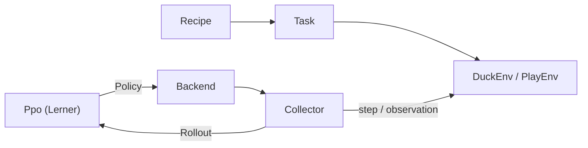

# 14 Der Lehrer – eine Schule für die Ente

> **Kurz gesagt:** Der Lehrer ist Kerns eigene Trainingsschule für die Micro Duck. Dutzende Enten
> üben gleichzeitig in der Simulation, bekommen erst ein Vorbild gezeigt und probieren dann selbst,
> bis aus Zufallszahlen ein Netz geworden ist, das springen kann. Alles läuft in Kerns eigenem C++,
> auf dem Rechner wie im Browser, und kommt überall Bit für Bit gleich heraus.

Kein Python, kein PyTorch: Simulation, Lernverfahren und Export laufen in C++ auf Kerns Engine
und der Physik Box3D. Der Lehrer lernt nativ auf allen Prozessorkernen (auch ohne Bildschirm auf
einem Server) und als WebAssembly im Browser, auf Desktop und Handy. Ein Lauf ergibt auf allen in der CI geprüften
Plattformen **Bit für Bit dasselbe Netz**.

Die Ente im Lehrer ist **dieselbe** wie im Studio: dieselbe `GameWorld`, dieselben Servos und
Sensoren, derselbe 50-Hz-Regler, dieselbe Physik mit 16 Sub-Steps ([Kapitel 13](13-micro-duck.md)).
Ein Netz von hier läuft deshalb unverändert im Studio. Exportiert wird es im Format von Pollens Netzen
(Pollen Robotics hat den echten Roboter und seine Netze gebaut). Auf dem echten Roboter ist es nicht
erprobt: Wer es auf Hardware lädt, tut das auf eigenes Risiko ([Kapitel 16](16-kalibrierung.md)).

So sind Kerns eigene Netze entstanden: `policies/jump.onnx` (der Sprung) und `policies/play.onnx`
(die Spielschicht). Dieses Kapitel zeigt, wie der Lehrer gebaut ist und rechnet. Was ein neuronales
Netz ist und wie Nachahmen und Reinforcement Learning funktionieren, erklärt
[Anhang A](A-grundlagen-neuronale-netze.md) von Grund auf; die Bedienung steht in
[Kapitel 15](15-eigene-modelle.md).

## 14.1 Was steckt drin?

Der Lehrer wohnt in `src/lehrer/` und `include/kern/lehrer/`: etwa ein Dutzend Dateipaare für
Umgebung, Aufgaben, Netz, PPO, Threads, Rezepte, Vorbild und CMA-ES, Spielschicht, ONNX-Export,
Kalibrierung, Fingerabdruck und Browser-Schnittstelle, dazu das Werkzeug `kern_lehrer` und die Seite
`web/lehrer/`. Der Stand laut `docs/lehrer.md`:

| Schritt | Stand |
|---|---|
| Simulation ohne Bild, Netz mit Adam, PPO, ONNX-Export | fertig |
| Variation, Lernen im Browser, Determinismus | fertig |
| Der Sprung: Vorbild → Nachahmen → Üben | fertig |
| Digitaler Zwilling: Gerätemodelle, Kalibrierung | fertig (ohne echte Messdaten) |
| Spielen: Ball kicken, Socke aufheben, tragen, ausspucken | in Überarbeitung |

## 14.2 Wer macht was?

> **Stell dir vor …** eine Sportschule. Der **Lehrplan** (`Recipe`) legt fest, was geübt wird. Die
> **Übung** (`Task`) sagt, wofür es Punkte gibt. In der **Turnhalle** (`Env`) turnt eine Ente.
> **Helfer mit Klemmbrett** (`Collector`) schreiben alles mit (`Rollout`). Der **Trainer** (`Ppo`)
> wertet die Zettel aus und gibt neue Anweisungen (`Policy`) heraus. Das **Gebäude** (`Backend`)
> bestimmt, wie viele Hallen gleichzeitig offen sind.



`DuckEnv` führt eine Ente durch Episoden (61 Beobachtungen rein, 14 Aktionen raus), `PlayEnv` die
Spielschicht (23 rein, 9 raus). Werkzeug und Browser nutzen dieselben Rezepte, damit derselbe Lauf
überall dasselbe Netz ergibt. Policy und Rollout lassen sich in flache Puffer packen und so zwischen
Threads oder Web Workern verschicken. `ThreadBackend` verteilt Gruppen von Enten auf Threads; im
Browser ist jeder Web Worker ein Sammler und ein weiterer der Lerner.

Die Trainingsschleife ist dadurch kurz:

```cpp
IterationStats train_iteration(Ppo& ppo, Backend& backend) {
  std::vector<Rollout> rollouts;
  backend.collect(ppo.policy(), ppo.config().steps_per_env,
                  ppo.iteration() + 1, rollouts);
  std::vector<const Rollout*> ptrs;
  for (const Rollout& r : rollouts) ptrs.push_back(&r);
  ppo.set_parallel(backend.update_parallel());
  return ppo.learn(ptrs);
}
```

In Worten: Das Backend lässt alle Enten mit der aktuellen Policy üben und füllt die Liste der
Rollouts. Zeiger darauf einsammeln, dem Lerner die Threads des Backends leihen, lernen. Das ist **eine** Iteration; Tausende ergeben einen Sprung. Vor jeder
Iteration ruft das Backend außerdem die Lehrpläne auf („ab jetzt kostet ein Sturz mehr“).

## 14.3 Die Turnhalle der Ente

### Eine Ente, eine Welt

Jede `DuckEnv` baut eine Ente auf ebenem Boden in einer **eigenen** `GameWorld`. Der Renderer bleibt
headless, die Grafikkarte wird nie angefasst. Ein Schalter sorgt dafür, dass der Regler der Ente die
Aktion des Lehrers nimmt, genau wie im Training: Grundstellung plus Aktion, mit der Busverzögerung
des Servoprofils. Läuft gerade eine fertige Bewegung (Skill, Aufheben, Sitzen), hat sie Vorrang.

Ein `step(action)` ist ein **Regeltakt** von 20 ms Roboterzeit: Aktion an den Regler, 4 Weltschritte
rechnen, ab und zu ein Schubs (wenn Variation an ist), dann misst `walker_probe` alles, was
Belohnung und Kritiker brauchen (Lage, Geschwindigkeit, Drehrate, Sohlenkontakte, Fußhöhen,
Bodenkontakt anderer Teile, Gelenke). Die Aufgabe rechnet die Belohnung und sagt, ob Schluss ist.
Zuletzt entsteht die neue Beobachtung: zuerst genau das, was der Regler sieht, plus die Befehle der
Aufgabe in den Plätzen 48–60. Der Kritiker bekommt diese saubere Version plus Zusatzwissen. Hat die Aufgabe ein Vorbild, fragt sie
es jetzt, was es täte (für die Nachahmungsbelohnung). Erst
ganz am Ende bekommt **nur der Actor** die Sensorfehler aufgeprägt.

### Die Aufgabe: Was gibt Punkte?

Eine `Task` ist eine kleine C++-Klasse: Name, Episodenlänge, zufälliger Start, Befehle, Belohnung,
Lehrpläne. Belohnungen folgen der Konvention von mjlab: **Gewicht × Term × dt** (dt = 0,02 s), jeder
Term mit Namen, damit `--trace` ihn zeigen kann. Nur Einmaliges wie der Sturz wird nicht mit dt
multipliziert.

Eingebaut sind zwei Aufgaben. **`stand`** ist der Schnelltest: 4 s stehen, Punkte fürs Aufrechtsein,
für Bein- und Halshaltung und die richtige Höhe (0,115 m), ein kleiner Abzug für hektische Aktionen;
ein Sturz kostet −4 und beendet die Episode. **`jump`** ist der Sprung (14.6).

### Der asymmetrische Kritiker

Beim Lernen arbeiten zwei Netze zusammen (Grundlagen in Anhang A.11). Der **Actor** handelt und
sieht nur, was die Sensoren liefern, mit allen Fehlern. Nur er wird exportiert. Der **Kritiker**
schätzt, wie gut eine Lage ist, existiert nur beim Lernen und darf deshalb mehr sehen: die saubere
Beobachtung und Dinge, die kein Sensor misst. Beim Sprung sind das 9 Zusatzwerte, etwa die
Rumpfhöhe über dem Start, die Rumpfgeschwindigkeit, die Fußhöhen und ob die Ente schon geflogen ist.

> **Stell dir vor …** ein Fahrschüler mit beschlagener Brille und ein Fahrlehrer mit klarer Sicht.
> Fahren muss später der Schüler allein. Aber beim Üben sind die Rückmeldungen viel besser, weil der
> Lehrer mehr sieht.

### Variation: jede Ente ein bisschen anders

Übte die Ente immer in derselben perfekten Welt, lernte sie genau diese Welt auswendig. Deshalb
würfelt der Lehrer pro Episode vieles neu, wie in Pollens Rezepten (**Domain Randomization**):

- **Start:** Blickrichtung beliebig, ±3° Schieflage, Sohlenreibung × 0,7 bis 1,3.
- **Bau:** Rumpfmasse und -trägheit ±5 %, Schwerpunkte um ±3 mm verschoben (beim Sprung per Lehrplan bis
  ±15 mm im Rumpf und ±10 mm im Kopf).
- **Servos:** jeder mit eigener Reibung und Trägheit (XL330: ±10 %), Busverzögerung 15–30 ms.
- **Sensoren (nur Actor):** Rauschen auf Gyro, Schwerkraft und Gelenken, ein Encoder-Versatz, eine
  IMU, die bis zu einen Takt zu spät ist.
- **Schubse:** alle 3–6 s bis zu 0,3 m/s; per Lehrplan erst ab Iteration 300, bis 500 mit 27 %.

Wie man die Servo-Streuung misst, erklärt [Kapitel 16](16-kalibrierung.md).

> **Wusstest du?** Der Lehrer bewertet jedes Netz **zweimal**: auf dem sauberen Roboter und mit
> voller Variation. Ein Netz, das nur mit genau einer Masse, einer Reibung und einer Verzögerung
> stehen kann, steht auf dem echten Roboter nicht.

Der Zufall selbst ist reproduzierbar: `Rng` ist splitmix64, klein und schnell. Bei einem Lauf mit
Seed s bekommt Ente k den Seed s · 1000003 + k. Er hängt nur von der Nummer der Ente ab, nie vom
Thread, der sie rechnet (wichtig für 14.7).

## 14.4 Die Netze: Mlp, Normalizer, Adam

**Das Netz.** `Mlp` ist ein mehrschichtiges Perzeptron wie in rsl_rl, der Bibliothek, mit der Pollen
die Netze der Ente trainiert: ELU zwischen den Schichten, lineare letzte Schicht. Der Sprung-Actor
hat die Form **61 → 512 → 256 → 128 → 14**, knapp 200 000 Regler (nachgerechnet in Anhang A.1).
Alle Parameter liegen in einem langen Vektor, die Gewichte „eingangsweise“. Das klingt nach
Buchhaltung, hat aber einen klugen Grund: So werden beide Rechenrichtungen zu einfachen Schleifen,
die der Compiler beschleunigt, **ohne die Reihenfolge der Additionen zu ändern** – und die ist
heilig (14.7). Auch die e-Funktion der ELU kommt aus Kerns deterministischer Mathe-Bibliothek.

Am Anfang werden die Gewichte zufällig gezogen wie in PyTorch, im Bereich ±1/√(Zahl der Eingänge).
Bei der Rückwärtsrechnung (Anhang A.5) nutzt Kern einen Trick: Die Ableitung der ELU im negativen
Bereich ist genau „Ausgabe + 1“, also genügt die gespeicherte Ausgabe. Gradienten werden
**aufaddiert**, damit sich Teilstücke einer Minibatch summieren lassen. Ein Test prüft das Ganze
gegen finite Differenzen.

**Der Normalisierer** rechnet jeden Eingang auf ein gemeinsames Maß um (Anhang A.7):

```
y = (x − Mittelwert) / (√Varianz + 0,01)
```

Mittelwert und Varianz führt er laufend nach (Chans Formel, in doppelter Genauigkeit). Beim Export
landet er als `Sub` und `Div` vorn im Netz, wie bei Pollen. Der Kritiker hat seinen eigenen.

Beim **Warmstart** übernimmt der Actor Gewichte und Normalisierer von Pollens Steh- und Laufnetz
velstand und **friert den Normalisierer ein**, denn die Gewichte gehören zu genau diesen Werten.
Eingänge, die velstand nie benutzt hat (beim Sprung die Phasenplätze 55 und 56), bekommen Gewicht 0.
Der Actor handelt dann anfangs exakt wie velstand, bis er lernt, sie zu nutzen.

**Adam** (Anhang A.6) läuft mit PyTorchs Standardwerten. Vorher wird der Gradient auf die
Gesamtlänge 1,0 gestutzt. Adams Gedächtnis kommt mit in den Checkpoint.

## 14.5 PPO Schritt für Schritt

Kern folgt dem PPO von rsl_rl. Warum PPO so gebaut ist, steht in Anhang A.11; hier geht es um den
Ablauf in Kern.

| Einstellung | Standard | Sprung | Spielschicht |
|---|---|---|---|
| Actor | 512, 256, 128 | 512, 256, 128 | 256, 128 |
| Kritiker | 512, 256, 128 | 256, 128 | 256, 128 |
| Rauschen am Anfang | 1,0 | 0,3 | 0,2 |
| Takte je Ente | 24 | 48 | 64 |
| Entropie-Bonus | 0,01 | 0,005 | 0 |
| Lernrate | 10⁻³ | 10⁻⁴ | 10⁻⁴ |

Überall gleich: 5 Epochen, 4 Minibatches, Clip 0,2, γ = 0,99, λ = 0,95, Ziel-KL 0,01 mit adaptiver
Lernrate, Gradientenbegrenzung 1,0, geclippter Wertverlust.

1. **Sammeln.** Jede Ente läuft ihre Takte. Der Actor liefert einen Mittelwert μ, dazu kommt
   Rauschen: **a = μ + σ · ε**. Das Rauschen ist die Neugier – ohne es probiert die Ente nie etwas
   Neues. Gespeichert werden Beobachtungen, Aktion, Belohnung und ob die Episode durch Sturz
   („terminal“) oder Zeitablauf („timeout“) endete.
2. **Ordnen.** Der Lerner legt alle Zeilen in **eine** feste Reihenfolge, Schritt für Schritt und
   darin Ente für Ente. Dann lernen die Normalisierer aus allem auf einmal (ein eingefrorener bleibt).
3. **Alte Policy neu bewerten** – mit den frischen Normalisierern. Bei nur ein paar Dutzend Enten
   wandern sie zwischen zwei Iterationen merklich, sonst wäre der Vergleich „neu gegen alt“ schief.
4. **Vorteil mit GAE.** War jede Aktion besser oder schlechter als erwartet (Beispiel in Anhang
   A.11)? Ein **Zeitablauf** ist kein Scheitern: Die Episode hätte weitergehen können, also wird
   der Wert der Zukunft geschätzt statt auf null gesetzt. Ein **Sturz** hat keine Zukunft. Am Ende
   des Rollouts schätzt der Kritiker den Wert der Lage, in der jede Ente gerade steht. Danach werden
   alle Vorteile auf Mittelwert 0 und Streuung 1 gebracht, damit die Schrittgröße nicht vom
   Belohnungsmaßstab abhängt.
5. **Update.** 5 Epochen × 4 Minibatches = 20 Lernschritte. Jede Minibatch wird in genau
   **8 feste Teilstücke** zerlegt, die auf den Threads laufen. Vor jedem Schritt misst der Lerner
   per KL-Divergenz, wie weit sich die Policy schon bewegt hat: über 0,02 teilt er die Lernrate
   durch 1,5, unter 0,005 multipliziert er mit 1,5 (immer zwischen 10⁻⁵ und 10⁻²). So bleibt jeder
   Schritt in einer „Vertrauensregion“. Der geclippte Verlust macht gute Aktionen
   wahrscheinlicher, aber nur bis zum Verhältnis 1,2 (schlechte unwahrscheinlicher bis 0,8). Der
   Kritiker lernt die Erträge vorherzusagen, ein kleiner Entropie-Bonus hält das Rauschen am
   Leben, das σ selbst ist ein gelernter Regler pro Aktion (mindestens 0,001). Zum Schluss werden
   die 8 Teilgradienten in fester Reihenfolge summiert, und je ein Adam macht einen Schritt für
   Actor und Kritiker.

> **Achtung, Falle!** Nach dem Nachahmen kann der Actor schon springen, aber der Kritiker hat keine
> Ahnung, was das wert ist. Lernte der Actor sofort mit, steuerten ihn die Zufallsurteile des
> Kritikers und zerstörten das Gelernte. Deshalb lernt in den ersten 30 Iterationen (Spielschicht:
> 20) **nur der Kritiker** – „Kritiker zuerst“.

Nach jeder Iteration gibt es eine Statistik: mittlere Belohnung, Rückgabe und Länge der beendeten
Episoden, Wert- und Surrogatverlust, Entropie, Lernrate, mittleres σ, Zeiten und Entenschritte
insgesamt. Ein Checkpoint (Kennung `KERNPPO1`) enthält den ganzen
Lerner mit beiden Netzen, Normalisierern und Adam-Gedächtnissen.

## 14.6 Vorbild, Nachahmen, Üben: wie der Sprung entstand

### Warum PPO allein scheiterte

Die ersten Läufe mit reinem PPO – mit Lehrplänen, Phasensignal, Warmstart, verschiedenen Netzgrößen
und Lernraten – fanden den Absprung nicht. Drei Gründe:

- Ein Absprung braucht **alle Beinservos gleichzeitig am Anschlag**. Die Servos sind weich und
  erreichen ihr Höchstmoment erst bei 1,7 rad Abweichung; das Netz muss also Ziele weit hinter den
  Gelenkgrenzen setzen. Zufälliges Ausprobieren erzeugt das praktisch nie.
- Stehen ist sicher und bringt Punkte; ein missglückter Versuch kostet einen Sturz.
- Mit wenigen Dutzend Enten ist der Gradient verrauscht.

> **Stell dir vor …** du willst einem Hund einen Salto beibringen und gibst nur dann ein Leckerli,
> wenn er zufällig einen macht. Du wartest ewig. Zeigst du ihm die Bewegung Stück für Stück, geht
> es plötzlich.

Darum lehrt der Lehrer in drei Schritten: **Vorbild suchen → Nachahmen → Üben.** Zur Laufzeit gibt
es nur das Netz; das Vorbild existiert nur beim Lernen.

### Das Vorbild: ein Sprung in 15 Zahlen

`JumpDemo` beschreibt einen Sprung mit **15 Zahlen**: die Servoziele von Hüfte, Knie und Knöchel des
linken Beins zu fünf Zeitpunkten (Hocke, Abdruck, Anziehen, Landen, Abfedern); das rechte Bein
spiegelt. Dazwischen wird interpoliert und alles durch tanh mit Amplitude 2,5 rad geschickt. So
sind Ziele hinter den Gelenkgrenzen möglich, und der Servo drückt mit voller Kraft. Vor und nach dem
Sprung hält velstand die Balance.

### Die 15 Zahlen finden: CMA-ES

„15 Zahlen rein, Sprungnote raus“ ist eine ganze Physiksimulation, ohne Ableitung. Hier hilft
**CMA-ES**, eine Evolutionsstrategie ohne Gradienten (Anhang A.13).

> **Stell dir vor …** du suchst im Dunkeln die tiefste Stelle eines Sees und wirfst jedes Mal
> 16 Steine um dich herum. Wo es am tiefsten plumpst, gehst du hin – und merkst dir, in welche
> Richtung es tiefer wird.

Kern hat CMA-ES selbst nach Hansens Tutorial geschrieben, deterministisch wie alles. Der Lehrer
nutzt es überall, wo es keine Ableitung gibt: hier fürs Vorbild, in [Kapitel 16](16-kalibrierung.md)
für die Servo-Kalibrierung. CMA-ES lernt nicht nur, wohin es geht, sondern auch die Form der
Suchwolke (welche Zahlen zusammen wandern sollten). Der Startpunkt wird zuerst bewertet, das
Ergebnis ist also nie schlechter; alle Kandidaten einer Generation rechnen parallel. Pro Generation
16 Kandidaten, Suchbreite σ = 0,8 ab Grundstellung (0,3 ab einem gegebenen Start); jeder springt
6 Episoden, eine sauber, fünf mit voller Variation. Alle Kandidaten
einer Generation treffen **dieselben** Roboter (fairer Vergleich), jede Generation andere (kein
Vorbild für Glücks-Enten). Die Note belohnt Steigen, Flugzeit und Höhe, bestraft Neigung über 15°
und Stürze (frühe mehr als späte) und gibt Bonuspunkte fürs Stehen am Ende und für einen echten
Sprung. Zurück kommt das **Zentrum** der Suchwolke, nicht der beste Einzelne, denn der kann Glück
gehabt haben. Das eingebaute Vorbild brauchte drei Stufen mit zusammen **370 Generationen**.

### Nachahmen mit DAgger

Lernt das Netz nur aus Fahrten des Vorbilds, kennt es nur dessen Zustände. Ein kleiner eigener
Fehler führt ins Unbekannte, dort macht es einen größeren, die Fehler schaukeln sich auf: die
**Verteilungsverschiebung** (Anhang A.9). DAgger dreht den Spieß um: **Das Netz fährt, das Vorbild
kommentiert.** In Runde 0 fährt das Vorbild; ab Runde 1 fährt das Netz (mit etwas Rauschen, 0,05),
und in jedem Takt sagt das Vorbild, was es getan hätte. Nach jeder Runde lernt das Netz aus **allen**
bisherigen Beispielen. So enthält der Datensatz genau die Lagen, in die das Netz selbst gerät, mit
der richtigen Antwort dafür. Voraussetzung: Das Vorbild muss in jeder dieser Lagen eine sinnvolle
Antwort haben.

Beim Sprung: 8 Runden à 96 Episoden mit voller Variation; gelernt wird per mittlerem quadratischem
Fehler mit eigenem, frischem Adam (10 Epochen, Minibatch 256, Lernrate 10⁻³). Wer welchen Teil einer
Runde rechnet, ist egal: Zusammengefügt ergibt sich genau dieselbe Runde.

Danach wird **geübt**: Rauschen 0,1, 30 Iterationen „Kritiker zuerst“, dann PPO mit
Sprung-Belohnung, einer Nachahmungsbelohnung und voller Variation, bis der Sprung robust ist.

### Die Aufgabe `jump`

Der einzige Befehl ist ein **Phasensignal**: cos und sin der Phase t / 2 s in den Plätzen 55 und 56.
Die Episode dauert 2 s. Kein Skript, keine inverse Kinematik, keine künstlichen Kräfte – die Bewegung
kommt allein vom Netz über 14 Servoziele. Die Belohnung hat 15 Terme, die wichtigsten:

| Term | Gewicht | Wofür |
|---|---|---|
| `airborne` | 20 × aufrecht | im Flugfenster in der Luft und steigend |
| `lift` | 20 × aufrecht | Steiggeschwindigkeit beim Absprung |
| `landed` | 6 × aufrecht | nach dem Flug auf beiden Sohlen |
| `imitate` | 10 | nah an der Aktion des Vorbilds |
| `tilt` | −30 | Schieflage kostet |
| `fall` | −2 → −20 | einmalig, per Lehrplan strenger |

Dazu kleinere Terme: Haltung von Beinen und Hals, Wegrutschen, ein zweiter Hüpfer, Drehrate,
Eigenkontakt, hektische Aktionen (per Lehrplan ab Iteration 200 strenger) und, nur ohne Vorbild,
eine Referenzhöhe. Als Sturz gilt mehr als 60° Neigung oder ein Rumpf unter 5 cm.

> **Achtung, Falle!** Eine Episode endet bei **jedem Bodenkontakt eines Teils außer den Sohlen**.
> Sonst wäre es die sicherste Wette, sich auf Schnabel oder Schwanz abzustützen. Netze sind Meister
> im Ausnutzen von Lücken.

Was als **echter Sprung** zählt, entscheidet der strenge `JumpMeter`: alle Teile mindestens 60 ms in
der Luft, der Rumpf steigt dabei mindestens 5 mm über die Abhebehöhe (nur Füße anziehen gilt nicht),
nie mehr als 30° Neigung, und am Ende steht die Ente aufrecht auf beiden Sohlen. Mit diesem Maß
misst `evaluate_jump` jede Policy in Studio-Physik: echte Sprünge, Stürze, Höhe, Steigen, Flugzeit,
Neigung.

## 14.7 Determinismus: überall dasselbe Netz

Simulation, Training und abgespielte Roboter-Logs kommen auf allen CI-Plattformen gleich heraus:
GCC auf x86, Apple clang auf ARM, WebAssembly. Ein Fehler ist damit wiederholbar und kein Rauschen,
das auf jedem Rechner anders aussieht.

> **Wusstest du?** Ein einziges anderes Bit im letzten Rundungsschritt eines Sinus reicht, damit die
> simulierte Ente nach Sekunden einen anderen Gang hat.

Was dafür nötig ist:

- **Keine FMA-Zusammenfassung** (`-ffp-contract=off`): sonst rundet `a*b+c` auf manchen Prozessoren
  anders als in WebAssembly.
- **Box3D ohne SIMD**, wie in WebAssembly; nativ kostet das nichts, der Gelenklöser ist der Engpass.
- **Eigene Mathe-Bibliothek:** `sin`, `cos`, `exp` … runden auf verschiedenen Systemen im letzten Bit
  verschieden. Kern nutzt überall die Fassungen aus musl über `kern::dm::`. Nur was laut IEEE exakt
  ist (`sqrt`, `fabs`, `floor`), bleibt aus `std::`.
- **Unabhängig von der Zahl der Worker:** Seeds aus der globalen Entennummer, kanonische Ordnung,
  immer 8 Teilstücke in fester Summierreihenfolge.

Gleicher Seed und gleich viele Enten ergeben also dasselbe Netz, auf 1 Kern, 16 Kernen oder in
4 Web Workern. Geprüft wird das mit einem **Fingerabdruck**: `kern_lehrer --fingerprint 400` lässt
die saubere Ente 400 Takte gehen und drehen und gibt pro Takt einen Hash über die exakten Bits von
Lage und Gelenken aus. Der erste abweichende Takt zeigt, wann zwei Builds auseinanderlaufen. Die CI
prüft das dreimal; ein weiterer Test lernt mit 1, 2 und 4 Workern und vergleicht die Netze Byte für
Byte. **Regel für neuen Code:** `kern::dm::sin` statt `std::sin`, keine Summen in
Thread-Reihenfolge, kein `-ffast-math` ([Kapitel 2](02-bauen-und-testen.md)).

## 14.8 Die Spielschicht lernen

Die Spielschicht ([Kapitel 13](13-micro-duck.md)) entscheidet, ob die Ente zu Ball oder Socke geht,
kickt, aufhebt, trägt und ausspuckt. Sie lernt wie der Sprung: Vorbild, DAgger, PPO.

**`PlayEnv`:** Die Ente läuft selbstständig mit Kern extras; der Lehrer steuert nur die
Spielschicht, darunter laufen Pollens Netze unverändert. Ein Schritt ist eine Entscheidung (40 ms),
eine Episode dauert höchstens 60 s. Der Actor ist 23 → 256 → 128 → 9; der Kritiker kennt zusätzlich
6 Geheimwerte (ob Ball und Socke da sind und wo sie wirklich liegen).

**Szenen:** zufällige Blickrichtung; mit 30 % ein Ball, 30 % eine Socke, 40 % beides, oft dicht
beieinander. Das Ziel liegt mal direkt vor der Ente, meist 0,35 bis 1,2 m entfernt, manchmal außer
Sicht. Bälle mit 3,5 bis 6 cm Radius, 15 bis 50 g, Schaumstoff bis Gummi; mit 30 % eine zweite Socke. Dazu
Variation wie beim Sprung und ein Objektdetektor, der verrauscht ist und bis zu 20 % aussetzt.

**Belohnung** pro Entscheidung: −0,01 für die Zeit, +2 × Annäherung, +3 fürs gehaltene Aufheben,
etwas fürs Tragen, **+10 für einen 0,25 m weggekickten Ball oder eine 0,25 m weit getragene und
ausgespuckte Socke**, −5 für einen Sturz. Die Annäherung zählt zum wahren Ziel (Socke vor Ball),
nicht während die Ente etwas hält. Kick- oder Ablege-Erfolg beendet die Episode als Zeitablauf, nicht
als Scheitern.

**Das Vorbild** sieht **genau dasselbe wie das Netz**, keine wahren Positionen, und hat kein
verstecktes Gedächtnis außer der Startstelle des linken Fußes (dazu Ballradius und gemessene
Bissposition). Nur so kann das Netz es wirklich lernen. Vereinfacht: Sieht es nichts, dreht es sich.
Sonst steuert es das nähere Ziel an (ein Ball im Weg wird zuerst gekickt), geht nah dran langsam auf
einer Linie heran, sagt „Stopp“ und steht. Steht es richtig, startet es Kick oder Aufheben, sonst
geht es zurück und kommt neu (Spielraum: Socke ±8 mm voraus und ±12 mm seitlich, Ball ±2 cm).
„Stehen“ heißt: beide Sohlen länger als 0,25 s am Boden. Beim Aufheben ist der Schnabel von
Phase 0,04 bis 0,30 offen. Hält es etwas, trägt es 0,3 m und spuckt aus. Der Wunsch nach Kick oder
Aufheben steigt als **Rampe** über die letzte halbe Sekunde des Stillstehens, damit das Netz ihn aus
der Stehzeit ablesen kann.

**Was der Lehrer selbst misst:** Wo greift der Schnabel eine Socke? Statt eine Zahl in den Code zu
schreiben, legt der Lehrer die Socke auf ein Gitter von 11 × 9 Stellen vor eine stehende Ente, lässt
sie aufheben und prüft, ob die Socke nach 3 s Tragen noch im Schnabel ist. Gewählt wird eine Stelle,
um die herum auch viele andere halten, denn das Hingehen ist nie millimetergenau. Ändert sich die
Physik, misst er neu; hält nirgends etwas, nimmt er 6,5 cm vor dem Rumpf, mittig. Ebenso misst er, wie weit die Ente nach „Stopp“ noch geht.

Nachgeahmt wird wie beim Sprung mit DAgger (30 Epochen, Minibatch 256, Lernrate 10⁻³). Danach soll
das Netz üben (`--spielen-ueben`): Warmstart von der Datei mit eingefrorenem Normalisierer,
Rauschen 0,1, 20 Iterationen „Kritiker zuerst“, und belohnt wird nur, was wirkt – wo der Biss
wirklich hält, findet es selbst. Beim Nachahmen und Üben laufen die Episoden je zur Hälfte sauber
und variiert. `play.onnx` entstand
aus 12 Runden Nachahmen à 32 Episoden; ausgewählt wurde Runde 8:

| | sauberer Roboter | volle Variation |
|---|---|---|
| Ball weggekickt | 9 von 11 | 7 von 11 |
| Socke aufgehoben | 4 von 21 | 13 von 21 |
| aufgehoben, getragen, ausgespuckt | 1 von 21 | 0 von 21 |
| Griffe, die hielten | 2 von 14 | 1 von 15 |
| Stürze | 2 von 32 | 10 von 32 |

Der **Ball ist gelernt**: Das Netz stellt den linken Fuß hinter den Ball und startet Pollens Kick;
passt es nicht, setzt es neu an. Die Socke steuert es genauso an und beißt, aber mit der gemessenen
Reibung der Polster auf Baumwolle hält der Biss selten. Der Engpass ist der **Griff in dieser
Physik**, nicht die Entscheidung. Als Nächstes kommen ein Sockenmodell, das sich wie Stoff in den
Schnabel legt, und das Üben mit Belohnung.

## 14.9 Ergebnisse des Sprungs

`policies/jump.onnx`: Sprung-Rezept, 32 Enten auf 2 Kernen, Seed 1, 3000 Übungsiterationen.

| | sauber (40 Episoden) | volle Variation (40) |
|---|---|---|
| echte Sprünge | 40 von 40 | 36 von 40 |
| Steigen in der Luft | 11,6 mm | 8,2 mm |
| Flugzeit | 120 ms | 109 ms |
| größte Neigung (Mittel) | 8° | 9° |
| Stürze | 0 von 40 | 0 von 40 |

Die vier „unechten“ Sprünge waren nur zu flach. Der Weg dahin in Entenschritten:
Vorbildsuche einmalig rund 2 Millionen (18 Minuten auf 2 Kernen), erster echter Sprung des Netzes
nach 7 Nachahmungsrunden (43 355), Nachahmung fertig nach 49 936, Üben 2,3 Millionen.

| Plattform | erster echter Sprung | Üben (Schritte/s) |
|---|---|---|
| nativ, 2 Threads | 106 s | 1431 |
| nativ, 1 Thread | – | 763 |
| Browser, 2 Sammler + Lerner | 515 s | 391 |
| Browser, alles auf 1 Kern | 539 s | 336 |

Der Browser lernt **dasselbe Netz**, nur rund 4- bis 5-mal langsamer (WebAssembly ohne SIMD und
ohne Threads im Worker). Nativ schafft die Physik rund 1300 Entenschritte pro Sekunde und Kern. Mit
8 statt 16 Sub-Steps wäre sie 1,6-mal schneller, aber Gang und Bewegungen ändern sich messbar –
also bleibt es bei 16. Im Studio: 3 von 3 echte Sprünge, danach steht und läuft die Ente weiter.

> **Probier's aus!** Öffne auf https://kernengine.de/ das Beispiel-Level (File › Example Levels ›
> Micro Duck), starte Play, übernimm die Ente mit F8 und drück **7**. Was du siehst, ist
> `jump.onnx` aus dem Lehrer: rund 9 mm Steigen, 120 ms Flug.

## 14.10 Der Export nach ONNX

ONNX ist ein offenes Dateiformat für Netze (Anhang A.14). Kern schreibt den Actor genau in der Form
von Pollens Netzen: `obs ─ Sub ─ Div ─ Gemm ─ Elu ─ … ─ Gemm ─ actions`. Vorn sitzt der
Normalisierer, dann die Schichten. Kern liest die Datei zur Probe wieder ein (bis 10⁻⁴ genau), und
auch ONNX Runtime, die Laufzeit des echten Roboters, lädt sie. Die Metadaten
haben dieselben Schlüssel wie bei Pollen (Gelenknamen, Grundstellung, Beobachtungsnamen …) plus
`task` und `lehrer` („Kern (C++ PPO on Box3D)“). Die Spielschicht hat eigene, darunter `rate_hz` = 25.

## 14.11 Der Lehrer im Browser


`kern/build.sh --lehrer` baut `kern_lehrer.wasm`. Die Seite `/lehrer/` lädt das Modul einmal und
gibt es an jeden Web Worker. **Sammler-Worker** führen ihre Enten und schicken Rollouts; **ein
Lerner-Worker** macht Nachahmung, PPO-Update, alle 25 Iterationen eine Sprungprobe und den Export.
Er nimmt auch Einstellungen als JSON, die das Rezept überschreiben.

Auf der Seite wählst du die Bewegung (Sprung, oder Stehen als Schnelltest), Worker (Standard
Kerne − 1, höchstens 8), Enten je Worker (8), Iterationen (1500), Seed, Anfangsrauschen und
Lernrate. Sie zeigt Iteration, Schritte pro Sekunde, Rückgabe, Episodenlänge, echte Sprünge, Höhe
und Flugzeit als Zahlen und Kurven und hält den Bildschirm wach.

Alle 25 Iterationen und am Ende speichert sie das Netz **im Browser** (IndexedDB „kern-lehrer“) und
meldet es per BroadcastChannel: **Offene Studio-Tabs übernehmen es sofort.** „.onnx herunterladen“
liefert die Datei. Die Spielschicht lässt sich im Browser nicht trainieren.

> **Probier's aus!** Öffne auf kernengine.de die Lehrer-Seite `/lehrer/`, wähle Stehen als
> Schnelltest und starte. Beobachte Rückgabe und Episodenlänge: Wie lange halten die Enten durch?
> Starte danach einen Sprung-Lauf mit einem offenen Studio-Tab daneben – das neue Netz landet dort
> von selbst.

> **Wusstest du?** Chromes CPU-Drosselung bremst nur den Hauptthread, nicht die Worker, und taugt
> deshalb nicht als Handy-Ersatz. Gemessen wurde stattdessen „alles auf einem Kern“, und auf dem
> Handy zeigt die Seite selbst, wie viele Entenschritte pro Sekunde es schafft.

## 14.12 Tests

Rund ein Dutzend Tests prüfen Rückwärtsrechnung, Adam, PPO, bitgleiche Episoden, den Fingerabdruck,
gleiche Netze bei 1, 2 und 4 Workern, den Export, den Sprung im Lehrer **und** im Studio und die
Kalibrierung ([Kapitel 16](16-kalibrierung.md)).

## Das nimmst du mit

- Der Lehrer trainiert in reinem C++ auf Kerns Physik, nativ und im Browser, Bit für Bit gleich.
- Die Ente im Lehrer ist dieselbe wie im Studio, deshalb läuft ein Netz dort ohne Umbau.
- Rezept, Aufgabe, Umgebung, Sammler und Lerner sind getrennt; ein Backend verteilt sie.
- Der Actor sieht nur fehlerhafte Sensoren, der Kritiker mehr. Exportiert wird nur der Actor.
- Variation macht robust; bewertet wird immer sauber **und** variiert.
- Der Sprung entstand so: Vorbild mit CMA-ES, Nachahmen mit DAgger, Üben mit PPO,
  „Kritiker zuerst“.
- Determinismus braucht eigene Mathe-Funktionen, kein FMA und feste Summierreihenfolgen.
- Die Spielschicht kickt den Ball schon gut; beim Sockengriff ist die Physik der Engpass.

## Knobelecke

1. Warum darf der Kritiker Dinge sehen, die kein Sensor misst, der Actor aber nicht?
2. Eine Episode endet nach 2 s ohne Sturz. Warum setzt der Lehrer den Wert der Zukunft nicht auf
   null?
3. Warum gibt CMA-ES das Zentrum der Suchwolke zurück und nicht den besten Kandidaten?
4. Du rechnest denselben Lauf mit 2 und mit 8 Threads. Was muss gleich bleiben, damit dasselbe
   Netz herauskommt?
5. Warum endet eine Sprung-Episode, sobald der Schnabel den Boden berührt?

### Lösungen

1. Der Kritiker wird nur beim Lernen gebraucht und nie exportiert. Der Actor muss auf dem Roboter
   mit dessen echten Sensoren auskommen.
2. Ein Zeitablauf ist kein Scheitern; die Ente hätte weiterstehen können. Ihr Wert wird geschätzt.
   Nur ein Sturz hat keine Zukunft.
3. Die Noten sind verrauscht; der beste Einzelne kann Glück gehabt haben. Das Zentrum ist
   verlässlicher.
4. Seed und Gesamtzahl der Enten. Die Zahl der Threads ändert nur die Geschwindigkeit.
5. Sonst lernt das Netz, dass Abstützen sicher Punkte bringt, statt zu springen.

---

© 2026 Christian Heinrich Hohlfeld · Alle Rechte vorbehalten · [Impressum und Rechte](00-impressum.md)
