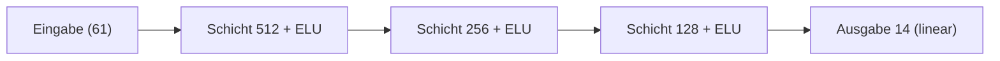
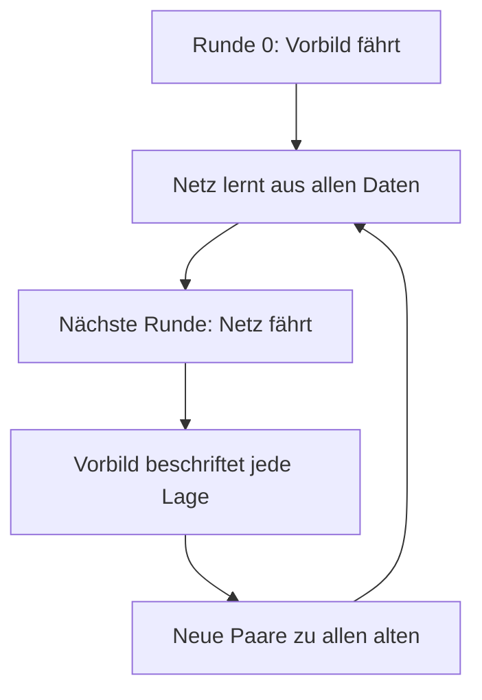
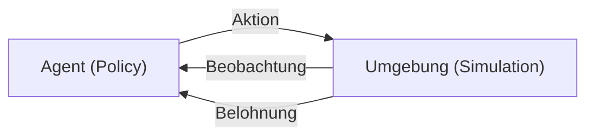
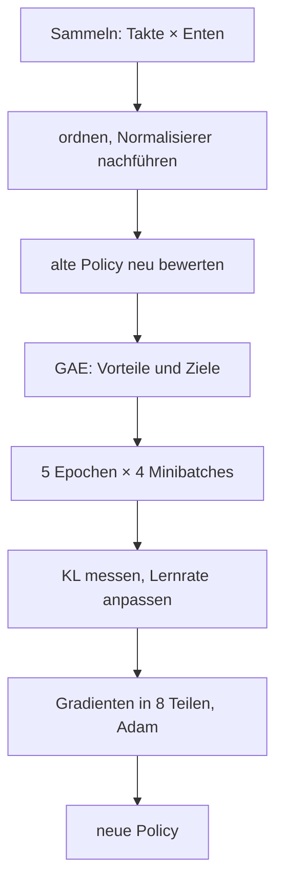
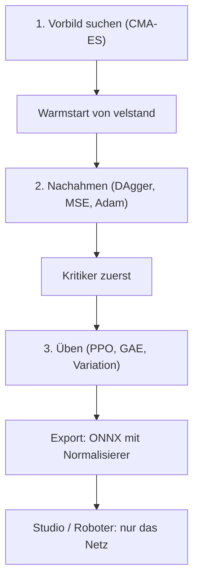

# Anhang A – Wie Maschinen lernen: Netze, Nachahmen, Belohnung

> **Kurz gesagt:** Dieser Anhang erklärt ohne Mathe-Studium, wie ein neuronales Netz funktioniert,
> wie es durch Nachmachen und durch Belohnung lernt und warum die Micro Duck am Ende springen kann.
> Du brauchst nur Grundrechenarten und ein bisschen Neugier. Jeder Begriff kommt erst allgemein,
> dann mit Beispiel, dann mit der Stelle, wo Kern ihn benutzt.

Wie Kerns Lehrer all das umsetzt, steht in [Kapitel 14](14-lehrer.md), wie du selbst trainierst,
in [Kapitel 15](15-eigene-modelle.md). Der Code liegt in `src/lehrer/`.

## A.1 Was ein neuronales Netz ist

### Ein Mischpult mit vielen Reglern

> **Stell dir vor …** ein riesiges Mischpult. Vorn kommen Signale herein, hinten kommt Musik heraus.
> Dazwischen sitzen Tausende Drehregler. Am Anfang stehen sie zufällig, und es klingt furchtbar.
> „Lernen“ heißt: die Regler so lange nachstellen, bis das Richtige herauskommt.

Ein neuronales Netz ist genau so ein Mischpult, mathematisch eine Funktion: Zahlen rein, Zahlen
raus. Bei der Micro Duck gehen **61 Zahlen** hinein (Lage des Rumpfs, Gelenkwinkel, Gelenk-
geschwindigkeiten, letzte Aktion, Befehle) und **14 Zahlen** heraus: die Ziele für die 14 Servos.
Die Regler heißen **Parameter** (Gewichte und Biases). Niemand stellt sie von Hand ein; sie werden
gelernt. Was „richtig“ ist, legt eine Zahl fest, die möglichst klein werden soll: der Verlust (A.3).

### Das Neuron

Der kleinste Baustein ist das künstliche **Neuron**. Es macht drei Dinge:

1. Jeden Eingang mit seinem **Gewicht** malnehmen (wie stark zählt er? auch negativ möglich).
2. Alles addieren und einen **Bias** dazuzählen (eine Art Grundeinstellung).
3. Das Ergebnis durch eine **Aktivierungsfunktion** schicken, die es „verbiegt“.

```
 x1 ──w1──┐
          ├──► Summe + b ──► z ──► ELU(z) ──► Ausgabe
 x2 ──w2──┘
```

**Rechnen wir eins durch.** Zwei Eingänge x₁ = 0,5 und x₂ = −1, Gewichte w₁ = 2 und w₂ = 0,5,
Bias b = 0,1:

- Summe: 2 · 0,5 + 0,5 · (−1) + 0,1 = 1 − 0,5 + 0,1 = **0,6**
- Die Aktivierung ELU lässt positive Zahlen unverändert: Ausgabe **0,6**.

Jetzt drehen wir nur am Bias: b = −0,9. Die Summe wird 1 − 0,5 − 0,9 = **−0,4**. Für negative
Zahlen rechnet ELU e^z − 1 = e^(−0,4) − 1 ≈ 0,670 − 1 = **−0,330**. Ein einziger Regler hat die
Antwort umgedreht. Genau so lernt ein Netz: Es dreht an Tausenden Reglern ein winziges Stück.

### Schichten und das MLP

Viele Neuronen nebeneinander, die dieselben Eingänge sehen, bilden eine **Schicht**. Mehrere
Schichten hintereinander ergeben ein **mehrschichtiges Perzeptron** (MLP). Kern baut den
Sprung-Actor so:



Die letzte Schicht ist **linear**, ohne Aktivierung, denn Servoziele dürfen jede Zahl sein. Wie viele
Regler sind das? Eine Schicht von n auf m Neuronen hat n · m Gewichte und m Biases:
61 · 512 + 512 · 256 + 256 · 128 + 128 · 14 = **196 864 Gewichte**, dazu **910 Biases**, zusammen
**197 774 Parameter**. Fast 200 000 Regler! Der Kritiker hat in Kerns Rezepten die Form
(256, 128), das Netz der Spielschicht ist 23 → 256 → 128 → 9.

In Kern ist das `Mlp` in `nn.h`. Alle Parameter liegen in einem einzigen langen Vektor, die Gewichte
„eingangsweise“ – warum, erklärt [Kapitel 14.4](14-lehrer.md).

### Warum die Aktivierung so wichtig ist

Ohne Aktivierung wäre ein tiefes Netz nutzlos: Lineare Rechnungen hintereinander sind wieder eine
lineare Rechnung. Hundert Schichten könnten dann nicht mehr als eine. Erst das „Verbiegen“ erlaubt
krumme Zusammenhänge wie „Knie stärker beugen, je schneller der Rumpf kippt, aber nur bis zum
Anschlag“.

Kern verwendet **ELU**, wie die Bibliothek rsl_rl, mit der Pollen Robotics die Netze der Micro Duck
trainiert:

| z | ELU(z) | z | ELU(z) |
|---|---|---|---|
| −4 | −0,98 | 0 | 0 |
| −1 | −0,63 | 1 | 1 |
| −0,4 | −0,33 | 2 | 2 |

Rechts ist ELU eine gerade Linie, links biegt sie sanft ab und nähert sich −1. Anders als die
verbreitete ReLU (links einfach 0) gibt es kein „totes“ Gebiet, in dem ein Neuron nichts mehr lernt.
Im Code ist es eine Zeile:

```cpp
y[k] = y[k] > 0 ? y[k] : kern::dm::expm1(y[k]);  // ELU
```

Ist der Wert positiv, bleibt er; sonst wird e^z − 1 berechnet. `expm1` macht das auch für winzige
Zahlen genau, und `kern::dm` ist Kerns eigene Mathe-Bibliothek, die auf jedem Gerät bitgleich
rechnet (A.11).

### Der Start: Zufall, aber klein

Alle Regler auf 0 zu stellen wäre fatal: Alle Neuronen einer Schicht rechneten dasselbe, bekämen
dieselbe Korrektur und blieben für immer **Zwillinge**. Deshalb werden sie zufällig gezogen, und zwar
klein genug, dass die Summen nicht von Schicht zu Schicht explodieren. Kern macht es wie PyTorch:
gleichverteilt zwischen −1/√n und +1/√n, wobei n die Zahl der Eingänge ist. Bei 61 Eingängen also
etwa ±0,128. Für die letzte Schicht gibt es noch einen Faktor (`output_gain`), mit dem man die
ersten Ausgaben klein halten kann.

## A.2 Die Vorwärtsrechnung

„Vorwärts“ heißt: Schicht für Schicht ausrechnen, von der Eingabe zur Ausgabe, meist für einen
ganzen Stapel (**Batch**) von Eingaben auf einmal; Kern rechnet dabei vier Zeilen gleichzeitig. Fürs
Lernen merkt sich die Vorwärtsrechnung alle Zwischenergebnisse (den **Cache**), beim bloßen Handeln
nicht.

Die innerste Schleife läuft dabei immer über Gewichte, die im Speicher direkt hintereinander
liegen, und rechnet „y plus a mal x“. So kann der Compiler sie beschleunigen, **ohne die
Reihenfolge der Additionen zu ändern**. Genau dafür liegen die Gewichte eingangsweise: Sonst müsste
der Compiler Summen umordnen, und umgeordnete Kommazahl-Summen sind nicht mehr bitgleich (A.11).

## A.3 Der Verlust: Wie schlecht bin ich gerade?

Damit ein Netz lernen kann, braucht es eine Zahl, die sagt, wie falsch es liegt: die
**Verlustfunktion**. Je kleiner, desto besser.

Der Klassiker ist der **mittlere quadratische Fehler** (MSE): Für jede Ausgabe den Abstand zum
Zielwert nehmen, quadrieren, alles mitteln. Beispiel: Das Netz sagt (0,5; 2), richtig wäre (1; 1).
Fehler: (0,5 − 1)² = 0,25 und (2 − 1)² = 1, Mittel **0,625**. Quadrieren hat zwei Vorteile: Minus
und Plus zählen gleich, und große Fehler zählen besonders viel.

In Kern nutzt das Nachahmen genau diesen Verlust (`Ppo::imitate`), und auch der Kritiker lernt mit
einem quadratischen Fehler (A.11).

> **Stell dir vor …** der Verlust ist eine Landschaft. Jede Reglerstellung ist ein Ort, der Verlust
> ist die Höhe. Du willst ins tiefste Tal. Aber die Landschaft hat fast 200 000 Richtungen, und es
> gibt keine Karte. Du stehst im **dichten Nebel** und spürst nur, wie steil der Boden unter deinen
> Füßen ist.

## A.4 Gradientenabstieg: im Nebel bergab

### Die Grundidee

Die Neigung unter den Füßen heißt **Gradient**. Er zeigt bergauf. Also macht man einen Schritt in
die Gegenrichtung:

```
neuer Regler = alter Regler − Lernrate × Gradient
```

Die **Lernrate** ist die Schrittlänge. Ein Beispiel mit nur einem Regler θ und dem Verlust θ² (ein
Tal mit tiefstem Punkt bei 0). Der Gradient ist 2θ.

| Schritt | Lernrate 0,1 | Lernrate 1,1 |
|---|---|---|
| Start | 1 | 1 |
| 1 | 1 − 0,1 · 2 = 0,8 | 1 − 1,1 · 2 = −1,2 |
| 2 | 0,64 | 1,44 |
| 3 | 0,512 | −1,728 |

Mit 0,1 geht es brav ins Tal. Mit 1,1 springst du jedes Mal über das Tal hinweg, landest höher als
vorher und schaukelst dich auf. Zu kleine Schritte dagegen kommen kaum voran. Die Lernrate ist
deshalb einer der wichtigsten Regler überhaupt.

### Minibatches und Epochen

Den exakten Gradienten über **alle** Beispiele zu berechnen, ist teuer. Also schätzt man ihn an einer
zufälligen Handvoll, einem **Minibatch**, und macht viele kleine Schritte (stochastischer
Gradientenabstieg). Die Schätzung rauscht, und kleine Minibatches rauschen mehr. Genau das bremste
das Sprungtraining mit nur wenigen Dutzend Enten. Ein Durchgang durch alle Daten heißt **Epoche**.
Kern mischt die Reihenfolge mit seinem eigenen Zufallsgenerator.

### Die Notbremse

Ein einzelner Ausreißer kann einen riesigen Gradienten erzeugen und das Netz mit einem Schritt
ruinieren. Deshalb wird die **Länge** des gesamten Gradienten begrenzt: Ist sie größer als 1,0,
wird sie auf 1,0 gestutzt. Die Richtung bleibt gleich. In Kern sitzt diese Bremse in `Adam`; sie
misst die Länge in doppelter Genauigkeit und beim Actor über Netzgewichte **und** σ zusammen.

## A.5 Backpropagation: Wer ist schuld?

Für jeden der 200 000 Regler brauchen wir den Gradienten: „Wenn ich diesen Regler ein bisschen
drehe, wie ändert sich der Verlust?“ Jeden Regler einzeln anzustupsen und neu zu rechnen, wäre
200 000-mal die ganze Rechnung. **Backpropagation** schafft es in einem einzigen Rückwärtsdurchgang.

> **Stell dir vor …** ein Staffellauf ist verloren. Der Trainer fragt die Schlussläuferin: „Wie viel
> hast du verloren?“ Sie antwortet und gibt die Frage an die Läuferin vor ihr weiter, anteilig nach
> deren Beitrag. So wandert die Schuld vom Ziel bis zum Start, und jede weiß am Ende, was sie
> verbessern muss.

Mathematisch ist das die **Kettenregel**: Der Fehler am Ausgang wird Schicht für Schicht nach hinten
gereicht, jedes Mal mit den Gewichten und der Steigung der Aktivierung verrechnet.

### Von Hand durchgerechnet

Ein Mini-Netz: ein Eingang x, ein ELU-Neuron, ein linearer Ausgang y, Verlust (y − t)².
Startwerte: x = 1, Ziel t = 1, w₁ = 0,5, b₁ = −1, w₂ = 2, b₂ = 0,5.

**Vorwärts:** z = 0,5 · 1 − 1 = −0,5. h = ELU(−0,5) = e^(−0,5) − 1 ≈ −0,393. y = 2 · (−0,393) + 0,5
≈ −0,287. Verlust (−0,287 − 1)² ≈ **1,656**. Ziemlich daneben.

**Rückwärts:**

| Was | Rechnung | Wert |
|---|---|---|
| Fehler am Ausgang | 2 · (y − t) | −2,574 |
| Schuld von w₂ | −2,574 · h | 1,013 |
| weiter zu h | −2,574 · w₂ | −5,148 |
| Steigung der ELU | h + 1 | 0,607 |
| Schuld von w₁ und b₁ | −5,148 · 0,607 | −3,122 |

Die Steigung der ELU im negativen Bereich ist e^z, und das ist genau h + 1. Man braucht also nur die
Ausgabe des Neurons. Diesen Trick nutzt auch Kern.

**Ein Schritt bergab** mit Lernrate 0,1: w₂ wird 1,899, b₂ wird 0,757, w₁ wird 0,812, b₁ wird
−0,688. **Noch einmal vorwärts:** z = 0,124 (jetzt positiv), y ≈ 0,994, Verlust ≈ **0,00004**. Ein
einziger Schritt hat den Fehler hier fast beseitigt. Bei echten Netzen mit vielen Beispielen, die
sich widersprechen, geht es in winzigen Schritten voran.

In Kern macht das `Mlp::backward`. Die Gradienten werden **aufaddiert**, damit Teile eines Batches
auf verschiedenen Threads gerechnet und hinterher summiert werden können. Ob alles stimmt, prüft ein
Test mit **finiten Differenzen**: einen Regler minimal hoch- und runterdrehen und schauen, wie sich
der Verlust ändert.

## A.6 Adam: der kluge Wanderer

Reiner Gradientenabstieg hat zwei Schwächen: Alle Regler bekommen dieselbe Schrittweite, obwohl
manche Gradienten riesig und andere winzig sind, und er reagiert nervös auf Rauschen. **Adam**
(Kingma und Ba, 2015) merkt sich für jeden Regler zwei gleitende Durchschnitte:

- die übliche **Richtung** (geglätteter Gradient, „Schwung“),
- die übliche **Größe** (Wurzel aus dem geglätteten quadrierten Gradienten).

Der Schritt ist dann ungefähr Lernrate × Richtung / Größe. Dadurch macht jeder Regler ähnlich große
Schritte, egal wie groß seine Zahlen sind.

**Beispiel:** Im allerersten Schritt ist nach Adams Anfangskorrektur Richtung = g und Größe = |g|.
Der Schritt ist also genau ± Lernrate, **ob der Gradient 0,000001 oder 1000 ist**. Wie ein Wanderer,
der im Nebel immer gleich große Schritte macht und nur auf die Richtung achtet.

Kern nutzt PyTorchs Standardwerte (Glättung 0,9 und 0,999, Lernrate 10⁻³). Actor, Kritiker und
Nachahmen haben je einen eigenen Adam (der fürs Nachahmen ist frisch, damit sein Schwung nicht ins
spätere PPO hineinwirkt), und sein Gedächtnis kommt in den Checkpoint: Ein fortgesetzter Lauf macht
genau die Schritte, die ein ununterbrochener gemacht hätte.

## A.7 Normalisierung: alle auf Augenhöhe

Die 61 Eingänge sind sehr verschieden groß: Winkel um Zehntel, Gelenkgeschwindigkeiten zweistellig,
die Schwerkraftrichtung zwischen −1 und 1. Die großen Eingänge würden die Summen dominieren und das
Lernen verlangsamen. Deshalb rechnet man jeden Eingang auf Mittelwert 0 und Streuung 1 um:

```
normiert = (x − Mittelwert) / (Streuung + 0,01)
```

**Beispiel:** Eine Gelenkgeschwindigkeit hat im Mittel 2 und streut um 4. Der Wert 10 wird zu
(10 − 2) / 4,01 ≈ **2,0**: „zwei Streuungen über dem Üblichen“. Die 0,01 verhindert eine Division
durch null bei Eingängen, die fast konstant sind.

Weil eine bessere Ente andere Zustände erlebt, werden Mittelwert und Streuung laufend nachgeführt.
Dafür reicht eine exakte Formel (Chans Algorithmus), die nur drei Zahlen pro Eingang braucht.

Wichtig: **Der Normalisierer gehört zum Netz.** Ohne genau diese Umrechnung ist das Netz wertlos,
deshalb steht er im exportierten Netz ganz vorn (A.14) und reist mit der Policy zu jedem Sammler.
Beim Warmstart wird er eingefroren; neue Eingänge bekommen Mittelwert 0, Teiler 1 und Gewicht 0,
sodass das Netz anfangs exakt wie das alte handelt ([Kapitel 14.4](14-lehrer.md)).

Der Lerner führt die Normalisierer einmal pro Iteration mit allen gesammelten Beobachtungen nach
und bewertet die alte Policy danach **mit den neuen** Werten neu. Bei wenigen Dutzend Enten wandern
sie sonst merklich, und die Verhältnisse von PPO (A.11) wären verfälscht.

## A.8 Auswendiglernen gegen Verstehen

Ein Netz mit 200 000 Reglern kann eine kleine Datenmenge **auswendig lernen**: perfekte Antworten auf
die Übungsaufgaben, Unsinn bei neuen. Das heißt **Überanpassung**. Gegenmittel: mehr und
vielfältigere Daten, Prüfung auf Daten, die nie zum Lernen dienten, rechtzeitig aufhören (das beste
Netz nehmen, nicht das letzte) und kleinere Netze.

In der Robotik heißt Überanpassung meist: Das Netz hat sich auf **genau diese Simulation**
eingestellt. Das Gegenmittel ist Variation (A.12); Kern prüft jedes Netz sauber **und** variiert,
und das Auswählen der besten Runde ist „rechtzeitig aufhören“.

## A.9 Lernen durch Nachmachen

### Überwachtes Lernen und Verhaltensklonen

Beim **überwachten Lernen** gibt es zu jeder Eingabe die richtige Antwort, wie ein Arbeitsheft mit
Lösungen. Das Netz minimiert den Fehler, fertig. In der Robotik ist die „richtige Antwort“ die Aktion
eines Experten: Man lässt ihn vormachen, notiert Paare (was er sieht, was er tut) und trainiert das
Netz darauf. Das heißt **Verhaltensklonen**. In Kern heißt der Experte **Vorbild**.

### Die Falle: Verteilungsverschiebung

> **Stell dir vor …** du lernst Fahrradfahren nur, indem du jemandem zusiehst, der immer perfekt in
> der Mitte des Wegs fährt. Dann fährst du selbst, kommst ein paar Zentimeter vom Weg ab – und weißt
> nicht weiter, denn so eine Lage hast du nie gesehen. Du korrigierst falsch, kommst noch weiter ab,
> und landest im Gebüsch.

```
 Vorbild:  ●──●──●──●──●──●──●   (immer in der Mitte)
 Klon:     ●──●──●─╲
                    ●─╲          kleiner Fehler → unbekannte Lage
                       ●──╲      → größerer Fehler → ...
                           ●  Sturz
```

Das heißt **Verteilungsverschiebung**: Beim Fahren erzeugt das Netz selbst Zustände, die es beim
Lernen nie gesehen hat. Forscher haben gezeigt, dass der Gesamtfehler dabei mit dem **Quadrat** der
Episodenlänge wachsen kann statt nur mit der Länge.

### DAgger: Der Schüler fährt, der Lehrer kommentiert

**DAgger** (Ross, Gordon und Bagnell, 2011) dreht den Spieß um. Der Schüler fährt selbst, und das
Vorbild sagt in jedem Moment, was **es** getan hätte.



So entstehen Daten genau dort, wohin der Schüler wirklich gerät, mit der richtigen Antwort dafür.
In Kern fährt das Netz ab Runde 1 mit etwas Rauschen (0,05), damit auch Lagen knapp neben seiner
Bahn vorkommen; nach jeder Runde lernt es aus **allen** Beispielen (10 Epochen, Minibatch 256,
Lernrate 10⁻³). Beim Sprung springt das Netz nach 7 Runden zum ersten Mal echt. Die Spielschicht
lernt genauso. Das Vorbild heißt beim Sprung `JumpTeacher`, beim Spielen `PlayEnv::teacher`.

Eine Bedingung macht DAgger erst möglich: Das Vorbild darf nur sehen, was das Netz sieht, und kein
verstecktes Gedächtnis haben. Eine Antwort, die nur von der Beobachtung abhängt, kann ein Netz exakt
lernen; eine, die von Verborgenem abhängt, nicht.

## A.10 Lernen durch Belohnung

Verhaltensklonen braucht einen Experten. Gibt es keinen, oder soll das Netz besser werden als er,
hilft **Reinforcement Learning** (RL, bestärkendes Lernen).

> **Stell dir vor …** Hundetraining. Du sagst dem Hund nicht, wie er seine Muskeln bewegen soll. Er
> probiert etwas, und wenn es gut war, gibt es ein Leckerli. Mit der Zeit macht er öfter, was
> Leckerlis bringt.

### Der Kreislauf



Der **Agent** (die Ente mit ihrem Netz) sieht eine **Beobachtung**, wählt eine **Aktion**, die
Umgebung antwortet mit einer neuen Beobachtung und einer **Belohnung**. In Kern ist die Umgebung eine
`Env`; bei `DuckEnv` ist ein Schritt ein Regeltakt von 20 ms (50 pro Sekunde).

Ein Schritt (`step`) liefert die Belohnung und ob die Episode durch Sturz oder Zeitablauf endete.

Fachleute nennen das einen **Markov-Entscheidungsprozess**: Zustände, Aktionen, eine Physik, die
den nächsten Zustand bestimmt, Belohnungen. „Markov“ heißt: Was als Nächstes passiert, hängt nur
vom Jetzt ab, nicht von der Vorgeschichte.

### Zustand gegen Beobachtung

Die Ente kennt ihren Zustand nicht vollständig. Sie sieht nur, was ihre Sensoren melden, mit
Rauschen und Verspätung: Gelenkwinkel, Gyro, Schwerkraftrichtung, ihre letzte Aktion, Befehle. Ihre
wahre Höhe über dem Boden oder ihre Geschwindigkeit im Raum sieht sie **nicht**. Die letzte Aktion
in der Beobachtung wirkt wie ein kleines Gedächtnis. Fachleute sagen dazu „teilweise beobachtbar“
(POMDP). Wie stark die Sensoren rauschen und verspäten, legt `Task::Noise` fest (Zahlen in
[Kapitel 14](14-lehrer.md)).

### Belohnung und Return

Die **Belohnung** ist eine Zahl pro Schritt und die einzige Stelle, an der man dem Agenten sagt, was
er tun soll. Und er nimmt sie **wörtlich**.

> **Achtung, Falle!** In frühen Läufen lernte die Ente, auf dem Schwanz zu sitzen, Hechtsprünge zu
> machen oder sich abzustützen – weil die Belohnung das zuließ. Jede Lücke musste mit einer
> strengeren Regel geschlossen werden ([Kapitel 15.11](15-eigene-modelle.md)).

In Kern liefert `Task::reward` die Belohnung, nach der Konvention von mjlab als Summe aus Gewicht ×
Term × Taktdauer; die einzelnen Terme bleiben für Berichte sichtbar.

Der **Return** ist die Summe aller künftigen Belohnungen. Damit er nicht unendlich wird, zählen
spätere Belohnungen weniger: Jeder Schritt in die Zukunft multipliziert mit dem **Diskontfaktor**
γ. Kern nutzt γ = 0,99. Eine Belohnung in 100 Schritten zählt dann nur noch 0,99¹⁰⁰ ≈ 0,37-mal so
viel, in 300 Schritten nur noch etwa 0,05-mal. Die Ente „schaut“ also grob 100 Takte voraus, das
sind 2 Sekunden: genau so lang wie ein ganzer Sprung.

> **Wusstest du?** Der Return lässt sich rückwärts rechnen: Return jetzt = Belohnung jetzt +
> γ × Return ab dem nächsten Schritt. Auf dieser einen Zeile baut fast alles Weitere auf.

### Policy, Wert und Vorteil

Die **Policy** ist die Entscheidungsregel: Beobachtung rein, Aktion raus. Zum Lernen ist sie
**zufällig** (sie würfelt um einen Mittelwert herum), auf dem Roboter nimmt man nur den Mittelwert.

Der **Wert** V einer Lage sagt: „Wie viel Return erwarte ich ab hier?“ Der **Aktionswert** Q sagt:
„Wie viel Return erwarte ich, wenn ich erst genau diese Aktion wähle und danach wie gewohnt
weitermache?“ Der **Vorteil** einer Aktion ist Q minus V, also: „War sie besser oder schlechter als
das, was ich hier sonst so tue?“ Positiv heißt besser. Genau das braucht das Lernen: Mach mehr von
dem, was besser als üblich war.

Eine einfache Schätzung des Vorteils aus einem Schritt ist der **TD-Fehler**: das, was passiert ist
(Belohnung plus Wert der neuen Lage mal γ), minus das, was man erwartet hatte (Wert der alten Lage).

### Sturz oder Zeitablauf?

Eine Episode kann auf zwei grundverschiedene Arten enden. Beim **Sturz** gibt es keine Zukunft, ihr
Wert ist 0. Beim **Zeitablauf** stünde die Ente noch, das Zeitlimit ist nur eine Eigenschaft des
Trainings. Wer beides gleich behandelt, bringt dem Netz bei, dass Anstrengung kurz vor Schluss
sinnlos ist. Kern unterscheidet daher und schätzt beim Zeitablauf den Wert der Zukunft mit
(„Bootstrapping“).

### Wie lernt die Policy? Der Policy-Gradient

Die Belohnung hängt über die Physik von der Aktion ab, und die Physik lässt sich nicht ableiten. Der
Trick: Man leitet nur die **Wahrscheinlichkeit** der gewählten Aktion ab. Hatte eine Aktion einen
positiven Vorteil, macht man sie wahrscheinlicher, bei negativem unwahrscheinlicher. Dafür muss die
Policy würfeln.

Kern würfelt mit einer **Glockenkurve** (Normalverteilung) pro Servo: Aktion = Mittelwert aus dem
Netz + σ × Zufallszahl. Das σ ist ein eigener, lernbarer Regler pro Aktion: Am Anfang ist es groß
(viel Ausprobieren), später kleiner. Beim Sprung startet es bei 0,3 und wird nach der Nachahmung auf
0,1 gesetzt, damit ein Netz, das schon springt, nicht alles wieder verlernt. Untergrenze ist 0,001,
der Standard ohne Rezept 1,0. Jede Ente würfelt mit ihrem **eigenen** Zufallsstrom, der nur von
Seed und ihrer Nummer abhängt, nie davon, welcher Worker sie rechnet.

### Entropie: die Neugier am Leben halten

Die **Entropie** misst, wie unbestimmt eine Verteilung ist. Bei der Glockenkurve hängt sie nur
von σ ab: σ = 1 ergibt pro Aktion 1,419, σ = 0,1 ergibt −0,884 (bei kontinuierlichen Verteilungen
darf die Entropie negativ sein). Ohne Gegenmaßnahme schrumpft σ oft zu schnell, die Ente hört auf auszuprobieren und bleibt bei der ersten halbwegs brauchbaren Lösung
hängen. Ein kleiner **Entropie-Bonus** im Verlust hält sie neugierig (Kern: 0,01, beim Sprung
0,005).

## A.11 Actor, Kritiker und PPO

### Zwei Netze, eine Mannschaft

Für den Vorteil braucht man den Wert V. Den schätzt ein zweites Netz, der **Kritiker**. Das
handelnde Netz heißt **Actor**. Beide lernen gleichzeitig: Der Kritiker lernt, Returns
vorherzusagen; der Actor lernt aus den Vorteilen, die der Kritiker ausrechnet. Jedes hat eigenen
Normalisierer und eigenen Adam.

Nach dem Nachahmen ist der Actor schon gut, der Kritiker weiß aber nichts; seine Urteile wären
Zufall. Deshalb lernt in Kern zuerst **nur der Kritiker** (30 Iterationen).

### GAE: der Vorteil, gut geschätzt

Der TD-Fehler eines einzigen Schritts rauscht wenig, ist aber schief, wenn der Kritiker sich irrt.
Der volle Return rauscht stark, ist aber ehrlich. **GAE** (Generalized Advantage Estimation) mischt
beides mit einem zweiten Regler λ: Man geht rückwärts durch die Zeit, und jeder Vorteil ist der
eigene TD-Fehler plus γ · λ mal der Vorteil des nächsten Schritts. Kern nutzt λ = 0,95, also
γ · λ = 0,9405. Mit λ = 0 bliebe nur der TD-Fehler, mit λ = 1 der volle Return.

**Rechnen wir drei Schritte:** Belohnungen (1, 0, 2), Werte V = (5, 4, 6), Wert danach 3.

| t | TD-Fehler | Vorteil | Ziel des Kritikers |
|---|---|---|---|
| 2 | 2 + 0,99 · 3 − 6 = −1,03 | −1,03 | 4,97 |
| 1 | 0 + 0,99 · 6 − 4 = 1,94 | 1,94 − 0,9687 = 0,9713 | 4,9713 |
| 0 | 1 + 0,99 · 4 − 5 = −0,04 | −0,04 + 0,9135 = 0,8735 | 5,8735 |

Schritt 0 sah für sich allein leicht schlecht aus, war aber insgesamt **gut**: Er führte in eine
Lage, von der aus es besser lief als erwartet. Das Ziel des Kritikers ist jeweils Vorteil plus Wert.
In Kern sind das drei Zeilen:

```cpp
const f32 delta = reward + live * cfg_.gamma * next - v;
adv = delta + live * cfg_.gamma * cfg_.lam * adv;
return_buf_[row] = adv + v;
```

Zeile 1 ist der TD-Fehler, Zeile 2 die GAE-Rückwärtssumme, Zeile 3 das Ziel des Kritikers. `live`
ist 0 nach einem Episodenende; dann gibt es keine Fortsetzung. Für den letzten Schritt des
Rollouts schätzt der Kritiker den Wert dort, wo jede Ente gerade steht. Am Schluss werden alle
Vorteile auf Mittel 0 und Streuung 1 gebracht, damit ihre Größe nicht von der Größe der Belohnungen abhängt.

### Warum zu große Schritte gefährlich sind

Die Daten stammen von der **alten** Policy. Macht man einen großen Schritt, ist die neue Policy weit
weg, die Vorteile gelten für sie nicht mehr, und eine gute Policy kann in einem Schritt kaputtgehen.
Dann sammelt sie schlechte Daten, aus denen sie sich kaum erholt. Mehrere Epochen auf denselben
Daten – eigentlich praktisch, weil man die Daten besser ausnutzt – machen es noch schlimmer.

### PPO: Verbessern mit Gurt

**Proximal Policy Optimization** (Schulman und andere, 2017) begrenzt, wie weit sich die Policy pro
Update bewegen darf. Zentral ist das **Verhältnis** ρ: Wie viel wahrscheinlicher wählt die neue
Policy die gesammelte Aktion als die alte? ρ = 1 heißt „gleich“. PPO erlaubt Verbesserungen nur, bis
ρ das Band von 0,8 bis 1,2 verlässt (Clip ε = 0,2):

| Vorteil | Verhältnis | Lernt weiter? | Bedeutung |
|---|---|---|---|
| positiv | bis 1,2 | ja | gute Aktion verstärken |
| positiv | über 1,2 | **nein** | schon genug verstärkt |
| negativ | ab 0,8 | ja | schlechte Aktion abschwächen |
| negativ | unter 0,8 | **nein** | schon genug abgeschwächt |

**Beispiel:** Vorteil 1, ρ = 1,3. Ungebremst wäre der Gewinn 1,3, gebremst 1,2. PPO nimmt den
vorsichtigeren Wert, und weil der am Deckel klebt, fließt kein Gradient: Der Schritt, der noch weiter
in diese Richtung schieben würde, findet nicht statt.

> **Wusstest du?** PPO ist absichtlich pessimistisch. Verbesserungen werden gedeckelt,
> Verschlechterungen nie. Wählt die neue Policy eine **schlechte** Aktion häufiger als vorher
> (Vorteil negativ, ρ = 1,3), wird das immer korrigiert.

Zusätzlich regelt Kern wie rsl_rl die **Lernrate** über die **KL-Divergenz**, ein Maß dafür, wie
verschieden alte und neue Policy sind: Ist sie größer als 0,02, wird die Lernrate durch 1,5 geteilt,
unter 0,005 mit 1,5 malgenommen, immer zwischen 10⁻⁵ und 10⁻². Große Schritte, wenn es ruhig ist,
kleine, wenn die Policy springt.
Auch der Kritiker hat eine Bremse: Seine Schätzung darf sich pro Update nur um ε vom alten Wert
entfernen.

### Ein PPO-Update im Ganzen



Kerns Standardwerte: 24 Takte je Ente (Sprung 48), 5 Epochen, 4 Minibatches, Clip 0,2, γ = 0,99,
λ = 0,95, Lernrate 10⁻³ (Sprung 10⁻⁴).

Sammeln und Lernen sind in Kern getrennt: Sammler brauchen nur die Policy und liefern Rollouts, der
Lerner nimmt alle Rollouts. Deshalb können die Sammler Threads oder Web Worker sein.

### Gleiches Ergebnis auf jedem Rechner

Kommazahlen im Computer sind tückisch: (0,1 + 0,2) + 0,3 ergibt im Rechner nicht exakt dasselbe wie
0,1 + (0,2 + 0,3) – im letzten Bit unterscheiden sie sich. Summiert man Gradienten in einer
Reihenfolge, die von der Zahl der Threads abhängt, bekommt man auf 2 und 16 Kernen verschiedene
Netze. Kern verhindert das:

- Jede Ente bekommt ihren Seed aus ihrer globalen Nummer.
- Alle Rollouts kommen in eine feste Reihenfolge, und summiert wird immer in fester Reihenfolge
  (jede Minibatch in genau 8 Teilen).
- Alle Mathe-Funktionen kommen aus `kern::dm`.
- Kein FMA: Der Compiler darf „a mal b plus c“ nicht zu einem Befehl zusammenfassen, der je nach
  Prozessor anders rundet.

Das Ergebnis: gleicher Seed, gleich viele Enten, gleiches Netz, nativ wie im Browser
([Kapitel 14.7](14-lehrer.md), [Anhang C](C-grundlagen-physik.md)).

## A.12 Von der Simulation in die Wirklichkeit

Ein simuliert trainiertes Netz trifft auf einen Roboter, der anders ist: ungenau gemessene Massen,
streuende Servos, wechselnde Böden, rauschende Sensoren. Diese **Sim-to-Real-Lücke** zu überbrücken,
ist die Kernaufgabe des Robotiklernens. Zwei Strategien ergänzen sich:

1. **Die Simulation der Wirklichkeit annähern:** genaue, an Messungen kalibrierte Modelle
   ([Kapitel 16](16-kalibrierung.md)).
2. **Das Netz unempfindlich machen:** Es lernt in vielen leicht verschiedenen Welten, sodass die
   echte nur eine weitere ist. Das ist **Domain Randomization**. Was Kern alles variiert, steht in
   [Kapitel 14.3](14-lehrer.md).

> **Stell dir vor …** du übst Tischtennis mal mit schwerem, mal mit leichtem Ball, mal auf rutschigem,
> mal auf stumpfem Boden, mal mit Brille, mal ohne. Am Turniertag ist dir egal, wie der Saal ist.

Zwei Feinheiten: Manche Variation kommt erst nach und nach (**Lehrpläne**), weil zu viel Chaos am
Anfang verhindert, dass die Bewegung überhaupt entsteht. Beim Sprung wächst die
Schwerpunkt-Streuung ab Iteration 200 über 600 Iterationen, die Schubse kommen ab Iteration 300.
Und was man nicht genau messen kann, wird **variiert**, damit sich das Netz nicht darauf verlässt:
Das Servoprofil hat neben jedem Wert eine Streuung, und das Training zieht jeden Servo daraus.

Dazu kommen der **asymmetrische Kritiker**, der beim Lernen mehr sehen darf als der Roboter
(beim Sprung 9 Zusatzwerte, bei der Spielschicht 6), und der **Warmstart**: Kerns Sprung beginnt
als Pollens velstand-Netz, kann also schon stehen und muss nur den Sprung dazulernen. Dessen
Gewichte werden dafür aus dem ONNX-Layout in Kerns eingangsweises Layout umsortiert.

## A.13 Suchen ohne Gradient: CMA-ES

Manche Probleme haben keinen nutzbaren Gradienten. Beim Sprung-Vorbild sind 15 Zahlen die Eingabe
und eine ganze Simulation mit Flug, Landung und Sturz die Bewertung; verrauscht, weil jede
Generation andere Roboter trifft. Bei der Kalibrierung sollen 6 Servoparameter so gewählt werden,
dass die Simulation Messungen nachspielt.

Hier helfen **Evolutionsstrategien**: Kandidaten um einen Mittelpunkt würfeln, bewerten, den
Mittelpunkt zu den Besseren schieben. **CMA-ES** (nach Hansen) lernt zusätzlich die **Form** der
Würfelwolke:

```
 Generation 1          Generation 5            Generation 20
   ·  ·   ·              · ·                      ·
  ·  ●  ·  ·            ·●··                     ●:
   · ·  ·               ·  ·  ↗                  (schmal, entlang
  (rund, groß)         (gestreckt Richtung Tal)    des Tals)
```

Pro Generation passiert grob:

1. Kandidaten aus der Wolke ziehen und bewerten.
2. Die bessere Hälfte bekommt Gewichte, die Besten am meisten.
3. Der Mittelpunkt wandert zu ihrem gewichteten Mittel.
4. Die Schrittweite wächst, wenn mehrere Generationen in dieselbe Richtung gingen, und schrumpft,
   wenn sich die Schritte aufheben.
5. Die Wolke streckt sich in die Richtungen, in denen es gut lief.

Kern hat CMA-ES nach Hansens Tutorial selbst geschrieben (`cmaes.cpp`). Ohne Vorgabe sind es
4 + ⌊3 · ln n⌋ Kandidaten (für 6 Parameter wären das 9); die Kalibrierung nimmt 12, die
Vorbildsuche 16. Der Startpunkt
wird zuerst bewertet, das Ergebnis ist also nie schlechter. Alle Kandidaten einer Generation werden
parallel bewertet. Zurück kommen der beste Punkt **und** der Mittelpunkt, und bei verrauschten Noten
ist der Mittelpunkt die bessere Antwort: Der Beste hatte vielleicht nur Glück. Auch CMA-ES rechnet
mit Kerns eigenem Zufall und `kern::dm`, ist also reproduzierbar. Die genauen Formeln stehen im
blauen Buch.

Beim Vorbild sucht CMA-ES frei im ganzen Zahlenraum; erst tanh mal Amplitude macht daraus
Servoziele, die so immer innerhalb ±2,5 rad bleiben. Jeder Kandidat springt 6 Episoden (eine
sauber, fünf variiert), alle Kandidaten einer Generation auf denselben Robotern.

## A.14 ONNX: das Netz zum Mitnehmen

**ONNX** ist ein offenes Dateiformat für Rechengraphen. Ein Modell ist eine Kette von Bausteinen
(Operatoren) mit den Gewichten als Konstanten in derselben Datei. Programme wie ONNX Runtime führen es
aus, auf dem Roboter, im Browser oder auf dem Server, ohne die Software zu kennen, die es trainiert
hat. Für ein MLP braucht man nur vier: `Sub` und `Div` (die Normalisierung), `Gemm` (eine Schicht:
Gewichte mal Eingang plus Bias) und `Elu`.

```
obs ─► Sub ─► Div ─► Gemm ─► Elu ─► … ─► Gemm ─► actions
```

Kern schreibt die Datei mit einem **eigenen, winzigen Schreiber** für das Protobuf-Format, ohne
Bibliothek, im selben Format wie Pollens Netze (61 rein, 14 raus).
Exportiert wird nur der **Mittelwert** der Policy: Auf dem Roboter wird nicht mehr ausprobiert, σ
und Kritiker bleiben im Lerner. Die Gewichte werden dafür als [Ausgang][Eingang] umsortiert, die
Metadaten tragen dieselben Schlüssel wie bei Pollen plus `task` und `lehrer`. Ein Test liest die
Datei wieder ein und vergleicht bis 10⁻⁴ genau, und ONNX Runtime lädt sie auch. Mehr in
[Kapitel 14.10](14-lehrer.md).

## A.15 Wie alles zusammenkommt



Die Leitlinie steht in Kerns Code: „At run time there is only the network: the demonstration exists
only while it learns.“ Vorbild, Kritiker, Rauschen, Variation – alles ist **Gerüst**, das beim Lernen
hilft und danach abgebaut wird. Was bleibt, ist eine Normalisierung und eine Handvoll
Matrixmultiplikationen mit ELU dazwischen. Und das reicht, damit eine Ente springt.

> **Probier's aus!** Öffne auf https://kernengine.de/ das Micro-Duck-Level (File › Example Levels ›
> Micro Duck), starte Play, übernimm mit F8 und drück **7**. Jeder Servo bekommt in diesem Moment
> 50-mal pro Sekunde eine Zahl aus knapp 200 000 Reglern, die einmal reiner Zufall waren.

> **Probier's aus!** Auf der Lehrer-Seite (`/lehrer/` auf kernengine.de) kannst du das Lernen live
> verfolgen. Setz das Anfangsrauschen einmal groß und einmal klein und vergleiche die Kurven:
> Neugier gegen Vorsicht.

## Das nimmst du mit

- Ein neuronales Netz ist ein Mischpult mit vielen Reglern: gewichtete Summen plus Aktivierung,
  Schicht für Schicht. Der Sprung-Actor hat 197 774 Regler.
- Lernen heißt, den Verlust zu verkleinern: im Nebel bergab, mit der Lernrate als Schrittlänge.
- Backpropagation verteilt die Schuld rückwärts; Adam macht gleichmäßige, kluge Schritte.
- Normalisierung bringt alle Eingänge auf Augenhöhe und gehört fest zum Netz.
- Nachahmen braucht DAgger, sonst schaukeln sich kleine Fehler auf.
- Reinforcement Learning lernt aus Belohnung, und die wird wörtlich genommen.
- PPO verbessert mit Gurt: kleine, sichere Schritte, ein Kritiker schätzt den Vorteil.
- Variation, Lehrpläne und asymmetrischer Kritiker bauen die Brücke von der Simulation zur
  Wirklichkeit.

## Knobelecke

1. Ein Neuron hat x₁ = 1, x₂ = 2, w₁ = 0,5, w₂ = −1, b = 1. Was gibt es mit ELU aus?
2. Warum wäre ein Netz ohne Aktivierungsfunktion mit 100 Schichten nicht schlauer als eins mit einer?
3. Du trainierst mit Lernrate 1,1 auf dem Verlust θ². Was passiert?
4. Mit γ = 0,99: Wie viel zählt eine Belohnung in 100 Schritten im Vergleich zu einer jetzt?
5. PPO: Vorteil −1, Verhältnis ρ = 1,3. Wird das noch korrigiert?

### Lösungen

1. Summe: 0,5 − 2 + 1 = −0,5. ELU: e^(−0,5) − 1 ≈ −0,39.
2. Lineare Rechnungen hintereinander sind wieder eine lineare Rechnung; erst die Aktivierung
   erlaubt krumme Zusammenhänge.
3. Der Wert springt jedes Mal über das Tal und wird immer größer: 1, −1,2, 1,44 …
4. Etwa 0,37-mal so viel.
5. Ja. Die neue Policy wählt die schlechte Aktion häufiger; PPO deckelt nur Verbesserungen, nie
   Korrekturen von Verschlechterungen.

---

© 2026 Christian Heinrich Hohlfeld · Alle Rechte vorbehalten · [Impressum und Rechte](00-impressum.md)
