# Anhang A – Wie Maschinen lernen: Netze, Nachahmen, Belohnung

> **Kurz gesagt:** Dieser Anhang erklärt ohne Mathe-Studium, wie ein neuronales Netz funktioniert,
> wie es durch Nachmachen und durch Belohnung lernt und warum die Micro Duck am Ende springen kann.
> Die Grundrechenarten reichen fast überall. Wo doch etwas mehr vorkommt – Hochzahlen, die
> e-Funktion, eine Steigung, die Glockenkurve –, führen wir es an Ort und Stelle mit einem Bild und
> einer kleinen Tabelle ein. Die Rechenbeispiele darfst du auch überspringen: Die Bilder tragen.

> **Begriffe vorab:**
> - **Servo** – ein kleiner Motor, dem man einen Winkel sagt und der dann dorthin fährt; die Ente
>   hat 14 davon.
> - **Simulation** – die nachgebaute Ente im Computer, die nach den Regeln der Physik läuft und fällt.
> - **Takt** – der Herzschlag der Steuerung: 50-mal pro Sekunde misst die Ente und bekommt neue Ziele.
> - **Episode** – ein Übungsdurchgang, vom Start bis zum Sturz oder bis die Zeit um ist.
> - **Lehrer** – Kerns Trainingssystem, das die Netze der Ente lernen lässt.
> - **Seed** – die Startzahl für den Zufall: gleicher Seed, gleicher Zufall.
> - **velstand** – das fertige Lauf- und Stehnetz von Pollen Robotics, das in Kern mitkommt.
> - **Rechenkern** – eines der Rechenwerke im Prozessor; mehrere Kerne können gleichzeitig rechnen.

Wie Kerns Lehrer all das umsetzt, steht in [Kapitel 14](14-lehrer.md), wie du selbst trainierst, in
[Kapitel 15](15-eigene-modelle.md). Die genauen Formeln, Namen und Werte stehen im blauen Buch,
Anhang A.

## A.1 Was ein neuronales Netz ist

### Ein Mischpult mit vielen Reglern

Ein neuronales Netz ist eine Rechenmaschine: Zahlen rein, Zahlen raus. Dazwischen sitzen sehr viele
Regler, und **Lernen** heißt, diese Regler so lange nachzustellen, bis das Richtige herauskommt.

> **Stell dir vor …** ein riesiges Mischpult. Vorn kommen Signale herein, hinten kommt Musik heraus.
> Dazwischen sitzen Tausende Drehregler. Am Anfang stehen sie zufällig, und es klingt furchtbar.
> „Lernen“ heißt: die Regler so lange nachstellen, bis es gut klingt.

Bei der Micro Duck gehen **61 Zahlen** hinein: wie der Rumpf liegt, wie die Gelenke stehen und wie
schnell sie sich bewegen, was die Ente zuletzt getan hat und welcher Befehl gerade gilt. Heraus
kommen **14 Zahlen**: die Zielwinkel für die 14 Servos. Niemand stellt die Regler von Hand ein; sie
werden gelernt. Was „richtig“ ist, misst eine Zahl, die möglichst klein werden soll: der **Verlust**
(A.3).

### Das Neuron

Der kleinste Baustein ist das künstliche **Neuron**. Es macht drei Dinge:

1. Jeden Eingang mit seinem **Gewicht** malnehmen: Wie stark zählt dieser Eingang? Gewichte dürfen
   auch negativ sein.
2. Alles zusammenzählen und eine **Grundeinstellung** dazurechnen (Fachwort **Bias**).
3. Das Ergebnis durch eine **Aktivierung** schicken, die es „verbiegt“ (gleich mehr dazu).

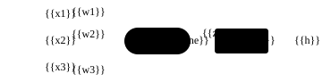

**Rechnen wir eins durch.** Drei Eingänge 0,5, −1 und 0, Gewichte 2, 0,5 und 3, Bias 0,1. Der
dritte Eingang ist gerade 0 und trägt darum nichts bei:

- Summe: 2 · 0,5 + 0,5 · (−1) + 3 · 0 + 0,1 = 1 − 0,5 + 0 + 0,1 = **0,6**
- Die Aktivierung lässt positive Zahlen, wie sie sind: Ausgabe **0,6**.

Jetzt drehen wir nur an der Grundeinstellung: Bias −0,9. Die Summe wird 1 − 0,5 − 0,9 = **−0,4**.
Negative Zahlen staucht die Aktivierung; laut der Tabelle im nächsten Abschnitt wird aus −0,4 etwa
**−0,33**. Ein einziger Regler hat die Antwort umgedreht. Genau so lernt ein Netz: Es dreht an
Tausenden Reglern je ein winziges Stück.

### Warum das Verbiegen so wichtig ist

Ohne Verbiegen könnte ein Netz nur **malnehmen und zusammenzählen**. Das ergibt immer eine gerade
Linie: doppelt so viel rein, doppelt so viel raus. Hängt man solche Rechnungen hintereinander, kommt
wieder nur eine gerade Linie heraus. Hundert Schichten könnten dann nicht mehr als eine. Erst das
Verbiegen erlaubt „krumme“ Zusammenhänge wie „Knie stärker beugen, je schneller der Rumpf kippt,
aber nur bis zum Anschlag“.

> **Stell dir vor …** du baust aus geraden Holzlatten eine Kurve. Mit einer einzigen langen Latte
> geht das nie. Mit vielen kurzen Latten, die jeweils an einem Knick abbiegen, schon. Jedes Neuron
> liefert so einen Knick.

Kern verwendet die Aktivierung **ELU**, wie Pollen Robotics beim Training der Ente. In Worten:
**Positive Zahlen bleiben, wie sie sind. Negative werden gestaucht, und zwar nie unter −1.**

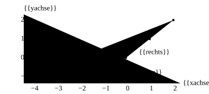

Rechts von 0 liegen die Punkte auf einer geraden Linie, links biegen sie sanft ab und kommen der −1
immer näher. Mehr brauchst du nicht; für die Beispiele in diesem Anhang reicht diese Tabelle:

| Eingang | ELU macht daraus |
|---|---|
| 1 | 1 |
| 0 | 0 |
| −0,4 | −0,33 |
| −0,5 | −0,39 |
| −1 | −0,63 |
| −2 | −0,86 |
| −4 | −0,98 |

> **Für Neugierige:** Woher kommen die Zahlen links? Aus der **e-Funktion**, einem Schrumpfen um
> immer denselben Anteil: Jeder ganze Schritt nach links lässt gut ein Drittel übrig, wie bei einem
> Kuchen, von dem bei jedem Schritt knapp zwei Drittel gegessen werden. Bei −1 ist noch 0,368 übrig, bei
> −2 noch 0,135. ELU zieht davon 1 ab: 0,368 − 1 ≈ −0,63. Darum kommt ELU der −1 immer näher, ohne
> sie zu erreichen – der Kuchen wird nie ganz alle. Eine verbreitete andere Aktivierung setzt alle
> negativen Zahlen einfach auf 0; dann kann ein Neuron in einem Bereich landen, in dem es nichts mehr
> lernt. ELU wird links nie ganz flach und hat diesen „toten“ Bereich nicht.

### Schichten

Viele Neuronen nebeneinander, die alle dieselben Eingänge sehen, bilden eine **Schicht**. Mehrere
Schichten hintereinander ergeben ein Netz. Das Sprung-Netz der Ente sieht so aus:

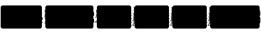

Die letzte Schicht verbiegt nicht, denn ein Servoziel darf jede Zahl sein, auch eine stark negative.
Zusammen hat das Netz fast **200 000 Regler**.

> **Für Neugierige:** So zählt man nach: Eine Schicht mit n Eingängen und m Neuronen hat n · m
> Gewichte und m Grundeinstellungen. 61 · 512 + 512 · 256 + 256 · 128 + 128 · 14 = 196 864 Gewichte,
> dazu 910 Grundeinstellungen, zusammen 197 774 Regler.

### Der Start: Zufall, aber klein

Bevor gelernt wird, müssen die Regler irgendwo stehen. Alle auf 0 wäre fatal: Dann rechneten alle
Neuronen einer Schicht genau dasselbe, bekämen dieselbe Korrektur und blieben für immer
**Zwillinge**. Darum stellt man sie zufällig ein, aber klein. Je mehr Eingänge ein Neuron hat, desto
kleiner die Startwerte – sonst würden die Summen von Schicht zu Schicht immer größer und
explodierten.

## A.2 Die Vorwärtsrechnung

**Vorwärts rechnen** heißt: die Eingabe vorn hineingeben, Schicht für Schicht weiterreichen, bis
hinten die Antwort herauskommt. Das ist alles, was ein fertiges Netz tut, 50-mal pro Sekunde.

> **Stell dir vor …** eine Eimerkette bei einem Brand. Der erste nimmt das Wasser, gibt es dem
> nächsten, der gibt es weiter, bis der letzte es ins Feuer kippt. Jede Schicht ist ein Mensch in
> der Kette: Sie nimmt, was die vorige ihr gibt, rechnet daran und reicht es weiter.

Im Bild des Sprung-Netzes oben ist das die Reihe von links nach rechts: Jede Schicht liefert ein
**Zwischenergebnis** an die nächste, die letzte die Servoziele.

Beim **Lernen** gibt es einen Unterschied: Dann merkt sich die Kette jedes Zwischenergebnis, wie
Zettel, die an jeder Station liegen bleiben. Die braucht man gleich, wenn der Fehler rückwärts
verteilt wird (A.5). Beim bloßen Handeln auf dem Roboter wirft man sie sofort weg.

> **Für Neugierige:** Kern ordnet die Rechnung so, dass der Rechner sie schnell erledigen kann,
> **ohne** dabei die Reihenfolge der Additionen zu verändern. Warum das wichtig ist, steht in A.11
> unter „Gleiches Ergebnis auf jedem Rechner“.

## A.3 Der Verlust: Wie schlecht bin ich gerade?

Damit ein Netz lernen kann, braucht es eine Zahl, die sagt, wie falsch es liegt: den **Verlust**. Je
kleiner, desto besser. Lernen heißt dann einfach: den Verlust kleiner machen.

Der Klassiker ist der **mittlere quadratische Fehler**: Für jede Ausgabe den Abstand zum Zielwert
nehmen, mit sich selbst malnehmen („quadrieren“), dann den Durchschnitt bilden. Beispiel: Das Netz
sagt 0,5 und 2, richtig wäre 1 und 1. Die Abstände sind −0,5 und 1; quadriert 0,25 und 1;
Durchschnitt **0,625**. Das Quadrieren hat zwei Vorteile: Ein Fehler nach unten zählt so viel wie
einer nach oben, und große Fehler zählen besonders viel (doppelter Abstand, vierfacher Verlust).

Diesen Verlust benutzt der Lehrer, wenn das Netz ein Vorbild nachahmt (A.9).

> **Stell dir vor …** der Verlust ist eine Landschaft. Jede Stellung aller Regler ist ein Ort, der
> Verlust ist die Höhe dort. Du willst ins tiefste Tal. Nur hat diese Landschaft nicht zwei
> Himmelsrichtungen wie eine echte, sondern fast 200 000 – eine für jeden Regler. Und es gibt keine
> Karte. Du stehst im **dichten Nebel** und spürst nur, wie steil der Boden unter deinen Füßen ist.

## A.4 Gradientenabstieg: im Nebel bergab

### Die Grundidee

Im Nebel spürst du nur die **Steigung** unter deinen Füßen: Wohin geht es bergauf, und wie steil?
Also machst du einen Schritt in die Gegenrichtung, bergab. Die Steigung für alle Regler zusammen
heißt **Gradient**. Die Schrittlänge heißt **Lernrate**.

```
 neuer Regler = alter Regler − Lernrate × Steigung
```

Wie misst man eine Steigung? Ganz ohne höhere Mathe: ein winziges Stück zur Seite gehen und schauen,
wie viel höher man dann steht. Steigung = Höhenunterschied geteilt durch die Schrittlänge.

**Ein Tal zum Ausprobieren.** Ein einziger Regler r, und der Verlust ist r · r (kurz **r²**, „r
hoch 2“). Das ist ein Tal mit dem tiefsten Punkt bei r = 0.

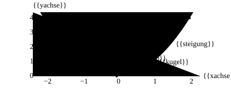

Steht der Regler bei 1, ist der Verlust 1 · 1 = 1. Ein Hundertstel weiter, bei 1,01, ist er
1,01 · 1,01 = 1,0201. Der Unterschied 0,0201 geteilt durch 0,01 ergibt etwa **2**. So bekommt man
an jeder Stelle die Steigung, und für dieses Tal kommt immer „zweimal r“ heraus:

| Regler r | Verlust r² | Steigung dort |
|---|---|---|
| −2 | 4 | −4 (bergab nach rechts) |
| −1 | 1 | −2 |
| 0 | 0 | 0 (ganz unten) |
| 1 | 1 | 2 (bergab nach links) |
| 2 | 4 | 4 |

Jetzt laufen wir los, von r = 1 aus, mit zwei verschiedenen Lernraten:

| Schritt | Lernrate 0,1 | Lernrate 1,1 |
|---|---|---|
| Start | 1 | 1 |
| 1 | 1 − 0,1 · 2 = 0,8 | 1 − 1,1 · 2 = −1,2 |
| 2 | 0,64 | 1,44 |
| 3 | 0,512 | −1,728 |

Mit 0,1 geht es brav ins Tal. Mit 1,1 springst du jedes Mal über das Tal hinweg, landest auf der
anderen Seite höher als vorher und schaukelst dich auf – wie eine Kugel, die zu fest angestoßen wird.
Die Grenze liegt in diesem Tal genau bei Lernrate 1: Dann springt die Kugel ewig zwischen 1 und −1
hin und her, darunter kommt sie unten an, darüber schaukelt sie sich auf. Zu kleine Schritte dagegen
kommen kaum voran. Die Lernrate ist deshalb einer der wichtigsten Regler überhaupt.

### Häppchen statt alles: Minibatches und Epochen

Die genaue Steigung über **alle** Übungsbeispiele auszurechnen, dauert lange. Also schätzt man sie an
einer kleinen, zufälligen Handvoll, einem **Minibatch**, und macht dafür viele kleine Schritte.

> **Stell dir vor …** eine Umfrage. Wer fünf Leute fragt, bekommt ein wackeligeres Ergebnis als bei
> tausend – aber er ist viel schneller fertig und kann öfter fragen.

Kleine Häppchen geben also eine wackeligere Richtung. Das hat das Sprungtraining der Ente gespürt.
Beim Üben mit Belohnung (A.10) sind die Übungsbeispiele das, was die Enten erlebt haben. Üben nur
wenige Dutzend Enten gleichzeitig, gibt es pro Runde wenig Erlebtes – die Häppchen werden klein und
die Richtung entsprechend unruhig. Einmal alle Daten durchgehen heißt **Epoche**.

### Die Notbremse

Ein einzelnes verrücktes Beispiel kann eine riesige Steigung erzeugen und das Netz mit einem einzigen
Schritt ruinieren. Darum wird die Schrittlänge nach oben begrenzt: Die **Richtung** bleibt, aber zu
große Schritte werden auf eine Höchstlänge gekürzt.

> **Stell dir vor …** ein Auto mit Geschwindigkeitsbegrenzer, das sich nie schneller als 130 fahren
> lässt. Lenken darfst du frei, nur die Geschwindigkeit hat eine Obergrenze.

## A.5 Backpropagation: Wer ist schuld?

Für jeden der 200 000 Regler braucht man die Steigung: „Wenn ich diesen Regler ein bisschen drehe,
wie ändert sich der Verlust?“ Jeden Regler einzeln anzustupsen und alles neu zu rechnen, hieße
200 000-mal die ganze Rechnung. **Backpropagation** (Rückwärtsverteilung) schafft es in einem
einzigen Durchgang von hinten nach vorn.

> **Stell dir vor …** ein Staffellauf ist verloren. Der Trainer fragt die Schlussläuferin: „Wie viel
> hast du verloren?“ Sie antwortet und gibt die Frage an die Läuferin vor ihr weiter, anteilig nach
> deren Beitrag. So wandert die Schuld vom Ziel bis zum Start, und jede weiß am Ende, was sie
> verbessern muss.

So funktioniert es: Am Ausgang ist klar, wie falsch die Antwort war. Diesen Fehler reicht man Schicht
für Schicht nach vorn weiter. Jede Schicht gibt ihn anteilig weiter – viel an die Regler, die viel
zur Antwort beigetragen haben, wenig an die anderen. Wie viel jemand beigetragen hat, steht auf den
Zetteln, die die Vorwärtsrechnung liegen gelassen hat (A.2). Die Rechenregel dahinter heißt
**Kettenregel**; wer mag, rechnet sie unten an einem Mini-Netz nach.

Das Ergebnis eines kleinen Beispiels in Worten: Ein Mini-Netz liegt anfangs mit einem Verlust von
**1,656** ziemlich daneben. Nach einem einzigen Rückwärtsdurchgang und einem Schritt bergab ist der
Verlust fast **0**. Bei echten Netzen mit vielen Beispielen, die sich teilweise widersprechen, geht
es dagegen in winzigen Schritten voran.

### Für Nachrechner: das Mini-Netz von Hand

Ein Eingang x = 1, ein Neuron mit ELU, ein Ausgang ohne Verbiegen, Ziel 1. Die Regler: erstes
Gewicht 0,5, erste Grundeinstellung −1, zweites Gewicht 2, zweite Grundeinstellung 0,5.

**Vorwärts:** Summe 0,5 · 1 − 1 = −0,5. ELU aus der Tabelle: **−0,393**. Ausgang 2 · (−0,393) + 0,5
≈ −0,287. Verlust (−0,287 − 1)² ≈ **1,656**.

**Rückwärts.** Eine Regel trägt alles: Die Schuld eines Gewichts ist der Fehler, der bei ihm
ankommt, mal das, was durch dieses Gewicht hindurchging.

| Was | Rechnung | warum so | Wert |
|---|---|---|---|
| Fehler am Ausgang | 2 · (−0,287 − 1) | Steigung des Quadrats (A.4) | −2,574 |
| Schuld 2. Gewicht | −2,574 · (−0,393) | × sein Eingang | 1,013 |
| Schuld 2. Grundeinst. | −2,574 · 1 | sie zählt immer voll | −2,574 |
| ans Neuron weiter | −2,574 · 2 | × das 2. Gewicht | −5,148 |
| Steigung der ELU | −0,393 + 1 | siehe unten | 0,607 |
| Fehler im Neuron | −5,148 · 0,607 | × Steigung der ELU | −3,122 |
| Schuld 1. Gewicht | −3,122 · 1 | × sein Eingang x = 1 | −3,122 |
| Schuld 1. Grundeinst. | −3,122 · 1 | sie zählt immer voll | −3,122 |

Zwei Kniffe stecken darin. Erstens: Der Fehler am Ausgang ist die Steigung des Quadrats – dieselbe
Regel „zweimal Abstand“ wie im Tal aus A.4. Zweitens: Im gestauchten Bereich ist die Steigung der
ELU genau „Ausgabe plus 1“ – man kann sie also aus dem gemerkten Zwischenergebnis ablesen. Und weil
der Eingang x = 1 ist, haben erstes Gewicht und erste Grundeinstellung dieselbe Schuld.

**Ein Schritt bergab** mit Lernrate 0,1, für jeden Regler: neuer Wert = alter Wert − 0,1 × Schuld.

| Regler | alt | − 0,1 × Schuld | neu |
|---|---|---|---|
| 2. Gewicht | 2 | − 0,101 | 1,899 |
| 2. Grundeinstellung | 0,5 | + 0,257 | 0,757 |
| 1. Gewicht | 0,5 | + 0,312 | 0,812 |
| 1. Grundeinstellung | −1 | + 0,312 | −0,688 |

**Noch einmal vorwärts:** Die Summe ist jetzt 0,812 − 0,688 = 0,124 (positiv, ELU lässt sie
stehen), der Ausgang 1,899 · 0,124 + 0,757 ≈ 0,99, der Verlust fast **0** (ohne Runden gerechnet
etwa 0,00004).

> **Für Neugierige:** Ob die Rückwärtsrechnung stimmt, prüft Kern genau auf die langsame Art aus dem
> ersten Absatz: einen Regler ein winziges Stück hoch- und runterdrehen und schauen, wie sich der
> Verlust ändert. Beide Wege müssen dieselbe Steigung liefern.

## A.6 Adam: der kluge Wanderer

Einfaches Bergabgehen hat zwei Schwächen: Alle Regler bekommen dieselbe Lernrate, obwohl manche
Steigungen riesig und andere winzig sind, und jeder Wackler im Gelände bringt den Wanderer aus dem
Tritt. **Adam** ist ein klügeres Verfahren. Es merkt sich für jeden Regler zwei Dinge:

- die **übliche Richtung** der letzten Schritte – das gibt Schwung und glättet Wackler,
- die **übliche Größe** der letzten Steigungen.

Beides sind **gleitende Durchschnitte**: Durchschnitte der letzten Schritte, bei denen neuere mehr
zählen als ältere, so wie man beim Wetter eher auf die letzten Tage achtet als auf den letzten Monat.
Adam teilt dann die übliche Richtung durch die übliche Größe. Dadurch macht jeder Regler ähnlich
große Schritte, egal ob seine Steigungen winzig oder riesig sind.

**Beispiel:** Im allerersten Schritt sind Richtung und Größe genau gleich groß. Der Schritt ist also
genau so lang wie die Lernrate, **ob die Steigung 0,000001 oder 1000 ist**.

> **Stell dir vor …** ein erfahrener Wanderer im Nebel. Er macht immer gleich große, ruhige Schritte
> und achtet vor allem auf die Richtung. Ein einzelner Stein unter dem Schuh bringt ihn nicht vom Weg.

Am Anfang ist Adams Gedächtnis noch leer; ohne Ausgleich wären die ersten Schritte viel zu klein.
Adam rechnet das heraus – darum ist schon der erste Schritt so lang wie die Lernrate.

Jeder, der lernt, bekommt sein **eigenes** Adam-Gedächtnis: der Actor, der Kritiker (A.11) und das
Nachahmen (A.9) je eines. Wie drei Schüler mit je einem eigenen Notizbuch – was einer sich notiert,
bringt die anderen nicht durcheinander.

Adams Gedächtnis gehört zum Spielstand des Trainings: Wird ein unterbrochener Lauf fortgesetzt,
macht er genau die Schritte, die ein ununterbrochener gemacht hätte.

## A.7 Normalisierung: alle auf Augenhöhe

Die 61 Messwerte der Ente sind sehr verschieden groß: Winkel um ein paar Zehntel, Geschwindigkeiten
zweistellig, die Richtung nach unten zwischen −1 und 1. Die großen würden die Summen beherrschen und
das Lernen bremsen. Darum rechnet man jeden Messwert auf ein gemeinsames Maß um: **„Wie weit liegt
er über oder unter dem Üblichen?“** Das erledigt der **Normalisierer**.

> **Stell dir vor …** Schulnoten aus verschiedenen Ländern: Eine 2 in Deutschland, eine 15 von 20 in
> Frankreich, ein „B“ in England. Erst wenn man alle in ein gemeinsames System umrechnet, kann man sie
> vergleichen.

Dafür braucht man zwei Zahlen pro Messwert: den **Durchschnitt** und die **Streuung**. Die Streuung
sagt, wie weit die Werte üblicherweise vom Durchschnitt abweichen.

**Beispiel:** Eine Gelenkgeschwindigkeit ist im Durchschnitt 2 und weicht üblicherweise um 4 davon
ab. Der Wert 10 liegt 8 über dem Durchschnitt, also zwei übliche Abweichungen darüber: umgerechnet
**2**. Der Wert 2 wird zu 0, der Wert −2 zu −1.

Weil eine bessere Ente andere Lagen erlebt, führt der Lehrer Durchschnitt und Streuung beim Üben
laufend nach.

Wichtig: **Der Normalisierer gehört fest zum Netz.** Ohne genau diese Umrechnung versteht das Netz
seine Eingaben nicht mehr. Darum steht er im fertigen Netz ganz vorn (A.14).

## A.8 Auswendiglernen gegen Verstehen

Ein Netz mit 200 000 Reglern kann eine kleine Menge Übungsaufgaben **auswendig lernen**: perfekte
Antworten auf die bekannten Aufgaben, Unsinn bei neuen. Das heißt **Überanpassung**. Gegenmittel:
mehr und vielfältigere Übungsdaten, Prüfen auf Aufgaben, die nie zum Lernen dienten, rechtzeitig
aufhören (das beste Netz nehmen, nicht das letzte) und kleinere Netze.

> **Stell dir vor …** ein Schüler, der die Lösungen des Übungsblatts auswendig kann. In der
> Klassenarbeit mit neuen Zahlen hilft ihm das gar nichts.

In der Robotik heißt Überanpassung meist: Das Netz hat sich auf **genau diese Simulation**
eingestellt. Das Gegenmittel ist Variation (A.12). Der Lehrer prüft jedes Netz deshalb auf dem
sauberen **und** auf variierten Robotern, und dass am Ende die beste Runde gewählt wird, ist das
„rechtzeitige Aufhören“.

## A.9 Lernen durch Nachmachen

### Mit Lösungsheft: Verhaltensklonen

Beim **überwachten Lernen** gibt es zu jeder Aufgabe die richtige Antwort, wie ein Arbeitsheft mit
Lösungen. Das Netz macht den Verlust zwischen seiner Antwort und der Lösung klein, fertig. In der
Robotik ist die „richtige Antwort“ das, was ein Experte tut: Man lässt ihn vormachen, schreibt Paare
auf (was er sieht, was er tut) und trainiert das Netz darauf. Das heißt **Verhaltensklonen**. Im
Lehrer heißt der Experte **Vorbild**.

### Die Falle: Lagen, die man nie gesehen hat

> **Stell dir vor …** du lernst Fahrradfahren nur, indem du jemandem zusiehst, der immer perfekt in
> der Mitte des Wegs fährt. Dann fährst du selbst, kommst ein paar Zentimeter vom Weg ab – und weißt
> nicht weiter, denn so eine Lage hast du nie gesehen. Du korrigierst falsch, kommst noch weiter ab,
> und landest im Gebüsch.

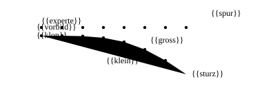

Fachleute nennen das **Verteilungsverschiebung**: Beim Selberfahren gerät das Netz in Lagen, die es
beim Lernen nie gesehen hat, und kleine Fehler schaukeln sich auf. Und zwar schneller als die Fahrt
lang ist: Bei doppelt so langer Fahrt können es bis zu viermal so viele Fehler werden.

### DAgger: Der Schüler fährt, der Lehrer kommentiert

**DAgger** dreht den Spieß um. Der Schüler fährt selbst, und das Vorbild sagt in jedem Moment, was
**es** an dieser Stelle getan hätte.

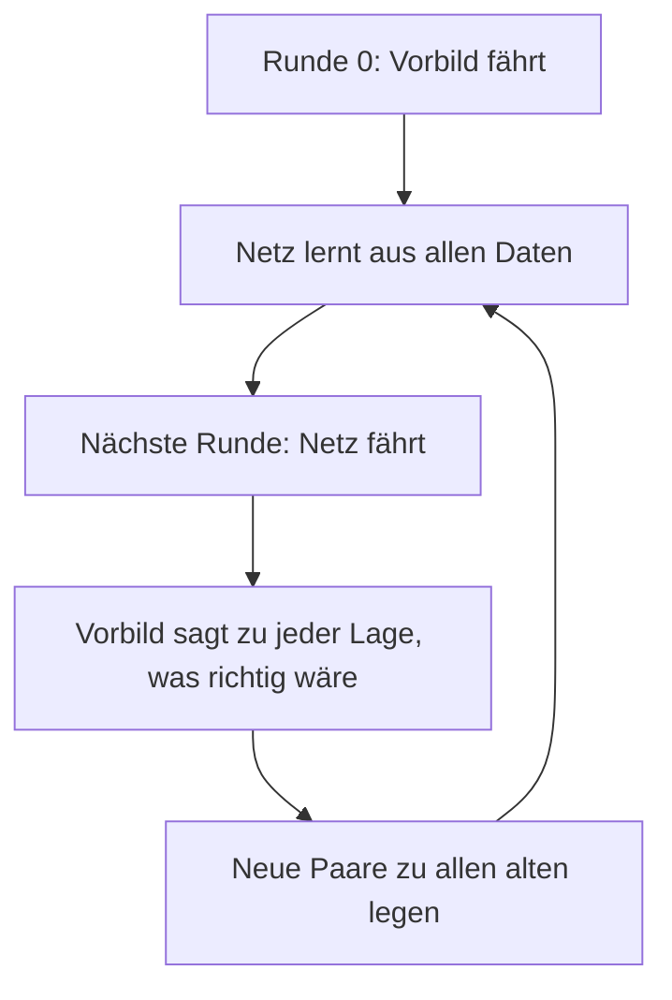

So entstehen Übungsdaten genau dort, wohin der Schüler wirklich gerät, samt der richtigen Antwort
dafür. Damit auch Lagen knapp neben seiner Bahn vorkommen, fährt das Netz mit etwas Zufall. Beim
Sprung der Ente springt das Netz nach 7 Runden zum ersten Mal echt.

Eine Bedingung macht DAgger erst möglich: Das Vorbild darf nur sehen, was auch das Netz sieht.

> **Stell dir vor …** der Fahrlehrer sagt „Jetzt bremsen!“, weil er hinter der Hecke ein Kind
> gesehen hat. Der Schüler sieht das Kind nicht. Er kann diese Regel nicht lernen – für ihn kommt das
> Bremsen aus dem Nichts.

## A.10 Lernen durch Belohnung

Verhaltensklonen braucht einen Experten. Gibt es keinen, oder soll das Netz besser werden als er,
hilft **Reinforcement Learning** (bestärkendes Lernen): Man sagt nicht, **wie** etwas geht, sondern
nur, **ob** es gut war.

> **Stell dir vor …** Hundetraining. Du sagst dem Hund nicht, wie er seine Muskeln bewegen soll. Er
> probiert etwas, und wenn es gut war, gibt es ein Leckerli. Mit der Zeit macht er öfter, was
> Leckerlis bringt.

### Der Kreislauf

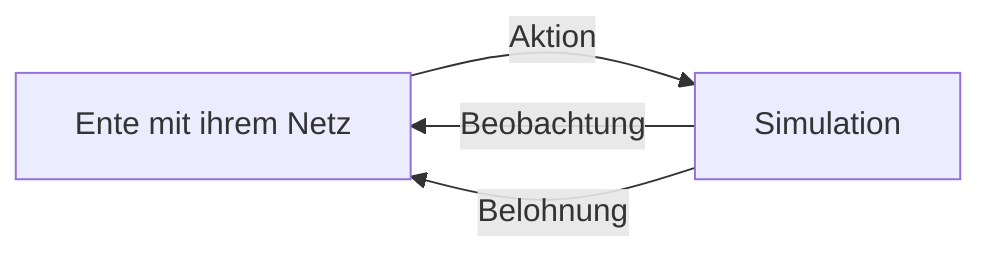

Der Handelnde – Fachwort **Agent**, hier die Ente mit ihrem Netz – sieht eine **Beobachtung**, wählt
eine **Aktion**, und die Welt antwortet mit einer neuen Lage und einer **Belohnung**. Bei der Ente
dreht sich dieser Kreis einmal pro Takt, also 50-mal pro Sekunde, bis die Episode durch einen Sturz
oder durch Zeitablauf endet.

> **Für Neugierige:** Fachleute nennen diesen Kreislauf einen Markov-Entscheidungsprozess. „Markov“
> heißt: Was als Nächstes passiert, hängt nur von der Lage jetzt ab, nicht davon, wie man dorthin
> gekommen ist.

### Was die Ente weiß und was nicht

Die Ente kennt ihre Lage nicht vollständig. Sie sieht nur, was ihre Sensoren melden, und die
rauschen und hinken etwas hinterher: Gelenkwinkel, einen Drehsensor im Rumpf, die Richtung nach
unten, ihre letzte Aktion, den Befehl. Ihre wahre Höhe über dem Boden oder ihre Geschwindigkeit im
Raum sieht sie **nicht**. Die letzte Aktion in der Beobachtung wirkt wie ein kleines Gedächtnis.

### Belohnung und Return

Die **Belohnung** ist eine Zahl pro Takt und die einzige Stelle, an der man der Ente sagt, was sie
tun soll. Meist ist sie eine Summe einzelner Posten, jeder mit eigenem Gewicht – beim Sprung etwa
fürs In-der-Luft-Sein, für die Landung und fürs Aufrechtbleiben; die Liste steht in
[Kapitel 14](14-lehrer.md). Und die Ente nimmt die Belohnung **wörtlich**.

> **Achtung, Falle!** In frühen Läufen lernte die Ente, auf dem Schwanz zu sitzen, Hechtsprünge zu
> machen oder sich abzustützen – weil die Belohnung das zuließ. Jede Lücke musste mit einer
> strengeren Regel geschlossen werden ([Kapitel 15](15-eigene-modelle.md)).

Der **Return** ist die **Gesamtpunktzahl ab jetzt**: alle künftigen Belohnungen zusammen. Damit sie
nicht ins Unendliche wächst, zählen spätere Belohnungen weniger. Jeder Takt in die Zukunft nimmt
die Belohnung mit 0,99 mal, kostet also ein Prozent.

> **Stell dir vor …** ein Eis in der Sonne, das jede Sekunde ein Prozent kleiner wird. Ein Eis jetzt
> ist mehr wert als dasselbe Eis, das du erst in zwei Minuten bekommst.

Wie viel bleibt nach vielen Takten übrig? Dafür nimmt man 0,99 so oft mit sich selbst mal, wie Takte
vergehen; kurz schreibt man das mit einer **Hochzahl**: 0,99¹⁰⁰ heißt „100-mal hintereinander mit
0,99 malnehmen“.

| Takte in der Zukunft | Sekunden | so viel zählt die Belohnung noch |
|---|---|---|
| 1 | 0,02 | 0,99 |
| 10 | 0,2 | 0,90 |
| 50 | 1 | 0,61 |
| 100 | 2 | 0,37 |
| 300 | 6 | 0,05 |

Die Ente „schaut“ also grob 100 Takte voraus, das sind 2 Sekunden: etwa so lang wie ein ganzer
Sprung.

> **Wusstest du?** Den Return kann man rückwärts ausrechnen: Gesamtpunktzahl ab jetzt = Belohnung
> jetzt + 0,99 × Gesamtpunktzahl ab dem nächsten Takt. Man fängt am Ende der Episode an und läuft
> zurück zum Anfang.

### Policy, Wert und Vorteil

Die **Policy** ist die Entscheidungsregel der Ente: Beobachtung rein, Aktion raus – also ihr Netz.
Zum Lernen ist sie **etwas zufällig** (gleich mehr dazu); auf dem Roboter nimmt man nur ihre beste
Idee.

Der **Wert** einer Lage sagt: „Wie viele Punkte erwarte ich ab hier, wenn ich mache wie immer?“ Der
**Vorteil** einer Aktion sagt: „War sie besser oder schlechter als das, was ich hier sonst tue?“
Positiv heißt besser. Genau das braucht das Lernen: **Mach mehr von dem, was besser war als üblich.**

**Beispiel:** An dieser Stelle bekommt die Ente normalerweise noch 5 Punkte. Diesmal hat sie etwas
anderes probiert und 7 bekommen. Vorteil: **+2**. Diese Aktion soll häufiger werden.

### Sturz oder Zeitablauf?

Eine Episode kann auf zwei grundverschiedene Arten enden. Nach einem **Sturz** gibt es keine Zukunft
mehr, ihr Wert ist 0. Beim **Zeitablauf** stünde die Ente noch, das Zeitlimit ist nur eine
Eigenschaft des Trainings. Wer beides gleich behandelt, bringt dem Netz bei, dass Anstrengung kurz
vor Schluss sinnlos ist. Der Lehrer unterscheidet daher und schätzt beim Zeitablauf, wie viele Punkte
die Ente noch bekommen hätte.

### Wie lernt die Policy? Würfeln und verschieben

Die Belohnung hängt über die ganze Physik von der Aktion ab. Eine Steigung wie in A.4 bekommt man
hier nicht: Ein Fuß berührt den Boden oder nicht, die Ente fällt oder nicht – die Punkte springen,
statt sanft zu steigen. Und für 200 000 Regler müsste man jedes Mal die ganze Episode neu spielen.
Der Trick: Die Ente **würfelt ein wenig**. Das Netz sagt „ungefähr so“, und die Ente weicht jedes
Mal ein bisschen zufällig davon ab. War eine Abweichung gut (positiver Vorteil),
verschiebt man das „ungefähr so“ in ihre Richtung. War sie schlecht, weg davon.

Wie weit sie abweicht, folgt der **Glockenkurve** (Fachwort **Normalverteilung**): Kleine
Abweichungen sind häufig, große selten. Wie breit die Glocke ist, sagt eine einzige Zahl, die
**Streuung σ** (gesprochen „Sigma“) – dieselbe Idee wie die Streuung in A.7: wie weit die Werte
üblicherweise von der Mitte abweichen.

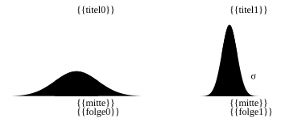

| Bereich um „ungefähr so“ | so viele Versuche landen darin |
|---|---|
| ± 1 σ | etwa 2 von 3 |
| ± 2 σ | etwa 19 von 20 |
| ± 3 σ | fast alle |

**Beispiel:** Das Netz sagt für ein Knie 0,2, und σ ist 0,1. Dann landen etwa zwei von drei
Versuchen zwischen 0,1 und 0,3, fast alle zwischen −0,1 und 0,5.

σ ist selbst ein Regler, den das Training mitlernt, für jeden Servo eigens. Am Anfang ist die Glocke
breit (viel Neugier), später wird sie schmaler. Beim Sprung wird sie nach dem Nachahmen bewusst
schmal gestellt, damit ein Netz, das schon springt, nicht alles wieder verwürfelt. Jede Ente würfelt
mit ihrem **eigenen**, festen Zufall, der nur vom Seed und ihrer Nummer abhängt.

### Entropie: die Neugier am Leben halten

Ohne Gegenmaßnahme wird die Glocke oft zu schnell schmal: Die Ente hört auf, Neues auszuprobieren,
und bleibt bei der ersten halbwegs brauchbaren Lösung hängen. Dagegen hilft ein kleiner Bonus für
Neugier. Gemessen wird die Neugier mit der **Entropie**: einer Zahl, die sagt, wie breit die Ente
ausprobiert.

> **Stell dir vor …** ein Koch, der immer nur sein erstes halbwegs gutes Rezept kocht. Ein kleiner
> Bonus fürs Ausprobieren hält ihn offen für Besseres – ohne dass er jeden Tag etwas völlig Neues
> auf den Tisch bringt.

| Glocke | wie breit probiert die Ente | Entropie |
|---|---|---|
| σ = 1 | sehr breit | hoch |
| σ = 0,3 | mittel | mittel |
| σ = 0,1 | eng um ihre beste Idee | niedrig |

Der Bonus ist klein. Er soll das Schmalerwerden nur bremsen, nicht verhindern.

## A.11 Actor, Kritiker und PPO

### Zwei Netze, eine Mannschaft

Für den Vorteil muss man wissen, wie viele Punkte an einer Stelle **üblich** sind, also ihren Wert.
Den schätzt ein zweites Netz, der **Kritiker**. Das handelnde Netz heißt **Actor**. (Achtung: Im
Studio heißt „Actor“ etwas anderes, nämlich ein Ding im Level. Hier ist immer das handelnde Netz
gemeint.)

> **Stell dir vor …** eine Sportlerin und ihre Trainerin. Die Sportlerin turnt (Actor). Die
> Trainerin turnt nie selbst, sagt aber nach jeder Übung: „Das war besser als sonst“ oder
> „schlechter als sonst“ (Kritiker).

Beide lernen gleichzeitig: Der Kritiker lernt, die Gesamtpunktzahl vorherzusagen – mit demselben
Verlust wie beim Nachahmen (A.3), dem Abstand zwischen seiner Schätzung und den tatsächlich
erreichten Punkten. Der Actor lernt aus den Vorteilen, die der Kritiker ausrechnet. Nach dem
Nachahmen ist der Actor schon gut, der Kritiker weiß aber noch nichts; seine Urteile wären Zufall.
Deshalb lernt anfangs eine Weile **nur der Kritiker** („Kritiker zuerst“).

### GAE: Ein schlechter Schritt kann gut gewesen sein

Wie gut war eine einzelne Aktion wirklich? Manchmal sieht ein Schritt für sich allein schlecht aus,
führt aber in eine Lage, von der aus alles besser läuft.

> **Stell dir vor …** beim Schach opferst du eine Figur. Für sich allein ein Verlust. Drei Züge
> später setzt du matt. Im Rückblick war das Opfer der beste Zug der Partie.

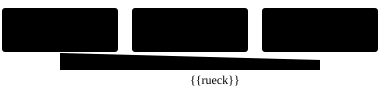

Genau das macht **GAE** (Fachwort für „gut geschätzter Vorteil“). Man geht **rückwärts** durch die
Zeit: Jeder Schritt bekommt zuerst seine eigene Überraschung – „Wie viel besser oder schlechter als
erwartet war es gleich danach?“ – und dazu einen Teil dessen, was danach noch kam. Je weiter weg die
Folgen, desto weniger zählen sie.

Warum nicht einfach alle echten Punkte bis zum Ende zusammenzählen? Weil die vom Zufall vieler
späterer Schritte verwackelt sind. Und warum nicht nur dem Kritiker vertrauen? Weil der sich irren
kann. GAE mischt beides: ein bisschen Vertrauen in den Kritiker, ein bisschen echte Erfahrung.

> **Für Neugierige:** Wie stark spätere Folgen zählen, regelt ein zweiter Abwertungsfaktor neben
> den 0,99, beim Lehrer 0,95. Am Ende werden alle Vorteile noch auf ein gemeinsames Maß gebracht,
> wie beim Normalisierer (A.7). Die ganze Rechnung steht im blauen Buch, Anhang A.

### Warum zu große Schritte gefährlich sind

Die Erfahrung stammt vom **alten** Verhalten. Ändert man das Netz auf einmal stark, passt die
Erfahrung nicht mehr zu ihm, und ein gutes Verhalten kann in einem einzigen Schritt kaputtgehen. Dann
sammelt die Ente schlechte Erfahrung, aus der sie sich kaum erholt. Mehrere Epochen auf denselben
Daten – eigentlich praktisch, weil man die Daten besser ausnutzt – machen es noch schlimmer.

> **Stell dir vor …** eine Lehrerin bekommt nach einer einzigen Stunde Rückmeldung und wirft daraufhin
> ihren ganzen Unterrichtsstil um. Die Rückmeldung galt aber für den alten Stil, nicht für den neuen.

### PPO: Verbessern mit Gurt

**PPO** ist das Lernverfahren des Lehrers. Seine Idee: **Pro Runde darf sich das Verhalten nur ein
bisschen ändern.** Gemessen wird das an einem einfachen Verhältnis: Wie viel öfter wählt das neue Netz
eine bestimmte Aktion als das alte? 1 heißt „gleich oft“, 1,2 heißt „20 Prozent öfter“.

> **Stell dir vor …** ein Hund an der Leine. Er darf schnuppern, wohin er will, aber nur so weit,
> wie die Leine reicht. Bei der nächsten Runde wird die Leine wieder vom neuen Standort aus gemessen.

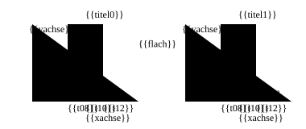

- Eine **gute** Aktion (positiver Vorteil) darf pro Runde höchstens 20 Prozent häufiger werden.
  Darüber hinaus wird nicht mehr weiter verstärkt.
- Eine **schlechte** Aktion darf höchstens 20 Prozent seltener werden. Darüber hinaus wird nicht mehr
  weiter abgeschwächt.

Die Leine bremst nur, wenn das Netz schon in die gewünschte Richtung gelaufen ist. Läuft es in die
falsche Richtung – wählt es eine schlechte Aktion sogar öfter als vorher –, zieht die Leine nie, und
das wird immer zurückkorrigiert.

> **Wusstest du?** PPO ist absichtlich vorsichtig, aber nur in eine Richtung. Verbesserungen werden
> gedeckelt, die Korrektur von Fehlern nie. Wählt das neue Netz eine **schlechte** Aktion öfter als
> das alte (Vorteil negativ, Verhältnis 1,3), wird das immer korrigiert.

> **Für Neugierige:** Zusätzlich passt der Lehrer die Lernrate selbst an: Ändert sich das Verhalten
> pro Runde zu stark, wird sie kleiner, bleibt es sehr ruhig, wird sie größer. Und auch der Kritiker
> hat eine Leine: Seine Schätzung darf sich pro Runde nur ein Stück vom alten Wert entfernen.

### Eine Trainingsrunde im Ganzen

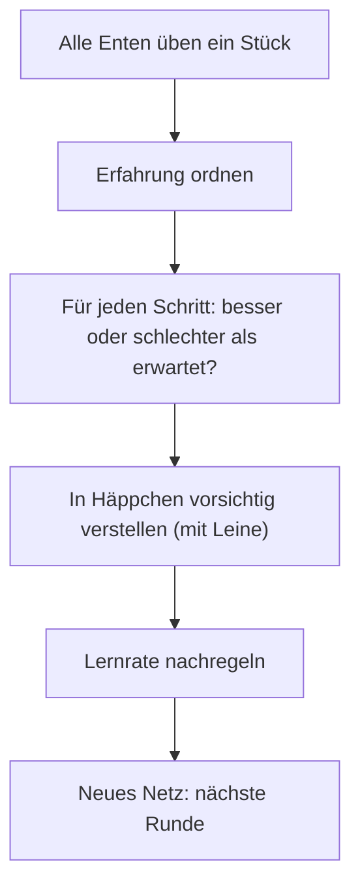

Eine solche Runde heißt **Iteration**. Üben und Lernen sind getrennt: Die **Sammler** brauchen nur das
aktuelle Netz und liefern ihre Erfahrung ab, der **Lerner** verbessert daraus das Netz. Deshalb
können die Sammler auf mehreren Rechenkernen gleichzeitig arbeiten. Die genauen Einstellungen stehen
im blauen Buch, Anhang A.

### Gleiches Ergebnis auf jedem Rechner

Kommazahlen im Computer sind tückisch. Der Rechner merkt sich jede Kommazahl nur mit begrenzt vielen
Stellen und rundet nach jedem Rechenschritt – wie ein Taschenrechner mit kurzem Display. Je nach
Reihenfolge wird an anderer Stelle gerundet. Darum ergibt (0,1 + 0,2) + 0,3 im Rechner nicht exakt
dasselbe wie 0,1 + (0,2 + 0,3); in der allerletzten Stelle unterscheiden sie sich. Zählt man beim
Lernen in einer Reihenfolge zusammen, die davon abhängt, wie viele Rechenkerne mithelfen, bekommt
man auf 2 und auf 16 Kernen verschiedene Netze. Kern verhindert das:

- Jede Ente hat ihren eigenen, festen Würfel, der nur von ihrer Nummer und dem Seed abhängt.
- Zusammengezählt wird immer in derselben Reihenfolge, egal wie viele Kerne helfen.
- Kern bringt eigene Rechenfunktionen mit, die auf jedem Gerät gleich runden.
- Kern verbietet dem Rechner Abkürzungen, bei denen manche Prozessoren anders runden als andere.

Das Ergebnis: gleicher Seed, gleich viele Enten, **dasselbe Netz** – auf dem Laptop wie im Browser
auf dem Handy ([Kapitel 14](14-lehrer.md), [Anhang C](C-grundlagen-physik.md)).

## A.12 Von der Simulation in die Wirklichkeit

Ein Netz, das in der Simulation gelernt hat, trifft auf einen Roboter, der immer ein bisschen anders
ist: ungenau gemessene Massen, streuende Servos, wechselnde Böden, rauschende Sensoren. Diese
**Sim-to-Real-Lücke** zu überbrücken, ist die Kernaufgabe des Robotiklernens. Zwei Wege ergänzen
sich:

1. **Die Simulation der Wirklichkeit annähern:** genaue, an Messungen angepasste Modelle
   ([Kapitel 16](16-kalibrierung.md)).
2. **Das Netz unempfindlich machen:** Es übt in vielen leicht verschiedenen Welten, sodass die echte
   nur eine weitere ist. Das ist **Variation** (Fachwort Domänen-Randomisierung).

> **Stell dir vor …** du übst Tischtennis mal mit schwerem, mal mit leichtem Ball, mal auf rutschigem,
> mal auf stumpfem Boden, mal mit Brille, mal ohne. Am Turniertag ist dir egal, wie der Saal ist.

Drei Feinheiten helfen dabei:

- **Lehrpläne:** Manche Variation kommt erst nach und nach dazu, weil zu viel Chaos am Anfang
  verhindert, dass die Bewegung überhaupt entsteht. Wie beim Klavierüben: erst langsam, dann
  schneller; erst ohne Störung, dann mit. Beim Sprung kommen etwa die Schubse erst nach einigen
  hundert Runden dazu.
- **Was man nicht genau messen kann, wird variiert:** Zu jedem Servowert gehört eine Streuung, und
  das Training zieht jeden Servo daraus. So verlässt sich das Netz nicht auf Zahlen, die niemand
  genau kennt.
- **Der asymmetrische Kritiker:** Der Kritiker wird nur beim Üben gebraucht. Darum darf er mehr sehen
  als der Roboter, etwa die genaue Höhe des Rumpfs. Seine Urteile werden dadurch genauer – und auf
  den Roboter kommt ja nur der Actor.

Dazu kommt der **Warmstart**: Kerns Sprung beginnt nicht mit zufälligen Reglern, sondern als Pollens
velstand-Netz. Es kann also schon stehen und balancieren und muss nur noch den Sprung dazulernen.
Damit dabei nichts kaputtgeht, handelt das neue Netz am Anfang **exakt** wie das Original: Die neue
Eingabe, die das alte Netz nie kannte – die „Uhr“, die sagt, wo im Sprung die Ente gerade ist –,
startet mit Gewicht 0 und wird erst nach und nach genutzt. Und die Umrechnung der Messwerte
(der Normalisierer aus A.7) wird von velstand übernommen und bleibt fest – anders als sonst wird sie
hier nicht nachgeführt, damit das übernommene Können nicht verrutscht.

## A.13 Suchen ohne Steigung: CMA-ES

Manchmal kann man gar keine Steigung ausrechnen. Beim Sprung-Vorbild sind 15 Zahlen die Eingabe
(Zielwinkel des linken Beins zu fünf Zeitpunkten des Sprungs) und eine ganze Simulation mit Flug,
Landung und vielleicht Sturz die Bewertung; dazu ist sie verrauscht, weil jede Runde andere Roboter
trifft. Bei der Kalibrierung sollen 6 Servowerte so gewählt werden,
dass die Simulation Messungen nachspielt ([Kapitel 16](16-kalibrierung.md)).

Dann hilft Ausprobieren mit System: eine **Wolke** von Kandidaten um einen Mittelpunkt würfeln,
alle bewerten, den Mittelpunkt zu den Besseren schieben. **CMA-ES** lernt zusätzlich die **Form**
der Wolke.

> **Stell dir vor …** du suchst nachts mit Freunden den tiefsten Punkt eines Sees, jeder mit einem
> Senklot im eigenen Boot. Ihr verteilt euch, ruft eure Tiefen, und alle rudern zu denen mit den
> tiefsten Werten. Merkt ihr, dass der See in einer Richtung lang abfällt, verteilt ihr euch in diese
> Richtung weiter.

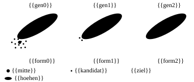

Pro Runde passiert grob:

1. Kandidaten aus der Wolke ziehen und bewerten.
2. Die bessere Hälfte zählt, die Besten am meisten.
3. Der Mittelpunkt wandert zu ihnen.
4. Ging es mehrere Runden in dieselbe Richtung, werden die Schritte größer; heben sie sich auf,
   kleiner.
5. Die Wolke streckt sich in die Richtungen, in denen es gut lief.

Zwei Kniffe machen das Verfahren verlässlich. Der Startpunkt wird zuerst bewertet, das Ergebnis ist
also nie schlechter als der Anfang. Und bei verrauschten Bewertungen nimmt man am Ende eher den
**Mittelpunkt** als den Besten: Der Beste hatte vielleicht nur Glück. Damit der Vergleich innerhalb
einer Runde gerecht ist, springen dort alle Versuche auf denselben Robotern
([Kapitel 14](14-lehrer.md)).

> **Für Neugierige:** Kern hat CMA-ES selbst geschrieben; es rechnet mit Kerns eigenem Zufall und
> liefert daher bei gleichem Seed immer dasselbe. Die Formeln stehen im blauen Buch, Anhang A.

## A.14 ONNX: das Netz zum Mitnehmen

Ein fertiges Netz muss raus aus dem Lehrer: ins Studio, auf den Roboter, in andere Programme. Dafür
gibt es ein gemeinsames Dateiformat für Netze, **ONNX**. Es beschreibt das Netz als Kette einfacher
Rechenbausteine, mit allen Reglerwerten in derselben Datei.

> **Stell dir vor …** ein PDF. Egal, mit welchem Programm ein Dokument geschrieben wurde – als PDF
> kann es jeder öffnen und es sieht überall gleich aus. ONNX ist das PDF für Netze: Der Roboter muss
> nicht wissen, womit das Netz trainiert wurde.

Die Kette für die Ente ist kurz, dieselbe wie in A.1:


Kern schreibt seine Netze genau im selben Format wie Pollen Robotics. Exportiert wird dabei nur das
„ungefähr so“ des Netzes, ohne Würfeln: **Auf dem Roboter wird nicht mehr ausprobiert.** Auch der
Kritiker bleibt zu Hause; er war nur Trainer.

> **Für Neugierige:** Kern braucht für den Export keine fremde Bibliothek, sondern hat einen eigenen,
> winzigen Schreiber. Zur Probe liest Kern jede Datei wieder ein und vergleicht. Einzelheiten im
> blauen Buch, Anhang A und Kapitel 14.

## A.15 Wie alles zusammenkommt

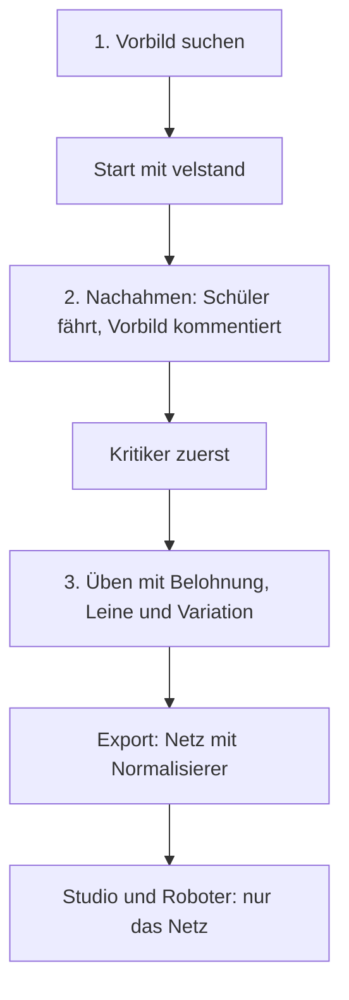

Die Leitlinie steht in Kerns Code, übersetzt: „Zur Laufzeit gibt es nur das Netz – das Vorbild
existiert nur, solange es lernt.“ Vorbild, Kritiker, Würfeln, Variation – alles ist **Gerüst**, das
beim Lernen hilft und danach abgebaut wird. Was bleibt, ist eine Umrechnung der Messwerte und ein
paar Schichten, die malnehmen, zusammenzählen und verbiegen. Und das reicht, damit eine Ente springt.

> **Probier's aus!** Öffne auf https://kernengine.de/ das Micro-Duck-Level über
> **Datei › Beispiel-Levels › Micro Duck** (File › Example Levels › Micro Duck), starte **Spielen**
> (Play), übernimm die Ente mit **F8** und drück die **7**. Jeder Servo bekommt in
> diesem Moment 50-mal pro Sekunde eine Zahl aus knapp 200 000 Reglern, die einmal reiner Zufall
> waren.

> **Probier's aus!** Öffne die Lehrer-Seite **kernengine.de/lehrer/** und wähle als Bewegung
> **Stehen (Schnelltest)**. Trag bei **Aktionsrauschen am Anfang** 1 ein und drück **Start**. Lass
> es ein paar Dutzend Iterationen laufen (der Zähler **Iteration** zeigt, wie weit es ist), drück
> **Pause** und merk dir die Kurve der Episodenlänge (wie lange die Enten durchhalten) und die Zahl
> **Aktionsrauschen**. Lade die Seite neu, trag 0,1 ein und wiederhole das mit ebenso vielen
> Iterationen. Was du erwarten kannst: Mit 1 ist die Glocke breit, die Enten probieren wild herum;
> mit 0,1 bleiben sie nah an ihrer Idee. Schau, wie sich die Zahl Aktionsrauschen beim Üben
> verändert – das ist σ, das mitlernt. Woran du „besser“ erkennst: Die Kurve der Episodenlänge
> steigt schneller Richtung 4 Sekunden, die Enten halten also früher bis zum Schluss durch. Welche
> Einstellung das schafft, findest du selbst heraus. Ein Lauf braucht etwas Geduld; der Tab muss
> dabei offen bleiben.

## Das nimmst du mit

- Ein neuronales Netz ist ein Mischpult mit vielen Reglern: malnehmen, zusammenzählen, verbiegen,
  Schicht für Schicht. Das Sprung-Netz hat fast 200 000 Regler.
- Lernen heißt, den Verlust zu verkleinern: im Nebel der Steigung nach bergab, mit der Lernrate als
  Schrittlänge.
- Backpropagation verteilt die Schuld rückwärts; Adam macht gleichmäßige, ruhige Schritte.
- Der Normalisierer bringt alle Messwerte auf Augenhöhe und gehört fest zum Netz.
- Nachahmen braucht DAgger: Der Schüler fährt, das Vorbild kommentiert.
- Lernen durch Belohnung: würfeln, und was besser war als üblich, wird häufiger. Die Belohnung wird
  wörtlich genommen.
- PPO lernt an der Leine; der Kritiker schätzt, was üblich ist.
- Variation, Lehrpläne und der asymmetrische Kritiker bauen die Brücke von der Simulation zur
  Wirklichkeit.

## Knobelecke

1. Ein Neuron hat die Eingänge 1 und 2, die Gewichte 0,5 und −1 und die Grundeinstellung 1. Was
   gibt es mit ELU aus? (Die Tabelle aus A.1 hilft.)
2. Warum wäre ein Netz ohne Verbiegen mit 100 Schichten nicht schlauer als eins mit einer?
3. Du gehst im Tal r² mit Lernrate 1,1 bergab. Was passiert?
4. Wie viel zählt eine Belohnung in 100 Takten im Vergleich zu einer jetzt?
5. PPO: Eine Aktion war schlecht (Vorteil negativ), aber das neue Netz wählt sie 1,3-mal so oft wie
   das alte. Wird das noch korrigiert?

### Lösungen

1. Summe: 0,5 · 1 − 1 · 2 + 1 = −0,5. Laut Tabelle macht ELU daraus etwa **−0,39**.
2. Ohne Verbiegen wird nur malgenommen und zusammengezählt; das ergibt hintereinander wieder nur
   eine gerade Linie. Erst das Verbiegen erlaubt krumme Zusammenhänge.
3. Der Regler springt jedes Mal über das Tal und landet immer höher: 1, −1,2, 1,44, −1,728 …
4. Etwa 0,37-mal so viel, gut ein Drittel (Tabelle in A.10).
5. Ja. PPO deckelt nur Verbesserungen, nie die Korrektur von Fehlern.

---

© 2026 Christian Heinrich Hohlfeld · Alle Rechte vorbehalten · [Impressum und Rechte](00-impressum.md)
